|Nazwa|Opis|Wygląd|
|-------------|-------------------------------------------|-----------------------|
|Ankheg|Obrzydliwy, podziemny stawonóg o gigantycznych rozmiarach, przypominający skrzyżowanie turkucia podjadka z modliszką. Ankheg zamieszkuje płytkie korytarze wydrążone pod polami uprawnymi, lasami i traktami handlowymi, atakując swoje ofiary od dołu. Zakopany tuż pod powierzchnią ziemi, cierpliwie czeka na wstrząsy wywołane krokiem przechodzącego stworzenia, po czym błyskawicznie wyrzuca przednie odnóża, wciągając nieszczęśnika pod ziemię. Zanim ofiara zdoła podjąć walkę, ankheg miażdży ją potężnymi żuwaczkami i polewa wysoce żrącym kwasem żołądkowym.|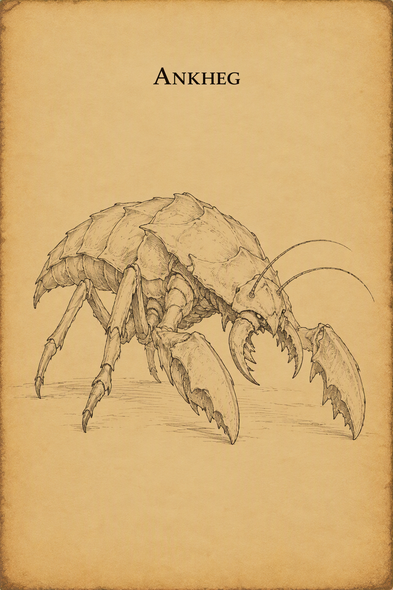{ .center-img width="30%" }|
|Bazyliszek|**Bazyliszek mniejszy** - przerażający, ośmionogi gad zamieszkujący ciemne jaskinie, podziemia oraz gęste, wilgotne knieje. Choć nie osiąga gigantycznych rozmiarów, jest uważany za jedno z najgroźniejszych stworzeń, jakie można spotkać na dzikich szlakach. Bazyliszek mniejszy powoli porusza się tuż przy ziemi, cierpliwie osaczając ofiarę. Jego najgroźniejszą bronią jest magią przesiąknięte spojrzenie – pojedynczy kontakt wzrokowy z tą bestią wystarczy, by krew w żyłach stężała, a tkanki i kości nieszczęśnika w kilka sekund zamieniły się w lity kamień. **Bazyliszek większy** - monstrualna, wysoce agresywna odmiana bazyliszka, stanowiąca szczytowe osiągnięcie gadyjej ewolucji skażonej mroczną magią. Osiąga długość dojrzałego smoka i zamieszkuje głębokie rejony Podmroku lub odosobnione, ruinujące się podziemia. Bazyliszek większy nie polega wyłącznie na petryfikującym wzroku: jego ogromna masa ciała, opancerzone łuski oraz potężna paszczęka pozwalają mu taranować przeszkody i miażdżyć pancerze. Dodatkowo jego oddech i płyny ustrojowe są skrajnie toksyczne – stwór wydycha chmurę żrącego gazu, który trawi płuca i tkanki wszystkich żywych istot w jego otoczeniu.|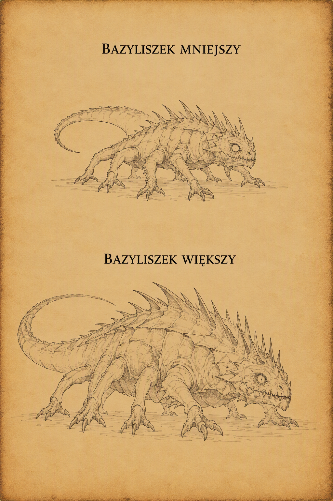{ .center-img width="30%" }|
|Bełkotek|**Bełkotek** - niewielki, opętany szaleństwem drapieżnik Podmroku i gęstych, mrocznych kniei, nękający wędrowców morderczymi chmarami. Z natury chroni się przed światłem słonecznym, wyłaniając się z podziemnych szczelin wyłącznie po zmroku. Tym, co z histerycznym wyprzedzeniem zapowiada nadejście fali bełkotków, jest kakofonia jazgotliwego śmiechu, pisków i niezrozumiałego, piskliwego gęgotu, od którego stwory te wzięły swoją nazwę. Bełkotki nie posiadają zmysłu samozachowawczego ani taktyki – wiedzione czystym, zwierzęcym pędem zalewają cel własnymi ciałami, dążąc do zaszatkowania go na śmierć i pożarcia do czystych kości. **Chory bełkotek** (zwany także gibberlingiem) - szkaradna, zniekształcona odmiana i tak już przerażającego stworzenia stanowi jedno z najbardziej odpychających zagrożeń w głębi podziemi i mrocznych kniei. Dotknięty toczącą go zarazą, chory bełkotek jest jeszcze bardziej nieprzewidywalny i agresywny niż jego zdrowi pobratymcy. Z jego owrzodzonej skóry sączy się jadowita mazi, a z pyska – obok charakterystycznego, szaleńczego bełkotu – dobiega głuchy, męczeński skowyt. W walce stanowi podwójne niebezpieczeństwo: choć sam w sobie jest fizycznie wątły i łatwy do pokonania, bezpośredni kontakt z nim grozi zarażeniem ciężką chorobą. Każdy cios zadany temu stworzeniu lub ukąszenie z jego strony może przenieść na poszukiwacza przygód wyniszczającą infekcję, co czyni starcie z całymi chmarami tych potworów wyścigiem z czasem.|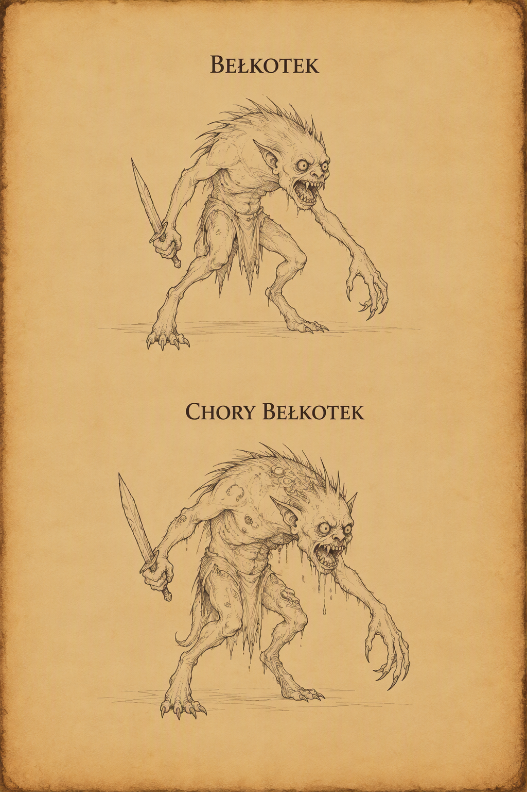{ .center-img width="30%" }|
|Borsukołak|Ponury, niezwykle porywczy i terytorialny likantrop, uosabiający gwałtowność oraz ślepą zawziętość dzikiego borsuka. Borsukołaki są z natury samotnikami, którzy rzadko łączą się w stada – zamieszkują głębokie, wykopane przez siebie kompleksy podziemnych nory w mrocznych kniejach lub wzgórzach. Choć w ludzkiej postaci sprawiają wrażenie milczących, zgryźliwych i stroniących od ludzi odludków, w chwili zagrożenia lub pod wpływem pełni księżyca ulegają furiackiej transformacji. W starciu borsukołak nie zna pojęcia odwrotu: zapędzony w róg lub zraniony wada w morderczy amok, walcząc z doścignioną zawziętością aż do całkowitego wyeliminowania wroga.|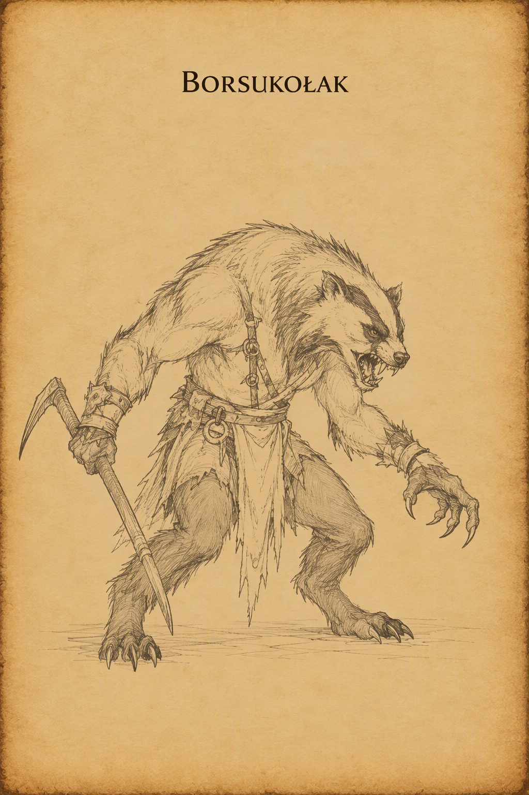{ .center-img width="30%" }|
|Czerwony Mag|**Czarodziej** - potężny czarodziej wywodzący się z magokratycznego królestwa Thay, łatwo rozpoznawalny po całkowicie ogolonej głowie, skomplikowanych magicznych tatuażach pokrywających twarz oraz pysznych, purpurowo-czerwonych szatach. Jako mistrz wybranej szkoły magii (często Nekromancji lub Wywoływania) traktuje sztuki tajemne wyłącznie jako narzędzie dominacji i zdobywania władzy, bezwzględnie eliminując rywali i wykorzystując potężne zaklęcia obszarowe oraz arcanum do realizacji celów politycznych swojej nacji. **Strażnik** - Wyszkolony do bezwzględnego posłuszeństwa elitarny strażnik przydzielany do ochrony Czerwonych Magów, ubrany w ciężką, czernioną lub zdobioną czerwienią zbroję płytową. Zamiast operować magią, polega na brutalnej sile, dyscyplinie bojowej oraz atutach kontroli pola walki (takich jak Sentinel czy styl Protection), stanowiąc żywy, nieustępliwy mur odgradzający czarującego pryncypała od ataków w zwarciu i przyjmujący na siebie ciosy wymierzone w maga.|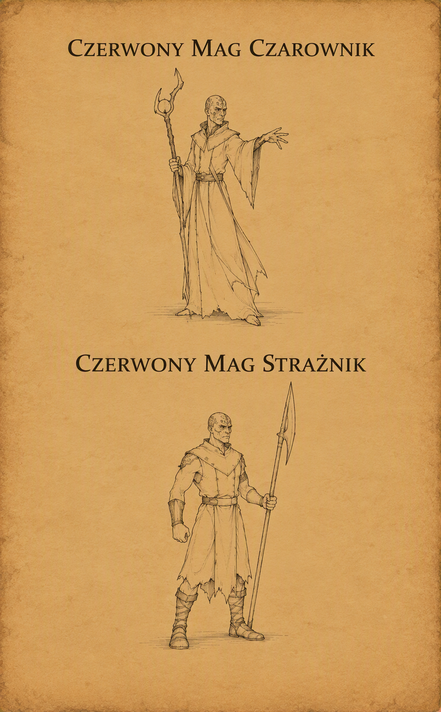{ .center-img width="30%" }|
|Dzik|To niezwykle agresywny i terytorialny drapieżnik, na którego łatwo natknąć się w gęstych lasach Wybrzeża Mieczy. Dzik nie czeka na ruch przeciwnika – wyczuwszy zagrożenie, natychmiast prze do przodu pełną szarżą, starając się nadziać wroga na ostre jak brzytwa kły. Ze względu na swoją ślepą furię potrafi z łatwością powalić poturbowanego lub nieostrożnego poszukiwacza przygód.|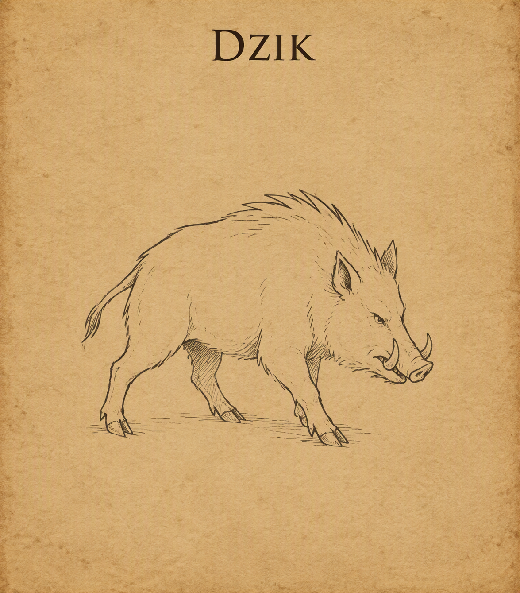{ .center-img width="30%" }|
|Ettin|Monstrualny, dwugłowy gigant o wyjątkowo obmierzłej aparycji i znikomej inteligencji, żyjący w dzikich ostępach oraz w głębi górskich jaskiń. Obydwie głowy posiadają własne, odrębne osobowości i nieustannie sprzeczają się ze sobą o jedzenie, kierunek marszu czy dominację, lecz na polu bitwy działają w idealnej synergii. Dzięki dwóm parom oczu i uszu niezwykle trudno go zaskoczyć, a nieprzerwany czujnik zmysłów sprawia, że stale wypatruje potencjalnego zagrożenia lub łatwego łupu. W walce posługuje się dwiema potężnymi, ciężkimi broniami oburącz, tłukąc wroga z niszczycielską siłą.|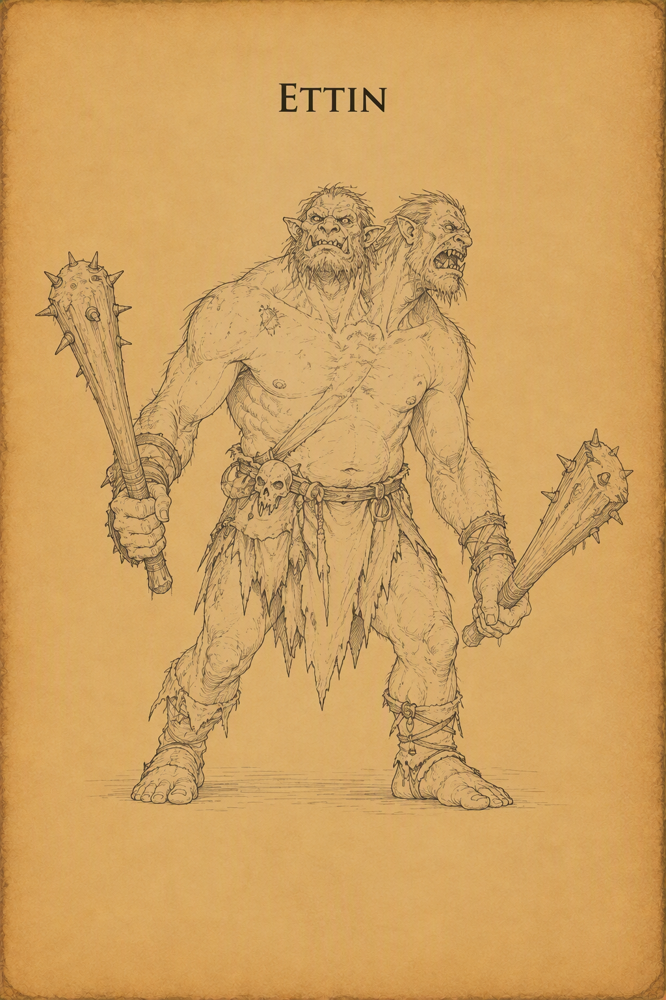{ .center-img width="30%" }|
|Etterkap|Obrzydliwy, skryty drapieżnik podziemi i gęstych, mrocznych lasów, stanowiący koszmarną hybrydę pająka z pajęczakiem-humanoidem. Etterkapy to istoty wysoce terytorialne, prymitywne i wyzbyte współczucia, które żyją w głębokiej symbiozie z olbrzymimi pająkami, często pełniąc rolę ich pasterzy lub opiekunów. Polują głównie z zasadzki – przekształcają zaniechane sztatnie, jaskinie czy gęwiny w gęste, lepkie labirynty pajęczyn, w których schwycone ofiary powoli konają, obezwładnione jadem i skazane na powolne wyssanie płynów ustrojowych.|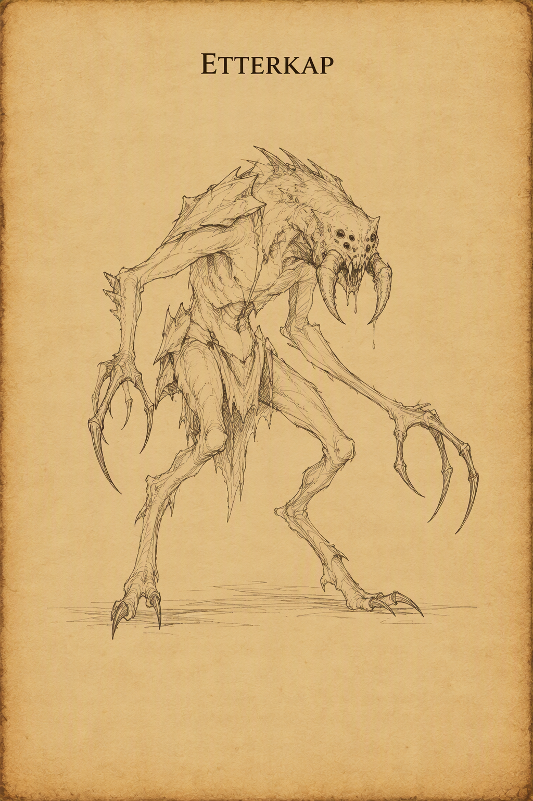{ .center-img width="30%" }|
|Flind|Przerażający, wyjątkowo rzadki władca i mroczny powiernik woli Yeenoghu, stojący na samym szczycie hierarchii gnolli. W przeciwieństwie do opętanych szałem Kłów czy dzikich wojowników watahy, flind łączy potworną siłę fizyczną z przebiegłym, wręcz demonicznym intelektem. O ile zwykły gnoll kieruje się bezmyślnym głodem, o tyle flind z chłodną premedytacją planuje kampanie podbojów, prowadząc całe watahy ku rzezi i spustoszeniu. Słynie z władania magicznym korbaczem (Flindbar), którego każde uderzenie niesie ze sobą demoniczną klątwę – wywołując paraliżujący strach, rozrywając umysł lub pozbawiając ofiarę sił życiowych.|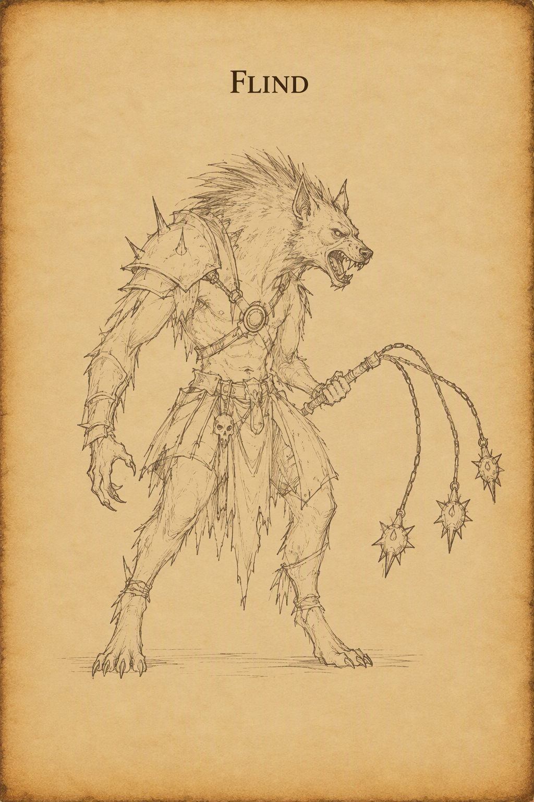{ .center-img width="30%" }|
|Ghast|Wyższa, bardziej pojętna odmiana ghula, zrodzona z czystego nekrotycznego zepsucia i niepohamowanego głodu żywego mięsa. Działa jako przewodnik pożądliwych, padlinożernych hord w mrocznych kryptach oraz na starodawnych cmentarzyskach. Emanuje z niego potworny, trupi odór tak intensywny, że paraliżuje zmysły i wywołuje gwałtowne nudności u każdego, kto znajdzie się w jego pobliżu. W walce wykazuje się przebiegłością – potrafi zastawiać zasadzki i atakować w najsłabszym momencie, by szponami zatrutymi pośmiertną skazą doprowadzić ofiarę do pełnego paraliżu.|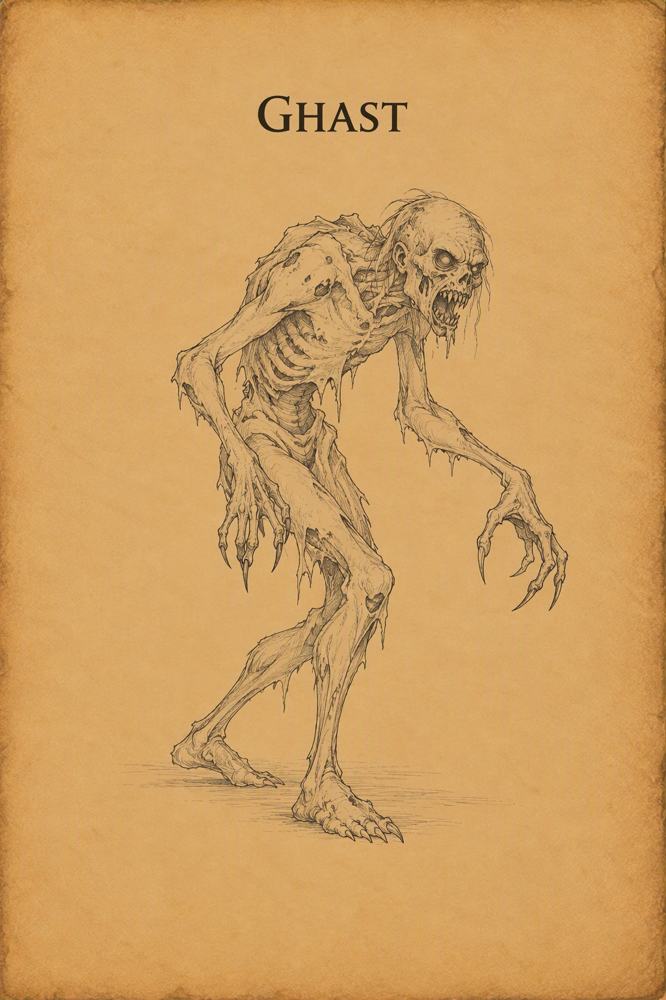{ .center-img width="30%" }|
|Ghul|Mroczny, czmychający nieumarły średniego rozmiaru, zrodzony z patologicznego, kanibalistycznego głodu za życia lub pożarty przez martwiczą magię Podmroku i cmentarzy. Przypomina wypaczone, wychudzone ludzkie zwłoki o matowej, sinej skórze, wydłużonych pazurach i ostrych, powiększonych zębach ułatwiających rozrywanie mięsa. W walce polega na ataku z zaskoczenia w grupach (stadach) – jego najgroźniejszą bronią jest paraliżujący dotyk pazurów (Paralyzing Touch), który natychmiast unieruchamia żywe ofiary, pozwalając ghulowi oraz jego pobratymcom na swobodne pożeranie celu na oczach bezsilnej reszty drużyny.|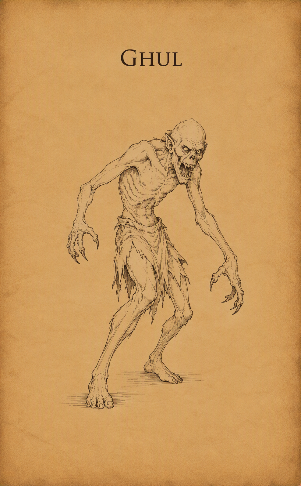{ .center-img width="30%" }|
|Gnoll|**Gnoll** - hybrydalny, drapieżny humanoid o posturze łączącej cechy spadzistoplecej hieny i wychudzonego człowieka. Porusza się na lekko ugiętych, żylastych kończynach, emitując ciągły, piskliwy śmiech przeplatany warczeniem. Jako czciciel demonicznego władcy Yeenoghu, nie zna litości ani dyplomacji – kieruje nim wyłączny, nienasycony głód świeżego mięsa. W walce używa prymitywnych toporów, włóczni lub ciężkich łuków, nadrabiając brak taktyki furiacką przewagą liczebną. **Gnoll-rozpruwacz** - większy, bardziej bezwzględny przedstawiciel rasy, pchnięty w szał przez bezpośrednie błogosławieństwo mrocznych sił lub czystą żądzę krwi. W opowieściach jawi się jako żywy taran – nie kryje się w cieniu, lecz wpada w szyki wroga niczym rozjuszona bestia. Posługuje się długa rohatyną, wyszczerbionym ostrzem, którym wykonuje obszerne, głębokie cięcia mające doprowadzić cel do natychmiastowego wykrwawienia i otwarcia drogi dla reszty stada. **Gnoll-weteran** - przywódca watahy lub doświadczony w dziesiątkach potyczek samiec alfa, który przetrwał dzięki siłowej dominacji i rzadko spotykanemu u gnolli zmysłowi taktycznemu. Zamiast bezmyślnego szału prezentuje zimne, brutalne opanowanie – potrafi utrzymać w rygorze podległe mu bestie i kierować ich atakiem na wrażliwe punkty karawany czy strażnicy. Nosi cięższe, pordzewiałe płaty zbroi zdarte z poległych wrogów i włada ciężkim orężem dwuręcznym. **Gnoll czempion** - szczytowe osiągnięcie demonicznej skazy w hierarchii watahy, będące naczyniem dla bezpośredniej woli i szału Yeenoghu. Czempion to nie tylko potężny wojownik, ale też bezwzględny zwierzchnik, przy którym zwykłe gnolly wpadają w religijny, morderczy amok. Tam gdzie pojawia się czempion, brak miejsca na odwrót czy kalkulację – stwór ten żywi się cierpieniem i strachem, pędząc przed sobą stado niczym żywą falę zniszczenia. W starciu szuka starcia z najsilniejszymi obrońcami wroga, składając ich rozerwane ciała w krwawym darze swojemu demonicznemu władcy. **Wódz gnolli** - militarny, bezwzględny samiec alfa stojący na czele watahy, który utrzymuje władzę wyłącznie dzięki brutalnej sile, zastraszaniu i fizycznej dominacji. W przeciwieństwie do opętanego mistycznym szałem Kła Yeenoghu, wódz jest czystej krwi weteranem starć, łączącym zwierzęcy pragmatyzm z bezlitosnym zmysłem przywódczym. Na polu bitwy wydaje z siebie potężne, ryczące komendy, pędząc podległe mu bestie do jeszcze bardziej furiackiego natarcia. Sam wybiera na cel najsilniejszych i najbardziej opancerzonych wrogów, by ich upokarzającą śmiercią przypieczętować swoją pozycję w stadzie.|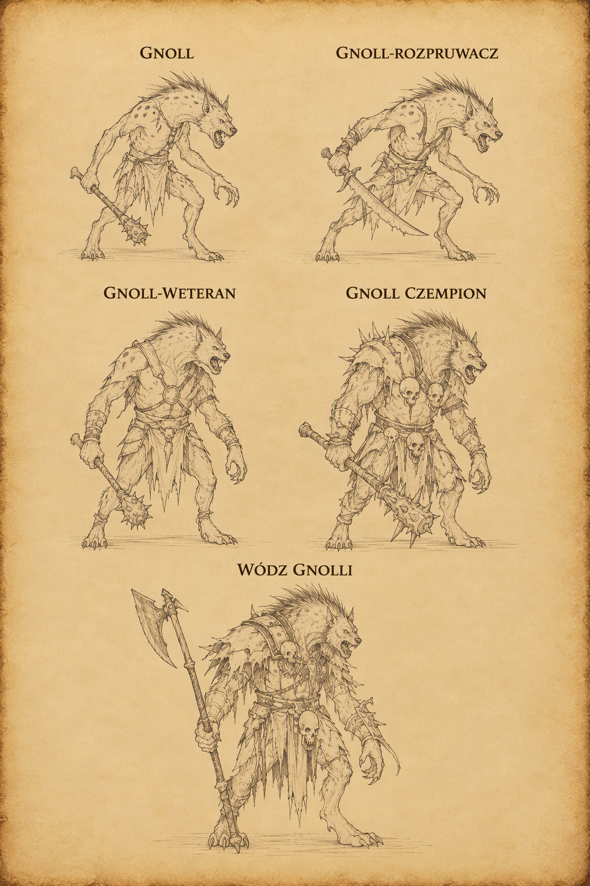{ .center-img width="30%" }|
|Goblin|Mały, małoduszny i chaotyczny podziemny humanoid, żyjący w wielkich, głośnych plemionach u podnóża gór, w ruinach i głębokich jaskiniach. Jednostkowo goblin jest lękliwy i słaby, dlatego w walce zawsze polega na przewadze liczebnej, zasadzkach, pułapkach oraz strzałach zatrutymi bełtami z ukrycia. Gdy szala zwycięstwa przechyla się na stronę wroga, gobliny bez wahania rzucają się do ucieczki, stratowując się wzajemnie w wąskich korytarzach.|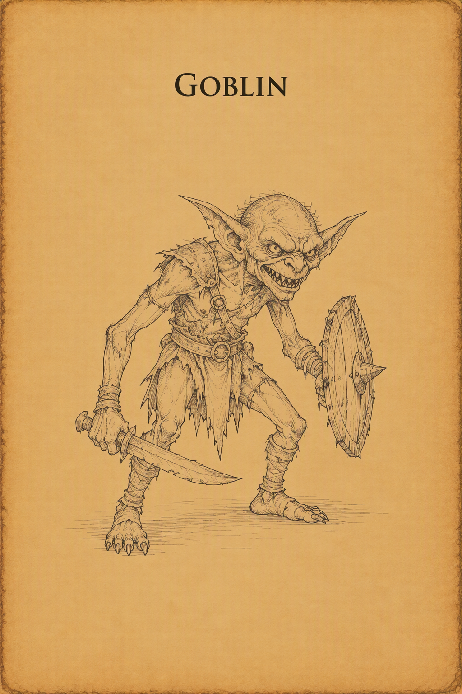{ .center-img width="30%" }|
|Golem|**Golem z ciała** - makabryczna, bezduszna konstrukcja zszyta z fragmentów ludzkich i potwornych zwłok, wprawiona w ruch poprzez potężną, zakazaną magię oraz uderzenie pioruna. Nie odczuwa bólu, strachu ani zmęczenia, a w walce prze bezmyślnie naprzód, wykonując bezwzględne rozkazy swojego stwórcy. Jego skóra ma trupią, sinoszarą barwę, a miejsca łączenia tkanek znaczą grube, pękające szwy oraz rdzawe, metalowe klamry. Choć jest powolny i pozbawiony jakiejkolwiek gracjonalności, dysponuje potężną, miażdżącą siłą fizyczną. Ogień budzi w nim niekontrolowany, zwierzęcy lęk, natomiast wyładowania elektryczne nie wyrządzają mu szkody – przeciwnie, zamykają jego martwe rany i napędzają go do dalszej walki.|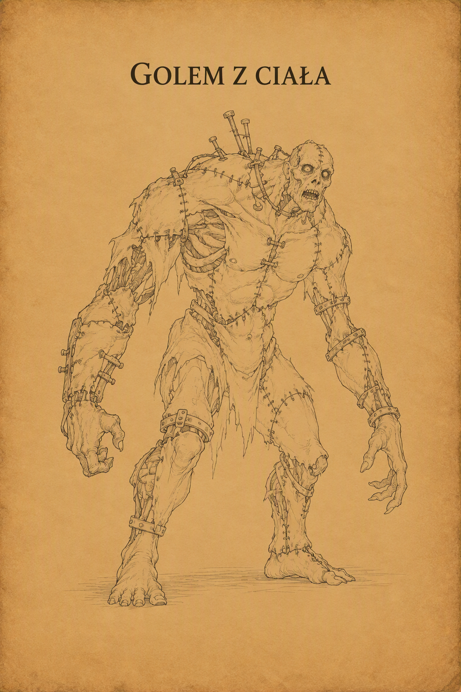{ .center-img width="30%" }|
|Hobgoblin|**Hobgoblin** - zdyscyplinowany, bezwzględny wojownik i urodzony taktyk. W przeciwieństwie do swoich chaotycznych, mniejszych krewnych – goblinów – hobgoblin przedkłada żelazną dyscyplinę, porządek i wyszkolenie bojowe nad bezmyślne okrucieństwo. Żyje w wysoce zmilitaryzowanym społeczeństwie, gdzie wartość jednostki mierzy się jej przydatnością na polu bitwy. W walce używa dobrze utrzymanego oręża i pancerza, doskonale współdziałając w zwartej formacji z resztą swojego oddziału. **Hobgoblin czarodziej** - Cienisty adept magii bojowej, stanowiący żywą artylerię w szeregach hobgoblińskiego legionu. Odrzuca czysto teoretyczne aspekty arkana na rzecz czarów o wysokim potencjale niszczycielskim – głównie władania ogniem, błyskawicami i energią kinetyczną. Podczas potyczki staje tuż za pierwszą linią piechoty, chłodno kalkulując trajektorie zaklęć tak, by dziesiątkować wroga, nie narażając przy tym własnych oddziałów. **Hobgoblin szaman** - mroczny duchowy przywódca i mistyk legionu, łączący wojskową dyscyplinę swojej rasy z pierwotną, złowrogą magią religijną. Szaman czerpie moc z kultu wojennych bóstw (takich jak Maglubiyet) lub z paktów z potężnymi duchami wojny i krwi. Na polu bitwy nie tylko wspiera żołnierzy błogosławieństwami i uzdrawiającą magią, ale też wywołuje u wrogów paraliżujący strach, osłabia ich morale i ciska klątwami rozrywającymi ciało od wewnątrz. **Hobgoblin elita** - doświadczony dowódca i weteran setek potyczek, reprezentujący szczyt militarnej hierarchii rasy. To nie tylko wybitny fechmistrz, ale przede wszystkim genialny taktyk potrafiący w ułamku sekundy dostrzec wyrwę w szyku wroga i wydać precyzyjne rozkazy swojemu pododdziałowi. Nosi ciężką, wyśmienicie dopasowaną zbroję płytową, a jego obecność na polu bitwy podnosi morale żołnierzy i wymusza bezwzględne posłuszeństwo. **Hobgoblin kapitan** - oficer pola bitwy odpowiedzialny za bezpośrednie kierowanie pododdziałami legionu w najgorętszych punktach starcia. Pośredniczy między naczelną elitą a szeregowymi żołnierzami, dbając o bezwzględne egzekwowanie rozkazów i utrzymanie nienaruszonego szyku. Sam w sobie jest groźnym, doskonale wyszkolonym wojownikiem, który na polu bitwy wydaje głośne, krótkie komendy taktyczne, wskazując cele dla łuczników lub kierując impet natarcia w odsłonięte skrzydło wroga. **Hobgoblin z Chłodu** - zrozpaczony, brutalny legionista należący do „Chłodu” (The Chill) – złowrogiej bandy najemniczej złożonej z hobgoblinów, orków i ogrów, opłacanej przez Żelazny Tron do wywoływania chaosu na traktach i paraliżowania handlu stalą na Wybrzeżu Mieczy. Hobgobliny z tej frakcji odznaczają się szczególnym okrucieństwem i wyzbyciem z jakichkolwiek hamulców moralnych. Przystosowani do surowych warunków i brutalnej dyscypliny narzucanej przez dowódców (takich jak ogr Ardenor Crush), działają jako sprawnie zorganizowane oddziały uderzeniowe, które terroryzują kupców, wioski oraz podróżnych na traktach przyległych do Wrót Baldura.|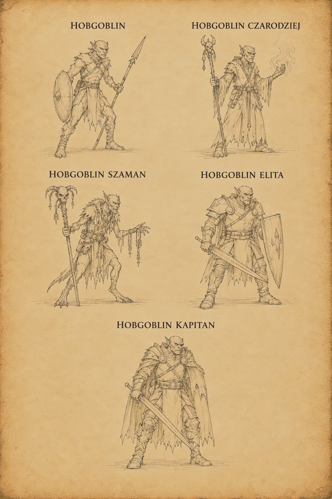{ .center-img width="30%" }|
|Kobold|**Kobold** - mały, tchórzliwy i skrajnie złośliwy jaszczuroludzki humanoid, zamieszkujący głębokie jaskinie, opuszczone kopalnie oraz leża smoków, które czci jako boskie istoty. Pojedynczy kobold jest wątły, dlatego w walce polega wyłącznie na przytłaczającej przewadze liczebnej, podstępie oraz gęsto rozmieszczonych, śmiertelnych pułapkach. Doskonale zna każdy zakamarek swoich podziemnych korytarzy, wciągając intruzów wprost na ukryte zapadnie, wstrzeliwane samoczynnie zatrute bełty czy wilcze doły. **Kapitan koboldów** - wyjątkowo ostrożny i bezwzględny dowódca roju, który zyskał autorytet dzięki sprytowi, nieco większej posturze lub wyjątkowym zasługom dla plemienia. Kapitan potrafi wymusić dyscyplinę na spanikowanej zgrai sowim krzykiem i groźbą natychmiastowej egzekucji. W walce nie rzuca się ślepo do pierwszej linii – operuje terytorium tak, by naprowadzać wrogów pod strzały swoich podwładnych, nosi solidniejszy opancerzenie (często złożone ze skradzionych i dociętych elementów) oraz cięższą broń lub tarczę wytworzoną ze smoczych łusek. **Kobold szaman** - mroczny mistyk i duchowy przewodnik plemienia, w którego żyłach płynie odrobina smoczej krwi lub łaska wojennych potęg Podmroku. Szaman uchodzi za łącznika z pradawnymi siłami – za pomocą rytuałów wywołuje paniczny strach u wrogów, miota prymitywnymi czarami ognia lub kwasu i nakłada na swoich wojowników bitewne błogosławieństwa. Trzyma się zawsze w głębi szyku lub na podwyższeniach skalnych, otoczony wianuszkiem najwierniejszych strażników gotowych oddać za niego życie. **Kobold komando** - uderzeniowa, wysoce wyszkolona jednostka elitarna pośród koboldów, łącząca śmiertelną precyzję strzelecką z absolutnym brakiem lęku na polu bitwy. W przeciwieństwie do zwykłych, panikujących koboldów, komando działa z chłodną, wręcz bezwzględną kalkulacją. Cząstki tego pododdziału są wykorzystywane do najtrudniejszych zadań dywersyjnych: cichego eliminowania wrogich czarodziejów, zastawiania zasadzek na szpicy natarcia oraz paraliżowania czołówki wroga zanim ta zdoła zorientować się w sytuacji. Często posługują się bronią miotaną zapaloną magią lub zatrutą najgroźniejszymi toksynami Podmroku.|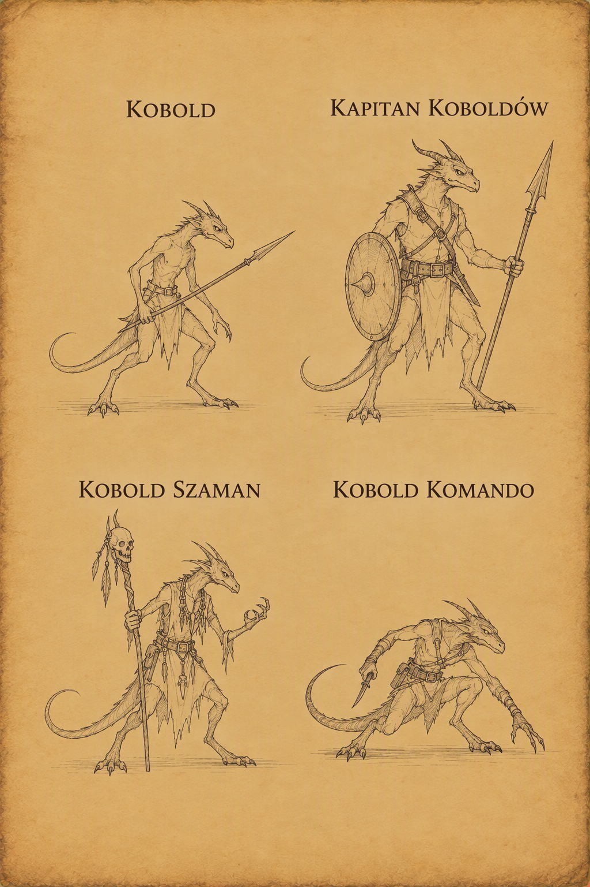{ .center-img width="30%" }|
|Łupieżca umysłów|Mroczna, wysoce inteligentna i budząca powszechny terror istota z głębin Podmroku, będąca uosobieniem psionicznego koszmaru. Łupieżcy umysłów uważają wszystkie inne rasy za niższe formy życia, przeznaczone wyłącznie do roli niewolników lub pokarmu. Unikają bezpośredniego starcia fizycznego, wykorzystując potężną magię psychiczną do miażdżenia woli wrogów, paraliżowania ich umysłów falą uderzeniową oraz przejmowania całkowitej kontroli nad ich ciałami. Najbardziej przerażającym aktem z ich udziałem jest pożarcie mózgu żywej, sparaliżowanej ofiary za pomocą giętkich macek okalających ich otwór gębowy.|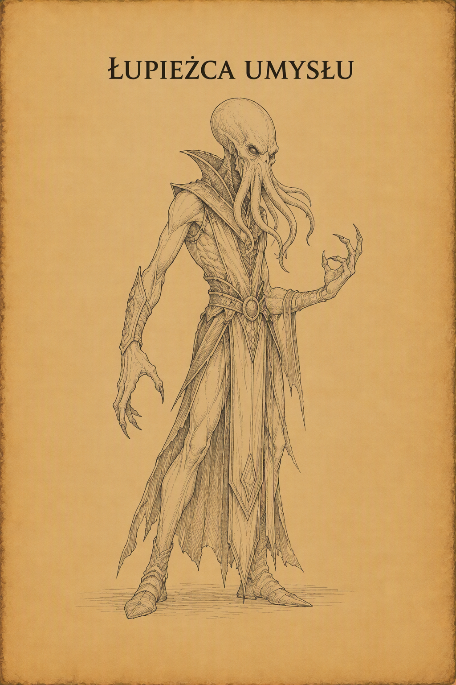{ .center-img width="30%" }|
|Meduza|Przeklęta, skrajnie próżna i bezwzględna istota stanowiąca tragiczne ucieleśnienie zabójczego piękna. Według podań meduzy były niegdyś śmiertelnikami, których chciwość, pycha lub pakty z mrocznymi potęgami sprowadziły straszliwe przekleństwo transformacji. Meduza zamieszkuje odosobnione, ruinujące się pałace, podziemne krypty i starożytne świątynie, obwarowane przerażającą galerią śmiertelnie realistycznych, kamiennych posągów jej dawnych ofiar. Jej najstraszniejszą bronią jest wzrok – każde stworzenie, które spojrzy bezpośrednio w jej oczy, w mgnieniu oka doświadcza bolesnej, nieodwracalnej petryfikacji, zamieniając się w martwy głaz.|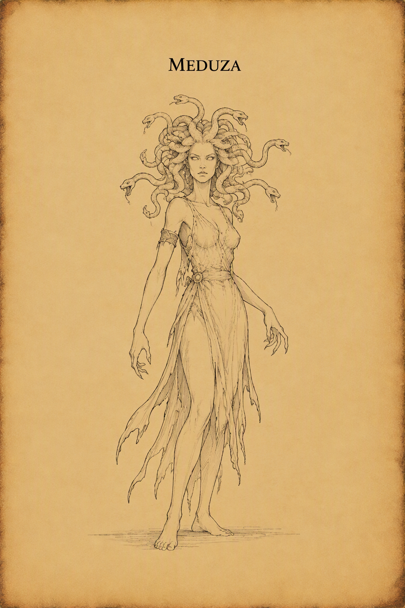{ .center-img width="30%" }|
|Mimik|**Agresywny młody mimik** - mniejsza, wyjątkowo pobudliwa i niestabilna odmiana klasycznego mimika. Z racji młodego wieku i niepełnego opanowania sztuki kamuflażu, jej transformacje bywają niedoskonałe – na powierzchni udawanej skrzyni czy mebla mogą pojawiać się tętniące pęknięcia, pęcherze lub nierówności. Jest jednak znacznie bardziej agresywny i niecierpliwy niż dojrzałe osobniki: zamiast czekać, aż ofiara sama go dotknie, potrafi gwałtownie rzucić się na zbliżający się cel, atakując lepkimi mackami i ostrymi jak brzytwa zębami.|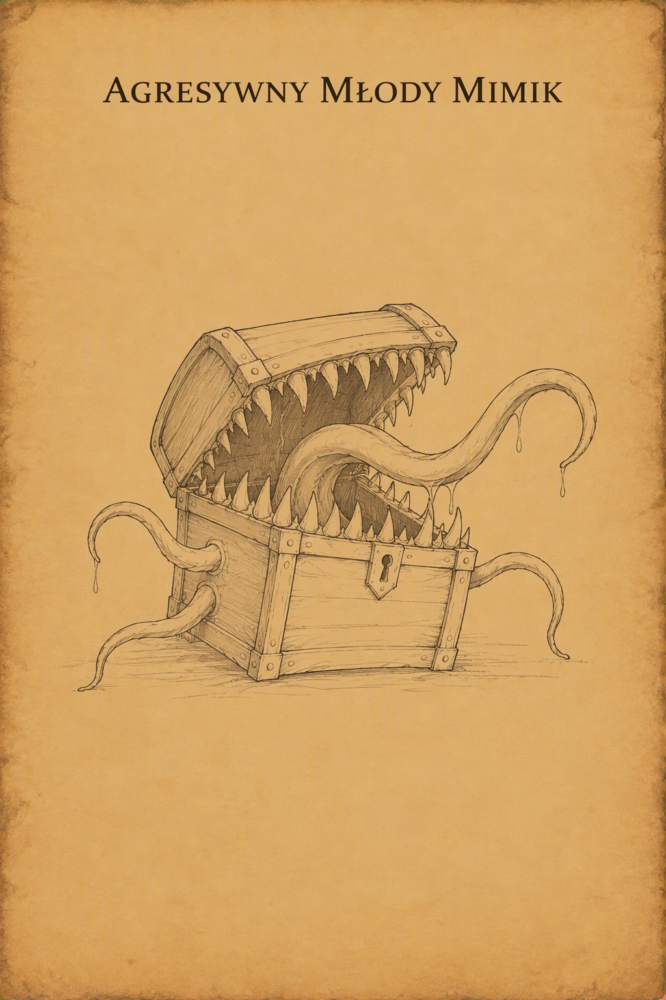{ .center-img width="30%" }|
|Niedźwiedziożuk|Najwięksi, najsilniejsi i najbardziej skryci pośród wszystkich istot goblinoidalnych. Mierzący ponad dwa metry wzrostu, porośnięci gęstym futrem bugbearzy łączą brutalną siłę fizyczną z zaskakującą naturalną zręcznością. W przeciwieństwie do głośnych i zdyscyplinowanych hobgoblinów, bugbearzy preferują samotne łowy lub działanie w małych grupach, specjalizując się w cichym skradaniu się i organizowaniu krwawych zasadzek. W walce wykorzystują swoją ogromną masę oraz broń obuchową i sieczną, atakując z zaskoczenia z siłą zdolną zdruzgotać pancerz wojownika w pierwszym uderzeniu.|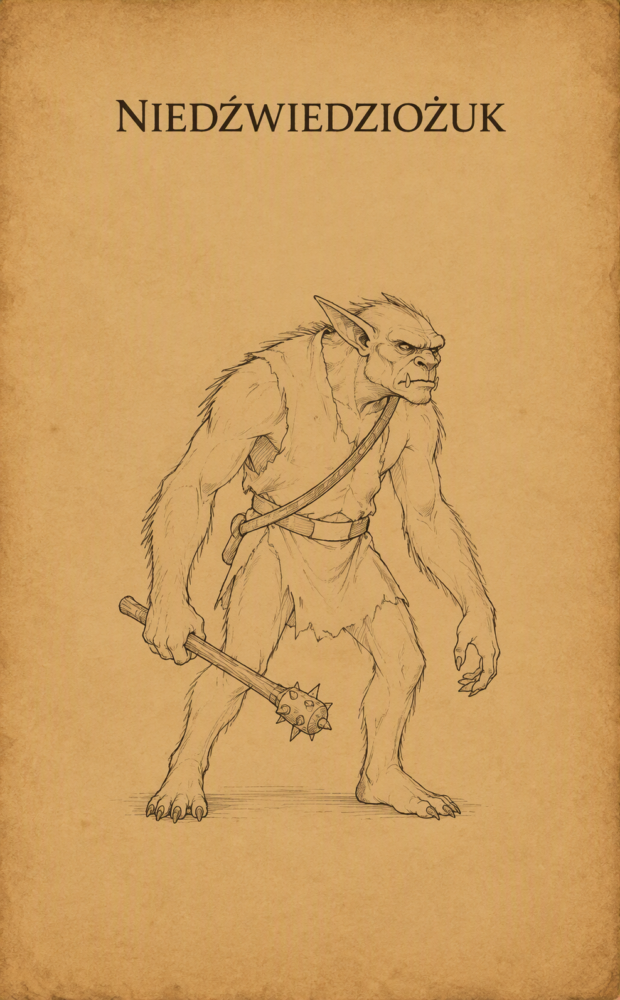{ .center-img width="30%" }|
|Niedźwiedź|**Dziki niedźwiedź** - ten powszechnie spotykany na leśnych traktach i w dzikich ostępach drapieżnik to jedno z podstawowych zagrożeń dla początkujących wędrowców. Jest porywczy, wysoce terytorialny i w pełni polega na brutalnej sile. W walce natychmiast szarżuje na ofiarę, starając się przygnieść ją masą swojego cielska i zadać głębokie rany potężnymi uderzeniami pazurów, co czyni go niebezpiecznym przeciwnikiem. Niedźwiedź czarny - najmniejszy i najsłabszy przedstawiciel rodziny niedźwiedzi, zamieszkujący obrzeża lasów, jaskinie i górskie przełęcze. Z natury jest znacznie mniej agresywny od swoich większych krewniaków – często zachowuje neutralność i po prostu ignoruje wędrowców, dopóki nie zostanie bezpośrednio zaatakowany. **Niedźwiedź jaskiniowy** - relikt zamierzchłej epoki i prawdziwy władca podziemnych ostępów, górujący rozmiarem i siłą nad jakimkolwiek ze swoich powierzchniowych krewnych. Zamieszkuje głębokie kompleksy jaskiń, naturalne groty oraz opuszczone krasowe korytarze, w których poszukuje schronienia i bezpiecznych miejsc na wielomiesięczną hibernację. Choć nie jest z natury potworem wykazującym demoniczną czy magiczną złośliwość, jego bezwzględny terytorializm, skrajny głód po obudzeniu oraz powalająca masa sprawiają, że stanowi jedno z najgroźniejszych starć, jakie mogą spotkać poszukiwacze przygód schodzący pod ziemię. W walce prze do przodu niczym żywa taranująca skała – miażdży cele ciężarem ciała, rozrywa pancerze szponami i łamie kości pojedynczym kłapnięciem potężnej paszczy.|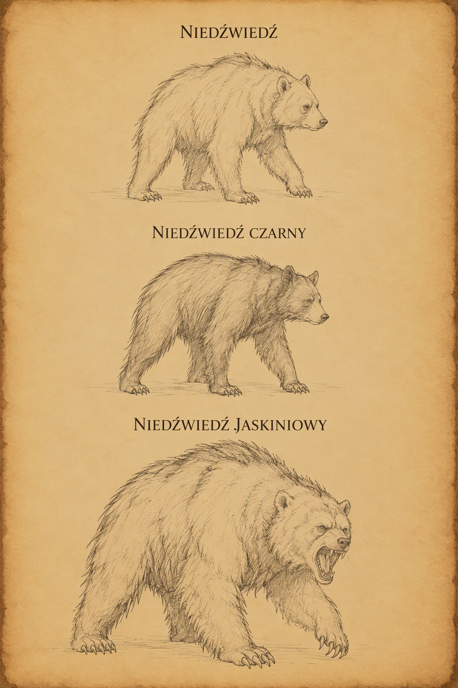{ .center-img width="30%" }|
|Ogr|To ogromny, brutalny i wyjątkowo tępy stwór, stanowiący stałe zagrożenie na leśnych szlakach, w górskich przełęczach oraz opuszczonych ruinach Wybrzeża Mieczy. Mierzący ponad trzy metry wzrostu drapieżnik kieruje się wyłącznie wiecznym głodem i pierwotną agresją, rzadko dając się przekonać jakimkolwiek argumentom. W walce całkowicie ignoruje taktykę, polegając na niszczycielskiej sile swoich potężnych ramion i ciężkiej maczugi lub pnia drzewa. Choć jest powolny i łatwy do wyminęcia przez zwinnego wojownika, pojedyncze trafienie jego bronią potrafi zdruzgotać pancerz i powalić nawet doświadczonego poszukiwacza przygód.|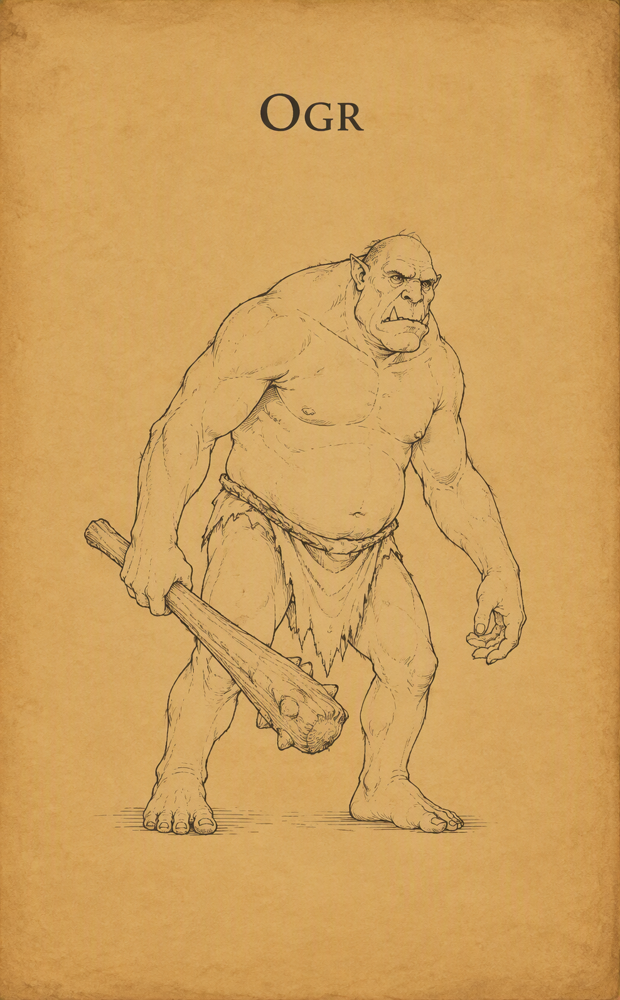{ .center-img width="30%" }|
|Ogrilion|Brutalna, nieokiełznana krzyżówka ogra i orka, łącząca gwałtowność oraz masę mięśniową pierwszego z zawziętością i drapieżnym instynktem drugiego. Ogriliony są powszechnie uważane za potwory nawet przez własnych krewnych – słyną z całkowitego braku samokontroli i ślepej furiackiej agresji. W walce rzadko posługują się skomplikowaną bronią; preferują taranowanie wroga masą ciała, miażdżenie go żelaznymi pięściami, ciężkimi maczugami lub rzucanie głazami na odległość.|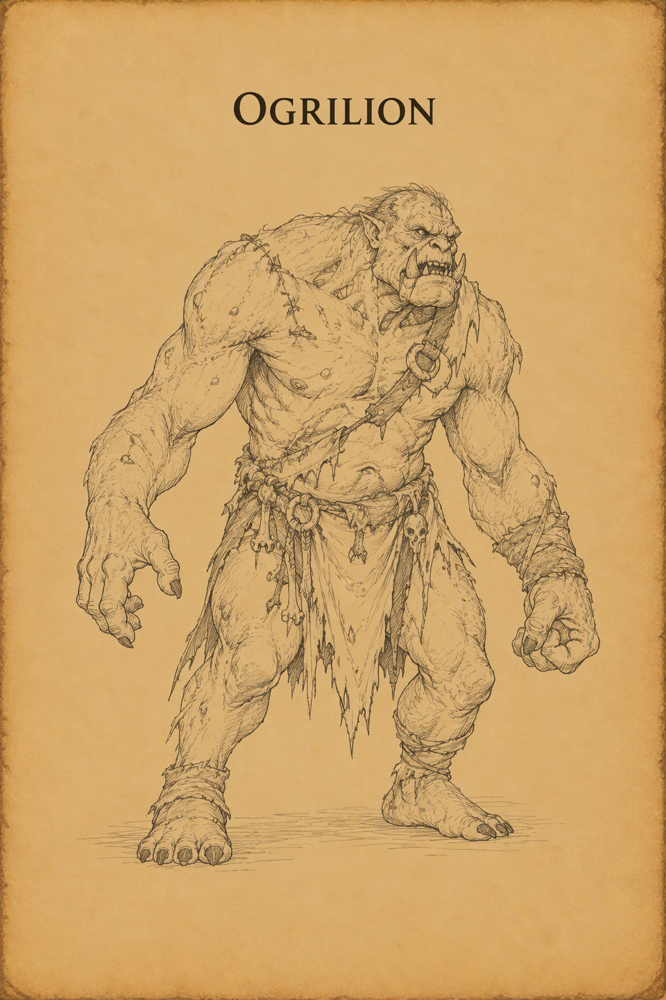{ .center-img width="30%" }|
|Ork|**Ork** - brutalny, terytorialny drapieżnik w humanoidalnej skórze, żyjący z podbojów i grabieży. Posiada masywną, lekko pochyloną sylwetkę o wysokości od 180 do 210 cm, brudnoszarą lub szarozieloną skórę oraz płaską pyskoczaszkę z żółtymi kłami wyzierającymi z dolnej szczęki. Jako trzon watahy walczy w zwarciu, odziany w łączone pancerze skórzano-płytowe lub kolczugi i dzierżąc ciężkie topory bojowe bądź dwuręczne miecze. W walce polega na przytłaczającej sile fizycznej, bezwzględności oraz wysokiej odporności na ból. **Ork Łucznik** - wariant strzelecki, odpowiadający za rażenie celów z podwyższenia lub zza pleców natarcia piechoty. Mniej obciążony pancerzem – nosi lekkie przeszywanice lub dopasowane skóry niekrępujące ruchów ramion. Posługuje się ciężkimi, kompozytowymi łukami z giętkiego drewna i ścięgien, z których wypuszcza strzały zdolne przebijać tarcze na duży dystans. Przy bezpośrednim zagrożeniu dobywa krótkiego miecza lub toporka, choć jego główną rolą jest zasypywanie wroga ciągłym ostrzałem. **Ork Kapłan (Szaman / Oko Gruumsha)** - duchowy przywódca i fanatyczny mistyk plemienia, często składający w ofierze jedno własne oko na znak oddania mrocznym bóstwom. Odziany w skórzane pancerze wykończone czaszkami i rytualne szaty nasycone krwią ofiarną. Dzierży wojenną buławę lub kościany sztylet. Zamiast czystej siły fizycznej wykorzystuje profańską magię do wprowadzania pobratymców w wojenny szał, nakładania klątw na wrogów oraz rażenia przeciwników mroczną energią. **Ork Mag** - rzadki wariant o podstępnym, wypaczonym umyśle, władający pierwotną magią zniszczenia i cienia. Jego ciało często zdobią wypalone, świecące w mroku runy, a rynsztunek ograniczony jest do skórzanych karwaszy, pasów i ciemnych szat. Dzierży magiczny kostur zwieńczony czaszką lub rogiem. Na polu bitwy sieje chaos: ciśnie kulami ognia, przywołuje żrące chmury oraz pętuje wrogów nienaturalnym strachem ze znacznej odległości.|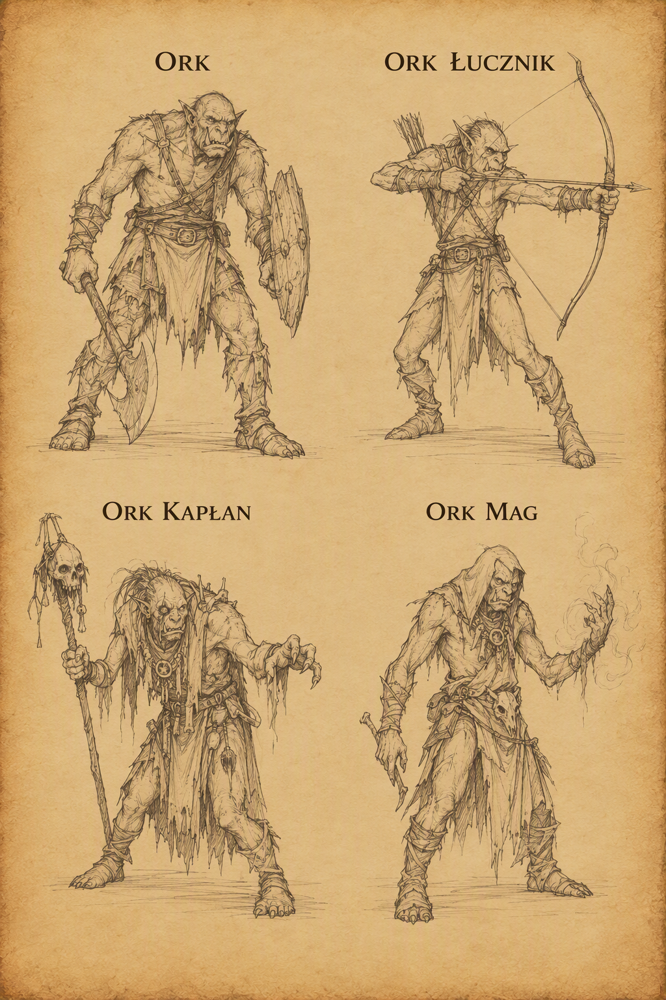{ .center-img width="30%" }|
|Orog|Potężniejsza, wysoce zmilitaryzowana i inteligentniejsza podrasa orków zamieszkująca głąb podziemi oraz Podmrok. Orogowie górują nad swoimi powierzchniowymi krewnymi zarówno siłą fizyczną, jak i dyscypliną wojenną. Tworzą ciężko zbrojne elitarne oddziały, które w strukturach watah często pełnią rolę gwardii przywódców lub samodzielnych jednostek szturmowych.|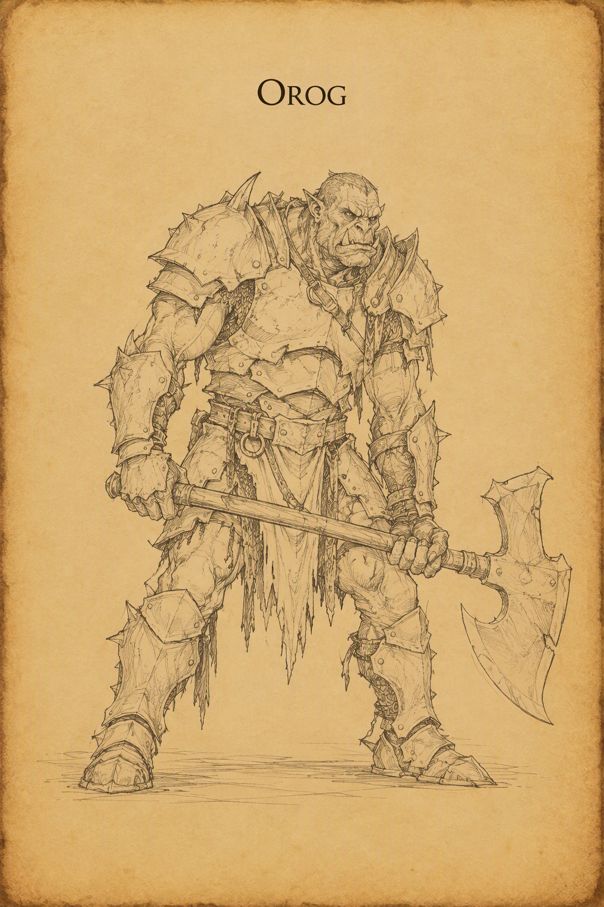{ .center-img width="30%" }|
|Pająk|**Pająk** - miewielki, zwrotny drapieżnik o drobnej, zwartej budowie i wyciągniętych, cienkich odnóżach. Jego chitynowy pancerz jest gładki i stosunkowo miękki, co pozwala mu sprawnie wciskać się w ciasne szczeliny skalne, pod korę drzew czy w załomki mury. W walce nie polega na sile fizycznej, lecz na zaskoczeniu – przemyka bezszelestnie, zadając błyskawiczne, drobne ukąszenia i wstrzykując sączącą się z niewielkich szczękoczułków toksynę, która powoduje drętwienie kończyn oraz martwicę tkanek wokół rany. **Wielki pająk** - masywny pajęczak o budowie dorosłego drapieżnika, cechujący się krępym odwłokiem oraz odnóżami gęsto pokrytymi sztywnymi, czuciowymi szczecinkami. Posiada grubszy, matowy pancerz w barwach brunatno-czarnych oraz wypukłe, nieruchome ślepia skupione nad potężnymi szczękoczułkami. To klasyczny budowniczy sieci – przesiaduje w centrum lepkich, skomplikowanych konstrukcji jedwabnych, reagując na najmniejsze drgania nici, by dopaść pochwyconą ofiarę, unieruchomić ją jadem paraliżującym i ciasno opleść w kokon. **Olbrzymi pająk** - monstrualna bestia o potężnym, segmentowanym pancerzu, przypominającym spękaną skałę lub porośniętą korytnicę. Jego odnóża są masywne, o grubych stawach zdolnych utrzymać ogromny ciężar na pionowych ścianach jaskiń. Szczękoczułki tej bestii rozmiarem przypominają kościane sztylety, a z ich ujść stale kapie gęsty, żrący jad. Olbrzymi pająk rzadko polega na subtelnych sieciach – najczęściej poluje z zasadzki, taranując ofiary ciężarem własnego ciała, miażdżąc je i wstrzykując toksynę rozpuszczającą tkanki wewnętrzne jeszcze przed konsumpcją. **Pająk miecznik** - przerażający, wysoce agresywny pajęczak o chitynowym pancerzu gęsto naszpikowanym ostrymi jak brzytwa wyrostkami i kolcami. Jego odnóża zakończone są wydłużonymi, twardymi kościanymi ostrzami, którymi sprawnie szlachtuje i patroszy swoje ofiary. Zamiast tkania klasycznych sieci preferuje bezpośrednią, brutalną szarżę – dopada cel furiackim skokiem, zamieniając impet uderzenia w krwawą siekankę. **Pająk-upiór** - ciemny, nieumarły pajęczak zrodzony z nekrotycznej energii oraz cieni, którego półmaterialne ciało wydaje się spowite kłębiącym się dymem. Posiada matowy, obmierzły pancerz przerosły mrokiem oraz świecące zimnym blaskiem ślepia. Z łatwością przenika przez lite ściany i przeszkody, a jego ataki omijają pancerz fizyczny, uderzając bezpośrednio w siły witalne i trwale osłabiając ciało ofiary. **Astralny pająk fazowy** - głębinowy drapieżnik sferyczny o pancerzu mieniącym się srebrzysto-fioletową łuną kosmicznej energii. Wykorzystuje nagięcia w strukturze rzeczywistości do natychmiastowego przenikania między Planem Materialnym a Astralnym. Materializuje się tuż za plecami niczego niespodziewającego się celu, zadaje błyskawiczne ugryzienie nasycone niszczycielską magią oraz jadem, po czym natychmiast znika w krainie sfer, uniemożliwiając wyprowadzenie kontry.|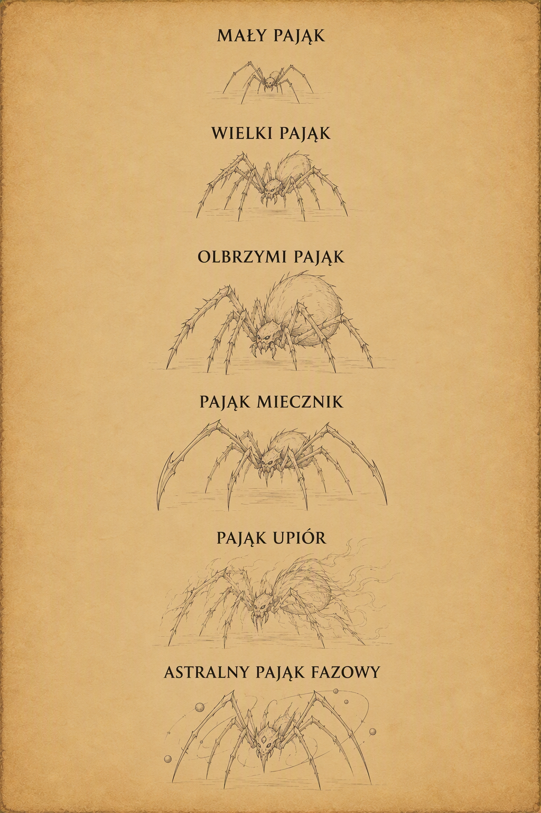{ .center-img width="30%" }|
Pełzacz ścierwojad|Głęboko w podziemnych korytarzach, tam gdzie zapach wilgoci miesza się z odorem rozkładu, po ścianach i sufitach bezszelestnie mknie Pełzacz Ścierwojad. Ten gigantyczny, obrzydliwy stawonóg jest wiecznie głodną czystką podziemi – zwabiony zapachem krwi i śmierci, poluje z zaskoczenia, spadając na niczego niespodziewających wędrowców wprost z ciemności. Wokół jego szczczęk wije się pęk obrzydliwych macek ociekających paraliżującym śluzem; wystarczy jedno muśnięcie, by śmiałek zastygł w bezruchu, bezradnie patrząc, jak stwór powoli wciąga go do swojego leża, by pożreć go żywcem.|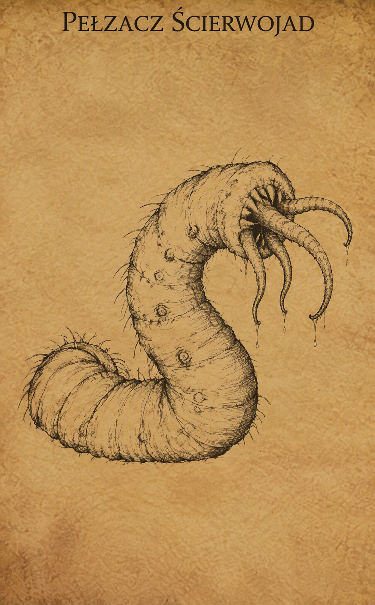{ .center-img width="30%" }|
|Pies|**Pies bojowy** - treningowo przygotowany, udomowiony ogar, wyhodowany do walki u boku żołnierzy, strażników lub poszukiwaczy przygód. Wyróżnia się czujnością, wysoką Karnością oraz odpornością na strach. W walce polega na pędzie i powaleniu celu za pomocą potężnego uścisku szczęk, ułatwiając swemu panu zadanie wykończającego ciosu. **Zdziczały pies** - wychudzony, żyjący w stadach drapieżnik, zamieszkujący obrzeża miast, pustkowia oraz ruiny. Samotnie nie stanowi większego zagrożenia i jest płochliwy, jednak w grupie wykorzystuje taktykę sfory, zyskując przewagę w atakach, gdy w pobliżu ofiary znajduje się przynajmniej jeden z jego pobratymców.|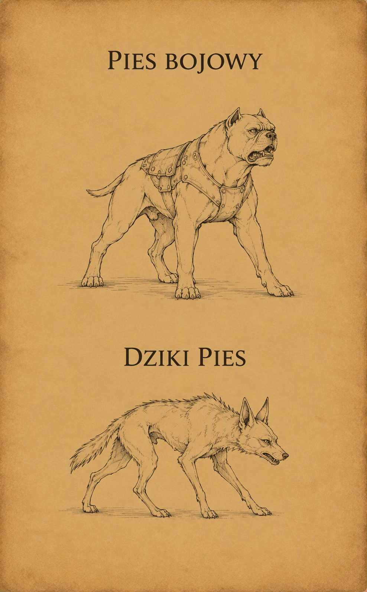{ .center-img width="30%" }|
|Powietrzny sługa|Półinteligentna, mroczna i wyjątkowo niebezpieczna manifestacja z Sfery Żywiołu Powietrza. Sprowadzany do świata materialnego głównie przez potężnych kapłanów lub czarnoksiężników za pomocą rytuałów pętania, służy wyłącznie jako bezwzględny tropiciel i porywacz. Powietrzny służący jest całkowicie niewidzialny w swoim naturalnym stanie, co czyni go niemal niemożliwym do wykrycia bez pomocy potężnej magii. Wyzbyty własnej woli i pragnień, skupia całą swoją egzystencję na wykonaniu powierzonego mu zadania. Jeśli jednak zostanie wyzwolony ze pęt lub misja zakończy się niepowodzeniem, wpada w niekontrolowany szał, kierując mściwy gniew przeciwko swojemu przywoływaczowi.|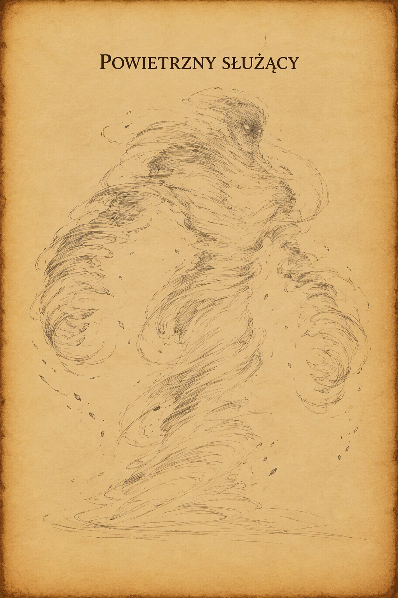{ .center-img width="30%" }|
|Półogr|Hybryda człowieka i ogra, stanowiąca tragiczne lub niebezpieczne połączenie ludzkiej sprytności z potężną, niszczycielską siłą ogra. Półogry rzadko znajdują akceptację w cywilizowanych społecznościach, gdzie patrzy się na nie z lękiem i nieufnością, co spycha je najczęściej na margines – do grup najemniczych, gangów w dokach lub na usługi lokacji przestępczych. Choć brakuje im finezji, na polu bitwy stanowią żywą przeszkodę nie do przebicia: są potężniejsi od najsilniejszego człowieka, a przy tym znacznie bystrzejsi od swoich pełnokrwistych ogrzych rodziców.|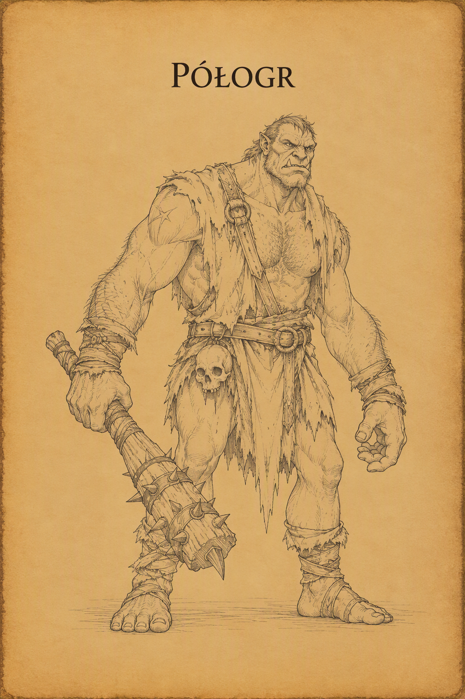{ .center-img width="30%" }|
|Rozbójnik|**Rozbójnik** - zwykły oprych, zbój lub dezerter, który porzucił prawo na rzecz łatwego zysku na szlakach handlowych Wybrzeża Mieczy. Odziany w skórzaną zbroję i uzbrojony w miecz, topór lub krótki łuk, rzadko działa w samotności, preferując zasadzki w rejonach leśnych i na mało uczęszczanych traktach. Choć pojedynczo nie stanowi wielkiego wyzwania dla doświadczonych wędrowców, w grupie bywa śmiertelnie niebezpieczny – zwłaszcza gdy zasypuje swoją ofiarę gradem strzał z ukrycia. **Rozbójnik karawanowy** - wyspecjalizowany zbir, należący do dobrze zorganizowanych grup przestępczych, które polują bezpośrednio na bogate transporty kupieckie. W przeciwieństwie do zwykłego oprycha, charakteryzuje się większą dyscypliną, lepszym wyekwipowaniem oraz brakiem skrupułów. Doskonale zna słabe punkty chroniących strażników i metody szybkiego paraliżowania wozów, przez co starcie z nim wymaga od drużyny znacznie większej ostrożności i szybkiej eliminacji celów na odległość. **Rozbójnik łucznik** - zadzierżysty strzelec wyznaczony w bandzie do zadawania ciosów z bezpiecznej odległości i osłaniania szturmujących oprychów. Zazwyczaj jest to były kłusownik, najemnik bez szpiku lub weteran wojenny, dla którego łuk jest nie tyle narzędziem polowania, ile maszyną do cichego zabijania. Nie szuka bezpośredniego zwarcia – zajmuje dogodne pozycje na wzniesieniach, w gęstwinie koron drzew lub za skałami, skąd precyzyjnie wyłącza z walki najgroźniejszych przeciwników, woźniców oraz czarodziejów, zanim ci zdołają rzucić pierwsze zaklęcie. **Elitarny Najemnik Czarnych Szponoów** - Bezkompromisowy, cichy i śmiertelnie skuteczny skrytobójca na usługach Żelaznego Tronu oraz podziemnych syndykatów przestępczych działających wzdłuż Wybrzeża Mieczy. Wyselekcjonowani spośród najbardziej bezwzględnych weteranów, najemnicy Ci przechodzą mordercze szkolenie w taktyce podjazdowej, walce w półmroku oraz precyzyjnym skradaniu. W przeciwieństwie do pospolitych zbirów czy strażników, Elita Czarnego Szponu nie szuka otwartego zwarcia na prostych zasadach – operują w całkowitej ciszy, rażąc cele z ukrycia zatrutą serią bełtów lub strzał, zanim ofiara zdoła w ogóle dostrzec zagrożenie.|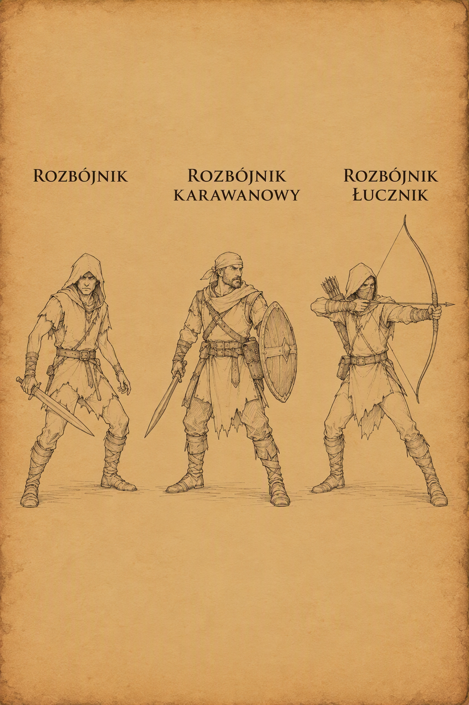{ .center-img width="30%" }|
|Szaroskóry|**Szaroskóry** - mroczny, zgorzkniały kuzyn krasnoludów powierzchniowych, zamieszkujący najgłębsze, bezsłoneczne rejony Podmroku. Wytworzony w wyniku wieków niewoli i eksperymentów pod jarzmem Łupieżców Umysłu, duergar wyzbył się wszelkiej radości, dumy z kunsztu czy wesołości, zastępując je chłodną kalkulacją, podejrzliwością oraz bezwzględną pracowitością. Duergarzy słyną ze wrodzonych zdolności psionicznych – potrafią stawać się całkowicie niewidzialni oraz powiększać swoje rozmiary w trakcie bitwy, co czyni z nich niezwykle groźnych i nieprzewidywalnych przeciwników. **Szaroskóry - złodziej** - cichy, bezszelestny zabójca i zwiadowca, wykorzystujący naturalną niewidzialność do przenikania za linie wroga lub eliminowania kluczowych celów bez podnoszenia alarmu. W przeciwieństwie do powierzchniowych łotrzyków, duergar złodziej nie szuka poklasku ani zysku dla własnej próżności – działa z żelazną, wojskową precyzją na rozkaz swojej gildii lub władcy. Rozpoczyna atak od cienia, paraliżując ofiarę zatrutym ostrzem, po czym powiększa swoje gabaryty, by dokończyć dzieła z niszczycielską siłą. **Szaroskóry kapłan** - Mroczny guślarz i duchowy przewodnik podziemnego ludu, służący surowemu bóstwu Laduguerowi lub opiekuńczej bogini Duerra. Kapłan duergarów jest uosobieniem bezwzględnego posłuszeństwa, dyscypliny i cierpienia. Na polu bitwy wspiera swoich pobratymców ciężkim obuchem, osłania ich mroczną magią i psioniką, a wrogów pęta pętami mentalnej rozpaczy. Jest zarazem zarządcą niewolników i strażnikiem tradycji, wypleniającym wszelkie przejawy słabości w rodzonym plemieniu. Szaroskóry wojownik - żelazny filar podziemnych wojsk duergarów, wytrenowany do walki w ciasnych, ciemnych korytarzach oraz do odpierania napaści potworów z Podmroku. Karbowany pancerz, ciężka tarcza i bojowy młot lub kilof stanowią jego nieodłączny ekwipunek. Wojownik działa w ścisłym szyku, bezchmurnie znosząc ból i trudy starcia. Wykorzystuje umiejętność zwiększania masy ciała, by natychmiastowo zablokować wąskie przejścia lub stratować lżejszych przeciwników w zwarciu.|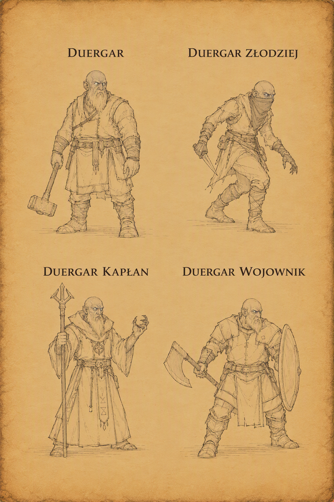{ .center-img width="30%" }|
|Szczur|Szczur jaki jest każdy widzi. A jak nie widział to jego szczęście. Olbrzymi szczur jest wiekszy, chyba to jasne?|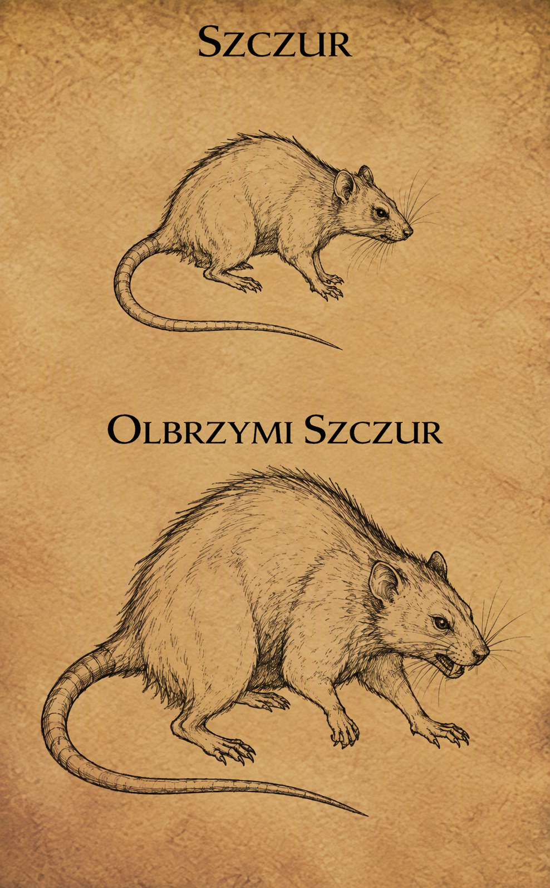{ .center-img width="30%" }|
|Szkielet wojownik|Szkielet wojownik to ożywiona magią nekromancji pozostałość po poległym żołnierzu, ślepo wykonująca rozkazy swojego twórcy. Pozbawiony tkanki, lęku i własnej woli, prze naprzód z mechaniczną nieustępliwością, dzierżąc spękaną tarczę oraz wyszczerbiony miecz lub włócznię. Choć sam w sobie jest kruchy i podatny na obuchowe uderzenia, stanowi poważne zagrożenie w grupie, walcząc bezczelnie aż do całkowitego rozsypania się w pył.|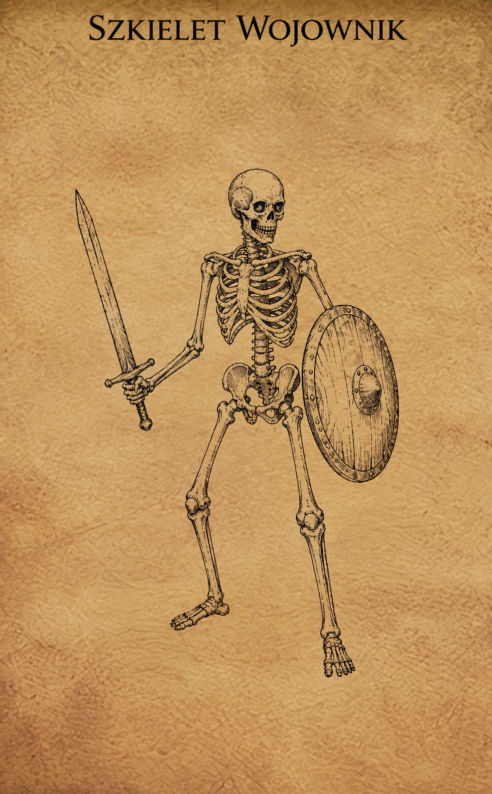{ .center-img width="30%" }|
|Szlam|**Szary szlam** - bezwietrzna, płaska masa obumarłej tkanki organicznej i rozpuszczonego kamienia, przypominająca zwykłą kałużę wody lub wilgotną plamę na posadzce jaskini. Szary szlam to cichy, bezmyślny drapieżnik Podmroku, który nie posiada wzroku ani słuchu, orientując się w otoczeniu wyłącznie za pomocą drgań podłoża i zapachu białka. Gdy ofiara nastąpi na jego ciało, stwór natychmiast opływa jej kończyny, wydzielając żrący kwas, który w mgnieniu oka trawi pancerze, drewno, ciało i kości, zamieniając zdobycz w pożywną papkę. **Ochrowy galaretowiec (Szlam ochrowy)** - olbrzymia, amorficzna masa o barwie brudnego złota, ochry lub zgniłej zieleni, poruszająca się z zaskakującą sprawnością po ścianach, stropach i podłogach. Ochrowy galaretowiec jest znacznie bardziej żywotny i obdarzony potężniejszym instynktem łowieckim niż jego szary krewny. Atakuje, powoli owijając się wokół ofiary i wciągając ją do wnętrza swojego żrącego ciała. Najbardziej przerażającą cechą tej bestii jest jej zdolność do podziału – próba pocięcia lub rażenia galaretowca energią elektryczną powoduje natychmiastowe rozpadnięcie się stwora na dwa mniejsze, w pełni funkcjonalne i równie agresywne osobniki. **Musztardowy galaretowiec/szlam** - najgroźniejszy, hybrydowy i niespotykanie inteligentny przedstawiciel kategorii śluzów, powstały według podań w wyniku nieudanego zaklęcia przemiany. W przeciwieństwie do swoich bezmyślnych krewnych, musztardowy galaretowiec wykazuje spryt, potrafi planować zasadzki i świadomie wycofywać się z walki. Charakteryzuje się brunatnożółtą barwą i ostrym, gryzącym zapachem przypominającym gorczycę. Wydziela wokół siebie spowalniający, paraliżujący opary toksyczne, a atakujących go wrogów zaskakuje odpornością na większość czarów oraz zdolnością do pochłaniania energii magii i pocisków.|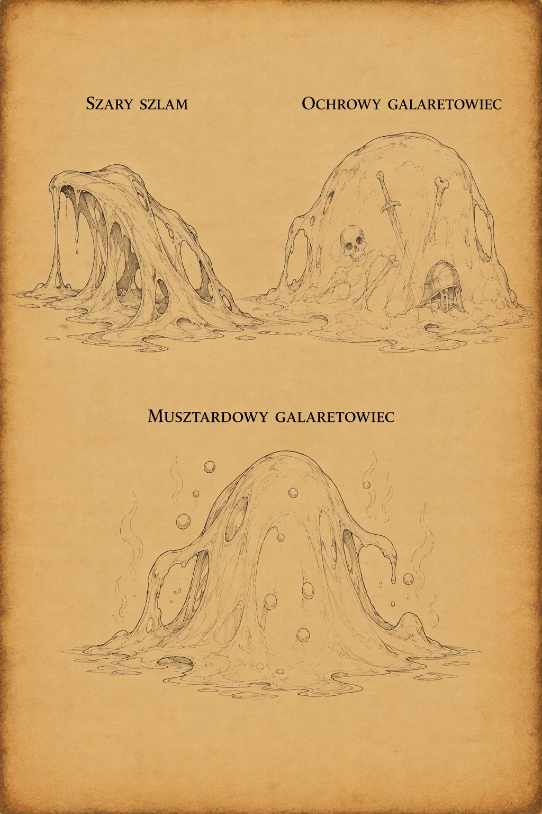{ .center-img width="30%" }|
|Wąż|Olbrzymi wąż to groźny, kilkunastometrowy drapieżnik zamieszkujący gęste dżungle, bagna oraz mroczne zalane podziemia. Porusza się bezszelestnie w gęstwinie lub pod powierzchnią wody, atakując z zaskoczenia z szybkością uderzenia pioruna. W zależności od gatunku, zabija błyskawicznym ukąszeniem wstrzykującym śmiercionośny jad lub oplata ofiarę potężnym, umięśnionym ciałem, dławiąc ją i miażdżąc kości przed połknięciem w całości.|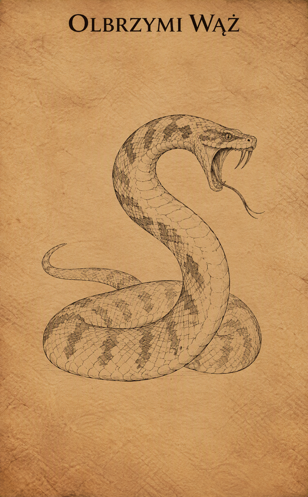{ .center-img width="30%" }|
|Tasloi|Prymitywna, złośliwa rasa niewielkich humanoidów zamieszkująca gęste korony drzew w tropikalnych dżunglach i wilgotnych lasach. Tasloi prowadzą nadrzewny tryb życia, tworząc osady z plecionych pomostów i szałasów zawieszonych wysoko nad ziemią. Z natury są skrajnie podstępne i agresywne, wykazując głęboką nienawiść do większości ras. Rzadko schodzą na dno lasu, woląc atakować z zaskoczenia z wysokości – rażą ofiary zatrutymi dmuchawkami, ciskają krótkimi włóczniami lub zeskakują na grzbiety nieostrożnych wędrowców, by dobić ich w chaotycznym zwarciu. Często oswajają i ujeżdżają wielkie pająki dżunglowe oraz dziki.|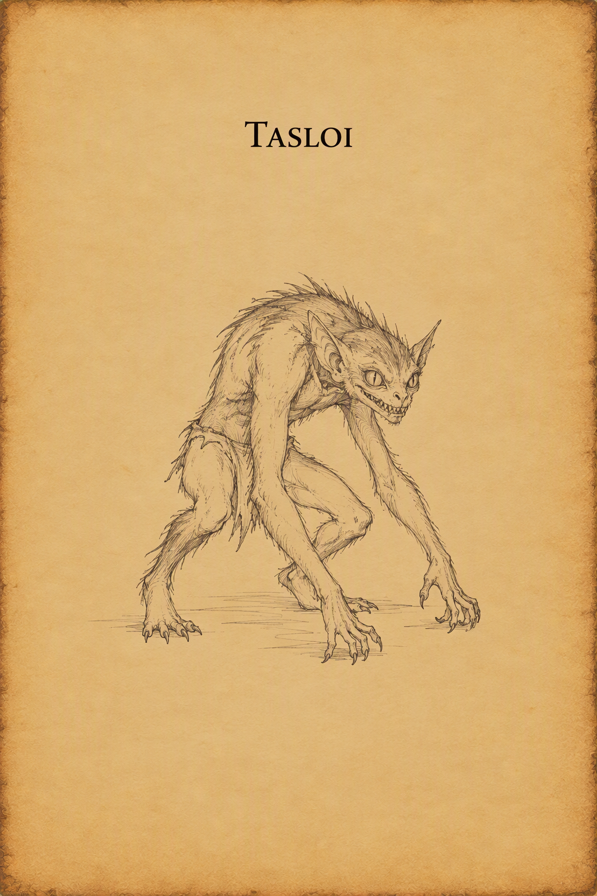{ .center-img width="30%" }|
|Wilk|**Wilk** - Klasyczny drapieżnik o smukłej, wydłużonej sylwetce i gęstej, chroniącej przed mrozem sierści. Długie, dryblasowate kończyny zapewniają mu niezwykłą wydolność podczas wyczerpujących pościgów, a precyzyjny uścisk mocnych szczęk i wyostrzony węch czynią z niego bezszelestnego łowcę przemierzającego dzikie knieje w zwartej watasze. **Straszliwy wilk** - Monstrualna bestia o potężnym kośćcu, głębokiej klatce piersiowej i masywnym karku zwieńczonym sztywną, jeżącą się grzywą. Posiada szeroką czaszkę z gigantycznymi kłami zdolnymi do kruszenia pancerzy oraz siłę mięśniową pozwalającą na taranowanie przeszkód i powalanie dorosłego jelenia lub jeźdźca jednym impetem. **Worg** - Złośliwy, wysoce agresywny drapieżnik o spadzistym zadzie, nieproporcjonalnie szerokich barkach i szorstkiej, poszarpanej sierści. Cechuje go krótsza, masywna pyskoczaszka z stale odsłoniętymi zębami oraz pałające inteligencją, okrutne spojrzenie żółtych lub czerwonawych ślepi. **Wampiryczny wilk** - Skażona mroczną energią bestia o smołowo czarnym futrze i szkarłatnie płonących oczach. Jego ciało pozbawione jest tętna oraz oddechu, a w trupio bladym pysku wyróżniają się nadnaturalnie wydłużone, ostre jak igły kły, służące do przebijania tętnic i łczyczego wyssania sił witalnych ze swych ofiar. **Zimowy wilk** - majestatyczny, a zarazem przerażający drapieżnik o rozmiarach bojowego konia, zamieszkujący mroźne tundry, ośnieżone szczyty i lodowce. Zimowy wilk to nie jest zwykła bestia – posiada wysoką inteligencję, potrafi porozumiewać się we własnym mroźnym języku oraz w mowie gigantów, z którymi często wchodzi w pakiety i sojusze. W walce wykazuje się wyrachowaną taktyką, a oprócz potężnych szczęk używa swojego najgroźniejszego oręża: podmuchu lodowatego dechu, który w kilka chwil zamraża tkanki i krew w żyłach ofiary. **Straszny wilk** - skażona magią cienia lub nieumarłym piętnem bestia, emanująca aura pierwotnego lęku i mrocznej potęgi. Cechuje ją smukła, lecz nienaturalnie potężna sylwetka o głębokim, czarnym jak węgiel futrze, które wydaje się pochłaniać światło i pozostawiać za sobą delikatny, eeryczny tuman mgły. Z jej szerokiego pyska sączy się bezustanny, mroźny powiew upiornej energii, a z głęboko osadzonych oczu bije demoniczne, bladozielone lub martwe, srebrzyste światło. Straszny wilk nie jest jedynie fizycznym drapieżnikiem – poluje przede wszystkim na umysły swoich ofiar, paraliżując je mistycznym, nienaturalnym strachem i osłabiając ich wolę do walki, zanim wyprowadzi śmiertelny cios.|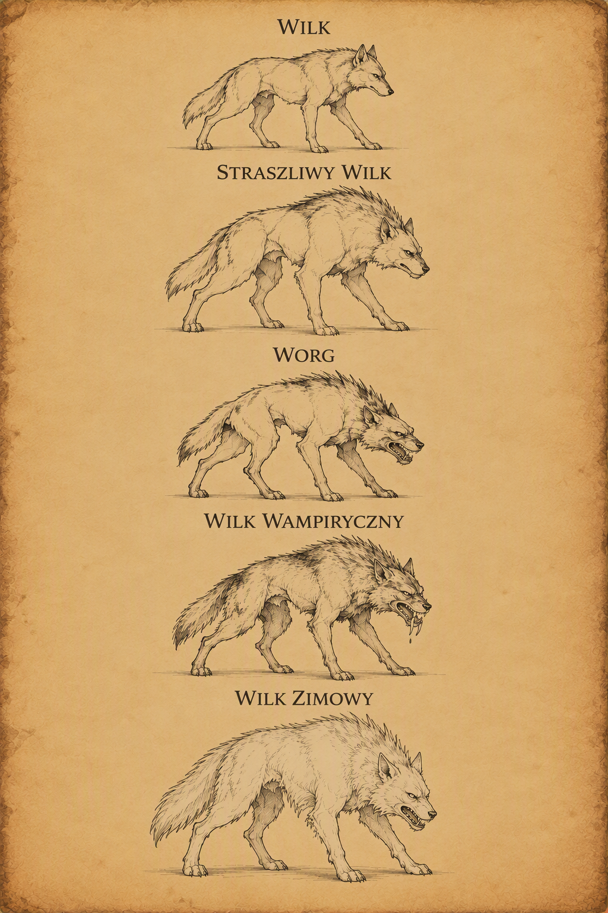{ .center-img width="30%" }|
|Wiwerna|**Młoda wiwerna** - niedojrzały, lecz wysoce agresywny drapieżnik, który zaraz po wykluciu z jaja wykazuje bezwzględny instynkt łowiecki. Choć rozpiętość jej skrzydeł i masa ciała nie pozwalają jeszcze na porywanie dorosłych ssaków, młoda wiwerna jest niezwykle zwinna i nieprzewidywalna. Gnieździ się w otwartych szczelinach skalnych i na niższych półkach górskich, polując na mniejszą zwierzynę. W starciu działa impulsywnie – nadrabia brak doświadczenia furiackimi doskokami, kąsaniem oraz próbowaniem siły swojego dopiero rozwijającego się, lecz już groźnego żądła. **Wiwerna** - Gwałtowny, drapieżny krewny prawdziwych smoków, pozbawiony jednak ich inteligencji, magii oraz przednich odnóży. Wiwerna porusza się na dwóch silnych, szponiastych nogach, a jej skrzydła są zintegrowane z przednimi kończynami na wzór olbrzymiego nietoperza. Żyje na niedostępnych graniopodobnych skałach i urwiskach, skąd wypatruje zdobyczy. W walce używa potężnych szczęk, rzuca się na cel z powietrza, a jej największym atutem jest elastyczny ogon zakończony grubym, kościanym żądłem przesiąkniętym śmiertelną toksyną.|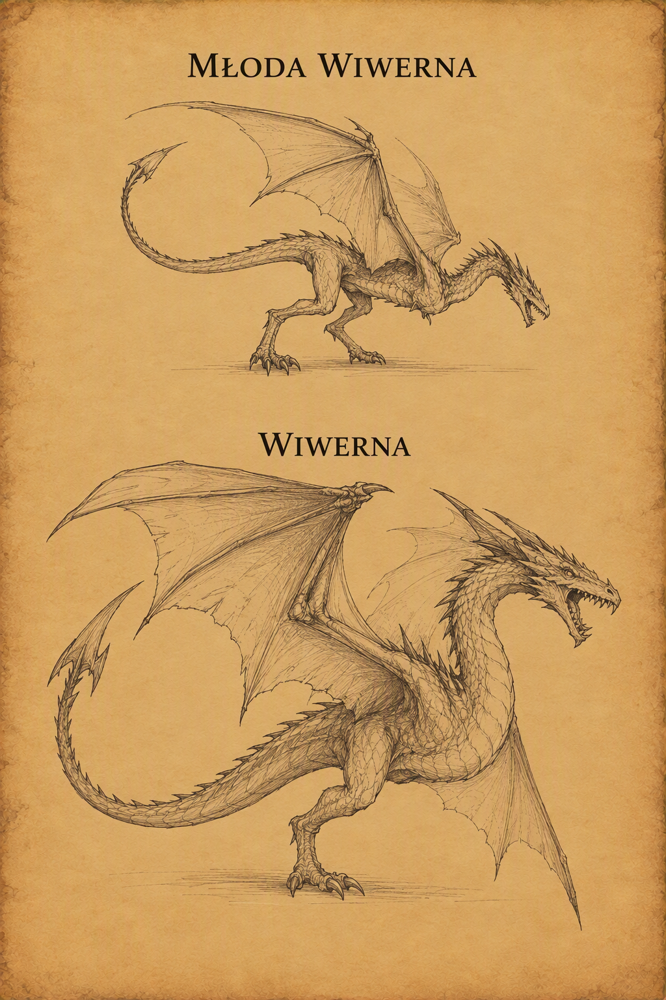{ .center-img width="30%" }|
|Xvart|Te niewielkie, niebieskoskóre i krzykliwe stworzenia stanowią jedno z najbardziej uciążliwych zagrożeń na dzikich obszarach Wybrzeża Mieczy. Znane ze swojej niespotykanej tchórzliwości, xvarty rzadko atakują w pojedynkę – szukają przewagi w przytłaczającej liczebności, nękając podróżnych głośnym wrzaskiem i atakując chmarami z ukrycia. Uzbrojeni w prymitywne sztylety, krótkie miecze lub proce, w walce bezczelnie wykorzystują swoją zwinność, jednak wystarczy powalić kilku z nich lub ich przywódcę, by reszta uciekła w popłochu w gęstwiny.|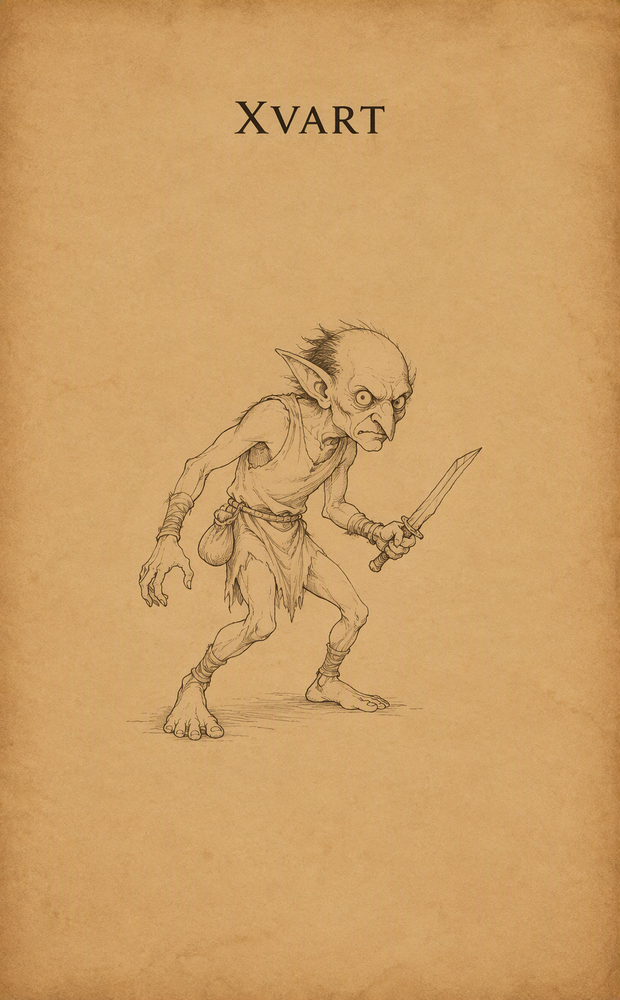{ .center-img width="30%" }|
|Zombie|Powolny, nieposiadający własnej woli nieumarły, powołany do życia przez mroczną nekromancję lub skażony pośmiertnym plagiatorstwem. Jego ciało znajduje się w różnym stadium rozkładu – od świeżo pochowanych zwłok ze stężałą, trupią skórą, po gnijące, otwarte rany odsłaniające mięśnie i kości. Zombie nie odczuwa bólu, strachu ani zmęczenia; porusza się ciężkim, nierównym krokiem, powoli lecz nieuchronnie prąc naprzód. W walce prze do przodu bez względu na odniesione obrażenia, atakując miażdżącym ciężarem własnego ciała, kłami oraz powiązanymi siłą woli pazurami, by rozszarpać żywe tkanki.|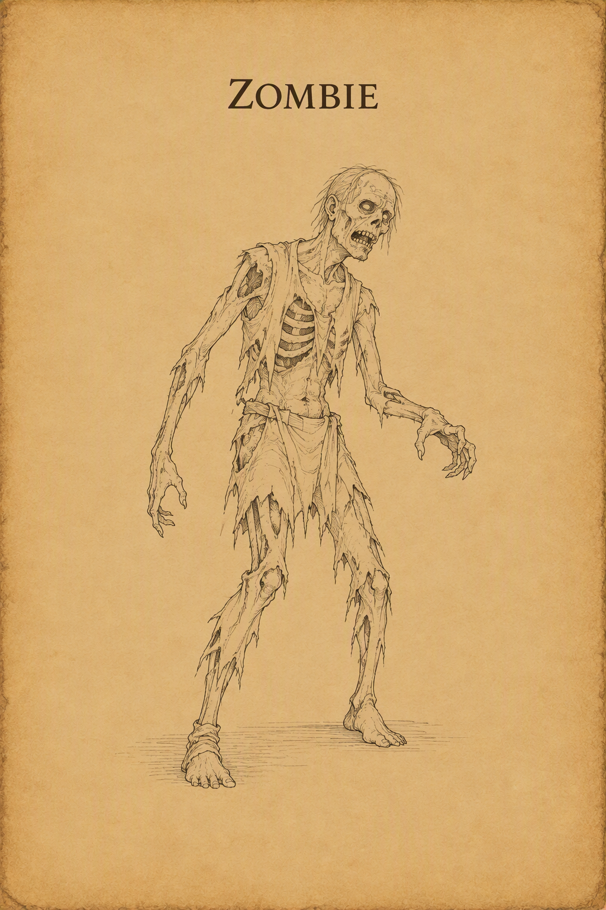{ .center-img width="30%" }|
|Żywiołak|**Żywiołak ziemi** - monstrualna, powolna i niemal niezniszczalna manifestacja czystego Planu Ziemi. Sprowadzony do świata materialnego za pomocą potężnej magii, żywiołak ten jawi się jako krocząca góra kamienia, gleby i minerałów, prowadzona niematerialną, prostą wolą swojego przywoływacza lub pragnieniem ochrony terytorium. Żywiołak ziemi nie odczuwa strachu, bólu ani znużenia. W walce prze do przodu niczym żywa lawina, taranując przeszkody i miażdżąc wrogów samym ciężarem własnej masy. Jego powiązanie z podłożem jest tak głębokie, że potrafi bezszelestnie przenikać przez lity kamień i ziemię, niczym pływak przez wodę, zaskakując przeciwników wyłonieniem się bezpośrednio pod ich stopami.|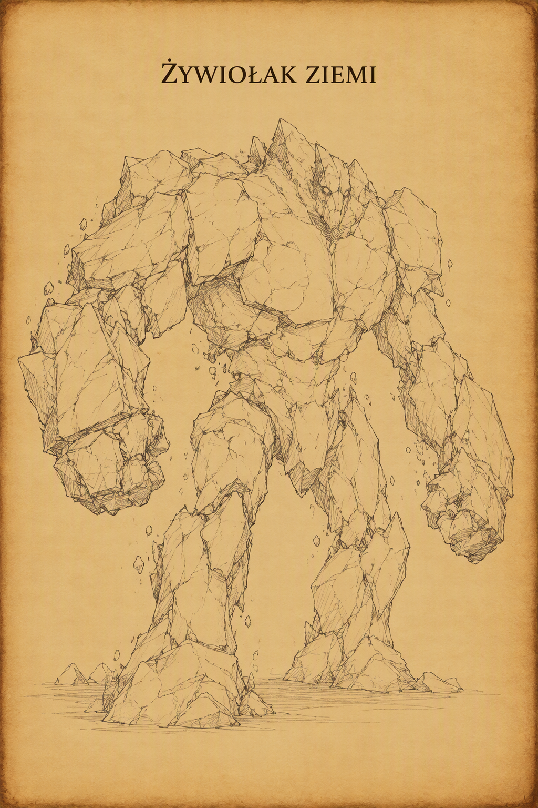{ .center-img width="30%" }|

<!-- 

#|A|AAA|{ .center-img width="30%" }|

 -->
