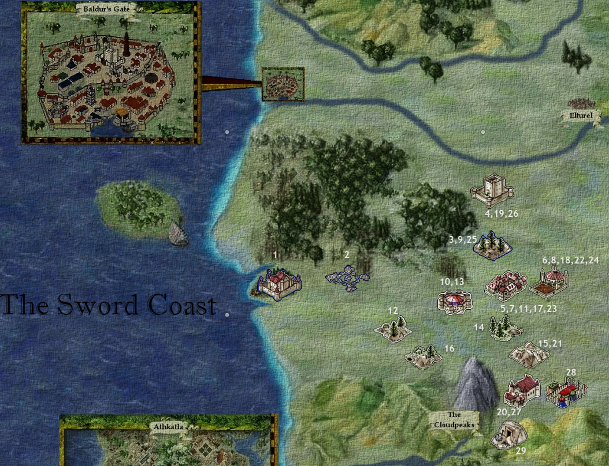
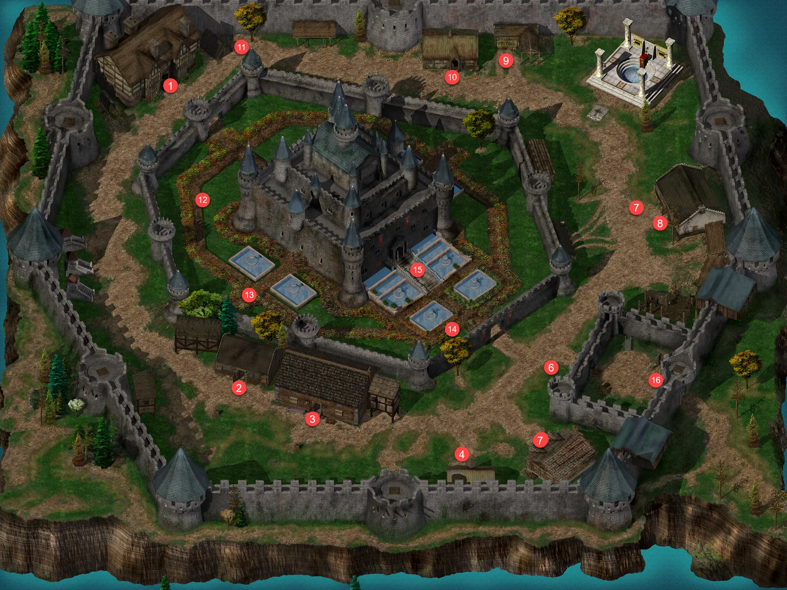
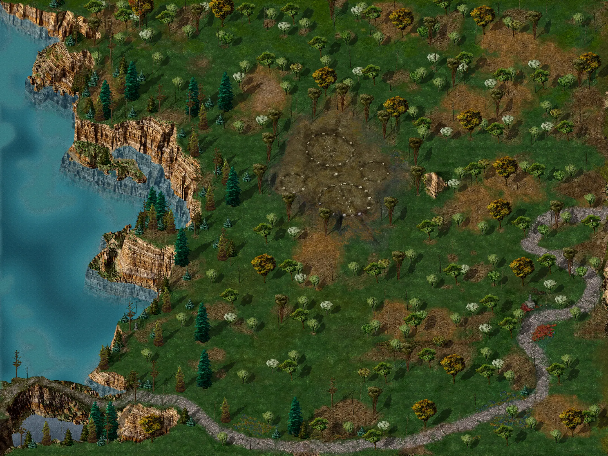
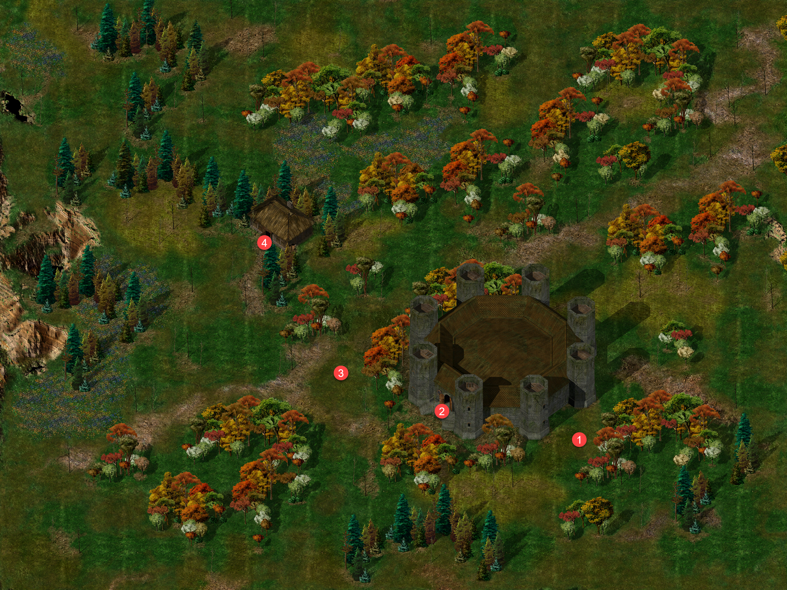
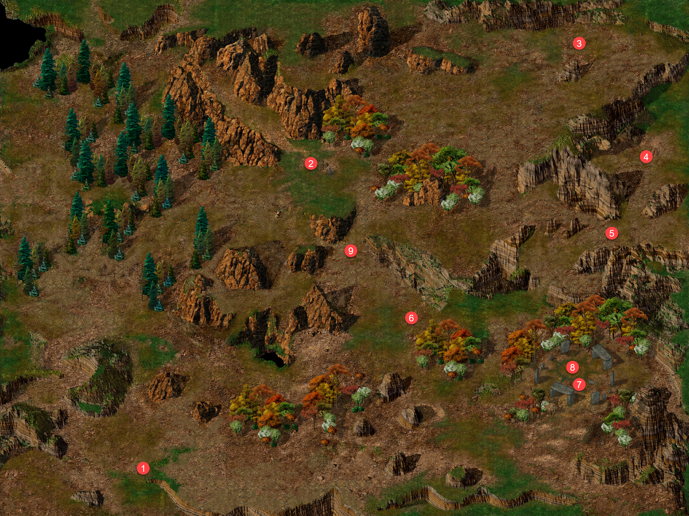
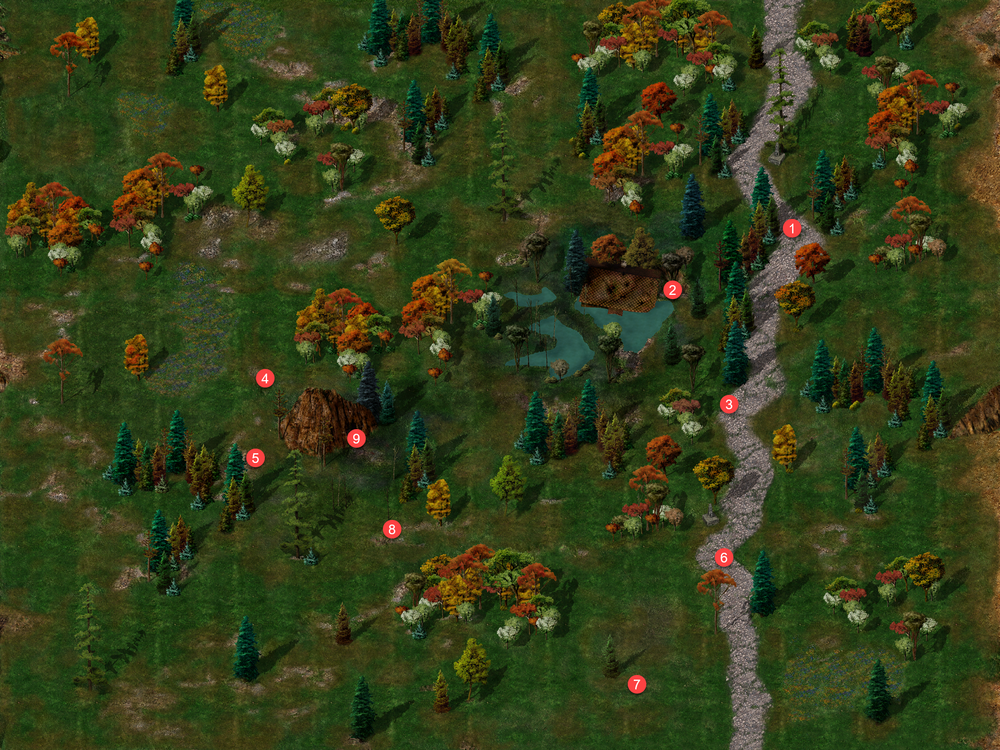
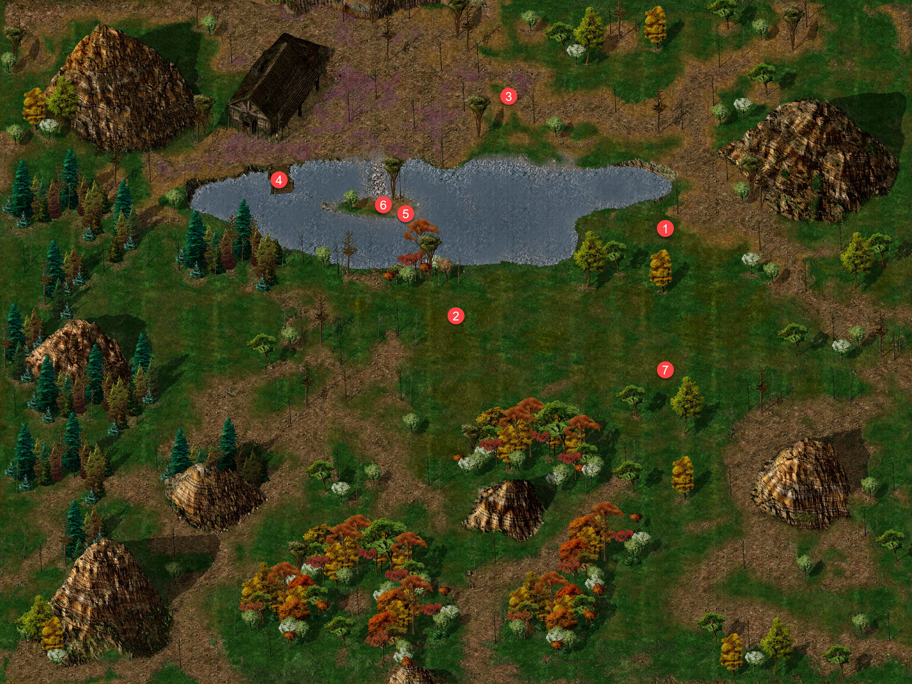
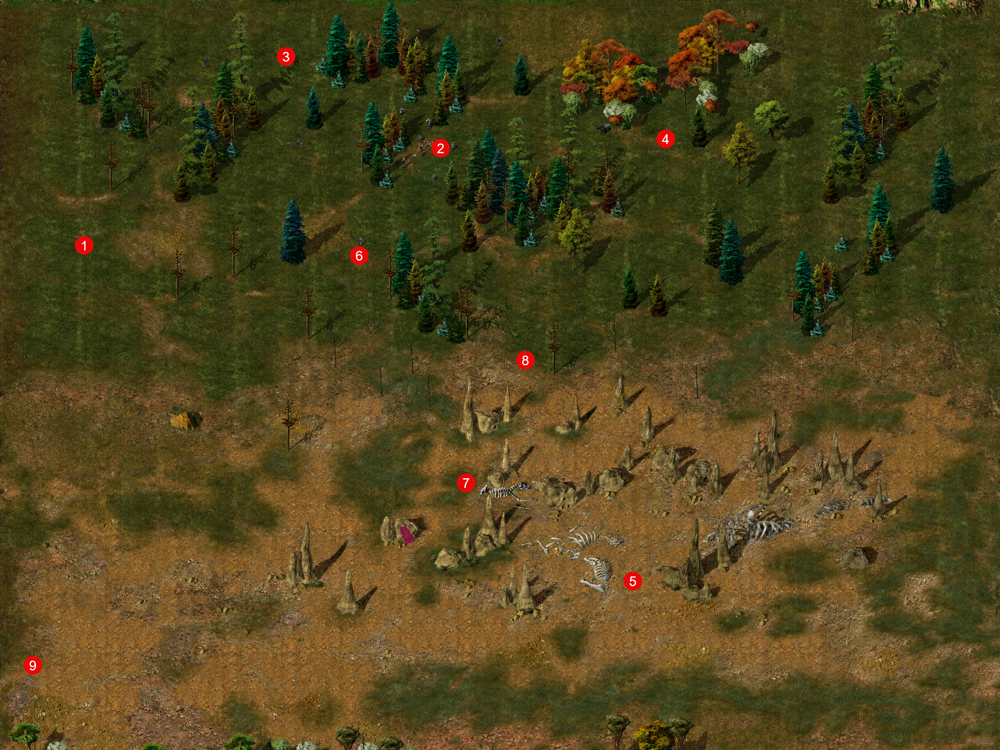
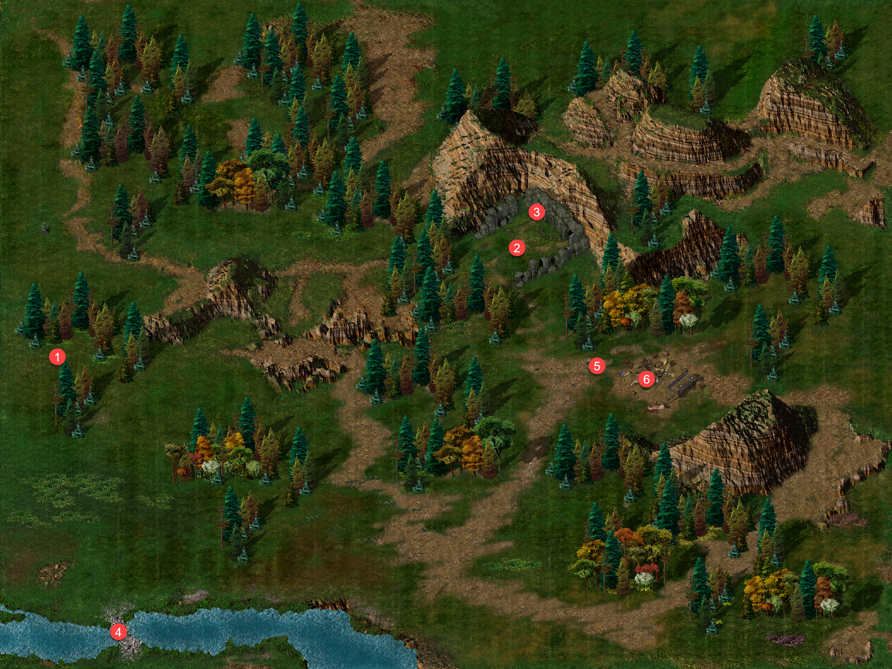

| Nazwa | Kod | Mapa |
|------------------------------|---------|--------------------------|
| Mapa świata | Faerun | { width="100" } |
| Candlekeep [1] | BG2600 | { width="100" } |
| Lwi Trakt [2] | BG2700 | { width="100" } |
| Nadbrzeżny Trakt [3,9,25,43] | BG2800 | { width="100" } |
| Pod Pomocną Dłonią [4,19,26,38,41] | BG2300 | { width="100" } |
| Beregost [5,7,8,11,17,23,35,37,42] | BG3300 | { width="100" } |
| Świątynia Lathandera [6,9,18,22,24,36] | BG3400 | { width="100" } |
| Wysoki Żywopłot [10,13] | BG3200 | { width="100" } |
| Czerwone Jary [12,46] | BG3700 | { width="100" } |
| Dzicze Beregostu [14,44] | BG3800 | { width="100" } |
| Przełęcz Nashkel [15,21,45] | BG4300 | { width="100" } |
| Ustronne Jezioro [16] | BG4200 | { width="100" } |
| Nashkel [20,27,34,48] | BG4800 | { width="100" } |
| Jarmark w Nashkel [28] | BG4900 | { width="100" } |
| Kopalnia Nashkel [31,33] | BG5400 | { width="100" } |
| Dolina Grobowców [32] | BG5000 | { width="100" } |
| Równina Ostrych Kłów [39] | BG3500 | { width="100" } |
| Las Pająków [40] | BG3000 | { width="100" } |
| Starożytne Ruiny [47] | BG4100 | { width="100" } |
| Góry Bełkotków [49] | BG5500 | { width="100" } |
| Gullykin [50] | BG4000 | { width="100" } |
| Knieja Larsa [53] | BG4000 | { width="100" } |

