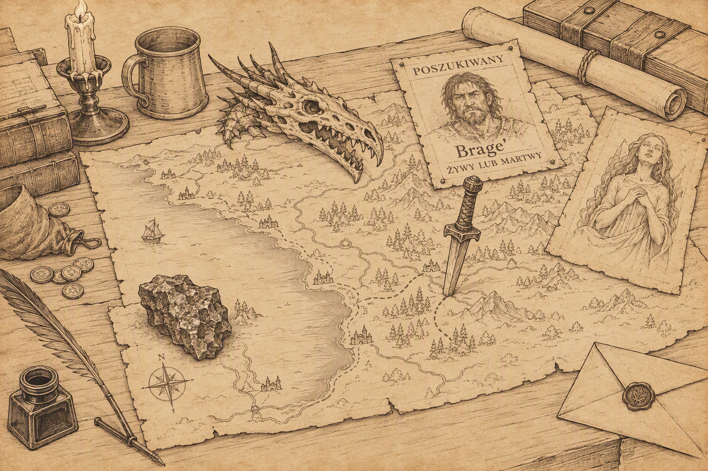
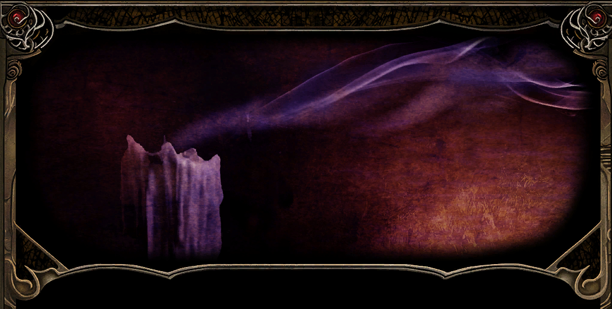

# Tropem żelaza

{ .center-img width="70%%" }

{ .center-img width="80%" }

*Po pospiesznej ucieczce z Candlekeep problemy nękające Wybrzeże Mieczy wciąż zlewały się w trudny do uporządkowania chaos. **Gorion** z pewnością nie chciałby jednak, aby jego wychowanek pozostawał bezczynny. Zbadanie kryzysu żelaza i wydarzeń w kopalni Nashkel mogło rzucić nieco światła również na niepewne położenie samego Leecha. Młody przywódca nie wiedział jeszcze, czy kłopoty regionu mają związek z zasadzką, śmiercią przybranego ojca i kolejnymi kontraktami wystawianymi na jego głowę. Wkrótce miał się przekonać, że na Wybrzeżu Mieczy przypadkowe zdarzenia wyjątkowo często okazują się fragmentami tej samej, znacznie większej układanki.*

## Nashkel&nbsp;20 { .divider }

{ .center-img width="40%" }

Dotarcie do *Nashkel* oznaczało wypełnienie ostatniej prośby **Goriona** i celu wyznaczonego przez **Jaheirę** oraz **Khalida** ([Jaheira and Khalid](../other/zadania.md#q11)).

Na rogatkach miasta drużyna spotkała **Kulla Huggerglittera** 1, uczonego zainteresowanego właściwościami miejscowej rudy. Badacz uważał, że *Nashkel* zbyt mocno kojarzy się z kopalnią, a zbyt mało ze sztuką i nauką. Zamierzał to zmienić, badając wpływ skrajnych temperatur na metale oraz wykonane z nich przedmioty. Szczególnie interesowało go magiczne zimno. Chciał sprawdzić, czy długotrwałe działanie mrozu wpływa na jakość broni i pancerzy. Potrzebował do tego zwartej bryły magicznego lodu, uformowanej przez wieloletnią zimę lub wyjątkowo chłodny klimat. Leech zgodził się przynieść podobne znalezisko, jeśli natrafi na nie podczas dalszych podróży ([Ice and Ore](../other/zadania.md#q61)).

Ostatnie walki wyraźnie zahartowały **Haiassa**, który stał się silniejszym i znacznie groźniejszym towarzyszem.

Przy wejściu do miasta drogę zastąpił **Bardolan** 2, strażnik pilnujący porządku w niespokojnym regionie. Ostrzegł, że osoby szukające kłopotów powinny czym prędzej ruszyć dalej, ponieważ *Nashkel* ma już wystarczająco wiele własnych problemów. Ruda z kopalni była zepsuta, w podziemiach miały grasować potwory, a najniższe poziomy zostały niemal opuszczone. Strażnik wspomniał również o dowódcy **Brage’u**, który pewnej nocy wpadł w szał i wymordował własną rodzinę. Mimo zbrodni **Bardolan** nadal nazywał go dowódcą, pamiętając człowieka, którym był przed tragedią. Nie wierzył, by tak gwałtowna przemiana nastąpiła bez zewnętrznej przyczyny.

Tuż obok **Brat** 3 wspomniał o człowieku topniejącym w jaskini na północ od miasta. Opowieść brzmiała niedorzecznie, ale w ostatnich dniach niedorzeczne historie podejrzanie często okazywały się prawdziwe (The Melting Man 62).

W gospodzie 4 na Leecha czekała kolejna łowczyni nagród. **Neira** zamierzała odebrać kontrakt opiewający już na sześćset osiemdziesiąt sztuk złota, lecz nie doceniła możliwości drużyny i podzieliła los poprzedników.

W jednym z pokojów przebywali państwo **von Undenzieh**, napuszona para szlachecka. Lady wspomniała o synu **Arnimie**, który bawił się gdzieś w mieście ze swoim nowym, egzotycznym zwierzątkiem.

Karczmarz ostrzegł, że sytuacja w *Nashkel* jest znacznie gorsza, niż mogłoby się wydawać przyjezdnym. Odkąd stworzenia zaczęły mordować górników, część mieszkańców uznawała miasto za przeklęte. Wspomniał również o tragedii **Brage’a**, który kilka tygodni wcześniej stracił rozum i zamordował własną rodzinę. Jego zdaniem nie było to dobre miejsce na dłuższy pobyt ([The Tale of Captain Brage](../other/zadania.md#q63)).

Przy gospodzie 5 drużyna spotkała przygnębioną **Taris**, poszukującą pewnego mężczyzny. Nie potrafili jednak udzielić jej żadnej pomocy.

W centrum miasta 6 oczekiwał burmistrz **Berrun Ghastkill**. Rozpoznał **Jaheirę** i domyślił się, że jej kompania jest obiecanym wsparciem. Wyjaśnił, że górnicy regularnie znikają, a wydobywana ruda zostaje w tajemniczy sposób zanieczyszczona. Straż nie mogła przeprowadzić dochodzenia, ponieważ chroniła mieszkańców i karawany przed bandytami. Leech zgodził się zejść pod ziemię, odnaleźć źródło problemu i przynieść dowody potwierdzające ustalenia. **Jaheira** obiecała wykorzystać swoje umiejętności, aby cała drużyna wróciła z pierwszej poważnej misji w jednym kawałku. 

**Finch** także przedstawiła własny projekt. Zamierzała założyć w *Nashkel* bibliotekę dostępną dla mieszkańców miasta. Burmistrz zgodził się przeznaczyć na ten cel skrzydło posiadłości lorda i lady **Fenric**, a przygotowania miał nadzorować ich sługa **Trask**. Poprosił jedynie, aby bibliotekarka oszczędziła gospodarzom ciągłego tupania i nadmiaru publicznych odczytów. Rozradowana gnomka zapewniła, że zachowa umiar, choć w jej przypadku mogło to oznaczać zaledwie kilka wykładów dziennie ([Finch's Quest to Start a Library in Nashkel](../other/zadania.md#q25)).

Nieopodal urzędował **Oublek** 7, samozwańcze niezastąpione ogniwo pomiędzy strażą a mieszkańcami. Niemal bez namysłu uznał Leecha za łowcę nagród **Greywolfa** i szykował już dwieście sztuk złota za rzekome wykonanie kontraktu na **Tengana**. Młody gnom uczciwie wyprowadził go z błędu. Zaskoczony urzędnik podziękował za szczerość i zapowiedział, że wieść o niej dotrze do dowódcy straży. Leech nie wzbogacił się o dwieście monet, ale udowodnił, że nie każda okazja do łatwego zarobku musi kończyć się opróżnieniem miejskiej kasy ([Oublek the Bounty Officer](../other/zadania.md#q64)). :material-trending-up: **Reputacja +1**

Zapytany o dostępne kontrakty **Oublek** wskazał dwie osoby. Pierwszą był zbiegły **Brage**, którego uznawano za wyjątkowo niebezpiecznego ([The Tale of Captain Brage](../other/zadania.md#q63)). Drugą okazał się rzeźbiarz **Prism**, oskarżony o kradzież dwóch szmaragdów. Straż pragnęła odzyskać klejnoty, lecz losem artysty interesowała się znacznie mniej ([Prism the Sculptor](../other/zadania.md#q65)).

W koszarach 8 żołnierze opowiedzieli więcej o upadłym dowódcy. Nagroda za jego głowę była wysoka, ale żaden z dawnych podwładnych nie chciał podnieść broni przeciwko towarzyszowi. Wielu podejrzewało wpływ przeklętego miecza albo złowrogiej magii. Oddział wysłany za **Brage’em** wyruszył niemal tydzień wcześniej i dotąd nie powrócił. Strażnicy przyznali również, że z powodu bandytów grasujących na północy brakuje ludzi do patrolowania kopalni. Miasto potrzebowało kogoś gotowego zejść pod ziemię i odkryć źródło kryzysu.

Po wyjściu z koszar drużynę zaczepił **Hick**. Przeprosił za wcześniejsze krzyki i wyjaśnił, że napięcie garnizonu wynika z tragedii dawnego dowódcy. **Brage** wyruszył samotnie na pozornie prostą misję. Kiedy żołnierze dotarli później na miejsce, znaleźli roztrzaskany wóz i stary miecz. Po powrocie do *Nashkel* odkryli ciała rodziny dowódcy. **Hick** podejrzewał, że znalezione ostrze mogło wywołać obłęd. Poprosił również, aby Leech nie wspominał porucznikowi o jego wcześniejszym wybuchu. Zniknięcie kapitana i śmierć jego bliskich wyraźnie miały głębsze podłoże, dlatego należało poszukać prawdy, zamiast jedynie dostarczyć uciekiniera przed sąd ([The Tale of Captain Brage](../other/zadania.md#q63)).

Obok koszar 9 stał potężnie zbudowany nieznajomy z gryzoniem na ramieniu. Na razie drużyna postanowiła ominąć go szerokim łukiem.

Zauważyli kłótnię między chłopcami 10 i jeden z chłopców osamotniony po tej dziecinnej aferze rówieśnikami. Inne dzieci przekonywały go, że nigdy nie stanie się prawdziwym mężczyzną i poprosił nas o wytłumaczenie co znaczy nim być. Leech wyjaśnił, że dojrzałość nie zależy od wzrostu ani brody, lecz od rozsądku, doświadczenia i umiejętności rozpoznania, kiedy należy działać. Pokrzepiony chłopiec postanowił kiedyś dokonywać wielkich czynów i zobaczyć odległe krainy. Najpierw musiał jednak wrócić do domu i nakarmić kury. Drużyna zapewniła go, że prawdziwemu mężczyźnie jak najbardziej wypada opiekować się uroczymi stworzeniami. Po spotkaniu z Melicampem wiedzieli, że lekceważenie drobiu bywa nierozsądne ([Into the Manhood](../other/zadania.md#q67)).

Przy moście drużyna spotkała **Edwina** 11, Czerwonego Maga poszukującego wiedźmy imieniem **Dynaheir**. **Sandrah**, darząca *Thayan* wyjątkową niechęcią, nie zamierzała uczestniczyć w planowanym morderstwie i kazała czarodziejowi wypchać się sianem ([Edwin and Dynaheir](../other/zadania.md#q68)).

Przy studni 12 oczekiwała **Sistriya**, która podczas niewoli w twierdzy gnolli ukryła księgę oraz dwa zwoje w mrocznej krainie dostępnej przez niewielki portal. Wejście można było otworzyć magicznym symbolem umieszczonym w jednej z jam w południowej części warowni. Badaczka nie chciała, aby o utracie notatek dowiedział się **Everan**. Za ich odzyskanie obiecała dwa tysiące sztuk złota oraz unikatową różdżkę. Wyprawa do twierdzy gnolli zyskała więc dodatkowy cel i portal do koszmarnego odbicia świata, bo najwyraźniej same gnolle nie były dostateczną zachętą ([Stronghold and Its Shadows](../other/zadania.md#q69)).

Przy wejściu do *Bekającego Smoka* stała pani **Brunnstein** 13, zrozpaczona matka poszukująca syna **Aarona**. Młodzieniec wyruszył w góry z narzeczoną **Mariną** i prawdopodobnie zamierzał poprosić ją o rękę. Żadne z nich nie jednak wróciło. Tropiciel **Barin** odnalazł ciało dziewczyny, zamordowanej i zrzuconej z wodospadu. Wokół widniały ślady jakiś potworów, dlatego nieuzbrojeni mieszkańcy nie odważyli się ruszyć dalej. **Jen’lig** obiecała pomóc, a zrozpaczona matka wskazała, że więcej informacji posiada **Barin**, przebywający w miejscowej świątyni ([A Failed Picnic](../other/zadania.md#q70)).

W karczmie 14 drużyna spotkała **Vola**, niestrudzonego bajarza gotowego za kufel piwa opowiedzieć wszystko, co zasłyszał w *Nashkel*. Według jego relacji kryzys żelaza objął całe Wybrzeże Mieczy. Karawany napadali współpracujący ze sobą ludzie i półludzie, ruda po przetopieniu stawała się bezużyteczna, a górnicy znikali pod ziemią. **Sandrah** przyznała, że w jego ustach nawet ponure wieści nabierają wdzięku. **Volo** natychmiast odpowiedział próbą flirtu, sugerując bardziej ustronne miejsce. **Jen’lig** zauważyła cierpko, że jego występ był jedynie rozwlekłą wersją ulicznych plotek. Zapytany o **Brage’a**, bajarz spoważniał. Dawny dowódca był rozsądnym i oddanym rodzinie człowiekiem, a jego obłędu nic wcześniej nie zapowiadało. Jedynym podejrzanym szczegółem pozostawał nowy miecz zdobyty krótko przed tragedią. Kolejna wzmianka o ostrzu trudno było uznać za przypadek.

W karczmie natknęliśmy się na poetę **Lake Poet Roba**, oferującego swoje usługi, lecz drużyna nie potrzebowała kolejnego autora pieśni o własnych dokonaniach.

Po drugiej stronie południowego mostu 15 zaczepił ich **Noober**, zasypując pytaniami pozbawionymi składu i sensu. **Sandrah** postawiła przerwać tę iritującą sytuację i wspomniała o jego równie nieznośnym bracie, którego podobno wrzuciła do portu za identyczne zachowanie. Noober uznał, że tym razem lepiej wycofać się w porę.

Na pobliskich polach **Karp** 16 opowiedziała o ciężkim życiu rolników. Ziemia była wypalona, twarda i dawała coraz gorsze plony. Jeśli kolejny rok nie przyniesie poprawy, jej rodzinę czekała przeprowadzka do slumsów *Athkatli*. Leech zauważył, że zarówno rolnicy, jak i górnicy pracują z rękami zanurzonymi w ziemi. **Karp** odpowiedział, że rolnik przynajmniej nie schodzi każdego dnia do własnego grobu. **Finch** dodała, że drużynę zapewne czeka pod ziemią śmierć i rozczłonkowanie, choć niekoniecznie w tej kolejności - śliczna optymistka.

Dalej na północy, **Nigati** 17 poinformowała nas przed rosnącym przy drodze *Aescalusem*. Roślina miała cenne właściwości lecznicze, dlatego zielarka przekazała **Sandrah** próbkę. Kapłanka wspomniała o pozostawionym w domu urządzeniu, które potrafiło wzmacniać mikstury dodatkiem niezwykłego ziela.

Przy północnym moście **Rasaad** 18 demonstrował sztuki walki *Zakonu Słonecznej Duszy*. Pokaz próbował zakłócić miejscowy osiłek, lecz mnich odmówił bezcelowej bójki. Wyjaśnił, że prawdziwy wojownik rozwija ciało, umysł i ducha, a siły używa w obronie słusznej sprawy. Jego zakon wywodził się z czasów *Netherilu* i pierwotnie służył *Amaunatorowi*. Po upadku imperium poszczególne wspólnoty zwróciły się ku różnym bóstwom, natomiast klasztor **Rasaada** obrał *Selûne*. Leech zaproponował mnichowi wspólną podróż, a ten zgodził się dołączyć. **Khalid** serdecznie powitał rodaka z Calimshanu, po czym wraz z **Jaheirą** ustąpił mu miejsca w drużynie. Oboje zamierzali oczekiwać w *Pomocnej Dłoni*.

# Rasaad

Człowiek · Mnich Słonecznej Duszy · Praworządny Dobry

> Zapytany o swoją przeszłość **Rasaad** ze smutkiem wspomina utratę brata, **Gamaza**, który zginął z rąk Złodziei Cienia z *Athkatli*. Obaj bracia dorastali w *Klasztorze Księżyca* w *Calimshanie*. Trafili tam po tym, jak jeden z mnichów Słonecznej Duszy uratował ich z ulic *Calimportu*. Po śmierci ojca, który zginął na Arenie Ifrytów, gdzie trafił za niespłacone długi, chłopcy z trudem wiązali koniec z końcem i utrzymywali się z drobnych kradzieży. Pomimo tragicznego dzieciństwa i śmierci **Gamaza**, **Rasaad** odnalazł wewnętrzny spokój w naukach swojego zakonu oraz wierze w **Selûne**, Pannę Księżyca.

:material-account-group: **Przyłączeni NPC:** *Rasaad*

:material-account-group: **Pozostawieni NPC:** *Khalid, Jaheira*

W świątyni *Helma* 19 drużyna spotkała **Barina**, tropiciela prowadzącego poszukiwania *Aarona*. Potwierdził, że młodzieniec i *Marina* zostali napadnięci przez gnolle przy wodospadzie. Dziewczynę zamordowano, natomiast *Aarona* uprowadzono na zachód. Nocą przy wodospadzie pojawiała się jasna postać przypominająca ducha. **Barin**, dysponujący jedynie grupą wystraszonych rolników, przerwał poszukiwania i zwrócił się o pomoc do kapłanów. Ślad **Aarona** prowadził więc ku górom, gdzie na drużynę czekały zarówno gnolle, jak i tajemnicza zjawa ([A Failed Picnic](../other/zadania.md#q70)).

**Nalin**, kapłan *Helma*, powitał przybyszów i zaoferował usługi świątyni. Rozpoznał jednak **Sandrah** i próbował poruszyć jakiś temat, który najwyraźniej nie był jej na rękę. Kapłanka uciszyła go pocałunkiem, wprawiając duchownego w zaskoczenie, ale nie wywołując wyraźnego sprzeciwu. **Nalin** uważał **Brage’a** za jednego z najlepszych dowódców straży po tej stronie *Amnu*. Podejrzewał, że za nagłym obłędem musiał stać zewnętrzny wpływ. Jeśli dawny dowódca dobrowolnie przyjdzie do świątyni, otrzyma pomoc i możliwość odpokutowania win zamiast natychmiastowej śmierci ([The Tale of Captain Brage](../other/zadania.md#q63)).

Kapłan przekazał również kilka plotek. **Keldath Ormlyr** miał odwiedzić Nashkel i bezskutecznie pouczać górników w sprawie wadliwej rudy. Nieprzychylna recenzja **Vola** podobno zmniejszyła dochody jednego z miejscowych przedsiębiorców o połowę, zaś w lasach na zachodzie widywano ogry i niebezpiecznych szaleńców. Najpoważniejsze wieści dotyczyły napięcia między *Amnem* a *Wrotami Baldura*. Wielcy Książęta oskarżali południowe królestwo o napady na szlakach, a do *Beregostu* skierowano oddziały Płonącej Pięści. Obie strony miały coraz więcej podejrzeń i coraz mniej zaufania.

Za świątynią 20 drużynę zagadnął przyjaźnie nastawiony zombie. Nie zamierzał pozostać nieumarłym, lecz pochowano go w obrządku *Helma*, podczas gdy jako górnik był wyznawcą *Ibrandula*. Grabarz przebywający w świątyni zgodził się powtórzyć ceremonię, pod warunkiem że nieboszczyk tym razem rzeczywiście pozostanie w grobie. Poinformowany zombie udał się do kaplicy ([An Errant Funeral](../other/zadania.md#q60)).

Na cmentarzu znajdowało się wiele osobliwych epitafiów. Przy grobie niejakiego *Marka D.* 21 zmaterializował się ku zaskoczeniu wszystkich mag **Daer’Ragh**, ostrzegając, że kolejna próba zbliżenia się do nagrobka zakończy się wyjątkowo nieprzyjemnie. Drużyna postanowiła wrócić do tej sprawy później.

W drodze ku posiadłości Fenriców spotkali Arnima 22, uciekającego przed młodą wiwerną. Stworzenie zostało zabite, chłopiec uciekł, a drużyna zabrała głowę bestyjki ([Nashkel Monster](../other/zadania.md#q71)).

W północnym dworku 23 oczekiwał ich **Trask**, przełożony **Finch**. Polecił bibliotekarce zdobywać księgi do powstającego księgozbioru. Właściciele posiadłości byli natomiast prowincjonalnymi arystokratami, którzy pragnęli uchodzić za mecenasów literatury, choć niewiele o niej wiedzieli. Na piętrze drużyna zastała ich córkę **Samanthę** i **Jamiego** w dwuznacznej sytuacji (raczej jednoznacznej!). Para szybko uciekła, licząc, że spotkanie nie dotrze do uszu rodziców. W bibliotece odnaleziono trzynasty tom „*Historii Shadowdale*”, poszukiwany przez gadający regał **Thalantyra** ([Bibliophilia](../other/zadania.md#q54)).

W domu na zachodzie 24 mieszkanka Nashkel poprosiła o odnalezienie męża **Josepha**, pracującego w kopalni. Rozpoznawalnym znakiem był noszony przez niego pierścień z nefrytem ([Joseph's Wife](../other/zadania.md#q72)).

Po zebraniu nowych tropów kompania postanowiła wrócić do *Beregostu* i *Pomocnej Dłoni*, zabrać **Imoen** oraz **Garricka**, a przy okazji zamknąć kilka rozpoczętych juz spraw.

:material-paw: Bestiariusz: *młoda wiwerna*

## Przełęcz Nashkel&nbsp;21 { .divider }

{ .center-img width="40%" }

W jaskini 5 drużyna odnalazła **Boohady’ego Creama**, nazywanego przez miejscowe dzieci *Topniejącym Człowiekiem*. Nieszczęśnik rzeczywiście powoli rozpływał się na oczach przybyszów. Klątwę rzuciła na niego *Madame Potpourri*, przekonana, że z niej szydził. Boohady nie znał sposobu na cofnięcie przemiany ani miejsca pobytu czarownicy. Wiedział jedynie, że kobietę przyciągają jaskrawe kolory, słodycze i hazard. Wszystkie trzy wskazówki prowadziły ku jarmarkowi w Nashkel ([The Melting Man](../other/zadania.md#q62)).

Drużyna ruszyła następnie do *Świątyni Lathandera*, aby zdać raport z zakończonej sprawy pogrzebu.

:material-paw: Bestiariusz: *bełkotek*

## Świątynia Lathandera&nbsp;22 { .divider }

{ .center-img width="40%" }

**Eloran** 2 dowiedziała się, że zmarły sam opuścił grób, ponieważ odprawiono nad nim obrządek *Helma*, zamiast ceremonii należnej wyznawcy *Ibrandula*. Kapłanka zapytała Leecha, jak zamierza postępować wobec ludzi wyznających zupełnie odmienne wartości. Młody gnom odparł, że nie zdoła przekonać każdego słowami, ale może własnym przykładem pokazać istnienie innych dróg. **Eloran** uznała, że taka metoda czasem przynosi efekty ([An Errant Funeral](../other/zadania.md#q60)).

Nowe zlecenie było mniej wzniosłe. W domu niedaleko *Płonącego Czarodzieja* pojawiła się plaga szczurów, a *Płonąca Pięść* odmówiła interwencji. Kapłanka przypomniała, że nie każde zadanie musi być widowiskowe. Tępienie gryzoni stanowiło niemal rytuał przejścia każdego poszukiwacza przygód ([The Rat King](../other/zadania.md#q73)).

## Beregost&nbsp;23 { .divider }

{ .center-img width="40%" }

W *Wesołym Żonglerze* 22 do drużyny ponownie dołączyła **Imoen**.

:material-account-group: Przyłączeni NPC: **Imoen**

**Landrin** 21 poczęstowała swoich wybawców ożywczą herbatą, która uleczyła odniesione rany.

W domu wskazanym przez Eloran 42 właścicielka skierowała kompanię na piętro. Zamiast zwyczajnego gniazda gryzoni zastali tam Króla Szczurów, przypominającego bardziej likantropa niż zwierzę. Leech przekonał go, by wraz ze stadem przeniósł się do tuneli na *Nadbrzeżnym Trakcie*, opuszczonych po śmierci malarity ([The Rat King](../other/zadania.md#q73)).

W siedzibie *Oka Gorgony* 29 drużyna zamknęła kontrakt na **Cartha**. **Liedel** przyjęła wiadomość z zadowoleniem, lecz nie miała na razie kolejnych zleceń ([Liedel's Bounty: Carth](../other/zadania.md#q40)).

## Świątynia Lathandera&nbsp;24 { .divider }

{ .center-img width="40%" }

Po szybkim rozwiązaniu szczurzego problemu drużyna wróciła do **Eloran** 2. Leech wyjaśnił, że oszczędził szczurołaka, ponieważ przeciwnik nie zasługiwał na śmierć wyłącznie z powodu swojej natury.

Kapłanka zauważyła, że nie mamy wpływu na to, kim się rodzimy, lecz możemy zdecydować, kim się staniemy. Miała jedynie nadzieję, że podarowana istocie szansa nie obróci się kiedyś przeciw młodemu gnomowi ([The Rat King](../other/zadania.md#q73)).

Kolejne zlecenie dotyczyło agenta *Zhentarimów* zmierzającego z *Pomocnej Dłoni* do *Beregostu*. **Eloran** stanowczo odrzuciła pomysł rozpoczęcia rozmowy. Według niej poszukiwany *Zhent* nie należał do nielicznych renegatów zasługujących na wątpliwości. Zadanie miało zakończyć się jego śmiercią ([A Zhent Agent](../other/zadania.md#q74)).

## Nadbrzeżny Trakt&nbsp;25 { .divider }

{ .center-img width="40%" }

Agent nie poruszał się otwartym traktem, lecz ukradkiem przemykał w cieniu drzew (10). Zaatakował Sandrah z zaskoczenia, ale został szybko pokonany ([A Zhent Agent](../other/zadania.md#q74)).

Korzystając z bliskości *Pomocnej Dłoni*, drużyna udała się tam na odpoczynek.

:material-paw: Bestiariusz: *chory bełkotek*

## Pomocna Dłoń&nbsp;26 { .divider }

{ .center-img width="40%" }

Podczas odpoczynku **Rasaad** opowiedział więcej o przeszłości. Jego matka zmarła przy porodzie, a ojciec samotnie wychowywał jego i brata **Gamaza**. Gdy rosnące długi przerosły możliwości rodziny, ojca skazano na walkę na arenie *Ifrytów*, gdzie zginął ku rozrywce tłumu. Osieroceni bracia przetrwali na ulicach *Calimportu*, żebrząc, usługując i czasem kradnąc. Kiedy **Gamaz** został przyłapany z ręką w sakiewce mnicha *Słonecznej Duszy*, duchowny zamiast wymierzyć karę zabrał obu chłopców do klasztoru. Tam otrzymali schronienie i rozpoczęli naukę sztuk walki oraz tajemnic *Selûne*. Po latach klasztor w *Athkatli* przestał odpowiadać na wiadomości. Przełożeni z *Calimportu* wysłali dziesięciu mnichów, w tym obu braci, aby zbadać sprawę. Na miejscu zastali opuszczoną siedzibę, a mieszkańcy bali się rozmawiać. Po długim śledztwie odkryli, że za zniknięciem wspólnoty mogli stać wyznawcy *Shar*. W zasłyszanych szeptach stale powracało jedno imię: **Alorgoth**. **Rasaad** nie uważał swoich poszukiwań za zemstę. Pragnął odpowiedzi i sprawiedliwości dla zaginionych członków zakonu. Do historii **Gamaza** zamierzał powrócić, gdy będzie gotów opowiedzieć więcej.

W innej rozmowie Leech zauważył, że **Drizzt Do’Urden** znał **Sandrah** znacznie lepiej, niż sugerowało ich niedawne spotkanie. Kapłanka przyznała, że drow był jednym z jej nauczycieli walki. Jako dziewczynka wzięła niespodziewanego gościa za włamywacza i zaatakowała go niewielkim młotkiem używanym do mocowania girland. **Drizzt** podjął zabawę, sprawdzając jej umiejętności aż do chwili, gdy ojciec **Sandrah** wyjaśnił pomyłkę. Wojownik dostrzegł naturalny talent dziewczyny i podczas pobytu w *Waterdeep* udzielił jej prawdziwych lekcji. Młot pozostał odtąd jej ulubioną bronią. Leech zażartował, że zapewne samego rzucania zaklęć uczył ją **Elminster**. Tajemniczy uśmiech kapłanki sugerował jednak, że żart mógł być niebezpiecznie bliski prawdy.

W wolnej chwili **Imoen** wyrównała rachunki z **Finch** za dawny żart z *Candlekeep*, wypełniając jej posłanie miodem i robakami. Bibliotekarka przypomniała, że sama jedynie przykleiła zakładkę przyjaciółki do rzadkiego tomu o archeologii *Netherilu*. Ponieważ **Finch** musiała zmienić pościel, Imoen otrzymała obowiązek wyprania koców i umycia stóp bibliotekarki. Zwycięstwo siostrzyczki Leecha okazało się krótkotrwałe, lepkie i zakończone dodatkowymi obowiązkami.

Podczas marszu **Sandrah** usłyszała melodię nuconą przez **Garricka**. Pieśń miała należeć do powstającego eposu o bohaterach *Wybrzeża Mieczy*, a jedną z jego głównych postaci była córka potężnego maga. Bard próbował opisać urodę swojej muzy, lecz zabrakło mu odpowiednio wzniosłych słów. **Sandrah** poradziła, aby zamiast pochwał wykazał się czynami. Propozycja odebrała artyście większość pewności siebie, a gdy oboje zostali nieco z tyłu, dalszego ciągu rozmowy nie usłyszał już nikt.

Po wygodnym noclegu drużyna postanowiła wrócić do Nashkel i przygotować się do zejścia pod ziemię.

:material-account-group: Odłączeni NPC: Rasaad (Nashkel)

:material-account-group: Przyłączeni NPC: Garrick

## Nashkel&nbsp;27 { .divider }

{ .center-img width="40%" }

Przy gospodzie 4 Leecha niespodziewanie oskarżono o napaść na **Arnima** i zabicie jego rzekomo niegroźnego zwierzątka. Nowobogaccy von **Undenzieh** przyprowadzili żołnierza i zażądali aresztowania winowajcy. **Sandrah** wyjaśniła, że drużyna uratowała chłopca przed młodą wiwerną, która wykluła się z kupionego przez rodzinę jaja. Rodzice nie chcieli słuchać, dopóki kapłanka nie pokazała odciętej głowy stworzenia. Przyciśnięty dowodami **Arnim** przyznał, że skłamał ze strachu przed karą za utratę drogiego pupila. Strażnik odrzucił oskarżenia. Undenzieh'owie bardziej martwili się jednak stratą stworzenia wartego tysiąc sztuk złota niż ocaleniem syna ([Nashkel Monster](../other/zadania.md#q71)).

W sklepie **Henninga** 25 drużyna sprzedała futro zimowego wilka za pięćset sztuk złota. Kupiec zwrócił uwagę na **Imoen**, lecz zabrakło mu odwagi, by zagadnąć ją bezpośrednio. **Sandrah** szybko zrozumiała jego intencje i przedstawiła ich sobie. Dziewczyna początkowo bardziej interesowała się różową odzieżą niż właścicielem sklepu, ale wyraźnie speszony **Henning** zdołał wzbudzić jej ciekawość.

Mając **Imoen** ponownie w drużynie, kompania udała się na jarmark.

## Jarmark w Nashkel&nbsp;28 { .divider }

{ .center-img width="40%" }

**Imoen** szybko ostrzegła **Sandrah**, że przystojny i dobrze wychowany **Henning** pozostaje tylko w jej orbicie zainteresowań. Kapłanka zapewniła, że nie zamierza rywalizować z „*Imoen Wspaniałą*”, zwłaszcza że kupiec od początku zwracał uwagę właśnie na nią. Zwykle pewna siebie dziewczyna natychmiast się speszyła i zaczęła mieć nadzieję na kolejną wizytę w sklepie.

Emerytowany bibliotekarz **Archibald** 1 wyprzedawał ostatnie tomy ze swojej kolekcji. **Garrick** rozpoznał wśród nich „*Ostateczne kompendium sławnych, choć mało znanych bohaterów*” autorstwa *Saemona Schamy*. Ujęty entuzjazmem barda i dobrymi manierami drużyny starzec podarował księgę bez zapłaty. Jeden z rozdziałów wspominał o duchu barda **Myr’Cutia**, który miał błąkać się w pobliżu ruin szkoły magii *Ulcastera*, wciąż poszukując nowych przygód ([Traveling Librarian](../other/zadania.md#q75)).

Artyści występujący nieopodal 2 przekazali kilka informacji o **Prismie**. Rzeźbiarz zachowywał się inaczej od chwili powrotu z *Evereski*, a jego nieobecność na ulubionym jarmarku budziła zdziwienie ([Prism the Sculptor](../other/zadania.md#q65)).

The Great Gazib 3 demonstrował przywoływanie ogra zwanego **Oopah Wspaniały**. Wielokrotnie dręczone stworzenie w końcu zaatakowało. Drużyna musiała je zabić, a samozwańczy czarodziej uciekł. **Sandrah** była już pewna, że gdzieś na jarmarku znajduje się również skamieniała kobieta z wizji.

Przy kolejnym stoisku 4 sprzedawano króliki. Drużyna kupiła jednego z myślą o dobrodusznym **Ughu** ([A New Best Friend for Ugh](../other/zadania.md#q59)).

W jednej z jurt 5 szybkopalca **Vitiare** ukradła Leechowi sto sztuk złota, lecz nie uciekła wystarczająco szybko. Tam również odnaleziono **Madame Potpourri**, która za odpowiednią opłatą przekazała antidotum dla **Boohady’ego Creama**. Czarownica sądziła, że mężczyzna szydził z niej, choć w rzeczywistości nawiązywał jedynie do własnego nazwiska ([The Melting Man](../other/zadania.md#q62)).

„Lord” Binky the Buffoon 6 próbował przedrzeźniać Leecha, lecz szybko stracił zapał.

W jednej z szulerni 7 krupier zaoferował rzadki magiczny przedmiot. Była nim skórzana uprząż, podobno należąca niegdyś do bohatera z *Doliny Lodowego Wichru*. Leech odkupił osobliwe znalezisko za pięćset sztuk złota.

W mniejszym pawilonie 8 **Zordral** więził czarodziejkę **Benthę** i groził jej śmiercią. Oskarżał kobietę o zamiar otrucia dzieci, wybicia zwierząt oraz podporządkowania sobie młodych mieszkańców miasta. **Sandrah** wytknęła mu obłudę: sam był magiem i zamierzał zabić pojmaną za pomocą zaklęcia, a mimo to potępiał ją za używanie magii. Rozwścieczony **Zordral** zaatakował i przypłacił fanatyzm życiem. Uwolniona **Bentha** potwierdziła, że jej prześladowca był dawnym wrogiem rodziny. W podzięce wskazała **Volothampa Geddarma**, przebywającego w gospodzie w Nashkel, jako człowieka posiadającego wyjątkowo rozległą wiedzę.

W kolejnej pałatce 9 sprzedawano magiczne amulety i zwoje ochronne. Nieopodal **Lestor** 10 przyznał, że jarmark opustoszał, ponieważ większość mieszkańców pracuje w kopalni albo już padła ofiarą czyhających tam stworzeń. Górnicy nadal schodzili pod ziemię, gdyż bez pracy ich rodziny czekał głód.

W następnym pawilonie 11 handlarz próbował wyłudzać pieniądze za bezwartościowe eliksiry. Leech pozbawił go życia, zabierając ze skrzyń rzeczy mające rzeczywistą wartość. :material-trending-down: Reputacja -4

Kolejni sprzedawcy 12, 13 oferowali broń i mikstury.

Tina 14 próbowała wyłudzić nieco pieniędzy. Otrzymała dwadzieścia sztuk złota za bezwartościowy amulet, po czym przyznała, że był to zakład mający sprawdzić, czy zdoła przekonać nieznajomego do wręczenia jej monet.

Krasnolud **Zeke** 15 wystawiał na pokaz skamieniałą kobietę 16, oferując zwój przywracający ciało za pięćset sztuk złota. Sandrah rozpoznała ofiarę i nie zamierzała płacić za cudze nieszczęście. Odebrała handlarzowi zwój i przepędziła go z jarmarku. Po użyciu zaklęcia z kamiennego więzienia uwolniono **Branwen**, kapłankę-wojowniczkę *Tempusa* z *Wysp Norheim*. W podzięce dołączyła do drużyny. Ostrzegła także przed magiem **Tranzigiem**, który ją skamienił i działał dla nieznanej grupy najemników ([Find the Petrified Priestess](../other/zadania.md#q18)).

**Sandrah** wyjaśniła, że o losie wojowniczki dowiedziała się dzięki *Odłamkowi Mystry*, magicznemu urządzeniu jej ojca. **Branwen** dostrzegła ironię w tym, że magia odpowiedzialna za uwięzienie pośrednio doprowadziła również do ratunku. Wspólnie rozpoczELI polowanie na **Tranziga** i jego sprzymierzeńców.

# Branwen

Człowiek · Wojowniczka/Kapłanka Tempusa · Neutralna

> Pochodzi z osady *Seawolf* na Wyspach Norheim. Opuściła rodzinne strony w młodym wieku, ponieważ pragnęła zostać kapłanką, choć w jej społeczności funkcję tę mogli pełnić wyłącznie mężczyźni. Nie żywi jednak urazy do swoich pobratymców, uznając te przeciwności za próbę wiary. Podróżując wzdłuż wybrzeża, służyła w lokalnych milicjach, aż dołączyła do grupy poszukiwaczy przygód działającej w okolicach *Nashkel*. Nie wiedziała, że jej towarzysze zajmują się rozbojem. Podczas pierwszego napadu odmówiła zaatakowania karawany bezbronnych kupców i wystąpiła przeciw bandytom. W trakcie walki mag **Tranzig** przemienił ją w kamień. Pomimo poniesionej klęski **Branwen** wierzy, że **Tempus** aprobuje jej decyzję. W jej oczach atakowanie bezbronnych należy do najbardziej nikczemnych czynów.

:material-account-group: Odłączeni NPC: Garrick (Pomocna Dłoń)

:material-account-group: Przyłączeni NPC: Branwen

Na jarmarku nie brakowało osób pragnących przygód. Młoda bardka **Keiria Silverstring** próbowała dołączyć do drużyny, lecz kompania nie potrzebowała kolejnej niedoświadczonej pieśniarki.

Pierwsza rozmowa **Jen’lig** i **Branwen** rozpoczęła się od wzajemnej nieufności. Kapłanka znała githyanki jako bezlitosnych zabójców, natomiast astralna wojowniczka uważała mieszkańców *Planu Materialnego* za słabych i pozbawionych honoru. Obie dostrzegły jednak podobieństwo własnych uprzedzeń. **Branwen** postanowiła dać githyanki szansę, a **Jen’lig** zauważyła, że zło często przypisuje się temu, co nieznane, dlatego prawdy należy szukać głębiej niż w opowieściach.

Zmartwiony **Tayn** 17 poszukiwał brata **Husky’ego**, który oddalił się do lasu z pewną dziewczyną. Towarzyszka wróciła sama, twierdząc, że spotkanie rozczarowało jej oczekiwania, a młodzieńca pozostawiła w pobliżu jaskini. Drużyna zgodziła się poszukać brata Tayana ([Carnival and the Missing Brother](../other/zadania.md#q76)).

W skrzyni 18 odnaleziono pierwszą książkę poszukiwana przez **Finch** - „*Współczesna metalurgi*” ([Finch's Quest to Start a Library in Nashkel](../other/zadania.md#q25)).

Kolejny gnom o magicznych predyspozycjach, **Skeezer Lumpkin VI** 19, marzył o przygodach, lecz również nie znalazł miejsca w drużynie.

W palarni opium na wschodzie 20 jedynie **Pruflas** był zdolny do rozmowy, lecz nie powiedział niczego przydatnego.

W północnym lesie znajdowała się jaskinia 21, w której skrzynia okazała się młodym mimikiem. Po jego pokonaniu znaleziono odgryzioną, owłosioną dłoń oraz wartościowy amulet. Przedmioty należały do **Husky’ego**, co rozwiało nadzieję na jego uratowanie ([Carnival and the Missing Brother](../other/zadania.md#q76)).

{ .center-img width="60%" }

Miejscowi opowiadali również o zatonięciu łodzi, w którym zginęło kilkanaście osób, napadach bandytów kradnących bydło oraz skarbach ukrytych podobno w ruinach *Mostu Firewine*.

Podczas marszu **Sandrah** przysunęła się do Leecha i położyła dłoń na jego ramieniu. Zapewniła, że dopóki są razem, to raczej czekające przed nimi zagrożenia powinny się obawiać. Przyznała, że nie wątpi w jego zdolności, lecz człowiek ścigany przez skrytobójców powinien przyjmować każdą dostępną ochronę. Leech odpowiedział, że jej opieka zawsze będzie mile widziana.

Zmęczona kompania rozbiła obóz w lesie nieopodal jarmarku.

<em>Podczas niespokojnej nocy Leech po raz pierwszy od opuszczenia Candlekeep ujrzał we śnie Goriona. Wizja przeniosła go pod mury dawnego domu, gdzie cień przybranego ojca ponownie ruszył ku lasom. Na jego oczach przeszłość wciąż odtwarzała śmierć opiekuna. Z każdym powtórzeniem nieznany zabójca wydawał się jednak mniej niezwyciężony. Leech nabrał przekonania, że pewnego dnia zdobędzie dość siły, aby dorównać mordercy i pomścić jego ofiary. Gdy wizja dobiegła końca, odnalazł w lesie nieznaną ścieżkę i podążył nią, prowadzony obcym głosem obiecującym mu upragnioną moc.</em>

**Sandrah** zauważyła, że Leech źle spał. Wizja zawierała niezrozumiałe przesłanie, a po przebudzeniu młody gnom odkrył w sobie nową zdolność. Kapłanka ostrzegła, że ścierają się w nim dwie siły i dwie drogi. Walkę mogła zapoczątkować śmierć **Goriona** albo obraz jego mordercy. Również **Imoen** zauważyła bladość przyjaciela. Leech wyjaśnił, że potrafi teraz wysysać z przeciwnika siły życiowe, raniąc go i jednocześnie lecząc własne ciało. Dziewczyna uznała moc za niepokojącą, choć potencjalnie przydatną.

Nadszedł czas na kopalnię.

:material-paw: Bestiariusz: *agresywny młody mimik*
