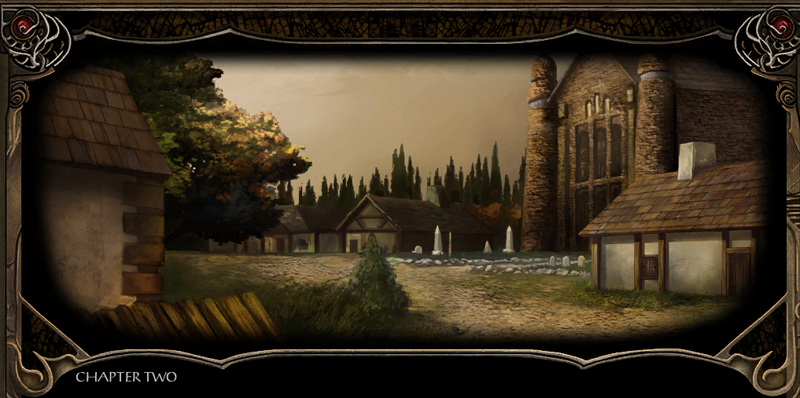
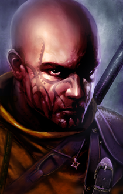
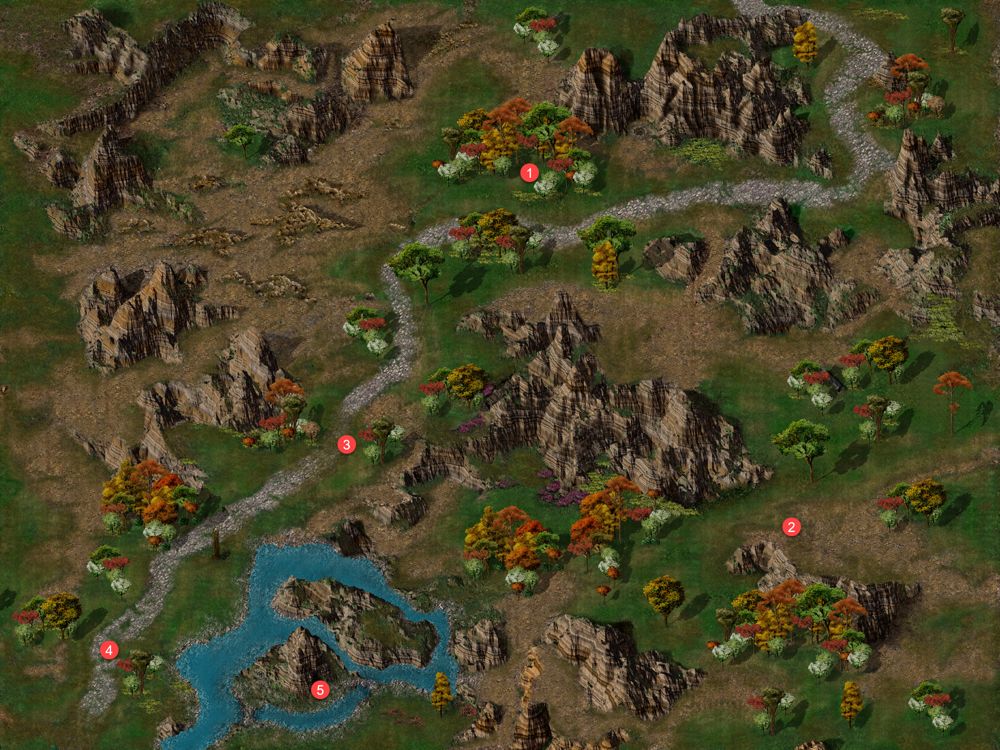
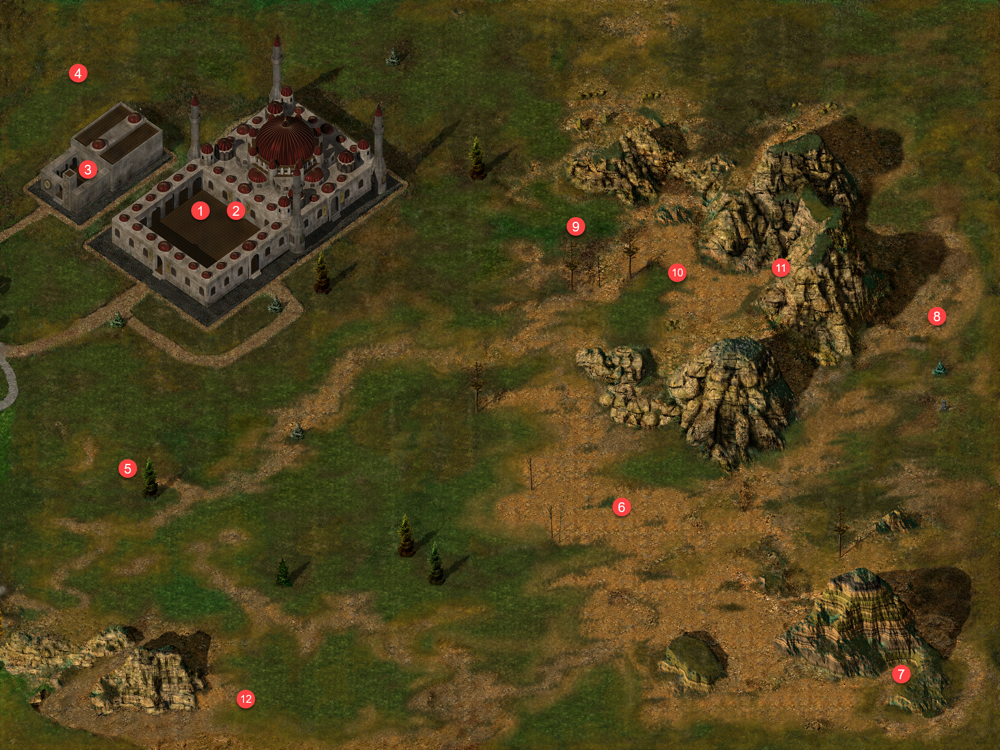
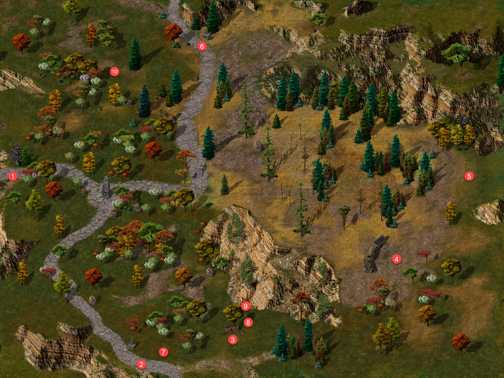
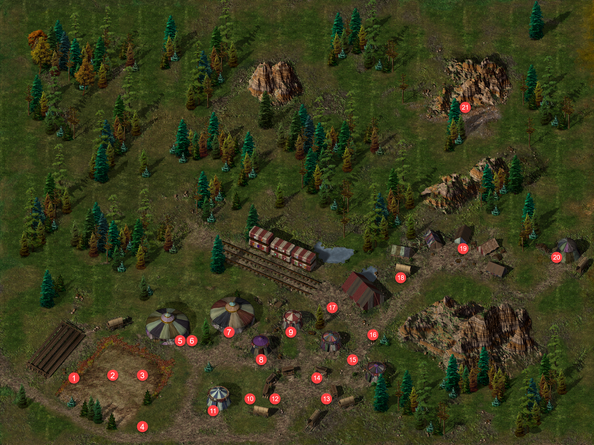
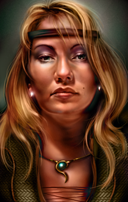
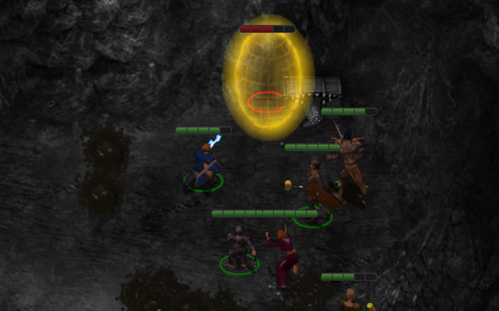

# Co z tym żelazem?
{ .center-img width="90%" }

*Po niedawnej, pospiesznej ucieczce z Candlekeep problemy nękające Wybrzeże Mieczy wciąż zlewały się w trudny do uporządkowania chaos. **Gorion** z pewnością nie chciałby jednak, aby jego wychowanek pozostawał bezczynny. Zbadanie miejscowych kłopotów mogło rzucić nieco światła zarówno na kryzys żelaza i wydarzenia w kopalniach Nashkel, jak i na niepewne położenie samego Leecha. Młody przywódca nie wiedział jeszcze, czy problemy regionu mają jakikolwiek związek z zasadzką, śmiercią przybranego ojca i kolejnymi kontraktami wystawianymi na jego głowę. Wkrótce miał się jednak przekonać, że na Wybrzeżu Mieczy przypadkowe zdarzenia wyjątkowo często okazują się fragmentami tej samej, znacznie większej układanki.*

## Nashkel&nbsp;20 { .divider }

[{ .center-img width="40%" }](../maps/BG4800.webp)

Dotarłem do Nashkel i wypełniłem prośbę Goriona (Jaheira and Khalid 11).

Na rogatkach *Nashkel* drużyna spotkała **Kulla Huggerglittera** (1), uczonego zainteresowanego nietypowymi właściwościami miejscowej rudy. Badacz uważał, że miasto zbyt mocno kojarzy się z kopalnią, a zdecydowanie za mało ze sztuką i nauką. Sam zamierzał nieco poprawić tę nierównowagę, rozpoczynając projekt dotyczący wpływu skrajnych temperatur na surowce oraz wykonane z nich przedmioty. Szczególnie interesowało go magiczne zimno. Chciał sprawdzić, jak długotrwałe działanie mrozu wpływa na rudę i jakość wytwarzanej później broni oraz pancerzy. Przy obecnym kryzysie żelaza badanie mogło mieć praktyczne znaczenie, ponieważ należało ustalić, czy wyposażenie wykonane z poddanego takim warunkom metalu pozostaje bezpieczne. Leech zgodził się pomóc, choć potrzebny składnik zapowiadał się nietypowo. **Kull** poszukiwał zwartej bryły magicznego lodu, powstałej w wyniku wieloletniego działania naturalnych procesów, długiej zimy albo wyjątkowo chłodnego klimatu. Nie oczekiwał szybkiego rezultatu, lecz poprosił, aby drużyna przyniosła mu podobne znalezisko, jeśli natrafi na nie podczas dalszych wędrówek (Ice and Ore 61).

Ostatnie walki znacznie wpłynęły na Haiass’a stał się teraz dużo groźniejszym kompanem.

Przy wejściu do *Nashkel* drogę zastąpił drużynie **Bardolan** (2), miejscowy strażnik pilnujący porządku w niespokojnym regionie. Ostrzegł, że osoby szukające kłopotów powinny czym prędzej ruszyć dalej. W *Nashkel* i bez ich pomocy działo się już wystarczająco źle. Zapytany przez **Finch** o sytuację w mieście, **Bardolan** opowiedział o coraz bardziej niepokojących pogłoskach. Ruda wydobywana w kopalni była zepsuta, a w podziemiach miały grasować demony. Najniższe poziomy zostały opuszczone i miały pozostać zamknięte do czasu rozwiązania kryzysu. Strażnik wspomniał również o dowódcy **Brage’u**, który pewnej nocy wpadł w szał i zamordował własną rodzinę. Pozbawiono go tytułu, lecz **Bardolan** nadal nazywał go dowódcą, pamiętając człowieka, którym był przed tragedią. **Brage** uciekł w pobliskie wzgórza, a jego dawny podwładny wierzył, że coś musiało doprowadzić go do szaleństwa. Na wspomnienie upadłego dowódcy głos strażnika zaczął drżeć. Nie opłakiwał wyłącznie zamordowanej rodziny, lecz także człowieka utraconego przez całe *Nashkel*. Drużyna wkroczyła więc do miasta z trzema wyraźnymi tropami: zepsutą rudą, pogłoskami o stworzeniach w kopalni oraz tajemniczym obłędem **Brage’a**. Wszystkie wskazywały, że kryzys na południu sięga znacznie głębiej, niż sugerowały uliczne plotki.

Tuż obok Brat (3) twierdzi, że widział topniejącego człowieka w jaskini na północ od miasta (The Melting Man 62).

W gospodzie (4) kolejna łowczyni głów – Neira, odchodzi w zapomnienie i jej kontrakt opiewający już na 680 sztuk złota. W pokoju zastajemy napuszoną szlachtę z rodu Undenzieht, lady wspomniała syna Armina bawiącego się nowym zwierzakiem.

Rozmowy z gośćmi miejscowej karczmy szybko potwierdziły, że sytuacja w *Nashkel* jest znacznie gorsza, niż mogłoby się wydawać przyjezdnym. Jeden z bywalców poradził drużynie, aby zawróciła, póki jeszcze może. Odkąd w kopalni pojawiły się potwory mordujące górników, mieszkańcy zaczęli uważać miasto za przeklęte. Karczemne pogłoski przypomniały również o tragedii **Brage’a**. Zaledwie kilka tygodni wcześniej dowódca miejscowej straży stracił rozum i wymordował własną rodzinę (The Tale of Captain Brage 63). Dla mieszkańców był to kolejny dowód, że nad *Nashkel* zawisło coś znacznie gorszego niż zwyczajny kryzys żelaza. Jak oznajmił ponuro jeden z gości, nie było to dobre miejsce na dłuższy pobyt.

Karczmarz ostrzegł drużynę, że sytuacja w *Nashkel* jest znacznie gorsza, niż mogłoby się wydawać przyjezdnym. Odkąd potwory zaczęły mordować górników w miejscowej kopalni, mieszkańcy uznawali miasto za przeklęte, a rozsądniejszym podróżnym radzono zawrócić, póki jeszcze mogli. Wspomniał również o tragedii **Brage’a**, niedawnego dowódcy straży, który kilka tygodni wcześniej stracił rozum i wymordował własną rodzinę. Dla karczmarza był to kolejny dowód, że nad *Nashkel* zawisło coś znacznie gorszego niż zwyczajny kryzys żelaza. Jak stwierdził ponuro, nie było to dobre miejsce na dłuższy pobyt.

Przy gospodzie (5) smutna kobieta o imieniu Taris rozpytywała o jakiegoś mężczyznę, ale nie byliśmy w stanie jej pomóc.

W centrum *Nashkel* (6) drużyna spotkała burmistrza **Berruna Ghastkilla**, który rozpoznał **Jaheirę** i domyślił się, że przybyła kompania jest oczekiwanym wsparciem. Wyjaśnił, że miejscowa kopalnia została niemal całkowicie zamknięta. Górnicy regularnie znikali, a wydobywana ruda była w tajemniczy sposób zanieczyszczana. Straż miejska nie mogła przeprowadzić dochodzenia, ponieważ musiała chronić mieszkańców oraz karawany przed bandytami. Leech zgodził się zejść do kopalni, odkryć źródło problemu i przynieść dowody potwierdzające ustalenia. **Jaheira** obiecała natomiast wykorzystać swoje zdolności, aby cała drużyna wróciła z pierwszej poważnej misji w jednym kawałku.

Przed odejściem **Finch** przedstawiła burmistrzowi własny projekt. Zamierzała założyć w *Nashkel* bibliotekę poświęconą mieszkańcom miasta. **Berrun Ghastkill** potwierdził, że tymczasowa placówka może powstać w jednym ze skrzydeł posiadłości lorda i lady **Fenric**, a ich sługa **Trask** miał nadzorować przygotowania. Poprosił jedynie, aby oszczędzić gospodarzom ciągłego tupania po podłogach i nie urządzać na miejscu zbyt wielu odczytów. Rozradowana bibliotekarka zapewniła, że zachowa niezbędny umiar, choć w jej przypadku oznaczało to zapewne tylko kilka wykładów dziennie (**Finch's Quest to Start a Library in Nashkel** 25).

W *Nashkel* drużyna poznała **Oubleka**, samozwańcze niezastąpione ogniwo łączące miejscową straż z mieszkańcami. Urzędnik niemal bez namysłu uznał Leecha za łowcę nagród **Greywolfa** i już szykował wypłatę dwustu sztuk złota za rzekome wykonanie kontraktu na **Tengana**. Młody gnom mógł bez trudu przyjąć pieniądze przeznaczone dla kogoś innego, lecz uczciwie wyprowadził urzędnika z błędu. Zaskoczony **Oublek** podziękował za szczerość, przyznając, że niewiele brakowało, aby przekazał nagrodę zupełnie obcej osobie. Wieść o uczciwości przybysza miała dotrzeć także do dowódcy straży. Leech nie wzbogacił się o dwieście monet, ale przynajmniej udowodnił, że nie każda okazja do łatwego zarobku musi kończyć się opróżnieniem miejskiej kasy (Oublek the Bounty Officer 64). (Reputacja: +1.)

Urzędnik miał o własnej roli bardzo wysokie mniemanie, choć nie był skłonny poświęcać czasu sprawom, których sam nie uważał za wystarczająco istotne. Zapytany o dostępne nagrody wspomniał o dwóch poszukiwanych osobach. Pierwszą był zbiegły dowódca straży, **Brage**, którego uznawano za wyjątkowo niebezpiecznego (The Tale of Captain Brage 63). Drugą okazał się miejscowy artysta **Prism**, oskarżony o kradzież dwóch szmaragdów. Straż pragnęła odzyskać klejnoty, lecz los samego rzeźbiarza nie wzbudzał większego zainteresowania. Drużyna postanowiła zapamiętać oba nazwiska, nie wiedząc jeszcze, czy czeka ją polowanie na przestępców, czy odkrywanie kolejnych tragedii skrywanych przez okolice *Nashkel* (**Prism the Sculptor** 65).

Wewnątrz koszar (8) drużynę zaczepił **Hick**, który oznajmił, że wstęp mają wyłącznie członkowie amnijskiej armii, i próbował wypchnąć przybyszów za drzwi. Leech odpowiedział na tyle stanowczo, że żołnierz natychmiast przeprosił i wycofał się, najwyraźniej przypominając sobie o zaletach spokojnej służby bez połamanych zębów. Pozostali strażnicy chętniej dzielili się informacjami. Przyznali, że nagroda za głowę **Brage’a** jest ogromna, lecz żaden z nich nie zamierza podnosić broni przeciw dawnemu dowódcy i towarzyszowi. Wielu nadal nie wierzyło, że człowiek jego rangi mógł świadomie wymordować własną rodzinę. Podejrzewali raczej wpływ przeklętego miecza albo złowrogiej magii. Oddział wysłany za **Brage’em** wyruszył niemal tydzień wcześniej i dotąd nie powrócił. Strażnicy obawiali się najgorszego, choć wciąż liczyli, że uciekiniera uda się odnaleźć żywego i postawić przed sądem. Nagrodę za informacje lub schwytanie dawnego dowódcy wypłacał **Oublek**, urzędujący przed koszarami. Żołnierze wyjaśnili również, że z powodu bandytów grasujących na północy brakuje ludzi do patrolowania kopalni (The Tale of Captain Brage 63). Nawet odnalezienie **Brage’a** nie rozwiązywało więc najważniejszego problemu *Nashkel*. Miasto potrzebowało kogoś, kto zaryzykuje zejście pod ziemię i odkryje źródło kryzysu.

Po wyjściu z koszar drużynę ponownie zaczepił **Hick**. Żołnierz przeprosił za wcześniejsze krzyki i przyznał, że napięcie panujące w garnizonie wynika z tragedii ich dawnego dowódcy. **Brage** wyruszył samotnie na misję, choć podwładni próbowali go od tego odwieść. Zadanie miało dotyczyć tylko jednego trupa, dlatego dowódca nie spodziewał się większego zagrożenia. Kiedy strażnicy dotarli później na miejsce, znaleźli jedynie roztrzaskany wóz oraz stary miecz należący wcześniej do dowódcy. Początkowo sądzili, że to właśnie tam wydarzyło się coś strasznego. Po powrocie do *Nashkel* odkryli jednak ciała rodziny **Brage’a**. **Hick** nie potrafił wyjaśnić, co zaszło pomiędzy odnalezieniem miecza a dokonaniem zbrodni, lecz wyraźnie podejrzewał, że oręż mógł mieć związek z nagłym obłędem dowódcy. Na zakończenie poprosił Leecha, aby nie wspominał porucznikowi o jego wcześniejszym wybuchu. Najwyraźniej nawet w oblężonym problemami garnizonie nagana za brak manier pozostawała sprawą, której rozsądny żołnierz wolał uniknąć. Zniknięcie kapitana i śmierć jego najbliższych ma jakieś głębsze dno, dobrze by było rozwiązać tę zagadkę a nie tylko doprowadzić kapitana do sądu (Captain Brage's Guilt 66).

Obok (9) wystaje jakiś wielki gość z gryzoniem na ramieniu. Na razie obchodzimy go bokiem.

Chwilę po kłótni z innymi dziećmi Leech zauważył zawstydzonego chłopca (10), który wyraźnie potrzebował rozmowy ze starszą osobą. Rówieśnicy wyśmiewali go, nazywali głupcem i przekonywali, że nigdy nie stanie się prawdziwym mężczyzną. Chłopiec nie rozumiał jednak, co właściwie mieli na myśli. Wiedział jedynie, że dorośli noszą brody i pracują, lecz nie potrafił pojąć, dlaczego miałoby to świadczyć o ich wartości. Wychowanek **Goriona** wyjaśnił, że dojrzałość nie zależy od zarostu ani wzrostu, lecz od rozsądku, doświadczenia oraz umiejętności rozpoznania, kiedy należy działać, a kiedy lepiej zachować milczenie. Dodał, że sam fakt zadawania pytań i próby zrozumienia codziennego życia świadczy o tym, że chłopiec już znajduje się na właściwej drodze. Pokrzepiony rozmówca podziękował i oznajmił, że zamierza przemyśleć jego słowa, urosnąć, dokonywać ważnych rzeczy i zobaczyć odległe krainy. Na razie musiał jednak wrócić do domu i nakarmić kury. Upewnił się jeszcze, czy prawdziwemu mężczyźnie wypada zajmować się tak uroczymi stworzeniami. Leech nie widział w tym najmniejszego problemu. Po niedawnym spotkaniu z **Melicampem** wiedział przecież, że lekceważenie drobiu bywa wyjątkowo nierozsądne (Into the Manhood 67).

Przy mości natknęlismy się na Edwina - czerwonego maga. Sandrah ma na nich alergię i ostrzegła mnie przed tym sortem czarodziejów. Gdy go zagadnęliśmy wspominał o konieczności zabicia jakiejś wiedźmy – Dynaheir. Sandrah z wielką przyjemnością kazała się Edwinowi wypchać sianem (Edwin and Dynaheir 68).

Przy studni (12) **Sistriya**, poszukiwała doświadczonych poszukiwaczy przygód. Niedawno została pojmana przez gnolle i uwięziona w ich twierdzy na zachodzie. Obawiając się, że napastnicy przejmą jej badania, otworzyła niewielki portal i wrzuciła przez niego księgę oraz dwa zwoje z notatkami. Sama zdołała później uciec, lecz pozostawionych materiałów nie potrafiła odzyskać. Portal prowadził do koszmarnej krainy cieni, spowitej gęstą mgłą i pełnej stworzeń znacznie groźniejszych od gnolli. Wejście można było otworzyć za pomocą magicznego symbolu umieszczonego na ścianie jednej z jam w południowej części twierdzy, na zachód od największego wykopu. Po drugiej stronie należało odnaleźć księgę oraz dwa zwinięte pergaminy, o ile miejscowe potwory nie zdążyły ich przenieść. **Sistriya** szczególnie nie chciała, aby o utracie zapisków dowiedział się **Everan**. Za ich odzyskanie obiecała dwa tysiące sztuk złota, wcześniej ukryte na czarną godzinę, oraz wykonaną przez siebie unikatową różdżkę. Leech przyjął zlecenie. Wyprawa do twierdzy gnolli właśnie wzbogaciła się o portal do mrocznego odbicia świata, bo najwyraźniej same gnolle nie stanowiły jeszcze dostatecznej zachęty (**Stronghold and Its Shadows** 69).

Koło wejścia do karczmy Bekający Smok **pani Brunnstein** (13), zrozpaczona matkę poszukuje zaginionego syna **Aarona**. Młodzieniec wyruszył kilka dni wcześniej w góry wraz z narzeczoną **Mariną**. Mieli urządzić piknik, podczas którego prawdopodobnie zamierzał poprosić ukochaną o rękę. Żadne z nich nie wróciło. Miejscowy tropiciel **Barin** zebrał grupę rolników i rozpoczął poszukiwania. Odnaleziono ciało **Mariny**, zamordowanej i zrzuconej z wodospadu. Wokół znajdowały się ślady potworów, dlatego nieuzbrojeni mieszkańcy nie odważyli się ruszyć dalej. Los **Aarona** pozostawał nieznany.
**Jen’lig** obiecała rozpocząć poszukiwania, a **pani Brunnstein** wskazała, że więcej szczegółów może przekazać **Barin**, przebywający obecnie w miejscowej świątyni. Zrozpaczona matka uprzedziła, że jej syn jest wyjątkowo wrażliwy, i błagała o pośpiech. Drużyna zyskała więc kolejny powód, aby zbadać góry otaczające *Nashkel* (A Failed Picnic 70).

W karczmie (14) spotkami **Vola**, niestrudzonego wędrowca i bajarza, który za kufel piwa gotów był podzielić się wszystkim, co zasłyszał podczas pobytu w *Nashkel*. Według jego opowieści kryzys żelaza objął już niemal całe *Wybrzeże Mieczy*. Karawany padały ofiarą zadziwiająco zgodnych band ludzi i półludzi, a ruda, której udało się dotrzeć do celu, po przetopieniu stawała się krucha i niemal bezużyteczna. W samej kopalni spadało wydobycie, górnicy znikali bez śladu, a ci, którzy pozostali, coraz mniej chętnie schodzili pod ziemię. **Sandrah** znała już większość tych pogłosek, lecz przyznała, że w ustach **Vola** nawet ponure wieści nabierały odrobiny wdzięku. Bajarz natychmiast wyłowił komplement i, przysuwając się bliżej, odpowiedział własną próbą flirtu. Zasugerował, że pod nieobecność jej potężnego ojca mogliby kontynuować rozmowę w bardziej ustronnym miejscu. **Jen’lig** szybko sprowadziła go na ziemię, zauważając cierpko, że jego opowieść była jedynie rozwlekłą wersją plotek krążących po ulicach. Urażony kronikarz uznał, że towarzystwo najwyraźniej nie potrafi należycie docenić talentu, i już zamierzał odejść.

Leech zatrzymał go jeszcze pytaniem o **Brage’a**. Tym razem **Volo** spoważniał. Dawny dowódca amnijskiej straży zaginął kilka tygodni wcześniej, po tym jak rozsądny i oddany rodzinie człowiek nagle popadł w obłęd i dopuścił się niewyobrażalnej zbrodni. Żaden z jego podwładnych nie zauważył wcześniej niczego, co mogłoby zwiastować tak gwałtowną przemianę. Jedynym podejrzanym szczegółem pozostawał nowy miecz, który **Brage** zdobył krótko przed tragedią. Bajarz nie potrafił rozstrzygnąć, czy to właśnie ostrze zatruło umysł dowódcy, lecz kolejna wzmianka o tej broni trudno było uznać za przypadek. Tam także kolejny poeta Lake Poer Rob pragnął sprzedać swoje usługi ale odmówiliśmy.

Po drugiej stronie południowego mostu (15) zaczepił nas Noober i zaczał zadawać pytania bez składu i ładu. Sandrah zagrała „va banque” i wspomniała o jego bracie, równie upierdliwym, którego wrzuciła do wody w porcie za takie samo zachowanie. Gość wymiękł w samą porę.

Na okolicznych polach drużyna spotkała **Karp** (16), która z gorzką ironią opowiadała o swojej „sielskiej” codzienności. Zeszłoroczne zbiory pozostawiły pola usiane twardymi bryłami ziemi, wypalonymi przez słońce tak mocno, że na ich widok pękały nawet pługi. Nowe nasiona trzeba było wciskać pomiędzy resztki starej uprawy, choć nikt nie oczekiwał, że cokolwiek z nich wyrośnie. Jeśli kolejny rok nie przyniesie poprawy, rodzinie pozostanie porzucić gospodarstwo i szukać miejsca w slumsach *Athkatli*. Leech zauważył, że zarówno rolnicy, jak i górnicy spędzają życie z rękami zanurzonymi w ziemi. **Karp** odpowiedział jednak, że na powierzchni przynajmniej nie trzeba schodzić do własnego grobu. Górnicy pracowali głęboko pod ziemią, gdzie pazury nieznanych bestii mogły w każdej chwili wciągnąć ich w ciemność. **Finch** przyznała, że oczekująca drużynę wyprawa do kopalni rzeczywiście wzbudza litość. Zaraz potem poprawiła się ponuro, zauważając, że zapewne czeka ich tam pewna śmierć i rozczłonkowanie, choć niekoniecznie w tej kolejności - optymistka.

Troch dalej na północ **Nigati** (17) ostrzegła drużynę, aby uważała na rosnące przy drodze zioła Aescalusa. Rośliny miały cenne właściwości lecznicze, dlatego zbierała je z myślą o dalszym wykorzystaniu. **Sandrah** od razu doceniła jej wiedzę. Przedstawiła się jako kapłanka **Mystry** specjalizująca się w leczeniu ciała i umysłu, co wyraźnie ucieszyło zielarkę. **Nigati** przyznała, że sama zawdzięcza życie umiejętnościom uzdrowicieli, dlatego chętnie przekazała służce bogini magii próbkę ziół. Kapłanka wspomniała o magicznym urządzeniu, dzięki któremu można było wzmacniać zwykłe mikstury lecznicze dodatkiem Aescalusa. Niestety pozostawiła je w domu, lecz miała nadzieję odzyskać je podczas jednej z przyszłych podróży. Do tego czasu próbka mogła poczekać w ekwipunku na właściwe zastosowanie.

Po rundce za rzeką wracamy mostem północnym przy Nashkel Inn (18) zaczepiamy Rasaada, mnicha demonstrującego sztuki walki Zakonu Słonecznej Duszy. Pokaz przerwał miejscowy osiłek, który zaczął drwić z jego wiary i próbował sprowokować go do bójki. **Rasaad** odmówił bezcelowego starcia, tłumacząc, że prawdziwy wojownik powinien rozwijać ciało, umysł i ducha, a siły używać jedynie w obronie słusznej sprawy. Leech pochwalił go za wierność zasadom, nawet w obliczu jawnej głupoty. Mnich opowiedział następnie o swoim zakonie, założonym w czasach starożytnego *Netherilu* i pierwotnie poświęconym **Amaunatorowi**. Po upadku imperium część wyznawców zwróciła się ku **Lathanderowi**, inni ku **Sune**, natomiast wspólnota **Rasaada** obrała **Selûne**. Jej światło miało symbolizować prawdę, współczucie i wewnętrzną siłę przeciwstawianą duchowej ciemności **Shar**. Leech zaproponował mnichowi wspólną podróż. **Rasaad**, dotąd bezskutecznie szukający celu w *Nashkel*, zgodził się dołączyć, licząc, że pomoże innym odnaleźć własne światło. **Khalid** serdecznie powitał rodaka z *Calimshanu*, lecz ustąpił wraz z Jaheirą mu miejsca w drużynie. Zapowiedział, że ich drogi jeszcze się skrzyżują i że będzie można ich odnaleźć w pomocnej dłoni *Wybrzeżu Mieczy*.

# Rasaad

Człowiek · Mnich Słonecznej Duszy · Praworządny Dobry

> Zapytany o swoją przeszłość **Rasaad** ze smutkiem wspomina utratę brata, **Gamaza**, który zginął z rąk Złodziei Cienia z *Athkatli*. Obaj bracia dorastali w *Klasztorze Księżyca* w *Calimshanie*. Trafili tam po tym, jak jeden z mnichów Słonecznej Duszy uratował ich z ulic *Calimportu*. Po śmierci ojca, który zginął na Arenie Ifrytów, gdzie trafił za niespłacone długi, chłopcy z trudem wiązali koniec z końcem i utrzymywali się z drobnych kradzieży. Pomimo tragicznego dzieciństwa i śmierci **Gamaza**, **Rasaad** odnalazł wewnętrzny spokój w naukach swojego zakonu oraz wierze w **Selûne**, Pannę Księżyca.

:material-account-group: **Przyłączeni NPC:** *Rasaad*

:material-account-group: **Pozostawieni NPC:** *Khalid, Jaheira*

Udajemy się do świątyni Helma (19). Tam spotkali **Barina**, tropiciela z *Chmurnych Szczytów*, który prowadził poszukiwania zaginionego **Aarona**. Wyjaśnił, że młodzieniec i jego narzeczona **Marina** zostali napadnięci przez gnolle w pobliżu wodospadu. Dziewczyna prawdopodobnie próbowała się bronić, dlatego napastnicy zabili ją i zrzucili ciało w przepaść. **Aarona** uprowadzili natomiast na zachód, w stronę gór. **Barin** dostrzegł tam również coś znacznie bardziej niepokojącego. Nocą przy wodospadzie pojawiała się jasna, niemal biała postać przypominająca ducha. Tropiciel nie odważył się jej skonfrontować bez wsparcia kapłanów, dlatego udał się do świątyni w poszukiwaniu boskiej pomocy. Poszukiwania przerwano, ponieważ **Barin** dysponował jedynie garstką niedoświadczonych rolników. Większość nie znała dziczy i chciała wrócić na własne pola, a w starciu z gnollami lub zjawą stanowiliby raczej dodatkowy ciężar niż realne wsparcie. Leech podziękował za informacje. Drużyna wiedziała już, że ślad **Aarona** prowadzi na zachód, a tajemnicza postać przy wodospadzie może skrywać kolejną część tragedii (**A Failed Picninc 70).

Nalin kapłan **Helma**, oferując opiekę, leczenie i inne usługi w zamian za stosowną ofiarę. **Sandrah** podziękowała za ciepłe przyjęcie, po czym błyskawicznie uciszyła młodego i przystojnego duchownego pocałunkiem bo rozpoznał ją i chciał poruszyć jakiś temat jaki nie był jej na rekę. Zaskoczony **Nalin** uznał gest za nieoczekiwany, lecz najwyraźniej całkiem mile widziany.

Kapłan opowiedział następnie o **Brage’u**, którego uważał za jednego z najlepszych dowódców straży po tej stronie *Amnu*. Nie potrafił pogodzić się z jego nagłym obłędem i mordem dokonanym na własnej rodzinie. Podejrzewał, że za tak gwałtowną przemianą musiał stać jakiś zewnętrzny wpływ. Zapewnił również, że jeśli dawny dowódca przyjdzie do świątyni dobrowolnie, otrzyma pomoc i możliwość odpokutowania win zamiast natychmiastowej śmierci (The Tale of Captain Brage 63).

**Nalin** podzielił się także najnowszymi pogłoskami z regionu. Burmistrz *Beregostu*, **Keldath Ormlyr**, miał odwiedzić *Nashkel* i pouczać górników, aby przestali wydobywać wadliwe żelazo, jak gdyby mogli własnymi rękami rozwiązać tajemnicę skażonej rudy. Kapłan wspomniał również o recenzji **Vola**, która podobno zmniejszyła dochody jednego z miejscowych przedsiębiorców o połowę. Poszkodowany zapowiadał, że przy następnym spotkaniu odbędzie z bajarzem wyjątkowo stanowczą rozmowę, najlepiej gdzieś na zapleczu. Na zachodzie, w lasach, mieli grasować ogry i szaleńcy, dlatego podróżnym zalecano szczególną ostrożność. Równocześnie pogarszały się stosunki pomiędzy *Amnem* a *Wrotami Baldura*. Wielcy Książęta oskarżali południowe królestwo o napady na szlakach, lecz zdaniem **Nalina** rzucanie podobnych oskarżeń pod adresem jednej z najpotężniejszych krain Zachodu było wyjątkowo ryzykowne. Do *Beregostu* wysłano także kilka oddziałów **Płonącej Pięści**. Wyglądało na to, że Wielcy Książęta coraz poważniej obawiali się działań *Amnu*. Wojskowa mobilizacja nie wróżyła niczego dobrego, szczególnie w czasie, gdy obie strony miały więcej podejrzeń niż dowodów.

Za świątynią (20) zagaduje na przyjaźnie nastawiony zombie i informuje, że nie zemrze, jak należy bo dostał niewłaścią posługę - helmicką a on potrzebuje jak to górnikowi przystało ibrandulską. Cóż, trzeba pogadać z grabarzem (An Errant Funeral 60), którego zauważyliśmy chwilę wcześniej w świątyni (19). Oczywiście, nie ma problemy z powtórzeniem obrządku o ile zmarły zechce w końcu odejść. Poinformowaliśmy nieumarłego (19) i podążył do kaplicy.

Na cmentarzu zauważyliśmy wiele zabawnych epitafiów, ale przy grobie niejakiego Marka D. (21) nagle zmaterializował się czarodziej Daer‘Ragh, który zagroził, że kolejna próba zbliżenia się do nagrobka skończy się dla nas niekomfortowo. Postanowiliśmy to sprawdzić innym razem.

Zmierzając ku posiadłości Fenrica Koło (22) spotykamy Arnima, chłopca uciekającego przed małą wiwerną, która oczywiście zneutralizowaliśmy. Dzieciak zwiał a my zabraliśmy sobie trofeum w postaci głowy gadziny (Nashkel Monster 71).

W dworku na północy (23) spotykamy przełożonego Finch – Trask’a. Oczekuje od naszej ładniutkiej gnomki zdobycia ksiąg. Sami właściciele posiadłości to szlachecki zaścianek pragnący zaistnieć nie mając zielonego pojęcia o literaturze. Na górze nakrywamy ich córkę Samanthe z Jamiem w niejednoznacznej sytuacji, zmykają przed nami i starają się nie zwrócić na siebie uwagi rodziców. Byliśmy zachwyceni biblioteką, zwłaszcza, że na jednej z półek znaleźliśmy księgę, o której wspominał gadający mebel Thalantyra (Bibliophilia 54).

W domu na zachodzie (24) mieszkająca tam kobieta poprosiła nas o zadbanie o jej męża Józefa, górnika z kopalni w pobliskiej kopalni (JOSEPH’S WIFE). Mąż nosi pierścień z nefrytem (Joseph's Wife 72).

Postanawiamy udać się do Beregostu i Pomocnej Dłoni po Imoen i Garricka i załatwić tam kilka spraw związanych ze zleceniami.

Bestiariusz: młoda wiwerna

## Przełęcz Nashkel&nbsp;21 { .divider }

[{ .center-img width="40%" }](../maps/BG4300.webp)

Rzeczywiście w jaskini (5) drużyna spotkała **Boohady’ego Creama**, którego miejscowe dzieci nie bez powodu nazywały Topniejącym Człowiekiem. Nieszczęśnik rzeczywiście powoli rozpływał się na oczach przybyszów. Wyjaśnił, że niegdyś był zupełnie zwyczajnym człowiekiem, dopóki nie obraził niewłaściwej osoby. Rozwścieczona **Madame Potpourri** rzuciła na niego klątwę, zapowiadając, że stopi się niczym lody pozostawione w upalny dzień. **Boohady** zdążył już pogodzić się z losem. Wspominał udane życie i dwoje dzieci, dochodząc do wniosku, że najwyraźniej zasłużył na karę. Leech nie zamierzał jednak bezczynnie patrzeć, jak człowiek zmienia się w kałużę. Problem polegał na tym, że ofiara nie znała sposobu na zatrzymanie klątwy ani miejsca pobytu czarownicy. Jedyną wskazówką były upodobania **Madame Potpourri**. Kobietę miały przyciągać jaskrawe kolory, słodycze i hazard. Pozostawało więc odnaleźć miejsce łączące wszystkie trzy przyjemności i przekonać kapryśną czarownicę do cofnięcia zaklęcia, zanim z **Boohady’ego Creama** pozostanie jedynie wyjątkowo nieszczęśliwa plama (**The Melting Man** 62).

Podążamy do Świątyni Lathandera zdać sprawy I

Bestiariusz: bełkotek

## Świątynia Lathandera&nbsp;22 { .divider }

[{ .center-img width="40%" }](../maps/BG3400.webp)

Po zakończeniu sprawy z zaginionym pochówkiem drużyna zdała **Eloran** (2) raport. Okazało się, że zmarły sam opuścił grób, niezadowolony z obrzędów odprawionych przez kapłanów **Helma**. Jako wyznawca **Ibrandula** pragnął pożegnania zgodnego z własną wiarą. Kapłanka uznała historię za interesującą. **Ibrandul**, sprzymierzony zarówno z **Maską**, jak i **Ilmaterem**, stał niemal na przeciwległym krańcu boskiego porządku względem **Lathandera**. Zapytała więc Leecha, jak zamierza postępować wobec ludzi, których wiara pozostaje całkowicie sprzeczna z jego własnymi przekonaniami. Wychowanek **Goriona** przyznał, że zapewne nie zdoła nikogo przekonać samymi słowami. Może jednak pokazać własnym przykładem, że istnieją inne drogi życia, a ciekawość skłoni niektórych do samodzielnego poszukiwania odpowiedzi. **Eloran** uznała, że podobna metoda czasem rzeczywiście przynosi efekty, po czym zakończyła rozmowę i poleciła wrócić, gdy młody awanturnik będzie gotów na kolejne zadanie (**An Errant Funeral** 60).

Nowe zlecenie okazało się znacznie mniej wzniosłe. Tym razem nie chodziło o nieumarłych, nekromantów ani wyznawców mrocznych bóstw, lecz o plagę szczurów w domu jednej z mieszkanek *Beregostu*, niedaleko *Płonącego Czarodzieja*. Leech z niedowierzaniem zapytał, czy naprawdę ma polować na kilka gryzoni. **Eloran** przypomniała mu jednak, że nie każde zadanie musi być efektowne, a świątynia odpowiada również za zwyczajne problemy mieszkańców. Skoro **Płonąca Pięść** odmówiła pomocy, ktoś musiał zająć się szkodnikami. Kapłanka zasugerowała przy tym, że tępienie szczurów jest niemal rytuałem przejścia każdego szanującego się poszukiwacza przygód. Młody gnom zgodził się bez dalszych protestów. Najwyraźniej po duchach, malarytach i skradzionych zwłokach przyszła pora ponownie udowodnić, że żadna piwnica pełna gryzoni nie może czuć się przy nim bezpiecznie (**The Rat King** 73).

## Beregost&nbsp;23 { .divider }

[{ .center-img width="40%" }](../maps/BG3300.webp)

Pierwsze kroki kierujemy do Wesołego Żonglera (22) i zabieramy ze sobą Imoen.

:material-account-group: **Przyłączeni NPC:** *Imoen*

Następnie odwiedzamy panię Landrin (21) i częstuje nas ożywczą herbatką, która skutecznie leczy wszystkie rany.

Zaglądamy do domu wskazanego przez Elonara (42). Właścicielka wskazała nam siedlisko gryzoni na górze. Ku naszemu zdziwieniu zamieszkał tam Król Szczurów, wyglądający bardziej na likantropa niż gryzonia. Udało się nam wyperswadować mu przenosiny do sieci jaskiń na Nadbrzeżnym Trakcie, które zasiedlał malaryta i pająki (**The Rat King** 73).

Zaglądamy do Oka Gorgony (29) i zamykamy sprawę kontraktu na Cartha. Liedel jest zadowolony i nie ma na razie więcej zleceń (Liedel's Bounty: Carth 40).

## Świątynia Lathandera&nbsp;24 { .divider }

[{ .center-img width="40%" }](../maps/BG3400.webp)

Szybko załatwonia sprawa ze szczurami skłoniła nas do powrotu do świątyni Pieśni Poranka (2). Poinformano Eloran, że szczurami dowodził likantrop, którego Leech oszczędził i przekonał, by wraz ze swoim stadem przeniósł się do tuneli zajmowanych wcześniej przez wyznawcę **Malara**. Kapłanka zapytała, dlaczego pozostawił szczurołaka przy życiu. Wychowanek **Goriona** odparł, że przeciwnik nie zasługiwał na śmierć wyłącznie z powodu swojej natury. **Eloran** zauważyła, że nie mamy wpływu na to, kim się rodzimy, lecz możemy zdecydować, kim ostatecznie się staniemy. Miała jedynie nadzieję, że darowana istocie szansa nie obróci się kiedyś przeciwko młodemu gnomowi (**The Rat King** 73).

Kolejne zlecenie nie dotyczyło już nieumarłych, kultystów ani gryzoni. Z *Pomocnej Dłoni* do *Beregostu* zmierzał agent Zhentarimów, którego należało odnaleźć i zlikwidować. Leech zapytał, czy nie warto najpierw z nim porozmawiać, lecz **Eloran** stanowczo odrzuciła ten pomysł. Według niej jedyny dobry Zhent był martwym Zhentem, a poszukiwany nie należał do nielicznych renegatów zasługujących na wątpliwości. Agent powinien poruszać się wzdłuż traktu pomiędzy *Pomocną Dłonią* a *Beregostem*. Zhentarimscy wysłannicy nie słynęli z dyskrecji, dlatego odnalezienie celu nie powinno sprawić większych trudności. Tym razem kapłanka nie pozostawiła miejsca na moralne rozważania: zadanie miało zakończyć się śmiercią agenta (**A Zhent Agent** 74).

Podążamy więc do agenta.

## Nadbrzeżny Trakt&nbsp;25 { .divider }

[{ .center-img width="40%" }](../maps/BG2800.webp)

Agenta znaleźliśmy nie przy trakcie ale podązającego ukradkiem w cieniu drzew (10). Napadł Sandrah z nienacka ale udało się go szybko zneutralizować (**A Zhent Agent** 74).

Będą tak blisko Pomocnej Dłoni udajemy się tam odpocząć.

Bestiariusz: chory bełkotek

## Pomocna Dłoń&nbsp;26 { .divider }

[{ .center-img width="40%" }](../maps/BG2300.webp)

Raasad staje się bardziej rozmowny. Jego matka zmarła przy porodzie a ojciec miał trudności z wychowaniem jego i młodszego brata, Gamaza. Życie w Calimporcie jest trudne dla tych, którzy nie urodzili się w bogactwie i przywilejach. Kiedy nie mógł już spłacać rosnących długów, ojciec Raasada został skazany na Arenę Efeetum, gdzie walczył i zginął dla rozrywki ludzi. Jego śmierć pozostawiła braci, zdanych na życie na ulicach. Pomagali sobie nawzajem, żebrząc, służąc i… czasami kradnąc. Pewnego dnia Gamaza złapano z ręką na sakiewce mnicha Słonecznej Duszy. Zamiast nas karać, mnich zabrał nas do klasztoru, gdzie zostaliśmy wykąpani, nakarmieni i ubrani jako nowicjusze. Od tego dnia uczyli się tajemnic Selûne i trenowali swoje ciała, umysły i duchy, aby szerzyć jej światło innym. Selûne pobłogosławiła Gamaza i Raasada w dniu, w którym spotkali tego mnicha. Od tego dnia światło bogini rozjaśniło ich egzystencję. Raasad pojawił się w Nashkel bo kiedy sekta w Athkatli przestała odpowiadać na wiadomości, jego mistrzowie w Calimporcie wysłali dziesięciu mnichów do zbadania sprawy. Bracia byli wśród wybranych do wypłynięcia do Amn. Zastali klasztor opuszczony. Mieszkańcy z okolicy, pytani o tę tajemnicę, zmieniali temat lub uciekali. Tygodniami prowadzili dochodzenie. Wreszcie, dzięki skrytości, podstępowi i cierpliwości, dotarli do pogłosek, że agenci Shar, Pani Nocy, zamordowali wszystkich mnichów Słonecznej Duszy w Athkatli. Miejscowi bali się Shar zbyt bardzo, by rozmawiać o tym z przybyszami. Ale wciąż wypływało jedno imię: Alorgoth. Niestety nie ma żadnych śladów i został tylko z tym imieniem. Przyrzekł wkrótce ponownie porozmawiać o bracie i swojej historii. (Podczas dalszej rozmowy **Rasaad** opowiedział Leechowi, jak trafił do Zakonu Słonecznej Duszy. Wspomnienie rodzinnego domu wciąż budziło w nim zarówno ciepło, jak i żal. Matka zmarła, wydając go na świat, a ojciec samotnie wychowywał jego oraz starszego brata, **Gamaza**. Życie w *Calimportcie* nie było łaskawe dla osób pozbawionych majątku i wpływów. Kiedy rosnące długi przerosły możliwości rodziny, ojca skazano na walkę na Arenie Ifrytów, gdzie zginął ku rozrywce tłumu. Osieroceni bracia próbowali przetrwać na ulicach, żebrząc, usługując i czasem kradnąc. Pewnego dnia **Gamaz** został przyłapany z ręką w sakiewce mnicha Słonecznej Duszy. Zamiast wymierzyć karę, duchowny zabrał obu chłopców do klasztoru. Tam otrzymali schronienie, jedzenie i odzież, a z czasem rozpoczęli naukę sztuk walki oraz tajemnic **Selûne**. To właśnie światło Panny Księżyca po raz pierwszy rozjaśniło ich ponure życie. Leech zapytał następnie, co sprowadziło mnicha do *Nashkel*. **Rasaad** wyjaśnił, że choć poszczególne odłamy Zakonu Słonecznej Duszy służą różnym bogom, nadal utrzymują ze sobą kontakt. Gdy klasztor w *Athkatli* przestał odpowiadać na wiadomości, przełożeni z *Calimportu* wysłali dziesięciu mnichów, aby zbadali sprawę. Wśród wybranych znaleźli się również **Rasaad** i **Gamaz**. Na miejscu zastali opuszczony klasztor. Mieszkańcy okolicy bali się mówić, lecz po wielu tygodniach cierpliwego śledztwa mnisi odkryli, że za zniknięciem wspólnoty mogli stać wyznawcy **Shar**, odwiecznej przeciwniczki **Selûne**. W zasłyszanych szeptach wciąż powracało jedno imię: **Alorgoth**. Leech zauważył, że poszukiwania mnicha brzmią jak kolejna wyprawa napędzana zemstą. **Rasaad** zaprzeczył. Zemsta była jedynie cieniem padającym na serce, podczas gdy on pragnął odpowiedzi i sprawiedliwości dla zaginionych braci zakonnych. Młody gnom skwitował, że zawsze słyszał o zemście podawanej na zimno, lecz nie zamierzał dalej drażnić nowego towarzysza. Do tej historii mogli jeszcze powrócić.)

Podczas rozmowy Leech zauważył, że słynny **Drizzt Do’Urden** znał **Sandrah** znacznie lepiej, niż mogłoby wynikać z ich niedawnego spotkania. Kapłanka przyznała z dumą, że drow był niegdyś jednym z jej nauczycieli walki. Ta wiadomość tylko pogłębiła zdumienie młodego gnoma. Bez podobnego szkolenia sama sprawność jego towarzyszki i tak robiła wrażenie, lecz teraz nabierała zupełnie nowego znaczenia. Wszystko zaczęło się w czasie, gdy **Sandrah** sporadycznie towarzyszyła ojcu podczas jego misji. Szybko zauważyła, że magia oraz dyplomacja nie zawsze wystarczają do rozwiązania każdego problemu, dlatego postanowiła opanować również sztukę walki. Początkowo sięgała po bardziej „damskie” uzbrojenie, takie jak sztylety, później zaś próbowała broni dystansowej, aby trzymać przeciwników z dala od siebie. Prawdziwe powołanie odnalazła jednak zupełnym przypadkiem. Pewnego ciepłego, wiosennego dnia została sama w rodzinnej rezydencji, przygotowując hol na zbliżające się urodziny ojca. Przytwierdzała do ściany girlandy za pomocą drobnych gwoździ i niewielkiego młotka, gdy przez otwarte drzwi wszedł niespodziewany gość. Był nim **Drizzt Do’Urden**, lecz młoda **Sandrah** wzięła słynnego wojownika za złodzieja i bez chwili namysłu ruszyła do ataku swoim małym młotkiem. Leech z trudem wyobrażał sobie tę scenę: drobna dziewczynka nacierająca z młotkiem na jednego z najznakomitszych wojowników w Krainach. Drow zamiast natychmiast wyjaśnić pomyłkę, postanowił jednak podtrzymać zabawę i sprawdzić umiejętności napastniczki. Pojedynek trwał do chwili, gdy w drzwiach stanął ojciec **Sandrah** i wybuchnął śmiechem. Po wyjaśnieniu nieporozumienia **Drizzt** przyznał, że jest pod wrażeniem naturalnego talentu dziewczyny do walki w zwarciu. Sam miał nawet nabawić się kilku paskudnych siniaków. Zdecydował się więc udzielić jej prawdziwych lekcji podczas pobytu w *Waterdeep*, a za broń odpowiednią dla młodej uczennicy uznał właśnie młot. Wychowanek **Goriona** nie krył podziwu. Lekcje walki od **Drizzta Do’Urdena** wyjaśniały, dlaczego **Sandrah** tak pewnie radziła sobie na polu bitwy. Zażartował, że w następnej kolejności zapewne dowie się, iż samego rzucania zaklęć uczył ją **Elminster**. Tajemniczy uśmiech kapłanki sugerował jednak, że nawet ten żart mógł być niebezpiecznie bliski prawdy.

W wolnej chwili **Imoen** postanowiła wyrównać rachunki z **Finch** za jeden z dawnych żartów w *Candlekeep*. Bibliotekarka odkryła w swoim posłaniu lepką mieszaninę robaków i miodu, podczas gdy sprawczyni z trudem powstrzymywała śmiech, wspominając osłupiałą minę starego **Puffgutsa**. **Finch** szybko domyśliła się, kto odpowiada za ten bałagan. Przypomniała przyjaciółce, że wcześniejszy dowcip polegał jedynie na przyklejeniu ulubionej zakładki **Imoen** do rzadkiego tomu poświęconego archeologii *Netherilu*. Jej zdaniem była to drobna psota, zupełnie nieporównywalna z wypełnieniem czyjegoś łóżka miodem i wijącymi się robakami. Młoda złodziejka odparła, że musiała wreszcie odpłacić za żart sprzed lat, choć z przezorności oszczędziła torbę z książkami. Bibliotekarka przyznała, że mogło być gorzej, po czym oznajmiła, że skoro sama przebrała pościel, **Imoen** zajmie się praniem koców oraz myciem jej stóp. Zwycięstwo siostrzyczki Leecha okazało się więc krótkotrwałe, lepkie i zakończone dodatkowymi obowiązkami.

Podczas marszu **Sandrah** usłyszała, jak **Garrick** nuci nieznaną melodię. Bard z dumą oznajmił, że utwór jest jego własnym dziełem, choć po chwili przyznał, że w przypadku artystów natchnienie niekiedy przychodzi z tak odległych źródeł, iż dopiero później odkrywają, że melodię zasłyszeli już u kogoś innego. Szybko wyszło na jaw, że pieśń stanowi część powstającego eposu o bohaterach *Wybrzeża Mieczy*, a jedną z jego głównych postaci miała być właśnie córka potężnego maga. Zaintrygowana **Sandrah** poprosiła, aby rozpoczął od początku. Pieśń opowiadała o niebezpiecznych szlakach, chłodzie, starej magii oraz pięknej bohaterce, którą bard próbował opisać w odpowiednio wzniosłych słowach. W tym miejscu natchnienie wyraźnie zaczęło go opuszczać. **Garrick** przyznał, że nadal poszukuje określeń zdolnych oddać urodę swojej muzy. **Sandrah** przyjęła komplement z rozbawieniem, lecz przypomniała pieśniarzowi, że bardowskie pochwały należy tłumaczyć tak, aby nie raziły przesadą. **Garrick** poczuł się niesprawiedliwie oceniony i zapytał, jak ma udowodnić szczerość swoich słów. Służka **Mystry** odpowiedziała, że powinien przestać mówić i zamiast tego wykazać się czynami. Ta propozycja odebrała bardowi znaczną część pewności siebie. Zdołał jedynie wyjąkać, że mogliby przynajmniej spróbować, po czym oboje pozostali nieco z tyłu za resztą drużyny. Leech nie słyszał już dalszego ciągu rozmowy, lecz sądząc po nagłej ciszy **Garricka**, tym razem to nie brak rymu sprawił artyście największą trudność.

Po wygodnym noclegu wracamy do Nashkel przygotować się na odwiedziny kopalni.

:material-account-group: **Odłączeni NPC:** *Rasaad* (powinien być w Nashkel)

:material-account-group: **Przyłączeni NPC:** *Garrick*

## Nashkel&nbsp;27 { .divider }

[{ .center-img width="40%" }](../maps/BG4800.webp)

Przy Nashkel Inn (4) Leech został niespodziewanie oskarżony o napaść na młodego **Arnima**, syna bogatych państwa **von Undenzieh**, oraz zabicie jego rzekomo niegroźnego zwierzątka. Rozwścieczeni rodzice przyprowadzili amnijskiego żołnierza i zażądali natychmiastowego aresztowania winowajcy. Według ich wersji młody gnom groził chłopcu bronią, a następnie zabił jego niewielkiego węża ogrodowego. **Sandrah** stanowczo zaprzeczyła oskarżeniom. Wyjaśniła, że drużyna uratowała **Arnima** przed młodą wiwerną, która wykluła się z zakupionego przez rodzinę jaja i rzuciła się na chłopca. Rodzice nie chcieli słuchać wyjaśnień, utrzymując, że ich synowi nigdy nie groziło żadne niebezpieczeństwo, a zabite stworzenie było jedynie kosztownym, egzotycznym pupilem. Kapłanka zwróciła się więc bezpośrednio do chłopca i zażądała prawdy. Następnie pokazała świeżo odciętą głowę młodej wiwerny, rozwiewając wszelkie wątpliwości żołnierza. Przyciśnięty dowodami **Arnim** przyznał, że stworzenie rzeczywiście wykluło się z jaja i próbowało go pożreć. Skłamał ze strachu przed karą ojca za utratę drogiego zwierzęcia. Amnijski strażnik uznał skargę za bezpodstawną i odrzucił żądanie aresztowania. Państwo **von Undenzieh** nie zdobyli się jednak na szczere podziękowanie. Ojciec chłopca bardziej przejmował się utratą egzotycznego stworzenia wartego tysiąc sztuk złota niż ocaleniem syna, a na odchodne obraził swoich wybawców Żołnierz przeprosił Leecha za fałszywe oskarżenia. Młody dowódca zachował spokój, choć zapewne po raz pierwszy spotkał rodzinę, dla której uratowanie dziecka stanowiło mniejszy problem niż utrata kosztownego jaja (Nashkel Monster 71).

Zaglądamy do tutejszego sklepu (25), który prowadzi Henning. Wspomniał on o białym wilku widzianym podobno w Chmurnych Szczytach. Zwierzę miało być łatwym celem dla doświadczonego łowcy, a kupiec obiecał dobrze zapłacić za jego futro. Zaraz potem handlarz zwrócił uwagę na **Imoen**, choć początkowo zabrakło mu odwagi, by zapytać o nią wprost. **Sandrah** szybko zrozumiała jego intencje i z rozbawieniem przywołała przyjaciółkę. Przedstawiła ją jako **Imoen z Candlekeep**, dając wyraźnie speszonemu kupcowi okazję do osobistego powitania. Młoda adeptka magii znacznie bardziej zainteresowała się jednak zawartością sklepu niż jego właścicielem. Natychmiast zapytała o różowe ubrania, a uradowany **Henning** zaprezentował jej odpowiedni towar i zaproponował uczciwą cenę. Drużyna sprzedała mu również zdobyte wcześniej futro zimowego wilka, otrzymując pięćset sztuk złota. Kupiec z miejsca rozpoznał w Leechu łowcę, który przyniósł cenny okaz, i ponownie zaprosił kompanię do obejrzenia swojego asortymentu.

Mając Imoen ze sobą możemy odwiedzić jarmark.

## Jarmark w Nashkel&nbsp;28 { .divider }

[{ .center-img width="40%" }](../maps/BG4900.webp)

Imoen i **Sandrah** zauważyły, że **Henning** z *Nashkel* jest nie tylko przystojny, lecz także wyjątkowo dobrze wychowany. **Imoen** natychmiast ostrzegła przyjaciółkę, że kupiec jest całkowicie poza jej zasięgiem. Tym razem zamierzała osobiście dopilnować, by żadna kapłanka, bez względu na urodę i wdzięk, nie sprzątnęła jej interesującego mężczyzny sprzed nosa. Służka **Mystry** zapewniła, że nie odważyłaby się rywalizować z „Imoen Wspaniałą”. Dodała przy tym, że dziewczyna nie ma powodów do obaw, ponieważ **Henning** wyraźnie zwrócił uwagę właśnie na nią. Od chwili wejścia do sklepu nie spuszczał z niej wzroku, a później poprosił **Sandrah**, aby ich sobie przedstawiła. Zwykle pewna siebie **Imoen** natychmiast się speszyła. Zaczęła mieć nadzieję, że Leech wkrótce uzna za konieczne ponowne uzupełnienie zapasów. Najwyraźniej sklep **Henninga** stał się dla niej nagle znacznie ciekawszy niż wszystkie różowe stroje wystawione na sprzedaż.

Podszedł do nas bibliotekarz Archibald (1) z propozycją ostatnich dzieł jakie wyprzedaje przed emeryturą. Garrick napalił się na jedną z nich – Ostateczne Kompendium i staliśmy się jego posiadaczem. Szybko udało się nam zauważyć ze książka wspomina o duchu barda Myr’Cutio, który gdzieś w Ulcaster może ukrywać skarby (Travelling Librarians 75). (Wśród ostatnich posiadanych tomów znajdowało się „Ostateczne kompendium sławnych, choć mało znanych bohaterów” autorstwa **Saemona Schamy**. Tytuł natychmiast rozpoznał **Garrick**, który marzył o tej książce, odkąd był niewiele wyższy od gnoma. Zapewnił, że dzieło należy do klasyki i z pewnością okaże się przydatne każdemu bardowi. Ujęty jego entuzjazmem oraz dobrymi manierami drużyny **Archibald** podarował księgę bez zapłaty. Pożegnał podróżników, dodając, że nawet najgorsze przeciwności losu mogą kiedyś przynieść człowiekowi coś pożytecznego. Uradowany **Garrick** obiecał, że nie zapomni hojności starego bibliotekarza.) Szybko udało się nam zauważyć ze książka wspomina o duchu barda Myr’Cutio, który gdzieś w Ulcaster może ukrywać skarby (Traveling Librarian 75).

Artyści nieopodal (2) przekazali nam trochę informacji o poszukiwanym rzeźbiarzu. Podobno zmienił się od czasu powrotu z Evereski i wszyscy są zdziwieni jego nieobecnościa na ulubionym przez niego jarmarku (Prism the Sculptor 65).

The Great Gazib (3) dureń wyczarowujący ogra - The Amazing Oopah - wkurzył go poprzez ciągłe tortury. Ten w końcu zaatakował. Musieliśmy zabić ogra a pseudo czarodziej zwiał w podskokach. Sandrah jest pewna, że zamieniona w kamień kobieta jest gdzieś tutaj.

Tuż obok (4) natknęliśmy się na hodowcę królików. Kupiliśmy jednego może dobrotliwy Ugh ucieszy się z nowego zwierzaczka (A New Best Friend for Ugh 59).

W jednej z jurt (5) szybkopalca Vitiare oskubała ze 100 sztuk złota i nie zwiała. Szybko zareagowaliśmy i już nikogo nie okradnie. Tam także madame Potpourri, za namową pieniądza podzieliła się antidotum na problem pana Cream’a. Miałem ochotę zdobyć ten flakonik z użyciem miecza, bo „pinda” z niej jakich mało. Sądziła, że Boohady szydził z niej, gdy tak naprawdę odwoływał się do swojego nazwiska (The Melting Man 62).

Kolejny idiota „Lord” Binky the Buffon (6) próbował mnie przedrzeźniać, ale w końcu dał za wygraną.

W kolejnej szulerni (7) jeden z krupierów, zaproponował zakup rzadkiego przedmiotu, okazała się nim skórzana uprząż podobno należąca do jakiegoś bohatera z Icewind Dale.

W jednym z mniejszych namiotów (8) natknęli się na **Zordrala**, który więził czarodziejkę **Benthę** i groził jej śmiercią. Oskarżał kobietę o zamiar otrucia dzieci, wybicia zwierząt gospodarskich oraz podporządkowania sobie młodych mieszkańców miasta. **Sandrah** wytknęła mu obłudę: sam był magiem i zamierzał zabić pojmaną za pomocą zaklęcia, a mimo to potępiał ją wyłącznie za posługiwanie się magią. Wyśmiany **Zordral** stracił panowanie nad sobą i zaatakował, przypłacając własny fanatyzm życiem. Uwolniona **Bentha** przyznała, że rzeczywiście zajmuje się magią, lecz zaprzeczyła wszystkim oskarżeniom. **Zordral** był jej dawnym wrogiem, który od lat przysparzał cierpienia zarówno jej, jak i całej rodzinie. Gdyby drużyna nie pojawiła się w odpowiedniej chwili, czarodziejka zostałaby zamordowana. Wdzięczna za ratunek **Bentha** wspomniała, że nie zna dobrze okolic *Nashkel*, ale wskazała osobę mogącą posiadać przydatne informacje. W miejscowej gospodzie zatrzymał się **Volothamp Geddarm**, człowiek słynący z wiedzy tak rozległej, że zdaniem czarodziejki wie więcej, niż powinien wiedzieć zwykły śmiertelnik.

W kolejnej pałatce (9) sklepikarz oferuje bardzo ciekawe amulety i zwoje ochronne. Dalej Lestor (10) przyznał, że jarmark opustoszał, ponieważ większość mieszkańców pracuje w kopalni albo już padła ofiarą czyhających tam stworzeń. Mimo zagrożenia górnicy nadal schodzą pod ziemię, gdyż bez pracy ich rodziny czeka głód. Sam, z powodu niesprawnej nogi, nie nadawał się do garnizonu i mógł jedynie pchać wózki z rudą.

W kolejnym jarmarcznym pawilonie (11) sprzedawca chciał wyłudzić pieniądze za nic nie warte eliksiry. Postanowilem skrócić go o głowę i zabrać bardziej wartościowe ze skrzyń. Reputacja: -4. Kolejni sprzedawcy (12), (13) zaopatrzeni w trochę broni i eliksirów.

Spotkaliśmy Tinę (14), która pragnęła wycyganić od nas trochę pieniędzy. W końcu dostała 20 sztuk złota za nic nie warty amulet, bo dziewka ładna była. Jak się okazało był to jej zakład o to czy namówi kogoś na podarowanie jej pieniędzy. Ach, żebym miał więcej czasu tutaj to Tina miałaby dużo więcej gier do wyboru.

Krasnolud Zeke (15) chciał sprzedać za 500 sztuk złota czar zamiany kamienia w ciało. Sandrah rozpoznała w kamiennej figurze (16) poszukiwaną przez nią kobietę i w ostrych słowach zdobyła za darmo od ulicznego liczykrupy konieczny nam zwój (Przy jednym z jarmarcznych pawilonów **Zeke** zachęcał przechodniów do oglądania skamieniałej kobiety. Za pięćset sztuk złota oferował zwój, którym nabywca mógł uwolnić nieznajomą z kamiennego więzienia i przekonać się, czy jest księżniczką, potężną czarodziejką czy zwyczajną ofiarą klątwy. **Sandrah** nie zamierzała płacić za cudze nieszczęście. Zdzieliła handlarza młotem, odebrała mu zwój i przepędziła go z jarmarku, ostrzegając, by więcej nie żerował na krzywdzie innych. **Zeke** próbował jeszcze tłumaczyć, że chciał jedynie sprawdzić działanie zaklęcia, lecz szybko uznał, że najrozsądniej będzie uciec.).

Sandrah użyła zwoju i w ten sposób przyłaczyła się do nas Branwen. Przedstawiła się jako kapłanka-wojowniczka **Tempusa** z Wysp Norheim. W podzięce za ratunek dołączyła do drużyny, przysięgając pomóc w jej sprawie. Ostrzegła również przed magiem **Tranzigiem**, który ją skamienił i działał na zlecenie nieznanej grupy najemników. Poprzysięgła odnaleźć go i zabić, zanim powróci w rodzinne strony (Find the Petrified Priestess 18). **Sandrah** wyjaśniła, że o losie wojowniczki dowiedziała się dzięki *Odłamkowi Mystry*, magicznemu urządzeniu jej ojca ukazującemu odległe wydarzenia. **Branwen** dostrzegła ironię w tym, że magia odpowiedzialna za jej uwięzienie pośrednio doprowadziła także do ratunku. Służka **Mystry** przypomniała jednak, że bogini obdarza mocą wielu ludzi, a zadaniem jej kapłanów jest naprawianie szkód wyrządzonych przez tych, którzy nadużywają tego daru. Przekonana tym wyjaśnieniem **Branwen** wezwała drużynę do wspólnej walki w imię **Tempusa** i **Mystry**, rozpoczynając polowanie na **Tranziga** oraz jego sprzymierzeńców.

# Branwen

Człowiek · Wojowniczka/Kapłanka Tempusa · Neutralna

> Pochodzi z osady *Seawolf* na Wyspach Norheim. Opuściła rodzinne strony w młodym wieku, ponieważ pragnęła zostać kapłanką, choć w jej społeczności funkcję tę mogli pełnić wyłącznie mężczyźni. Nie żywi jednak urazy do swoich pobratymców, uznając te przeciwności za próbę wiary. Podróżując wzdłuż wybrzeża, służyła w lokalnych milicjach, aż dołączyła do grupy poszukiwaczy przygód działającej w okolicach *Nashkel*. Nie wiedziała, że jej towarzysze zajmują się rozbojem. Podczas pierwszego napadu odmówiła zaatakowania karawany bezbronnych kupców i wystąpiła przeciw bandytom. W trakcie walki mag **Tranzig** przemienił ją w kamień. Pomimo poniesionej klęski **Branwen** wierzy, że **Tempus** aprobuje jej decyzję. W jej oczach atakowanie bezbronnych należy do najbardziej nikczemnych czynów.

:material-account-group: **Odłączeni NPC:** *Garrick* (Pomocna Dłoń)

:material-account-group: **Przyłączeni NPC:** *Branwen*

Na jarmarku mnóstwo nudzących się i przygód pragnących nieznajomych. Keiria Silverstring młoda bardka (15) próbowała się przyłączyć, ale stanowczo nie potrzebujemy początkujących bardów.

**Imoen** przypomniała **Sandrah**, że kończą się zapasy soli, strzał i kilku innych potrzebnych drobiazgów. Kapłanka przekazała Leechowi, że pobyt w *Nashkel* warto wykorzystać na uzupełnienie ekwipunku. Zanim zdążyła zaproponować wysłanie **Imoen** do sklepu z listą zakupów, dziewczyna już pędziła w stronę kramów. **Sandrah** roześmiała się tylko, mając nadzieję, że w całym pośpiechu siostrzyczka Leecha nie zapomniała zabrać samej listy.

Podczas rozmowy **Jen’lig** i **Branwen** z początku traktowały się z wyraźną nieufnością. Kapłanka **Tempusa** znała githyanki jedynie z opowieści przedstawiających ich jako bezlitosnych zabójców, natomiast astralna wojowniczka uważała mieszkańców Planu Materialnego za słabych i często pozbawionych honoru. Obie szybko dostrzegły jednak podobieństwo własnych uprzedzeń. **Branwen** postanowiła dać githyanki szansę, jeśli ta rzeczywiście zna wartość honoru i potrafi o niego walczyć. **Jen’lig** zauważyła natomiast, że zło często przypisuje się temu, co obce lub nieznane, dlatego prawdy zawsze należy szukać głębiej niż w zasłyszanych opowieściach.

Zmartwiony Tayn (17) szuka swojego brata Husky’iego, który poszedł do lasu spuścić pary z panienką, ale ta wróciła bez niego, mówiąc, że miała większe oczekiwania i zostawiła go przy jakiejś jaskini. Zgodziliśmy się rozejrzeć (Carnival and the Missing Brother 76).

W skrzyni (18) znajdujemy pierwszą z poszukiwanych przez Finch ksiąg: Współczesna metalurgia (Finch's Quest to Start a Library in Nashkel 25).

Kolejny gnom (19) z magicznymi predyspozycjami – Skeezer Lumpkin VI - pragnący przygód, no, nie z nami tym razem.

W palarni opium na wschodzie (20) tylko Pruflas był zdolny do artykulacji, ale niczego sensownego.

W lesie na północy znajdujemy jaskinię (21) a w niej skrzynia okazała się Mimikiem. Po jego pokonaniu znaleźliśmy odgryzioną, owłosioną dłoń i zacny amulet chyba należały do Husky brata Tyana. Po chwili potweirdzamy przypuszczenie (17) (Carnival and the Missing Brother 76).

{ .center-img width="60%" }

Rolnik opowiedział nam o wypadku na morzu, w którym kilkunastu ludzi straciło życie, gdy ich łódź została zalana. Czy to robota Wodnej Królowej Umberlee, zastanawiam się? Inny narzekał na bandytów kradnących bydło. Podobno w ruinach mostu Firewine znajdują się wielkie skarby.

Podczas ostrożnego marszu **Sandrah** przysunęła się do Leecha i położyła dłoń na jego ramieniu. Zapewniła, że dopóki są razem, to raczej czekające przed nimi zagrożenia powinny się obawiać. Młody gnom zażartował, że odnosi wrażenie, iż to ona próbuje chronić jego. Kapłanka przyznała, że nie wątpi w jego umiejętności, lecz człowiek ścigany przez skrytobójców powinien przyjmować każdą dostępną ochronę. Leech odpowiedział, że jej opieka zawsze będzie mile widziana, nazywając ją czule swoją ukochaną.

Czujemy się bardzo zmęczeni i postanawiamy zaoobozować w lesie przu jarmarku. 

{ .center-img width="60%" }

*Podczas niespokojnej nocy Leech po raz pierwszy od opuszczenia *Candlekeep* ujrzał we śnie **Goriona**. Wizja przeniosła go pod mury dawnego domu, gdzie cień przybranego ojca ponownie ruszył ku lasom, jak podczas ich ostatniej wspólnej podróży. Tym razem młody gnom nie podążył za nim, wiedząc, co czeka pośród drzew. Na jego oczach przeszłość raz po raz odtwarzała śmierć **Goriona**. Potężny wojownik wyłonił się z ciemności, a przybrany ojciec, mimo całej swojej magii, nie potrafił powstrzymać napastnika. Każde powtórzenie sprawiało jednak, że nieznany zabójca wydawał się coraz mniej niezwyciężony. W umyśle Leecha narodziło się przekonanie, że pewnego dnia zdobędzie dość siły, by dorównać mordercy i pomścić wszystkie jego ofiary. Gdy wizja dobiegła końca, odnalazł w mrocznym lesie nieznaną wcześniej ścieżkę. Podążył nią bez wahania, prowadzony obcym głosem obiecującym to, czego pragnął. Obraz śmierci **Goriona** powracał przez całą noc. Z każdym kolejnym przebudzeniem ból nie znikał, lecz stawał się dziwnie znajomy.*

**Sandrah** zauważyła, że Leech źle spał. Młody gnom opowiedział jej o śnie, w którym po raz pierwszy od opuszczenia *Candlekeep* ujrzał **Goriona**. Wizja zawierała niezrozumiałe przesłanie, a po przebudzeniu odkrył w sobie nowe zdolności. Kapłanka ostrzegła, że wewnątrz niego ścierają się dwie siły i dwie możliwe drogi. Walkę tę mogła zapoczątkować śmierć **Goriona** albo obraz jego mordercy. Leech podziękował jej za troskę i pocałował ukochaną, wiedząc, że niezależnie od znaczenia snu nie będzie mierzył się z nim samotnie.

Także **Imoen** zauważył ze Leech jest blady i wyraźnie poruszony. Młody gnom przyznał, że zamiast zwykłego snu nawiedził go koszmar, w którym ponownie znalazł się w *Candlekeep* i oglądał śmierć **Goriona**. Wizja pozostawiła po sobie coś więcej niż wspomnienie. Po przebudzeniu Leech odkrył, że potrafi wysysać z przeciwnika siły życiowe, zadając mu rany i jednocześnie lecząc własne ciało. **Imoen** uznała tę nagle nabytą moc za niepokojącą, lecz być może przydatną. Poradziła mu odpocząć, a sama zajęła się pakowaniem rzeczy przed dalszą drogą.

Czas na kopalnie!!!

Bestiariusz: agresywny młody mimik

## Na szlaku { .divider }

Na szlaku drużynę zatrzymali **Senjak** i **Dorotea**, wspierani przez ukrytych łuczników. Bandyci zażądali całego dobytku, grożąc śmiercią każdemu, kto spróbuje stawić opór. Negocjacje szybko straciły jednak sens, gdy kolejni strzelcy zaczęli padać, a z ukrycia wyłonił się **Dorn**. Półork rozpoznał w napastnikach dawnych towarzyszy, którzy zdradzili go i pozostawili, by poniósł winę za działania **Simmeona**. **Dorotea** próbowała zrzucić całą odpowiedzialność na przywódcę grupy, natomiast **Senjak** odpowiedział obelgami. Wkrótce oboje zaczęli oskarżać się nawzajem, dokładnie tak samo, jak wcześniej wspólnie zwrócili się przeciw **Dornowi**. Półork nie zamierzał słuchać dalszych wymówek. Oznajmił, że połowa bandy już nie żyje, a zdrajcy wkrótce do niej dołączą. **Senjak** i **Dorotea** wydali rozkaz ataku, rozpoczynając starcie, które miało rozliczyć dawne zdrady i przybliżyć **Dorna** do odnalezienia **Simmeona**. (Tuż przed kopalnią zostaliśmy zaatakowani przez bandę prowadzoną przez zbyt pewnych siebie Senjaka i Doroteę. Naszym niespodziewanym sprzymierzeńcem okazał się Dorn – przemknął wcześniej w Pomocnej Dłoni. Ten pół-ork szuka zemsty za zostawienie go w więzieniu przez kamratów. Zostało jeszcze dwóch i prosił o pomoc w dokończeniu dzieła i zaoferował swój miecz. Przystałem na to chociaż Imoen nie jest do tego przekonana.) 
Po walce **Dorn** ujawnił, że od niemal roku ściga dawnych towarzyszy, którzy zdradzili go i pozostawili w więzieniu w *Luskanie*. Śmierć **Senjaka** i **Dorotei** oznaczała, że pozostało mu jeszcze dwoje zdrajców, w tym **Simmeon**. Półork nie chciał wyjaśnić źródła swoich nadnaturalnych mocy, lecz przyjął propozycję wspólnej podróży. Uznał, że drużyna może pomóc mu dokonać zemsty, a jego umiejętności okażą się przydatne Leechowi. Młody gnom zgodził się przyjąć go do kompanii, uznając, że zdrada nie powinna pozostać bez kary.
Póki co każemy mu czekać na nas w Pomocnej Dłoni.

{ .center-img width="60%" }

# Dorn

Półork · Czarny strażnik · Neutralny Zły

> **Dorn** niechętnie opowiada o swojej przeszłości i mimo pomocy w walce z dawnymi towarzyszami pozostaje oszczędny w osobistych szczegółach. Z nielicznych informacji wynika, że ten bezwzględny półork pochodzi z północy i już wcześniej padł ofiarą zdrady. Nie wybacza podobnych przewinień i bezlitośnie ściga każdego, kto złamie dane mu słowo. Całkowite skupienie na zemście pozostawiło mu niewiele zainteresowań poza walką.

:material-account-group: **Przyłączeni NPC:** *Dorn*

:material-account-group: **Odłączeni NPC:** *Dorn* (Pomocna Dłoń)

## Kopalnia Nashkel&nbsp;29 { .divider }

[{ .center-img width="40%" }](../maps/BG5400.webp)

**Sandrah** zapytała **Branwen** o niedawną przeszłość i jej związki z magiem **Tranzigiem**. Wojowniczka, choć wstydziła się własnych błędów, wyjawiła, że czarodziej należał do organizacji odpowiedzialnej zarówno za napady bandytów, jak i problemy w kopalni. Podziemną operacją dowodził półork wspierany przez liczną armię koboldów, które uważały go niemal za boga. Była to cała wiedza, jaką posiadała, lecz pozwalała drużynie lepiej przygotować się do zejścia pod ziemię. **Branwen** podziękowała kapłance za przypomnienie, że może wspierać kompanię nie tylko orężem, lecz także zdobytymi informacjami.

**Sandrah** przyłapała **Imoen** na próbie odczytywania tropów. Dziewczyna uznała ślady za należące do niewielkiego wilka, lecz kapłanka szybko ją poprawiła: był to zwykły pies. **Imoen** oburzyła się, przypominając, że to właśnie **Sandrah** chciała odnaleźć zimowego wilka i zdobyć jego futro dla **Henninga**. Gdy służka **Mystry** zapytała, jakiej nagrody przyjaciółka oczekuje od kupca, **Imoen** roześmiała się i zasugerowała, że zamierza poprosić o coś znacznie ciekawszego niż pieniądze (Imoen in Love 77). A co najważniejsze natknęliśmy się na zimowego wilka i śnieżno białe futro mamy w bagażu.

Na północy przy magazynie koło kopalni (1) kolejny łowca głów – Zargos Flintblade – nie zwiększył swojej płynności finansowej, ale jego czterech pomocników (najemne krasnoludy) były niezłym wyzwaniem. Przyszło nam się także zmierzyć z czterema najemnymi krasnalami – nie było łatwo ale z tarczą. Zargos miał przy sobie kontrakt popisany ponownie przez M.S.. Juz 400 sztuk złota.

W ponurym miejscu naznaczonym śmiercią (2) Leech odnalazł niezwykły **Bursztynowy Kwiat**. Roślina wyrosła tam, gdzie człowiek odebrał sobie życie, i przemówiła jako uosobienie nadziei, której zadaniem było łagodzić strach, pocieszać pogrążonych w żałobie oraz wskazywać drogę zagubionym. Kwiat wyczuł w młodym gnomie krew i śmierć, lecz dostrzegł też jego wolę dalszej walki. Pozwolił się zerwać, prosząc, aby Leech zaniósł go osobie potrzebującej pomocy. Ostrzegł przy tym, że zanim będzie mógł ocalić innych, sam będzie musiał nauczyć się przyjmować wsparcie (**Amber Flower 19**) (Przy czarnym, uschłym drzewie (3) natknęliśmy się na Bursztynowy Kwiat, który zdradził nam, że w tym miejscu ktoś popełnił samobójstwo a on kwitnie by uśmierzyć płacz i pocieszyć. Wiedział, że przybędziemy po niego i zabierzemy go do Otter’a ).

{ .center-img width="60%" }

Dandald (3) poinformował nas o stworach z głowami psów w kopalni oraz rzeźbiarzu Prismie pracującym nad czymś na północy. **Dandal** ostrzegł drużynę przed gnollami grasującymi w okolicy i poradził wrócić do bezpiecznego *Nashkel*. Gdy **Jen’lig** wyjaśniła, że są poszukiwaczami przygód, wskazał kopalnię na północnym zachodzie. Uprzedził, że zarządca **Emerson** może odrzucić ich pomoc, choć górnicy potrzebują każdego zdolnego wojownika. Wspomniał również o ekscentrycznym rzeźbiarzu **Prismie**, który pracował nad ogromnym posągiem wykutym w zboczu pobliskiego urwiska.

Przerażony **Galtok** (4) poprosił drużynę o pomoc. Wyjaśnił, że został pojmany przez tuzin koboldów, które torturowały go wyłącznie dla rozrywki. Zdołał uciec, lecz napastnicy ruszyli jego tropem. **Finch** zapewniła, że rozprawią się z prześladowcami i nikomu nie stanie się krzywda. Ledwie wypowiedziała te słowa, koboldy pojawiły się w pobliżu, zmuszając kompanię do natychmiastowej walki.

Przy skalnym urwisku (5) drużyna odnalazła Prisma, który kończył monumentalny portret elfiej piękności imieniem Ellesime. Rzeźbiarz przyznał, że skradł dwa szmaragdy, aby wykorzystać je jako oczy swego arcydzieła. Wyczerpany wielodniową pracą i wspomagany miksturami szybkości poprosił o ochronę przed łowcą nagród Greywolfem. Najemnik przybył chwilę później, zainteresowany wyłącznie klejnotami i zapłatą. Gdy Leech odmówił wydania artysty, Greywolf zaatakował na swoje nieszczęści. Walka nie była łatwa gdyż wspomagali go znający fach łucznicy. Prism zdążył ukończyć rzeźbę, po czym opadł z sił i zmarł czując się spełniony. Pozwolił zabrać cały swój dobytek, prosząc jedynie, by szmaragdy pozostały w oczach ukochanej Ellesime czego jednak nie mogliśmy zrobić - ieobecni nie maja głosy (Prism the Sculptor 65). Reputacja: +1 ( Zaślepiony pracą na swoim kolejnym dziełem poprosił nas o pomoc, aby mógł ja ukończyć. Wykradzione przez niego szmaragdy, które mają uwiecznić jego wiekopomne są poszukiwane nie tylko przeze mnie, ale także przez Szarego Wilka (lokalny łowca nagród), chyba wspominał o nim Oublek z Nashkel. Zgodziliśmy się chronić Prism’a do czasu ukończenia jego pracy. Niestety nasz oponent po fachu, nie chciał poczekać odrobiny czasu i teraz już więcej kontraktów nie przyjmie jak i trzech jego pomocników. Prism ostatkiem sił zakończył swoje wiekopomne przedsięwzięcie i zszedł z uśmiechem i imieniem Ellesime na ustach. Nie zostało nam nic innego, jak zabrać poszukiwane szmaragdy z wiarą, że kiedyś wrócą tu – gdzie ich miejsce.)

Imoen patrzy na mnie z wyrzutem abyśmy jednak wrócili z futrem do Nashkel.

Bestiariusz: krasnolud najemnik (mlot i proca), pies bojowy, ghoul, wilk, kobold, bełkotek, xvart, zimowy wilk, bandyta łucznik

## Nashkel&nbsp;30 { .divider }

[{ .center-img width="40%" }](../maps/BG4800.webp)

Imoen przypomniała Sandrah, że kończą się zapasy soli, strzał i innych potrzebnych drobiazgów. Kapłanka zaproponowała więc wykorzystać pobyt w Nashkel na uzupełnienie ekwipunku. Zanim zdążyła wysłać przyjaciółkę do sklepu (25), dziewczyna już pobiegła na zakupy. Pozostawało tylko mieć nadzieję, że zabrała ze sobą listę. Zachowuje się jak kotka w rui. Podążyliśmy za nią i Henning z chęcią kupił kolejne futro. Po dostarczeniu futra zimowego wilka Henning wypłacił drużynie pięćset sztuk złota i pochwalił odwagę Imoen. Przyznał, że często martwi się o niebezpieczeństwa czyhające na nią podczas wypraw, a każda otwierająca się furtka sklepu budzi w nim nadzieję na jej powrót. Wyraźnie zadowolona dziewczyna wygrzebała z plecaka nieco sfatygowane suszone różowe jagody i zaprosiła kupca, aby wspólnie zjedli je na słońcu. Wyglądało na to, że zainteresowanie Imoen przestało ograniczać się do różowych ubrań i korzystnych cen (Imoen in Love 77).

Postanowiliśmy poprawić nasz wizerunek i wydaliśmy trochę pieniędzy w światyni Helma (19). Reputacja +5

Przekazaliśmy Oublekowi (7) odnalezione szmaragdy i zamknęliśmy jedno z jego zleceń (Prism the Sculptor 65).

Przy spichlerzu (26) daliśmy się namówić na pomoc pani Blackwood. Nie mogę się nadziwić mojej naiwności – chodziło opiekę nad dwójką uroczych ludzkich „demonów” – Sarah i Tom’em. To był koszmar!!! (Babysitting in Nashkel 79) Reputacja: +1.

Już miałem wydać rozkaz powrotu do kopalń, gdy Imoen znowu spojrzała na mnei z wyrzutem i jeszcze raz zajrzeliśmy do Henninga (25). Zachwycona Imoen powitała kupca pocałunkiem. Mężczyzna przygotował dla niej wyjątkowy prezent: miękkie, różowe futro, które natychmiast podbiło jej serce. Dziewczyna nie zamierzała czekać ani chwili z przymiarką. Obsypała Henninga pocałunkami i z figlarną obietnicą pociągnęła go na piętro. Wyglądało na to, że różowe futro ostatecznie przypieczętowało rodzący się romans.

Sandrah zachwyciła się różowym futrem Imoen. Strój był nie tylko miękki i elegancki, lecz także nasycony zaklęciami chroniącymi przed zimnem i upałem. Kapłanka uznała, że kosztowny prezent najlepiej świadczy o uczuciach Henninga. Imoen zaczęła jednak wątpić, czy związek ze sklepikarzem pasuje do „Imoen Wspaniałej”, marzącej dotąd raczej o rycerzu lub paladynie. Sandrah przypomniała jej, że Henning nie oczekuje porzucenia przygód ani stania za ladą. Przeciwnie, podziwia jej niezależność i bohaterstwo. Uspokojona dziewczyna szybko dostrzegła korzyści takiego układu. Zaczęła nawet planować reklamowanie sklepu hasłem: „Kupuj tam, gdzie kupują bohaterowie”, z uzbrojeniem osobiście certyfikowanym przez Imoen Wspaniałą i jej towarzyszy.

## Kopalnia Nashkel&nbsp;31 { .divider }

[{ .center-img width="40%" }](../maps/BG5400.webp)

Płacząca kobieta (7) wspomina, że jej mąż kupił nietypowy miecz i chwilę później zaginął (The Echoed Cry 79). Ciekawe podobno kapitan Brage także zaopatrzył się w nową klingę tuż przed masakrą.

Koło wejścia do kopalni natykamy się na górników dzielących się informacją, że na dolnych poziomach ruda jest skażona i do niczego się nie nadaje a ilość górników się zmniejsza dramatycznie. Niedaleko Emerson’a (6) poprosił nas o sprawdzenie co dzieje się w kopalni, nie on pierwszy (Invetigating the Nashkel Mines 80).

## Kopalnia Nashkel - poziom I&nbsp;31.I { .divider }

[{ .center-img width="40%" }](../maps/BG5401.webp)

Górnik Gord (1) mówił o jakiś małych demonach wychodzących ze ścian. I radził porozmawiać z Ruffin (2) który ledwo uszedł z życiem. Ruffie, czego można było się spodziewać, powtórzył co już wiedzieliśmy. W kopalni nie wydobywa się już rudy i dlatego pracuje bardzo mała obsada.

Lesley (3), Dilak (5), Marvin (7), Bob (6) nie wnieśli niczego nowego, poza sugestią o duchach, smoku i potwierdzeniu, że górnicy giną. Za to Dink (4) poprosił o dostarczenie poziom niżej zgubionego przez Kylee’a sztyletu (Kylee's Dagger 81). Małe demony wzmiankowane przez górników to chyba koboldy. W wózkach znajdowała się skażona ruda.

Amnijscy strażnicy potwierdzili obecność licznych koboldów w głębi kopalni, lecz nie wierzyli, by tak prymitywne stworzenia samodzielnie odpowiadały za cały kryzys. Nawet przemycona na powierzchnię ruda okazała się równie skażona jak pozostałe wydobycie. Jeden z żołnierzy widział także zaginionego górnika, który mimo śmierci nadal się poruszał. Napięci strażnicy byli już zmęczeni walką z niewidocznym przeciwnikiem, dlatego ostrzegli drużynę przed wykonywaniem podejrzanych ruchów.

W mrocznych korytarzach Sandrah przyznała, że nie zamierza odejść ze świata niezauważona. Nie pragnęła jednak osobistej sławy. Uważała, że dobre czyny przynoszą trwałą zmianę dopiero wtedy, gdy stają się przykładem dla innych. Leech odpowiedział, że najważniejsze jest pozostawienie Torilu lepszym, niż się go zastało, niezależnie od rozgłosu. Kapłanka zgodziła się, po czym żartobliwie nazwała go przyszłym bohaterem. Najpierw należało jednak wykonać zadanie, a dopiero później zbierać laury.

Schodzimy niżej (8)

Bestiariusz: kobold

## Kopalnia Nashkel - poziom II&nbsp;31.II { .divider }

[{ .center-img width="40%" }](../maps/BG5402.webp)

Górnik Beldin przybiegł (1) do nas goniony przez kilka koboldów. Pozbyliśmy się pasożytów. Reputacja: +1.
Sandrah zasugerowała zabranie próbki skażonego żelaza do Nashkel. Być może miejscowi uczeni albo Taerom zdołają ustalić przyczynę jego rozpadu. Warto było również przeszukiwać ciała napotkanych stworzeń w poszukiwaniu substancji używanej do niszczenia rudy. W jednej z wydrążonych sal spotkaliśmy Kylee (2) i przekazaliśmy mu sztylet (Kylee's Dagger 81). Podzielił się swoimi informacjami o koboldach i ich coraz większej liczbie.
Na tym poziomie dużo ciał zabitych górników a przy jednym z zabitych koboldów znaleźliśmy fiolkę z dziwnym płynem, czyżby on powodował przeobrażenie rudy?

Górnicy potwierdzili, że niższe poziomy kopalni są znacznie niebezpieczniejsze. W tunelach widywano liczne koboldy, także uzbrojone w miecze, co podważało opowieści o przypadkowej pladze dzikich stworzeń. Mimo zagrożenia robotnicy kontynuowali pracę, pragnąc jedynie jak najszybciej opuścić tę śmiertelną pułapkę.

Widizmy zejście niżej (3).

Bestiariusz: kobold, kapitan koboldów, kobold szaman, olbrzymi pająk

## Kopalnia Nashkel - poziom III&nbsp;31.III { .divider }

[{ .center-img width="40%" }](../maps/BG5403.webp)

Po zejściu niżej znajdujemy zwłoki (1) a przy nich pierścień z nefrytem i dedykacją dla Józefa. Niestety będziemy mieć smutną wiadomość dla jego żony (Joseph's Wife 72).

W korytarzach postawione są pułapki na szczęcie Jen’lig umie je wykrywać i deaktywować.
Silnie, ale nie za silnie uzbrojona banda Gorkena Bloodaxe (2) - mrocznych duergarów - zaatakowała nas znienacka – niezły sprzęt mieli!

Koło mostku na lawą (3) jedną z grup koboldów prowadził Rovo, głośnie obwieszczając swój nowy miecz. Przy jego ciele znaleźliśmy katanę o nazwie Juu-San. Chyba wiemy do kogo należy (The Echoed Cry 79).

Schodzimy niżej (4).

Bestiariusz: kobold, kobold komando, duergar złodziej, duergar kapłan, duergar wojownik, ghul, wielki pająk

## Kopalnia Nashkel - poziom IV&nbsp;31.IV { .divider }

[{ .center-img width="40%" }](../maps/BG5404.webp)

Coraz głębiej, przed nami długi tunel a na końcu olbrzymi pieczara z dziwną budowlą wewnątrz.
Sprawdzamy co w środku (1).

{ .center-img width="60%" }

Sprawcą całego problemu w kopalni był Mulahey. Tazok wysłał go tu, aby uniemożliwił zbiór rudy i dostarczył także substancję ją zatruwająca. Z listów wynika także, że zatrudnił bandytów, aby uniemożliwili transport rudy z kopalni. Kontaktem Mulaheya z Tazokiem jest niejaki Tranzig, który czeka w gospodzie Feldeposta w Beregoście (Confrontin Tranzig 82) (Investigating the Nashkel Mines).
Ktoś o inicjale D. wydaje się odpowiedzialny za problem z Bragg’iem i jego nowym mieczem. Był tam też przetrzymywany elfi mag Xan, uwolniliśmy go i będzie nam towarzyszył. Branwen poczeka na nas w swiątyni w Nashkel (Przy Mulaheyu znaleziono dwa listy od Tazoka, potwierdzające, że skażenie rudy było celowym sabotażem. Koboldy miały zatruwać wydobycie dostarczonym minerałem, mordować górników i ukrywać obecność całej operacji. Wspierały ich najemne oddziały Czarnych Szponów oraz Chłodu, odpowiedzialne za niszczenie karawan z żelazem zmierzających z południa i wschodu. Kolejne wiadomości ujawniały rosnące niezadowolenie Tazoka. Koboldy działały zbyt jawnie, a sam Mulahey coraz gorzej radził sobie z zadaniem. W razie problemów miał kontaktować się z Tranzigiem, przebywającym w gospodzie Feldeposta w Beregostcie.).

Dwa inne, wielce ciekawe listy znależli w komnacie Mulahey'a. Jeden z nich wspominał o osobie oznaczonej inicjałem „D.”, która ingerowała w plany spiskowców i przekazała dowódcy Nashkel niezwykły miecz. Osłabione siły amnijskie przestały schodzić do kopalni, lecz Mulahey miał przygotować się na kolejnych intruzów. Dokumenty jasno wskazywały, że kryzys żelaza stanowi część znacznie większego spisku kierowanego przez Tazoka. 

Z ostatniego listu wynika, że tajemnicza organizacja Węży złożyła Mulaheyowi propozycję spotkania. Powinniśmy wyglądać w nocy w Beregost niejakiego Tarash’a Blackhelmeta (Odnaleziony list ujawniał, że tajemnicza organizacja od dłuższego czasu obserwowała działania Mulaheya i była pod wrażeniem ich skuteczności. Proponowała współpracę, która w przyszłości mogła przynieść korzyści obu stronom. W razie zainteresowania Mulahey miał skontaktować się nocą z Tarashem Blackhelmetem, czekającym przy kamiennym filarze w centrum Beregostu. Wiadomość kończyło religijne pozdrowienie oddające chwałę bogu oraz wszystkie klejnoty Wężowi).

Jest pewne, że śmierć Mulaheya złagodzi obawy sterroryzowanych mieszkańców Nashkel, ale ja dalej jestem niespokojny. Choć pół-ork rzeczywiście mógł być przyczyną nieszczęść, które dotknęły kopalnię, niedobór żelaza jest zbyt powszechny, by to była tylko jego sprawka. Jego listy potwierdzają, chociaż dają niewiele wskazówek co do tego, gdzie ukrywają się jego wspólnicy, że mogą oni mieć powiązania z bandytami, którzy obecnie nękają Wybrzeże.

Uwolniony z niewoli Xan przedstawił się jako Szary Płaszcz z Evereski, wysłany w celu zbadania tajemniczych wydarzeń w okolicy. Został jednak schwytany przez Mulaheya i przez wiele tygodni przetrzymywany pod ziemią. Elf dołączył do drużyny, choć z właściwym sobie pesymizmem uznał jej sprawę za niemal beznadziejną. Wspomniał również o swoim najcenniejszym przedmiocie, księżycowym ostrzu przechowywanym wśród skarbów i dokumentów Mulaheya.

# Xan

Elf · Zaklinacz · Praworządny Dobry

> Xan pochodzi z elfiej twierdzy Evereska i jest Szarym Płaszczem, strażnikiem wysłanym do zbadania kryzysu żelaza. Jego zadaniem jest ustalenie przyczyn niedoboru oraz ocena zagrożenia dla całego regionu. Choć obdarzony znaczną wiedzą i magicznym talentem, podchodzi do misji z właściwym sobie pesymizmem. Większość sytuacji ocenia z ponurym fatalizmem, jakby porażka była nie tyle możliwością, co nieuniknionym zakończeniem. Całe życie poświęcił doskonaleniu magii i stał się utalentowanym czarodziejem. Skupienie na nauce pozostawiło mu jednak niewiele czasu na przyjaźnie oraz inne zainteresowania. Jest osobą zdolną, lecz jego nieustanny pesymizm potrafi poważnie osłabić morale towarzyszy.

:material-account-group: **Przyłączeni NPC:** *Xan*

:material-account-group: **Odłączeni NPC:** *Branwen* (świątynia w Nashkel)

Bestiariusz: kobold, kobold szaman, pająk miecznik, szary szlam (galaretowiec), ghul, kobold, szkielet