# W mroku kopalni

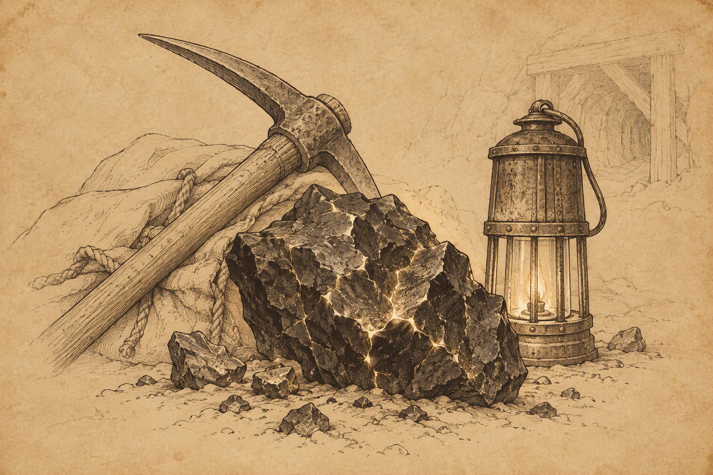{ .center-img width="70%%" }

## Na szlaku { .divider }

Przed kopalnią drużynę zatrzymali **Senjak** i **Dorotea**, wspierani przez ukrytych łuczników. Bandyci zażądali całego dobytku. Negocjacje zakończyły się, gdy kolejni strzelcy zaczęli padać, a z ukrycia wyłonił się **Dorn**. Półork rozpoznał dawnych towarzyszy, którzy zdradzili go i pozostawili w więzieniu w Luskanie. **Dorotea** próbowała zrzucić winę na **Simmeona**, lecz **Dorn** nie zamierzał słuchać wymówek. Po śmierci zdrajców ujawnił, że od niemal roku ściga byłych kamratów. Pozostało mu jeszcze dwóch, w tym sam **Simmeon**.

Leech zgodził się pomóc w zemście, uznając, że umiejętności czarnego strażnika mogą okazać się użyteczne. Na razie polecił mu oczekiwać w *Pomocnej Dłoni*.

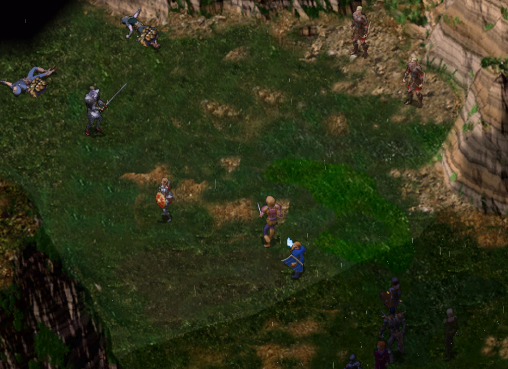{ .center-img width="60%" }

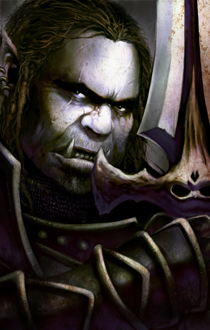

# Dorn

Półork · Czarny strażnik · Neutralny Zły

> **Dorn** niechętnie opowiada o swojej przeszłości i mimo pomocy w walce z dawnymi towarzyszami pozostaje oszczędny w osobistych szczegółach. Z nielicznych informacji wynika, że ten bezwzględny półork pochodzi z północy i już wcześniej padł ofiarą zdrady. Nie wybacza podobnych przewinień i bezlitośnie ściga każdego, kto złamie dane mu słowo. Całkowite skupienie na zemście pozostawiło mu niewiele zainteresowań poza walką.

:material-account-group: **Przyłączeni NPC:** *Dorn*

:material-account-group: **Odłączeni NPC:** *Dorn* (Pomocna Dłoń)

## Kopalnia Nashkel&nbsp;29 { .divider }

[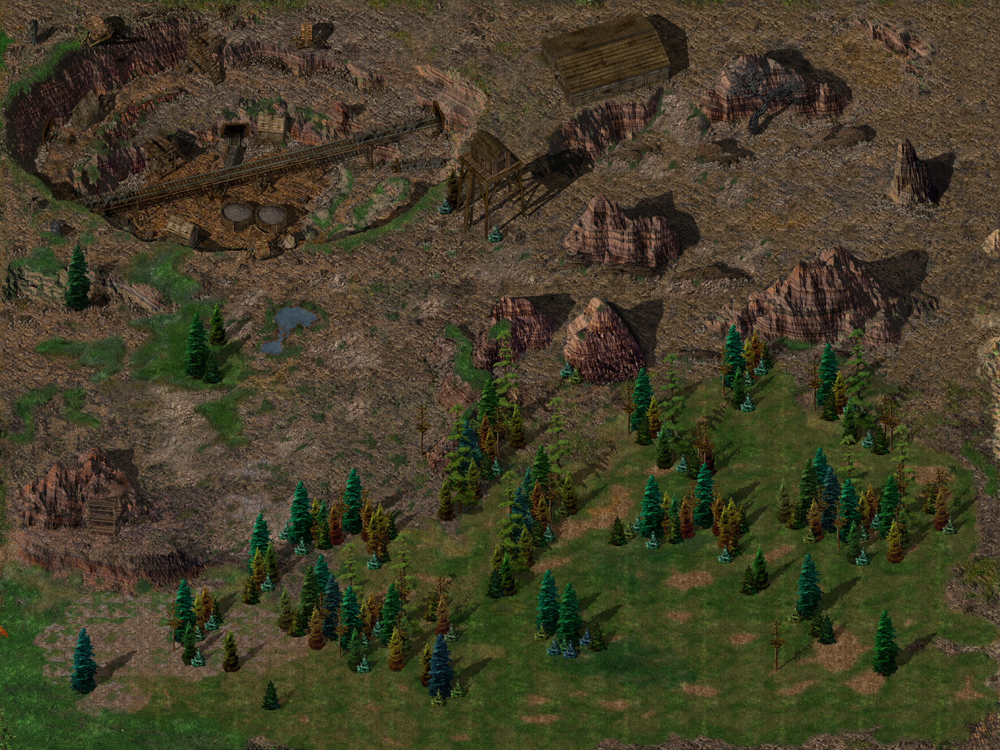{ .center-img width="40%" }](../maps/BG5400.webp)

Przed zejściem pod ziemię **Sandrah** wypytała **Branwen** o **Tranziga**. Wojowniczka wyjawiła, że mag należał do organizacji odpowiedzialnej zarówno za napady bandytów, jak i problemy kopalni. Podziemną operacją dowodził półork wspierany przez armię koboldów, które uważały go niemal za boga.

W osobnej rozmowie **Imoen** próbowała odczytać ślady, myląc zwykłego psa z niewielkim wilkiem. Gdy **Sandrah** wspomniała o futrze zimowego wilka dla **Henninga**, dziewczyna roześmiała się i zasugerowała, że oczekuje znacznie ciekawszej nagrody niż pieniądze ([Imoen in Love](../other/zadania.md#q77)). Wkrótce rzeczywiście natrafili na zimowego wilka, a jego śnieżnobiałe futro trafiło do bagażu.

Na północy, przy magazynie 1, zaatakował kolejny łowca nagród, **Zargos Flintblade**, wspierany przez czterech najemnych krasnoludów. Starcie było ciężkie, ale drużyna zwyciężyła. Przy ciele napastnika znaleziono następny kontrakt podpisany inicjałami „*M.S.*”, tym razem opiewający na czterysta sztuk złota.

Przy czarnym, uschniętym drzewie 2 Leech odnalazł *Bursztynowy Kwiat*. Roślina rozkwitła w miejscu samobójstwa, aby łagodzić strach i pocieszać pogrążonych w żałobie. Wiedziała, że młody gnom przybędzie i zaniesie ją osobie potrzebującej pomocy. Poprosiła, by przekazał ją **Otterowi**, ostrzegając jednocześnie, że zanim zacznie ratować innych, sam musi nauczyć się przyjmować wsparcie ([Amber Flower](../other/zadania.md#q19)).

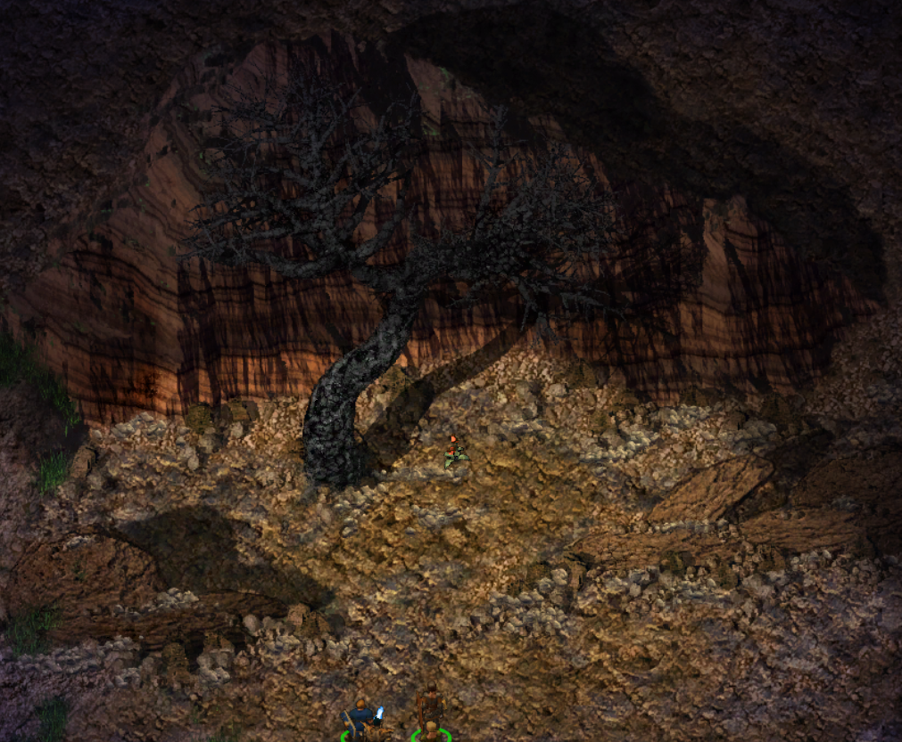{ .center-img width="60%" }

**Dandal**  ostrzegł przed gnollami grasującymi w okolicy i wskazał kopalnię na północnym zachodzie. Uprzedził, że zarządca **Emerson** może odrzucić pomoc, choć górnicy potrzebują każdego zdolnego wojownika. Wspomniał również o **Prismie**, pracującym nad ogromnym posągiem wykutym w urwisku.

Natomiast przerażony **Galtok** 4 poprosił o ratunek. Został pojmany i torturowany przez grupę koboldów, lecz zdołał uciec. Ledwie **Finch** obiecała ochronę, napastnicy pojawili się w pobliżu i zmusili drużynę do walki.

Przy urwisku 5 odnaleziono **Prisma**, kończącego monumentalny portret elfiej piękności *Ellesime*. Rzeźbiarz wyznał, że ukradł dwa szmaragdy, aby wykorzystać je jako oczy arcydzieła. Wyczerpany wielodniową pracą poprosił o ochronę przed **Greywolfem**. Ten ostatni pojawił się chwilę później wraz z trzema łucznikami. Nie zamierzał czekać na ukończenie rzeźby, dlatego doszło do walki, której nie przeżył. **Prism** zdążył dokończyć dzieło, po czym zmarł spełniony, wypowiadając imię *Ellesime*. Prosił, aby szmaragdy pozostały w oczach ukochanej, lecz nieobecni nie mają głosu. Drużyna zabrała poszukiwane klejnoty z nadzieją, że być może kiedyś powrócą na właściwe miejsce ([Prism the Sculptor](../other/zadania.md#q65)). :material-trending-up: Reputacja +1

Spojrzenie **Imoen** nie pozostawiało wątpliwości. Z futrem zimowego wilka należało natychmiast wrócić do *Nashkel*.

:material-paw: Bestiariusz: *krasnolud najemnik, pies bojowy, ghul, wilk, kobold, bełkotek, xvart, zimowy wilk, bandyta łucznik*

## Nashkel&nbsp;30 { .divider }

[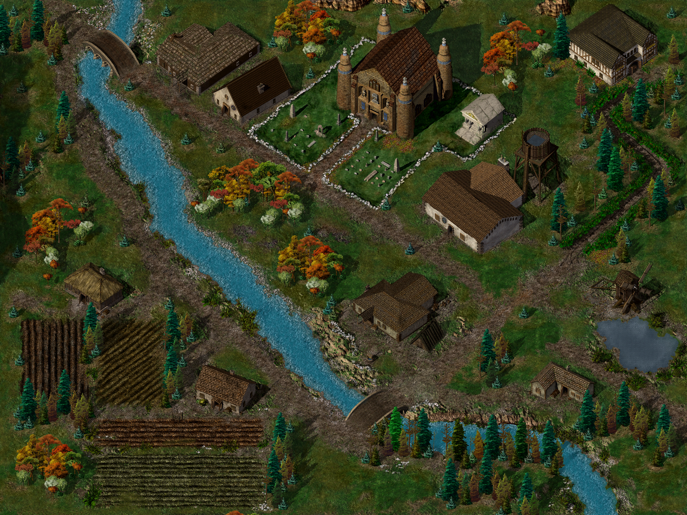{ .center-img width="40%" }](../maps/BG4800.webp)

Po powrocie do miasta **Imoen** przypomniała o kończących się zapasach i pobiegła do sklepu **Henninga** 25, zanim ktokolwiek zdążył wręczyć jej listę i zachowując się jak kotka w rui. Kupiec z radością przyjął futro, wypłacił pięćset sztuk złota i pochwalił odwagę dziewczyny. Przyznał, że martwi się o niebezpieczeństwa czyhające na nią podczas wypraw, a każde otwarcie drzwi sklepu budzi w nim nadzieję na jej powrót. Zadowolona **Imoen** wygrzebała z plecaka suszone różowe jagody i zaprosiła go na wspólny poczęstunek w słońcu ([Imoen in Love](../other/zadania.md#q77)).

Aby poprawić nadszarpniętą opinię, drużyna złożyła hojną ofiarę w świątyni *Helma* 19. :material-trending-up: Reputacja +5

**Oublekowi** 7 przekazano szmaragdy odzyskane po śmierci **Prisma**, zamykając jedno z jego zleceń ([Prism the Sculptor](../other/zadania.md#q65)).

Przy spichlerzu 26 pani **Blackwood** poprosiła o krótką opiekę nad dziećmi, **Sarah** i **Tomem**. Pozornie niewinne zadanie okazało się półgodzinną walką z dwójką uroczych ludzkich demonów ([Babysitting in Nashkel](../other/zadania.md#q78)). :material-trending-up: Reputacja +1

Gdy Leech chciał już zarządzić powrót do kopalni, **Imoen** ponownie spojrzała na niego z wyrzutem. Podczas kolejnej wizyty u **Henninga** dziewczyna powitała kupca pocałunkiem, a ten wręczył jej miękkie, różowe futro nasycone zaklęciami chroniącymi przed zimnem i upałem. Zachwycona Imoen nie zamierzała czekać z przymiarką. Obsypała kupca pocałunkami i pociągnęła go na piętro. Różowe futro ostatecznie przypieczętowało rodzący się romans.

Później przyznała **Sandrah**, że zawsze wyobrażała sobie u boku świetlistego rycerza lub paladyna, a nie sklepikarza. **Imoen** przypomniała jednak, że **Henning** nie oczekuje porzucenia przygód ani stania za ladą. Przeciwnie, podziwia jej niezależność. Uspokojona dziewczyna natychmiast dostrzegła handlowy potencjał związku. Zaplanowała nawet reklamę sklepu: „*Kupuj tam, gdzie kupują bohaterowie*”, z uzbrojeniem osobiście certyfikowanym przez **Imoen Wspaniałą** i jej towarzyszy.

Ponownie kierują się do kopalni tym razem z założeniem zejścia na dół.

## Kopalnia Nashkel&nbsp;31 { .divider }

[{ .center-img width="40%" }](../maps/BG5400.webp)

Płacząca kobieta 7 wspomniała o mężu, który kupił niezwykły miecz, a wkrótce potem zaginął. Podobną klingę zdobył **Brage** przed dokonaniem masakry, co trudno było uznać za przypadek ([The Echoed Cry](../other/zadania.md#q79)).

Przy wejściu do kopalni górnicy potwierdzili, że na dolnych poziomach ruda jest skażona i bezużyteczna, a liczba robotników dramatycznie maleje. **Emerson**, zarządca kopalni, 6 zezwolił drużynie zbadać podziemia, dając jej jeden dzień na ustalenie źródła problemu ([Investigating the Nashkel Mines](../other/zadania.md#q80)).

## Kopalnia Nashkel - poziom I&nbsp;31.I { .divider }

[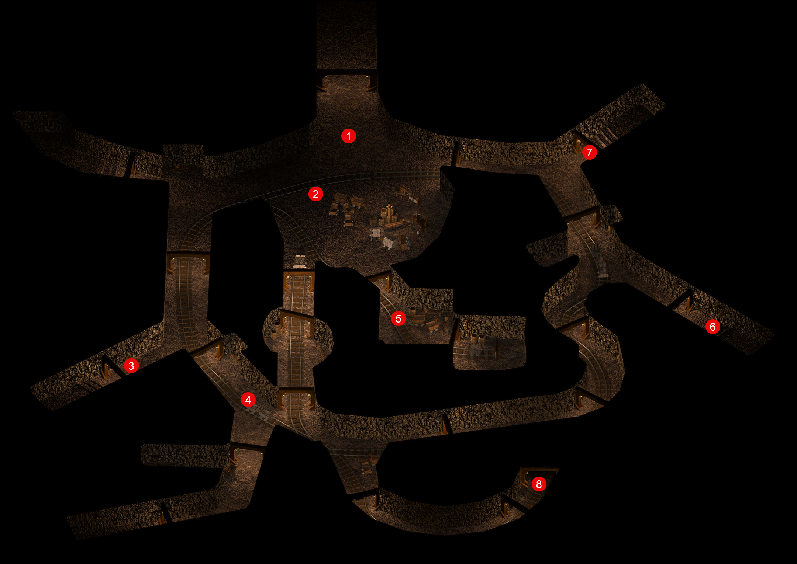{ .center-img width="40%" }](../maps/BG5401.webp)

Górnik **Gord** 1 opowiedział o niewielkich demonach wychodzących ze ścian i poradził porozmawiać z **Ruffiem** 2, który ledwie uszedł z życiem. Jego relacja potwierdziła wcześniejsze informacje: stworzenia zaatakowały robotników, a ratujący go strażnicy zginęli.

**Lesley** 3, **Dilak** 5, **Bob** 6 i **Marvin** 7 nie wnieśli wiele ponad pogłoski o duchach, smoku i kolejnych zgonach. **Dink** 4 poprosił natomiast o dostarczenie **Kylee’emu**, pracującemu poziom niżej, zgubionego sztyletu ([Kylee's Dagger](../other/zadania.md#q81)).

Małymi demonami okazały się koboldy, a w górniczych wózkach leżała skażona ruda. Amnijscy strażnicy potwierdzili obecność licznych stworzeń, lecz nie wierzyli, by tak prymitywne istoty samodzielnie stały za całym kryzysem. Jeden z żołnierzy widział także zaginionego górnika, który mimo śmierci nadal się poruszał.

W mrocznych korytarzach **Sandrah** przyznała, że nie zamierza odejść z tego świata niezauważona. Nie pragnęła jednak osobistej sławy. Uważała, że dobre czyny przynoszą trwałą zmianę dopiero wtedy, gdy stają się przykładem dla innych. Leech odpowiedział, że najważniejsze jest pozostawienie **Torilu** lepszym, niż się go zastało. Kapłanka zgodziła się i nazwała go przyszłym bohaterem. Najpierw należało jednak wykonać zadanie, a dopiero później zbierać laury.

Drużyna odnalazła zejście prowadzące niżej 8.

:material-paw: Bestiariusz: *kobold*

## Kopalnia Nashkel - poziom II&nbsp;31.II { .divider }

[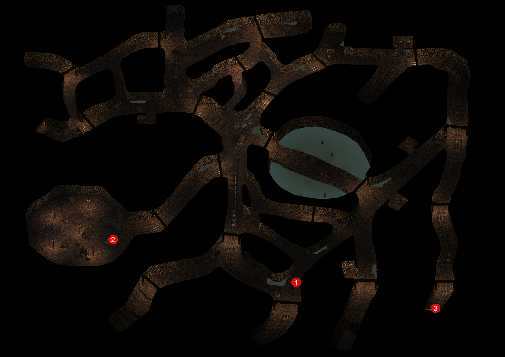{ .center-img width="40%" }](../maps/BG5402.webp)

Górnik **Beldin** 1 przybiegł w stronę drużyny, ścigany przez koboldy. Stworzenia zostały pokonane, a robotnik ocalał. :material-trending-up: Reputacja +1

**Sandrah** zasugerowała zabranie próbki skażonego żelaza do *Nashkel*. Być może miejscowi uczeni albo **Taerom** zdołają ustalić przyczynę rozpadu. Warto było również przeszukiwać ciała koboldów w poszukiwaniu substancji wykorzystywanej do zatruwania rudy.

W jednej z komór drużyna odnalazła **Kylee’ego** 2 i przekazała mu sztylet ([Kylee's Dagger](../other/zadania.md#q81)). Górnik potwierdził, że liczba koboldów stale rośnie.

Poziom był pełen ciał zabitych robotników. Przy jednym z koboldów znaleziono fiolkę z dziwnym płynem, który mógł odpowiadać za skażenie wydobycia. Część stworzeń posługiwała się mieczami, a ich działania wyglądały na znacznie lepiej zorganizowane, niż sugerowały opowieści o przypadkowej pladze.

Drużyna odnalazła kolejne zejście 3.

:material-paw: Bestiariusz: *kobold, kapitan koboldów, kobold szaman, olbrzymi pająk*

## Kopalnia Nashkel - poziom III&nbsp;31.III { .divider }

[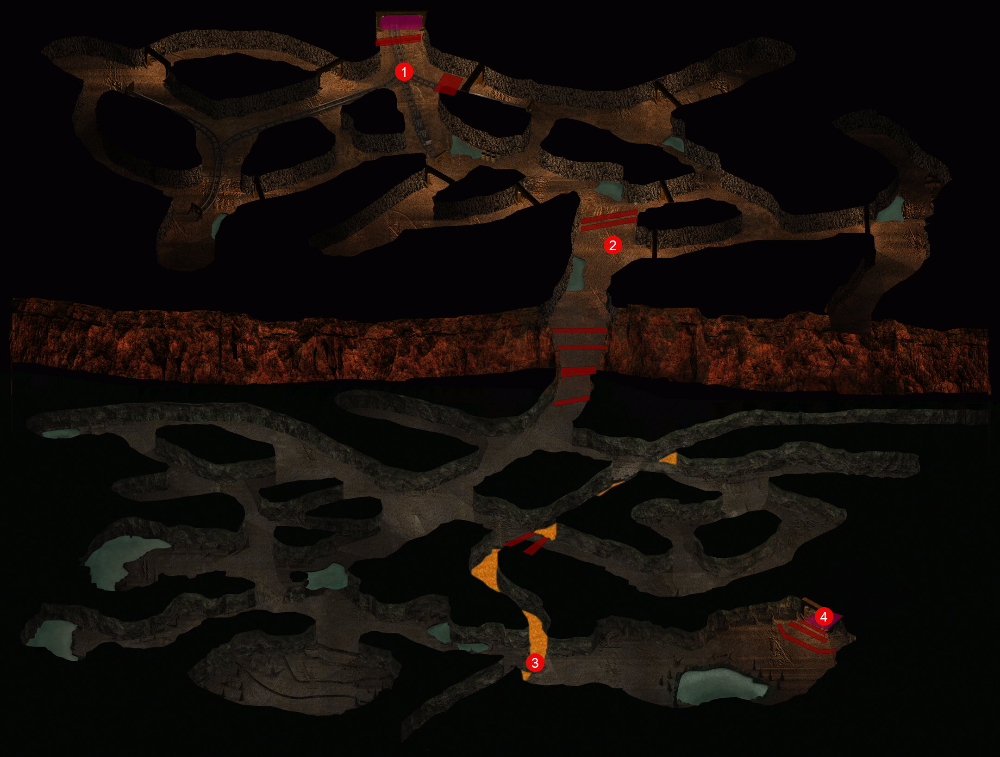{ .center-img width="40%" }](../maps/BG5403.webp)

Przy zwłokach jednego z górników 1 znaleziono pierścień z nefrytem i dedykacją dla **Josepha**. Jego żonie należało przekazać tragiczną wiadomość ([Joseph's Wife](../other/zadania.md#q72)).

Korytarze zabezpieczono pułapkami, lecz **Jen’lig** potrafiła je wykrywać i rozbrajać.

Banda szaroskórych dowodzona przez **Gorkena Bloodaxe’a** 2 zaatakowała z zaskoczenia. Mroczne krasnoludy były dobrze uzbrojone, ale po ciężkiej walce ich wyposażenie trafiło w ręce zwycięzców.

Przy moście nad lawą 3 jedną z grup koboldów prowadził **Rovo**, głośno wychwalający swój nowy miecz. Przy jego ciele znaleziono katanę *Juu-San*. Wszystko wskazywało na to, że broń należała do zaginionego mężczyzny wspomnianego przez płaczącą kobietę przy wejściu do kopalni ([The Echoed Cry](../other/zadania.md#q79)).

Drużyna zeszła jeszcze głębiej 4.

:material-paw: Bestiariusz: *kobold, kobold komando, szaroskóry złodziej, szaroskóry kapłan, szaroskóry wojownik, ghul, wielki pająk*

## Kopalnia Nashkel - poziom IV&nbsp;31.IV { .divider }

[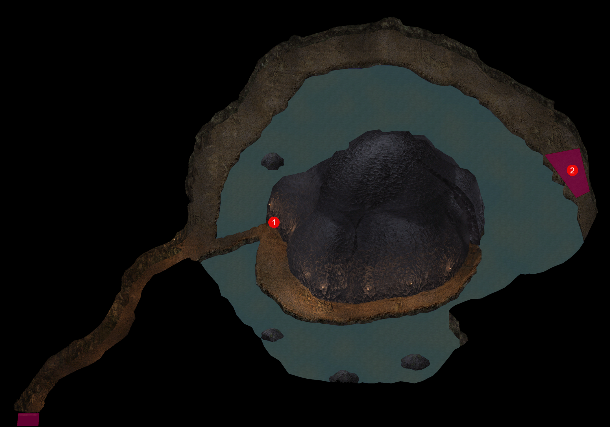{ .center-img width="40%" }](../maps/BG5404.webp)

Długi tunel doprowadził drużynę do ogromnej pieczary, pośrodku której stała dziwna budowla. Wszystko wskazywało na to, że właśnie tam znajduje się centrum podziemnej operacji 1.

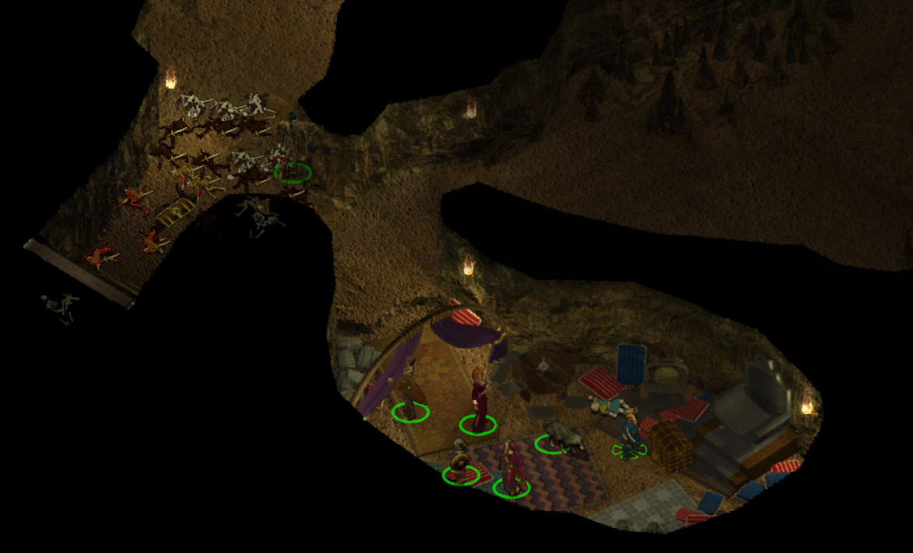{ .center-img width="60%" }

Za sabotaż kopalni odpowiadał **Mulahey**, działający na rozkaz **Tazoka**. Koboldy zatruwały rudę dostarczonym minerałem, zabijały górników i ukrywały skalę operacji. Równocześnie *Czarne Szpony* i *Chłód* niszczyły karawany przewożące żelazo z południa i wschodu.

Po krótkiej ale wymagającej walce z hordą koboldów Mulahey przestał być problemem.

Listy wskazywały, że **Tazok** był coraz bardziej niezadowolony z podwładnego. Koboldy działały zbyt jawnie, a operacja zwracała uwagę. Łącznikiem pomiędzy nimi był **Tranzig**, przebywający w gospodzie *Feldeposta* w *Beregoście* ([Confronting Tranzig](../other/zadania.md#q82))([Investigating the Nashkel Mines](../other/zadania.md#q80)).

Kolejny dokument wspominał osobę oznaczoną inicjałem „*D.*”, która ingerowała w działania spiskowców i przekazała dowódcy *Nashkel* niezwykły miecz. Wiadomość łączyła więc sabotaż kopalni z tragedią Brage’a ([The Tale of Captain Brage](../other/zadania.md#q63)).

Ostatni list pochodził od nieznanej organizacji, która od dłuższego czasu obserwowała działania **Mulaheya** i proponowała współpracę. W razie zainteresowania półork miał spotkać nocą **Tarasha Blackhelmeta**, oczekującego przy kamiennym filarze w centrum Beregostu. Wiadomość kończyło pozdrowienie oddające chwałę bogu i wszystkie klejnoty Wężowi ([The Serpents of Abrathor](../other/zadania.md#q83)).

Śmierć **Mulaheya** mogła uspokoić mieszkańców *Nashkel*, lecz nie kończyła kryzysu. Niedobór żelaza obejmował zbyt rozległy obszar, aby odpowiadała za niego wyłącznie jedna podziemna operacja. Dokumenty wskazywały na większy spisek powiązany z bandytami pustoszącymi całe Wybrzeże Mieczy.

W komnatach więziono także **Xana**, członka Szarych Płaszczy z Evereski, wysłanego w celu zbadania kryzysu. Elf spędził wiele tygodni pod ziemią, lecz po uwolnieniu dołączył do drużyny, choć z właściwym sobie pesymizmem uznał sprawę za niemal beznadziejną. Wśród skarbów **Mulaheya** odnaleziono jego najcenniejszy przedmiot, księżycowe ostrze.

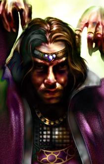

# Xan

Elf · Zaklinacz · Praworządny Dobry

> Xan pochodzi z elfiej twierdzy Evereska i jest Szarym Płaszczem, strażnikiem wysłanym do zbadania kryzysu żelaza. Jego zadaniem jest ustalenie przyczyn niedoboru oraz ocena zagrożenia dla całego regionu. Choć obdarzony znaczną wiedzą i magicznym talentem, podchodzi do misji z właściwym sobie pesymizmem. Większość sytuacji ocenia z ponurym fatalizmem, jakby porażka była nie tyle możliwością, co nieuniknionym zakończeniem. Całe życie poświęcił doskonaleniu magii i stał się utalentowanym czarodziejem. Skupienie na nauce pozostawiło mu jednak niewiele czasu na przyjaźnie oraz inne zainteresowania. Jest osobą zdolną, lecz jego nieustanny pesymizm potrafi poważnie osłabić morale towarzyszy.

:material-account-group: **Przyłączeni NPC:** *Xan*

:material-account-group: **Odłączeni NPC:** *Branwen* (świątynia w Nashkel)

:material-paw:Bestiariusz: kobold, kobold szaman, pająk miecznik, szary szlam, ghul, kobold, szkielet