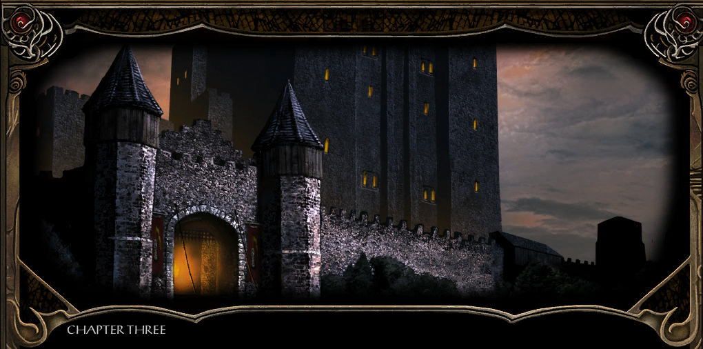
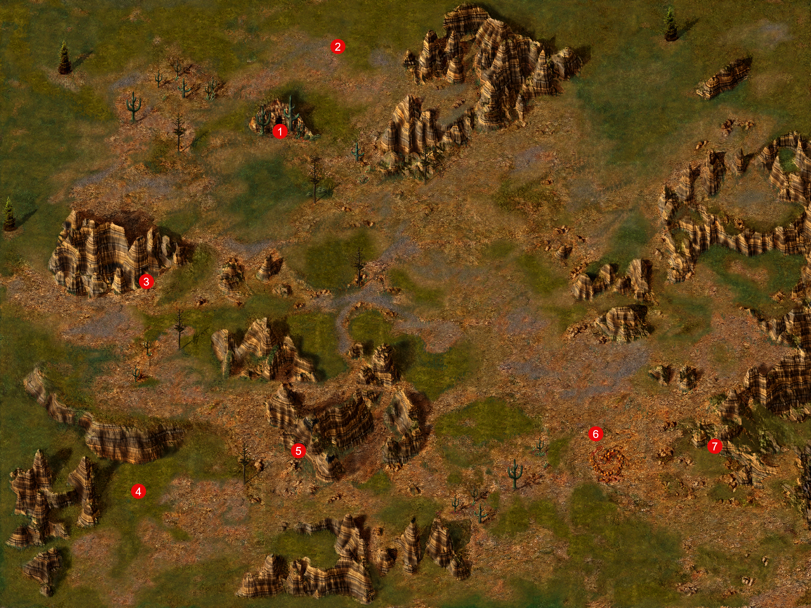

# UNDER CONSTRUCTION

{ .center-img width="90%" }

*Jest pewne, że śmierć Mulaheya złagodzi obawy sterroryzowanych mieszkańców Nashkel, ale ja dalej jestem niespokojny. Choć pół-ork rzeczywiście mógł być przyczyną nieszczęść, które dotknęły kopalnię, niedobór żelaza jest zbyt powszechny, by to była tylko jego sprawka. Jego listy potwierdzają, chociaż dają niewiele wskazówek co do tego, gdzie ukrywają się jego wspólnicy, że mogą oni mieć powiązania z bandytami, którzy obecnie nękają Wybrzeże.*

## Dolina Grobowców&nbsp;32 { .divider }

{ .center-img width="40%" }

Wyjście okazuje się ukrytym korytarzem z przejściem do Doliny Grobów (1).

Przy północnym wzgórzu spotykamy komando (2) amazonek złożone z Lamalhy, Zeeli, Telki, Elki, Natalka i Maneiry. Nie chciały przejść obok więc zostaną tu na zawsze. Przy sobie miały sporo sprzętu i wyciąg z Akai.

W grobowcu w trumnie (3) natknęliśmy się na odłamek kryształu – ciekawe jakiej większej całości jest fragmentem?

Napotykamy ankhegi i zabieramy ich skorupy, pewnie są cennym towarem.

Przerażony Hentold (4) błagał o pomoc i prosił, by nie pozwolić prześladowcy go dopaść. Xan zauważył cierpko, że trzymany przez mężczyznę sztylet emanuje tak silnym przekleństwem, iż jego przyjęcie może sprowadzić zgubę na całą drużynę. Hentold wyznał, że wyjął broń z grobowca w jaskini położonej niedaleko na wschodzie. Od tej chwili nawiedzały go wizje makabrycznej śmierci, nie pozwalając skupić myśli ani zaznać spokoju. Przekazał sztylet Jen’lig i poprosił o odniesienie go do otwartego grobu, licząc, że zwrot skradzionego przedmiotu zakończy klątwę. W grobowcu (5) spotkaliśmy zmartwychwstańca, który już straszyć nie będzie. Upiora, który pragnął odzyskać sztylet, który posłużył Alatosowi do jego zabicia.

Ekscentryczny mag Narcillius Harwilliger Neen (6) zaprosił drużynę do udziału w eksperymencie. Opracował zaklęcie pozwalające podporządkowywać sobie galaretowate stworzenia, takie jak szlamy, galarety i śluzy. Zamierzał przetestować je na musztardowych galaretach wypuszczonych do pobliskiego lasu. Xan uznał udział w doświadczeniu szalonego czarodzieja za kolejny krok ku nieuchronnej zagładzie. Sandrah była jednak zafascynowana i poprosiła o udostępnienie zaklęcia drużynie. Mag odmówił, twierdząc, że latami pracował nad swoim odkryciem i nie zamierza dzielić się jego mocą. Chwilę później przywołał galarety, przekonany, że posłusznie wykonają jego rozkazy. Pozostawało sprawdzić, czy eksperyment rzeczywiście odniósł sukces, czy też las wzbogacił się właśnie o kilka rozdrażnionych śluzów i jednego wyjątkowo pewnego siebie maga. Rzecz jasna urzeczywistnił się drugi wariant. Ginie wraz z dwoma galaretowatymi jestectwami jakie powołał. Przy magu znaleziono list zawierający wykaz artefaktów poszukiwanych przez jego mistrza. Za każdy z nich obiecywano wysoką zapłatę. Na liście znajdowały się: ciało nimfy, dająca się kontrolować musztardowa galareta, szypułka oka beholdera, skamieniała dziewica dowolnej rasy poza krasnoludami oraz jajo jadowitej wiwerny. Zdobyte przedmioty należało dyskretnie wysłać do wieży mistrza we Wrotach Baldura, nie dając łotrowi imieniem Ragefast okazji do wtrącenia się w przesyłkę. Wiadomość podpisał jedynie tajemniczy „R.”.

Kolejna krypta (7) skrywa tylko kilka trumien.

Sandrah uznała, że wydarzenia w kopalni były jedynie częścią znacznie większej operacji. Śmierć Mulaheya pozwoli wznowić wydobycie i ograniczyć skutki kryzysu żelaza, lecz działania drużyny z pewnością zwróciły uwagę spiskowców. Należało zdać raport Berrunowi Ghastkillowi, a następnie udać się do Beregostu i odnaleźć Tranziga oraz ludzi Tazoka.

Imoen przypomniała Jen’lig, że zgodnie z obozowym harmonogramem przypada na nią przygotowanie kolacji. Githyanki uznała gotowanie za zajęcie dla dzieci, lecz zgodziła się dostosować do zwyczajów towarzyszy. Jej plan polegał na wrzuceniu do garnka wszystkiego, co znajdzie w pobliżu, i gotowaniu zawartości przez kilka godzin. Wizja potrawy z grzybów, wiewiórek oraz być może szczura skutecznie przekonała Imoen, by jednak samodzielnie przygotować posiłek.

Xan przyznał, że im dłużej wędruje po niepewnym świecie, tym silniej tęskni za bezpieczną Evereską. Leech również wspominał Candlekeep, choć wiedział, że powrót nie przywróci dawnego życia. Wierzył jednak, że warto próbować pozostawić Toril lepszym dla przyszłych pokoleń. Elf odpowiedział historią Karsusa, który pragnął udoskonalić świat i zostać bogiem magii, lecz doprowadził jedynie do zagłady Imperium Netherilu.

O zmierzchu Imoen przypomniała Sandrah, że tym razem przypadają na nią obowiązki obozowe. Kapłanka zdradziła, że pranie, sprzątanie i gotowanie wykonuje za pomocą prostych zaklęć. Przyznała nawet, że wygoda domowej magii była jednym z powodów, dla których wybrała służbę Mystrze. Zachwycona Imoen natychmiast zażądała nauki, widząc w tym szansę na definitywne zakończenie ręcznego szorowania garnków.

Kawałek drogi przed nami. Wracamy do wejścia do kopalni a później do Nashkel.

Bestiariusz: olbrzymi wąż, szkielet, ghul, ankheg, szlam musztardowy (galaretowiec), pies bojowy, ghast

## Kopalnia Nashkel&nbsp;33 { .divider }

{ .center-img width="40%" }

Po opuszczeniu kopalni Emerson (6) z wyraźną ulgą powitał drużynę, uznając jej powrót za najlepszy widok od wielu tygodni. Natychmiast polecił górnikom wznowić pracę, choć przyznał, że transport rudy nadal pozostaje zagrożony przez bandytów. Zarządca poradził Leechowi zdać szczegółowy raport burmistrzowi Berrunowi Ghastkillowi, który powinien wypłacić stosowną nagrodę za przywrócenie kopalni do działania (Investigating the Nashkel Mines 80).

Płacząca kobieta (7) rozpoznała odnalezioną katanę jako broń swojego męża. Przyznała, że błagała go, by nie wyruszał na poszukiwanie zaginionych górników, lecz pragnął zostać bohaterem i ocalić mieszkańców miasta. Widok miecza potwierdził jej najgorsze obawy. Nie chciała zachować bolesnej pamiątki, dlatego oddała ją Leechowi (The Echoed Cry 79).

Wracamy do Nashkel.

## Nashkel&nbsp;34 { .divider }

{ .center-img width="40%" }

Przekazaliśmy Oublekowi (7) list znaleziony u Mulaheya o spisku przeciwko Brage’owi, ale nie przekonaliśmy go bo mimo wszystko dokonał przestępstwa.

Zostałem hojnie nagrodzony za mój wysiłek: 900 sztuk złota od Berruna Ghastkilla (6) i podziękowania od całego miasta. Żelazo będzie teraz powoli wracać na wybrzeże, chociaż jego transport jest nadal zdradzieckim przedsięwzięciem. Trzeba będzie zająć się bandytami na drogach. Zasugerował także rozmowę z Taerom’em Fuirum’em w Beregoście o fiolce z płynem zakażającym złoża (Vial of Mysterious Liquid 84) Reputacja +1.