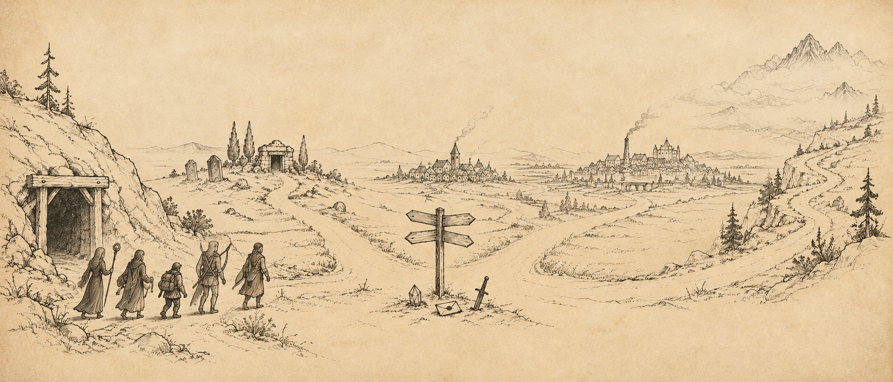

# Mulahey to tylko rozgrzewka

{ .center-img width="80%%" }

*Śmierć Mulaheya z pewnością uspokoi sterroryzowanych mieszkańców Nashkel, lecz mnie nie przyniosła ulgi. Półork odpowiadał za nieszczęścia w kopalni, ale kryzys żelaza obejmował zbyt rozległy obszar, by mógł być wyłącznie jego dziełem. Odnalezione listy potwierdzały istnienie większego spisku i wskazywały na powiązania z bandytami pustoszącymi Wybrzeże. Nie pozostawało nic innego, jak podążyć tym tropem.*

{ .center-img width="70%%" }

## Dolina Grobowców&nbsp;32 { .divider }

{ .center-img width="40%" }

Tajne przejście z podziemi kopalni wyprowadziło drużynę do *Doliny Grobowców* 1, rozległej kotliny pełnej zapomnianych krypt, jaskiń i śladów dawnych pochówków.

Przy północnym wzgórzu drogę zagrodził oddział najemniczek dowodzony przez **Lamalhę** 2. Towarzyszyły jej **Zeela**, **Telka**, **Elka**, **Natalka** i **Maneira**. Kobiety nie zamierzały pozwolić Leechowi odejść, dlatego dolina stała się ich ostatnim przystankiem. Przy poległych znaleziono sporo wartościowego wyposażenia oraz wyciąg z Akai.

W innej krypcie 3 w trumnie spoczywał odłamek kryształu. Fragment wyraźnie należał niegdyś do większej całości, choć na razie jego przeznaczenie pozostawało zagadką.

Wśród wzgórz grasowały również ankhegi. Po pokonaniu bestii drużyna zabrała ich pancerze, licząc, że twarde i lekkie skorupy okażą się cennym materiałem dla doświadczonego kowala.

Przerażony **Hentold** 4 błagał o pomoc i prosił, by nie pozwolić prześladowcy go dopaść. **Xan** zauważył cierpko, że trzymany przez mężczyznę sztylet emanuje tak silnym przekleństwem, iż jego przyjęcie może sprowadzić zgubę na całą kompanię. **Hentold** wyznał, że wyjął broń z grobowca w jaskini położonej nieopodal na wschodzie. Od tej chwili prześladowały go wizje makabrycznej śmierci. Oddał sztylet **Jen’lig** i poprosił o odniesienie go do otwartego grobu, licząc, że zwrot skradzionego przedmiotu zakończy klątwę.

W grobowcu 5 czekał zmartwychwstaniec, który domagał się zwrotu broni użytej niegdyś przez **Alatosa** do jego zamordowania. Oddanie sztyletu nie uspokoiło upiora, dlatego drużynie pozostało ostatecznie położyć kres jego nawiedzeniom.

Ekscentryczny mag **Narcillius Harwilliger Neen** 6) zaprosił drużynę do udziału w eksperymencie. Opracował zaklęcie pozwalające podporządkowywać sobie galaretowate stworzenia i zamierzał przetestować je na musztardowych galaretach wypuszczonych do pobliskiego lasu. **Xan** uznał udział w doświadczeniu szalonego czarodzieja za kolejny krok ku nieuchronnej zagładzie. **Sandrah** była bardziej zainteresowana i poprosiła o udostępnienie zaklęcia, lecz mag odmówił podzielenia się dziełem wielu lat badań. Chwilę później przywołał galarety, przekonany, że posłusznie wykonają jego rozkazy. Oczywiście urzeczywistnił się wariant przewidziany przez **Xana**. Stworzenia zwróciły się przeciwko twórcy eksperymentu, a **Narcillius** zginął wraz z dwoma galaretowatymi obiektami swoich badań.

Przy magu znaleziono list zawierający wykaz artefaktów poszukiwanych przez jego mistrza. Za każdy obiecywano wysoką zapłatę. Na liście znajdowały się ciało nimfy, dająca się kontrolować musztardowa galareta, szypułka oka beholdera, skamieniała dziewica dowolnej rasy poza krasnoludami oraz jajo jadowitej wiwerny. Zdobyte przedmioty należało dyskretnie wysyłać do wieży we *Wrotach Baldura*, nie pozwalając, by w przesyłkę wtrącił się łotr imieniem **Ragefast**. Wiadomość podpisał jedynie tajemniczy „*R.*”.

Kolejna krypta 7 skrywała tylko kilka trumien, bez kolejnych przeklętych ostrzy, zmartwychwstańców ani szalonych eksperymentatorów.

Podczas marszu **Sandrah** zauważyła, że wydarzenia w kopalni były częścią znacznie większej operacji. Śmierć **Mulaheya** umożliwi wznowienie wydobycia, lecz działania drużyny z pewnością zwróciły uwagę spiskowców. Należało zdać raport **Berrunowi Ghastkillowi**, a następnie odnaleźć w *Beregostcie* **Tranziga** oraz ludzi **Tazoka**.

Przy rozbijaniu obozu **Imoen** przypomniała **Jen’lig**, że zgodnie z harmonogramem przypada na nią przygotowanie kolacji. Githyanki uważała gotowanie za zajęcie dla dzieci, lecz zgodziła się dostosować do zwyczajów towarzyszy. Zamierzała wrzucić do garnka wszystko, co znajdzie w pobliżu, a następnie gotować zawartość przez kilka godzin. Wizja potrawy z grzybów, wiewiórek i być może szczura skutecznie przekonała **Imoen**, by samodzielnie przejąć obowiązki kucharki.

**Xan** przyznał, że im dłużej wędruje po niepewnym świecie, tym bardziej tęskni za bezpieczną *Evereską*. Leech również wspominał *Candlekeep*, choć wiedział, że powrót nie przywróci dawnego życia. Wierzył jednak, że warto próbować pozostawić *Toril* lepszym dla przyszłych pokoleń. Elf odpowiedział historią **Karsusa**, który również pragnął udoskonalić świat i zostać bogiem magii, lecz doprowadził jedynie do zagłady Imperium *Netherilu*. Jak zwykle zdołał odnaleźć katastrofę nawet w najbardziej optymistycznej wizji przyszłości.

O zmierzchu **Imoen** przypomniała **Sandrah**, że tym razem to na nią przypadają obowiązki obozowe. Kapłanka zdradziła, że pranie, sprzątanie i gotowanie wykonuje za pomocą prostych zaklęć. Przyznała nawet, że wygoda domowej magii była jednym z powodów, dla których wybrała służbę **Mystrze**. Zachwycona **Imoen** natychmiast zażądała nauki. Najwyraźniej perspektywa zakończenia ręcznego szorowania garnków rozbudziła w niej większe zainteresowanie magią niż niejedna opowieść o potężnych artefaktach. Czekał ich jeszcze długi marsz. Drużyna wróciła ku wejściu do kopalni, a stamtąd zamierzała ruszyć prosto do *Nashkel*.

:material-paw: Bestiariusz: *olbrzymi wąż, szkielet, ghul, ankheg, szlam musztardowy (galaretowiec), pies bojowy, ghast*

## Kopalnia Nashkel&nbsp;33 { .divider }

{ .center-img width="40%" }

Po dotarciu do kopalni **Emerson** 6 z ulgą powitał drużynę, uznając jej powrót za najlepszy widok od wielu tygodni. Natychmiast polecił górnikom wznowić pracę, choć przyznał, że transport rudy nadal pozostaje zagrożony przez bandytów. Zarządca poradził Leechowi zdać szczegółowy raport burmistrzowi **Berrunowi Ghastkillowi**, który powinien wypłacić nagrodę za przywrócenie kopalni do działania ([Investigating the Nashkel Mines](../other/zadania.md#q80)).

Zapłakana kobieta 7 rozpoznała odnalezioną katanę jako broń swojego męża. Błagała go, by nie wyruszał na poszukiwanie zaginionych górników, lecz pragnął zostać bohaterem i ocalić mieszkańców miasta. Widok miecza potwierdził jej najgorsze obawy. Nie chciała zachować pamiątki przypominającej o stracie, dlatego oddała ostrze Leechowi ([The Echoed Cry](../other/zadania.md#q79)).

Po zamknięciu obu spraw drużyna wróciła do *Nashkel*.

## Nashkel&nbsp;34 { .divider }

{ .center-img width="40%" }

Leech przekazał **Oublekowi** 7 list znaleziony w kryjówce **Mulaheya**, wskazujący na spisek związany z **Brage’em**. Urzędnik pozostał jednak nieprzekonany. Niezależnie od wpływu klątwy kapitan własnymi rękami zamordował rodzinę i innych niewinnych ludzi, dlatego zdaniem **Oubleka** powinien odpowiedzieć przed prawem.

Znacznie cieplej przyjął drużynę **Berrun Ghastkill** 6. Burmistrz wypłacił dziewięćset sztuk złota i przekazał podziękowania mieszkańców. Wydobycie mogło zostać wznowione, choć przewóz żelaza nadal pozostawał niebezpieczny z powodu bandytów atakujących karawany. **Berrun** zasugerował również pokazanie **Taeromowi Fuiruimowi** fiolki z płynem znalezionym przy koboldach. Kowal mógł pomóc ustalić, czy substancja rzeczywiście odpowiadała za skażenie wydobycia ([Vial of Mysterious Liquid](../other/zadania.md#q84)). :material-trending-up: **Reputacja +1**

Podczas wizyty w sklepie **Henning** zachwycił się **Imoen** w różowym futrze, które jego zdaniem podkreślało jej naturalny urok. Dziewczyna przyznała, że prezent musiał kosztować fortunę, ale był wart każdej monety. Następnie przedstawiła kupcowi pomysły na rozwój interesu, opracowane wspólnie z **Sandrah**. **Henning** zauważył, że łatwiej byłoby je realizować, gdyby **Imoen** została przy nim w *Nashkel*. Dziewczyna przypomniała jednak, że nie zamierza porzucać życia poszukiwaczki przygód i stawać za ladą. Kupiec zapewnił, że nie chce jej zmieniać. Marzył jedynie o wspólnym domu. **Imoen** przypadkiem zdradziła, że sklep zaczyna uważać za ich własne gniazdko, lecz szybko przypomniała o zobowiązaniach wobec Leecha i drużyny. **Henning** nie próbował jej zatrzymywać. Poprosił jedynie, aby częściej wracała do *Nashkel* a Leech obiecał odwiedzać miasto zawsze, gdy ich droga ponownie poprowadzi w pobliżu.

Przed gospodą 27 pojawił się kolejny łowca nagród, **Nimbul**, któremu nie udało się skutecznie skrócić życia Leecha. Przy jego ciele znaleziono dowód, że przynajmniej za częścią kontraktów stał **Tazok**.

Drużyna ponownie spotkała **Noobera** 28, lecz tym razem nieznośny gaduła niemal zamilkł. Dopadło go poważne przeziębienie i potrzebował ciepłego miejsca na rekonwalescencję ([A Warm Place for Noober](../other/zadania.md#q85)).

W domu **Josepha** 24 drużyna przekazała wdowie odnaleziony pierścień z nefrytem. Kobieta natychmiast rozpoznała pamiątkę i zrozumiała, że jej mąż zginął w kopalni podczas poszukiwań zaginionych górników. Leech przeprosił za bolesną wiadomość i oddał jej ostatnią pamiątkę po zmarłym ([Joseph's Wife](../other/zadania.md#q72)). Korzystając z okazji, poprosił również o udzielenie schronienia **Nooberowi**. Perspektywa jego nieustannego gadania nie wzbudziła entuzjazmu, lecz kobieta miała wolne łóżko, a jej matka zyskałaby kogoś, kto z apetytem zjada przygotowane puddingi i buliony. **Noober** przyjął dobrą wiadomość z radością przerywaną kaszlem i natychmiast ruszył do nowego schronienia. Warto by było zajrzeć tam po kilku dniach i sprawdzić, czy rodzina nadal uważa przyjęcie go pod dach za dobry pomysł ([A Warm Place for Noober](../other/zadania.md#q85)).

Podczas marszu **Xan** wyjaśnił, dlaczego czarodziej nosi miecz. Uważa, że mag pozbawiony głosu nie może precyzyjnie wypowiadać zaklęć, a broń pozwalała mu bronić się nawet po utracie możliwości czarowania. Jego księżycowe ostrze było jednym z elfich mieczy obdarzonych mocą przez **Sehanine**. Takie klingi same wybierały godnych właścicieli i zabijały każdego, kto próbował wykorzystać ich moc w niegodziwy sposób. Ostrze należało wcześniej do ojca **Xana**, który spośród sześciorga dzieci właśnie jego wyznaczył na dziedzica. Leech zażartował, że miecz wybrał elfa, ponieważ wiedział, iż ten nigdy nie podejmie żadnego ryzyka. **Xan** odparł, że rozwaga jest cenniejsza od samobójczej brawury nazywanej bohaterstwem. Nie był jednak pewien, czy ta wiedza w jakikolwiek sposób zwiększa ich szanse na przeżycie. Obecnie i tak pozostawały znikome.

Większość rozpoczętych spraw w *Nashkel* została zamknięta. Nadszedł czas powrotu do *Beregostu*.

## Beregost&nbsp;35 { .divider }

{ .center-img width="40%" }

Przed kuźnią 23 drużyna ponownie spotkała **Elminstera**, który słyszał już o wydarzeniach w kopalni. Przewidywał, że Leech wywrze znaczący wpływ na losy *Wybrzeża Mieczy*, choć ostrzegł, że dla kogoś tak młodego może się to okazać ciężkim brzemieniem. Spotkanie ujawniło skrywaną dotąd tajemnicę: **Sandrah** była córką starego maga. Kapłanka zapewniła ojca, że dobrze opiekuje się towarzyszami, po czym poprosiła, aby potwierdził, iż nie przyłączyła się do Leecha jako jego szpieg. **Elminster** odpowiedział, że ufa córce bezgranicznie i wie, że samodzielnie podejmuje decyzje. Przyznał także, że znał **Goriona**, lecz odmówił rozmowy o jego przeszłości oraz pochodzeniu Leecha. Pewne odpowiedzi miały nadejść dopiero we właściwym czasie. Na pożegnanie przekazał praktyczną wskazówkę. Bandyci nękający okolicę regularnie przemieszczali się na północny wschód, a obserwacja ich szlaków mogła doprowadzić drużynę do głównej kryjówki.

Przed kuźnią pojawiła się również młoda **Chloe** z wiadomością od oficer **Vai**, oczekującej w *Wesołym Żonglerze*. Dziewczynka otrzymała złotą monetę za dostarczenie wezwania ([Vai's Bounty Upon Bandits](../other/zadania.md#q86)). **Chloe** rozpoznała kompanię jako bohaterów, którzy ocalili kopalnię w *Nashkel*. Choć jej rodzina nie przepadała za mieszkańcami *Amnu*, uważała, że nikt nie powinien cierpieć z powodu żelaznego kryzysu. Wskazała gospodę w południowo-wschodniej części miasta i życzyła wędrowcom opieki **Tymory**. **Xan** skwitował pochwały ponurym stwierdzeniem, że należy współczuć zarówno krainie potrzebującej bohaterów, jak i samym bohaterom. Coś w tym było.

W kuźni **Taerom Fuiruim** rozpoznał przyniesione pancerze jako skorupy ankhegów. Odpowiednio obrobiony materiał dorównywał pełnej zbroi płytowej, pozostając przy tym znacznie lżejszy. Za komplet skorup zaoferował pięćset sztuk złota albo wykonanie wyjątkowej zbroi, wartej nawet dwadzieścia tysięcy monet. **Sandrah** poprosiła przy okazji o poprawienie zapięcia pasa. Kowal zaprosił ją na zaplecze, gdzie dysponował odpowiednimi narzędziami. Po zakończeniu pracy zapewnił kapłankę, że zawsze może zwrócić się do niego z podobnym problemem. Dziewczyna z wyjątkową bezczelnością igrała z uczuciami Leecha i najwyraźniej czerpała z tego niemałą przyjemność.

Młody gnom przekazał **Taeromowi** także fiolkę tajemniczej substancji znalezionej w kopalni. Podejrzewał, że właśnie ona odpowiada za niszczenie rudy. Kowal nie potrafił samodzielnie zbadać płynu, lecz znał osobę dysponującą odpowiednią wiedzą. Poprosił o kilka dni i obiecał przekazać wyniki analizy ([Vial of Mysterious Liquid](../other/zadania.md#q84)).

W *Wesołym Żonglerze* 22 oficer **Vai** wyjaśniła, że jej oddział został odcięty od *Wrót Baldura* i od niemal tygodnia nie otrzymywał rozkazów. Drogę powrotną blokowali bandyci, którzy po wydarzeniach w *Nashkel* stali się jeszcze bardziej agresywni. Nie byli już zwykłymi rabusiami szukającymi łatwego zarobku. Wszystko wskazywało na to, że działają dla kogoś. Oficer poprosiła drużynę o pomoc w oczyszczeniu regionu. Za każdy zdobyty brązowy emblemat bandytów obiecała pięćdziesiąt sztuk złota. Chciała przywrócić bezpieczeństwo na szlakach przed nadejściem zimy i umożliwić swoim ludziom powrót do *Wrót Baldura* ([Vai's Bounty Upon Bandits](../other/zadania.md#q86)).

W gospodzie pijani **Spec** i **Ken Piekarz** wdali się w awanturę o oszustwo podczas gry. Wśród bełkotliwych oskarżeń, gróźb i wyzwisk spór szybko przerodził się w bójkę. Kłócili się przy tym o wynik jakiegoś meczu pomiędzy drużynami z *Wrót Baldura* i *Czarnej Wyspy*. Najwyraźniej alkohol sprawił, że rezultat rozgrywki stał się dla obu ważniejszy niż zachowanie wszystkich zębów.

U *Feldeposta* 14 Leech ponownie zagadnął nieznajomą, która przedstawiła się jako **Illasera Szybka**, semblijska łowczyni nagród. Słyszała już o dokonaniach drużyny w kopalni i zaproponowała współpracę. Miała przekazywać informacje o kontraktach, zanim trafią na publiczne listy, zatrzymując dla siebie dwadzieścia procent nagrody. Pierwsze zlecenie dotyczyło grupy awanturników dowodzonych przez podstarzałego pijaka **Rithelma**. Banda zdemolowała *Płonącego Czarodzieja*, zraniła kilku gości i doprowadziła do śmierci młodego chłopaka. Kontrakt wystawiła rodzina zabitego. Grupa składała się z pięciu ludzi i gnolla, a po ucieczce z *Beregostu* skierowała się na wschód. Leech miał sam zdecydować o ich losie i przynieść skrzydlaty hełm przywódcy jako dowód wykonania zadania. Nagroda wynosiła dwieście czterdzieści sztuk złota, nie licząc łupów znalezionych przy bandytach ([Black Hearts - The Huntress](../other/zadania.md#q87)).

Niedługo później **Sandrah** odnalazł posłaniec **Landrel**, przynosząc pilne wezwanie od jej ojca. **Elminster** oczekiwał na córkę i jej towarzyszy w świątyni **Gellany** w *Pomocnej Dłoni*. Skoro stary mag osobiście wysłał zaufanego sługę, sprawa musiała być poważna. **Landrel** wspomniał także o problemach z *Odłamkiem Mystry*, lecz szczegóły miał przekazać sam **Elminster**. **Imoen** odetchnęła z ulgą, gdy okazało się, że nie muszą wędrować aż do *Waterdeep* ([Elminster's Daughter](../other/zadania.md#q88)).

Karczmarz w *Płonącym Czarodzieju* 12 potwierdził, że ofiarą bandy **Rithelma** był syn **Eda**. Napastnicy mieli później udać się w stronę świątyni ([Black Hearts - The Huntress](../other/zadania.md#q87)).

Podczas wędrówki ulicami *Beregostu* **Sandrah** zauważyła, że **Imoen** po raz kolejny czyta ten sam list z rozmarzonym uśmiechem. Dziewczyna przyznała, że był to pierwszy list miłosny, jaki kiedykolwiek otrzymała, ten był oczywiście od **Henninga**. Kapłanka zaproponowała kupienie mu prezentu, a wybór padł na kosztowną czekoladę z *Calimshanu*. Leech wątpił jedynie, czy słodycz dotrze do adresata, skoro **Imoen** miała podróżować tuż obok niej. **Xan** wyraził obawę, że delikatna sylwetka **Sandrah** nie pasuje do ciężaru spoczywających na niej obowiązków. Kapłanka przypomniała, że kruchość wyglądu nie oznacza bezradności. W walce polegała na technice, szybkości i precyzji, unikając ciosów zamiast przyjmować je siłą. Elf porównał jej ruchy do tańca, lecz przyznał, że właśnie dlatego obawia się jednego trafienia mogącego zniszczyć tę delikatną harmonię. **Sandrah** uspokoiła go, przypominając o swoich zdolnościach uzdrowicielskich.

Kolejna rozmowa dotyczyła ciężaru bycia córką **Elminstera**. **Xan** zauważył, że mimo młodego wieku kapłanka bierze na siebie ogromną odpowiedzialność, choć wszystko stara się obracać w uśmiech i lekkie słowa. **Sandrah** odpowiedziała, że nikt nie jest w stanie udźwignąć całego *Torilu*. Można jedynie zrobić wszystko, co możliwe, i pogodzić się z ryzykiem porażki. Zawsze pragnęła być oceniana jako ona sama, nie tylko jako córka słynnego maga, lecz miłość i troska ojca przewyższały niedogodności jego sławy. Widząc smutek elfa, ujęła jego dłonie i zapewniła, że zawsze może liczyć na jej obecność.

**Jen’lig** opowiedziała natomiast **Xanowi** o wielowiekowej niewoli githyanki pod panowaniem illithidów. Elf przyznał, że żadna istota nie powinna cierpieć podobnego losu, lecz zauważył, że niekończąca się wojna z dawnymi ciemiężycielami uczyniła jej lud bezwzględnym i całkowicie podporządkowanym walce. Astralna wojowniczka odrzuciła ponure rozważania. Nie zamierzała polegać na nadziei, lecz działać, dopóki świat nie stanie się takim, jakim powinien być. **Xan** stwierdził, że zaczyna brzmieć jak nieznośnie entuzjastyczna **Sandrah**, na co githyanki odpowiedziała, że kapłanka często ma rację zarówno w słowach, jak i czynach.

W drodze do świątyni drużyna przekazała **Otterowi O’Forestowi** 2 odnaleziony **Bursztynowy Kwiat**. Dzięki niezwykłej roślinie wspomniany przez niego człowiek miał przeżyć. Poruszony **Otter** podziękował za pomoc i wręczył drużynie nagrodę, zapewniając, że nigdy nie zapomni jej czynu. **Imoen** skwitowała pochwałę z właściwą sobie swobodą. W końcu ratowanie ludzi było właśnie tym, czym zajmowała się ich kompania ([Amber Flower](../other/zadania.md#q19)).

## Świątynia Lathandera&nbsp;36 { .divider }

{ .center-img width="40%" }

W westybulu 3 czekali poszukiwani awanturnicy: **Rithelm**, **Elys Horne**, **Wynna**, **Nichye**, **Andoc** oraz gnoll **Kherk Snotpaw**. Banda nie zamierzała negocjować i natychmiast zaatakowała. Przy ciele **Rithelma** znaleziono charakterystyczny skrzydlaty hełm oraz zbezczeszczony symbol **Bhaala**. Z takim dowodem drużyna mogła wrócić do **Illasery** po nagrodę ([Black Hearts - The Huntress](../other/zadania.md#q87)).

## Beregost&nbsp;37 { .divider }

{ .center-img width="40%" }

**Illasera Szybka** 14 przyjęła skrzydlaty hełm jako dowód wykonania kontraktu i wypłaciła obiecane dwieście czterdzieści sztuk złota. Pozwoliła Leechowi zatrzymać trofeum, natomiast symbol znaleziony przy **Rithelmie** rozpoznała jako znak martwego boga **Bhaala**. Poradziła szybko się go pozbyć, zanim ktoś uzna drużynę za sprzymierzeńców jego kultu. Kolejne zlecenie dotyczyło *Najeźdźców Czerwonej Wody*, bandy hobgoblinów napadającej na karawany przy *Drodze Wybrzeża*. Grupę wspierało dwóch magów, a jej dowódca posługiwał się budzącym grozę mieczem. Zleceniodawca pozostawał anonimowy, lecz wszystko wskazywało na porachunki pomiędzy bandytami. Najeźdźcy prawdopodobnie odłączyli się od *Chłodu* i zaczęli działać na własną rękę. Ostatni napad miał miejsce na południe od *Beregostu*. Jeden z ocalałych pracował przy rozładunku towarów w posiadłości **Travenhurstów** na północy miasta i mógł wskazać dalszy trop. Za likwidację bandy **Illasera** obiecała czterysta osiemdziesiąt sztuk złota. Jako dowód należało przynieść charakterystyczny miecz przywódcy ([Black Hearts - The Huntress](../other/zadania.md#q87)).

W gospodzie **Sandrah** otworzyła butelkę wybornego wina z równin *Akanal*. **Xan** wahał się przed jej otwarciem, obawiając się, że wraz z ostatnim kielichem bezpowrotnie utracą coś wyjątkowego. Kapłanka zauważyła jednak, że pozostawiona w spokoju butelka byłaby jedynie niespełnioną obietnicą przyjemności. Elf porównał krótkotrwałość trunku do ludzkiego życia, które z jego perspektywy przemija równie szybko. **Sandrah** odpowiedziała, że nawet długa elfia egzystencja może zostać zmarnowana na tanie wino i ponure rozmyślania. Otworzyła butelkę, napełniła kielichy i wzniosła toast za radości życia, nawet jeśli żadna z nich nie trwa wiecznie. Gdy zabrzmiała muzyka, zaprosiła **Xana** do tańca. Elf początkowo odmówił, nazywając zabawę makabrycznym tańcem nad własnym grobem, lecz kapłanka nie pozwoliła mu ponownie schować się za ponurymi słowami i pociągnęła go na parkiet. Pierwsze kroki maga były niepewne, ale szybko odnalazł rytm. Ich taniec przyciągnął uwagę całej sali i zakończył się głośnymi oklaskami. **Xan** przyznał, że po raz pierwszy od dawna czuje się naprawdę żywy. **Sandrah** usiadła obok i zasugerowała, że tej nocy potrzebuje na ustach czegoś więcej niż kolejnego kielicha. Pocałowała elfa, a ten, mimo zwyczajowego przekonania o nieuchronności rozczarowań, objął ją bez dalszego protestu.

Przy posiadłości **Travenhurstów** 43 drużyna odnalazła **Elenair**, ocalałą z napadu *Najeźdźców Czerwonej Wody*. Karawana wyruszyła z *Nashkel* na północ i rozbiła obóz przy *Nadbrzeżnym Trakcie*. Podczas wieczerzy napastnicy uderzyli bez ostrzeżenia, wspierani przez błyskawice i dwóch magów. Matka **Elenair** próbowała zorganizować odwrót, lecz poległa w walce. Dziewczyna rzuciła się jej na pomoc, ale przywódca bandy ogłuszył ją płazem miecza. Uznana za martwą odzyskała przytomność dopiero następnego ranka, pośród szczątków karawany. Zapamiętała czerwono-pomarańczową glinę pokrywającą ubrania napastników. Podobna ziemia występowała w *Czerwonych Jarach*, na południowy zachód od *Beregostu*. Ten ślad powinien doprowadzić drużynę do kryjówki bandytów ([Black Hearts - The Huntress](../other/zadania.md#q87)).

Lista rozpoczętych spraw była coraz dłuższa, lecz najważniejsze pozostawało prowadzenie śledztwa naprzód. Po krótkiej naradzie drużyna ruszyła do *Pomocnej Dłoni*.

## Pomocna Dłoń&nbsp;38 { .divider }

{ .center-img width="40%" }

W obrębie murów pojawił się **Inoshishi** 16, mnich z klasztoru **Saku** w odległym *Kara-Turze*. Przybysz dostrzegł w Leechu osobę zaznajomioną z dyscypliną ciała i umysłu. Sam pochodził z dojo w *Kozakurze*, lecz przybył na *Wybrzeże Mieczy* z misją znacznie trudniejszą, niż początkowo przewidywał. Poszukiwał legendarnej katany *Saiai no Hito*, wykutej przez **Ne Kurosunę**, jednego z pierwszych członków klasztoru **Saku**. Kowal opuścił zakon po rozstaniu z ukochanym **Shiroume Yakuchim**. Nie potrafiąc uwolnić się od wspomnień utraconej miłości, przelał własne pytania, wątpliwości i nadzieję na pojednanie w tworzoną broń. Katana miała trafić do klasztoru jako symbol oddania oraz pamiątka po człowieku, który przez całe życie wspierał pozostałych członków zakonu. Po śmierci **Ne Kurosuny** jego kuźnia zniknęła, a przeznaczony dla **Shiroume Yakuchiego** miecz został skradziony. Mnisi prześledzili jego los z *Kozakury* przez *Kara-Tur* aż na *Wybrzeże Mieczy*. Zadaniem **Inoshishiego** było odzyskanie katany i sprowadzenie jej do klasztoru **Saku**, gdzie powinna spocząć wśród  najważniejszych relikwii zakonu. Leech zgodził się pomóc. Mnich przyznał jednak, że został napadnięty przez nieznajomą kobietę i utracił część dobytku. Zamierzał uzupełnić zapasy oraz zasięgnąć rady kapłanów. Zaproponował więc rozpoczęcie poszukiwań od wizyty w miejscowej świątyni ([Restoring Saiai no Hito](../other/zadania.md#q89)).

Niedługo później do zajazdu dotarł spanikowany uciekinier z *Nashkel*. Bandyci odpowiedzieli na wydarzenia w kopalni nocnym atakiem na miasto. Uderzyli przede wszystkim w sklep **Henninga**, podczas gdy pozostałe zabudowania niemal nie ucierpiały. **Imoen** zażądała natychmiastowego powrotu na południe, obawiając się o ukochanego. **Sandrah** przyznała, że działania drużyny mogły sprowokować odwet, a jej obowiązek wobec mieszkańców nie skończył się wraz ze śmiercią **Mulaheya**. Leech obiecał zająć się sprawą tak szybko, jak to możliwe.

Przed gospodą przebywał również **Churin**, poszukujący doświadczonych najemników do wyprawy na daleką północ. Miasto *Easthaven* w *Dolinie Lodowego Wichru* organizowało ekspedycję w odpowiedzi na problemy nękające region i osadę *Kuldahar*. Uczestnikom obiecywano bogactwo oraz sławę. Zanim jednak **Churin** zdradził szczegóły wyprawy, poprosił o osobistą przysługę. **Brage** był jego kuzynem. Leech miał odnaleźć kapitana i sprowadzić go żywego do *Nashkel*. Dopiero wtedy droga ku *Easthaven* miała stanąć przed drużyną otworem.

Pojawiła się tam także **Pilar**, lecz nie zamierzała rozmawiać, dopóki ktoś nie przyniesie jej piwa. Tę znajomość należało odłożyć na kolejne spotkanie.

W świątyni 6 drużyna spotkała **Elminstera**, który wezwał ich z powodu kradzieży *Odłamka Mystry*. Artefakt działał wyłącznie w rękach osób związanych z nim krwią, dlatego stary mag sądził, że złodziej nie zamierzał użyć jego mocy, lecz chciał skrzywdzić jego oraz całe Krainy. Trop prowadził do duergarów i demonicznych rycerzy widzianych w *Waterdeep*. **Sandrah** przekazała ojcu zwój znaleziony przy zabitym duergarze niedaleko *Beregostu*. Dokument wspominał o portalu, **Azalirgrundelu** oraz jego największym wrogu. Jeden z nich musiał posiadać skradziony Odłamek, a zwój mógł otworzyć przejście do kryjówki któregoś z demonów. Wzmianki o mglistych górach i wodzie wskazywały na *Chmurne Szczyty*. **Elminster** ostrzegł, że tym razem drużyna zmierzy się z istotami znacznie potężniejszymi od wcześniejszych przeciwników. Zalecił unikać otwartej walki i polegać na sprycie. Leech przyjął zadanie, a **Sandrah** obiecała odzyskać *Odłamek Mystry* ([A Demonic Scroll](../other/zadania.md#q29))([Elminster's Daughter](../other/zadania.md#q88)).

**Inoshishi** poprosił **Gellanę** o pomoc w odnalezieniu *Saiai no Hito*. Kapłanka zgodziła się przeprowadzić wróżbę w zamian za dwieście sztuk złota oraz przedmiot bezpośrednio powiązany z poszukiwaną kataną. Mnich posiadał wcześniej amulet, który według jego braci i sióstr stanowił część rękojeści miecza. Talizman został jednak skradziony wraz z pozostałym dobytkiem podczas napadu na drodze z *Beregostu*. Bez niego zaklęcie **Gellany** nie mogło wskazać położenia katany. Leech zgodził się odzyskać amulet. **Inoshishi** podejrzewał, że złodziejka nadal przebywa w okolicy *Pomocnej Dłoni* i mogła ukryć się na zwyczajowym terenie łowieckim miejscowych rabusiów. Mnich pozostał w świątyni, oczekując na wynik poszukiwań ([Restoring Saiai no Hito](../other/zadania.md#q89)).

Zanim drużyna wyruszy na ratunek **Henningowi**, zamierzała zbadać tereny na wschodzie, znane jako *Równina Ostrych Kłów*.
