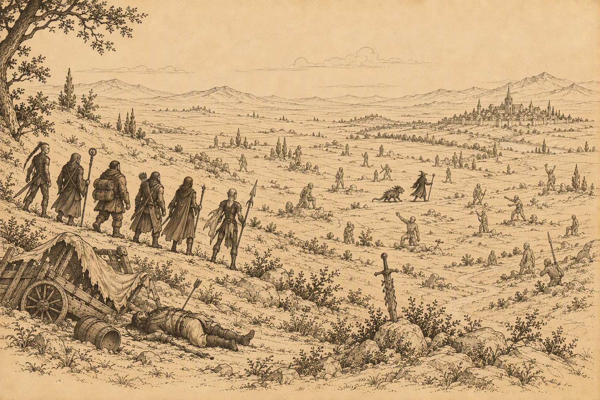

# Cudza Wola

{ .center-img width="70%%" }

## Równina Ostrych Kłów&nbsp;39 { .divider }

{ .center-img width="40%" }

Na równinie drużyna spotkała ghula **Koraxa** 1, który przyłączył się do niej i pomógł w walce z bazyliszkami oraz meduzami. Wokół stały skamieniałe postaci, nieme świadectwa losu wcześniejszych podróżników. Pośród niebezpiecznych stworzeń swobodnie przechadzał się mag **Mutamin** 2, jak gdyby bazyliszki były posłusznymi zwierzętami. Szaleniec z dumą nazywał swoje ofiary dziełami sztuki i przyznał, że to on zamienił **Branwen** w kamień. Kompanii szykował podobne miejsce w swojej wiecznej galerii. **Sandrah** zażądała wyjaśnień, podejrzewając, że wśród skamieniałych kobiet może znajdować się również osoba poszukiwana przez jej ojca. **Mutamin** nie zamierzał jednak odpowiadać i rzucił swoje stworzenia do ataku. Po krótkiej walce sam dołączył do martwych eksponatów własnego ogrodu. Wielkim planistą z pewnością nie był ([Basilisk Pets](../other/zadania.md#q49)).

Przy jego ciele wędrowcy znaleźli list podpisany tajemniczym inicjałem „*R.*”, takim samym jak na wiadomości szalonego maga, który próbował kontrolować galaretowate stworzenia. Dokument ponownie wspominał **Ragefasta**, za którym nieznany nadawca wyraźnie nie przepadał. Oba eksperymenty musiały być częścią tej samej sprawy.

**Jen’lig** z odrazą porównała petryfikację do losu martwych bóstw *Planu Astralnego*, których kamienne szczątki githyanki z *Tu’narath* traktowali jak zwykłą ziemię. Nie życzyła podobnego losu nawet słabej istocie, która nie potrafiła obronić się przed klątwą. Dla astralnej wojowniczki skamienienie było odmianą niewoli, równie odrażającą jak kajdany *illithidów*. Nikt nie powinien pozostawać uwięziony we własnym martwym ciele.

Dalszą drogę zagrodziły kolejne bazyliszki i meduzy (3, 5, 6, 7). Dzięki pomocy **Koraxa** udało się oczyścić okolicę bez powiększania kamiennej kolekcji **Mutamina**.

Następnie kompania natknęła się na czworo aroganckich awanturników z Waterdeep: **Kirian**, **Lindina**, **Baerina** oraz **Petera** 8. Przybysze od początku kpili z wyglądu i doświadczenia wędrowców, porównując ich do przypadkowej bandy gibberlingów obwieszonej znalezioną bronią. **Imoen** próbowała załagodzić sytuację, lecz **Sandrah** nie zamierzała dłużej znosić obelg. Gdy **Kirian** szyderczo zapytała, czy kapłanka chce dać jej klapsa wielkim mieczem, służka *Mystry* dobyła broni. Chwilę później obie grupy starły się w walce. Przybysze z *Waterdeep* chcieli udzielić drużynie lekcji władania szablą. Niestety nie mieli już nikogo uczyć.

Dalej wędrowcy spotkali **Skodda**, **Mazuri** i **Gaela** 9, którzy przedstawili się jako kupcy. Twierdzili, że ledwo uszli z życiem przed bandytami, stracili cały dobytek i przypadkiem zabłądzili na ziemie opanowane przez bazyliszki **Mutamina**. **Gael** zapewnił, że zarówno *Płonąca Pięść*, jak i jego własna organizacja od pewnego czasu zwalczają rozbójników, dlatego dalsza droga powinna być bezpieczniejsza. Kupcy nie mieli czym wynagrodzić pomocy, lecz obiecali przekazać *Wielkim Książętom* *Wrót Baldura* wieści o bezinteresownym czynie Leecha. :material-trending-up: Reputacja +1

Niedługo później do **Xana** podeszła biała łania. Zwierzę dotknęło nosem dłoni elfa, po czym ruszyło między drzewa, oglądając się, jakby oczekiwało, że drużyna podąży jego śladem. Zaprowadziło wędrowców ku obozowisku rzekomych kupców. Ich historia najwyraźniej nie była kompletna.

:material-paw: Bestiariusz: *tasloi, ghul, meduza, bazyliszek mniejszy, bazyliszek większy, gnoll rozpruwacz, gnoll czempion, czarny niedźwiedź, niedźwiedź jaskiniowy, brązowy niedźwiedź, olbrzymi wąż, goblin, flind*

## Las Pająków&nbsp;40 { .divider }

{ .center-img width="40%" }

Biała łania zaprowadziła drużynę z powrotem do obozowiska **Skodda** 1. Tym razem wędrowcy dostrzegli trzy związane, pobite i odziane w łachmany elfki. Przywódca handlarzy bez skrupułów oznajmił, że kobiety są jego własnością i zamierza sprzedać je w *Calimporcie*. **Xan** nie zamierzał tolerować niewolnictwa. Przypomniał Leechowi, że nie trzeba być elfem, aby stanąć w obronie istot ograbionych z wolności i godności. Młody gnom oddał właścicielowi księżycowego ostrza dowodzenie w nadchodzącym starciu. Elf przyjął odpowiedzialność z właściwym sobie westchnieniem, uznając całe przedsięwzięcie za zapewne beznadziejne, ale konieczne. **Skodd** odmówił uwolnienia niewolnic, dlatego o ich losie musiała rozstrzygnąć walka.

Po śmierci handlarzy **Siene**, **Diala** i **Minuwiel** błagały o ochronę. Gdy rozpoznały w **Xanie** właściciela księżycowego ostrza, padły przed nim na kolana. Wyraźnie zakłopotany elf objął je swoją opieką i nakazał jak najszybciej opuścić niebezpieczną okolicę. Kobiety obawiały się samotnej podróży. **Xan** wskazał im *Pomocną Dłoń*, bezpieczny zajazd położony dzień drogi na zachód. Leech uznał jednak, że samo wskazanie kierunku nie wystarczy, i postanowił, że kompania osobiście odprowadzi uwolnione elfki pod mury zajazdu.

{ .center-img width="40%" }

## Pomocna Dłoń&nbsp;41 { .divider }

{ .center-img width="40%" }

Drużyna bezpiecznie doprowadziła elfie piękności do *Pomocnej Dłoni*. Były wdzięczne wszystkim, choć szczególne podziękowania skierowały ku **Xanowi**. :material-trending-up: Reputacja +1

Wędrowcy pozostawili elfa pod opieką uratowanych kobiet, a do dalszej wyprawy zabrali **Dorna**.

:material-account-group: Przyłączeni NPC: Dorn

:material-account-group: Odłączeni NPC: Xan (Pomocna Dłoń)

## Beregost&nbsp;42 { .divider }

{ .center-img width="40%" }

Zgodnie z wiadomością odnalezioną w komnacie **Mulaheya** drużyna przybyła nocą na spotkanie z wysłannikiem tajemniczej sekty. Przy kamiennym filarze czekał **Tarash** 44.

Wędrowcy podszyli się pod posłańców półorka i wypowiedzieli wskazane w liście hasło: „*i wszystkie klejnoty Wężowi*”. **Tarash** potwierdził, że reprezentuje *Węże Abbathora*, organizację zainteresowaną współpracą z ludźmi **Tazoka**. Gdy zdobyli potrzebne informacje, zrzucili maski. Po krótkiej walce wysłannik kultu zginął, a przy jego ciele znaleźli wiadomość o planowanej zasadzce na **Bashrika Sparklehammera** na północ od miasta ([The Serpents of Abbathor](../other/zadania.md#q83)).

Nie tracąc czasu, kompania ruszyła na pomoc krasnoludowi.

## Nadbrzeżny Trakt&nbsp;43 { .divider }

{ .center-img width="40%" }

Nie zdążyli! Z oddali zobaczyli, jak **Bashrik Sparklehammer** i **Mirjala** zostają otoczeni przez zabójców 11 dowodzonych przez człowieka imieniem **Draglon**. Zanim drużyna dotarła na miejsce, napastnicy dokonali egzekucji i teleportowali się w nieznane.

{ .center-img width="40%" }

Przy ciele **Bashrika Sparklehammera** wędrowcy odnaleźli pamiętnik opisujący jego ostatnią wyprawę. Krasnolud prowadził śledztwo w sprawie kultu *Węży Abbathora*, którego wyznawcy przedstawiali boga chciwości jako wyzwoliciela i patrona krasnoludów żyjących na powierzchni. Większość zapisków przeznaczono jednak dla wtajemniczonych, dlatego nie zdradzały prawdziwych celów ani działalności sekty. Ostatnia notatka wspominała, że **Bashrik** i **Mirjala** wyruszyli na południe, podczas gdy ich towarzysz **Wostok** miał szukać informacji w większym mieście. Cała trójka zamierzała później spotkać się w świątyni *Helma*.

W dopisku krasnolud zanotował, że podczas tropienia zabójcy z *Pomocnej Dłoni* poznał imię **Draglona**. Człowiek ten pojawiał się podobno w *Podpiwniczu* gdzieś we *Wrotach Baldura*, gdzie nadzorował interesy kultu. **Bashrik** planował zbadać ten trop po powrocie, lecz nie dostał już takiej szansy. Pamiętnik należało zachować, ponieważ mógł pomóc w dalszym śledztwie w sprawie *Węży Abbathora*, tym razem prowadzonym przez wędrowców ([The Serpents of Abbathor](../other/zadania.md#q83)).

W pobliżu karawany kompania natknęła się na **Deke’a** i kilku bandytów 12. Otoczony herszt poddał się i zdradził położenie obozu **Tazoka**, licząc, że informacja kupi mu wolność. Drużyna nie zamierzała jednak pozwolić, by człowiek odpowiedzialny za mordowanie podróżnych wrócił do dawnego zajęcia. **Deke** i jego kompani odeszli w zapomnienie, pozostawiając kolejny ślad prowadzący ku organizatorom napadów.

Była to zaledwie przygrywka do znacznie cięższego starcia. Dalej czekało dobrze przygotowane komando 13, w którego skład wchodzili **Necardian**, **Phallen Nightsbane** i **Malious**. Przeciwnicy zmusili wędrowców do prawdziwego wysiłku, lecz kolejna próba zdobycia głowy Leecha zakończyła się niepowodzeniem. Przy poległych znaleziono następny kontrakt. Zleceniodawca nakazywał zgładzić wychowanka Goriona bez zwłoki, ostrzegając, że cel jest niebezpieczny i podróżuje z dobrze wyposażonymi towarzyszami. Za dowód wykonania zadania oferowano sześćset osiemdziesiąt sztuk złota. Dokument rozesłano do odpowiednich gildii, grożąc śmiercią każdemu, kto ujawni jego treść władzom.

Z ukrycia nad traktem obserwował ich również **Vaxffee Chciwy** 14, który napadał na podróżnych i, jak sam twierdził, pomagał im pozbywać się nadmiernie ciężkiego bagażu. Leech zauważył, że sam szczególnie chętnie odbiera przedmioty złodziejom, dlatego obaj szybko znaleźli wspólny temat. Pozbawiony przewagi zaskoczenia Vaxffee nadal wierzył we własne możliwości i wyzwał młodego gnoma do walki. Wiara okazała się nieuzasadniona. Przy jego ciele drużyna odnalazła amulet skradziony **Inoshishiemu**, niezbędny do przeprowadzenia wróżby w sprawie zaginionej katany ([Restoring Saiai no Hito](../other/zadania.md#q89)).

Kompania ruszyła dalej na zachód, w stronę wybrzeża. Po drodze zamierzała zboczyć na południe od Beregostu i zamknąć dwie rozpoczęte wcześniej sprawy.

:material-paw: Bestiariusz: *bandyta, bełkotek, chory bełkotek, wilk, xvart*

## Dzicze Beregostu&nbsp;44 { .divider }

{ .center-img width="40%" }

Jedynym powodem ponownej wizyty w tej okolicy był **Ugh**. Zgodnie z obietnicą wędrowcy przynieśli ogrowi królika, który miał zastąpić zwróconego wcześniej pupila **Kessy**. Uradowany przyjął nowego przyjaciela i zabrał go na wspólne zbieranie ziół. Dziwny był z niego ogr, ale miło było dla odmiany zakończyć spotkanie z przedstawicielem jego rasy bez konieczności czyszczenia broni ([A New Best Friend for Ugh](../other/zadania.md#q59)).

## Przełęcz Nashkel&nbsp;45 { .divider }

{ .center-img width="40%" }

Drużyna zajrzała również do **Boohady’ego Creama** 5, przynosząc antidotum otrzymane od **Madame Potpourri**. *Topniejący Człowiek* niespodziewanie odmówił jednak jego przyjęcia. Wyjaśnił, że jeszcze przed rzuceniem klątwy ciężko chorował i powoli umierał. Przemiana uwolniła go od bólu, dlatego nie chciał wracać do dawnego ciała. Nie wiedział, czym ostatecznie się stanie, lecz wolał zaryzykować nieznane, niż znów cierpieć.

**Boohady** podziękował za wysiłek i zatrzymał miksturę na pamiątkę. W zamian przekazał Leechowi zaklętą koszulę, która mogła przydać się w dalszej podróży, po czym zaprosił drużynę do ponownych odwiedzin ([The Melting Man](../other/zadania.md#q62)).

Zgodnie z planem wędrowcy skierowali się ku wybrzeżu.

## Czerwone Jary&nbsp;46 { .divider }

{ .center-img width="40%" }

Do *Czerwonych Jarów* sprowadził ich kontrakt **Illasery**. Czerwono-pomarańczowa glina pokrywająca ubrania napastników karawany **Elenair** wskazywała, że właśnie tutaj ukrywają się *Najeźdźcy Czerwonej Wody*. Bandzie hobgoblinów przewodził **Perthag** 9, wspierany przez dwóch magów i dobrze przygotowanych wojowników. Najeźdźcy nie zamierzali odpowiadać za mordowanie podróżnych ani dobrowolnie rezygnować z lukratywnego procederu, dlatego sprawę rozstrzygnął oręż. Przy ciele **Perthaga** drużyna znalazła charakterystyczny miecz *Humanbane*, którego dostarczenie miało potwierdzić wykonanie kontraktu. Droga w kierunku wybrzeża stała się odrobinę bezpieczniejsza, a **Illasera** miała otrzymać dowód, że jej nowi współpracownicy nie marnują czasu ([Black Hearts - The Huntress](../other/zadania.md#q87)).

Kompania podążyła dalej ku starożytnym ruinom.

## Starożytne Ruiny&nbsp;47 { .divider }

{ .center-img width="40%" }

Na polanie 1 drogę zastąpił drużynie hobgoblin **Ba’ruk**, wspierany przez kilka koboldów. Zasadzka nie zatrzymała wędrowców na długo.

Na terenie wykopalisk 2 poznali archeologa **Charlestona Niba**, prowadzącego badania pozostałości po dawno wymarłym ludzie. O jego kulturze wiedziano niewiele, lecz odnalezione ślady wskazywały, że społeczność zniszczyła się podczas wewnętrznej wojny. Badacze mieli właśnie przebić się do centralnej komnaty, która mogła niegdyś należeć do miejscowego szamana. Ekspedycję nękały nocne zaginięcia, porwania i akty sabotażu, dlatego **Charleston** poprosił o ochronę do czasu otwarcia komory. Drużyna zgodziła się, lecz wspólnik archeologa **Gallor** szybko ujawnił zupełnie inne zamiary. Nie interesowały go ani wiedza, ani historia. Chciał zagarnąć odnalezione artefakty, zanim uczony przekaże je do muzeum. Plan wymagał wymordowania robotników i pozbycia się samego naukowca. **Sandrah** stanowczo odmówiła udziału w rabunku. **Finch** przypomniała, że podobne znaleziska powinny pozostać dostępne dla wszystkich, a **Imoen** dodała, że okradanie kieszeni to jedno, lecz zabijanie kilkunastu ludzi dla kilku staroci jest zwyczajnym okrucieństwem. Pozbawiony wspólników **Gallor** uciekł, zapewne w poszukiwaniu kogoś o mniej uciążliwych zasadach moralnych.

Wraz z **Charlestonem** weszli do wykopalisk 3, gdzie robotnicy otworzyli główną komorę. Wtedy z wnętrza ruin wydostała się obca siła, która opętała kopaczy i zwróciła ich przeciwko wszystkim obecnym. Wędrowcy nie zdołali ich ocalić. Archeolog rozpoznał imię wykrzykiwane przez oszalałych robotników: *Kozah*, starożytny bóg burz, konfliktu i zniszczenia. Plemię zamieszkujące niegdyś ruiny musiało oddawać mu cześć, a artefakt zamknięty w kamiennym sarkofagu najwyraźniej zachował część jego zgubnego wpływu.

Wewnątrz drużyna odnalazła również drugi kryształowy odłamek, podobny do fragmentu zabranego z grobowca w Dolinie Grobowców. Wciąż nie wiedziała, jaką całość tworzyły oba kawałki.

Wstrząśnięty śmiercią robotników **Charleston** postanowił zakończyć badania i ponownie zamknąć komorę. Chciał przywrócić odrobinę życia pamięci o wymarłej kulturze, lecz zrozumiał, że niektóre tajemnice powinny pozostać pogrzebane. :material-trending-up: Reputacja +1

{ .center-img width="50%" }

Wędrowcy ostrzegli archeologa, że **Gallor** próbował wynająć ich do zamordowania jego oraz pozostałych członków ekspedycji. Wiadomość zmieniła jego nastawienie do intencji drużyny i skłoniła go do powierzenia jej kolejnej sprawy. W pobliżu Mostu Firewine odkryto wejście do zachowanej podziemnej części ruin dawnego miasta. Wewnątrz miały przebywać złe duchy, które uniemożliwiały rozpoczęcie nowych badań. **Charleston** poprosił o oczyszczenie podziemi, a następnie przekazał zwój pozwalający przejść przez magiczną pieczęć chroniącą wejście ([Warded Dungeon Under Firewine Bridge](../other/zadania.md#q90)).

Po opuszczeniu ruin drogę zastąpił im *Prorok Zagłady*, demoniczny sługa uwolniony przez posążek *Kozaha*. W towarzystwie dwóch pomocników zażądał zwrotu relikwii i zagroził **Sandrah** wiecznym snem zapomnianych bogów. Kapłanka odmówiła oddania artefaktu, a wysłannik dawnego bóstwa nie zdołał odebrać go siłą.

{ .center-img width="50%" }

Przy leśnym stawie 4 kompania spotkała **Shandrahę**, samotną borsukołaczkę. Przerażona istota błagała o oszczędzenie, zapewniając, że nie poluje na ludzi i pragnie jedynie spokojnie żyć z dala od cywilizacji. **Shandraha** pochodziła z rodziny borsukołaków, której członkowie większość życia spędzali w odosobnieniu. Nie rozumiała miejskich zwyczajów ani potrzeby handlu, ponieważ staw zapewniał jej wodę, pożywienie i schronienie. Nie stanowiła dla nikogo zagrożenia, dlatego wędrowcy pozwolili jej pozostać. Wdzięczna istota zaoferowała drużynie bezpieczny odpoczynek nad wodą. Ostrzegła przed wilkami grasującymi w okolicy, lecz obiecała strzec obozu podczas snu. Wędrowcy skorzystali z propozycji.

<em>Podczas kolejnego niespokojnego snu Leech poczuł, jak ciepła i spokojna noc nagle przeszywa go chłodem. Ziemia rozstąpiła się pod stopami, wciągając go w ciemność, a gdy powróciło światło, ponownie znalazł się w opuszczonej kopalni Nashkel.
Przenikając przez ściany i kolejne poziomy, dotarł do bezwładnej zjawy Mulaheya, uwięzionej pomiędzy śmiercią a tym, co czekało na nią dalej. Przed półorkiem unosił się kościany sztylet, gotowy zadać mu śmierć sięgającą poza grób.
Leech odwrócił się od broni, uznając, że Mulahey poniósł już karę, a dalsze cierpienie byłoby jedynie niepotrzebnym okrucieństwem. Wdzięczna zjawa odeszła ku należnemu jej przeznaczeniu, pozostawiając po sobie iskrę nadziei, która wypełniła nieznaną dotąd pustkę w duszy młodego gnoma.
Z głębin dobiegł wściekły krzyk. Kościany sztylet pomknął ku sercu Leecha, lecz ten obudził się tuż przed uderzeniem, zlany zimnym potem. W uszach wciąż rozbrzmiewał pełen dezaprobaty głos:
„Ty... jeszcze... się nauczysz!”</em>

**Sandrah** zauważyła, że Leech ponownie obudził się zlany zimnym potem. Tym razem wizja nie była jedynie wspomnieniem przemocy. Ktoś próbował przemawiać poprzez kolejne sny i skierować młodego gnoma na wybraną przez siebie drogę. W pierwszym koszmarze pojawili się **Gorion** i jego zabójca, teraz zaś **Mulahey**, lecz słowa wypowiadane przez zjawy nie należały do żadnego z nich. Kapłanka uznała cały przekaz za kłamstwo. Przypomniała, że mordowanie i żądza krwi nie leżą w naturze Leecha, nawet jeśli walka bywa nieunikniona. Młody gnom zgodził się z jej oceną. Zamierzał odrzucić podsuwaną mu ścieżkę i wybierać to, co dawało siłę bez pogrążania się w bezmyślnym okrucieństwie. **Sandrah** przyjęła te słowa długim spojrzeniem, po czym podziękowała ukochanemu (jednemy z wielu) i ruszyła z nim dalej.

Przy zmasakrowanej karawanie 5 drużyna spotkała **Laryssę**, kuzynkę **Brage’a**. Kobieta błagała, aby odnaleźć kapitana i spróbować mu pomóc, zamiast zabijać go dla nagrody. Znała go jako uczciwego dowódcę i nie wierzyła, że z własnej woli mógł wymordować rodzinę. Wędrowcy obiecali zrobić wszystko, by sprowadzić go żywego.

Nieopodal odnaleźli samego **Brage’a** 6. Resztki jego rozsądku walczyły z obłędem, a każde zdanie przybierało formę zagadki. **Imoen** rozpoznała odpowiedź na jedną z nich - *śmierć*. Prawidłowe rozwiązanie na chwilę przywróciło kapitanowi jasność umysłu. Przerażony własnymi czynami **Brage** poprosił o zaprowadzenie do świątyni *Helma*. Chciał odpokutować za śmierć rodziny, choć nie rozumiał, co doprowadziło go do szaleństwa. Pamiętał jedynie obcą obecność w umyśle i bał się, że w każdej chwili może ponownie stracić kontrolę. Oddał wędrowcom przeklęty miecz i poprosił o jego zniszczenie. Jeśli nie zdoła odzyskać panowania nad sobą, wolał umrzeć, niż ponownie skrzywdzić niewinnych. **Imoen** przypomniała jednak, że jego śmierć nie przywróci życia ofiarom. Drużyna postanowiła bezpiecznie doprowadzić kapitana do *Nashkel*, gdzie kapłani mieli spróbować uwolnić go od wpływu złowrogiej broni ([The Tale of Captain Brage](../other/zadania.md#q63)).

{ .center-img width="50%" }

:material-paw: Bestiariusz: *niedźwiedź jaskiniowy, niedźwiedź brązowy, zdziczały pies, flind, gnoll czempion, gnoll rozpruwacz, wódz gnolli, tasloi, borsukołak*

## Nashkel&nbsp;48 { .divider }

{ .center-img width="40%" }

W świątyni 19 **Nalin** próbował przekonać **Brage’a**, że dokonane zbrodnie nie były wyłącznie wynikiem jego własnej woli. Kapitan pozostawał jednak przytłoczony śmiercią rodziny i chciał oddać się w ręce straży, aby ponieść karę. Kapłan ostrzegł, że przekazanie go garnizonowi doprowadzi jedynie do kolejnej niepotrzebnej śmierci. Zamiast tego zaoferował schronienie oraz możliwość odpokutowania win w świątyni. Za sprowadzenie zagubionego dowódcy wypłacił drużynie nagrodę wyższą od tej wyznaczonej przez **Oubleka** ([The Tale of Captain Brage](../other/zadania.md#q63)).

Następnie poprosił o poinformowanie urzędnika, że **Brage** dobrowolnie powrócił i trafił pod opiekę kapłanów. Wszystko wskazywało na udział złowrogiej magii, dlatego nie należało kończyć sprawy egzekucją, zanim nie zostanie poznana prawda ([Captain Brage's Guilt](../other/zadania.md#q66)).

**Oublek** 7 nie podzielał przekonania duchownych. Przypomniał, że kapitan przyznał się do wymordowania rodziny i dobrowolnie oddał miecz. Jego zdaniem nie było potrzeba lepszego dowodu winy, a opowieści o klątwie mogły służyć jedynie usprawiedliwieniu mordercy. Polecił przekazać **Nalinowi**, że dopóki **Brage** pozostaje w świątyni, sprawa nie zostanie zamknięta. Kapitan powinien odpowiedzieć przed prawem niezależnie od okoliczności zbrodni. Spór pomiędzy strażą a kapłanami dopiero się rozpoczynał ([Captain Brage's Guilt](../other/zadania.md#q66)).

Drużyna wróciła do **Nalina** 19, aby pokazać mu odzyskany miecz. Kapłan natychmiast wyczuł ciążącą na nim klątwę. **Brage** zrozumiał, że to właśnie ostrze przejęło kontrolę nad jego myślami i popchnęło go do zabicia rodziny. Odkrycie zmieniało charakter całej sprawy. Za obłędem kapitana nie stały ani lata spędzone w boju, ani mroczna strona jego charakteru, lecz przeklęta klinga. Kapłan świątynny poprosił Leecha o dalsze prowadzenie śledztwa i odnalezienie sprawcy, który wykorzystał **Brage’a** do własnych celów ([Captain Brage's Guilt](../other/zadania.md#q66)).

Kapitan nadal nie potrafił pogodzić się z dokonanymi czynami. **Sandrah** próbowała dodać mu otuchy, zapewniając, że nawet dla tak obciążonej duszy może istnieć droga do odkupienia. Leech poprosił następnie, aby raz jeszcze opowiedział o wydarzeniach poprzedzających tragedię. **Brage** z trudem wracał do tamtej nocy. Pamiętał przerażenie najbliższych, własne ręce splamione krwią oraz ludzi zabijanych bez chwili wahania. Nie wierzył, że może zostać uznany za niewinnego wyłącznie dlatego, że podczas rzezi nie panował nad sobą. Jedynym nietypowym wydarzeniem poprzedzającym jego obłęd było odnalezienie martwego kupca przy porzuconym wozie. W czasach nasilonych napadów podobny widok nie należał do rzadkości, lecz tym razem cały ładunek pozostawiono nietknięty. Ciało przeszywała osobliwie wykonana strzała, a wśród towarów leżał miecz zaadresowany bezpośrednio do **Brage’a**. Kapitan oczekiwał wówczas na nowe ostrze zamówione u odległego płatnerza, dlatego uznał przesyłkę za własną. Dopiero później broń przejęła kontrolę nad jego umysłem. Wszystko wskazywało na starannie przygotowaną pułapkę: kupca zamordowano, ale pozostawiono cały towar, aby przeklęta klinga bez wzbudzania podejrzeń trafiła w ręce dowódcy.

**Brage** nie pamiętał niczego więcej. Choć klątwa wyjaśniała jego szaleństwo, nie mogła wymazać obrazów śmierci rodziny ani poczucia winy. Poprosił, by pozostawiono go w świątyni, gdzie spróbuje odpokutować za czyny dokonane własnymi rękami, nawet jeśli kierowała nimi cudza wola.

Przed świątynią wędrowcy ponownie spotkali **Laryssę**. Kuzynka kapitana podziękowała za sprowadzenie go żywego i oddanie pod opiekę duchownych. Nadal nie wierzyła, że człowiek, którego znała jako uczciwego i lojalnego, mógł dobrowolnie wymordować najbliższych. Prowadząc własne śledztwo, odnalazła pijaka, który pierwszy zgłosił zwłoki kupca przy trakcie. Inni podróżni potwierdzili, że handlarz pojawił się wcześniej na jarmarku w *Nashkel* i miał wyjątkowo podejrzaną reputację. Twierdził, że przewozi wyłącznie broń, ponieważ podczas podróży zniszczył mu się wóz. Zdaniem **Laryssy** czyniło to historię jeszcze bardziej podejrzaną. Skoro odnaleziony przy kupcu miecz był przeklęty i zaadresowany bezpośrednio do kapitana, jego obecność na drodze nie mogła być przypadkiem. Kobieta zamierzała dalej badać ten trop i poprosiła Leecha o kontynuowanie własnego dochodzenia ([Captain Brage's Guilt](../other/zadania.md#q66)).

DOtarli w końcu do sklepu Henninga 25 i zastali tam ślady gwałtownej walki oraz kałuże krwi. **Sandrah** próbowała odciągnąć **Imoen**, lecz dziewczyna wyrwała się i natychmiast zaczęła wołać ukochanego. Kapłanka uspokoiła ją, że krew nie należała do kupca, chyba że ten ukrywał orkowe pochodzenie. Przeszukanie piętra potwierdziło jednak, że Henning zniknął. Ślady wskazywały, że stawił napastnikom zaciekły opór, a brak jego krwi pozwalał wierzyć, że przeżył i został uprowadzony.

**Imoen** ogłosiła, że „*Imoen Wspaniała* i jej drużyna” ruszają mu na ratunek. Ponieważ w sklepie nie znaleziono dalszych wskazówek, **Sandrah** zaproponowała rozmowę z burmistrzem. Tak gwałtowna walka nie mogła pozostać niezauważona.

**Berrun Ghastkill** 6 potwierdził, że sklep padł celem zorganizowanego ataku orków. Pozostała część miasta niemal nie ucierpiała, ponieważ napastnicy otrzymali rozkaz schwytania wyłącznie **Henninga**. Najwyraźniej wiedzieli o jego związku z **Imoen** i wykorzystali go, aby uderzyć w drużynę oraz powstrzymać dalsze śledztwo w sprawie kryzysu żelaza. Bandyci uciekli z zakładnikiem na północ. Według ostatnich wieści zmierzali ku *Lasowi Otulisko*, gdzie mieli dołączyć do karawany podążającej dalej na północny wschód. **Imoen** przysięgła odnaleźć sprawców i sprowadzić ukochanego bezpiecznie do domu. Burmistrz zapewnił, że mieszkańcy *Nashkel* wspierają dziewczynę w tej trudnej chwili. A ona obiecała, że podczas kolejnej wizyty sklep znów będzie otwarty, a jego właściciel powróci cały, zdrowy i równie pogodny jak wcześniej ([The Kidnapping of Henning](../other/zadania.md#q91)).

**Taris** 5 nadal poszukiwała męża, **Hagara**, który tydzień wcześniej odszedł z tajemniczą kobietą i ruszył na wschód, prawdopodobnie poza kopalnie. Kiedy próbowała dowiedzieć się czegoś więcej, nieznajoma uciekła. Opis kobiety odpowiadał osobie, o którą wcześniej wypytywał **Dorn**. Leech obiecał odnaleźć jej męża i ustalić, dokąd zaprowadziła go tajemnicza uwodzicielka. 

Na koniec wędrowcy zajrzeli do wdowy po **Josephie**. **Noober** zdążył odzyskać głos i bez wytchnienia rozmawiał z chorą matką gospodyni. Ku zaskoczeniu drużyny okazał się bardzo pomocny w opiece nad staruszką, a sama wdowa również nie narzekała na jego obecność. Najwyraźniej nieustanna paplanina potrafiła znaleźć praktyczne zastosowanie ([A Warm Place for Noober](../other/zadania.md#q85)).
