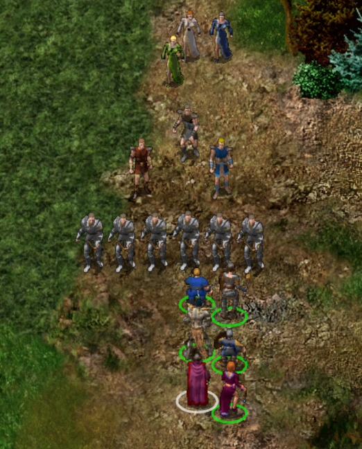
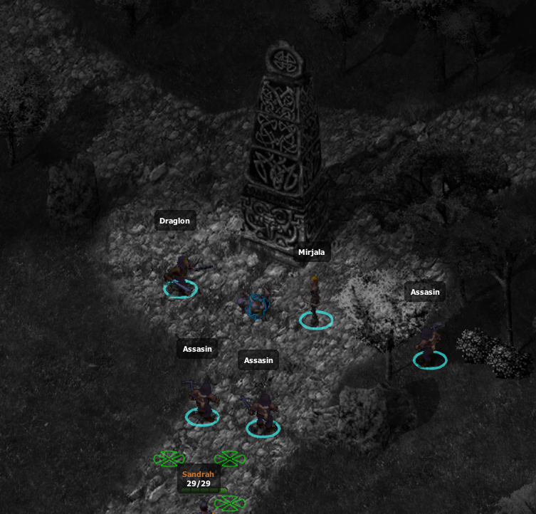
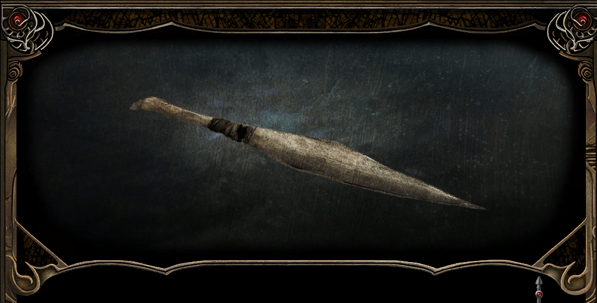
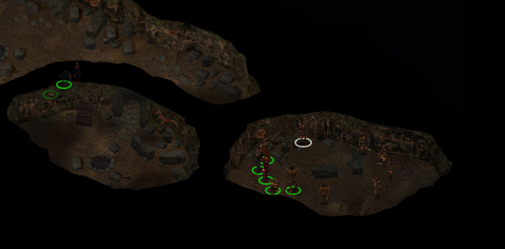
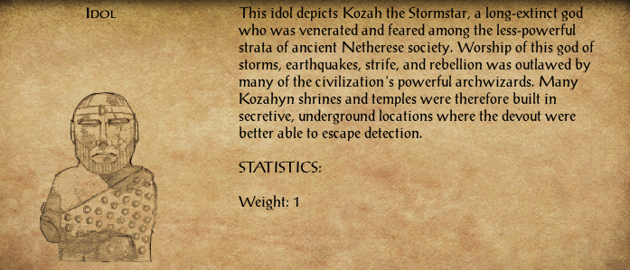
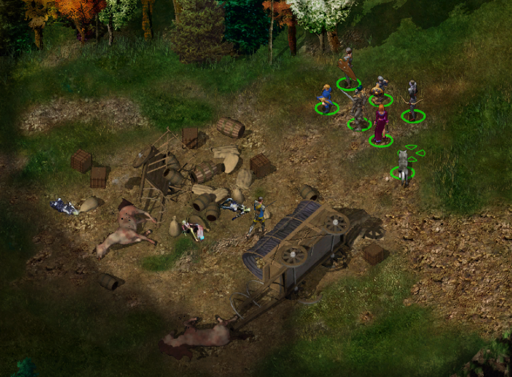

# UNDER CONSTRUCTION

## Równina Ostrych Kłów&nbsp;39 { .divider }

{ .center-img width="40%" }

Spotykamy ghula **Koraxa** 1, który przyłącza się do drużyny i pomaga w walce z bazyliszkami oraz meduzami. Wokół znajdują się skamieniałe postaci, niemych świadectw losu wcześniejszych podróżników. Pośród niebezpiecznych stworzeń swobodnie przechadza się mag **Mutamin** 2, jak gdyby bazyliszki były posłusznymi zwierzętami. Szaleniec z dumą nazywa swoje ofiary dziełami sztuki i przyznaje, że to on przemienił **Branwen** w kamień. Dla drużyny planuje podobne miejsce w swojej wiecznej galerii. **Sandrah** żąda wyjaśnień, podejrzewając, że wśród skamieniałych kobiet może znajdować się również osoba poszukiwana przez jej ojca. **Mutamin** nie zamierza jednak odpowiadać i wydaje swoim stworzeniom rozkaz ataku. Po krótkiej walce sam dołącza do martwych eksponatów własnego ogrodu. Wielkim planistą z pewnością nie zostanie ([Basilisk Pets](../other/zadania.md#q49)).

Przy jego ciele znajdujemy list podpisany tajemniczym inicjałem „*R.*”, takim samym jak wiadomość należąca do szalonego maga próbującego kontrolować galaretowate stworzenia. Dokument ponownie wspomina **Ragefasta**, za którym nieznany nadawca wyraźnie nie przepada. Oba eksperymenty muszą być częścią tej samej sprawy.

**Jen’lig** z odrazą porównuje petryfikację do losu martwych bóstw *Planu Astralnego*, których kamienne szczątki githyanki z *Tu’narath* traktują jak zwykłą ziemię. Nie życzy podobnego losu nawet słabej istocie, która nie potrafiła obronić się przed klątwą. Dla astralnej wojowniczki skamienienie jest odmianą niewoli, równie odrażającą jak kajdany *illithidów*. Nikt nie powinien pozostawać uwięziony we własnym martwym ciele.

Dalszą drogę zagradzają nam kolejne bazyliszki i meduzy (3, 5, 6, 7). Dzięki pomocy **Koraxa** udaje się oczyścić okolicę bez powiększania kamiennej kolekcji **Mutamina**.

Następnie natykamy się na czworo aroganckich awanturników z Waterdeep: **Kirian**, **Lindina**, **Baerina** oraz **Petera** 8. Przybysze od początku kpią z wyglądu i doświadczenia kompanii, porównując ją do przypadkowej bandy gibberlingów obwieszonej znalezioną bronią. **Imoen** próbuje uspokoić sytuację, lecz **Sandrah** nie zamierza dłużej tolerować obelg. Gdy **Kirian** szyderczo pyta, czy kapłanka chce dać jej klapsa wielkim mieczem, służka *Mystry* dobywa broni. Chwilę później obie grupy stają do walki. Przybysze z *Waterdeep* chcieli udzielić nam lekcji władania szablą. Niestety nie będą już nikogo uczyć.

Dalej spotykamy **Skodda**, **Mazuri** i **Gaela** 9, którzy przedstawiają się jako kupcy. Twierdzą, że ledwo uszli z życiem przed bandytami, stracili cały dobytek i przypadkiem zabłądzili na ziemie opanowane przez bazyliszki **Mutamina**. **Gael** zapewnia, że zarówno *Płonąca Pięść*, jak i jego własna organizacja od pewnego czasu zwalczają rozbójników, dlatego dalsza droga powinna być bezpieczniejsza. Kupcy nie mają czym wynagrodzić pomocy, lecz obiecują przekazać *Wielkim Książętom* *Wrót Baldura* wieści o bezinteresownym czynie Leecha. :material-trending-up: Reputacja +1

Niedługo później do **Xana** podchodzi biała łania. Zwierzę dotyka nosem dłoni elfa, po czym rusza między drzewami i ogląda się, jakby oczekiwało, że drużyna podąży jego śladem. Prowadzi nas ku obozowisku rzekomych kupców. Ich historia najwyraźniej nie była kompletna.

:material-paw: Bestiariusz: *tasloi, ghul, meduza, bazyliszek mniejszy, bazyliszek większy, gnoll rozpruwacz, gnoll elita, czarny niedźwiedź, niedźwiedź jaskiniowy, brązowy niedźwiedź, olbrzymi wąż, goblin, flind*

## Las Pająków&nbsp;40 { .divider }

{ .center-img width="40%" }

Biała łania prowadzi nas z powrotem do obozowiska **Skodda** 1. Tym razem dostrzegamy trzy związane, pobite i odziane w łachmany elfki. Przywódca handlarzy bez skrupułów oznajmia, że kobiety są jego własnością i zamierza sprzedać je w *Calimporcie*. **Xan** nie zamierza tolerować niewolnictwa. Przypomina Leechowi, że nie trzeba być elfem, aby stanąć w obronie istot ograbionych z wolności i godności. Leech oddaje właścicielowi księżycowego ostrza dowodzenie w nadchodzącym starciu. Elf przyjmuje odpowiedzialność z właściwym sobie westchnieniem, uznając całe przedsięwzięcie za zapewne beznadziejne, ale konieczne. **Skodd** odmawia uwolnienia niewolnic, dlatego o ich losie musi rozstrzygnąć walka.

Po śmierci handlarzy **Siene**, **Diala** i **Minuwiel** błagają o ochronę. Gdy rozpoznają w **Xanie** właściciela księżycowego ostrza, padają przed nim na kolana. Wyraźnie zakłopotany elf obejmuje je swoją opieką i nakazuje jak najszybciej opuścić niebezpieczną okolicę. Kobiety obawiają się samotnej podróży. **Xan** wskazuje im *Pomocną Dłoń*, bezpieczny zajazd położony dzień drogi na zachód. Leech uznaje jednak, że samo wskazanie kierunku nie wystarczy. Drużyna osobiście odprowadzi uwolnione elfki pod mury zajazdu.

{ .center-img width="40%" }

## Pomocna Dłoń&nbsp;41 { .divider }

{ .center-img width="40%" }

Bezpiecznie doprowadzamy elfie piękności do *Pomocnej Dłoni*. Wdzięczne są całej drużynie, choć szczególne podziękowania kierują ku **Xanowi**. :material-trending-up: Reputacja +1

Pozostawiamy elfa pod opieką uratowanych kobiet, a do dalszej wyprawy zabieramy **Dorna**.

:material-account-group: Przyłączeni NPC: Dorn

:material-account-group: Odłączeni NPC: Xan (Pomocna Dłoń)

## Beregost&nbsp;42 { .divider }

{ .center-img width="40%" }

Zgodnie z wiadomością odnalezioną w komnacie **Mulaheya** przychodzimy nocą na spotkanie z wysłannikiem tajemniczej sekty. Przy kamiennym filarze czeka **Tarash** 44.

Podszywamy się pod posłańców półorka i wypowiadamy wskazane w liście hasło: „*i wszystkie klejnoty Wężowi*”. **Tarash** potwierdza, że reprezentuje *Węże Abbathora*, organizację zainteresowaną współpracą z ludźmi **Tazoka**. Gdy zdobywamy potrzebne informacje, zrzucamy maskę. Po krótkiej walce wysłannik kultu ginie, a przy jego ciele znajdujemy wiadomość dotyczącą planowanej zasadzki na **Bashrika Sparklehammera** na północ od miasta ([The Serpents of Abbathor](../other/zadania.md#q83)).

Nie tracąc czasu, ruszamy na pomoc krasnoludzkiemu badaczowi.

## Nadbrzeżny Trakt&nbsp;43 { .divider }
{ .center-img width="40%" }

 Nie zdążyliśmy. Z oddali zobaczyliśmy, jak **Bashrik Sparklehammer** i **Mirjala** zostają otoczeni przez zabójców 11 dowodzonych przez człowieka imieniem **Draglon**. Zanim dotarliśmy na miejsce, napastnicy dokonali egzekucji i teleportowali się w nieznane.

{ .center-img width="40%" }

Przy ciele **Bashrika Sparklehammera** odnaleźliśmy pamiętnik opisujący jego ostatnią wyprawę. Krasnolud prowadził śledztwo dotyczące kultu *Węży Abbathora*, którego wyznawcy przedstawiali boga chciwości jako wyzwoliciela i patrona krasnoludów żyjących na powierzchni. Większość zapisków przeznaczono jednak dla wtajemniczonych, dlatego nie zdradzały prawdziwych celów ani działalności sekty. Ostatnia notatka wspominała, że **Bashrik** i **Mirjala** wyruszyli na południe, podczas gdy ich towarzysz **Wostok** miał szukać informacji w większym mieście. Cała trójka zamierzała później spotkać się w świątyni *Helma*.

W dopisku krasnolud zanotował, że podczas tropienia zabójcy z *Pomocnej Dłoni* poznał imię **Draglona**. Człowiek ten pojawiał się podobno w *Podpiwniczu* gdzieś we *Wrotach Baldura*, gdzie nadzorował interesy kultu. **Bashrik** planował zbadać ten trop po powrocie, lecz nie otrzymał już takiej szansy. Pamiętnik należało zachować, ponieważ mógł pomóc w dalszym śledztwie dotyczącym *Węży Abbathora* tym razem prowadzonego przez naszych wędrowców ([The Serpents of Abbathor](../other/zadania.md#q83)).

W pobliżu karawany natknęliśmy się na **Deke’a** i kilku bandytów 12. Otoczony herszt poddał się i ujawnił położenie obozu **Tazoka**, licząc, że informacja kupi mu wolność. Nie zamierzaliśmy jednak pozwolić, by człowiek odpowiedzialny za mordowanie podróżnych wrócił do dawnego zajęcia. **Deke** i jego kompani odeszli w zapomnienie, pozostawiając nam kolejny ślad prowadzący ku organizatorom napadów.

Była to zaledwie przygrywka do znacznie cięższego starcia. Dalej czekało dobrze przygotowane komando 13, w którego skład wchodzili **Necardian**, **Phallen Nightsbane** i **Malious**. Przeciwnicy zmusili nas do prawdziwego wysiłku, lecz kolejna próba zdobycia głowy Leecha zakończyła się niepowodzeniem. Przy poległych znaleźliśmy następny kontrakt. Zleceniodawca nakazywał zgładzić wychowanka Goriona bez zwłoki, ostrzegając, że cel jest niebezpieczny i podróżuje z dobrze wyposażonymi towarzyszami. Za dowód wykonania zadania oferowano sześćset osiemdziesiąt sztuk złota. Dokument rozesłano do odpowiednich gildii, grożąc śmiercią każdemu, kto ujawni jego treść władzom.

Z ukrycia nad traktem obserwował nas również **Vaxffee Chciwy** 14, który napadał na podróżnych i, jak sam twierdził, pomagał im pozbywać się nadmiernie ciężkiego bagażu. Leech zauważył, że szczególnie chętnie odbiera przedmioty złodziejom, dlatego obaj szybko znaleźli wspólny temat. Pozbawiony przewagi zaskoczenia Vaxffee nadal wierzył we własne możliwości i wyzwał młodego gnoma do walki. Wiara okazała się nieuzasadniona. Przy jego ciele odnaleźliśmy amulet skradziony **Inoshishiemu**, niezbędny do przeprowadzenia wróżby dotyczącej zaginionej katany ([Restoring Saiai no Hito](../other/zadania.md#q89)).

Ruszyliśmy dalej na zachód, w stronę wybrzeża. Po drodze zamierzaliśmy zboczyć na południe od Beregostu i zamknąć dwie rozpoczęte wcześniej sprawy.

:material-paw: Bestiariusz: *bandyta, bełkotek, chory bełkotek, wilk, xvart*

## Dzicze Beregostu&nbsp;44 { .divider }

{ .center-img width="40%" }

Jedynym powodem ponownej wizyty w tej okolicy był **Ugh**. Zgodnie z obietnicą przynieśliśmy ogrowi królika, który miał zastąpić zwróconego wcześniej pupila **Kessy**. Uradowany przyjął nowego przyjaciela i zabrał go na wspólne zbieranie ziół. Dziwny z niego ogr, ale miło było dla odmiany zakończyć spotkanie z przedstawicielem jego rasy bez konieczności czyszczenia broni ([A New Best Friend for Ugh](../other/zadania.md#q59)).

## Przełęcz Nashkel&nbsp;45 { .divider }

{ .center-img width="40%" }

Zajrzeliśmy również do **Boohady’ego Creama** 5, przynosząc antidotum otrzymane od **Madame Potpourri**. *Topniejący Człowiek* niespodziewanie odmówił jednak jego przyjęcia. Wyjaśnił, że jeszcze przed rzuceniem klątwy ciężko chorował i powoli umierał. Przemiana uwolniła go od bólu, dlatego nie chciał wracać do dawnego ciała. Nie wiedział, czym ostatecznie się stanie, lecz wolał zaryzykować nieznane, niż ponownie cierpieć.

**Boohady** podziękował za wysiłek i zatrzymał miksturę jako pamiątkę. W zamian przekazał Leechowi zaklętą koszulę, która mogła przydać się podczas dalszej podróży, po czym zaprosił drużynę do ponownych odwiedzin ([The Melting Man](../other/zadania.md#q62)).

Zgodnie z planem skierowaliśmy się ku wybrzeżu.

## Czerwone Jary&nbsp;46 { .divider }

{ .center-img width="40%" }

Do *Czerwonych Jarów* sprowadził nas kontrakt **Illasery**. Czerwono-pomarańczowa glina pokrywająca ubrania napastników karawany **Elenair** wskazywała, że właśnie tutaj ukrywają się *Najeźdźcy Czerwonej Wody*. Bandzie hobgoblinów przewodził **Perthag** 9, wspierany przez dwóch magów i dobrze przygotowanych wojowników. Najeźdźcy nie zamierzali odpowiadać za mordowanie podróżnych ani dobrowolnie zrezygnować z lukratywnego procederu, dlatego sprawę rozstrzygnęliśmy orężem. Przy ciele **Perthaga** znaleźliśmy charakterystyczny miecz *Humanbane*, którego dostarczenie miało potwierdzić wykonanie kontraktu. Droga w kierunku wybrzeża stała się odrobinę bezpieczniejsza, a **Illasera** otrzyma dowód, że jej nowi współpracownicy nie marnują czasu ([Black Hearts - The Huntress](../other/zadania.md#q87)).

Podążamy dalej ku starożytnym ruinom.

## Starożytne Ruiny&nbsp;47 { .divider }

{ .center-img width="40%" }

Na polanie (1) drogę zastąpił nam hobgoblin Ba’ruk, wspierany przez kilka koboldów. Zasadzka nie zatrzymała nas na długo.

Na terenie wykopalisk (2) poznaliśmy archeologa Charlestona Niba, prowadzącego badania pozostałości po dawno wymarłym ludzie. O jego kulturze wiedziano niewiele, lecz odnalezione ślady wskazywały, że społeczność zniszczyła się podczas wewnętrznej wojny. Badacze mieli właśnie przebić się do centralnej komnaty, która mogła niegdyś należeć do miejscowego szamana.

Ekspedycję nękały nocne zaginięcia, porwania i akty sabotażu, dlatego Charleston poprosił nas o ochronę do czasu otwarcia komory. Zgodziliśmy się, lecz jego wspólnik Gallor szybko ujawnił zupełnie inne zamiary.

Nie interesowały go ani wiedza, ani historia. Chciał zagarnąć odnalezione artefakty, zanim uczony przekaże je do muzeum. Plan wymagał wymordowania robotników i pozbycia się samego archeologa. Sandrah stanowczo odmówiła udziału w rabunku. Finch przypomniała, że podobne znaleziska powinny pozostać dostępne dla wszystkich, a Imoen dodała, że okradanie kieszeni to jedno, lecz zabijanie kilkunastu ludzi dla kilku staroci jest zwyczajnym okrucieństwem.

Pozbawiony wspólników Gallor uciekł, zapewne w poszukiwaniu kogoś o mniej uciążliwych zasadach moralnych.

Wraz z Charlestonem weszliśmy do wykopalisk (3), gdzie robotnicy otworzyli główną komorę. Wtedy z wnętrza ruin wydostała się obca siła, która opętała kopaczy i zwróciła ich przeciwko wszystkim obecnym. Nie zdołaliśmy ich ocalić.

Archeolog rozpoznał imię wykrzykiwane przez oszalałych robotników: Kozah, starożytny bóg burz, konfliktu i zniszczenia. Plemię zamieszkujące niegdyś ruiny musiało oddawać mu cześć, a artefakt zamknięty w kamiennym sarkofagu najwyraźniej zachował część jego zgubnego wpływu.

Wewnątrz odnaleźliśmy również drugi kryształowy odłamek, podobny do fragmentu zabranego z grobowca w Dolinie Grobowców. Nadal nie wiedzieliśmy, jaką całość tworzyły oba kawałki.

Wstrząśnięty śmiercią robotników Charleston postanowił zakończyć badania i ponownie zamknąć komorę. Chciał przywrócić odrobinę życia pamięci o wymarłej kulturze, lecz zrozumiał, że niektóre tajemnice powinny pozostać pogrzebane.

:material-trending-up: Reputacja +1

{ .center-img width="50%" }

Ostrzegliśmy archeologa, że Gallor próbował wynająć nas do zamordowania jego oraz pozostałych członków ekspedycji. Wiadomość zmieniła jego nastawienie do naszych intencji i skłoniła go do powierzenia nam kolejnej sprawy.

W pobliżu Mostu Firewine odkryto wejście do zachowanej podziemnej części ruin dawnego miasta. Wewnątrz miały przebywać złe duchy, które uniemożliwiały rozpoczęcie nowych badań. Charleston poprosił nas o oczyszczenie podziemi, a następnie przekazał zwój pozwalający przejść przez magiczną pieczęć chroniącą wejście (Warded Dungeon Under Firewine Bridge 90).

Po opuszczeniu ruin drogę zastąpił nam Prorok Zagłady, demoniczny sługa uwolniony przez posążek Kozaha. W towarzystwie dwóch pomocników zażądał zwrotu relikwii i zagroził Sandrah wiecznym snem zapomnianych bogów. Kapłanka odmówiła oddania artefaktu, a wysłannik dawnego bóstwa nie zdołał odebrać go siłą.

{ .center-img width="50%" }

Przy leśnym stawie (4) spotkaliśmy Shandrahę, samotną borsukołaczkę. Przerażona istota błagała o oszczędzenie, zapewniając, że nie poluje na ludzi i pragnie jedynie spokojnie żyć z dala od cywilizacji.

Shandraha pochodziła z rodziny borsukołaków, której członkowie większość życia spędzali w odosobnieniu. Nie rozumiała miejskich zwyczajów ani potrzeby handlu, ponieważ staw zapewniał jej wodę, pożywienie i schronienie. Nie stanowiła dla nikogo zagrożenia, dlatego pozwoliliśmy jej pozostać.

Wdzięczna borsukołaczka zaoferowała nam bezpieczny odpoczynek nad wodą. Ostrzegła przed wilkami grasującymi w okolicy, lecz obiecała strzec obozu podczas snu. Skorzystaliśmy z propozycji.

  
<em>Podczas kolejnego niespokojnego snu Leech poczuł, jak ciepłą i spokojną noc nagle przeszywa chłód. Ziemia rozstąpiła się pod jego stopami i wciągnęła go w ciemność. Gdy powróciło światło, ponownie znajdował się w opuszczonej kopalni Nashkel.

Przenikając przez ściany i kolejne poziomy, dotarł do bezwładnej zjawy Mulaheya, uwięzionej pomiędzy śmiercią a tym, co czekało na nią dalej. Przed półorkiem unosił się kościany sztylet, gotowy zadać mu śmierć sięgającą poza grób.

Leech odwrócił się od broni. Mulahey poniósł już karę, a dalsze cierpienie byłoby jedynie niepotrzebnym okrucieństwem. Wdzięczna zjawa odeszła ku należnemu jej przeznaczeniu, pozostawiając po sobie iskrę nadziei, która wypełniła nieznaną dotąd pustkę w duszy młodego gnoma.

Z głębin dobiegł wściekły krzyk. Kościany sztylet pomknął ku sercu Leecha, lecz ten obudził się tuż przed uderzeniem, zlany zimnym potem. W uszach wciąż rozbrzmiewał pełen dezaprobaty głos:

„Ty... jeszcze... się nauczysz!”</em>
 

Sandrah zauważyła, że Leech ponownie obudził się zlany zimnym potem. Tym razem wizja nie była jedynie wspomnieniem przemocy. Ktoś próbował przemawiać poprzez kolejne sny i skierować młodego gnoma na wybraną przez siebie drogę.

W pierwszym koszmarze pojawili się Gorion i jego zabójca, teraz zaś Mulahey, lecz słowa wypowiadane przez zjawy nie należały do żadnego z nich. Kapłanka uznała cały przekaz za kłamstwo. Przypomniała, że mordowanie i żądza krwi nie leżą w naturze Leecha, nawet jeśli walka bywa nieunikniona.

Młody gnom zgodził się z jej oceną. Zamierzał odrzucić podsuwaną mu ścieżkę i wybierać to, co dawało siłę bez pogrążania się w bezmyślnym okrucieństwie. Sandrah przyjęła te słowa długim spojrzeniem, po czym podziękowała ukochanemu i ruszyła z nim dalej.

Przy zmasakrowanej karawanie (5) spotkaliśmy Laryssę, kuzynkę Brage’a. Kobieta błagała, aby odnaleźć kapitana i spróbować mu pomóc, zamiast zabijać go dla nagrody. Znała go jako uczciwego dowódcę i nie wierzyła, że z własnej woli mógł wymordować rodzinę.

Obiecaliśmy zrobić wszystko, by sprowadzić go żywego.

Nieopodal odszukaliśmy samego Brage’a (6). Resztki jego rozsądku walczyły z obłędem, a każde zdanie przybierało formę zagadki. Imoen rozpoznała odpowiedź na jedną z nich: śmierć. Prawidłowe rozwiązanie na chwilę przywróciło kapitanowi jasność umysłu.

Przerażony własnymi czynami Brage poprosił o zaprowadzenie do świątyni Helma. Chciał odpokutować za śmierć rodziny, choć nie rozumiał, co doprowadziło go do szaleństwa. Pamiętał jedynie obcą obecność w umyśle i bał się, że w każdej chwili może ponownie stracić kontrolę.

Oddał nam przeklęty miecz i poprosił o jego zniszczenie. Jeśli nie zdoła odzyskać panowania nad sobą, wolał umrzeć, niż ponownie skrzywdzić niewinnych. Imoen przypomniała jednak, że jego śmierć nie przywróci życia ofiarom. Postanowiliśmy bezpiecznie doprowadzić kapitana do Nashkel, gdzie kapłani mieli spróbować uwolnić go od wpływu złowrogiej broni (The Tale of Captain Brage 63).

{ .center-img width="50%" }

:material-paw: Bestiariusz: niedźwiedź jaskiniowy, niedźwiedź brązowy, zdziczały pies, flind, gnoll elita, gnoll rozpruwacz, wódz gnolli, tasloi, borsukołak

## Nashkel 48 { .divider }

Nashkel{ .center-img width="40%" }

Nashkel{ .center-img width="40%" }

W świątyni (19) Nalin próbował przekonać Brage’a, że dokonane zbrodnie nie były wyłącznie wynikiem jego własnej woli. Kapitan pozostawał jednak przytłoczony śmiercią rodziny i chciał oddać się straży, aby ponieść karę.

Kapłan ostrzegł, że przekazanie go garnizonowi doprowadzi jedynie do kolejnej niepotrzebnej śmierci. Zamiast tego zaoferował schronienie oraz możliwość odpokutowania win w świątyni Helma. Za sprowadzenie zagubionego dowódcy wypłacił drużynie nagrodę wyższą od tej wyznaczonej przez Oubleka (The Tale of Captain Brage 63).

Następnie poprosił o poinformowanie urzędnika, że Brage dobrowolnie powrócił i trafił pod opiekę kapłanów. Wszystko wskazywało na udział złowrogiej magii, dlatego nie należało kończyć sprawy egzekucją, zanim nie zostanie poznana prawda (Captain Brage's Guilt 66).

Oublek (7) nie podzielał przekonania duchownych. Przypomniał, że kapitan przyznał się do wymordowania rodziny i dobrowolnie oddał miecz. Jego zdaniem nie było potrzeba lepszego dowodu winy, a opowieści o klątwie mogły służyć jedynie usprawiedliwieniu mordercy.

Polecił przekazać Nalinowi, że dopóki Brage pozostaje w świątyni, sprawa nie zostanie zamknięta. Kapitan powinien odpowiedzieć przed prawem niezależnie od okoliczności zbrodni. Spór pomiędzy strażą i kapłanami dopiero się rozpoczynał (Captain Brage's Guilt 66).

Wróciliśmy do Nalina (19), aby pokazać mu odzyskany miecz. Kapłan natychmiast wyczuł ciążącą na nim klątwę. Brage zrozumiał, że to właśnie ostrze przejęło kontrolę nad jego myślami i popchnęło go do zabicia rodziny.

Odkrycie zmieniało charakter całej sprawy. Szaleństwo kapitana nie wynikało z lat walki ani jego prawdziwej natury, lecz z wpływu przeklętej broni. Nalin poprosił Leecha o dalsze prowadzenie śledztwa i odnalezienie sprawcy, który wykorzystał Brage’a do własnych celów (Captain Brage's Guilt 66).

Kapitan nadal nie potrafił pogodzić się z dokonanymi czynami. Sandrah próbowała dodać mu otuchy, zapewniając, że nawet dla tak obciążonej duszy może istnieć droga do odkupienia. Leech poprosił następnie, aby raz jeszcze opowiedział o wydarzeniach poprzedzających tragedię.

Brage z trudem wracał do tamtej nocy. Pamiętał przerażenie najbliższych, własne ręce splamione krwią oraz ludzi zabijanych bez chwili wahania. Nie wierzył, że może zostać uznany za niewinnego wyłącznie dlatego, że podczas rzezi nie panował nad sobą.

Jedynym nietypowym wydarzeniem poprzedzającym jego obłęd było odnalezienie martwego kupca przy porzuconym wozie. W czasach nasilonych napadów podobny widok nie należał do rzadkości, lecz tym razem cały ładunek pozostawiono nietknięty. Ciało przeszywała osobliwie wykonana strzała, a wśród towarów leżał miecz zaadresowany bezpośrednio do Brage’a.

Kapitan oczekiwał wówczas na nowe ostrze zamówione u odległego płatnerza, dlatego uznał przesyłkę za własną. Dopiero później broń przejęła kontrolę nad jego umysłem. Wszystko wskazywało na starannie przygotowaną pułapkę: kupca zamordowano, ale pozostawiono cały towar, aby przeklęta klinga bez wzbudzania podejrzeń trafiła w ręce dowódcy.

Brage nie pamiętał niczego więcej. Choć klątwa wyjaśniała jego szaleństwo, nie mogła wymazać obrazów śmierci rodziny ani poczucia winy. Poprosił, by pozostawiono go w świątyni, gdzie spróbuje odpokutować za czyny dokonane własnymi rękami, nawet jeśli kierowała nimi cudza wola (Captain Brage's Guilt 66).

Przed świątynią ponownie spotkaliśmy Laryssę. Kuzynka kapitana podziękowała za sprowadzenie go żywego i oddanie pod opiekę duchownych. Nadal nie wierzyła, że człowiek, którego znała jako uczciwego i lojalnego, mógł dobrowolnie wymordować najbliższych.

Prowadząc własne śledztwo, odnalazła pijaka, który pierwszy zgłosił zwłoki kupca przy trakcie. Inni podróżni potwierdzili, że handlarz pojawił się wcześniej na jarmarku w Nashkel i miał wyjątkowo podejrzaną reputację. Twierdził, że przewozi wyłącznie broń, ponieważ podczas podróży zniszczył mu się wóz.

Zdaniem Laryssy czyniło to historię jeszcze bardziej podejrzaną. Skoro odnaleziony przy kupcu miecz był przeklęty i zaadresowany bezpośrednio do kapitana, jego obecność na drodze nie mogła być przypadkiem. Kobieta zamierzała nadal badać ten trop i poprosiła Leecha o kontynuowanie własnego dochodzenia (Captain Brage's Guilt 66).

W sklepie Henninga (25) zastaliśmy ślady gwałtownej walki oraz kałuże krwi. Sandrah próbowała odciągnąć Imoen, lecz dziewczyna wyrwała się i natychmiast zaczęła wołać ukochanego.

Kapłanka uspokoiła ją, że krew nie należała do kupca, chyba że ten ukrywał orkowe pochodzenie. Przeszukanie piętra potwierdziło jednak, że Henning zniknął. Ślady wskazywały, że stawił napastnikom zaciekły opór, a brak jego krwi pozwalał wierzyć, że przeżył i został uprowadzony.

Imoen ogłosiła, że „Imoen Wspaniała i jej drużyna” ruszają mu na ratunek. Ponieważ w sklepie nie znaleźliśmy dalszych wskazówek, Sandrah zaproponowała rozmowę z burmistrzem. Tak gwałtowna walka nie mogła pozostać niezauważona.

Berrun Ghastkill (6) potwierdził, że sklep padł celem zorganizowanego ataku orków. Pozostała część miasta niemal nie ucierpiała, ponieważ napastnicy otrzymali rozkaz schwytania wyłącznie Henninga. Najwyraźniej wiedzieli o jego związku z Imoen i wykorzystali go, aby uderzyć w drużynę oraz powstrzymać dalsze śledztwo dotyczące kryzysu żelaza.

Bandyci uciekli z zakładnikiem na północ. Według ostatnich wieści zmierzali ku Lasowi Otulisko, gdzie mieli dołączyć do karawany podążającej dalej na północny wschód. Imoen przysięgła odnaleźć sprawców i sprowadzić ukochanego bezpiecznie do domu.

Burmistrz zapewnił, że mieszkańcy Nashkel wspierają dziewczynę w tej trudnej chwili. Imoen obiecała, że podczas kolejnej wizyty sklep znów będzie otwarty, a jego właściciel powróci cały, zdrowy i równie pogodny jak wcześniej (The Kidnapping of Henning 91).

Taris nadal poszukiwała męża Hagara, który tydzień wcześniej odszedł z tajemniczą kobietą i ruszył na wschód, prawdopodobnie poza kopalnie. Kiedy próbowała dowiedzieć się czegoś więcej, nieznajoma uciekła.

Opis kobiety odpowiadał osobie, o którą wcześniej wypytywał Dorn. Leech obiecał odnaleźć Hagara i ustalić, dokąd zaprowadziła go tajemnicza uwodzicielka.

Na koniec zajrzeliśmy do wdowy po Josephie. Noober zdążył odzyskać głos i bez wytchnienia rozmawiał z chorą matką gospodyni. Ku naszemu zaskoczeniu okazał się bardzo pomocny w opiece nad staruszką, a sama wdowa również nie narzekała na jego obecność. Najwyraźniej nieustanna paplanina potrafiła znaleźć praktyczne zastosowanie (A Warm Place for Noober 85).

## Czerwone Jary&nbsp;46 { .divider }
{ .center-img width="40%" }

Szukamy hobgoblinów, których wyeliminowanie zleciła nam Illasera. Ekipie z Czerwonych Wód przewodził Perthag (9). Miał przy sobie miecz Humanbane.
Podążamy dalej.

## Starożytne Ruiny&nbsp;47 { .divider }
{ .center-img width="40%" }

Na polanie (1) zaatakował nas hobgoblin Ba’ruk wraz z kilkoma koboldami.

Na terenie wykopalisk (2) Charleston Nib prosi nas o ochronę. Prowadzi badania starożytnej osady. To, co pozostało z prymitywnej rasy, która dawno temu wymarła. Wiedza o ich kulturze jest znikoma, ale wydaje się, iż zniszczyli się sami w jakieś wojnie. Właśnie naukowiec ma się przebić do wewnętrznej komnaty, być może siedziby samego szamana wioski. Zgodziliśmy się pomóc, ale jego wspólnik Gallor nie jest zainteresowany nauką a jedynie grabieżą i sugeruje pozbycie się naukowca, co nie przypada nam do gustu i mu odmawiamy na co reaguje ucieczką (Przy wykopaliskach drużyna spotkała archeologa Charlestona Niba, który próbował dokończyć badania starożytnej osady. Ekspedycję nękały jednak nocne zaginięcia robotników, sabotaż i porwania. Uczony podejrzewał, że gdzieś w głębi ruin znajduje się komnata szamana. Leech zgodził się ochraniać obóz do czasu jej odnalezienia. Chwilę później Gallor, wspólnik archeologa, przedstawił własny plan. Chciał wykraść odkryte w ruinach artefakty i sprzedać je z zyskiem, zanim Charleston przekaże znaleziska do muzeum. Realizacja pomysłu wymagałaby jednak wymordowania robotników strzegących obozu. Sandrah stanowczo odmówiła udziału w takim rabunku. Gallor uznał ją za zbyt ostrożną i postanowił poszukać innego sposobu na zdobycie skarbów. Finch poparła decyzję kapłanki, przypominając, że historyczne artefakty powinny trafić do muzeum, gdzie będą dostępne dla wszystkich. Imoen dodała, że kradzież kieszonkowa to jedno, ale mordowanie kilkunastu ludzi dla kilku znalezisk byłoby zwyczajnym okrucieństwem.).

Wraz z Charlestonem wchodzimy (3) do wykopalisk, gdzie otwierają główną komorę. I jakieś zło opętało robotników i musieliśmy ich wyrżnąć.
Naukowiec rozpoznał imię wypowiadane przez oszalałych kopaczy – Kozah, imię starożytnej potęgi, imię boga Pandemonium. Plemię, które tu żyło, musiało czcić Kozaha i zniszczenie, które ze sobą niósł. W tym przeklętym kamiennym sarkofagu leży artefakt, który musi być tym, co spowodowało szał. Wraz z nim drugi odłamek czegość co nie jest na wiadome. Charleston decyduje się zaprzestać badań i zamknąć to miejsce na zawsze. Reputacja +1.

{ .center-img width="50%" }

Ostrzegamy go, że jego wspólnik chciał wynająć nas, aby go uśmiercić. Zmienia to jego nastawienie do nas i proponuje abyśmy wyczyścili wejście do części podziemi w pobliżu mostu Firewine. Zostawił nam zwój, który powinien pozowlic nam dostać się do środka (Warded Dungeon Under Firewine Bridge 90) (Po krwawych wydarzeniach Charleston Nib zrozumiał, że robotników opętał wpływ Kozaha, starożytnego boga zniszczenia. Źródłem szaleństwa był najpewniej przeklęty artefakt ukryty w kamiennym sarkofagu. Archeolog postanowił pozostawić go w grobowcu i zakończyć wykopaliska, przyznając, że niektóre tajemnice powinny pozostać martwe. Leech ostrzegł go również przed Gallorem, który planował zamordować uczonego i zagarnąć znaleziska. Przed odejściem Charleston zaproponował jednak kolejne zadanie. W ruinach nieopodal Mostu Firewine odkryto wejście do podziemnej części dawnego miasta, opanowanej przez złe duchy. Drużyna miała oczyścić lochy, umożliwiając rozpoczęcie nowych badań. Wejście chroniła magiczna pieczęć przygotowana przez zaprzyjaźnionego maga. Charleston przekazał Leechowi zwój pozwalający bezpiecznie przejść przez barierę). 

Po wyjściu z kazamatów zaatakował nas Prorok zagłady demon uwolniony z posążka wraz z dwoma pomocnikami, chciał odebrać nam artefakt. Bezskutecznie.

{ .center-img width="50%" }

Przy leśnym stawie (4) drużyna spotkała Shandrahę, samotną borsukołaczkę. Przerażona istota błagała o oszczędzenie, zapewniając, że nie poluje na ludzi i pragnie jedynie spokojnie żyć z dala od cywilizacji. Shandraha pochodziła z rodziny borsukołaków, której członkowie większość życia spędzali w odosobnieniu. Nie rozumiała zwyczajów mieszkańców miast ani potrzeby handlu, ponieważ staw zapewniał jej wodę, pożywienie i schronienie. Leech uznał, że nie stanowi zagrożenia, i pozwolił jej pozostać. Wdzięczna borsukołaczka zaoferowała bezpieczny odpoczynek nad stawem. Ostrzegła przed wilkami grasującymi w okolicy, lecz obiecała strzec drużyny podczas snu. Szkorzystaliśmy z okazji do odpoczynku.

<em>Podczas kolejnego niespokojnego snu Leech poczuł, jak ciepła i spokojna noc nagle przeszywa go chłodem. Ziemia rozstąpiła się pod stopami, wciągając go w ciemność, a gdy powróciło światło, ponownie znalazł się w opuszczonej kopalni Nashkel.
Przenikając przez ściany i kolejne poziomy, dotarł do bezwładnej zjawy Mulaheya, uwięzionej pomiędzy śmiercią a tym, co czekało na nią dalej. Przed półorkiem unosił się kościany sztylet, gotowy zadać mu śmierć sięgającą poza grób.
Leech odwrócił się od broni, uznając, że Mulahey poniósł już karę, a dalsze cierpienie byłoby jedynie niepotrzebnym okrucieństwem. Wdzięczna zjawa odeszła ku należnemu jej przeznaczeniu, pozostawiając po sobie iskrę nadziei, która wypełniła nieznaną dotąd pustkę w duszy młodego gnoma.
Z głębin dobiegł wściekły krzyk. Kościany sztylet pomknął ku sercu Leecha, lecz ten obudził się tuż przed uderzeniem, zlany zimnym potem. W uszach wciąż rozbrzmiewał pełen dezaprobaty głos:
„Ty... jeszcze... się nauczysz!”</em>

Sandrah zauważyła, że Leech ponownie obudził się zlany zimnym potem. Tym razem sen nie dotyczył jednak zwykłego rozlewu krwi, lecz czegoś znacznie głębszego. Młody gnom czuł, że ktoś próbuje przemawiać do niego poprzez kolejne wizje i skierować go na określoną drogę. W pierwszym koszmarze pojawili się Gorion i jego zabójca, teraz zaś Mulahey, lecz słowa wypowiadane przez zjawy nie należały do nich. Kapłanka uznała tajemniczy przekaz za kłamstwo. Przypomniała, że mordowanie i żądza krwi nie są naturą Leecha, nawet jeśli walka bywa nieunikniona. Młody gnom zgodził się z jej oceną. Zamierzał odrzucić narzucaną mu ścieżkę, wybierając to, co dawało mu siłę bez pogrążania się w przemocy.Sandrah przyjęła te słowa w milczeniu, obdarzając ukochanego długim spojrzeniem. Podziękowała mu, po czym oboje ruszyli dalej.

W końcu natrafiliśmy na zmasakrowaną karawanę (5) a przy niej Laryssę, kuzynkę Brage’a. Błagała nas abyśmy postarali się mu pomóc zamiast zabijać. Zrobimy co w naszej mocy.

Nieopodal (6) Brage przemawiał zagadkami, jakby resztki rozsądku walczyły z obłędem. Imoen rozpoznała odpowiedź na jedną z nich: śmierć. Prawidłowe rozwiązanie na chwilę przywróciło kapitanowi jasność umysłu. Przerażony własnymi czynami Brage poprosił, aby zaprowadzić go do świątyni Helma. Chciał odpokutować za zamordowanie rodziny, choć przyznał, że nie rozumie, co doprowadziło go do szaleństwa. Czuł jedynie obcą obecność w umyśle i obawiał się, że w każdej chwili może ponownie utracić kontrolę. Oddał drużynie przeklęty miecz, prosząc o jego zniszczenie. Jeśli nie zostanie uleczony, wolał umrzeć, niż znów skrzywdzić niewinnych. Imoen uznała jednak, że śmierć kapitana nie przywróci życia jego ofiarom. Drużyna postanowiła bezpiecznie doprowadzić go do Nashkel, gdzie kapłani mieli spróbować uwolnić go od wpływu złowrogiej broni (The Tale of Captain Brage 63).

{ .center-img width="50%" }

Bestiariusz: niedźwiedź jaskiniowy, niedżwiedź brązowy, zdziczały  pies, flind, gnol elita, gnol rozpruwacz, wódz gnoli, tasloi, borsukołak

## Nashkel&nbsp;48 { .divider }

{ .center-img width="40%" }

[{ .center-img width="40%" }](../maps/BG4800.webp)

W świątyni (19) Nalin próbował przekonać Brage’a, że dokonane zbrodnie nie były wyłącznie wynikiem jego własnej woli. Kapitan pozostawał jednak przytłoczony śmiercią rodziny i pragnął oddać się w ręce straży, aby ponieść karę. Kapłan ostrzegł, że przekazanie go garnizonowi doprowadzi jedynie do kolejnej niepotrzebnej śmierci. Zamiast tego zaoferował mu schronienie oraz możliwość odpokutowania win w świątyni Helma. Za sprowadzenie zagubionego dowódcy wypłacił drużynie nagrodę większą od tej wyznaczonej przez Oubleka (The Tale of Captain Brage 63).

Nalin poprosił następnie o poinformowanie Oubleka, że Brage dobrowolnie powrócił i trafił pod opiekę kapłanów. Wszystko wskazywało na udział złowrogiej magii, dlatego nie należało kończyć sprawy egzekucją, zanim nie zostanie poznana prawda (Captain Brage's Guilt 66).

Oublek (7) nie podzielał przekonania kapłanów o niewinności Brage’a. Przypomniał, że kapitan przyznał się do wymordowania rodziny i dobrowolnie oddał miecz. Jego zdaniem nie potrzeba było lepszego dowodu winy, a opowieści o klątwie służyły jedynie usprawiedliwieniu mordercy. Urzędnik polecił Leechowi przekazać Nalinowi, że dopóki Brage pozostaje w świątyni, sprawa nie zostanie zamknięta. Kapitan powinien odpowiedzieć przed prawem, niezależnie od okoliczności zbrodni. Śledztwo nie dobiegło więc końca, a spór pomiędzy strażą i kapłanami dopiero się rozpoczynał (Captain Brage's Guilt 66).

Wróciliśmy do Nalina (19) aby zbadał odzyskany miecz i natychmiast wyczuł ciążącą na nim klątwę. Brage zrozumiał, że to właśnie ostrze przejęło kontrolę nad jego myślami i popchnęło go do wymordowania rodziny. Kapłan uznał odkrycie za przełom. Szaleństwo kapitana nie wynikało z lat walki ani jego własnej natury, lecz z wpływu przeklętej broni. Poprosił Leecha o dalsze prowadzenie śledztwa i odnalezienie sprawcy, który za pomocą miecza wykorzystał Brage’a do swoich celów (Captain Brage's Guilt 66).

Brage nie potrafił pogodzić się z dokonanymi zbrodniami i uważał, że powinien ponieść karę za śmierć rodziny. Sandrah próbowała dodać mu otuchy, zapewniając, że nawet dla tak obciążonej duszy może istnieć droga do odkupienia. Leech poprosił kapitana, aby raz jeszcze opowiedział o wydarzeniach poprzedzających tragedię. Brage z trudem wracał do tamtej nocy. Pamiętał przerażenie najbliższych, własne ręce splamione krwią oraz ludzi, których zabijał bez chwili wahania. Nie wierzył, że może zostać uznany za niewinnego tylko dlatego, że podczas rzezi nie panował nad sobą. Jedynym nietypowym wydarzeniem poprzedzającym jego obłęd było odnalezienie martwego kupca przy porzuconym wozie. W czasach nasilonych napadów podobny widok nie należał do rzadkości, lecz tym razem bandyci pozostawili cały ładunek nietknięty. Ciało przeszywała osobliwie wykonana strzała, a pośród towarów znajdował się miecz zaadresowany bezpośrednio do Brage’a. Kapitan od pewnego czasu oczekiwał na nowe ostrze zamówione u odległego płatnerza, dlatego uznał przesyłkę za własną i zabrał broń. Dopiero później miecz przejął kontrolę nad jego umysłem i popchnął go do zbrodni. Wszystko wskazywało więc na starannie przygotowaną pułapkę: kupca zamordowano, lecz oszczędzono jego towary, aby przeklęta klinga bez wzbudzania podejrzeń trafiła w ręce dowódcy. Brage nie pamiętał niczego więcej. Choć klątwa tłumaczyła jego szaleństwo, nie potrafiła wymazać obrazów śmierci rodziny ani poczucia winy. Poprosił, by pozostawiono go w świątyni, gdzie mógł odpokutować za czyny dokonane własnymi rękami, nawet jeśli kierowała nimi cudza wola (Captain Brage's Guilt 66).

Przed świątynię spotykamy Laryssa, kuzynka Brage’a, podziękowała drużynie za sprowadzenie kapitana żywego i oddanie go pod opiekę świątyni. Nie wierzyła, że człowiek, którego znała jako uczciwego, lojalnego i dobrego, mógł z własnej woli wymordować rodzinę oraz zaatakować niewinnych. Prowadząc własne śledztwo, odnalazła pijaka, który pierwszy zgłosił ciało kupca przy trakcie. Inni podróżni potwierdzili, że handlarz pojawił się wcześniej na jarmarku w Nashkel i miał wyjątkowo podejrzaną reputację. Utrzymywał jednak, że przywiózł tylko broń, ponieważ podczas podróży zniszczył mu się wóz. Zdaniem Laryssy czyniło to całą historię jeszcze bardziej podejrzaną. Skoro odnaleziony przy kupcu miecz był przeklęty, jego obecność na drodze mogła nie być przypadkiem. Kobieta zamierzała dalej badać ten trop, lecz poprosiła Leecha, aby również kontynuował własne dochodzenie (Captain Brage's Guilt 66).

Zaglądamy do sklepu Henninga (25) i drużyna zastała ślady gwałtownej walki i kałuże krwi. Sandrah próbowała odciągnąć Imoen, lecz dziewczyna wyrwała się i natychmiast zaczęła wołać ukochanego. Kapłanka uspokoiła ją, że krew nie należała do Henninga, chyba że kupiec ukrywał orkowe pochodzenie. Przeszukanie piętra potwierdziło jednak, że zniknął. Ślady wskazywały, że stawił napastnikom zaciekły opór, a brak jego krwi pozwalał wierzyć, że przeżył i został uprowadzony. Imoen natychmiast ogłosiła, że „Imoen Wspaniała i jej drużyna” ruszają mu na ratunek. Ponieważ w sklepie nie znaleziono dalszych wskazówek, Sandrah zaproponowała wypytać burmistrza Berruna Ghastkilla. Tak gwałtowna walka nie mogła pozostać niezauważona.

Berrun Ghastkill (6) potwierdził, że sklep Henninga padł celem zorganizowanego ataku orków. Pozostała część miasta niemal nie ucierpiała, ponieważ napastnicy otrzymali rozkaz schwytania wyłącznie kupca. Najwyraźniej wiedzieli o jego związku z Imoen i wykorzystali go, aby uderzyć w drużynę oraz powstrzymać dalsze śledztwo w sprawie kryzysu żelaza. Bandyci uciekli z zakładnikiem na północ. Według ostatnich wieści zmierzali ku Lasowi Otulisko, gdzie mieli dołączyć do karawany prowadzonej w stronę północnego wschodu. Imoen przysięgła odnaleźć sprawców i sprowadzić Henninga bezpiecznie do domu. Burmistrz podziękował drużynie za dotychczasową pomoc i zapewnił, że mieszkańcy Nashkel wspierają Imoen w tej trudnej chwili. Dziewczyna obiecała, że przy kolejnej wizycie sklep znów będzie otwarty, a jego właściciel powróci cały, zdrowy i równie pogodny jak wcześniej (The Kidnapping of Henning 91).

Taris szukała męża Hagara, który tydzień wcześniej odszedł z tajemniczą kobietą i ruszył na wschód, prawdopodobnie poza kopalnie. Gdy próbowała dowiedzieć się czegoś więcej, nieznajoma uciekła. Podany przez nią opis pasował do kobiety, o którą wcześniej wypytywał Dorn. Leech obiecał odnaleźć Hagara. Taris pozostała w Nashkel, licząc, że śledztwo ujawni, dokąd zaprowadziła go tajemnicza uwodzicielka.

Zaglądamy do wdowy po Josephie i tam widzimy Noobera, który gada jak najęty z matką wdowy. Okazuje się, że jest bardzo pomocny w opiece nad chorą staruszką a i widać, że i wdowę obrządzić potrafi (A Warm Place for Noober 85).

----------
Równina Ostrych kłów

Udało się  odczarować Tamah (9), jedną z ofiar bazyliszków Mutamina. Kobieta pamiętała walkę z gnollami oraz chwilę, w której na jej oczach skamieniał Petr, lecz nie zdawała sobie sprawy, jak długo sama pozostawała uwięziona w kamieniu. Finch wyjaśniła, że mag wykorzystywał oswojone bazyliszki do petryfikowania podróżnych. Wdzięczna za ratunek Tamah podziękowała Leechowi i obiecała dobrze mówić o jego bezinteresownym czynie (Basilisk Pets 49). Reputacja: +1.
