# Nie będzie tak łatwo!

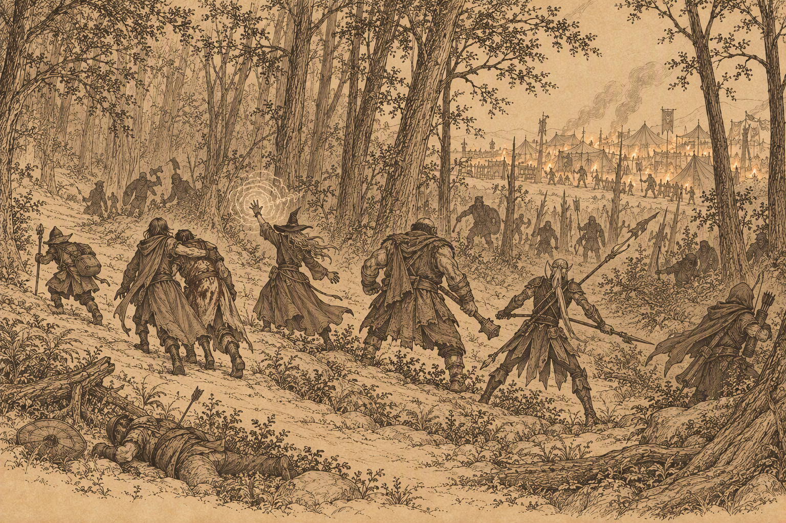{ .center-img width="70%%" }

## Góry Bełkotków&nbsp;49 { .divider }

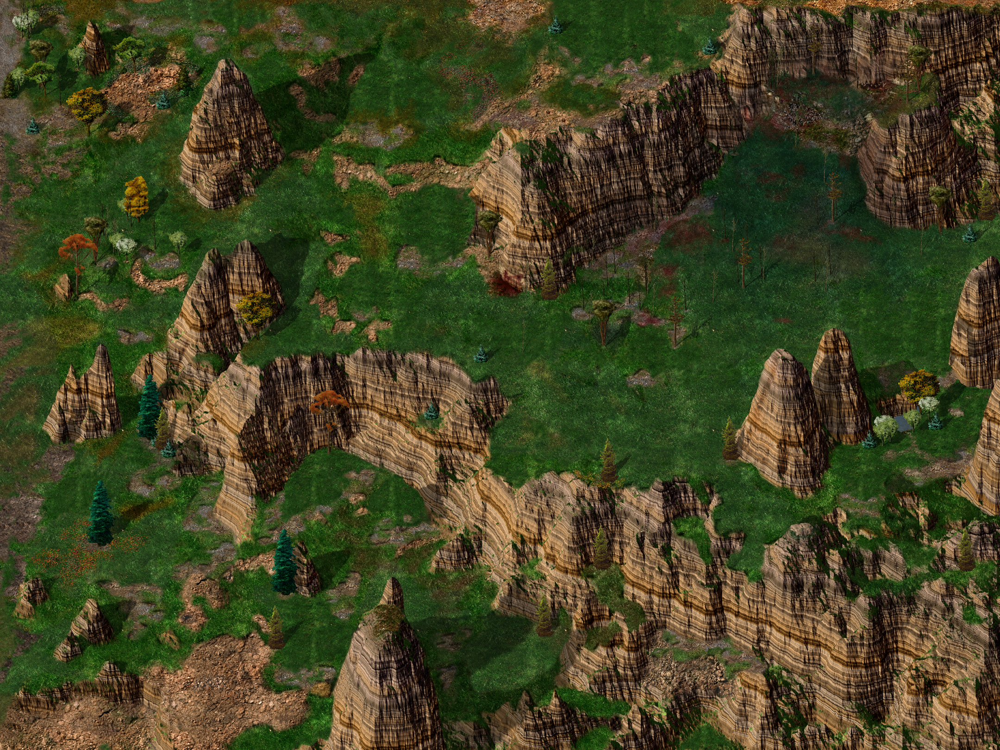{ .center-img width="40%" }

**Hugnot** 1 na widok przybyszów zaczął krzyczeć o orkach, lecz szybko dostrzegł pomyłkę i poprosił o ochronę. **Imoen** ponagliła go, by zamiast stać z otwartymi ustami, opowiedział, co widział. Przez okolicę przemknęło trzydziestu lub więcej orków, wyraźnie w pośpiechu. Na pytanie **Sandrah** o ludzkiego jeńca **Hugnot** wspomniał o wielkim worku, rozmiarami pasującym do porwanego człowieka. Nie wiedział jednak, co znajdowało się w środku — uciekł, nie mając ani okazji, ani ochoty zaglądać. 

Orkowie ruszyli na północny wschód, ku wiosce niziołków *Gullykin*. Przy takim tempie mogli dotrzeć tam jeszcze przed świtem. Sandrah zauważyła, że droga ta nie prowadziła do *Lasu Otulisko*, lecz **Hugnot** był pewien kierunku. Na rozwidleniu napastnicy zatrzymali się, krzyczeli i kłócili tak zaciekle, że niemal liczył, iż pozabijają się nawzajem. Ostatecznie wybrali jednak inną drogę. Leech uznał, że bez kogoś, kto pokierowałby nimi z odrobiną rozsądku, mogli zwyczajnie pomylić szlak. Pozostawało pytanie, czego szukali w osadzie niziołków ([The Kidnapping of Henning](../other/zadania.md#q91)).

**Dorn** uznał, że napotkani nieumarli rzadko powstawali bez cudzej pomocy, a wszystko wokół zdradzało rękę **Kryll**. Ostrzegł Leecha, że czaiła się gdzieś w pobliżu. Od miesięcy myślał niemal wyłącznie o zemście na dawnych zdrajcach, a nowe moce tylko podsycały tę żądzę. Zapytany o ich źródło przyznał, że zawarł układ i przyjął pewne warunki. Na tym jednak zakończył wyjaśnienia.

**Kryll** zastali w otoczeniu uwiedzionych mężczyzn 2. **Dorn** wypomniał jej, że niegdyś uważał ją za jedyną osobę, która potrafiła spojrzeć poza jego półorczą krew. Teraz widział, jak bardzo się pomylił. Wspomniał też o **Senjaku**, którym już się zajął. Była wspólniczka odparła, że ktoś musiał wziąć na siebie winę, aby odwrócić podejrzenia od reszty, a wybór padł na niego za sprawą **Simmeona**. Próbowała zbyć zemstę jako małostkowość, lecz **Dorn** nie zamierzał wybaczyć pozostawienia go na śmierć w *Luskan*. **Kryll** zamieniła otaczających ją mężczyzn w szkielety i posłała je przeciw drużynie. Nie ocaliły swojej pani.

Po śmierci **Kryll** przy jej ciele znaleźli list od **Simmeona**. Nadawca przepraszał za gwałtowne zachowanie podczas ostatniego rozstania i ostrzegał, że pół-ork uciekł z więzienia, po czym zaczął zabijać dawnych kompanów. Zapewniał, że zdobył potężnego sprzymierzeńca, i zapraszał adresatów do ukrytego obozu tuż przed wejściem do *Wrót Baldura*. Liczył, że wspólnie łatwiej stawią czoło mścicielowi, który właśnie przeczesywał wybrzeże.

Dorn zażądał listu, a poznawszy kryjówkę *Simmeona*, natychmiast chciał ruszać w drogę. Leech przypomniał, że ostrzeżony przeciwnik mógł przygotować pułapkę, lecz on nie zamierzał zwalniać. Wierzył, że wymknie się każdej zasadzce i pokona każdą przeszkodę. Ufał własnej sile bardziej niż słowom zabitych zdrajców, choć przeczuwał, że wzmianka o potężnym sprzymierzeńcu była prawdziwa. Leech zauważył, że ostrożność najwyraźniej przestała mu towarzyszyć, i zaproponował dalszą podróż. *Simmeon* nie miał im uciec. ([Dorn Il-Khan A Blackguard's Revennge](../other/zadania.md#q92)). Powinni także odwiedzić **Taris** i poinformować ją co się stało z jej głupim mężem.

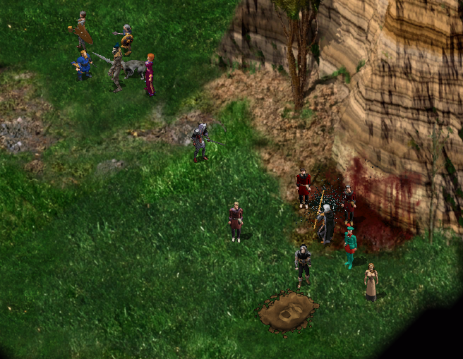{ .center-img width="50%" }

W kotlinie odnajdujemy **Deneb** 3, którą otaczały węże strzegące ją niczym wierne dzieci. Na widok drużyny zapowiedziała im kolejną ucztę, uznając przybyszów za złodziei. Leech zapytał, czy poprzedni intruzi również szukali *Kerykeionu*, lecz zamiast odpowiedzi usłyszał oskarżenia i wzmiankę o łotrach tańczących w świetle księżyca. **Deneb** chełpiła się, że kolejna marionetka padła ofiarą jej mocy. Gdy gnom zapytał o węże Deneb oznajmiła, że ona i jej podopieczni stanowili jedno, a wraz z nadejściem ciemności znów powstawali. Leech uznał, że nie sposób przemówić jej do rozsądku. Czarodziejka zagroziła, że ani ucieczka, ani walka nie zmienią losu przybyszów — jej pomocnicy mieli pożywić się ich zwłokami. Koniec końców Baldwin będzie rad z odzyskanego artefaktu ([Sorceress of Shadows](../other/zadania.md#q43))

**Lena** 4 zatrzymała Leecha i błagała o pomoc dla nieprzytomnego przyjaciela. Od ponad tygodnia błąkała się po dziczy, szukając kogoś, kto zdołałby uratować ciężko rannego **Samuela**. Jego stan był tak poważny, że nawet **Finch** nie potrafiła mu pomóc. Jedyną nadzieją pozostawała **Gellana Mirrorshade** ze *Świątyni Mądrości* w *Pomocnej Dłoni*. **Lena** poprosiła, by drużyna ostrożnie podniosła rannego i bez zwłoki zaniosła go do kapłanki. **Leech** zgodził się pomóc, a wdzięczna kobieta raz jeszcze przestrzegła, że **Samuelowi** pozostało niewiele czasu.

Podczas drogi wędrowców zaatakowali dezerterzy 5, oskarżający **Samuela** o zdradę. Zgiełk walki na chwilę przywrócił rannemu świadomość. **Sandrah** natychmiast rzuciła proste zaklęcie, by choć trochę złagodzić jego ból. Kiedy odzyskał głos, zapytał o **Lenę** i miejsce, do którego trafił. Kapłanka zapewniła go, że kobieta była bezpieczna, a drużyna zamierzała jak najszybciej dostarczyć go do *Świątyni Mądrości*. **Samuel** ostrzegł jednak, że nic nie będzie dobrze, dopóki okolicą rządziła *Płonąca Pięść*. **Sandrah** nakazała mu zachować spokój, by rany ponownie się nie otworzyły. **Finch** zaproponowała kolejne zaklęcie, żartując, że podczas długiej drogi chory mógłby zacząć zaczepiać każdego napotkanego bandytę. Kapłanka wyjaśniła, że w warunkach polowych zrobiła już wszystko, co było możliwe. **Samuel** potrzebował świątyni, odpoczynku i odpowiedniej opieki. Zanim ponownie opadł z sił, zdążył wyjawić, że *Płonąca Pięść* przestała strzec prawa i porządku, odkąd **Angelo Dosan** oddał ją na służbę *Żelaznemu Tronowi*. **Sandrah** powstrzymała go przed dalszym mówieniem i zesłała na niego sen. Ostatnim wysiłkiem **Samuel** raz jeszcze przestrzegł drużynę przed zdrajcami ([Samuel and Lena](../other/zadania.md#q93)).

Przy samotnym szczycie 6 zatrzymał drużynę **Hafiz**, prosząc o rozmowę w niezwykle ważnej sprawie. Gdy odzyskał oddech, przedstawił się jako **Hafiz bin Watat**, astrolog, uczony i mag. Usłyszawszy imię Leecha, natychmiast je rozpoznał. Twarz młodego gnoma wielokrotnie pojawiała się w jego snach, zawsze pośród krwi i śmierci. Nad Leechiem pochylał się złowrogi człowiek, a ich losy nieuchronnie splatały się ze śmiercią jednego z nich. Nasz bohater wyjaśnił, że wychował się w *Candlekeep* u boku **Goriona**, lecz po ucieczce z twierdzy jego przybrany ojciec został zamordowany. Od tamtej chwili ktoś nieustannie próbował pozbawić życia również młodego gnoma. **Hafiz** przeprosił za przywołanie bolesnych wspomnień. Pragnął jednak pomóc, a zarazem uwolnić się od nękających go wizji. Astrolog przekazał **Leechowi** zwój ochronny i polecił użyć go podczas starcia z ośmioma sługami zabójcy **Goriona**, aby osłonić drużynę przed ich gniewem. **Finch** z uznaniem przyjęła ten bezinteresowny dar. Nie wszyscy czyhali na życie Leecha. Gdzieś po jego stronie stali również życzliwi sprzymierzeńcy.

W trakcie dalszej podróży **Jen’lig** zapytała **Sandrah**, czy była *g’lathk*. Kapłanka nie znała tego określenia, więc githyanki wyjaśniła, że *g’lathk* zajmowali się uzdrawianiem mieszkańców *Tu’narath*. W głębi miasta pielęgnowali hydroponiczne ogrody, a rannych zabierali do komnat wyposażonych w regeneracyjne kapsuły, które przyspieszały naturalne gojenie. **Sandrah** odparła, że dzięki *Splotowi* nie potrzebowała bogów, by czerpać ze źródła magii, choć tam, gdzie było to możliwe, sama również korzystała z naturalnych metod leczenia. Chętnie dowiedziałaby się więcej o technikach stosowanych przez *g’lathk*. **Jen’lig** przyznała, że nie potrafiła dokładnie wyjaśnić swojej roli, lecz uważała się za pewien szczególny rodzaj *g’lathk*. **Sandrah** nazwała ją strażniczką i łowczynią złodziei. Githyanki uznała to określenie za trafne, zaznaczyła jednak, że dzieci *Gith* nigdy nie były złodziejami. Ściganie własnych wrogów ich sposobem pozostawało dla niej czymś zupełnie nowym.

Kawałek dalej 7 drogę zagrodził im kolejny najemnik *Płonącej Pięści*, żądając, by natychmiast się przedstawili. **Sandrah** oznajmiła, że byli jedynie wędrowcami. Strażnik ostrzegł ich przed bandytami grasującymi w okolicy, po czym wyjawił, że poszukiwał dezertera imieniem **Samuel**. Zbieg miał podróżować z kobietą, a za jego schwytanie wyznaczono nagrodę w wysokości pięćdziesięciu sztuk złota. Najemnik zdążył już odejść, gdy nagle zainteresował się niesionym przez drużynę rannym. **Sandrah** zachowała zimną krew i odparła, że był to jeden z ich towarzyszy, który ucierpiał podczas drogi. Wyjaśnienie wystarczyło. Członek *Płonącej Pięści* pożegnał wędrowców i ruszył dalej, nieświadomy, że poszukiwany prze niego znajdował się tuż przed nim. Stan **Samuela** nie był krytyczny, dlatego drużyna uznała, że przed powrotem do *Pomocnej Dłoni* mogła jeszcze sprawdzić trop prowadzący do *Gullykin*.

:material-paw: Bestiariusz: *niedźwiedziożuk, szkielet, dzik, bełkotek, wąż, niedźwiedź jaskiniowy, straszny wilk, straszliwy wilk*

## Gullykin&nbsp;50 { .divider }

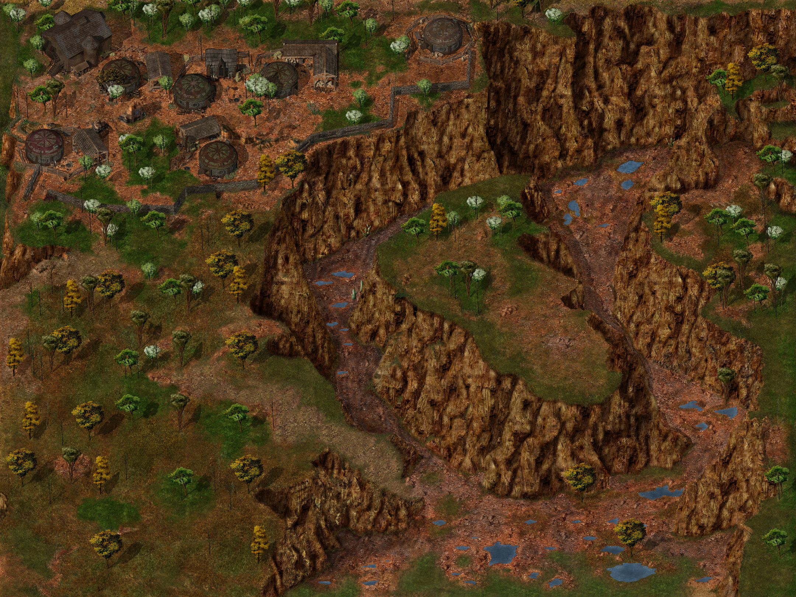{ .center-img width="40%" }

W *Gullykin* przywitał ich **Gandolar Luckyfoot** 1, który od razu zapytał, czy zmierzali ku *Wieży Durlaga*, czy może już z niej wracali i potrzebowali opatrzenia złamań oraz siniaków. Jak zauważył, wielu poszukiwaczy przygód docierało do osady ledwie żywych. Leech zapytał o dużą grupę orków, która mogła niedawno przechodzić przez okolicę. **Gandolar** udał, że nie rozumie pytania, lecz **Imoen** szybko straciła cierpliwość do tej gry. Niziołek przyznał w końcu, że orkowie zwykle nie zapuszczali się w te strony. **Imoen** uznała więc dalszą rozmowę za stratę czasu, zwłaszcza gdy **Henning** wciąż czekał na ratunek. **Gandolar** zdążył jednak wspomnieć o osobliwych odgłosach dobiegających jakiś czas temu z sadów na południe od wioski. Jego przyjaciel **Telben** miał udać się tam na zwiad. To wystarczyło **Imoen**. Ponagliła **Leecha**, by przestał stać z otwartymi ustami, i poprowadziła drużynę ku sadom.

Podczas poszukiwań ogrodnika wędrowcy natknęli się na niewielką grupę koboldów 2. Przy ich ciałach znaleźli pierścień emanujący osobliwą mocą.

Dalej usłyszeli wołanie o pomoc i odnaleźli rannego niziołka 3. Po odzyskaniu sił **Telben Beeswaxer** wyjaśnił, że natknął się na ogromną hordę orków, gdy szukał uli pośród drzew. Napastnicy początkowo go nie zauważyli, zajęci kłótnią o jeńca. Na wzmiankę o pojmanym **Imoen** natychmiast domyśliła się, że chodziło o **Henninga**. **Telben** potwierdził, że kupiec żył i mimo trudnego położenia nie tracił ducha. Część orków chciała go zabić i zagarnąć łupy ukryte w pobliskiej jaskini, pozostali natomiast obawiali się człowieka imieniem **Davaeorn**. Zamierzali dostarczyć mu zakładnika zgodnie z otrzymanym rozkazem. **Sandrah** uznała to nazwisko za kolejny ślad w rozrastającym się spisku. Kłótnia orków zakończyła się dla **Telbena** boleśnie. Kilku napastników oparło się o drzewo, na którym się ukrywał, strącając go prosto pod swoje stopy. Z ich wrzasków wywnioskował, że zgubili drogę do *Lasu Otulisko* i przypadkiem trafili w okolice *Gullykin*. Wiedzieli jednak o tajnej kwaterze ukrytej w jednej z pobliskich jaskiń, gdzie część z nich chciała schronić się z łupami. Obawiali się również oddziału prowadzonego przez gnoma i jego towarzyszy. **Telben** nie miał wątpliwości, że mówili o **Leechu**.

Orkowie próbowali zmusić niziołka do wskazania drogi do *Lasu Otulisko*. Gdy nawet tortury nie przyniosły odpowiedzi, związali go i rzucili obok **Henninga**. Kupiec wykorzystał chwilę, by opowiedzieć o swoim porwaniu. Był przekonany, że **Imoen** ruszy jego tropem. Na dowód, że żył i nie zamierzał się poddać, zsunął z palca pierścień i poprosił **Telbena** o przekazanie go drużynie jeśli się na nich natknie.

Ostatecznie dwaj orkowi przywódcy podzielili hordę. Większa grupa zabrała **Henninga** i ruszyła na północ, gdzie miała spotkać się z **Tazokiem** oraz zdobyć informacje o drodze do *Lasu Otulisko*. Mniejszy oddział powędrował na wschód, ku jaskini skrywającej łupy. Ponieważ ani droga do lasu, ani rola **Davaeorna** nie były jeszcze znane, drużyna postanowiła najpierw odwiedzić kryjówkę orków i wydobyć z nich kolejne odpowiedzi. **Telben** zaznaczył położenie jaskiń na mapie i poprosił, by podczas przesłuchania przekazać napastnikom jego najserdeczniejsze pozdrowienia.

Na drodze stanęli im kolejni łowcy głów 4. Tym razem **Molkar**, **Drakar**, **Morvin** i **Halacan** nie mieli przywitać następnego poranka.

Nasi wędrowcy odnaleźli jaskinię, w której ukrył się oddział orków 5. Wewnątrz czekała silna grupa wojowników wszelkiej maści, w tym magowie przywołujący żywiołaki ziemi i powietrzne sługi. Po ciężkiej walce drużyna przebiła się przez obrońców i odnalazła **Rellruka**. Ork spodziewał się, że Rudowłosa w końcu go odnajdzie. **Imoen** nie kryła satysfakcji, że przy okazji mogła rozprawić się z orkowym hersztem, lecz najpierw zażądała informacji o **Henningu**. **Rellruk** wyjawił, że jego zwierzchnik, **Knowlod**, zatrzymał jeńca i zamierzał dostarczyć go **Davaeornowi**.

**Imoen** zagroziła więźniowi powolną śmiercią, lecz Leech powstrzymał ją przed zbyt pochopnym działaniem. Zamierzał wydobyć z orka wszystko, co wiedział o **Davaeornie**, i dopiero później rozstrzygnąć jego los. **Rellruk** twierdził, że znosił tortury przez całe życie i nawet gdyby znał drogę do zleceniodawcy, wolałby umrzeć, niż ją zdradzić. **Sandrah** zauważyła jednak, że skoro orkowie mieli dostarczyć jeńca **Davaeornowi**, musieli wiedzieć, gdzie go szukać. **Rellruk** przyznał, że **Knowlod** zamierzał odnaleźć kopalnię w *Lesie Otulisko* bez pomocy **Tazoka**, choć tylko on znał prowadzącą do niej drogę. Chciwy **Knowlod** nie chciał dzielić się z nim nagrodą. 

Drużyna poznała kolejne ogniwo spisku, lecz łańcuch prowadzący ku prawdziwym mocodawcom zdawał się nie mieć końca. **Rellruk** chełpił się, że jedynie on wiedział, gdzie znaleźć **Tazoka**. **Imoen** szybko pozbawiła go tej ostatniej przewagi, przypominając, że droga do obozu bandytów była już znana. **Sandrah** dostrzegła słabość całej organizacji. Każdy znał tylko bezpośredniego przełożonego, co utrudniało zdradę, lecz pozwalało drużynie rozbijać spisek ogniwo po ogniwie. Wróg mógł długo nie reagować na ich działania, a gdy wreszcie odkryje, jak daleko zaszli, zabraknie mu solidnego oparcia. **Imoen** przyjęła tę myśl z ponurym zadowoleniem. Gdy zostanie sam, zapłaci za wszystko, a za porwanie **Henninga** zapłaci jeszcze raz ([The Kidnapping of Henning](../other/zadania.md#q91)).

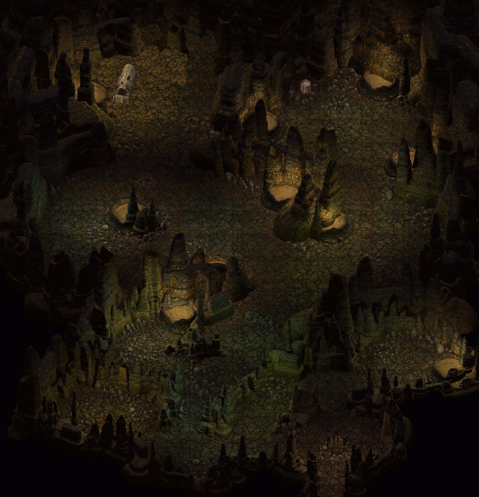{ .center-img width="50%" }

**Sandrah** zatrzymała drużynę i zaczęła przeglądać swoją wszechwiedzącą księgę. Przypomniała, że jej ojciec zgromadził rozległą wiedzę o *Wybrzeżu Mieczy*, dlatego na stronach tomu mogła znajdować się mapa *Lasu Otulisko*. Kapłanka szybko ostudziła nadzieje **Imoen**. Dawne kopalnie należały niegdyś do krasnoludów, które nawet w czasach swojej świetności ukrywały ich dokładne położenie przed obcymi klanami. Od tamtej pory minęło wiele lat, a miejsce niemal zupełnie zniknęło z pamięci mieszkańców krainy. Krasnoludy kopały coraz głębiej, aż pewnego dnia naruszyły podziemną rzekę lub zbiornik wodny. Woda zalała kopalnię, grzebiąc wielu górników. W kolejnych latach kilkukrotnie próbowano dostać się do podziemnego kompleksu, lecz wszystkie wyprawy zakończyły się niepowodzeniem. Wraz z upływem czasu zanikły również ostatnie wskazówki dotyczące jego położenia.

Leech przypomniał, że *Las Otulisko* zajmował niemal czwartą część *Wybrzeża Mieczy*. Nie było w nim osad ani prawdziwych dróg, a jedynie ścieżki wijące się pośród ponurych ruin. **Sandrah** dorzuciła do tego olbrzymie pająki i wiwerny. Żadne z tych zagrożeń nie mogło jednak powstrzymać drużyny przed uratowaniem **Henninga** i pokrzyżowaniem planów wroga. **Imoen** podsumowała sytuację bez zbędnych subtelności: musieli odnaleźć igłę w stogu siana wielkości całego *Lasu Otulisko*. **Sandrah** zauważyła jednak, że ich najbliższym celem nadal pozostawali **Tazok** i obóz bandytów.

Podczas odpoczynku **Sandrah** zapytała **Finch**, czy chciałaby przyjrzeć się księdze z bliska. Kronikarka skwapliwie przyjęła propozycję. Tom robił imponujące wrażenie, a możliwość jego studiowania wydawała się jeszcze bardziej kusząca, o ile Leech pozwoliłby jej poświęcić na to odpowiednio dużo czasu. Kapłanka wyjaśniła, że otrzymała księgę od ojca. Była dla niej bezcenna nie tylko ze względu na zawartą wiedzę, lecz także dlatego, że wielokrotnie pomagała jej podczas pełnego przygód życia. **Finch** z zachwytem rozpoznała *Historię Faerûnu Elminstera*, opatrzoną osobistym podpisem autora. **Sandrah** przypomniała jednak, że autor był jej ojcem, dlatego jego dzieło miało dla niej inne znaczenie niż dla nauczycielki czy badaczki. Księga stanowiła dziedzictwo przekazane jej na dalszą drogę. **Elminster** spisał w niej wiedzę zgromadzoną podczas długich lat wędrówek po Krainach, aby ocalić ją od zapomnienia. Nie tworzył jej jednak wyłącznie z myślą o córce. Pisząc kolejne fragmenty, często wyobrażał sobie **Sandrah** siedzącą na jego kolanach i słuchającą opowieści o przeżytych przez niego przygodach. Te wspomnienia pozostały dla kapłanki równie cenne jak sama zawartość tomu. Dopiero później **Elminster** uznał, że wiedza przydatna jego córce może przysłużyć się również innym, i polecił wydać księgę w *Waterdeep*. **Finch** zauważyła jednak, że niewielu mogło sobie pozwolić na jej astronomiczną cenę. **Sandrah** nie obwiniała o to ojca. Tak działała gospodarka, a większość mieszkańców *Faerûnu* nie potrzebowała całej wiedzy zawartej w opasłym tomie. Ci zaś, którym mogłaby się przydać, często nie potrafili nawet czytać. **Finch** natychmiast uznała te słowa za potwierdzenie wagi własnej misji. Zamierzała nieść światło wiedzy zwykłym ludziom, ucząc ich czytać i pozwalając im czerpać z tego, co inni poznali i zapisali.

Drużyna opuściła jaskinię zmęczona i świadoma, że na razie musiała odłożyć dalsze poszukiwania. Należało dostarczyć **Samuela** do *Pomocnej Dłoni*, odnaleźć **Henninga** i po drodze zajrzeć do *Beregostu*.

:material-paw: Bestiariusz: *kobold, worg, powietrzny sługa, żywiołak ziemi, ethercap, orog, ork, ork łucznik, ork kapłan, ork mag, hobgoblin czempion*

## Pomocna Dłoń&nbsp;51 { .divider }

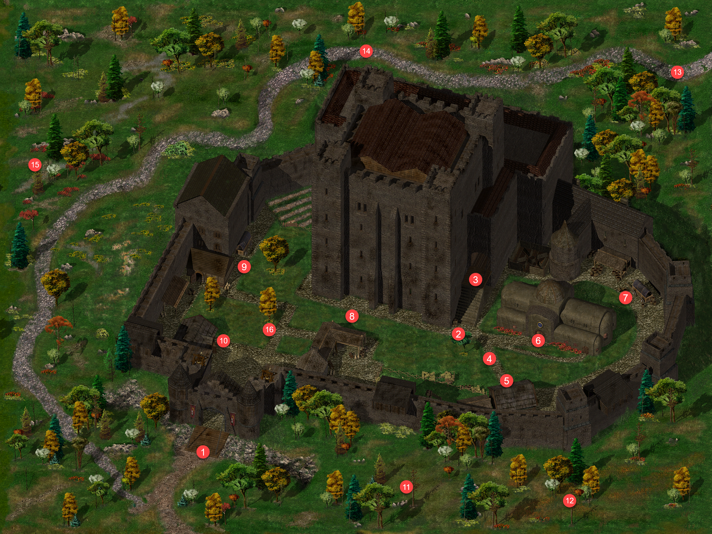{ .center-img width="40%" }

**Churin** 16 uznał, że po uratowaniu **Brage’a** miał przed sobą doświadczonych poszukiwaczy przygód, a właśnie takich ludzi polecono mu odnaleźć. Przekazał drużynie, że *Easthaven* poszukiwało śmiałków i najemników gotowych podjąć się zadania obiecującego bogactwo oraz sławę. Leech przypomniał sobie, że *Easthaven* leżało w *Dolinie Lodowego Wichru*. **Churin** potwierdził, że w regionie działo się coś niepokojącego, a sąsiednia osada *Kuldahar* zwróciła się o pomoc. Aby dotrzeć na miejsce, drużyna musiała wyruszyć daleko na północ, podążać wzdłuż *Górnego Chiontharu*, a następnie kontynuować drogę ku mroźnym krainom. **Churin** poradził, by przed wyprawą skontaktowali się z jego przyjacielem **Maladernothem**, przebywającym w *Ulgoth’s Beard*. Życząc wędrowcom powodzenia, pozostawił im decyzję, czy podejmą się tak dalekiej podróży.

W świątyni 6 drużyna przekazała **Samuela** pod opiekę **Gellany**. Ranny znalazł się wreszcie w miejscu, w którym mógł otrzymać należytą pomoc ([Samuel and Lena](../other/zadania.md#q93)). :material-trending-up: Reputacja +1

Po odzyskaniu amuletu **Inoshishi** poprosił **Gellanę Mirrorshade** o pomoc w odnalezieniu utraconych fragmentów *Saiai no Hito*. Kapłanka przyjrzała się przedmiotowi i dostrzegła krótkie obrazy miejsc, w których spoczywały części miecza. Pierwsza wizja ukazała wysoką wieżę z jasnym światłem na szczycie. Wokół szumiała woda, a w oddali rozbrzmiewały głosy. **Gellana** nie potrafiła rozstrzygnąć, czy należały do duchów, czy do żywych ludzi, lecz wszystko wskazywało na latarnię morską. Drugi obraz był znacznie bardziej niepokojący. Kolejny fragment został połknięty przez ogromne stworzenie. Choć ostrze prawdopodobnie przecięło jego wnętrzności, bestia nadal żyła, jakby potrafiła regenerować rany lub opierać się obrażeniom zadawanym od środka. Przebywała wśród skał i piasku, w suchym, kamienistym miejscu.

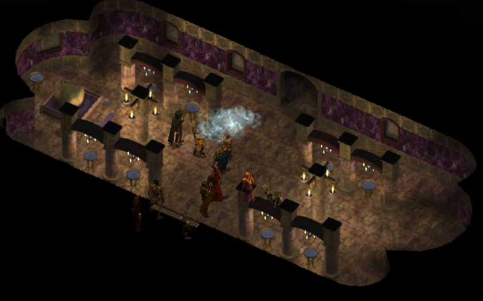{ .center-img width="50%" }

**Gellana** nie zdołała zobaczyć niczego więcej. **Inoshishi** uznał jednak, że zdobyte wskazówki wystarczą, by rozpocząć poszukiwania. Zamierzał przestudiować mapy, a drużynę poprosił, by podczas dalszych wędrówek wypatrywała latarni morskich oraz miejsc odpowiadających opisowi suchego, skalistego pustkowia. Leech zapewnił, że nie zamierzał jeszcze opuszczać przyjaciela i powiadomi go natychmiast po odnalezieniu fragmentów miecza. ([Restoring Saiai no Hito](../other/zadania.md#q89))

**Dorn** uznał, że drużyna robiła się dla niego zbyt słodką zbieraniną, i postanowił zaczekać na jakąś odmianę w gospodzie. Leech pozwolił mu odpocząć, a na dalszą drogę zabrał **Neerę**. Dzika magini przywitała go z udawanym wyrzutem, że kazał jej samotnie przebyć całą drogę. Szybko jednak porzuciła pretensje i zgodziła się ponownie dołączyć do drużyny. Po chwili poprosiła również o pomoc w bardziej osobistej sprawie. Choć początkowo uciekła przestraszona skutkami własnej magii, z czasem zaczęła szukać sposobu na ograniczenie jej nieprzewidywalnych następstw. Każde zaklęcie mogło wymknąć się spod kontroli, a **Neera** wciąż pamiętała incydent, podczas którego poraziła **Enith** i pozbawiła ją włosów. Porównała dziką magię do gry na flecie ze słuchu. Zwykle potrafiła wydobyć z instrumentu całkiem przyjemną melodię, lecz jeden fałszywy dźwięk wystarczał, by flet zaczął miotać ogniem we wszystkich kierunkach. Czasami zaś sam flet zamieniał się w chomika.

**Neera** podzieliła się plotką o dzikim magu imieniem **Adoy**, który od wielu lat żył na odludziu. Uznała, że ktoś tak doświadczony mógłby nauczyć ją lepiej panować nad nieujarzmioną mocą. Ostatnio widziano go na wschód od *Mostu Firewine*, dlatego poprosiła Leecha, by pomógł jej go odnaleźć. Zgodził się przyjrzeć sprawie, jeśli droga zaprowadzi drużynę w tamte strony. **Neera** przypomniała mu jednak, że poszukiwanie nauczyciela było czymś więcej niż wyprawą po nową sztuczkę. Liczyła, że **Adoy** pomoże jej uniknąć kolejnych porażeń, trwałej łysiny oraz innych kaprysów dzikiej magii.

Póki co nadszedł czas, by zamknąć kilka spraw w *Berezoście*.

:material-account-group: Odłączeni NPC: Dorn (Pomocna Dłoń)

:material-account-group: Przyłączeni NPC: Neera

## Beregost&nbsp;52 { .divider }

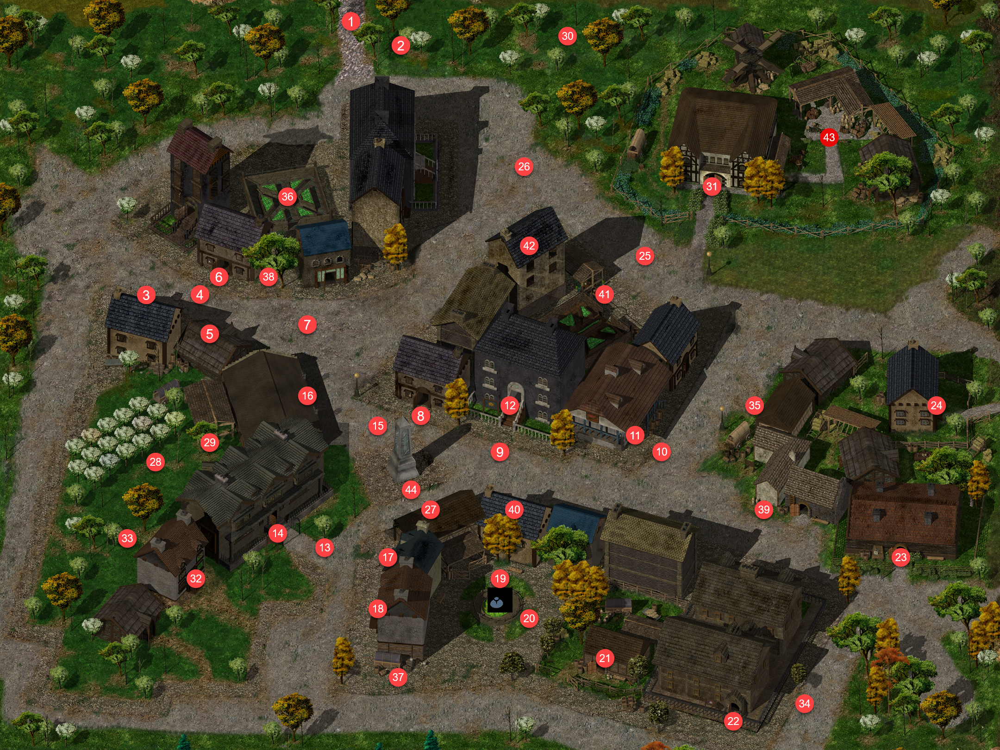{ .center-img width="40%" }

W kuźni 23 **Taerom Fuiruim** powitał ekipę wieścią, że udało się znaleźć sposób na zneutralizowanie tajemniczego zanieczyszczenia. Płatnerz wypróbował opracowaną metodę na własnych zapasach żelaza, a gdy tylko upewni się, że rzeczywiście działała, zamierzał przesłać wyniki badań do *Nashkel*. Tymczasem zachęcił ich, by obejrzeli przygotowany przez niego rynsztunek. Zdaniem **Taeroma** prezentował się teraz znacznie lepiej niż wcześniej ([Vial of Mysterious Liquid](../other/zadania.md#q84)).

U *Feldeposta* 14 **Illasera** natychmiast wyczuła klątwę ciążącą na mieczu hobgoblińskiego kapitana. Rozpoznała zaklęcie zguby i potwierdziła, że Leech przyniósł właściwą broń. Pozwoliła mu zatrzymać *Humanbane*, zauważając, że choć oręż był niezgrabny, wyglądał jak przedmiot o bogatej i krwawej przeszłości. Zgodnie z umową wypłaciła też pełne wynagrodzenie. Leech przyznał, że polowanie sprawiło mu więcej przyjemności, niż się spodziewał, i zapytał o kolejne zlecenie. **Illasera** odparła, że życie łowcy najwyraźniej mu służyło. Nowy kontrakt pojawił się jeszcze podczas jego wyprawy przeciw hobgoblinom. Choć drużyna oczyściła kopalnie *Nashkel* z koboldów, nekromanta imieniem **Sazazir** uznał opuszczone podziemia za doskonałe legowisko. Głębokie, wilgotne korytarze przyciągały najgorszych przedstawicieli jego profesji, a ciała górników poległych podczas koboldziej okupacji stanowiły gotową armię dla kogoś parającego się mroczną sztuką. **Leech** zauważył, że w kopalni cuchnęło wystarczająco mocno jeszcze przed pojawieniem się nekromanty. **Illasera** poradziła mu więc zaopatrzyć się w klamrę na nos, ponieważ podobni czarodzieje chętnie wykorzystywali odór przeciw wrogom. Zlecenie pochodziło od władz *Nashkel*. Burmistrz **Ghastkill** chciał, by sprawę załatwiono po cichu, zanim górnicy dowiedzą się, że niższe poziomy kopalni ponownie znalazły się w rękach potworów. Nie zamierzał wysyłać przeciw nekromancie niedoświadczonych żołnierzy, wiedząc, że byłoby to jedynie dostarczeniem mu kolejnych ciał do powiększenia armii. Potrzebował niewielkiej grupy odpowiednio wyszkolonych ludzi. **Sazazir** był dawnym kultystą z południa, który popadł w konflikt z *Harfiarzami* i kilka lat wcześniej został wypędzony na północ. Zyskał opinię wędrownego maga i wyrzutka, któremu odmawiano wstępu do niemal każdego miasta. **Illasera** podejrzewała, że nekromanta miał już dość tułaczki i postanowił wykorzystać kopalnie jako pierwszy krok ku zdobyciu wpływów w regionie. Za zgładzenie **Sazazira** wyznaczono nagrodę w wysokości sześciuset czterdziestu sztuk złota. Była skromniejsza niż zapłata za poprzednie oczyszczenie kopalni, ponieważ ciągłe ratowanie *Nashkel* nadwyrężyło sakiewkę burmistrza. **Illasera** poinformowała również, że nekromanta zajmował środkowe poziomy kompleksu, na których nie wznowiono jeszcze pracy. Pozostało wrócić do cuchnących podziemi i zadbać, by nekromanta nie zdążył dokończyć swoich planów. ([Black Hearts - The Huntress](../other/zadania.md#q87))

Na piętrze drużyna odnalazła **Tranziga**. Mag próbował odprawić przybyszów, tłumacząc, że spieszył się z opuszczeniem miasta. Leech zauważył, że grożenie magią nie poprawiło jego położenia i jego rola w problemach z żelazem jest mu dobrze znana. Nakazał **Tranzigowi** poddać się i ruszyć z nimi, ostrzegając, że w przeciwnym razie wyciągną go siłą. Mag uznał jednak, że poradzi sobie i przeszedł do ataku.

Przy jego ciele znaleziono list, który **Tazok** skierował do **Tranziga**. Herszt wyrażał zaniepokojenie przedłużającym się milczeniem **Mulaheya** i nakazywał magowi udać się do kopalni, by sprawdzić stan operacji. Polecił mu również odzyskać żelazo, które mogły ukraść koboldy. Zapowiadał, że następny napad najprawdopodobniej dosięgnie *Peldvale* albo *Kniei Larsa*, dlatego **Tranzig** miał odwiedzić oba miejsca, odnaleźć bandytów i sprowadzić ich z powrotem do obozu. ([Confronting Tranzig](../other/zadania.md#q82))

W *Oku Gorgony* 29 **Baldwin** z podziwem przyjął odłamek *Kerykeionu*, artefaktu, o którym słuchał opowieści jeszcze jako dziecko. Nawet roztrzaskany emanował potęgą i obietnicą władzy będącej zaledwie nikłym odbiciem pełnych możliwości relikwii. Poprosił Leecha o dokładne przedstawienie całego spotkania, gdyż opowieść miała dotrzeć do samego oka *Cyklopa*. Nas bohater powiedział, że podczas walki czarodziejka przywoływała węże z pustego powietrza, jakby sam *Kerykeion* poddawał się jej woli. **Baldwin** rozpoznał w tym rzadki dar przypisywany potomkom *Gorgon*, świadczący o głębokim związku z *Wężowymi Siostrami*. **Deneb** musiała pozostawać w niezwykle silnej, choć niebezpiecznej więzi z artefaktem. Czarodziejka sprawiała jednak wrażenie niestabilnej, jakby wpływ *Kerykeionu* stopniowo pochłaniał jej umysł. Zdaniem **Baldwina** potężne relikwie wymagały od właściciela nie tylko talentu magicznego, lecz także niezłomnej siły ducha. **Deneb** nie zdołała oprzeć się narastającym cieniom i zamiast zapanować nad mocą artefaktu, sama padła jej ofiarą. Taki los czekał każdego, kto sięgał po podobną potęgę, nie rozumiejąc ceny, jakiej mogła zażądać. Leech wspomniał również o innych łotrach próbujących odebrać czarodziejce *Kerykeion*. Ta wiadomość zaniepokoiła **Baldwina**. Skoro obcy wiedzieli o relikwii oraz prowadzonych poszukiwaniach, ktoś mógł zdradzić szczegóły całej operacji. Nie było wiadomo, czy napastników przyciągnęła jedynie moc artefaktu, czy za ich działaniami krył się większy i lepiej zorganizowany plan.

Po złożeniu sprawozdania, **Baldwin** ostrzegł go przed obecnością wyczuwalną ostatnio w mieście. Zamierzał wysłać szpiegów, by zbadali sprawę, a drużynie nakazał zachować szczególną ostrożność, zwłaszcza podczas pobytu w mieście. Na tym zakończył spotkanie, zapowiadając, że ponownie wezwie młodego gnoma, gdy nadejdzie właściwa pora. ([Sorceress of Shadows](../other/zadania.md#q43))

**Rigaldo** powitał naszych włóczykijów kolejną opowieścią, w której los, cień i fortuna jak zwykle splatały się w jedną, niezbyt przejrzystą całość. Tym razem wieści prowadziły na południe od *Nashkel*, gdzie wśród pól należących do miejscowego gospodarza kobieta imieniem **Karp** odnalazła dwa pierścienie o magicznej naturze. Klejnoty były przeznaczone dla kupca z *Ulgoth’s Beard*, który właśnie zmierzał po odbiór zamówienia. **Karp** nie ograniczała się jednak do uczciwego handlu. Chętniej korzystała z usług paserów i ludzi pokroju **Rigalda**, a swoje znalezisko ukrywała nawet przed małżonkiem. **Leech** mógł wykorzystać ten sekret jako narzędzie nacisku, podszyć się pod oczekiwanego kupca albo sięgnąć po mniej subtelne metody. Najważniejsze było, by przejął pierścienie, zanim rozpłyną się na targowiskach. Jeśli Leech zdobędzie oba pierścienie, jeden miał przekazać **Rigaldowi**, drugi zaś zachować jako zapłatę. Zleceniodawca przestrzegł go, by działał ostrożnie. Droga została wyznaczona, lecz z ukrycia obserwowało ją wiele nieznanych oczu ([Beneath the Plougshares](../other/zadania.md#q94)).

**Jen’lig** przyznała, że pod dowództwem Leecha wreszcie dostrzegała wyraźny postęp. Kolejne zwycięstwa dawały jej realną nadzieję na dopadnięcie zabójcy **Goriona**, odzyskanie utraconego miecza oraz pomszczenie **Kastyi**. Rozlew krwi nie miał dla niej znaczenia. Liczyły się kompetencje, skuteczność i droga prowadząca do celu. Jedynym prawdziwym zagrożeniem pozostawało zwątpienie dowódcy w słuszność podejmowanych decyzji lub w lojalność własnych towarzyszy.

Drużyna zajrzała do *Wesołego Żonglera*, by wreszcie porządnie odpocząć przed wyprawą do obozu bandytów.

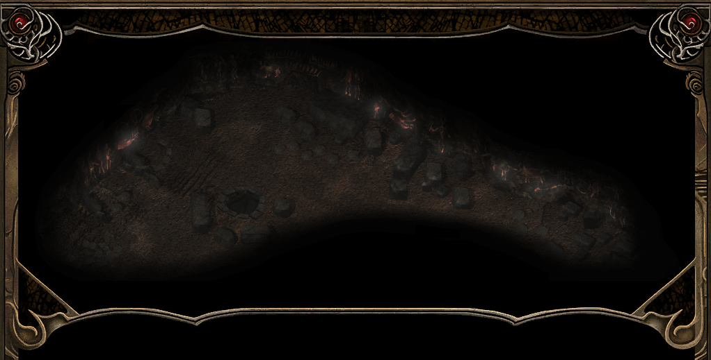

<em>Zwykłe sny z jakiegoś powodu ustąpiły miejsca czemuś zupełnie innemu. Pojawiła się wizja jaskini pokrytej niezwykłymi malowidłami, które zdawały się żyć i pulsować tajemniczą mocą. Ich obecność przenikała umysł, serce i duszę, aż wreszcie obrazy przemieniły się w głos.

Głos zwabił śniącego z powrotem do miejsca widzianego dawno temu, choć nie potrafił on rozstrzygnąć, czy naprawdę chodziło o stanowisko archeologiczne, czy jedynie kolejną sztuczkę własnego umysłu. Sen stawał się coraz wyraźniejszy. Obrazy układały się w słowa, a słowa przemawiały głosem innym niż wszystkie dotąd słyszane.

Wciąż powtarzał jedno wezwanie: „Wejdź w popiół i śnij to, co niegdyś wyśniono... a potem utracono”.</em>

Sen wskazywał, że należało ponownie odwiedzić *Starożytne Ruiny*. Na razie jednak droga prowadziła do *Kniei Larsa* ([Dreamheart](../other/zadania.md#q95)).

## Knieja Larsa&nbsp;53 { .divider }

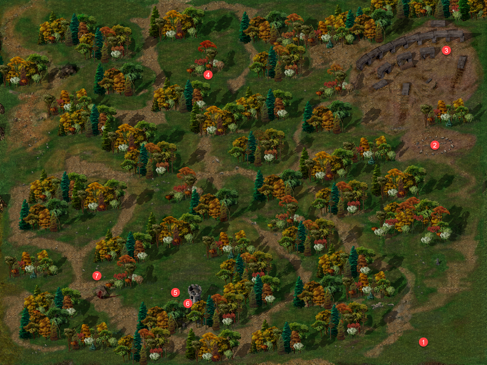{ .center-img width="40%" }

Drużyna spotkała **Nim’a Furlwinga** 1 i ocaliła jego psy zaatakowane przez wilki. Następnym razem mógł sam spróbować rycerskiego rzemiosła, zamiast czekać, aż obcy uratują jego zwierzęta. Palant.

Wędrowcy odnaleźli również trzeci portal 2, w którego wnętrzu pulsowała zielona sfera. Dostępu do niej strzegło sześć eterkapów. ([Circles of Interest](../other/zadania.md#q16))

Dalej drogę drużynie zastąpił **Osmadi** 3, oskarżając wędrowców o dokonanie rzezi, w której zginęli jego bracia. Nie chciał słuchać wyjaśnień **Neery** i przekonany o ich winie przywołał gniew *Malara*. Następnie wraz z dwoma niedźwiedziami rzucił się do ataku. W samym środku starcia z pomocą drużynie przyszedł trzeci niedźwiedź, zwracając się przeciw **Osmadiemu** i jego bestiom.

Po śmierci napastnika tajemniczy sprzymierzeniec przemówił ludzkim głosem. Przedstawił się jako **Corsone** i wyjaśnił, że **Osmadi** postradał rozum po niedawnej napaści bandytów zwanych *Chłodem*. Łupieżcy wtargnęli do ich obozu przy kapliczce i wymordowali wszystkich, których napotkali, w tym bliskich przyjaciół druida. Od tamtej chwili **Osmadi** nie był już sobą. **Neera** nie potrafiła zrozumieć, dlaczego **Corsone** pomógł zabić dawnego towarzysza, skoro obaj byli druidami i dobrze się znali. **Corsone** utrzymywał, że nie miał wyboru. **Osmadi** stał się zbyt niebezpieczny, a bez jego pomocy drużyna mogła nie przeżyć spotkania. **Neera** nie przyjęła tego wyjaśnienia. Podejrzewała, że **Corsone** celowo wykorzystał wędrowców, aby pozbyć się własnego kompana. Przyciśnięty pytaniami druid wreszcie odsłonił prawdę. Był *Druidem Cienia* i otruł **Osmadiego** oraz jego towarzyszy, aby uwolnić okoliczną ziemię od ich obecności. Pomoc udzielona drużynie stanowiła jedynie część planu. Teraz, gdy **Osmadi** nie żył, **Corsone** postanowił usunąć również niewygodnych świadków. Przybrał wrogą postać i zaatakował, lecz podzielił los druida, którego wcześniej pomógł zgładzić.

**Imoen** zapytała Leecha, czy wie kim był wspomniany wcześniej *Malar*. A ten przypomniał jej, że chodziło o jednego z bogów tego świata, dziewczyna natychmiast zapewniła, że doskonale o tym wiedziała i jedynie wystawiała go na próbę. Leech nie dał się zwieść. Pamiętał, że podczas nauki w *Candlekeep* **Imoen** znacznie chętniej zdobywała praktyczne umiejętności, niż zagłębiała się w księgi i słuchała uczonych dysput. Przyłapana na blefie dziewczyna przyznała mu rację. Lektura opasłych tomów i długie wykłady nigdy nie potrafiły utrzymać jej uwagi. Zgodziła się jednak wysłuchać opowieści o *Malarze*, pod warunkiem że on nie zamieni jej w rozwlekły wykład podobny do tych, którymi raczyły ją stare marudy z *Candlekeep*. Uprzedziła, że jej cierpliwość miała swoje granice. Leech obiecał więc skupić się na najważniejszych informacjach i wspólnie gawędzili dłuższą chwilę.

Drużyna spotkała **Katredę** 4, lecz kobieta nie była skłonna do rozmowy. Pozostawało zagadką, co robiła samotnie w tej okolicy.

Nagle pośród błysków i trzasków pojawił się **Baeloth** 6, pomstując na **Najima**, swojego rzekomo najwierniejszego sługę i przyjaciela. Nie został w pełni wskrzeszony, utracił znaczną część mocy, a nawet perspektywa świata wydawała mu się podejrzanie uszczuplona. Groził, że rozerwie całą sferę i osobiście zawlecze winowajcę na ten plan, dopóki nie zauważył stojącej przed nim drużyny. Natychmiast odzyskał teatralny ton i przedstawił się jako **Baeloth Barrityl**, znany szerzej jako **Baeloth Artysta**. Był przekonany, że **Leech** powinien paść przed nim na kolana, lecz młody gnom wyjaśnił, że swoje nakolanniki zostawił w domu. **Neera** uznała całe spotkanie za wyjątkowo zabawne, zwłaszcza gdy **Baeloth** przyznał, że nie potrafił wrócić do domu i został wystawiony na barbarzyństwo świata powierzchni. Drow opowiedział o swoim ostatnim przedsięwzięciu, *Krwawych Dołach*. Urządzał tam śmiertelne walki ku uciesze tłumu, a posłuszny dżinn **Najim** pilnował więźniów. **Leech** porównał widowisko do zwykłej bójki za karczmą, czym wyraźnie uraził dumę gospodarza areny. **Baeloth** z rozrzewnieniem wspominał ryk widowni i trzask kości, lecz jego triumf dobiegł końca, gdy grupa wojowników podstępem zmusiła go do osobistego udziału w walce. Przezorny **Baeloth** wcześniej zobowiązał **Najima**, by spełnił jego ostatnie życzenie i ochronił go przed śmiercią. Dżinn rzeczywiście wykonał rozkaz, choć uczynił to na swój sposób. **Baeloth** powrócił do życia, lecz został pozbawiony dawnej potęgi i skazany na towarzystwo ludzi, nad którymi nie miał miażdżącej przewagi. W końcu przyznał, że nadal władał przynajmniej częścią swoich mocy i mógł okazać się przydatny, gdyby ktoś zapewnił mu ochronę. Kolejny bardzo niejasnej prowiniencji członek drużyny to o dużo za dużo i pożegnali go się bez żalu.

Natknęli się również na samotną wieżę 6, w której spotkali maga **Haeballa**. Czarodziej zauważył, że podróżni rzadko zapuszczali się w te strony, choć ostatnio w okolicy pojawiało się coraz więcej obcych i niebezpiecznych stworzeń. Nagle z uwagą przyjrzał się Leechowi, jakby dostrzegł w nim coś znajomego. Po chwili uznał jednak, że się pomylił. Sądził, że wyczuł obecność diabelskiego maga, lecz szybko porzucił tę myśl. **Sandrah** od razu nabrała podejrzeń. Ostrzegła Leecha szeptem, że **Haeball** coś ukrywał, i poradziła zachować przy nim szczególną ostrożność. Zastanawiała się również, kogo czarodziej wziął za młodego gnoma i czyją krew rzekomo w nim wyczuł. 

Po opuszczeniu wieży kapłanka powróciła do osobliwego zachowania gospodarza. Jej zdaniem **Haeball** obawiał się potężnych magów podobnych do jej ojca, a na widok **Sandrah** musiał wyczuć jej pochodzenie albo błogosławieństwo *Mystry*. Leech zapytał, czy rzeczywiście tylko tyle wiedziała i czy tym razem to ona czegoś przed nim nie ukrywała. **Sandrah** spojrzała mu prosto w oczy i zapewniła, że powiedziała wszystko. Nie wiedziała o **Haeballu** nic więcej, lecz zaleciła ostrożność, gdyby drużyna ponownie go spotkała lub usłyszała o nim kolejne wieści.

Nierozsądny **Teven** zagrodził drużynie drogę kawałek dalej 7 i rozkazał złożyć broń, grożąc, że nie powtórzy ostrzeżenia. **Sandrah** natychmiast wkroczyła do rozmowy. Zaczęła schlebiać bandycie, zachwycając się jego zdolnościami magicznymi i udając, że od dawna pragnęła spotkać kogoś równie utalentowanego. Pochlebstwa szybko przyniosły skutek. **Teven** rozpoznał w niej księżniczkę z *Waterdeep* i z dumą uznał, że obrana droga nareszcie zapewniła mu zainteresowanie najpiękniejszych kobiet. **Sandrah** pokazała mu opaskę znalezioną wcześniej przy bandytach i zasugerowała, że ona oraz jej towarzysze chcieli dołączyć do ludzi **Tazoka**. Przekonywała, że tak potężni sprzymierzeńcy z pewnością przydaliby się organizacji, a sam **Teven** mógłby nawet otrzymać awans.

Bandyta bez trudu połknął przynętę. Ogłosił się przyszłym dowódcą **Sandrah** i nakazał drużynie ruszyć za sobą, przekonany, że **Tazok** chętnie przyjmie kolejnych berserkerów. Gdy odwrócił się do przybyszów plecami, kapłanka splunęła na ziemię, z niesmakiem zastanawiając się, czy naprawdę istniały osoby gotowe poniżyć się dla podobnego głupca. Podstęp jednak zadziałał. **Teven**, nieświadomy prawdziwych zamiarów wędrowców, poprowadził ich prosto do obozu bandytów.

:material-paw: Bestiariusz: *wilk, straszny wilk, straszliwy wilk, etterkap, czarny niedźwiedź, niedźwiedź, niedźwiedź jaskiniowy, elitarny najemnik Czarnego Szponu, bełkotek*

## Obóz Bandytów&nbsp;54 { .divider }

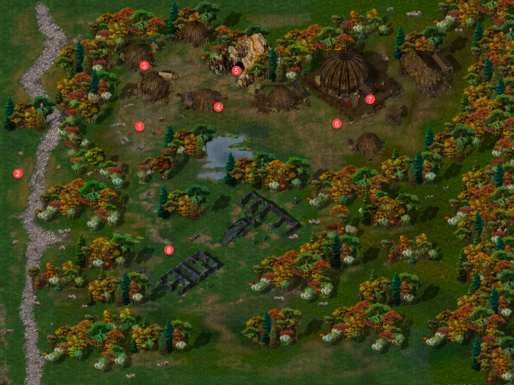{ .center-img width="40%" }

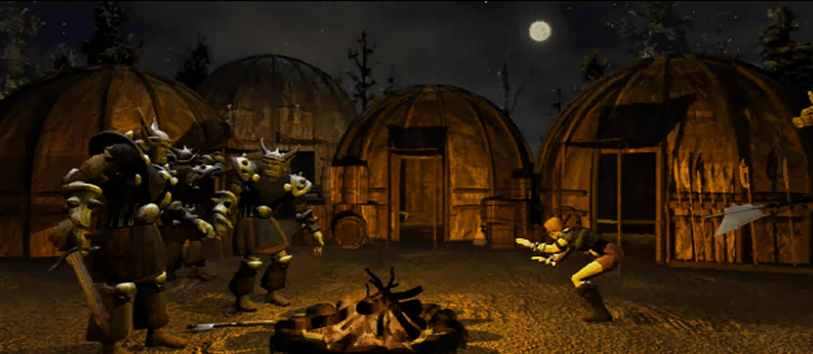{ .center-img width="70%" }

**Teven** poprowadził drużynę w stronę obozu 1, przedstawiając przybyszów jako nowych rekrutów. Jeden z bandytów natychmiast zakwestionował jego decyzję, lecz **Teven** zapewnił, że wędrowcy dobrze walczyli i mogli pomóc uzupełnić poniesione straty. Polecił jedynie trzymać ich z dala od kłopotów do czasu, aż **Tazok** osobiście oceni ich przydatność. Sam **Tazok** nie był zachwycony widokiem nowych twarzy. Zbeształ podwładnych za sprowadzenie obcych podczas tajnej operacji i zapowiedział, że osobiście ich przesłucha. Jeśli odpowiedzi nie spełnią jego oczekiwań, śmierć czekała zarówno rzekomych rekrutów, jak i **Tevena**. 

Leech wyjaśnił, że drużyna była silna, dobrze uzbrojona i potrafiła rozpoznać korzystną okazję. **Tazok** odparł, że nie brakowało mu silnych ramion, lecz gnom zauważył, że lepiej mieć kilku ludzi za dużo niż kilku za mało. Odpowiedź przypadła hersztowi do gustu. Ostrzegł jednak, że jeśli wędrowcy nie okażą się tak dobrzy, jak twierdzili, szybko pożegnają się z obozem, a być może również z życiem. **Tazok** zgodził się przyjąć drużynę na próbę. Nakazał jej dołączyć do nocnego patrolu i pilnować szlaków handlowych. Po zakończeniu napadów każdy miał otrzymać udział w łupach. **Sandrah** zaproponowała, że mogliby od razu dowieść swojej wartości, towarzysząc hersztowi w wyprawie, na co **Tazok** przystał.

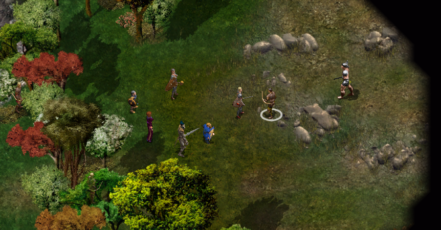{ .center-img width="70%" }

Podczas patrolu 2 **Tazok** przejrzał podstęp drużyny. Nie uwierzył, że nowi rekruci zamierzali uczciwie mu służyć, i oskarżył ich o próbę wywabienia go z obozu, by zaatakować bez wsparcia jego ludzi. Następnie wskazał **Jen’lig**, twierdząc, że widział już podobną istotę i osobiście uczestniczył w jej zgładzeniu. **Jen’lig** natychmiast rozpoznała jeden ze śladów prowadzących do morderców **Kasty**. Oskarżyła **Tazoka**, że wraz z pięcioma wspólnikami zabił jej towarzyszkę, lecz nie znalazł przy niej poszukiwanego miecza. Podobnie jak **Mulahey**, herszt musiał wiedzieć więcej o całej sprawie. Wzmianka o ostrzu wyraźnie rozdrażniła **Tazoka**. Przyznał, że przestrzegał pewnego czarodzieja przed interesowaniem się mieczem, ponieważ od początku spodziewał się po nim kłopotów. O **Mulaheyu** wyraził się z pogardą, nazywając go mięczakiem, głupcem i nieudacznikiem. **Jen’lig** zażądała imienia czarodzieja oraz informacji o miejscu jego pobytu. **Tazok** odpowiedział jedynie groźbą. Zapowiedział, że za chwilę jej miecz znajdzie się w jej własnych wnętrznościach. Rozmowa dobiegła końca, a o dalszych odpowiedziach musiał rozstrzygnąć oręż.

Śmierć **Tazoka** pozostała niezauważona, dzięki czemu drużyna mogła bezpiecznie wrócić do obozu i rozpocząć poszukiwania śladów **Henninga**.

Podsłuchane rozmowy zdradzały rosnące napięcie. Jeden z elitarnych najemników *Czarnych Szponów* ostrzegł kompana, by nie mówił zbyt wiele. **Tazok** miał pracować dla *Zhentarimów*, których wpływy sięgały daleko poza *Wybrzeże Mieczy*, a miejscowi nie patrzyli przychylnie na tych, którzy zbyt głośno o tym rozprawiali. Nie wszyscy podwładni darzyli jednak herszta podobnym szacunkiem. Inny najemnik zastanawiał się, skąd **Tazok** wziął prawo do rozkazywania *Szponom*, skoro podobno nie był nawet najważniejszym dowódcą. W obozie nie brakowało również zwykłych rzezimieszków. Jeden z bandytów przyznał, że gdyby nie służyli temu samemu zwierzchnikowi, chętnie zabiłby hobgobliny dla kilku miedziaków, które nosiły przy sobie.

W jednym z namiotów 3 drużyna spotkała **Tersusa**, który wziął przybyszów za nowych rekrutów. **Imoen** natychmiast zażądała informacji o orku, który porwał **Henninga**, grożąc, że w razie potrzeby wydobędzie odpowiedź siłą. Przerażony **Tersus** wskazał jaskinię na północy obozu, gdzie przebywali przywódcy bandytów, po czym zapewnił, że sam nic więcej nie wiedział. **Imoen** pozwoliła mu odejść, ostrzegając, by nikomu nie wspominał o ich rozmowie. **Sandrah** zwróciła uwagę na osobliwe imię rozmówcy, zauważając, że przeczytane wspak brzmiało równie niedorzecznie. **Tersus**, nie chcąc dłużej drażnić uzbrojonych przybyszów, wręczył jej skórzaną zbroję przeznaczoną dla nowych rekrutów. Zapytany o płatników wyjaśnił, że pieniądze pochodziły od ludzi *Zhentarimów*, a być może również od *Żelaznego Tronu*. Nie interesował się szczegółami. Otrzymywał złoto i wydawał wyposażenie, co w zupełności mu wystarczało.

**Sandrah** zapytała również o *Czarne Szpony* i *Chłód*. **Tersus** uznał, że skoro drużyna nie należała do żadnej z tych grup, musiała być niezależna. Wyjaśnił, że obie bandy działały osobno. *Szpony* nie przyjmowały hobgoblinów, podczas gdy *Chłód* najwyraźniej nie stawiał podobnych ograniczeń. Zapytany, dlaczego dwie konkurencyjne grupy współpracowały ze sobą, odparł jedynie, że taki był rozkaz zwierzchników. Najbardziej niepokojące wieści dotyczyły **Ardenora**. Otaczała go osobliwa magia, zupełnie niepodobna do niczego, czego można było oczekiwać po zwykłym hobgoblinie. Drużyna musiała go unikać, jeśli nie chciała przedwcześnie zdradzić swojej prawdziwej tożsamości.

**Knott** 4 od początku nie ufał przybyszom. **Sandrah** próbowała wypytać go o obóz, lecz mężczyzna nie zamierzał niczego zdradzać i kazał drużynie odejść. Kapłanka szybko uznała, że nie posiadał żadnych użytecznych informacji. Gdy **Knott** wspomniał o przeklętej Rudowłosej, **Imoen** natychmiast skojarzyła to określenie z orkami, które porwały **Henninga**. Zażądała, by wyjawił miejsce pobytu ukochanego, grożąc, że w przeciwnym razie wydobędzie odpowiedź siłą. Przerażony **Knott** zapewnił, że niczego nie wiedział. Wskazał jedynie jaskinię na północy obozu, gdzie przebywali dowódcy bandytów. **Imoen** pozwoliła mu odejść, lecz ostrzegła, by nikomu nie wspominał o ich spotkaniu. **Knott** gorliwie przyrzekł milczenie i czym prędzej zniknął im z oczu.

Drużyna sprawdziła wspomnianą jaskinię 5, w której stacjonował oddział gnolli. Wędrowcy rozprawili się z nimi po cichu, a w jednej z nisz odnaleźli ciężko rannego orka. **Sandrah** rozpoznała w nim jednego z ludzi **Knowloda**, a **Imoen** natychmiast zażądała informacji o **Henningu**. Jeniec znajdował się jednak w tak złym stanie, że nie potrafił wydobyć z siebie niczego poza jękami. **Imoen** zaczęła błagać **Sandrah**, by uleczyła orka. Kapłanka niechętnie przystała na prośbę, ostrzegając, że jej miłosierdzie może mieć przykre konsekwencje. Zaklęcie przywróciło rannemu siły, choć widok rozwścieczonej Rudowłosej sprawił, że szybko zatęsknił za chwilą wcześniejszej bezradności. 

Przyciśnięty pytaniami ork wyznał, że **Knowlod** opuścił obóz wraz z wodzem i ludzkim jeńcem. **Henning** wciąż żył, lecz **Garrtik** nie znał jego dalszego losu. Wiedział jedynie, że **Knowlod** zamierzał odnaleźć kopalnie w *Lesie Otulisko*. Drogę znał wyłącznie **Tazok**, dlatego orkowy przywódca udał się doie powinni teraz go odbierać. **Garrtik** przysiągł, że nikogo nie ostrzeże, po czym pozwolono mu odejść. Gdy ruszył w stronę wyjścia z obozu, **Imoen** nie potrafiła dłużej powstrzymywać łez. **Henning** nie zrobił nikomu nic złego, a mimo to cierpiał wyłącznie dlatego, że chciano uderzyć w nią i jej towarzyszy. **Sandrah** objęła przyjaciółkę i przypomniała, że żadna z tych tragedii nie była jej winą. Kapłanka obiecała, że wspólnie udzielą napastnikom lekcji, której nigdy nie zapomną. Rudowłosa otarła łzy. Skoro orkowie chcieli nauczki, mieli ją otrzymać.

**Taugosz „Dziesięciomłot” Khosann** 6 przedstawił się jako przywódca *Czarnych Szponów*. Z miejsca uznał drużynę za słabą i ostrzegł, że jeśli ktokolwiek stanie mu na drodze, nie będzie potrzebował młota. Wystarczy mu mały palec, a śmierć miała nadejść powoli. **Sandrah** odpowiedziała, że zyskał jej szacunek, lecz nie zamierzała się go obawiać. Lepiej pasowałby do kamieniołomu niż do dowodzenia ludźmi. **Taugosz** przyjął zniewagę z rozbawieniem i poradził kapłance zachować tę odwagę na spotkanie z **Tazokiem**. Wyjaśnił, że *Szpony* pracowały dla *Żelaznego Tronu*, lecz rozkazy otrzymywały wyłącznie od **Tazoka**. Dopóki zadanie nie zostanie wykonane, pozostali bandyci byli jedynie chwilowymi sprzymierzeńcami.

Przed wejściem do głównego namiotu 7 **Credus** powitał drużynę jako nowych rekrutów i natychmiast spróbował zaznaczyć swoją wyższość. Przedstawił się jako ich przełożony, choć sam pozostawał najnowszym członkiem bandy, dopóki nie pojawili się w obozie. Teraz zamierzał zrzucić na nich wszystkie najgorsze warty i wreszcie wspiąć się o szczebel wyżej w obozowej hierarchii. **Sandrah** zapytała, czego właściwie należało pilnować w obozie pełnym ciężko uzbrojonych bandytów. **Credus** przyznał, że wielu zadawało podobne pytanie, zwłaszcza w sprawie namiotu **Tazoka**. Herszt przechowywał tam jednak ważne dokumenty i inne cenne rzeczy, dlatego namiotu zawsze strzeżono, a nocą nikt nie miał prawa się do niego zbliżać. **Credus** ostrzegł nowych rekrutów, że każdego, kto podszedłby do namiotu, potraktuje pięścią, bez żadnych wyjątków. Nieświadomie wskazał tym samym miejsce najbardziej zasługujące na dokładne przeszukanie.

W stronę drużyny zmierzał **Ardenor Crush** i stało się jasne, że śmierci **Tazoka** nie uda się dłużej ukryć. Hobgoblin chciał jednak upewnić się, że odnalazł właściwych ludzi, dzięki czemu wędrowcom udało się wyciągnąć go z obozu do pobliskiego zagajnika 8. Tam skrócili jego marny żywot.

Przy ciele **Ardenora** znaleźli list od **Perthaga**, zabitego wcześniej przywódcy *Najeźdźców Czerwonej Wody*. Hobgoblin donosił zwierzchnikowi o udanych napadach w okolicach *Beregostu* i obfitych zdobyczach. Na szczęście ani nadawca, ani adresat nie stanowili już problemu.

Liczba przeciwników w obozie była zbyt wielka, by ryzykować frontalny atak, dlatego drużyna rozpoczęła walkę podjazdową. Bandyci odpowiedzieli z pełnym impetem. Wędrowcy zdołali zabić kilku napastników, lecz ostatecznie musieli podwinąć ogon i rozpocząć odwrót.

:material-paw: Bestiariusz: *rozbójnik, elitarny najemnik Czarnych Szponów, hobgoblin z Chłodu, gnoll*

## Na szlaku { .divider }

Drużynie udało się wyrwać z obozu, lecz stało się jasne, że do następnego starcia należało przygotować się znacznie lepiej.

Na szlaku wędrowcy spotkali osobliwego człowieka poszukującego obucha swojej siekiery. Odnaleźli zgubę nieopodal i zwrócili ją właścicielowi. Dopiero wtedy wyjaśnił, że broń należała do jego ojca i z tego powodu szukał jej pomimo zagrożeń czyhających w okolicy ([Man and His Hatchet](../other/zadania.md#q96)):material-trending-up: Reputacja +1.

Drużyna wycofała się do *Peldvale*, by wyleczyć rany i zastanowić się, jak następnym razem zaatakować obóz.
