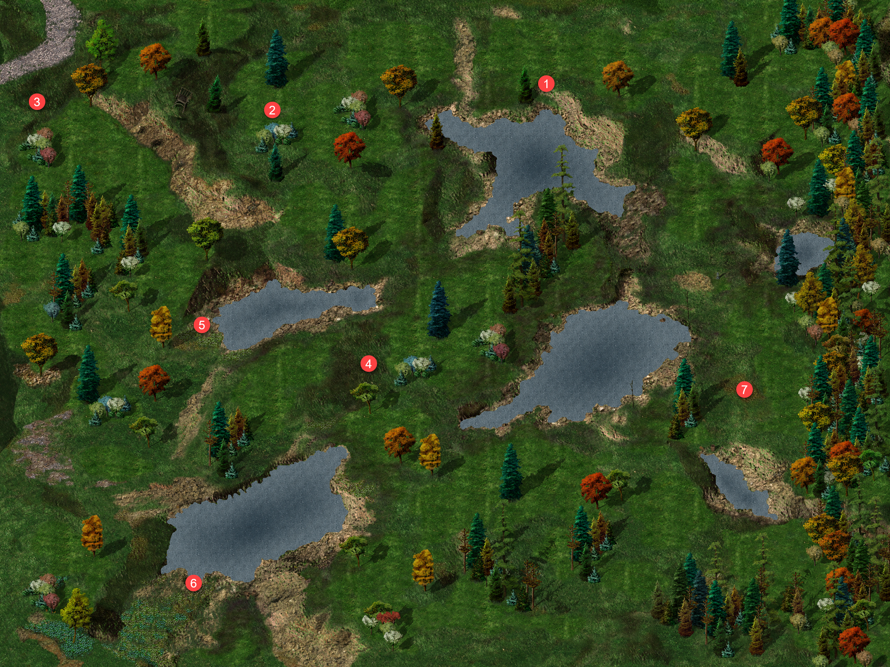
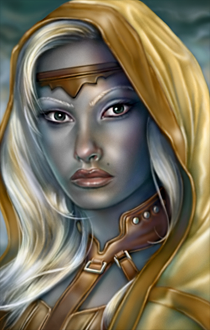
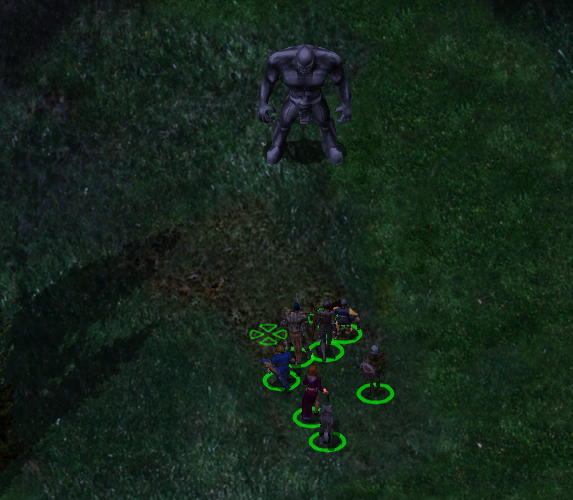
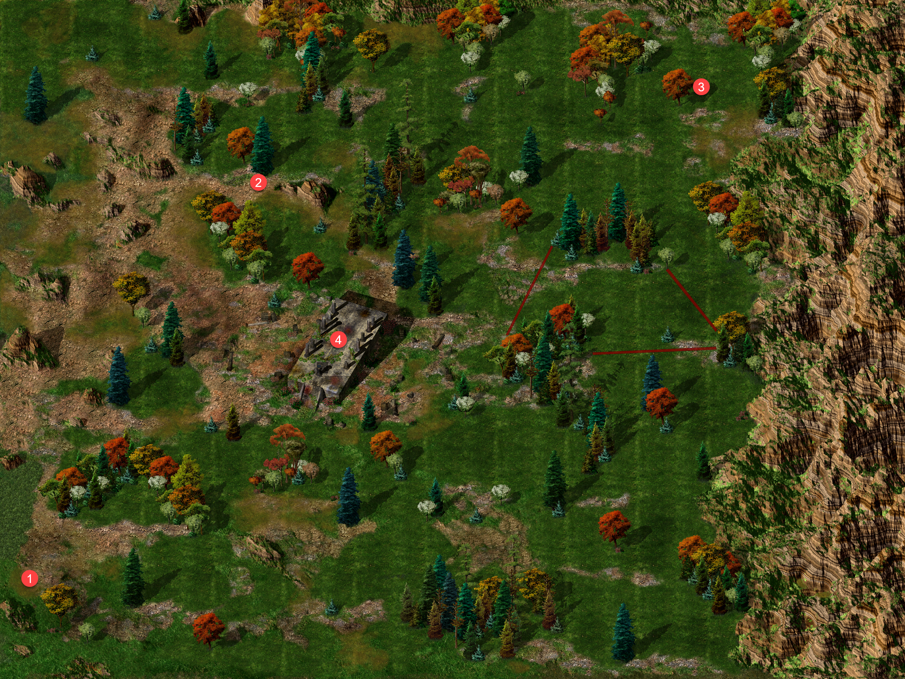

# UNDER CONSTRUCTION

## Góry Bełkotków&nbsp;49 { .divider }

{ .center-img width="40%" }

Hugnot (1) na widok przybyszów zaczął krzyczeć o orkach, lecz szybko dostrzegł pomyłkę i poprosił o ochronę. Imoen ponagliła go, by zamiast stać z otwartymi ustami, opowiedział, co widział. Przez okolicę przemknęło trzydziestu lub więcej orków, wyraźnie w pośpiechu. Na pytanie Sandrah o ludzkiego jeńca Hugnot wspomniał o wielkim worku, rozmiarami przypominającym człowieka. Nie wiedział jednak, co znajdowało się w środku — uciekł, nie mając ani okazji, ani ochoty zaglądać.

Orkowie ruszyli na północny wschód, ku wiosce niziołków Gullykin. Przy takim tempie mogli dotrzeć tam jeszcze przed świtem. Sandrah zauważyła, że droga ta nie prowadziła do Lasu Otulisko, lecz Hugnot był pewien kierunku. Na rozwidleniu napastnicy zatrzymali się, krzyczeli i kłócili tak zaciekle, że niemal liczył, iż pozabijają się nawzajem. Ostatecznie wybrali jednak inną drogę. Leech uznał, że bez kogoś, kto pokierowałby nimi z odrobiną rozsądku, mogli zwyczajnie pomylić szlak. Pozostawało pytanie, czego szukali w osadzie niziołków. (The Kidnapping of Henning 91)

Dorn uznał, że nieumarli rzadko powstawali bez cudzej pomocy, a wszystko wokół zdradzało rękę Kryll. Ostrzegł Leecha, że czaiła się gdzieś w pobliżu. Od miesięcy myślał niemal wyłącznie o zemście na dawnych zdrajcach, a nowe moce tylko podsycały tę żądzę. Zapytany o ich źródło przyznał, że zawarł układ i przyjął pewne warunki. Na tym jednak zakończył wyjaśnienia.

Kryll zastali w otoczeniu uwiedzionych mężczyzn (2). Dorn wypomniał jej, że niegdyś uważał ją za jedyną osobę, która potrafiła spojrzeć poza jego półorczą krew. Teraz widział, jak bardzo się pomylił. Wspomniał też o Senjaku, którym już się zajął. Kryll odparła, że ktoś musiał wziąć na siebie winę, aby odwrócić podejrzenia od reszty, a wybór padł na niego za sprawą Simmeona. Próbowała zbyć zemstę jako małostkowość, lecz Dorn nie zamierzał wybaczyć pozostawienia go na śmierć w Luskan. Kryll zamieniła otaczających ją mężczyzn w szkielety i posłała je przeciw drużynie. Nie ocaliły swojej pani.

Po śmierci Kryll przy jej ciele znaleźli list od Simmeona. Nadawca przepraszał za gwałtowne zachowanie podczas ostatniego rozstania i ostrzegał, że Dorn uciekł z więzienia w Luskan, po czym zaczął zabijać dawnych kompanów. Zapewniał, że zdobył potężnego sprzymierzeńca, i zapraszał adresatów do ukrytego obozu tuż przed wejściem do Wrót Baldura. Liczył, że wspólnie łatwiej stawią czoło mścicielowi, który właśnie przeczesywał wybrzeże.

Dorn zażądał listu, a poznawszy kryjówkę Simmeona, natychmiast chciał ruszać w drogę. Leech przypomniał, że ostrzeżony przeciwnik mógł przygotować pułapkę, lecz półork nie zamierzał zwalniać. Wierzył, że wymknie się każdej zasadzce i pokona każdą przeszkodę. Ufał własnej sile bardziej niż słowom zabitych zdrajców, choć przeczuwał, że wzmianka o potężnym sprzymierzeńcu była prawdziwa. Leech zauważył, że ostrożność najwyraźniej przestała mu towarzyszyć, i zaproponował dalszą podróż. Simmeon nie miał im uciec. (Dorn Il-Khan A Blackguard's Revennge 92). Powinni także odwiedzić Taris i poinformować ją co się stało z jej głupim mężem.

{ .center-img width="50%" }

W kotlinie odnajdujemy Deneb (3). Deneb otaczały węże, które strzegły jej niczym wierne dzieci. Na widok drużyny zapowiedziała im kolejną ucztę, uznając przybyszów za złodziei. Leech zapytał, czy poprzedni intruzi również szukali Kerykeionu, lecz zamiast odpowiedzi usłyszał oskarżenia i wzmiankę o łotrzykach tańczących w świetle księżyca. Deneb chełpiła się, że kolejna marionetka padła ofiarą jej mocy. Gdy gnom zapytał o wspomniane węże, odróżniając je od bełkotków, Deneb oznajmiła, że ona i jej podopieczni stanowili jedno, a wraz z nadejściem ciemności znów powstawali. Leech uznał, że nie sposób przemówić jej do rozsądku. Czarodziejka zagroziła, że ani ucieczka, ani walka nie zmienią losu przybyszów — jej węże miały pożywić się ich zwłokami. Przywołała „Mroczną Siostrę”, prosząc o siłę. (Sorceress of Shadows 43). BAldwim bedzie rad z odzyskanego artefaktu.

Lena (4) błagała nas o pomoc jej nieprzytomnemu przyjacielowi Samuelowi. Chce, żebyśmy zabrali go do Gellany w Pomocnej Dłoni. Niosąc go zostaliśmy napadnięci przez dezerterów (5), twierdzących, że ich zdradził (Samuel and Lena 94)(Lena zatrzymała Leecha i poprosiła o pomoc. Od ponad tygodnia błąkała się po dziczy, szukając kogoś, kto zdołałby uratować jej ciężko rannego przyjaciela. Samuel leżał nieopodal, a jego stan był tak poważny, że nawet Finch nie potrafiła mu pomóc. Jedyną nadzieją pozostawała Gellana Mirrorshade ze Świątyni Mądrości w Pomocnej Dłoni. Lena poprosiła, by drużyna ostrożnie podniosła Samuela i bez zwłoki zaniosła go do kapłanki. Leech zgodził się pomóc, a wdzięczna kobieta raz jeszcze przestrzegła, że rannemu pozostało niewiele czasu.)

Samuel odzyskał na chwilę przytomność i wyjawił, że Angelo Dosan z płomiennej Pięści zaprzedał się Żelaznemu Tronowi (Zgiełk walki przywrócił Samuelowi świadomość. Sandrah natychmiast rzuciła proste zaklęcie, by choć trochę złagodzić ból rannego. Gdy odzyskał głos, zapytał o Lenę i miejsce, do którego trafili. Kapłanka zapewniła go, że Lena była bezpieczna, a drużyna zamierzała jak najszybciej dostarczyć go do Świątyni Mądrości. Samuel ostrzegł jednak, że nic nie będzie dobrze, dopóki okolicą rządziła Płonąca Pięść. Sandrah nakazała mu zachować spokój, by rany ponownie się nie otworzyły. Finch zaproponowała rzucenie kolejnego zaklęcia, żartując, że podczas długiej drogi chory mógłby zaczepiać każdego napotkanego bandytę. Kapłanka wyjaśniła, że w warunkach polowych zrobiła już wszystko, co było możliwe. Samuel potrzebował świątyni, odpoczynku i odpowiedniej opieki. Zanim opadł z sił, zdążył przestrzec drużynę przed Płonącą Pięścią. Twierdził, że formacja przestała strzec prawa i porządku, odkąd Angelo Dosan oddał ją na służbę Żelaznemu Tronowi. Sandrah powstrzymała go przed dalszym mówieniem i zesłała na niego sen. Ostatnie słowa Samuela były kolejnym ostrzeżeniem przed zdrajcami).

Przy samotnym szczycie (6) zatrzymał drużynę Hafiz, prosząc o chwilę rozmowy w niezwykle ważnej sprawie. Gdy odzyskał oddech, przedstawił się jako Hafiz bin Watat, astrolog, uczony i mag. Usłyszawszy imię Leecha, natychmiast je rozpoznał. Twarz młodego gnoma wielokrotnie pojawiała się w jego snach, zawsze pośród krwi i śmierci. Nad Leechiem pochylał się złowrogi człowiek, a ich losy nieuchronnie splatały się ze śmiercią jednego z nich. Leech wyjaśnił, że wychował się w Candlekeep u boku Goriona, lecz po ucieczce z twierdzy jego przybrany ojciec został zamordowany. Od tamtej pory ktoś nieustannie próbował również pozbawić życia młodego gnoma. Hafiz przeprosił za przywołanie bolesnych wspomnień. Pragnął jednak pomóc, a zarazem uwolnić się od nękających go wizji. Astrolog przekazał Leechowi zwój ochronny. Polecił użyć go podczas starcia z ośmioma sługami zabójcy Goriona, aby osłonić drużynę przed ich gniewem. Finch z uznaniem przyjęła ten bezinteresowny dar. Nie wszyscy czyhali na życie Leecha. Gdzieś po jego stronie stali również życzliwi sprzymierzeńcy.

W trakcie podróży Jen’lig zapytała Sandrah, czy jest g’lathk. Kapłanka nie znała tego określenia, więc githyanki wyjaśniła, że g’lathk zajmowali się uzdrawianiem mieszkańców Tu’narath. W głębi miasta pielęgnowali hydroponiczne ogrody, a rannych zabierali do komnat wyposażonych w regeneracyjne kapsuły, które przyspieszały naturalne gojenie. Sandrah odparła, że dzięki Splotowi nie potrzebowała bogów, by czerpać ze źródła magii, choć tam, gdzie mogła, sama również korzystała z naturalnych metod leczenia. Chętnie dowiedziałaby się więcej o technikach stosowanych przez g’lathk. Jen’lig przyznała, że nie potrafiła dokładnie wyjaśnić swojej roli, lecz uważała się za pewien szczególny rodzaj g’lathk. Sandrah nazwała ją strażniczką i łowczynią złodziei. Githyanki uznała to określenie za trafne, zaznaczyła jednak, że dzieci Gith nigdy nie były złodziejami. Ściganie własnych wrogów na ich sposób pozostawało dla niej czymś zupełnie nowym.

Kawałek dalej (7) drogę zagrodził im kolejny najemnik Płonącej Pięści, żądając, by natychmiast się przedstawili. Sandrah oznajmiła, że byli jedynie wędrowcami. Strażnik ostrzegł ich przed bandytami grasującymi w okolicy, po czym wyjawił, że poszukiwał dezertera imieniem Samuel. Zbieg miał podróżować z kobietą, a za jego schwytanie wyznaczono nagrodę w wysokości pięćdziesięciu sztuk złota.
Najemnik zdążył już odejść, gdy nagle zainteresował się niesionym przez drużynę rannym. Sandrah zachowała zimną krew i odparła, że był to jeden z ich towarzyszy, który ucierpiał podczas drogi. Wyjaśnienie wystarczyło. Członek Płonącej Pięści pożegnał wędrowców i ruszył dalej, nieświadomy, że poszukiwany Samuel znajdował się tuż przed nim.

Stan Samuela nie był krytyczny i uznaliśmy, że musimy sprawdzić trop w Gullykin.

Bestiariusz: niedźwiedziożuk, szkielet, dzik, bełkotek, wąż, niedźwiedź jaskiniowy, straszny wilk, straszliwy wilk

## Gullykin&nbsp;50 { .divider }

{ .center-img width="40%" }

W Gullykin przywitał ich Gandolar Luckyfoot (1), który z miejsca zapytał, czy zmierzali ku Wieży Durlaga, czy może już z niej wracali i potrzebowali opatrzenia złamań oraz siniaków. Jak zauważył, wielu poszukiwaczy przygód docierało do osady ledwie żywych.

Leech zapytał o dużą grupę orków, która mogła niedawno przechodzić przez okolicę. Gandolar udał, że nie rozumie pytania, lecz Imoen szybko straciła cierpliwość do jego gry. Niziołek przyznał w końcu, że orkowie zwykle nie zapuszczali się w te strony. Imoen uznała więc, że dalsza rozmowa była stratą czasu, zwłaszcza gdy Henning wciąż czekał na ratunek. Gandolar zdążył jednak wspomnieć o osobliwych odgłosach dobiegających jakiś czas temu z sadów owocowych na południe od wioski. Jego przyjaciel Telben miał udać się tam na zwiad. To wystarczyło Imoen. Ponagliła Leecha, by przestał stać z otwartymi ustami, i poprowadziła drużynę ku sadom.

Szukając ogrodnika spotykamy małą grupkę koboldów (2) a przy nich pierścień o dziwnej mocy.

Dalej znajdujemy wołąjącego o pomoc niziołka (3). Po odzyskaniu sił Telben Beeswaxer wyjaśnił, że natknął się na ogromną hordę orków, gdy szukał uli pośród drzew. Napastnicy początkowo go nie zauważyli, zajęci kłótnią o jeńca. Na wzmiankę o pojmanym Imoen natychmiast domyśliła się, że chodziło o Henninga. Telben potwierdził, że kupiec żył i mimo trudnego położenia nie tracił ducha. Podczas gdy część orków chciała go zabić i zagarnąć łupy ukryte w pobliskiej jaskini, pozostali obawiali się człowieka imieniem Devern. Zamierzali dostarczyć mu zakładnika, zgodnie z otrzymanym rozkazem. Sandrah uznała to nazwisko za kolejny ślad w rozrastającym się spisku. Kłótnia orków zakończyła się dla Telbena boleśnie. Kilku napastników oparło się o drzewo, na którym się ukrywał, strącając go wprost pod swoje stopy. Z ich wrzasków wywnioskował, że zgubili drogę do Lasu Otulisko i przypadkiem trafili w okolice Gullykin. Wiedzieli o tajnej kwaterze ukrytej w jednej z pobliskich jaskiń, gdzie część z nich chciała schronić się z łupami. Obawiali się również oddziału prowadzonego przez gnoma i jego towarzyszy. Telben nie miał wątpliwości, że mówili o Leechu. Orkowie próbowali zmusić niziołka do wskazania drogi do Lasu Otulisko. Gdy nawet tortury nie przyniosły odpowiedzi, związali go i porzucili obok Henninga. Kupiec wykorzystał chwilę, by opowiedzieć o swoim porwaniu. Był przekonany, że Imoen ruszy jego tropem. Na dowód, że żył i nie zamierzał się poddać, zsunął z palca pierścień i poprosił Telbena o przekazanie go drużynie. Ostatecznie dwaj orkowi przywódcy podzielili hordę. Większa grupa zabrała Henninga i ruszyła na północ, gdzie miała spotkać się z Tazokiem oraz zdobyć informacje o drodze do Lasu Otulisko. Mniejszy oddział powędrował na wschód, ku jaskini skrywającej łupy. Ponieważ ani droga do lasu, ani rola Deverna nie były jeszcze znane, drużyna postanowiła najpierw odwiedzić kryjówkę orków i siłą wydobyć z nich kolejne odpowiedzi. Telben zaznaczył położenie jaskiń na mapie i poprosił, by przekazać napastnikom jego najserdeczniejsze pozdrowienia podczas przesłuchania.

Spotykamy kolejnych łowców głów (4). Tym razem Molkar, Drakar, Morvin i Halacan nie przywitają kolejnego poranka.

Znajdujemy jaskinię w której skrył się oddział orków (5). W środku silna grupa orków wszelkiej maści, zwłaszcza magów przywołujących żywiołaki ziemi i powietrzne sługi. Wybijamy wszystkie i natykamy się na Rellruka. Rellruk spodziewał się, że Rudowłosa w końcu go odnajdzie. Imoen nie kryła satysfakcji, że przy okazji mogła rozprawić się z orkowym hersztem, lecz najpierw zażądała informacji o Henningu. Ork wyjawił, że jego zwierzchnik, Knowlod, zatrzymał jeńca i zamierzał dostarczyć go Davaeornowi. Imoen zagroziła Rellrukowi powolną i bolesną śmiercią, lecz Leech powstrzymał ją przed zbyt pochopnym zabiciem więźnia. Zamierzał wydobyć z orka wszystko, co wiedział o Davaeornie, i dopiero później rozstrzygnąć jego los. Rellruk nie uląkł się gróźb. Twierdził, że znosił tortury przez całe życie i nawet gdyby znał drogę do Davaeorna, wolałby umrzeć, niż ją zdradzić. Sandrah zauważyła jednak, że skoro orkowie mieli dostarczyć jeńca Davaeornowi, musieli wiedzieć, gdzie go szukać. Rellruk przyznał, że Knowlod zamierzał odnaleźć kopalnię w Lesie Otulisko bez pomocy Tazoka, choć tylko Tazok znał prowadzącą do niej drogę. Chciwy Knowlod nie chciał dzielić się z nim nagrodą. Drużyna poznała więc kolejne ogniwo spisku, lecz łańcuch prowadzący ku jego prawdziwym mocodawcom zdawał się nie mieć końca. Rellruk chełpił się, że jedynie on wiedział, gdzie znaleźć Tazoka. Imoen szybko pozbawiła go tej ostatniej przewagi, przypominając, że droga do obozu bandytów była im już znana. Sandrah dostrzegła słabość całej organizacji. Każdy znał tylko bezpośredniego przełożonego, co utrudniało zdradę, lecz pozwalało drużynie rozbijać spisek ogniwo po ogniwie. Wróg mógł długo nie reagować na ich działania, a kiedy wreszcie odkryje, jak daleko zaszli, zabraknie mu już solidnego oparcia. Imoen przyjęła tę myśl z ponurym zadowoleniem. Gdy zostanie sam, zapłaci za wszystko, a za porwanie Henninga zapłaci jeszcze raz (The Kidnapping of Henning 91).

{ .center-img width="50%" }

Sandrah zatrzymała drużynę i zaczęła przeglądać swoją wszechwiedzącą księgę. Przypomniała, że jej ojciec zgromadził rozległą wiedzę o Wybrzeżu Mieczy, dlatego na stronach tomu mogła znajdować się mapa Lasu Otulisko. Kapłanka szybko ostudziła jednak nadzieje Imoen. Dawne kopalnie w Lesie Otulisko należały niegdyś do krasnoludów, którzy nawet w czasach ich świetności utrzymywali dokładne położenie w tajemnicy przed obcymi klanami. Od tamtej pory minęło wiele lat, a miejsce niemal zupełnie zniknęło z pamięci mieszkańców krainy. Krasnoludy kopały coraz głębiej, aż pewnego dnia naruszyły podziemną rzekę lub zbiornik wodny. Kopalnię zalała woda, grzebiąc wielu górników. W kolejnych latach kilkukrotnie próbowano dostać się do podziemnego kompleksu, lecz wszystkie wyprawy zakończyły się niepowodzeniem. Wraz z upływem czasu zanikły także ostatnie wskazówki dotyczące jego położenia. Leech przypomniał, że Las Otulisko zajmował niemal czwartą część Wybrzeża Mieczy. Nie prowadziły przez niego osady ani prawdziwe drogi, a jedynie ścieżki wydeptane wśród ponurych ruin. Sandrah dodała do tego olbrzymie pająki i wiwerny. Żadne z tych zagrożeń nie mogło jednak powstrzymać drużyny przed uratowaniem Henninga i pokrzyżowaniem planów wroga. Imoen podsumowała sytuację bez zbędnych subtelności: musieli znaleźć igłę w stogu siana wielkości całego Lasu Otulisko. Sandrah zauważyła jednak, że mimo zdobytych informacji ich najbliższym celem nadal pozostawali Tazok i obóz bandytów.

Odpoczywając po walce Sandrah zapytała Finch, czy chciałaby przyjrzeć się jej księdze z bliska. Kronikarka skwapliwie przyjęła propozycję. Tom robił imponujące wrażenie, a możliwość jego studiowania wydawała się jeszcze bardziej kusząca, o ile Leech pozwoliłby jej poświęcić na to dość czasu. Kapłanka wyjaśniła, że otrzymała księgę od ojca. Była dla niej bezcenna nie tylko ze względu na zawartą w niej wiedzę, lecz także dlatego, że wielokrotnie pomagała jej podczas pełnego przygód życia. Finch z zachwytem rozpoznała Historię Faerûnu Elminstera, opatrzoną osobistym podpisem samego autora. Sandrah przypomniała jednak, że autor był jej ojcem, dlatego jego dzieło miało dla niej znaczenie inne niż dla nauczycielki czy badaczki. Księga stanowiła dziedzictwo, które ojciec przekazał jej na dalszą drogę. Elminster spisał w niej wiedzę zgromadzoną podczas długich lat wędrówek po Krainach, aby ocalić ją od zapomnienia. Nie tworzył jej jednak wyłącznie z myślą o córce. Pisząc kolejne fragmenty, często wyobrażał sobie Sandrah siedzącą na jego kolanach i słuchającą opowieści o przeżytych przez niego przygodach. Te wspomnienia pozostały dla kapłanki równie cenne jak sama zawartość tomu. Dopiero później Elminster uznał, że wiedza przydatna jego córce może przysłużyć się również innym, i polecił wydać księgę w Waterdeep. Finch zauważyła jednak, że niewielu mogło sobie pozwolić na jej astronomiczną cenę. Sandrah nie obwiniała o to ojca. Tak działała gospodarka, a większość mieszkańców Faerûnu nie potrzebowała całej wiedzy zawartej w opasłym tomie. Ci zaś, którym mogłaby się przydać, często nie potrafili nawet czytać. Finch natychmiast wykorzystała te słowa jako potwierdzenie wagi własnej misji. Zamierzała nieść światło wiedzy zwykłym ludziom, ucząc ich czytać i pozwalając im czerpać z tego, co inni poznali i zapisali.

Opuszczamy jaskinię zmęczeni i rozumiejąc, że musimy póki co odpuścić sobie to miejsce i wrócić z Samuelem do Pomocnej Dłoni i znaleźć Henninga. Po drodze zajrzymy do Beregost.

Bestiariusz: kobold, worg, powietrzny sługa, żywiołak ziemi, ethercap, orog, ork, ork łucznik, ork kapłan, ork mag, hobgoblin czempion 

## Pomocna Dłoń&nbsp;51 { .divider }

{ .center-img width="40%" }

Churin (16) uznał, że po uratowaniu Brage'a jesteśmy już doświadczonymi poszukiwaczami przygód, a właśnie takich ludzi miał odnaleźć. Przekazał drużynie, że Easthaven poszukiwało śmiałków i najemników gotowych podjąć się zadania obiecującego bogactwo oraz sławę. Leech przypomniał sobie, że Easthaven leżało w Dolinie Lodowego Wichru. Churin potwierdził, że w regionie pojawiły się niepokojące wydarzenia, a sąsiednia osada Kuldahar zwróciła się o pomoc. Aby dotrzeć na miejsce, drużyna musiała wyruszyć daleko na północ, podążać wzdłuż Górnego Chiontharu, a następnie kontynuować drogę ku mroźnym krainom. Churin poradził, by przed wyprawą skontaktowali się z jego przyjacielem Maladernothiem, przebywającym w Ulgoth’s Beard. Życząc wędrowcom powodzenia, pozostawił im decyzję, czy podejmą się dalekiej podróży.

W świątyni (6) chcemy przekazujemy Samuela Gallenie za co wzrasta nam reputacja (Samuel and Lena 93). Reputacja +1.

Po odzyskaniu amuletu Inoshishi poprosił Gellanę Mirrorshade o pomoc w odnalezieniu utraconych fragmentów Saiai no Hito. Kapłanka przyjrzała się przedmiotowi i zdołała dostrzec krótkie obrazy miejsc, w których spoczywały części miecza. Pierwsza wizja ukazała jej wysoką wieżę z jasnym światłem na szczycie. Wokół szumiała woda, a w oddali rozbrzmiewały głosy. Nie potrafiła rozstrzygnąć, czy należały do duchów, czy do żywych ludzi, lecz wszystko wskazywało na latarnię morską. 
Drugi obraz był znacznie bardziej niepokojący. Kolejny fragment został połknięty przez ogromne stworzenie. Choć ostrze prawdopodobnie przecięło jego wnętrzności, bestia nadal żyła, jakby potrafiła regenerować rany lub opierać się obrażeniom zadawanym od środka. Przebywała wśród skał i piasku, w suchym, kamienistym miejscu.

{ .center-img width="50%" }

Gellana nie zdołała zobaczyć niczego więcej. Inoshishi uznał jednak, że zdobyte wskazówki wystarczą, by rozpocząć poszukiwania. Zamierzał przestudiować mapy, a drużynę poprosił, by podczas dalszych wędrówek wypatrywała latarni morskich oraz miejsc odpowiadających opisowi suchego, skalistego pustkowia. Leech zapewnił, że nie zamierzał jeszcze opuszczać przyjaciela i powiadomi go natychmiast po odnalezieniu fragmentów miecza. (Restoring Saiai no Hito 89)

Dorn uznał, że jesteśmy zbyt słodką zbieraniną i póki co będzie czekał na jakąs odmianę w gospodzie. Póki co niech sobie odpocznie a my zabieramy Neerę.

Neera przywitała Leecha z udawanym wyrzutem, że kazał jej samotnie przebyć całą drogę. Szybko jednak porzuciła pretensje i zgodziła się ponownie dołączyć do drużyny. Po chwili poprosiła go również o pomoc w bardziej osobistej sprawie. Choć początkowo uciekła przestraszona skutkami własnej magii, z czasem zaczęła szukać sposobu na ograniczenie jej nieprzewidywalnych następstw. Każde zaklęcie mogło wymknąć się spod kontroli, a Neera wciąż pamiętała incydent, podczas którego poraziła Enith i pozbawiła ją włosów. Porównała dziką magię do gry na flecie ze słuchu. Zwykle potrafiła wydobyć z instrumentu całkiem przyjemną melodię, lecz jeden fałszywy dźwięk wystarczał, by flet zaczął miotać ogniem we wszystkich kierunkach. Czasami zaś sam flet zamieniał się w chomika. Neera słyszała o dzikim magu imieniem Adoy, który od wielu lat żył na odludziu. Uznała, że ktoś tak doświadczony mógłby nauczyć ją lepiej panować nad nieujarzmioną mocą. Ostatnio widziano go na wschód od Mostu Firewine, dlatego poprosiła Leecha, by podczas podróży pomógł jej go odnaleźć. Leech zgodził się przyjrzeć sprawie, jeśli droga zaprowadzi drużynę w tamte strony. Neera przypomniała mu jednak, że poszukiwanie nauczyciela było czymś więcej niż wyprawą po nową sztuczkę. Liczyła, że Adoy pomoże jej uniknąć kolejnych porażeń, trwałej łysiny oraz innych niebezpiecznych kaprysów dzikiej magii.

Czas zakończyć parę spraw w Beregoście.

:material-account-group: Odłączeni NPC: Dorn (Pomocna Dłoń)

:material-account-group: Odłączeni NPC: Neera

## Beregost&nbsp;52 { .divider }

{ .center-img width="40%" }

W kużni (23) Taerom Fuiruim powitał Leecha wieścią, że udało się znaleźć sposób na zneutralizowanie tajemniczego zanieczyszczenia. Płatnerz wypróbował już opracowaną metodę na własnych zapasach żelaza, a gdy tylko upewni się, że rzeczywiście działała, zamierzał przesłać wyniki badań do Nashkel. Tymczasem zachęcił Leecha, by obejrzał przygotowany przez niego przedmiot. Zdaniem Taeroma prezentował się teraz znacznie lepiej niż wcześniej. (Vial of Mysterious Liquid 84)

U Feldeposta (14) Illasera natychmiast wyczuła klątwę ciążącą na mieczu hobgoblińskiego kapitana. Rozpoznała zaklęcie zguby i potwierdziła, że Leech przyniósł właściwą broń. Pozwoliła mu zatrzymać Humanbane, zauważając, że choć oręż był niezgrabny, wyglądał jak przedmiot o bogatej i krwawej przeszłości. Zgodnie z umową wypłaciła też pełne wynagrodzenie. Leech przyznał, że polowanie sprawiło mu więcej przyjemności, niż się spodziewał, i zapytał o kolejne zlecenie. Illasera odparła, że życie łowcy najwyraźniej mu służyło. Nowy kontrakt pojawił się jeszcze podczas jego wyprawy przeciw hobgoblinom.

Choć drużyna oczyściła kopalnie Nashkel z koboldów, nekromanta imieniem Sazazir uznał opuszczone podziemia za doskonałe legowisko. Głębokie, wilgotne korytarze przyciągały najgorszych przedstawicieli jego profesji, a ciała górników poległych podczas koboldziej okupacji stanowiły gotową armię dla kogoś parającego się mroczną sztuką. Leech zauważył, że w kopalni cuchnęło wystarczająco mocno jeszcze przed pojawieniem się nekromanty. Illasera poradziła mu więc zaopatrzyć się w klamrę na nos, ponieważ podobni czarodzieje chętnie wykorzystywali odór przeciw wrogom. Zlecenie pochodziło od władz Nashkel. Burmistrz Ghastkill chciał, by sprawę załatwiono po cichu, zanim górnicy dowiedzą się, że niższe poziomy kopalni ponownie znalazły się w rękach potworów. Nie zamierzał wysyłać przeciw nekromancie niedoświadczonych żołnierzy, wiedząc, że byłoby to jedynie dostarczeniem mu kolejnych ciał do powiększenia armii. Potrzebował więc niewielkiej grupy odpowiednio wyszkolonych ludzi. Sazazir był dawnym kultystą z południa, który popadł w konflikt z Harfiarzami i kilka lat wcześniej został wypędzony na północ. Zyskał opinię wędrownego maga i wyrzutka, któremu odmawiano wstępu do niemal każdego miasta. Illasera podejrzewała, że nekromanta miał już dość tułaczki i postanowił wykorzystać kopalnie jako pierwszy krok ku zdobyciu wpływów w regionie. Za zgładzenie Sazazira wyznaczono nagrodę w wysokości sześciuset czterdziestu sztuk złota. Była skromniejsza niż zapłata za poprzednie oczyszczenie kopalni, ponieważ ciągłe ratowanie Nashkel nadwyrężyło już sakiewkę burmistrza. Illasera poinformowała również, że nekromanta zajmował środkowe poziomy kompleksu, na których nie wznowiono jeszcze pracy. Nieumarli nie dotarli dotąd do wyżej położonych części kopalni, lecz drużyna musiała interweniować, zanim Sazazir zgromadzi całe wojsko. Na znak przyjęcia kontraktu łowczyni przekazała Leechowi księgę zaklęć Sazazira. Pozostało wrócić do cuchnących podziemi i zadbać, by nekromanta nie zdążył dokończyć swoich planów (Black Hearts - The Huntress 87).

Na piętrze odnaleźliśmy Tranziga próbował odprawić drużynę, tłumacząc, że spieszył się z opuszczeniem miasta. Leech zażądał wyjaśnień, lecz mag nie zamierzał odpowiadać i nakazał przybyszom zejść mu z drogi. Młody gnom nie dał się jednak zbyć. Wiedział, że Tranzig miał coś na sumieniu, i zażądał, by wyjawił wszystko, co wiedział. Mag przyznał, że rzeczywiście prowadził podejrzane interesy, po czym zagroził, że jeśli drużyna nie zniknie mu z oczu w ciągu pięciu sekund, rozniesie ją w pył. Leech zauważył, że grożenie magią nie poprawiło jego położenia. Nakazał Tranzigowi poddać się i ruszyć z nimi, ostrzegając, że w przeciwnym razie wyciągną go siłą. Mag uznał jednak, że ostrzegał ich wystarczająco długo, i przeszedł do ataku. 

Przy ciele znaleziono list, który Tazok skierował do Tranziga. Herszt wyrażał zaniepokojenie przedłużającym się milczeniem Mulaheya i nakazywał magowi udać się do kopalni, by sprawdzić stan operacji. Polecił mu również odzyskać żelazo, które mogły ukraść koboldy. Zapowiadał, że następny napad najprawdopodobniej dosięgnie Peldvale albo Knieji Larsa, dlatego Tranzig miał odwiedzić oba miejsca, odnaleźć bandytów i sprowadzić ich z powrotem do obozu (Confronting Tranzig 82).

Udajemy się do Oka Gorgony (29) gdzie **Baldwin z podziwem przyjął odłamek Kerykeionu, artefaktu, o którym słuchał opowieści jeszcze jako dziecko. Nawet roztrzaskany emanował potęgą i obietnicą władzy będącej zaledwie nikłym odbiciem pełnych możliwości relikwii. Poprosił Leecha o dokładne przedstawienie całego spotkania, gdyż opowieść miała dotrzeć do samego oka Cyklopa. Leech opowiedział, że podczas walki czarodziejka przywoływała węże z pustego powietrza, jakby sam Kerykeion poddawał się jej woli. Baldwin rozpoznał w tym rzadki dar przypisywany potomkom Gorgon, świadczący o głębokim związku z Wężowymi Siostrami. Deneb musiała pozostawać w niezwykle silnej, choć niebezpiecznej więzi z artefaktem. Czarodziejka sprawiała jednak wrażenie niestabilnej, jakby wpływ Kerykeionu stopniowo pochłaniał jej umysł. Zdaniem Baldwina potężne relikwie wymagały od właściciela nie tylko talentu magicznego, lecz także niezłomnej siły ducha. Deneb nie zdołała oprzeć się narastającym cieniom i zamiast zapanować nad mocą artefaktu, sama padła jej ofiarą. Taki los czekał każdego, kto sięgał po podobną potęgę, nie rozumiejąc ceny, jakiej mogła zażądać. 

Leech wspomniał również o innych łotrach, którzy próbowali odebrać czarodziejce Kerykeion. Ta wiadomość zaniepokoiła Baldwina. Skoro obcy wiedzieli o relikwii oraz prowadzonych poszukiwaniach, ktoś mógł zdradzić szczegóły całej operacji. Nie było wiadomo, czy napastników przyciągnęła jedynie moc artefaktu, czy też za ich działaniami krył się większy i lepiej zorganizowany plan. Gdy Leech zakończył sprawozdanie, Baldwin ostrzegł go przed obecnością wyczuwalną ostatnio w mieście. Ktoś obcy obserwował ich działania i próbował poznać zgromadzoną wiedzę o Kerykeionie. Baldwin zamierzał wysłać szpiegów, by zbadali sprawę, a Leechowi nakazał zachować szczególną ostrożność, zwłaszcza podczas pobytu w mieście. Na tym zakończył spotkanie, zapowiadając, że ponownie wezwie młodego gnoma, gdy nadejdzie właściwa pora. (Sorceress of Shadows 43)

Rigaldo powitał Leecha kolejną opowieścią, w której los, cień i fortuna jak zwykle splatały się w jedną, niezbyt przejrzystą całość. Tym razem wieści prowadziły na południe od Nashkel, gdzie wśród pól należących do miejscowego gospodarza kobieta imieniem Karp odnalazła dwa pierścienie o magicznej naturze. Klejnoty były przeznaczone dla kupca z Ulgoth’s Beard, który właśnie zmierzał po odbiór zamówienia. Karp nie ograniczała się jednak do uczciwego handlu. Chętniej korzystała z usług paserów i ludzi pokroju Rigalda, a swoje znalezisko ukrywała nawet przed małżonkiem. Leech mógł wykorzystać ten sekret jako narzędzie nacisku, podszyć się pod oczekiwanego kupca albo sięgnąć po mniej subtelne metody. Najważniejsze było, by przejął pierścienie, zanim rozpłyną się na targowiskach. 
Leech uznał, że najskuteczniejszą bronią będzie strach. Zamierzał rzucić na Karp cień groźby na tyle mroczny, by skłonić ją do oddania klejnotów. Rigaldo pozostawił wybór metody młodemu gnomowi, przypominając jedynie, że prawdziwa sztuka nie tkwiła w samym czynie, lecz w jego dyskretnym wykonaniu i następstwach. Jeśli Leech zdobędzie oba pierścienie, jeden miał przekazać Rigaldowi, drugi zaś zachować jako zapłatę. Zleceniodawca przestrzegł go, by działał ostrożnie. Droga została wyznaczona, lecz z ukrycia obserwowało ją wiele nieznanych oczu. (Beneath the Plougshares 94)

Jen’lig przyglądała się swojemu dowódcy z chłodną, taktyczną uwagą, po czym odezwała się swym szorstkim, lekko gardłowym głosem. Wyznała, że pod jego przywództwem wreszcie czuje postęp, a kolejne zwycięstwa dają jej realną nadzieję nie tylko na dopadnięcie mordercy Goriona, ale i odzyskanie utraconego miecza oraz pomszczenie Kastyi. Gdy w rozmowie padły słowa o ciągłym rozlewie krwi i przemocy, githyanki jedynie cicho syknęła. Wyjaśniła chłodno, że krew nie ma dla niej znaczenia – liczą się wyłącznie kompetencje i skuteczność. Metody są obojętne, dopóki przybliżają ich do celu, a jedynym niebezpieczeństwem byłoby zwątpienie dowódcy w sens ich działań lub w jej własną lojalność. Chwilę później jej spojrzenie złagodniało, a z piersi dobiegło ciche westchnienie. Przyznała, że dowódca stał się dla niej kimś ważnym. Choć był jedynie ssakiem, przypomniał jej, że ona sama również jest samicą, mającą własne, czysto biologiczne pragnienia. Gdy mężczyzna spytał z zaskoczeniem, czy zaczyna dostrzegać w nim partnera, wojowniczka ucięła wszelkie nieporozumienia. Wyjaśniła bez ogródek, że w jej kulturze parzenie się służy podtrzymaniu rasy lub czystej przyjemności, a pojęcie ludzkiej miłości jest dla githyanki całkowicie obce. Zaznaczyła jednak, że jej lud nigdy nie łączy się z kimś, kto nie cieszy się szacunkiem i wysokim statusem – a ona zdążyła go głęboko docenić. 
– Nic teraz nie mów. Pomyśl – podsumowała, zanim zdążył odpowiedzieć. Przypomniała mu, jak wcześniej pytał, czy jest piękna, i z dumą dodała, że pośród swojego ludu należy do niezwykle pożądanych samic i mogłaby wybierać z wielu kandydatów.

Zaglądamy do Wesołego Żonglera aby w końcu porządnie odpocząć przed wyprawą do obozu bandytów.

<em>Zwykłe sny z jakiegoś powodu ustąpiły miejsca czemuś zupełnie innemu. Pojawiła się wizja jaskini pokrytej niezwykłymi malowidłami, które zdawały się żyć i pulsować tajemniczą mocą. Ich obecność przenikała umysł, serce i duszę, aż wreszcie obrazy przemieniły się w głos.

Głos zwabił śniącego z powrotem do miejsca widzianego dawno temu, choć nie potrafił on rozstrzygnąć, czy naprawdę chodziło o stanowisko archeologiczne, czy jedynie kolejną sztuczkę własnego umysłu. Sen stawał się coraz wyraźniejszy. Obrazy układały się w słowa, a słowa przemawiały głosem innym niż wszystkie dotąd słyszane.

Wciąż powtarzał jedno wezwanie: „Wejdź w popiół i śnij to, co niegdyś wyśniono... a potem utracono”.</em>

Sen wskazywał, że trzeba ponownie odwiedzić Starozytne Ruiny (Dreamheart 95). Jednak teraz udajemy się do Knieji Larsa

## Knieja Larsa&nbsp;53 { .divider }

{ .center-img width="40%" }

Spotykamy Nim’a Furlwinga (1), ocaliliśmy jego psy zaatakowane przez wilki. Następnym razem, niech sam się weźmie za rycerskie rzemiosło – palant. Czeka, jak inni uratują jego psy!

Odnajdujemy trzeci portal (2) z zieloną sferą i sześcioma eterkapami ją pilnującymi (Circles of Interest 16). 

Drogę drużynie zastąpił Osmadi (3), oskarżając wędrowców o dokonanie rzezi, w której zginęli jego bracia. Nie chciał słuchać wyjaśnień Neery i przekonany o ich winie przywołał gniew Malara. Następnie wraz z dwoma niedźwiedziami rzucił się do ataku. W samym środku starcia z pomocą drużynie przyszedł jednak trzeci niedźwiedź, zwracając się przeciw Osmadiemu i jego bestiom. Po śmierci napastnika tajemniczy sprzymierzeniec przemówił ludzkim głosem. Przedstawił się jako Corsone i wyjaśnił, że Osmadi postradał rozum po niedawnej napaści bandytów zwanych Chłodem. Łupieżcy wtargnęli do ich obozu przy kapliczce i wymordowali wszystkich, których napotkali, w tym bliskich przyjaciół druida. Od tamtej chwili Osmadi nie był już sobą.

Neera nie potrafiła zrozumieć, dlaczego Corsone pomógł zabić dawnego towarzysza, skoro obaj byli druidami i dobrze się znali. Corsone utrzymywał, że nie miał wyboru. Osmadi był zbyt niebezpieczny, a bez jego pomocy drużyna mogła nie przeżyć spotkania. Neera nie przyjęła jednak tego wyjaśnienia. Podejrzewała, że Corsone celowo wykorzystał wędrowców, aby pozbyć się własnego kompana. Przyciśnięty pytaniami Corsone wreszcie odsłonił prawdę. Był Druidem Cienia i otruł Osmadiego oraz jego towarzyszy, aby uwolnić okoliczną ziemię od ich obecności. Pomoc udzielona drużynie stanowiła jedynie część jego planu. Teraz, gdy Osmadi nie żył, Corsone postanowił usunąć również niewygodnych świadków. Przybrał wrogą postać i zaatakował, lecz podzielił los maga, którego wcześniej pomógł zgładzić.

Imoen zapytała Leecha, kim był wspomniany wcześniej Malar. Gdy ten ze zdziwieniem przypomniał, że chodziło o jednego z bogów tego świata, dziewczyna natychmiast zapewniła, że doskonale o tym wiedziała i jedynie wystawiała go na próbę. Leech nie dał się zwieść. Pamiętał, że podczas nauki w Candlekeep Imoen znacznie chętniej zdobywała praktyczne umiejętności, niż zagłębiała się w księgi i słuchała uczonych dysput. Przyłapana na blefie dziewczyna przyznała mu rację. Lektura opasłych tomów i długie wykłady nigdy nie potrafiły utrzymać jej uwagi. Zgodziła się jednak wysłuchać opowieści o Malarze, pod warunkiem że Leech nie zamieni jej w rozwlekły wykład podobny do tych, którymi raczyły ją stare marudy z Candlekeep. Uprzedziła, że cierpliwość miała swoje granice. Leech obiecał więc zacząć od najważniejszych informacji.

Spotykamy Katredę (4) ale nie jest chętna do rozmowy - co tutaj robi samotnie?

Nagle wśród blysków i traszków pojawił się w opłakanym stanie Baeloth (5), pomstując na Najima, swojego rzekomo najwierniejszego sługę i przyjaciela. Nie został w pełni wskrzeszony, utracił znaczną część mocy, a nawet perspektywa świata wydawała mu się podejrzanie uszczuplona. Groził, że rozerwie całą sferę i osobiście zawlecze winowajcę na ten plan, dopóki nie zauważył stojącej przed nim drużyny. Natychmiast odzyskał teatralny ton i przedstawił się jako Baeloth Barrityl, znany szerzej jako Baeloth Artysta. Był przekonany, że Leech powinien paść przed nim na kolana, lecz młody gnom wyjaśnił, że swoje nakolanniki zostawił w domu. Neera uznała całe spotkanie za wyjątkowo zabawne, zwłaszcza gdy Baeloth przyznał, że nie potrafił wrócić do domu i został wystawiony na barbarzyństwo świata powierzchni.

Drow opowiedział o swoim ostatnim przedsięwzięciu, Krwawych Dołach. Urządzał tam śmiertelne walki ku uciesze tłumu, a posłuszny dżinn Najim pilnował więźniów. Leech porównał widowisko do zwykłej bójki za karczmą, czym wyraźnie uraził dumę gospodarza areny. Baeloth z rozrzewnieniem wspominał ryk widowni i trzask kości, lecz jego triumf dobiegł końca, gdy grupa wojowników podstępem zmusiła go do osobistego udziału w walce. Przezorny Baeloth wcześniej zobowiązał Najima, by spełnił jego ostatnie życzenie i ochronił go przed śmiercią. Dżinn rzeczywiście wykonał rozkaz, choć uczynił to na swój sposób. Baeloth powrócił do życia, lecz został pozbawiony dawnej potęgi i skazany na towarzystwo ludzi, z którymi nie miał miażdżącej przewagi.

W końcu przyznał, że nadal władał przynajmniej częścią swoich mocy i mógł okazać się przydatny, gdyby ktoś zapewnił mu ochronę. Leech bez dalszych ceremonii pozwolił mu dołączyć. Baeloth natychmiast założył, że obejmie dowodzenie, lecz gnom szybko wyprowadził go z błędu.Póki co jednak miał czekać na nas w Pomocnej Dłoni.

Wędrowcy natknęli się na samotną wieżę (6), w której spotkali maga Haeballa. Czarodziej zauważył, że podróżni rzadko zapuszczali się w te strony, choć ostatnio w okolicy pojawiało się coraz więcej obcych i niebezpiecznych stworzeń. Nagle z uwagą przyjrzał się Leechowi, jakby dostrzegł w nim coś znajomego. Po chwili uznał jednak, że się pomylił. Sądził, że wyczuł obecność diabelskiego maga, lecz szybko porzucił tę myśl. Sandrah od razu nabrała podejrzeń. Ostrzegła Leecha szeptem, że Haeball coś ukrywał, i poradziła zachować przy nim szczególną ostrożność. Zastanawiała się również, kogo czarodziej wziął za młodego gnoma i czyją krew rzekomo w nim wyczuł.

Po opuszczeniu wieży Sandrah wróciła do osobliwego zachowania gospodarza. Jej zdaniem Haeball obawiał się potężnych magów podobnie jak jej ojciec, a na widok kapłanki musiał wyczuć jej pochodzenie albo błogosławieństwo Mystry. Leech zapytał, czy rzeczywiście tylko tyle wiedziała i czy tym razem to ona czegoś przed nim nie ukrywała. Sandrah spojrzała mu prosto w oczy i zapewniła, że powiedziała wszystko. Nie wiedziała o Haeballu nic więcej, lecz zaleciła ostrożność, gdyby drużyna ponownie go spotkała lub usłyszała o nim kolejne wieści. Leech podziękował za ostrzeżenie, licząc, że ich drogi już nigdy się nie skrzyżują.

Teven zagrodził drużynie drogę i rozkazał złożyć broń (7), grożąc, że nie powtórzy ostrzeżenia. Sandrah natychmiast wkroczyła do rozmowy. Zaczęła schlebiać bandycie, zachwycając się jego zdolnościami magicznymi i udając, że od dawna pragnęła spotkać kogoś równie utalentowanego. Pochlebstwa szybko przyniosły skutek. Teven rozpoznał w niej księżniczkę z Waterdeep i z dumą uznał, że obrana droga nareszcie zapewniła mu zainteresowanie najpiękniejszych kobiet. Sandrah pokazała mu opaskę znalezioną wcześniej przy bandytach i zasugerowała, że ona oraz jej towarzysze chcieli dołączyć do ludzi Tazoka. Przekonywała, że tak potężni sprzymierzeńcy z pewnością przydaliby się organizacji, a sam Teven mógłby nawet otrzymać awans. Bandyta bez trudu połknął przynętę. Ogłosił się przyszłym dowódcą Sandrah i nakazał drużynie ruszyć za sobą, przekonany, że Tazok chętnie przyjmie kolejnych berserkerów. Gdy odwrócił się do przybyszów plecami, kapłanka splunęła na ziemię, z niesmakiem zastanawiając się, czy naprawdę istniały osoby gotowe poniżyć się dla podobnego głupca. Podstęp jednak zadziałał. Teven, nieświadomy prawdziwych zamiarów wędrowców, poprowadził ich prosto do obozu bandytów.

:material-account-group: Przyłączeni NPC: Baeloth

:material-account-group: Odłączeni NPC: Baeloth (Pomocna Dłoń)

Bestiariusz: wilk, straszny wilk, straszliwy wilk, etterkap, czarny niedźwiedź, niedźwiedź, niedźwiedź jaskiniowy, elitarny najemnik Czarbego Szponu, bełkotek

## Obóz Bandytów&nbsp;54 { .divider }

{ .center-img width="40%" }

{ .center-img width="70%" }

Teven popędził drużynę w stronę obozu (1), przedstawiając przybyszów jako nowych rekrutów. Jeden z bandytów natychmiast zakwestionował jego decyzję, lecz Teven zapewnił, że wędrowcy dobrze walczyli i mogli pomóc uzupełnić poniesione straty. Polecił jedynie trzymać ich z dala od kłopotów do czasu, aż Tazok osobiście oceni ich przydatność.

Sam Tazok nie był zachwycony widokiem nowych twarzy. Zbeształ podwładnych za sprowadzenie obcych podczas tajnej operacji i zapowiedział, że sam ich przesłucha. Jeśli odpowiedzi nie spełnią jego oczekiwań, śmierć czekała zarówno rzekomych rekrutów, jak i Tevena. Leech wyjaśnił, że drużyna była silna, dobrze uzbrojona i potrafiła rozpoznać korzystną okazję. Tazok odparł, że nie brakowało mu silnych ramion, lecz gnom zauważył, że lepiej mieć kilku ludzi za dużo niż kilku za mało. Odpowiedź przypadła hersztowi do gustu. Ostrzegł jednak, że jeśli wędrowcy nie okażą się tak dobrzy, jak twierdzili, szybko pożegnają się z obozem, a być może również z życiem. Tazok zgodził się przyjąć drużynę na próbę. Nakazał jej dołączyć do nocnego patrolu i pilnować szlaków handlowych. Po zakończeniu napadów każdy miał otrzymać udział w łupach. Sandrah zaproponowała, że mogliby od razu dowieść swojej wartości, towarzysząc mu w wyprawie, na co Tazok się zgodził. Zamierzał wyruszyć sam, pozostawiając nowym rekrutom czas na poznanie zasad panujących w obozie.

{ .center-img width="70%" }

W trakcie patrolu (2) Tazok przejrzał podstęp drużyny. Nie uwierzył, że nowi rekruci zamierzali uczciwie mu służyć, i oskarżył ich o próbę wywabienia go z obozu, by zaatakować bez wsparcia ludzi. Następnie wskazał Jen’lig, twierdząc, że widział już podobną istotę i osobiście uczestniczył w jej zgładzeniu. Jen’lig natychmiast rozpoznała jeden ze śladów prowadzących do morderców Kasty. Oskarżyła Tazoka, że wraz z pięcioma wspólnikami zabił jej towarzyszkę, lecz nie znalazł przy niej poszukiwanego miecza. Podobnie jak Mulahey, herszt musiał wiedzieć więcej o całej sprawie. Wzmianka o ostrzu wyraźnie rozdrażniła Tazoka. Przyznał, że przestrzegał pewnego czarodzieja przed interesowaniem się mieczem, ponieważ od początku spodziewał się po nim kłopotów. O Mulaheyu wyraził się z pogardą, nazywając go mięczakiem, głupcem i nieudacznikiem. Jen’lig zażądała imienia czarodzieja oraz informacji o miejscu jego pobytu. Tazok odpowiedział jedynie groźbą. Zapowiedział, że za chwilę jej miecz znajdzie się w jej własnych wnętrznościach. Rozmowa dobiegła końca, a o dalszych odpowiedziach musiał rozstrzygnąć oręż.

Szczęśliwie śmierć Tazoka pozostała niezauważona i możemy bezpiecznie przeszukać obóz w poszukiwaniu śladów Henninga.

Rozmowy zdradzały rosnące napięcie w obozie. Jeden z elitarnych najemników Czarnych Szponów ostrzegł swojego kompana, by nie mówił zbyt wiele. Tazok miał pracować dla Zhentarimów, których wpływy sięgały daleko poza Wybrzeże Mieczy, a miejscowi nie patrzyli przychylnie na tych, którzy zbyt głośno o tym rozprawiali. Nie wszyscy podwładni darzyli jednak herszta podobnym szacunkiem. Inny najemnik zastanawiał się, skąd Tazok wziął prawo do rozkazywania Szponom, skoro podobno nie był nawet najważniejszym dowódcą. W obozie nie brakowało też zwykłych rzezimieszków. Jeden z bandytów przyznał, że gdyby nie służyli temu samemu zwierzchnikowi, chętnie zabiłby hobgobliny dla kilku miedziaków, które nosiły przy sobie.

W jednym z namiotów (3) drużyna spotkała Tersusa, który wziął przybyszów za nowych rekrutów. Imoen natychmiast zażądała informacji o orku, który porwał Henninga, grożąc, że w razie potrzeby wydobędzie odpowiedź siłą. Przerażony Tersus wskazał jaskinię na północy obozu, gdzie przebywali przywódcy bandytów, po czym zapewnił, że sam nic więcej nie wiedział. Imoen pozwoliła mu odejść, ostrzegając, by nikomu nie wspominał o ich rozmowie. Sandrah zwróciła uwagę na osobliwe imię rozmówcy, zauważając, że przeczytane wspak brzmiało równie niedorzecznie. Tersus, nie chcąc dłużej drażnić uzbrojonych przybyszów, wręczył jej skórzaną zbroję przeznaczoną dla nowych rekrutów. Zapytany o płatników wyjaśnił, że pieniądze pochodziły od ludzi Zhentarimów, a być może również od Żelaznego Tronu. Nie interesował się szczegółami. Otrzymywał złoto i wydawał wyposażenie, co w zupełności mu wystarczało. Sandrah zapytała również o Szare Szpony i Chłód. Tersus uznał, że skoro drużyna nie należała do żadnej z tych grup, musiała być niezależna. Wyjaśnił, że obie bandy działały osobno. Szpony nie przyjmowali hobgoblinów, podczas gdy Chłód najwyraźniej nie stawiał podobnych ograniczeń. Zapytany, dlaczego dwie konkurencyjne grupy współpracowały ze sobą, odparł jedynie, że taki był rozkaz zwierzchników. Nie zamierzał dociekać powodów, zwłaszcza gdy nowi rekruci już sprawiali mu wystarczająco wiele kłopotów. Najbardziej niepokojące wieści dotyczyły Ardenora. Otaczała go osobliwa magia, zupełnie niepodobna do niczego, czego można było oczekiwać po zwykłym hobgoblinie. Musimy go unikać aby nie wydało się kim jesteśmy.

Knott (4) od początku nie ufał przybyszom. Sandrah próbowała wypytać go o obóz, lecz mężczyzna nie zamierzał niczego zdradzać i kazał drużynie odejść. Kapłanka szybko uznała, że nie posiadał żadnych użytecznych informacji. Gdy Knott wspomniał o przeklętej Rudowłosej, Imoen natychmiast skojarzyła to określenie z orkami, które porwały Henninga. Zażądała, by wyjawił miejsce pobytu ukochanego, grożąc, że w przeciwnym razie wydobędzie odpowiedź siłą. Przerażony Knott zapewnił, że niczego nie wiedział. Wskazał jedynie jaskinię na północ od obozu, gdzie przebywali dowódcy bandytów. Imoen pozwoliła mu odejść, lecz ostrzegła, by nikomu nie wspominał o ich spotkaniu. Knott gorliwie przyrzekł milczenie i czym prędzej zniknął im z oczu.

Sprawdzamy wspomnianą jaskinię (5). W której stacjonował oddział gnoli, który wytępiliśmy po cichu. W jednej z nisz leżał ciężko rannego orka. Sandrah rozpoznała w nim jednego z ludzi Knowloda, a Imoen natychmiast zażądała informacji o Henningu. Jeniec był jednak w tak złym stanie, że nie potrafił wydobyć z siebie niczego poza jękami. Imoen zaczęła błagać Sandrah, by uleczyła orka. Kapłanka niechętnie przystała na prośbę, ostrzegając, że jej miłosierdzie może mieć przykre konsekwencje. Zaklęcie przywróciło rannemu siły, choć widok rozwścieczonej Rudowłosej sprawił, że szybko zatęsknił za chwilą wcześniejszej bezradności. Przyciśnięty pytaniami ork wyznał, że Knowlod opuścił obóz wraz z wodzem i ludzkim jeńcem. Pojmany Henning wciąż żył, lecz Garrtik nie znał jego dalszego losu. Wiedział jedynie, że Knowlod zamierzał odnaleźć kopalnie w Lesie Otulisko. Drogę znał wyłącznie Tazok, dlatego orkowy przywódca udał się do jego namiotu, by obejrzeć mapę. Była to pierwsza dobra wiadomość od dłuższego czasu. Drużyna wiedziała już, dokąd powinna skierować kolejne kroki. Pozostawało jedynie dostać się do namiotu Tazoka i odnaleźć mapę prowadzącą do kopalni. Imoen nie pozwoliła zabić uleczonego jeńca. Uznała, że skoro ocalili mu życie zaledwie chwilę wcześniej, nie powinni odbierać go teraz. Garrtik przysiągł, że nikogo nie ostrzeże, po czym pozwolono mu odejść. Gdy ruszył w stronę wyjścia z obozu, Imoen nie potrafiła dłużej powstrzymywać łez. Henning nie zrobił nikomu nic złego, a mimo to cierpiał wyłącznie dlatego, że chciano uderzyć w nią i jej towarzyszy. Sandrah objęła przyjaciółkę i przypomniała, że żadna z tych tragedii nie była jej winą. Leech również nie wybrał takiego życia, lecz został zmuszony do niesienia jego ciężaru. Imoen przyznała jej rację, lecz nie potrafiła pogodzić się z tym, że wrogowie wciągnęli Henninga w ich walkę. Kapłanka obiecała, że wspólnie udzielą napastnikom lekcji, której nigdy nie zapomną. Rudowłosa otarła łzy. Skoro orkowie chcieli nauczki, mieli ją otrzymać.

Taugosz „Dziesięciomłot” Khosann (6) przedstawił się jako przywódca Czarnych Szponów. Z miejsca uznał drużynę za słabą i ostrzegł, że jeśli ktokolwiek stanie mu na drodze, nie będzie potrzebował młota. Wystarczy mu mały palec, a śmierć miała nadejść powoli. Sandrah odpowiedziała, że zyskał jej szacunek, lecz nie zamierzała się go obawiać. Lepiej pasowałby do kamieniołomu niż do dowodzenia ludźmi. Taugosz przyjął zniewagę z rozbawieniem i poradził kapłance zachować tę odwagę na spotkanie z Tazokiem. Wyjaśnił, że Szpony pracowały dla Żelaznego Tronu, lecz rozkazy otrzymywali wyłącznie od Tazoka. Dopóki zadanie nie zostanie wykonane, pozostali bandyci byli jedynie chwilowymi sprzymierzeńcami.

Przed wejściem do głownego (7) Credus powitał drużynę jako nowych rekrutów i natychmiast próbował zaznaczyć swoją wyższość. Przedstawił się jako ich przełożony, choć sam pozostawał najnowszym członkiem bandy, dopóki nie pojawili się w obozie. Teraz zamierzał zrzucić na nich wszystkie najgorsze warty i wreszcie wspiąć się o szczebel wyżej w obozowej hierarchii. Sandrah zapytała, czego właściwie należało pilnować w obozie pełnym ciężko uzbrojonych bandytów. Credus przyznał, że wielu zadawało podobne pytanie, zwłaszcza w sprawie namiotu Tazoka. Herszt przechowywał tam jednak ważne dokumenty i inne cenne rzeczy, dlatego namiotu zawsze strzeżono, a nocą nikt nie miał prawa się do niego zbliżać. Credus ostrzegł nowych rekrutów, by zachowali ostrożność. Każdego, kto podszedłby do namiotu, miał potraktować pięścią, bez żadnych wyjątków. Nieświadomie wskazał tym samym drużynie miejsce, które najbardziej zasługiwało na dokładne przeszukanie.

W naszym kierunku podążał Ardenor Crush i stało sie jasne, że dłużej nie uda się ukryć śmierci Tazoka. Szczęśliwie mag chciał sie upewnić, że chodzi o nas i udało sie nam go wyciagnąć z obozu do pobliskiego zagajnika (8), gdzie skróciliśmy jego marny żywot. Maił przy sobie list od ubitego już przez nas Perthaga dowódcy Najeźdźców Czerwonej Wody. Donosił zwierzchnikowi o udanych napadach w okolicach Beregostu. Na szczęście obaj już problemem nie są.

Ilość przeciwiników obozie jest zbyt duża na frontalny atak dlatego zaczynamu walkę podjazdową. Zaatakowali nas z całym impetem, kilku wrogów zabiliśmy ale musieliśmy zrobić rejteradę.

Bestiariusz: bandyta, elita Czarnych Szponów, Chill Hobgoblin, gnoll,  

## Na szlaku { .divider }

Udało się nam uciec musimy się lepiej przygotować do tej walki! Spotykamy dziwaka, który szuka obucha swojej siekiery. Znależliśmy ją nieopodal i oddaliśmy mu. Wtedy wyjaśnił, że ta siekiera należała do jego ojca i dlatego szukał jej pomimo pobliskich zagrożeń (Man and His Hatchet 96). Reputacja +1.

Wycofujemy się do Peldvale aby wykurować się i zastanowić jak zaatakować obóz.

## Peldvale&nbsp;55 { .divider }

{ .center-img width="40%" }

Jasne jest, że musimy zaopatrzyć się w więcej czarów i mikstur aby otwarcie zaatakować obów. Henning jest póki co cały i Imoen z trudem ale zaakceptowała tymczasowe odsunięcie odsieczy.

Napotykamy Teda (1), który powitał przybyszów i zapytał, co sprowadziło ich tak daleko od domu. Gdy Leech przedstawił drużynę jako poszukiwaczy przygód, rozmówca przypomniał sobie wuja, który również uważał się za wielkiego bohatera. Miał miecz, tarczę i grupę kompanów, lecz wyprawa przeciw potworowi zakończyła się dla niego wyjątkowo marnie. Bestia zastawiła pułapkę, a później odrywała śmiałkom ręce i nogi. Kiedy ojciec Teda odnalazł brata, pozostała po nim jedynie sterta gnijącego mięsa. Leech przyznał, że była to doprawdy krzepiąca opowieść, po czym zapytał o radę dla początkujących awanturników. Ted wskazał ruiny Mostu Firewine jako najlepsze miejsce dla tych, którzy pragnęli szybko się wzbogacić. Jeśli jednak drużyna szukała zajęcia bliżej domu, mogła zająć się bandytami nękającymi Wybrzeże Mieczy (The Firewine Ruins 97).

Znienacka atakują na ogrzy magowie (2) i udaje się odeprzeć ich atak.

Viconia wybiegła drużynie naprzeciw (3), błagając o pomoc. Sandrah natychmiast stanęła w jej obronie, uznając, że nikt nie powinien cierpieć wyłącznie z powodu swojego pochodzenia. Finch próbowała uspokoić uciekinierkę i poprosiła, by opowiedziała, kim była. Viconia zdołała jedynie się przedstawić i wyjaśnić, że pochodziła z daleka, nim ich rozmowę przerwał najemnik Płonącej Pięści. Mężczyzna zażądał wydania drowki, twierdząc, że była poszukiwana za zamordowanie wielu ludzi. Za wystarczający dowód jej winy uznawał jednak samo pochodzenie. Sandrah zapytała, czy naprawdę zamierzał zabić Viconię tylko dlatego, że była drowką, i co właściwie nazywał sprawiedliwością. Najemnik zasłonił się prawem i wyrokiem śmierci, lecz kapłanka nie ustąpiła. Zażądała dowodów popełnionych zbrodni, zamiast oskarżeń opartych wyłącznie na rasie ściganej. Gdy żołnierz ponownie nakazał drużynie zejść z drogi, Sandrah stanęła przed Viconią i oświadczyła, że będzie musiał najpierw przejść po ich trupach. Jej zdaniem to najemnik zachowywał się jak morderca, niezależnie od symboli, które nosił. Viconia zapewniła, że oskarżenia były kłamstwem i nikogo nie skrzywdziła. Najemnik Płonącej Pięści nie zamierzał jednak słuchać. Skazał całą drużynę na śmierć za ukrywanie rzekomej morderczyni i ruszył do ataku. Wędrowcy pozostali przy swoim wyborze, gotowi bronić Viconii przed egzekucją pozbawioną sądu i dowodów.

Viconia podziękowała drużynie za ocalenie. Wiedziała, że z powodu jej drowiego pochodzenia mogli nie chcieć obdarzyć jej zaufaniem, lecz poprosiła o jedną szansę. Potrzebowała sprzymierzeńców bardziej niż kiedykolwiek i zaproponowała, że dołączy do ich wędrówki. Sandrah przypomniała Leechowi, że ratując komuś życie, brali również odpowiedzialność za danie tej osobie możliwości rozpoczęcia nowej drogi. Leech przyznał jej rację. Drużyna potrzebowała dodatkowej pomocy, dlatego przyjęła Viconię w swoje szeregi. Drowka obiecała, że ich nie zawiedzie. Neera będzie czekać w Pomocnej Dłoni. :material-trending-down: Reputacja -2

# Viconia

Szary Elf · Kapłanka · Neutralna zła

> Zapytana o swoją przeszłość Viconia z dumą wyjawiła, że była mroczną elfką pochodzącą z podziemnego miasta Menzoberranzan. Niewiele mówiła o powodach opuszczenia pozbawionej słońca ojczyzny, lecz podobne rozstania rzadko przebiegały łagodnie. Twierdziła, że nie oddawała już czci pajęczej bogini Lolth, choć dla drowa porzucenie jej kultu często oznaczało śmierć. Zamiast tego zwróciła się ku Shar, Pani Nocy. Trudno było jednak ocenić, czy odrzuciła tym samym bezwzględne obyczaje własnego ludu. Prawa i zwyczaje powierzchni wydawały jej się osobliwe, głównie z powodu braku doświadczenia. Nie rozumiała również nieufności, jaką budziło jej pochodzenie. Wielu mieszkańców powierzchni nie zamierzało dać jej szansy, a sama obecność Viconii w drużynie mogła wpłynąć na sposób, w jaki postrzegano jej towarzyszy. Jak każdy drow, Viconia posiadała naturalną odporność na magię.

:material-account-group: Przyłączeni NPC: Viconia

:material-account-group: Odłączeni NPC: Neera (Pomocna Dłoń)

Koło jednego z jezior (4) spotykamy trzech poetów: Sama, Willego i Roba. Po wysłuchaniu ich poematów otrzymujemy harfę. Tak te wypociny wymagały od nas dużo poświęcenia i nagroda mile widziana.

W beczce (5) znajduje się księga. To jedna z tych poszukiwanych przez Finch - Rozkosze puddingów. Mam nadzieję, że kiedyś Finch zaprosi mnie na poranny budyń we dwoje (Finch's Quest to Start a Library in Nashkel 25).

Kolejne jezioro i kolejna beczka (6) a w niej skomplikowana aparatura. Pewnie wkrótce się przekonamy.

Nieco dalej (7) natykamy się na uszkodzonego golema. I wygląda, że właśnie co znaleziony mechanizm to jego mózg. Sprawdzamy co się stanie i oczywiści ożył i nas zaatakował.

{ .center-img width="60%" }

Trochę ochłoneliśmy po nieudanej walce w obozie bandytów i póki co zajmiemy sie problemem Elminstera oraz postaramy pozałatwiac sie parę innych spraw.

Jen’lig wspomniała, że młode githyanki z Varsh uczono walki, posyłając je przeciw mrocznym elfom. Podczas tych krwawych ćwiczeń sama zabiła wielu drowów. Viconia odpowiedziała, że w młodości brała udział w wyprawach przeciw wylęgarniom githyanki w Podmroku i również zgładziła wielu przeciwników. Jen’lig zauważyła, że obie zabijały wówczas niedoświadczonych młodzików, więc nie było w tym wielkiego osiągnięcia. Drowka przyznała jednak, że githyanki nie byli łatwym łupem. Potrafili walczyć, a w okrucieństwie dorównywali jej pobratymcom. Jen’lig uznała, że tym razem stanęły po tej samej stronie, zjednoczone wspólną misją i rozkazami dowódcy. Wkrótce ich przeciwnicy mieli nauczyć się lękać połączonych sił drowki i githyanki.

Udajemy się do Lasu Pajaków

Bestiariusz: bandyta, elita Czarnych Szponów, ogrzy mag, zdziczały pies, niedźwiedź czarny, niedżwiedź, niedźwiedź jaskiniowy, olbrzymi pająk, bełkotek  

## Las Pająków&nbsp;40 { .divider }

{ .center-img width="40%" }

----------
Równina Ostrych kłów

Udało się  odczarować Tamah (9), jedną z ofiar bazyliszków Mutamina. Kobieta pamiętała walkę z gnollami oraz chwilę, w której na jej oczach skamieniał Petr, lecz nie zdawała sobie sprawy, jak długo sama pozostawała uwięziona w kamieniu. Finch wyjaśniła, że mag wykorzystywał oswojone bazyliszki do petryfikowania podróżnych. Wdzięczna za ratunek Tamah podziękowała Leechowi i obiecała dobrze mówić o jego bezinteresownym czynie (Basilisk Pets 49). Reputacja: +1.

