# Od skamienienia do zapomnienia

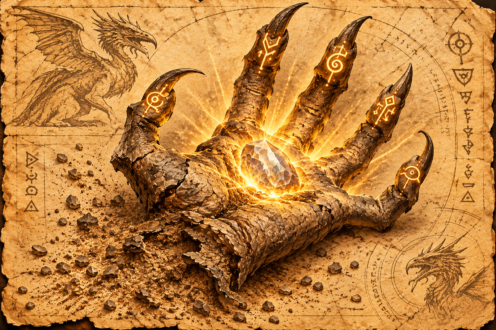{ .center-img width="70%%" }

## Peldvale&nbsp;55 { .divider }

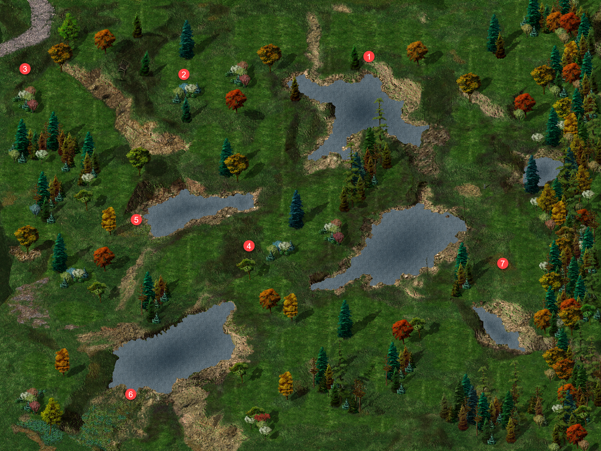{ .center-img width="40%" }

Stało się jasne, że przed kolejnym atakiem na *Obóz Bandytów* drużyna musiała zgromadzić więcej zaklęć i mikstur. **Henning** pozostawał póki co cały, dlatego **Imoen**, choć z wielkim trudem, zgodziła się tymczasowo odłożyć odsiecz. Nie oznaczało to rezygnacji, lecz jedynie przygotowanie takiego powrotu, po którym bandyci mieli już nie zebrać sił.

Na szlaku wędrowcy napotkali **Teda** 1, który powitał ich i zapytał, co sprowadziło ich tak daleko od domu. Gdy **Leech** przedstawił drużynę jako poszukiwaczy przygód, rozmówca przypomniał sobie wuja, który również uważał się za wielkiego bohatera. Miał miecz, tarczę i grupę kompanów, lecz wyprawa przeciw potworowi zakończyła się dla niego wyjątkowo marnie. Bestia zastawiła pułapkę, a później odrywała śmiałkom ręce i nogi. Kiedy ojciec **Teda** odnalazł brata, pozostała po nim jedynie sterta gnijącego mięsa.

**Leech** przyznał, że była to doprawdy krzepiąca opowieść, po czym zapytał o radę dla początkujących awanturników. **Ted** wskazał ruiny *Mostu Firewine* jako najlepsze miejsce dla tych, którzy pragnęli szybko się wzbogacić. Jeśli jednak drużyna szukała zajęcia bliżej domu, mogła zająć się bandytami nękającymi *Wybrzeże Mieczy*. ([The Firewine Ruins](../other/zadania.md#q97))

Niedługo później znienacka zaatakowali ogrzy magowie 2. Drużynie udało się odeprzeć napaść, choć spotkanie jasno pokazało, że nawet na pozornie spokojnym szlaku nie należało opuszczać broni.

Chwilę później naprzeciw wędrowców wybiegła szara elfka **Viconia** 3, błagając o pomoc. **Sandrah** natychmiast stanęła w jej obronie, uznając, że nikt nie powinien cierpieć wyłącznie z powodu swojego pochodzenia. **Finch** próbowała uspokoić uciekinierkę i poprosiła, by opowiedziała, kim była. Drowka zdołała jedynie się przedstawić i wyjaśnić, że pochodziła z daleka, nim rozmowę przerwał najemnik *Płonącej Pięści*. Mężczyzna zażądał wydania **Viconii**, twierdząc, że była poszukiwana za zamordowanie wielu ludzi. Za wystarczający dowód winy uznawał jednak samo jej pochodzenie. **Sandrah** zapytała, czy naprawdę zamierzał zabić drowkę tylko dlatego, że była drowką, i co właściwie nazywał sprawiedliwością. Najemnik zasłonił się prawem i wyrokiem śmierci, lecz kapłanka nie ustąpiła. Zażądała dowodów popełnionych zbrodni zamiast oskarżeń opartych wyłącznie na rasie ściganej. Gdy żołnierz ponownie nakazał drużynie zejść z drogi, **Sandrah** stanęła przed **Viconią** i oznajmiła, że będzie musiał najpierw przejść po ich trupach. Jej zdaniem to najemnik zachowywał się jak morderca, niezależnie od symboli, które nosił.

**Viconia** zapewniła, że oskarżenia były kłamstwem i nikogo nie skrzywdziła. Najemnik *Płonącej Pięści* nie zamierzał jednak słuchać. Skazał całą drużynę na śmierć za ukrywanie rzekomej morderczyni i ruszył do ataku. Wędrowcy pozostali przy swoim wyborze, gotowi bronić elfki przed egzekucją pozbawioną sądu i dowodów.

Po walce **Viconia** podziękowała wędrowcom za narażenie życia w jej obronie. Wiedziała, że widok drowki budził nieufność mieszkańców powierzchni, lecz zapewniła, że była wyrzutkiem i nie służyła już bóstwom budzącym ich lęk. Zwróciła się ku *Shar*, bogini mądrości i mocy, a teraz potrzebowała pomocy oraz miejsca, do którego mogłaby się udać. Obiecała dozgonną wdzięczność, jeśli pozwolą jej dołączyć do drużyny. **Sandrah** przypomniała **Leechowi**, że skoro zadali sobie trud, by ocalić komuś życie, spoczywała na nich również odpowiedzialność za danie tej osobie szansy na dalszą drogę. **Leech** odmówił jednak przyjęcia drowki, tłumacząc, że decyzja nie miała nic wspólnego z jej pochodzeniem. Drużyna nie potrzebowała kolejnej osoby, o którą musiałaby się troszczyć.

**Viconia** uznała mieszkańców powierzchni za słabych i stwierdziła, że powinna być wdzięczna za odrzucenie. **Sandrah** zganiła **Leecha**, lecz drowka zwróciła się do kapłanki spokojniej. Przyznała, że dostrzegła jej próbę przemówienia młodemu gnomowi do rozsądku, i zasugerowała, że być może pewnego dnia **Sandrah** zabije go i sama przejmie dowodzenie nad drużyną.

Na pożegnanie **Viconia** wręczyła kapłance osobliwy kawałek materiału. Zapowiedziała, że ich drogi jeszcze się skrzyżują, po czym odeszła. No i dobrze! ([A Strange Piece of Cloth](../other/zadania.md#q98))

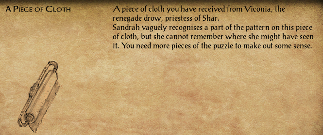{ .center-img width="60%" }

Nad jednym z jezior 4 drużyna spotkała trzech poetów: **Sama**, **Willy’ego** i **Roba**. Po wysłuchaniu ich poematów wędrowcy otrzymali harfę. Recytacje wymagały od słuchaczy niemałego poświęcenia, dlatego nagrodę przyjęto z tym większą wdzięcznością.

Loch

I to jest miejsce, które nasi przodkowie stworzyli dla człowieka! 
Oto dzieło naszej Miłości i Mądrości, 
dla każdego biedaka, który przeciw nam zawinił, 
choćby był najniewinniejszy — a może tylko trochę winny?

Czy to jedyne lekarstwo? Miłosierny Boże! 
Każdy por i naturalne ujście wysychają, 
przez niewiedzę i parzącą Nędzę, 
jego siły zwracają się przeciw własnemu sercu, 
zastygają i ulegają zepsuciu, przemienione w truciznę, 
aż wykwitają na nim niczym odrażające piętno zarazy.

Potem zamykamy go w naszych wilgotnych górskich lochach, 
gdzie jedynym losem jest niewygoda, 
bezprzyjaźna Samotność, Jęki i Łzy, 
dzikie Twarze o brzęczących kajdanach, 
widziane poprzez parę i opary jego lochu, 
w posępnym świetle lampy!

Tak więc leży, 
otoczony złem, aż sama jego dusza, 
niekształtna w swej istocie, zostaje beznadziejnie wypaczona 
widokiem coraz większej szpetoty!

Jakże odmiennymi posługujesz się środkami, o Naturo! 
Uzdrawiasz swe błądzące i znużone dziecko; 
zsyłasz na niego swe łagodne wpływy: 
słoneczne barwy, piękne kształty i wonne słodycze, 
melodie lasów, wiatrów i wód, 
aż ustąpi i nie będzie mógł dłużej się opierać.

Nie będzie już czymś obcym i zgrzytliwym 
pośród tego powszechnego tańca i śpiewu; 
lecz, wtapiając się we łzy, odzyskuje swą drogę, 
jego gniewny duch zostaje uleczony i przywrócony harmonii 
łagodnym dotykiem Miłości i Piękna.

Sam - poeta znad jeziora

Jaskinia

Wejdź do tej jaskini, Wędrowcze! Podejście 
jest długie, strome i mozolne; odpocznij tu przez chwilę. 
Możesz tu znaleźć wytchnienie od południowego żaru, 
osłonięty sklepieniem tej łukowatej skały, która budzi 
wdzięczny chłód; chwyć jej szorstkie ramiona. 

Wokół surowego wejścia zwisa stary bluszcz, 
 jego ciemnozielone gałęzie opadają w dół, a dzikie pszczoły 
 pośród szarych kwiatów szemrzą nieustannie, tworząc 
 najprzyjemniejszą melodię. Nie jest to zwyczajne miejsce. 
 Zyskuje moc tej Potęgi, która rodzi pieśń 
 i umiłowała to ustronne schronienie. 

Przypływ w dole 
 z rzadka niesie ku twym uszom szum wód;
 a ten wysoko zawieszony las na wietrze
 mieni się wieloma barwami. Spójrz, Wędrowcze! 

I pozwól, by twe złagodniałe serce głęboko poczuło, 
 jak dobre, jak cudowne jest Dzieło Natury. Gdy zaś stąd odejdziesz, 
 wyruszając ku zatłoczonym ulicom Miasta, 
 twe znużone oko na każdym kroku z niechęcią odwracać się będzie 
 od scen występku i nikczemności, wspominając, 
 że Człowiek sam stwarza zło, które później znosi. 
Rob - poeta znad jeziora

Szczęśliwy wojownik

Kim jest szczęśliwy Wojownik? Kim jest ten, 
 Którym chciałby zostać każdy zbrojny mąż? 
 To duch szlachetny, który wcześnie wszedł 
 W prawdziwe życie i wśród jego spraw się wiódł; 
 Według zamysłu, co młodzieńcza myśl mu dała, 
 Ku wzniosłym celom jego wola podążała. 
 Wewnętrzne światło drogę mu rozjaśnia, 
 A czego instynkt nie wie, wiedzą sobie wyjaśnia. 
 Trwa przy swym postanowieniu, lecz ponad wszystko ceni 
 Moralną wartość duszy, której nic nie zmieni. 

Skazany iść w orszaku Bólu, 
 Strachu i Krwi, w cierpieniu i mozole, 
 Potrzebę w chwałę umie przeobrazić, 
 A przeciwności własnej sile podporządkować. <
 Bo dzięki nim tę władzę w sobie ćwiczy, 
 Która najwyżej w ludzkiej naturze się liczy, 
 Poskramia wpływy, zmienia ich działanie, 
 Odbiera im moc i tłumi panowanie; 
 A rzeczy, które ducha mogłyby ugiąć, 
 Budzą w nim raczej współczucie, niż każą mu się cofnąć. 

Ustąpić umie, gdy wymaga chwila 
 I gdy ofiary obowiązek się domaga; 
 Im lepiej siebie zna, tym czystszy pozostaje, 
 Im większa pokusa, tym mocniej jej nie daje; 
 Im więcej cierpień i niedoli znosi, 
 Tym więcej czułości dla innych w sobie nosi. 

Prawo rozumu jest dla niego drogą, 
 A gdy potrzeba, radzi się przyjaciół; 
 I kiedy ludzie wokół niego mogą 
 Ku złu się skłaniać, on tym bardziej strzeże dobra. 

A chociaż najlepszy czyn czy zamiar 
 Niejednokrotnie na kruchej podstawie spoczywa, 
 On dobrem dobro karmi i odpłaca, 
 A każdy triumf cnoty nową cnotą wzbogaca. 

Gdy przyjdzie mu stanąć u steru władzy, 
 Występuje jawnie, bez podstępu i zdrady; 
 Na uczciwych warunkach swe miejsce obejmuje 
 Lub się wycofa, jeśli honor tego potrzebuje. 
 A jeśli w sercu własne żywi pragnienie, 
 Powierzonej ufności nie zdradzi za spełnienie; 
 Rozumie swój obowiązek i z równą wiernością 
 Dąży do celu z niewzruszoną stałością. 

Nie czai się więc, nie zastawia sideł 
 Na skarby, zaszczyty ni doczesną władzę; 
 Idzie za tym, za czym iść powinien, 
 A reszta niech spada, jeśli spaść ma, 
 Niczym manna z nieba. 

Jego siły rosły wśród powszednich zmagań, 
 Wśród drobnych trosk zwyczajnego życia, 
 Pod wpływem stałym, szczególnej łaski; 
 Lecz gdy nadejdzie chwila wielkiej próby, 
 Gdy Niebo złączy z jego losem 
 Wielką sprawę, dobrą lub złą dla całej ludzkości, 

Jest szczęśliwy jak kochanek; nagle rozjaśniony 
 Jak człowiek natchniony, mocą przepełniony. 
 I choć pośród walki wierny jest prawu, 
 Spokojnie widzi to, co nadchodzi bez strachu. 
 A jeśli niespodziany zew go wezwie, 
 Sprosta potrzebie, jakakolwiek będzie. 

I choć tak, wśród burzy i zamętu, 
 Zdaje się cały należeć do żywiołu, 
 Pozostaje duszą, której głębia zmierza 
 Ku domowym radościom i łagodnym wzruszeniom. 

Słodkie obrazy! Gdziekolwiek przebywa, 
 Nosi je w sercu, a pamięć ich jest żywa; 
 Tak wiernie kocha to, co umie cenić, 
 Że właśnie miłość odwagę potrafi w nim krzepić. 

Oto Człowiek, który wysoko wyniesiony 
 Może być na oczach całego Narodu, 
 Albo nieznany, w cieniu pozostawiony; 
 Któremu przypadnie zaszczyt albo trud, 
 Pomyślność albo nieprzychylny los, 
 Lecz w wielkiej grze życia wciąż ma własny głos. 

Gdzie to, co dla niego najcenniejsze, zdobyć trzeba, 
 Nie straszy go niebezpieczeństwo ani gniew nieba; 
 Nie zna myśli, co czułe szczęście zdradzi, 
 Nie zna lęku, który z obranej drogi sprowadzi. 
 Patrzy przed siebie, wierny aż do końca, 
 Od dobra ku lepszemu, jak ku światłu słońca. 

Czy pochwała jego imię przez wieki poniesie, 
 Czy szlachetne czyny pamięć mu przyniosą; 
 Czy też bez sławy spocznie w cichej ziemi, 
 Bez pomnika i imienia między potomnymi, 
 Znajdzie pociechę w sobie i w swej sprawie. 

A kiedy śmiertelna mgła wokół niego wstanie, 
 Ostatni oddech odda z ufnością w Niebiosa. 
Oto szczęśliwy Wojownik. Oto ten, 
 Którym chciałby zostać każdy zbrojny mąż 
Willy - poeta znad jeziora

W pobliskiej beczce 5 **Finch** odnalazła kolejną poszukiwaną księgę, *Rozkosze puddingów*. Pozostawało mieć nadzieję, że kiedyś kronikarka odwdzięczy się porannym budyniem we dwoje ([Finch's Quest to Start a Library in Nashkel](../other/zadania.md#q25)).

Przy kolejnym jeziorze stała następna beczka 6, a w niej spoczywała skomplikowana aparatura. Jej przeznaczenie pozostawało zagadką, choć drużyna nie musiała długo czekać na rozwiązanie.

Nieco dalej wędrowcy natknęli się na uszkodzonego golema 7. Wszystko wskazywało na to, że odnaleziony wcześniej mechanizm był brakującym mózgiem konstruktu. Postanowili sprawdzić, co się stanie po umieszczeniu aparatury na właściwym miejscu. Golem zgodnie z przewidywaniami ożył. Mniej zgodnie z nadziejami drużyny natychmiast zaatakował.

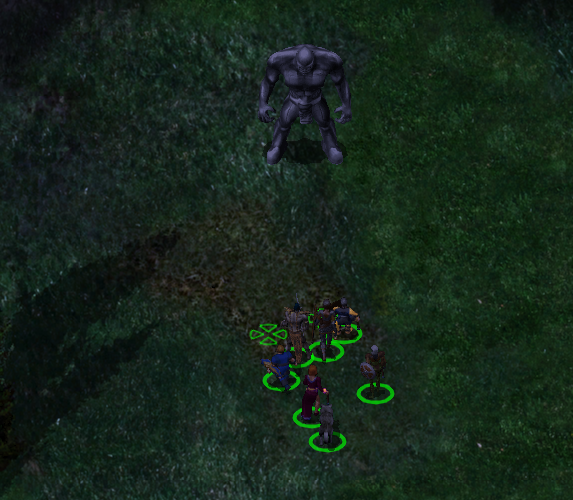{ .center-img width="60%" }

Po nieudanym szturmie na *Obóz Bandytów* emocje zdążyły nieco opaść. Wędrowcy postanowili więc na pewien czas odłożyć kolejne uderzenie, zająć się sprawą **Elminstera** i zamknąć kilka rozpoczętych wcześniej wątków.

Drużyna skierowała się ku *Lasowi Pająków*.

:material-paw: Bestiariusz: *rozbójnik, elitarny najemnik Czarnych Szponów, ogrzy mag, zdziczały pies, niedźwiedź czarny, niedźwiedź, niedźwiedź jaskiniowy, olbrzymi pająk, pająk-upiór, bełkotek, elita hobgoblinów, golem*

## Las Pająków&nbsp;56 { .divider }

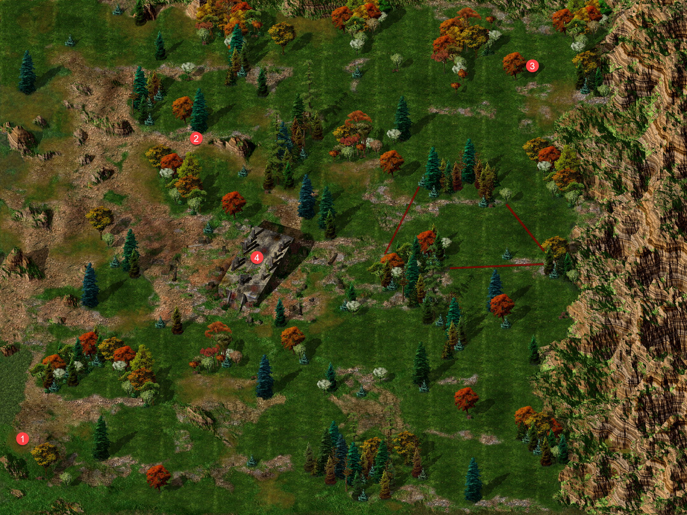{ .center-img width="40%" }

**Fahrrington** 1 poprosił drużynę o pomoc w odzyskaniu zwoju mądrości skradzionego przez tasloi. Złodziej uciekł na wschód, w stronę leża etterkapów, zapewne nieświadomy wartości łupu. W zamian za zwrot zwoju druid obiecał rozjaśnić karmę wędrowców. **Finch** oburzyła się na ten nieznośny akt kradzieży i wyraziła nadzieję, że zdołają pomóc poszkodowanemu.

Poszukiwany zwój rzeczywiście znajdował się przy zabitym etterkapie 3. Drużyna odzyskała własność druida i mogła zakończyć sprawę bez konieczności dalszych poszukiwań ([Fahrrington's Scroll](../other/zadania.md#q98)).

Wśród ruin dawnej świątyni 5 wędrowcy natknęli się na grupę *Czerwonych Magów*. Takie spotkanie mogło zakończyć się tylko w jeden sposób. **Denak**, **Brendan**, **Diana** i **Lasala** nie mieli już nikomu grozić.

Po walce **Sandrah** zapytała **Leecha**, czy teraz rozumiał, dlaczego tak bardzo gardziła podobnymi szumowinami. Przypomniała mu jednak jego własne słowa: każdy przypadek należało osądzać osobno, bez uprzedzeń wynikających wyłącznie z pochodzenia czy profesji. Wciąż czekała na wyjątek, który podważyłby jej niechęć, lecz tego dnia z pewnością go nie spotkała. Dodała, że nawet gdyby ponownie okazała się kapryśną wiedźmą, Leech powinien pamiętać, iż potrafiła zachowywać się inaczej.

**Jen’lig** zasyczała z dezaprobatą. Jej zdaniem próby przenoszenia istot między planami najczęściej kończyły się porażką, ponieważ przywołujący nie potrafili zapanować nad sprowadzonymi stworzeniami. Sama tylko raz musiała ratować młodego dowódcę schwytanego na *Planie Astralnym*. Pewien czarodziej przywołał grupę młodych githyanki wprost nad sadzawką lawy, lecz **Jen’lig** zabiła maga i ocaliła niedoświadczonego wojownika. **Sandrah** przyznała, że githyanki musiała wykazać się niezwykłą odwagą. **Jen’lig** odpowiedziała, że podczas najbliższego postoju pokaże dowódcy ślad po oparzeniu, który ciągnął się od palca u stopy aż po szpon.

:material-paw: Bestiariusz: *olbrzymi pająk, wielki pająk, pająk miecznik, pająk fazowy, pająk-upiór, tasloi, etterkap, żywiołak ognia*

## Równina Ostrych Kłów&nbsp;57 { .divider }

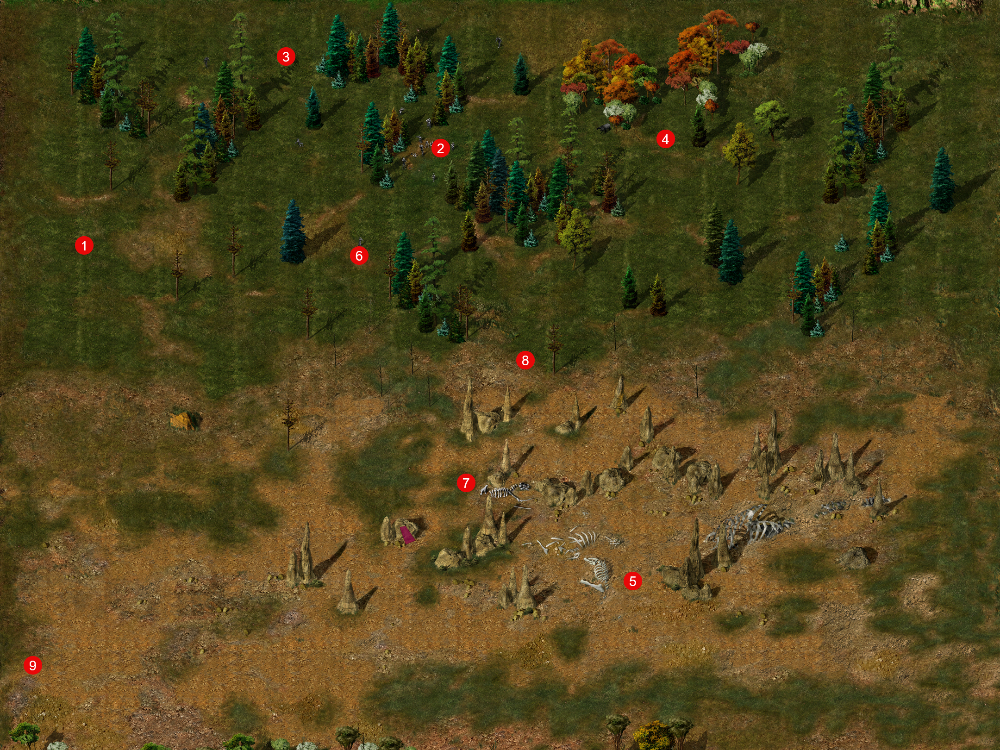{ .center-img width="40%" }

Drużynie udało się odczarować **Tamah** 10, jedną z ofiar bazyliszków **Mutamina**. Kobieta pamiętała walkę z gnollami oraz chwilę, w której na jej oczach skamieniał **Petr**, lecz nie zdawała sobie sprawy, jak długo sama pozostawała uwięziona w kamieniu.

**Finch** wyjaśniła, że mag wykorzystywał oswojone bazyliszki do petryfikowania podróżnych. Wdzięczna za ratunek **Tamah** podziękowała **Leechowi** i obiecała dobrze mówić o jego bezinteresownym czynie ([Basilisk Pets](../other/zadania.md#q49)). :material-trending-up: Reputacja +1

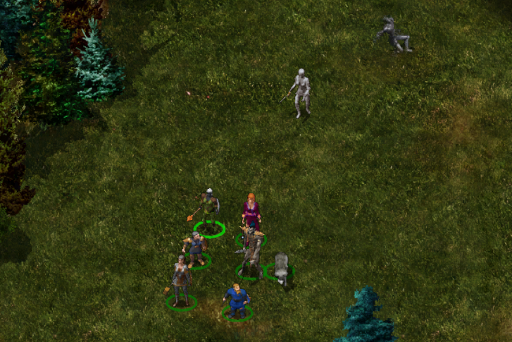{ .center-img width="60%" }

Nieopodal wędrowcy zauważyli wejście do jaskini 11 i postanowili sprawdzić, co kryło się w środku. Pierwszym mieszkańcem pieczary okazał się bazyliszek, który zatrzymał przy sobie wielu śmiałków, choć raczej nie z własnej woli. Szybko wyszło też na jaw, że podziemny kompleks miał kilka poziomów A.

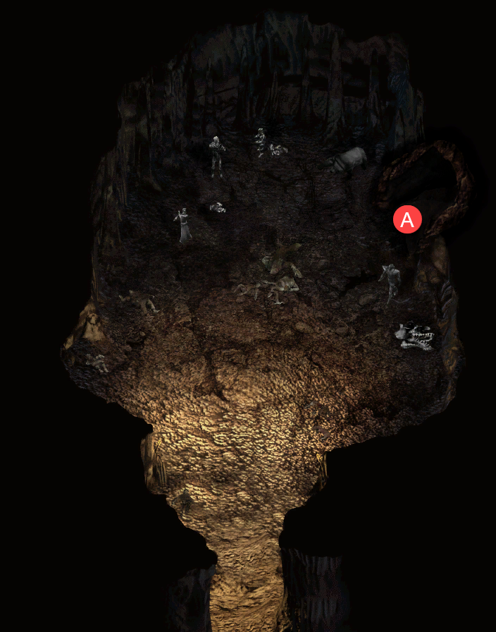{ .center-img width="60%" }

Na drugim poziomie drużynę powitała kolejna grupa bazyliszków i pająków. Po rozprawieniu się ze stworzeniami wędrowcy ruszyli dalej w dół B.

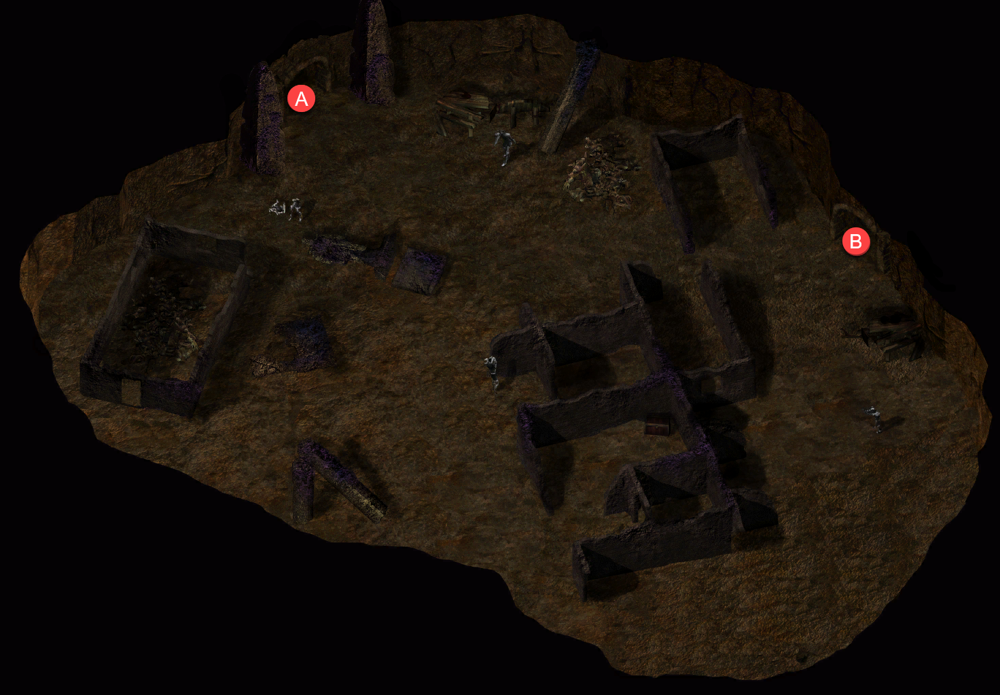{ .center-img width="60%" }

Kolejna część lochu nie przyniosła większej odmiany. Znów czekały w niej potwory, ciemność i wyraźne ostrzeżenie, że rozsądni podróżnicy od dawna przestali zaglądać w te strony.

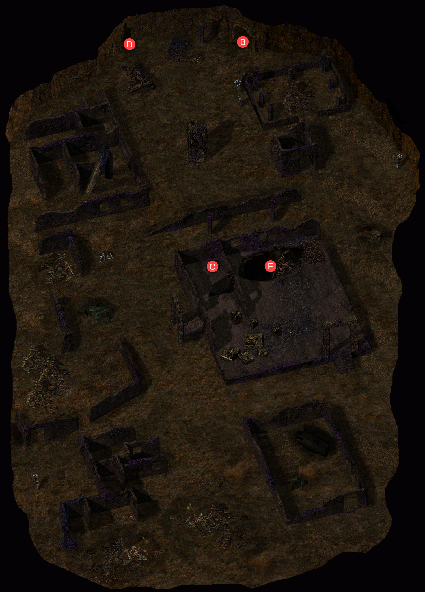{ .center-img width="60%" }

W jednej ze skrzyń drużyna znalazła odciętą dłoń C, kurczowo zaciśniętą na tajemniczym przedmiocie. Każdy palec dłoni znaczył magiczny glif, a jedynie odgięcie ich we właściwej kolejności mogło uwolnić skrywaną zawartość.

Wędrowcom udało się rozwiązać zagadkę. Gdy ostatni palec odgiął się we właściwą stronę, dłoń rozsypała się w pył, pozostawiając po sobie jedynie osobliwy kamień strażniczy.

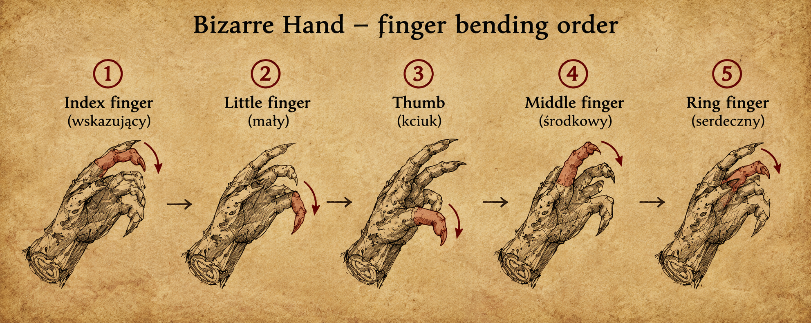{ .center-img width="80%" }

Użycie kamienia przeniosło drużynę do kieszonkowego planu. Ktoś stworzył go niegdyś jako prywatną ostoję, niedostępną dla wrogów i pozwalającą bezpiecznie odpocząć. Teraz wędrowcy stali się kolejnymi posiadaczami tego niezwykłego schronienia.

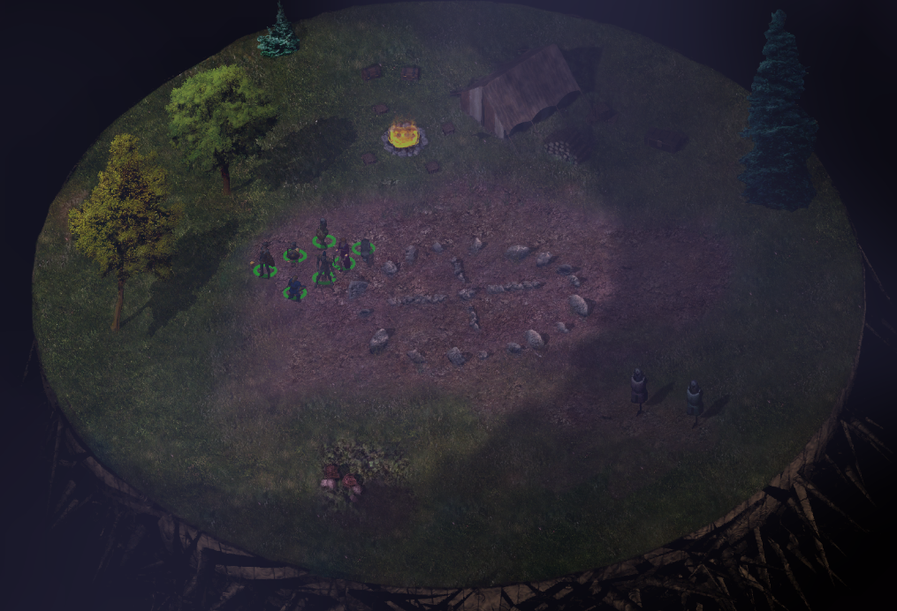{ .center-img width="80%" }

Po powrocie na rzeczywisty plan drużyna zeszła na kolejny poziom D. Czekał tam *Obserwator*, którego udało się pokonać jedynie dzięki sile żywiołu ognia.

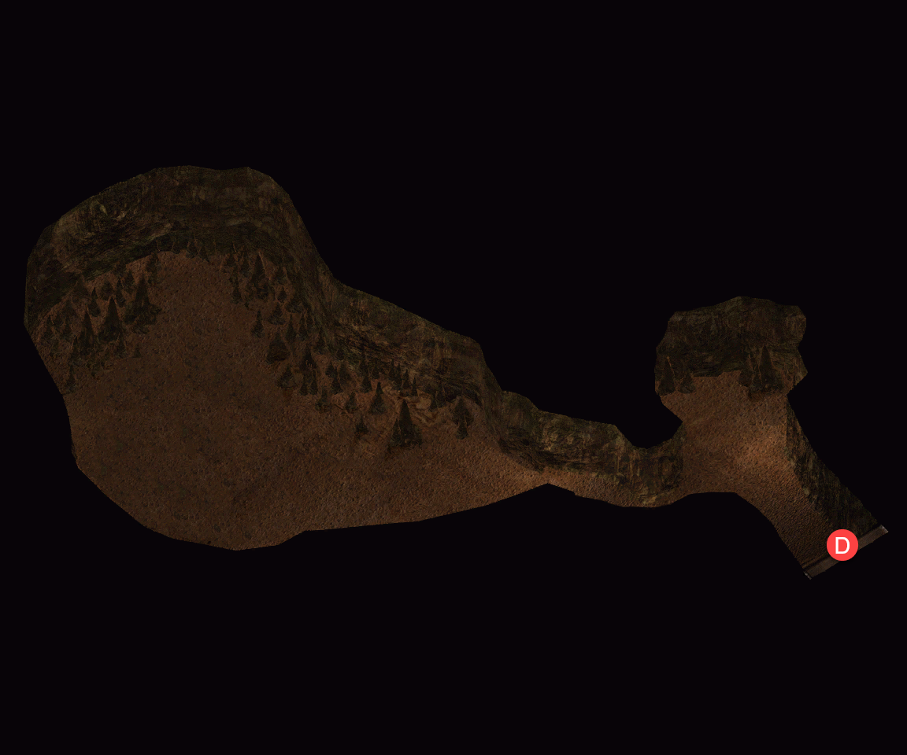{ .center-img width="60%" }

Wędrowcy wrócili na trzeci poziom i odnaleźli schody E, które prowadziły dwa piętra niżej, do pieczary z niewielkim jeziorem. Pośrodku wyspy, w miejscu skrytym głęboko pod ziemią, rosło samotne drzewo.

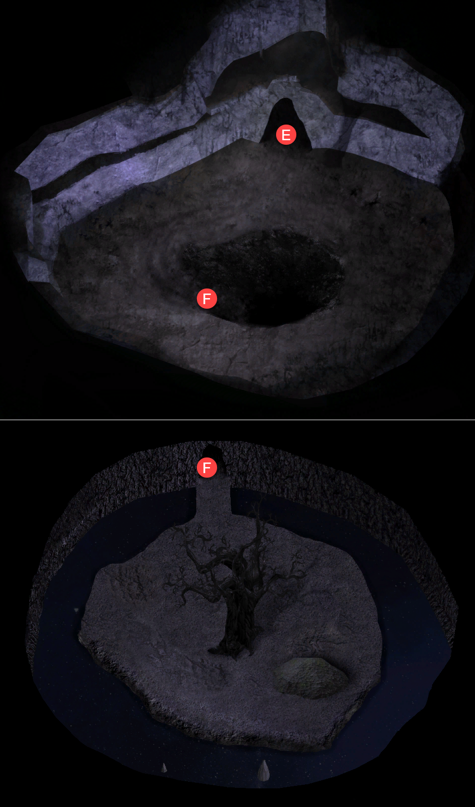{ .center-img width="60%" }

Gdy Leech dotknął pnia, usłyszał głos rozbrzmiewający bezpośrednio w umyśle. Należał do *Drzewa Cieni*, pradawnej istoty żywiącej się doświadczeniami i wspomnieniami ludzi. Drzewo wyznało, że od stuleci rosło dzięki opowieściom pozostawianym przez podróżników. Nie pożerało wspomnień w całości. Osłabiało je jedynie, pozostawiając wyblakły ślad dawnego bólu lub cierpienia, a w zamian obdarowywało gości darami.

Zaintrygowany Leech pozwolił istocie zajrzeć do własnego umysłu. *Drzewo Cieni* zaczęło przeszukiwać jego wspomnienia, aż natrafiło na szczególnie silny ślad. Było to wspomnienie **Goriona**. Przed oczami pradawnej istoty pojawił się obraz opiekuna Leecha otoczonego przez wrogów. Wspomnienie nie ograniczało się do samego wydarzenia. Niosło ze sobą wszystkie emocje, które tamtej nocy odczuwał zarówno młody gnom, jak i człowiek próbujący go ocalić. Drzewo skosztowało goryczy oraz bólu, lecz zapewniło, że nie odbierze ich całkowicie. Zabrało jedynie niewielką część doświadczenia, pozostawiając resztę nienaruszoną. Niektórych ran nie można było wymazać. Można było jedynie nauczyć się z nimi żyć, a ich gorzki smak odtąd miał pozostać zarówno z Leechem, jak i pradawną istotą.

*Drzewo Cieni* kontynuowało wędrówkę po zakamarkach umysłu młodego gnoma, badając wspomnienia, które mogły stać się dla niego pożywieniem. Natrafiło na obraz tawerny, pod którym kryło się coś znacznie mroczniejszego. W cieniu dawnych wydarzeń wyczuło ślady śmierci i morderstwa, wciąż unoszące się nad miejscem niczym gorzki posmak przeszłości. Istota zauważyła, że wspomnienie głęboko przeniknęło Leecha, pozostawiając w nim ślad, od którego nigdy nie zdołałby całkowicie się uwolnić.

Gdy drzewo sięgnęło głębiej, odnalazło wspomnienie tajemniczego starca, który twierdził, że potrafił dostrzec to, co skrywało się poza zasłoną rzeczywistości. Nie miało znaczenia, czy jego wizje były prawdą, czy jedynie wytworem obłąkanego umysłu. Ważne było, że wciągnął Leecha w niezwykłe poszukiwanie dowodów mających potwierdzić, iż nie był zwykłym szaleńcem. To doświadczenie przypadło *Drzewu Cieni* do gustu, dlatego pochłonęło część jego esencji.

Wreszcie istota natrafiła na wspomnienie niziołka, gotowego zaryzykować wszystko, by ocalić bliską sobie osobę. W pamięci pobrzmiewały zarówno przerażenie, jak i nadzieja. Niziołek poszukiwał drzewa podobnego do tego, które przemawiało do Leecha, choć tamto rosło w cieniu niezwykłego kwiatu. Mieszanka rozpaczy i wiary okazała się szczególnie kusząca. *Drzewo Cieni* z rozkoszą skosztowało wspomnienia, pozwalając, by jego słodko-gorzki smak rozszedł się po wszystkich gałęziach i korzeniach.

Za każde ofiarowane wspomnienie drzewo przekazało naszemu bohaterowi dar. Młody gnom postanowił kiedyś powrócić, by osłabić jeszcze część najbardziej bolesnych przeżyć. ([The Tree Of Shades](../other/zadania.md#q100))

Drużyna wróciła na powierzchnię.

Nieopodal wędrowcy spotkali **Shar-Teel** 12, która wyzwała Leecha na pojedynek. Po przegranej nie potrafiła wyjść z podziwu, jak dobrym okazał się przeciwnikiem. Zaproponowała przyłączenie się do drużyny, a jej propozycję przyjęto. Na razie miała jednak zaczekać na kompanów w *Nashkel*, pod *Bekającym Smokiem*.

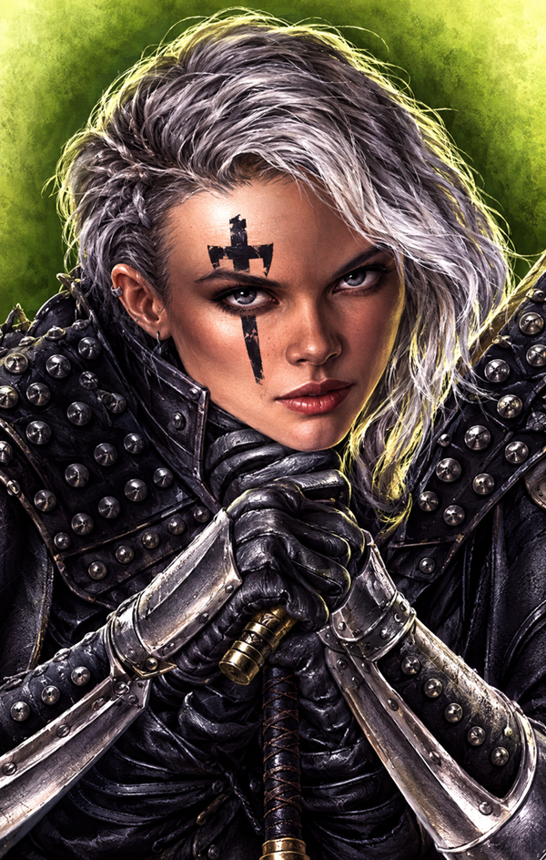

# Shar-Teel

Człowiek · Paladynka · Chaotyczna zła

> Zapytana o swoją przeszłość Shar-Teel nie miała wiele do powiedzenia. Z nielicznych słów można było wywnioskować, że była sierotą. Żywiła głęboką niechęć do najemników Płonącej Pięści i nie kryła pogardy wobec mężczyzn. Najwyraźniej pragnęła coś udowodnić, choć nie zdradzała, co dokładnie nią kierowało. Wszystko wskazywało jednak na to, że jej dzieciństwo nie należało do spokojnych.

Nadszedł czas na ponowne odwiedziny w *Gullykin*.

:material-account-group: Przyłączeni NPC: Shar-Teel

:material-account-group: Odłączeni NPC: Shar-Teel (Nashkel, Bekający Smok)

:material-paw: Bestiariusz: *gnoll, gnoll elita, bazyliszek większy, pająk olbrzymi, pająk-upiór, mniejszy obserwator*

## Gullykin&nbsp;58 { .divider }

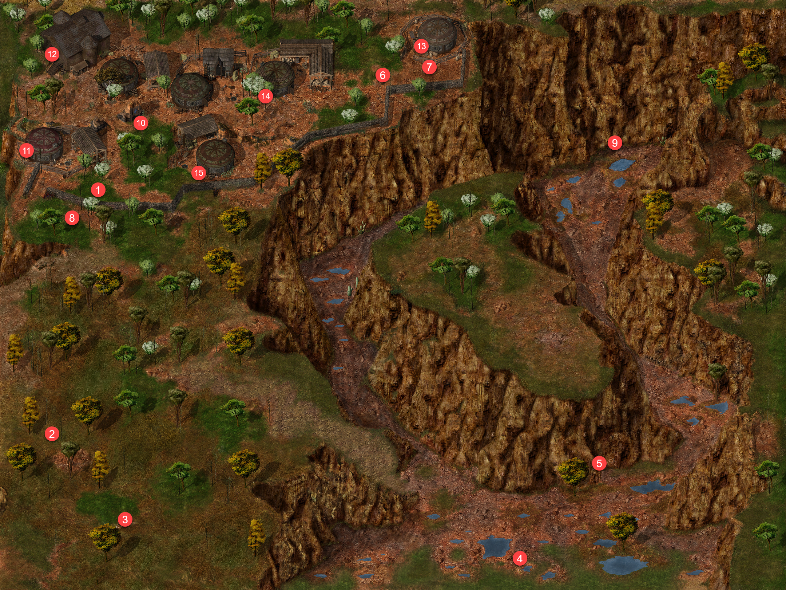{ .center-img width="40%" }

Przy jednym z domostw 6 drużynę zaczepił **Smeagol**, biorąc wędrowców za bohaterów zdolnych odzyskać jego skarb. Wyjaśnił, że paskudne gobliny ukradły mu „Skarb”, a bez niego pogrążył się w nędzy. Leech zapytał, czym właściwie był ów Skarb. **Smeagol** opisał go jako piękny, niezwykle lśniący pierścień, po czym ponaglił przybyszów, by odebrali go cuchnącym goblinom. Młody gnom zgodził się pomóc i obiecał zwrócić zgubę, gdy tylko wpadnie w ich ręce.

Drużyna szybko zorientowała się, że zdobyła poszukiwany pierścień już podczas pierwszej wizyty w wiosce. Uradowany **Smeagol** znów zaczął przemawiać do swojego Skarbu, zapewniając, że gobliny nigdy więcej go nie odbiorą. Następnie ruszył łapać mnóstwo ryb, które razem mieli zjeść po odzyskaniu pierścienia. Całe spotkanie pozostawiło po sobie osobliwe uczucie déjà vu.

Tuż obok mieszkała **Michalina** 7, która nie miała ochoty na rozmowę. Ziewając, wyjaśniła, że była zbyt zmęczona. Leech zażartował, że skoro wioska słynęła jedynie z ziemniaków, musiała spędzić całą noc na wyjątkowo hucznej zabawie albo na równie pasjonującym kopaniu bulw. **Michalina** zganiła go za brak uprzejmości i wyjaśniła, że niemal każdej nocy budziło ją wycie dochodzące z pobliskiego wzgórza. Pojawiał się tam osobliwy pies, który nie pozwalał jej zasnąć. Zwierzę uważnie jej się przyglądało, a jego groźny wygląd skutecznie zniechęcał kobietę do podejścia bliżej. Pies powracał niemal co noc.

Leech postanowił zaczekać do zmroku i wyjaśnić zagadkę niezwykłego zwierzęcia. **Michalina** zgodziła się pomóc, choć nadal pamiętała jego wcześniejsze docinki. Ostrzegła, że pies zwykle pojawiał się około północy. Gdy nadeszła noc, zwierzę rzeczywiście przybyło. Spojrzało na **Michalinę**, po czym pyskiem wskazało drogę prowadzącą poza wioskę. Kobieta uznała, że jeśli chcieli naprawdę pomóc i dowiedzieć się, co pies próbował przekazać, właśnie nadarzyła się ku temu okazja ([The Midnight Dog](../other/zadania.md#q101)).

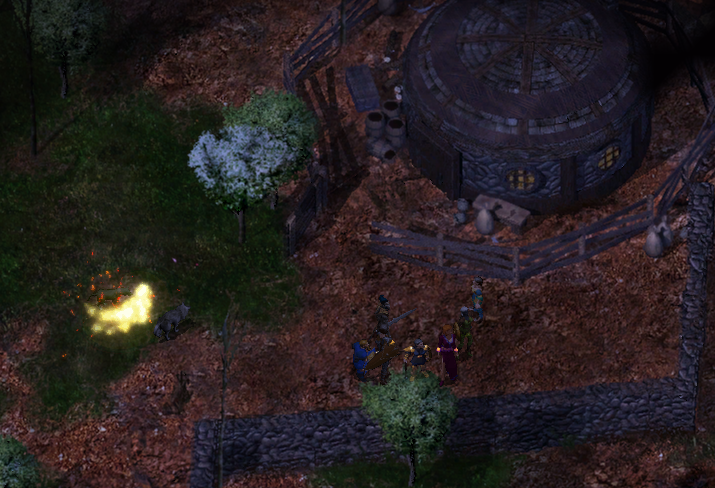{ .center-img width="60%" }

Pies oczekiwał na drużynę przy wyjściu z wioski 8. Na jego obroży widniało imię *Cu-sith*. Po chwili niezwykły przewodnik ruszył w stronę wąwozu, gdzie wskazał wejście do jaskini 9.

Wewnątrz pies zaprowadził wędrowców do płytkiego grobu niziołka A. Drużyna zabrała jego ciało i wróciła z nim do **Michaliny**.

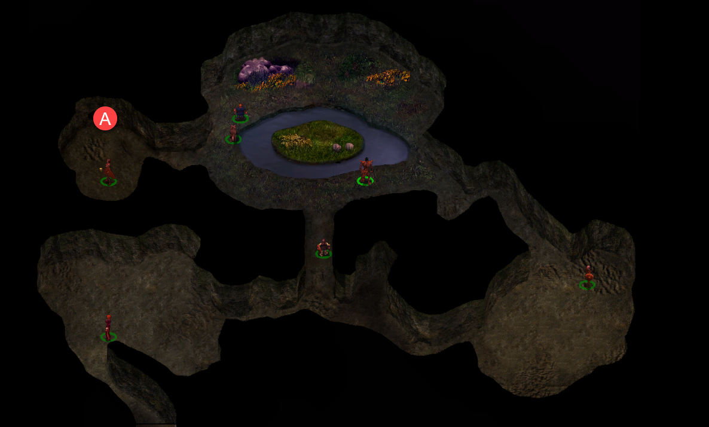{ .center-img width="60%" }

Wyjaśnili jej, że podążyli za psem aż do groty, do której zwierzę najwyraźniej próbowało ich zaprowadzić. Gdy drużyna odnalazła ciało, tajemniczy przewodnik pojawił się ponownie, jakby właśnie tego szukał i chciał, by **Michalina** również je zobaczyła. Kobieta rozpoznała w zmarłym **Loahna**, który zaginął jakiś czas wcześniej. **Leech** przypuszczał, że pies opiekował się jego ciałem. Być może niezwykłe stworzenie pomogło **Loahnowi** opuścić świat żywych, dzięki czemu jego duch nie błąkał się już po okolicy.

**Michalina** uznała tę teorię za niezwykle szczegółową, lecz rana na ciele wskazywała, że **Loahn** spadł ze skał. Podziękowała Leechowi za rozwiązanie zagadki i żałowała jedynie, że zaginiony nie zachował większej ostrożności. W nagrodę przekazała mu flet, po czym raz jeszcze wyraziła wdzięczność za udzieloną pomoc ([The Midnight Dog](../other/zadania.md#q101)).

Dalej drużyna spotkała **Manka Rubbleslide’a** 10, który powitał przybyszów i zaproponował swoje towary. Leech zauważył jednak, że kupiec wydawał się czymś przejęty, i zapytał, co się wydarzyło. **Manko** przyznał, że odnalazł niezwykły przepis pochodzący z *Kozakury* i zamierzał go wypróbować. Sama myśl o przygotowaniu egzotycznej potrawy napawała go entuzjazmem, lecz najpierw musiał zdobyć kilka rzadkich składników. Zapewnił przy tym, że danie nie przypominało niczego z innego planu ani niczego równie osobliwego. Kuchnia *Kozakury* była po prostu zupełnie inna.

Leech obiecał dostarczyć potrzebne składniki, jeśli natknie się na nie podczas podróży. **Manko** potrzebował miodu ze śliwek, wyciągu z aka oraz przyprawy toge. Pozostałe produkty miał już w swoim sklepie. Gdy zgromadzi wszystko, zamierzał przygotować wspaniałą kolację dla siebie i swojej żony. Po przyjęciu zlecenia Leech powrócił do oglądania towarów kupca ([Big Appetite in Small Gullykin](../other/zadania.md#q102)).

**Gandolar Luckyfoot** 1 ponownie powitał drużynę w *Gullykin* i zapytał, czy wędrowcy zmierzali do *Wieży Durlaga*, czy może właśnie z niej wrócili, potrzebując opatrzenia złamań oraz siniaków. Wielu śmiałków docierało do osady ledwie żywych, dlatego widok poturbowanych przybyszów nikogo już tam nie dziwił. Leech przyznał, że po trudach podróży chętnie skorzystałby z pomocy uzdrowiciela. **Gandolar** wskazał świątynię, w której służył **Alvanhendar**. Zapewnił, że w całej okolicy trudno byłoby znaleźć sprawniejszego kapłana, a ceny jego usług pozostawały rozsądne.

Po chwili niziołek przedstawił drużynie pewną propozycję. Ruiny *Firewine* od dawna niepokoiły mieszkańców okolicy. Kamienne pozostałości dawnej budowli przez lata niszczały w ciszy, lecz niedawno zamieszkała w nich banda koboldów. **Gandolar** poprosił wędrowców o usunięcie zagrożenia, obiecując w zamian dar od mieszkańców wioski. Wszystko, co drużyna odnalazłaby w ruinach, również mogła zatrzymać ([The Firewine Ruins](../other/zadania.md#q97)).

Drużyna zgodził się pomóc niziołkom najlepiej, jak potrafi. **Gandolar** wskazał drogę do ruin, lecz ostrzegł, że w ich pobliżu widywano wiele osobliwych stworzeń. Dochodziły go również słuchy, że koboldy były znacznie lepiej zorganizowane niż zwykle. Wejścia należało szukać w piwnicy miejscowej winiarni, gdzie ukryto tajemne drzwi prowadzące wprost do podziemi ([Firewine Bridge and Gullykin](../other/zadania.md#q103)).

Mieszkańcy *Gullykin* przyjęli drużynę z życzliwą ciekawością. Kupcy i karawany często odwiedzali osadę, lecz to wędrowni bohaterowie wzbudzali największe zainteresowanie. Jedna z mieszkanek porównała Leecha do **Littlemana**, największego podróżnika w historii niziołków. Uznała go za osobliwego przybysza, lecz zarazem kogoś godnego podziwu. Przy kolejnym spotkaniu ucieszyła się, że nadal żył. Jak zauważyła, wielu poszukiwaczy przygód powracało do *Gullykin* znacznie mniej rozmownych niż za pierwszym razem. Śmierć miała ten niezawodny wpływ na usposobienie.

Mieszkańcy nie tęsknili za bogactwami odległego świata. Wierzyli, że *Dallillia Opiekunka* zapewniała im wszystko, czego potrzebowali. Woleli spokojne życie w *Gullykin* od pogoni za skarbami, które mogły kosztować znacznie więcej, niż były warte. Jeden z niziołków ujął to prosto: trudno było rozstrzygnąć, kto był większym głupcem, człowiek odpoczywający w starym fotelu czy ten, który przez całe życie harował na nowy, aby kiedyś móc w nim usiąść.

Nie oznaczało to jednak, że okolica pozostawała wolna od zagrożeń. Mieszkańcy wcześniej radzili sobie z koboldami, lecz te zamieszkujące ruiny *Firewine* były znacznie lepiej zorganizowane niż ich pobratymcy. Nadal cuchnęły jak koboldy, ale najwyraźniej ktoś nauczył je działać według planu. Niziołki nie potrafiły wskazać drogi do wszystkich sekretów okolicy. Wielu wysokich wojowników przybywało do *Gullykin* z tymi samymi pytaniami, lecz odpowiedź niezmiennie brzmiała tak samo: żaden niziołek nie wiedział, gdzie znajdował się klucz do zamkniętej bramy.

Jedna z mieszkanek opowiedziała także o przeszłości *Firewine*. Niegdyś istniało tam elfie miasto handlowe, zniszczone około dwóch stuleci wcześniej wskutek pojedynku dwóch głupców. Gdyby któryś z nich postąpił rozsądniej, dawna osada być może wciąż by istniała ([The Firewine Ruins](../other/zadania.md#q97)).

Drużyna zajrzała do domów **Bunsena** 13, **Farthendella**, **Arlonda** 14, **Iris**, **Larga Cottona** i **Mabledale** 15.

W domu **Jenkala** 11 wędrowcy wyczuli zapach koboldów i odkryli ukryte przejście prowadzące do ruin *Firewine*. Gdy zdrada gospodarza wyszła na jaw, zaatakował. Po walce wśród jego rzeczy znaleziono kolejną księgę poszukiwaną przez **Finch**, *Opowieści ludowe z Nashkel* ([Finch's Quest to Start a Library in Nashkel](../other/zadania.md#q25)).

Na koniec drużyna odwiedziła świątynię *Yondalli* 12, skąd przejście prowadziło prosto do kazamatów *Firewine*.

:material-paw: Bestiariusz: *ghul, dezerter Płonącej Pięści, ankheg, kobold, straszliwy wilk*
