# UNDER CONSTRUCTION

## Peldvale&nbsp;55 { .divider }

{ .center-img width="40%" }

Jasne jest, że musimy zaopatrzyć się w więcej czarów i mikstur aby otwarcie zaatakować obów. Henning jest póki co cały i Imoen z trudem ale zaakceptowała tymczasowe odsunięcie odsieczy.

Napotykamy Teda (1), który powitał przybyszów i zapytał, co sprowadziło ich tak daleko od domu. Gdy Leech przedstawił drużynę jako poszukiwaczy przygód, rozmówca przypomniał sobie wuja, który również uważał się za wielkiego bohatera. Miał miecz, tarczę i grupę kompanów, lecz wyprawa przeciw potworowi zakończyła się dla niego wyjątkowo marnie. Bestia zastawiła pułapkę, a później odrywała śmiałkom ręce i nogi. Kiedy ojciec Teda odnalazł brata, pozostała po nim jedynie sterta gnijącego mięsa. Leech przyznał, że była to doprawdy krzepiąca opowieść, po czym zapytał o radę dla początkujących awanturników. Ted wskazał ruiny Mostu Firewine jako najlepsze miejsce dla tych, którzy pragnęli szybko się wzbogacić. Jeśli jednak drużyna szukała zajęcia bliżej domu, mogła zająć się bandytami nękającymi Wybrzeże Mieczy (The Firewine Ruins 97).

Znienacka atakują na ogrzy magowie (2) i udaje się odeprzeć ich atak.

Viconia wybiegła drużynie naprzeciw (3), błagając o pomoc. Sandrah natychmiast stanęła w jej obronie, uznając, że nikt nie powinien cierpieć wyłącznie z powodu swojego pochodzenia. Finch próbowała uspokoić uciekinierkę i poprosiła, by opowiedziała, kim była. Viconia zdołała jedynie się przedstawić i wyjaśnić, że pochodziła z daleka, nim ich rozmowę przerwał najemnik Płonącej Pięści. Mężczyzna zażądał wydania drowki, twierdząc, że była poszukiwana za zamordowanie wielu ludzi. Za wystarczający dowód jej winy uznawał jednak samo pochodzenie. Sandrah zapytała, czy naprawdę zamierzał zabić Viconię tylko dlatego, że była drowką, i co właściwie nazywał sprawiedliwością. Najemnik zasłonił się prawem i wyrokiem śmierci, lecz kapłanka nie ustąpiła. Zażądała dowodów popełnionych zbrodni, zamiast oskarżeń opartych wyłącznie na rasie ściganej. Gdy żołnierz ponownie nakazał drużynie zejść z drogi, Sandrah stanęła przed Viconią i oświadczyła, że będzie musiał najpierw przejść po ich trupach. Jej zdaniem to najemnik zachowywał się jak morderca, niezależnie od symboli, które nosił. Viconia zapewniła, że oskarżenia były kłamstwem i nikogo nie skrzywdziła. Najemnik Płonącej Pięści nie zamierzał jednak słuchać. Skazał całą drużynę na śmierć za ukrywanie rzekomej morderczyni i ruszył do ataku. Wędrowcy pozostali przy swoim wyborze, gotowi bronić Viconii przed egzekucją pozbawioną sądu i dowodów.

Viconia podziękowała drużynie za ocalenie. Wiedziała, że z powodu jej drowiego pochodzenia mogli nie chcieć obdarzyć jej zaufaniem, lecz poprosiła o jedną szansę. Potrzebowała sprzymierzeńców bardziej niż kiedykolwiek i zaproponowała, że dołączy do ich wędrówki. Sandrah przypomniała Leechowi, że ratując komuś życie, brali również odpowiedzialność za danie tej osobie możliwości rozpoczęcia nowej drogi. Leech przyznał jej rację. Drużyna potrzebowała dodatkowej pomocy, dlatego przyjęła Viconię w swoje szeregi. Drowka obiecała, że ich nie zawiedzie. Neera będzie czekać w Pomocnej Dłoni. :material-trending-down: Reputacja -2

# Viconia

Szary Elf · Kapłanka · Neutralna zła

> Zapytana o swoją przeszłość Viconia z dumą wyjawiła, że była mroczną elfką pochodzącą z podziemnego miasta Menzoberranzan. Niewiele mówiła o powodach opuszczenia pozbawionej słońca ojczyzny, lecz podobne rozstania rzadko przebiegały łagodnie. Twierdziła, że nie oddawała już czci pajęczej bogini Lolth, choć dla drowa porzucenie jej kultu często oznaczało śmierć. Zamiast tego zwróciła się ku Shar, Pani Nocy. Trudno było jednak ocenić, czy odrzuciła tym samym bezwzględne obyczaje własnego ludu. Prawa i zwyczaje powierzchni wydawały jej się osobliwe, głównie z powodu braku doświadczenia. Nie rozumiała również nieufności, jaką budziło jej pochodzenie. Wielu mieszkańców powierzchni nie zamierzało dać jej szansy, a sama obecność Viconii w drużynie mogła wpłynąć na sposób, w jaki postrzegano jej towarzyszy. Jak każdy drow, Viconia posiadała naturalną odporność na magię.

:material-account-group: Przyłączeni NPC: Viconia

:material-account-group: Odłączeni NPC: Neera (Pomocna Dłoń)

Koło jednego z jezior (4) spotykamy trzech poetów: Sama, Willego i Roba. Po wysłuchaniu ich poematów otrzymujemy harfę. Tak te wypociny wymagały od nas dużo poświęcenia i nagroda mile widziana.

W beczce (5) znajduje się księga. To jedna z tych poszukiwanych przez Finch - Rozkosze puddingów. Mam nadzieję, że kiedyś Finch zaprosi mnie na poranny budyń we dwoje (Finch's Quest to Start a Library in Nashkel 25).

Kolejne jezioro i kolejna beczka (6) a w niej skomplikowana aparatura. Pewnie wkrótce się przekonamy.

Nieco dalej (7) natykamy się na uszkodzonego golema. I wygląda, że właśnie co znaleziony mechanizm to jego mózg. Sprawdzamy co się stanie i oczywiści ożył i nas zaatakował.

{ .center-img width="60%" }

Trochę ochłoneliśmy po nieudanej walce w obozie bandytów i póki co zajmiemy sie problemem Elminstera oraz postaramy pozałatwiac sie parę innych spraw.

Jen’lig wspomniała, że młode githyanki z Varsh uczono walki, posyłając je przeciw mrocznym elfom. Podczas tych krwawych ćwiczeń sama zabiła wielu drowów. Viconia odpowiedziała, że w młodości brała udział w wyprawach przeciw wylęgarniom githyanki w Podmroku i również zgładziła wielu przeciwników. Jen’lig zauważyła, że obie zabijały wówczas niedoświadczonych młodzików, więc nie było w tym wielkiego osiągnięcia. Drowka przyznała jednak, że githyanki nie byli łatwym łupem. Potrafili walczyć, a w okrucieństwie dorównywali jej pobratymcom. Jen’lig uznała, że tym razem stanęły po tej samej stronie, zjednoczone wspólną misją i rozkazami dowódcy. Wkrótce ich przeciwnicy mieli nauczyć się lękać połączonych sił drowki i githyanki.

Udajemy się do Lasu Pajaków

Bestiariusz: bandyta, elita Czarnych Szponów, ogrzy mag, zdziczały pies, niedźwiedź czarny, niedżwiedź, niedźwiedź jaskiniowy, olbrzymi pająk, bełkotek  

## Las Pająków&nbsp;56 { .divider }

{ .center-img width="40%" }

Fahrrington (2) poprosił drużynę o pomoc w odzyskaniu zwoju mądrości, skradzionego przez tasloi. Złodziej uciekł na wschód, w stronę leża ettercapów, zapewne nieświadomy wartości łupu. W zamian za zwrot zwoju druid obiecał rozjaśnić karmę wędrowców. Finch oburzyła się na ten nieznośny akt kradzieży i wyraziła nadzieję, że zdołają pomóc poszkodowanemu. Rzeczywiście zwój znaleźlismy przy zabitym eterkapie (3). (Fahrrington's Scroll 98)

Wsród ruin (4) jakies światyni natknęliśmy się na czerwonych magów. Wynik takiego spotkania mógł byc tylko jeden. Denak, Brendan, Diana i Lasala już nikomu grozić nie będą.   

Sandrah zapytała Leecha, czy teraz rozumiał, dlaczego tak bardzo gardziła podobnymi szumowinami. Przypomniała mu jednak jego własne słowa: każdy przypadek należało osądzać osobno, bez uprzedzeń wynikających wyłącznie z pochodzenia czy profesji. Wciąż czekała na wyjątek, który podważyłby jej niechęć, lecz tego dnia z pewnością go nie spotkała. Dodała, że nawet gdyby ponownie okazała się kapryśną wiedźmą, Leech powinien pamiętać, iż potrafiła zachowywać się inaczej. Jen’lig zasyczała z dezaprobatą. Jej zdaniem próby przenoszenia istot między planami najczęściej kończyły się porażką, ponieważ przywołujący nie potrafili zapanować nad sprowadzonymi stworzeniami. Sama tylko raz musiała ratować młodego dowódcę schwytanego na Planie Astralnym. Pewien czarodziej przywołał grupę młodych githyanki wprost nad sadzawką lawy, lecz Jen’lig zabiła go i ocaliła niedoświadczonego wojownika. Sandrah przyznała, że githyanki musiała wykazać się niezwykłą odwagą. Jen’lig odpowiedziała, że podczas najbliższego postoju pokaże dowódcy ślad po oparzeniu, który ciągnął się od palca u stopy aż po szpon.

Viconia przez dłuższą chwilę pozostawała dla Leecha tajemnicą. Gdy próbował nakłonić ją do zwierzeń, drowka najpierw odprawiła go szorstko, twierdząc, że odór mieszkańca powierzchni był nie do zniesienia. Młody gnom nie zamierzał jednak rezygnować i zamiast zadawać bezpośrednie pytania, spróbował odwołać się do własnej intuicji. Tym razem Viconia uchyliła rąbka przeszłości. Pochodziła z Menzoberranzan, gdzie jej rodzina została wymordowana, a ona sama musiała uciekać na powierzchnię. Kiedy opuściła pozbawioną światła ojczyznę, porzuciła również kult Lolth. Droga nie wiodła jej jednak ku samotności. Przyjęła ją Shar, obdarzając siłą i wolą potrzebnymi do przetrwania. Viconia przyznała, że obecność przyjaciół takich jak Leech znacznie ułatwiała jej oswajanie się z życiem na powierzchni.

Viconia skryła się przed światłem, narzekając, że paliło ją niczym ogień. Wspomniała drowie powiedzenie: „Niech spłynie na ciebie jasność”, które w Podmroku uchodziło za wyjątkowo dotkliwą klątwę. Przypomniała Leechowi, że zgodziła się podążać za nim, dokądkolwiek zechce, pod warunkiem że nie będzie wystawiał jej na działanie przeklętego słońca. Przyznała, że nie potrafiła znieść jego blasku.

Leech przeprosił i wyjaśnił, że drużyna nie mogła zawsze podróżować nocą, lecz obiecał wykazać się większą wyrozumiałością. Viconia uznała, że zdecydowanie powinien, jeśli nie chciał, by zwiędła pod palącym jarzmem światła dziennego. Wracamy na Równinę Ostrych Kłów.

Bestiariusz: olbrzymi pająk, wielki pająk, pająk miecznik, pająk fazowy, pająk-upiór, tasloi, eterkap

## Równina Ostrych Kłów&nbsp;57 { .divider }

{ .center-img width="40%" }

Udało się odczarować Tamah (10), jedną z ofiar bazyliszków Mutamina. Kobieta pamiętała walkę z gnollami oraz chwilę, w której na jej oczach skamieniał Petr, lecz nie zdawała sobie sprawy, jak długo sama pozostawała uwięziona w kamieniu. Finch wyjaśniła, że mag wykorzystywał oswojone bazyliszki do petryfikowania podróżnych. Wdzięczna za ratunek Tamah podziękowała Leechowi i obiecała dobrze mówić o jego bezinteresownym czynie (Basilisk Pets 49). Reputacja: +1.

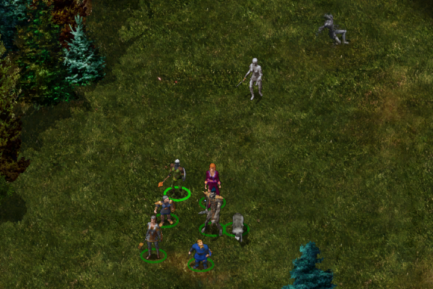{ .center-img width="60%" } 

Zauważamy jaskinię (11) i postanawiamy sprawdzić co w środku. Jej mieszkańcem był bazyliszek, który zatrzymał ze sobą wielu śmiałków. Okazuje się, że jaskinia ma kilka poziomów (A).

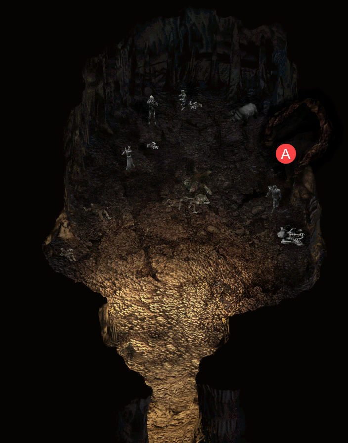{ .center-img width="60%" }

Na drugim poziomie kolejna grupa bazyliszków i pająków. Przemy w dół (B) 

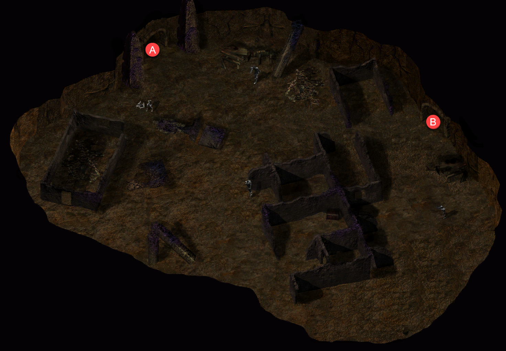{ .center-img width="60%" }

Nie inaczej w kolejnej parti lochu.

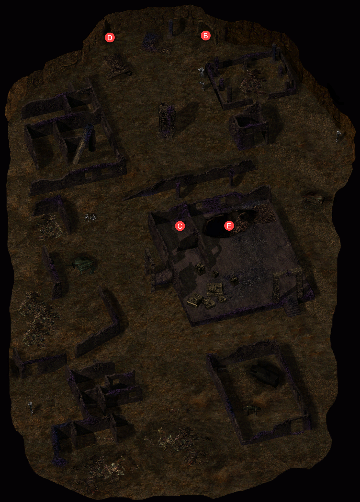{ .center-img width="60%" }

W jednej ze skrzyń znajdujemy odciętą dłoń (C) zaciśniętą na jakimś przedmiocie. Widać działanie magii i tylko odgięcie w odpowiedniej kolejności palców naznaczonych glifami pozwoli odkryć je tajemnicę. Udaje nam się i w tym momencie dłoń zamienia się w pył i zostaje tylko dziwny kamień strażniczy.

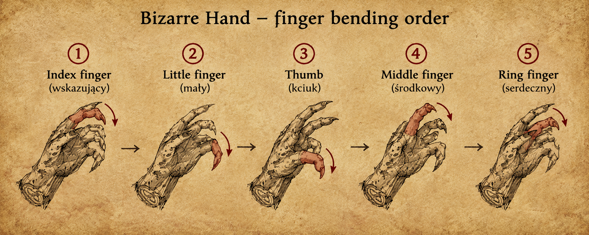{ .center-img width="80%" }

Użycie kamienia przeniosło ich do kieszonkowego planu, który ktoś kiedyś stworzył dla siebie i był ostoją pozwalającą odpocząć i niedostępna dla żadnych wrogów. W ten sposon drużyna stała się jej kolejnym posiadaczem.

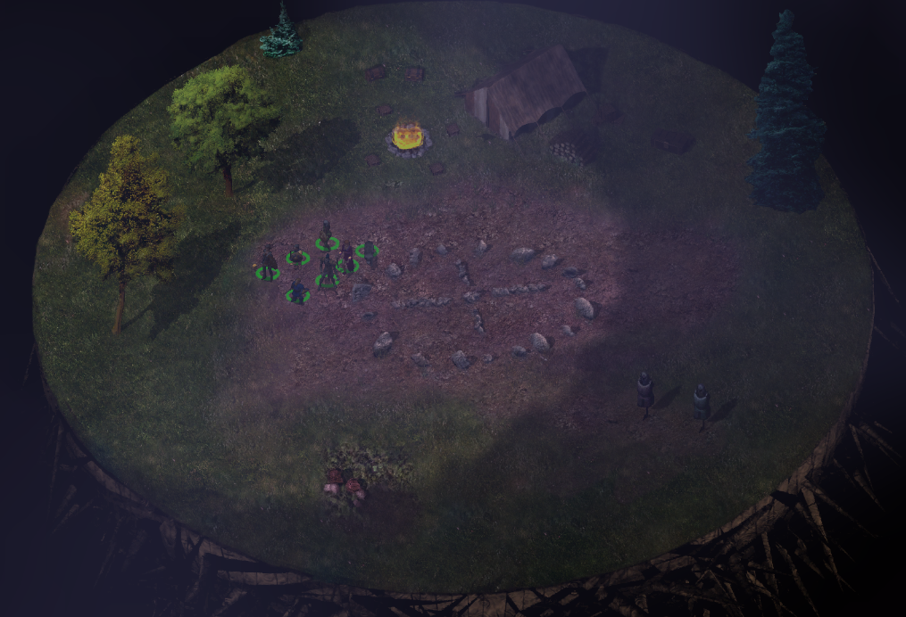{ .center-img width="80%" }

Wracamy do rzeczywistego planu i schodzimy na poziom kolejny (D) a tam czeka na nas Obserwator, ktorego pokonujemy jedynie dzieki sile żywiołu ognia.

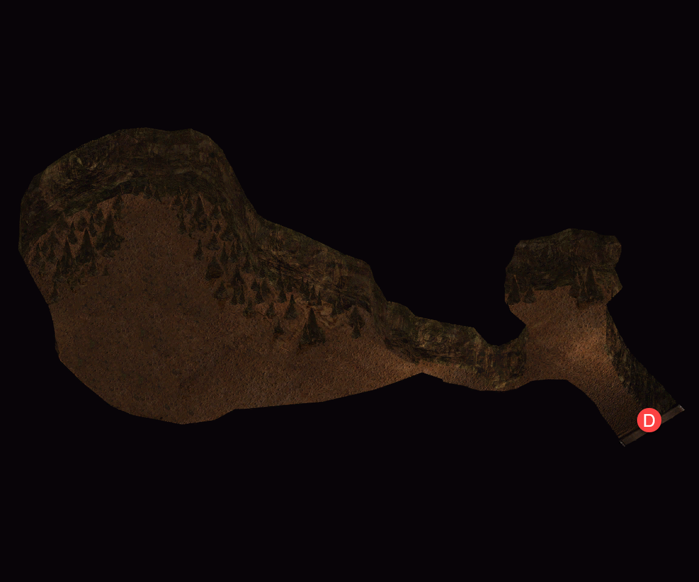{ .center-img width="60%" }

Wracam na poziom trzeci i tam odkrywamy schody (E), które prowadzą dwa poziomy niżej do pieczary z jeziorkien na której środku rośnie drzewo.

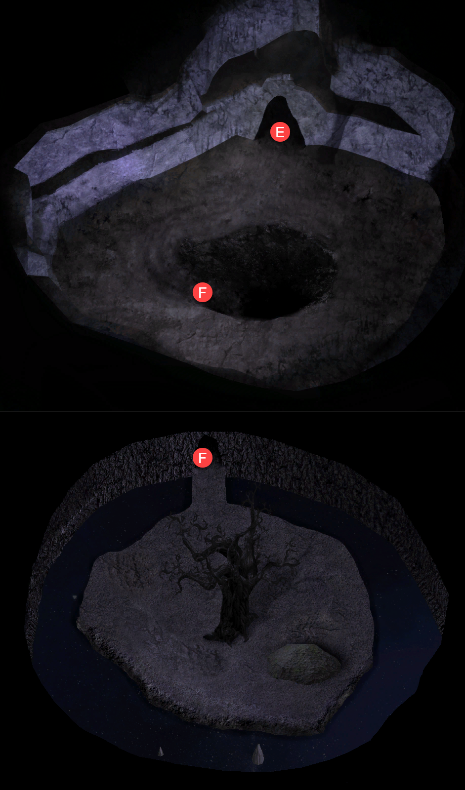{ .center-img width="60%" }

Po dotknięciu drzewa Leech usłyszał głos rozbrzmiewający bezpośrednio w jego umyśle. Należał do Drzewa Cieni, pradawnej istoty żywiącej się doświadczeniami i wspomnieniami ludzi. Drzewo wyznało, że od stuleci rosło dzięki opowieściom pozostawianym przez podróżników. Nie pożerało całych wspomnień, lecz osłabiało je, pozostawiając jedynie wyblakły ślad dawnego bólu lub cierpienia. W zamian obdarowywało swoich gości różnymi darami. Zaintrygowany Leech zgodził się pozwolić istocie zajrzeć do własnego umysłu. Drzewo Cieni zaczęło przeszukiwać jego wspomnienia, aż natrafiło na szczególnie silny ślad. Było to wspomnienie człowieka o imieniu Gorion. Przed oczami drzewa pojawił się obraz Goriona otoczonego przez wrogów. Wspomnienie nie ograniczało się jedynie do samego wydarzenia. Niosło ze sobą również wszystkie emocje, które tamtej nocy odczuwał zarówno Leech, jak i człowiek, który się nim opiekował. Drzewo skosztowało tego wspomnienia, chłonąc jego gorycz i ból, lecz zapewniło, że nie odbierze go całkowicie. Ostatecznie zabrało jedynie niewielką część doświadczenia. Reszta pozostała nienaruszona. Według Drzewa Cieni niektórych ran nie można wymazać, a jedynie nauczyć się z nimi żyć. Ich gorzki smak miał odtąd pozostać zarówno z nim, jak i z samą pradawną istotą.

Drzewo Cieni kontynuowało wędrówkę po zakamarkach umysłu Leecha, badając wspomnienia, które mogły stać się dla niego pożywieniem.

Najpierw natrafiło na obraz tawerny. Pod nią kryło się jednak coś znacznie mroczniejszego. W cieniu dawnych wydarzeń wyczuło ślady śmierci i morderstwa, które wciąż unosiły się nad tym miejscem niczym gorzki posmak przeszłości. Istota zauważyła, że wspomnienie to głęboko przeniknęło Leecha, pozostawiając w nim ślad, od którego nigdy nie będzie mógł się całkowicie uwolnić.

Gdy drzewo sięgnęło głębiej, odnalazło kolejne wspomnienie. Dotyczyło ono tajemniczego starca, człowieka twierdzącego, że potrafi dostrzec to, co skrywa się poza zasłoną rzeczywistości. Nie miało znaczenia, czy jego wizje były prawdą, czy jedynie wytworem obłąkanego umysłu. Ważne było to, że wciągnął Leecha w niezwykłe poszukiwanie dowodów mających potwierdzić, że nie był zwykłym szaleńcem. To doświadczenie przypadło Drzewu Cieni do gustu, dlatego pochłonęło część jego esencji.

Wreszcie natrafiło na wspomnienie niziołka. Była to drobna istota, gotowa zaryzykować wszystko, by ocalić kogoś, na kim jej zależało. W pamięci tej pobrzmiewało zarówno przerażenie, jak i nadzieja. Niziołek poszukiwał drzewa podobnego do tego, które teraz przemawiało do Leecha, choć tamto rosło w cieniu niezwykłego kwiatu. Mieszanka rozpaczy i wiary, którą istota dostrzegła na jego twarzy, okazała się szczególnie kusząca. Drzewo Cieni z rozkoszą skosztowało tego wspomnienia, pozwalając, by jego słodko-gorzki smak rozszedł się po wszystkich gałęziach i korzeniach pradawnej istoty.

Każde wspomnienie zostało nagrodzone przez drzewo darami. Powinienem tu wrócić znowu aby wymazać z pamięci cześć najbardzoiej traumatycznych przeżyć (The Tree Of Shades 99)

Wracamy na powierzchnię. Viconia przyznała, że zwyczaje mieszkańców powierzchni dotyczące przyjaźni wciąż pozostawały dla niej obce. Wspomniała o Imoen, lecz upewniwszy się najpierw, że dziewczyna nie podsłuchiwała, otwarcie stwierdziła, że sama nie zabrałaby jej w dalszą podróż. Dostrzegała jej użyteczność, ale nie była przekonana, czy równoważyła ona kłopoty, które Rudowłosa potrafiła sprowadzić. Przyznała jednak, że pochodziła z zupełnie innego świata, dlatego zapytała Leecha, dlaczego wciąż trzymał Imoen przy swoim boku. Leech wyjaśnił, że Imoen była dla niego niczym siostra, a łączące ich oddanie znaczyło więcej niż wszelkie rozważania o tym, czy bywała pomocna, czy nieznośna. Viconia nie potrafiła pojąć podobnej więzi. W jej ojczyźnie siostry uchodziły za śmiertelnie niebezpieczne rywalki. Nie łączyło ich oddanie wobec mężczyzn, lecz co najwyżej pogarda. W najlepszym razie pozostawali konkurentami, w najgorszym zaś zaciekłymi wrogami. Leech przypomniał, że takie zasady panowały w Podmroku, nie na powierzchni. Viconia przyznała, że tutejsze zwyczaje wydawały jej się niezwykle osobliwe. Jako drowka być może nigdy nie miała ich w pełni zrozumieć.

Spotykamy Shar-Teel (12) która wyzywa Leecha na pojedynek i po przegranej nie może wyjśc z podziwu jak dobrym przeciwnikiem się okazał. Zaproponowała przyłączenie się do drużyny co zaakceptowali ale póki co miała czekać na drużynę w Nashkel pod Bekającym Smokiem.

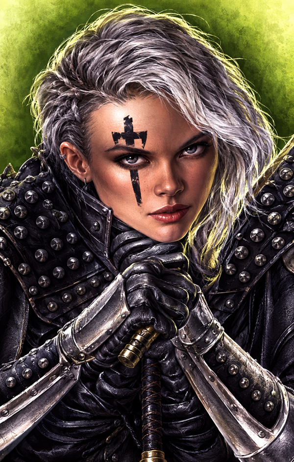

# Shar-Teel

Człowiek · Paladynka · Chaotyczna zła

> Zapytana o swoją przeszłość Shar-Teel nie miała wiele do powiedzenia. Z nielicznych słów można było wywnioskować, że była sierotą. Żywiła głęboką niechęć do najemników Płonącej Pięści i nie kryła pogardy wobec mężczyzn. Najwyraźniej pragnęła coś udowodnić, choć nie zdradzała, co dokładnie nią kierowało. Wszystko wskazywało jednak na to, że jej dzieciństwo nie należało do spokojnych.

Czas na ponowne odwiedziny w Gullykin.

:material-account-group: Przyłączeni NPC: Shar-Teel

:material-account-group: Odłączeni NPC: Shar-Teel (Nashkel, Bekający Smok)

Bestiariusz: gnoll, bazyliszek większy, pająk olbrzymi, pająk-upiór, mniejszy obserwator

## Gullykin&nbsp;58 { .divider }

{ .center-img width="40%" }

Przy jednym z domostw (6) Smeagol zaczepił drużynę, biorąc wędrowców za bohaterów zdolnych odzyskać jego skarb. Wyjaśnił, że paskudne gobliny ukradły mu „Skarb”, a bez niego pogrążył się w nędzy. Leech zapytał, czym właściwie był ów Skarb. Smeagol opisał go jako piękny, niezwykle lśniący pierścień, po czym ponaglił przybyszów, by odebrali go cuchnącym goblinom. Młody gnom zgodził się pomóc i obiecał zwrócić zgubę, gdy tylko wpadnie w ich ręce. Od razu połapalismy sie, że zdobyliśmy ten pierścień podczas pierwszej wizyty w wiosce. Uradowany Smeagol zaczął przemawiać do swojego nieobecnego Skarbu, zapewniając, że gobliny nigdy więcej go nie odbiorą. Następnie ruszył łapać mnóstwo ryb, które razem mieli zjeść po odzyskaniu pierścienia. Mam dziwne odczucie deja vu.

Tuż obok Michalina (7) Michalina nie miała ochoty na rozmowę. Ziewając, wyjaśniła, że była zbyt zmęczona. Leech zażartował, że skoro wioska słynęła jedynie z uprawy ziemniaków, musiała spędzić całą noc na wyjątkowo hucznej zabawie albo na równie pasjonującym kopaniu bulw. Michalina zganiła go za brak uprzejmości i wyjaśniła, że niemal każdej nocy budziło ją wycie dochodzące z pobliskiego wzgórza. Pojawiał się tam osobliwy pies, który nie pozwalał jej zasnąć. Zwierzę wpatrywało się w nią, a jego groźny wygląd skutecznie zniechęcał ją do podejścia bliżej. Pies powracał niemal co noc. Leech postanowił zaczekać do zmroku i wyjaśnić zagadkę niezwykłego zwierzęcia. Michalina zgodziła się pomóc, choć wciąż pamiętała jego wcześniejsze docinki. Ostrzegła, że pies zwykle pojawiał się około północy. Gdy nadeszła noc, zwierzę rzeczywiście przybyło. Spojrzało na Michalinę, po czym pyskiem wskazało drogę prowadzącą poza wioskę. Kobieta uznała, że jeśli Leech naprawdę chciał pomóc i dowiedzieć się, co pies próbował przekazać, właśnie nadarzyła się ku temu okazja. 

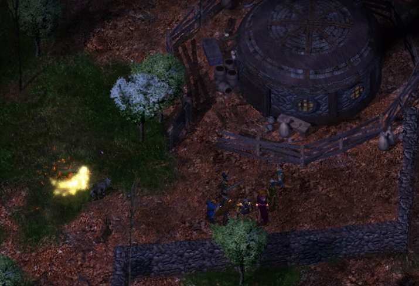{ .center-img width="60%" }

I rzeczywiście pies oczekiwał nas przy wyjściu z wioski (8), na jego obroży odczytaliśmy imię psa - Cu-sith. Po chwili zaczął prowadzić nas w stronę wąwozu, gdzie wskazał wejście do jaskini (9). 

W środku pies wskazał nam płytki pochówek niziołka (A), którego ciało zabraliśmy ze sobą. Wracamy do Michaliny.

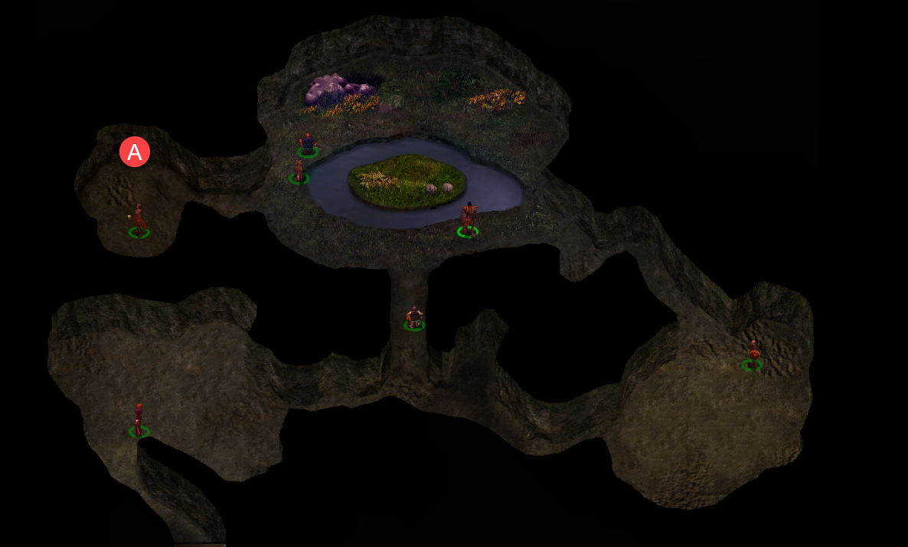{ .center-img width="60%" }

Leech wyjaśnił jej, że podążył za psem aż do groty, do której zwierzę najwyraźniej próbowało ich zaprowadzić. Kiedy odnalazł ciało, tajemniczy przewodnik pojawił się ponownie, jakby właśnie tego szukał i chciał, by Michalina oraz jej towarzysz również je zobaczyli. Michalina rozpoznała w zmarłym Loahna, który zaginął jakiś czas wcześniej. Leech przypuszczał, że pies zaopiekował się jego ciałem. Być może niezwykłe stworzenie pomogło Loahnowi opuścić świat żywych, a dzięki temu jego duch nie błąkał się już po okolicy. Michalina uznała tę teorię za niezwykle szczegółową, lecz rana na ciele wskazywała, że Loahn spadł ze skał. Podziękowała nieznajomemu za rozwiązanie zagadki i żałowała jedynie, że zaginiony nie zachował większej ostrożności. W nagrodę przekazała mu flet, po czym raz jeszcze wyraziła wdzięczność za udzieloną pomoc. (The Midnight Dog 100)

Dalej Manko Rubbleslide (10) powitał drużynę i zaproponował swoje towary. Leech zauważył jednak, że kupiec wydawał się czymś przejęty, i zapytał, co się wydarzyło. Manko przyznał, że odnalazł niezwykły przepis pochodzący z Kozakury i zamierzał go wypróbować. Sama myśl o przygotowaniu egzotycznej potrawy napawała go entuzjazmem, lecz najpierw musiał zdobyć kilka rzadkich składników. Zapewnił przy tym, że danie nie przypominało niczego z innego planu ani niczego równie osobliwego. Kuchnia Kozakury była po prostu zupełnie inna. Leech obiecał dostarczyć potrzebne składniki, jeśli natknie się na nie podczas podróży. Manko potrzebował miodu ze śliwek, wyciągu z aka oraz przyprawy toge. Pozostałe produkty miał już w swoim sklepie. Gdy zgromadzi wszystko, zamierzał przygotować wspaniałą kolację dla siebie i swojej żony. Po przyjęciu zlecenia Leech wrócił do oglądania towarów kupca. (Big Appetite in Small Gullykin 101)

Gandolar Luckyfoot  (1) ponownie powitał drużynę w Gullykin i zapytał, czy wędrowcy zmierzali do Wieży Durlaga, czy może właśnie z niej wrócili, potrzebując opatrzenia złamań oraz siniaków. Wielu śmiałków docierało do osady ledwie żywych, dlatego widok poturbowanych przybyszów nikogo już tam nie dziwił. Leech przyznał, że po trudach podróży chętnie skorzystałby z pomocy uzdrowiciela. Gandolar wskazał świątynię, w której służył Alvanhendar. Zapewnił, że w całej okolicy trudno byłoby znaleźć sprawniejszego kapłana, a ceny jego usług pozostawały rozsądne.

Po chwili niziołek przedstawił drużynie pewną propozycję. Ruiny Firewine od dawna niepokoiły mieszkańców okolicy. Kamienne pozostałości dawnej budowli przez lata niszczały w ciszy, lecz niedawno zamieszkała w nich banda koboldów. Gandolar poprosił wędrowców o usunięcie zagrożenia, obiecując w zamian dar od mieszkańców wioski. Wszystko, co drużyna odnalazłaby w ruinach, również mogła zatrzymać. (The Firewine Ruins 97). Leech zgodził się pomóc niziołkom najlepiej, jak potrafił. Gandolar wskazał drogę do ruin, lecz ostrzegł, że w ich pobliżu widywano wiele osobliwych stworzeń. Dochodziły go również słuchy, że koboldy były znacznie lepiej zorganizowane niż zwykle. Wejścia należało szukać w piwnicy miejscowej winiarni, gdzie ukryto tajemne drzwi prowadzące wprost do podziemi. (Firewine Bridge and Gullykin 102)

Mieszkańcy Gullykin przyjęli drużynę z życzliwą ciekawością. Kupcy i karawany często odwiedzali osadę, lecz to wędrowni bohaterowie wzbudzali największe zainteresowanie. Jedna z mieszkanek porównała Leecha do Littlemana, największego podróżnika w historii niziołków. Uznała go za osobliwego przybysza, lecz zarazem kogoś godnego podziwu. Przy kolejnym spotkaniu ucieszyła się, że nadal żył. Jak zauważyła, wielu poszukiwaczy przygód wracało do Gullykin znacznie mniej rozmownych niż za pierwszym razem. Śmierć miała ten niezawodny wpływ na usposobienie. Mieszkańcy nie tęsknili za bogactwami odległego świata. Wierzyli, że Dallillia Opiekunka zapewniała im wszystko, czego potrzebowali. Woleli spokojne życie w Gullykin od pogoni za skarbami, które mogły kosztować znacznie więcej, niż były warte. Jeden z niziołków ujął to prosto: trudno było rozstrzygnąć, kto był większym głupcem, człowiek odpoczywający w starym fotelu czy ten, który przez całe życie harował na nowy, aby kiedyś móc w nim usiąść. Nie oznaczało to jednak, że okolica pozostawała wolna od zagrożeń. Mieszkańcy wcześniej radzili sobie z koboldami, lecz te zamieszkujące ruiny Firewine były znacznie lepiej zorganizowane niż ich pobratymcy. Nadal cuchnęły jak koboldy, ale najwyraźniej ktoś nauczył je działać według planu. Niziołki nie potrafiły wskazać drogi do wszystkich sekretów okolicy. Wielu wysokich wojowników przybywało do Gullykin z tymi samymi pytaniami, lecz odpowiedź niezmiennie brzmiała tak samo: żaden niziołek nie wiedział, gdzie znajdował się klucz do zamkniętej bramy. Jedna z mieszkanek opowiedziała także o przeszłości Firewine. Niegdyś istniało tam elfie miasto handlowe, zniszczone około dwóch stuleci wcześniej wskutek pojedynku dwóch głupców. Gdyby któryś z nich postąpił rozsądniej, dawna osada być może wciąż by istniała. (The Firewine Ruins 97)

Zaglądamy do domów niziołków i w jednym z nich (11) wyczuwamy zapach koboldów. Odkrywamy ukryte przejście do ruin Firewine. Właściciel domu Jenkal zaata kował nas po wykryciu jego zdrady. W jego rzeczach udałonam się odnależć kolejną z poszukiwanych przez Finch ksiąg - Opowieści ludowe z Nashkel (Finch's Quest to Start a Library in Nashkel 25).

Odwiedzamy świątynię Yondalla (12) i korzystamy z przejścia do kazamatów Firewine.

Bestiariusz: ghul, dezerter Płomiennej Pięści, ankheg, kobold, sztraszliwy wilk,  

## Most Firewine - kazamaty&nbsp;59-1 { .divider }

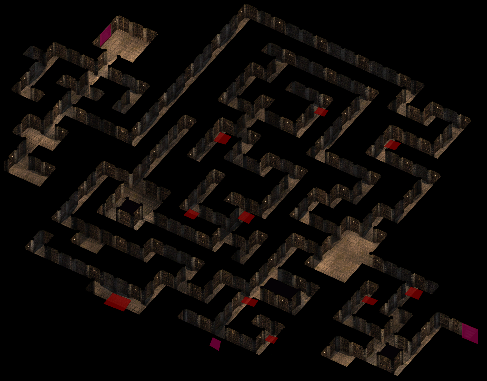{ .center-img width="40%" }

Wchodzimy do labiryntu korytarzy, dzieki zdolnościom Jen'lig jesteśmy w stanie wykryć i rozbroić pułapki. W końcu docieramy do sześciu duchów rycerzy (2), ktorzy mówi o konieczności zjednoczenia. Chyba kogoś lub czegoś brakuje. Kawałek dalej (3) podchodzi do nas nieumarły i prosi aby go zabić a zbroję zwrócić. Okazał się, że o to ta zbroja nie pozwala duchom odejść. Gdy ją wyczuły odeszły a nam został starożytny płatnerz, który niesie chyba ze sobą jakąś tajemnicę (Ghostly Knights in Firewine 103).

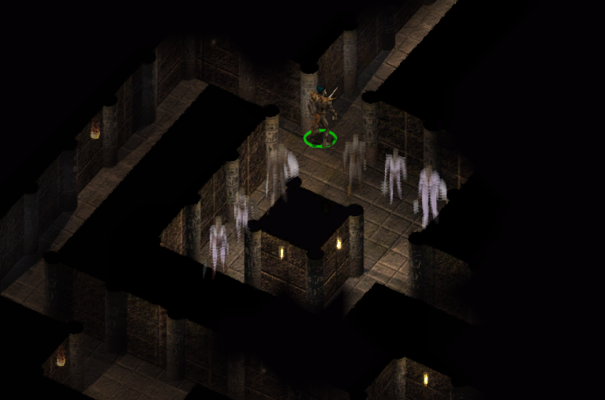{ .center-img width="60%" }

W w pomieszczeniu łączącym odnogi korytarzy (4) czekała na nas chmara koboldów i minotaur.

Imoen zapytała Viconię, dlaczego tak uważnie obserwowała ją i Leecha podczas ich rozmów. Drowka przyznała, że więź łącząca dawnych wychowanków Candlekeep od pewnego czasu nie dawała jej spokoju. Nie rozumiała, dlaczego Leech zabrał Imoen ze sobą, skoro jej użyteczność nie zawsze równoważyła kłopoty, które potrafiła sprowadzić. Imoen wyjaśniła, że ufała Leechowi i bez obaw dzieliła się z nim uczuciami oraz przekonaniami. Viconia uznała podobną otwartość za niebezpieczną. W Podmroku nikt przy zdrowych zmysłach nie odsłaniał się przed innymi, ponieważ każde wyznanie mogło pewnego dnia posłużyć jako broń. Imoen stawała się łatwym celem, gdyby Leech kiedykolwiek postanowił ją zdradzić. Rudowłosa odparła, że znała go od wielu lat. Leech miewał swoje wady, lecz zdrada przyjaciela do nich nie należała. Dodała, że bez wzajemnego zaufania nie sposób naprawdę kogoś poznać. Nawet drowka, choć zamknięta w sobie niczym pozostali mieszkańcy Podmroku, nie zdołałaby dowiedzieć się wiele o innych, gdyby zawsze trzymała ich na dystans. Viconia przyznała, że w słowach Imoen kryło się nieco prawdy, lecz podobna swoboda nadal wydawała jej się szaleństwem. Sama myśl o takiej otwartości przyprawiała ją o ból głowy. Imoen uspokoiła ją, że z czasem wszystko stanie się prostsze. Z figlarną szczerością dodała też, że zaufanie nie oznaczało konieczności zdradzania Leechowi absolutnie wszystkiego.

W końcu dotarlismy do dlugich korytarzy zakończonych małymi komnatami gdzie natykamy sie na Lendarna i ogrzego maga, którzy wysługiwali się koboldami. Stad prowadzi tunel do domu Jenkala (5) ale my wychodzimy na powierzchnie (6) zejściem przy moście.

## Most Firewine &nbsp;59-2 { .divider }

{ .center-img width="40%" }

Przy wejściu do kazamatów (1) spotykamy grupki koboldów. Dalej (2) powitał nas Meilum uznając przybyszów za doświadczonych podróżników i wprawnych wojowników. Przedstawił się jako największy szermierz Wybrzeża Mieczy, przekonany, że jego sława musiała dotrzeć nawet do uszu Leecha. Sandrah zapytała, jak długo przebywał na tym pustkowiu, skoro wyglądał, jakby spędził tam całe życie. Meilum odparł, że strzegł karawan i bezpiecznie prowadził podróżnych przez okoliczne szlaki. Imoen rozejrzała się jednak po pustej drodze i zauważyła, że od Czasu Niepokojów najwyraźniej nie przejechał tędy żaden wóz. Meilum wyznał, że ochraniał karawanę, lecz pewnej nocy wszyscy zniknęli. Zostały mu po nich jedynie strzępy materiału. Sandrah zrozumiała, że nieszczęśnik od tamtej pory nie opuszczał miejsca ich zaginięcia. Jego kolejne słowa tylko potwierdziły, że stracił rozum. Twierdził, że wciąż słyszał płacz zaginionych, a zarazem chełpił się mianem największego wojownika na Wybrzeżu Mieczy. Viconia uznała Meiluma za ledwie wyrośnięte dziecko. Szermierz odpowiedział pogardliwą uwagą pod adresem drowki, dowodząc, że oprócz rozumu utracił również resztki dobrego wychowania. Finch zapytała więc, dlaczego tak znakomity wojownik błąkał się po dziczy odziany w łachmany. Meilum odebrał pytanie jako zniewagę i zagroził, że udowodni wartość swojego ostrza. Finch zapewniła, że nie zamierzała go obrażać, po czym uznała rozmowę za zakończoną. Drużyna pozostawiła obłąkanego szermierza samemu sobie i ruszyła dalej ale zabraliśmy ze sobą strzępek materiału znaleziony w miejscu zaginionych członków karawany.

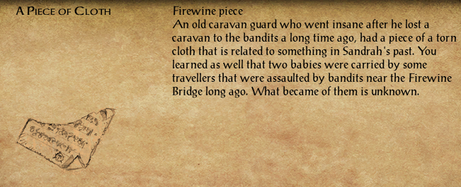{ .center-img width="60%" }

Bestiariusz: kobold, 