# Firewine

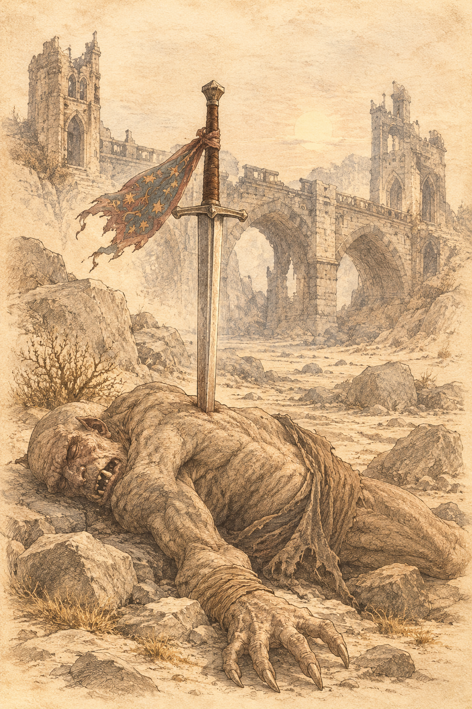{ .center-img width="40%" }

## Most Firewine - kazamaty&nbsp;59-I { .divider }

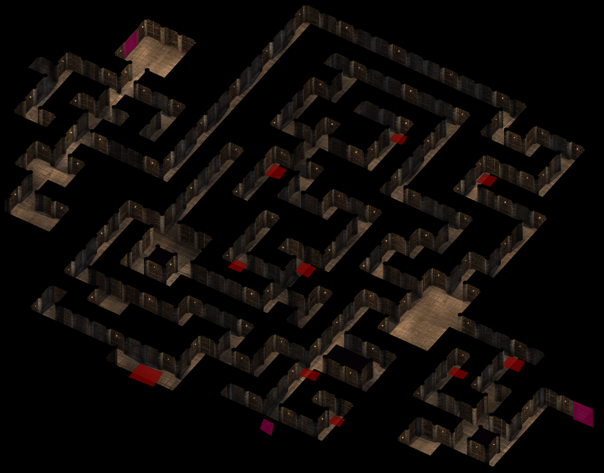{ .center-img width="40%" }

Drużyna wkroczyła do labiryntu ciasnych korytarzy 1, w których niemal każdy zakręt skrywał pułapkę. Dzięki umiejętnościom **Jen’lig** wędrowcy wykrywali zagrożenia, zanim zdążyły zebrać krwawe żniwo, i krok po kroku zagłębiali się w kazamaty. W końcu dotarli do sześciu duchów rycerzy 2, które powtarzały zagadkowe słowa o konieczności ponownego zjednoczenia. Najwyraźniej na coś czekały, lecz wśród widm brakowało ostatniego towarzysza albo przedmiotu, bez którego nie mogły zaznać spokoju.

Odpowiedź przyszła kawałek dalej 3. Do drużyny podszedł nieumarły wojownik i poprosił, by zakończyła jego istnienie, a noszoną przez niego zbroję zwróciła pozostałym rycerzom. To właśnie starożytny pancerz więził duchy w kazamatach. Gdy tylko wyczuły jego obecność, odzyskały jedność i odeszły, pozostawiając wędrowcom tajemniczą zbroję, która najwyraźniej skrywała jeszcze niejedną historię. ([Ghostly Knights in Firewine](../other/zadania.md#q104))

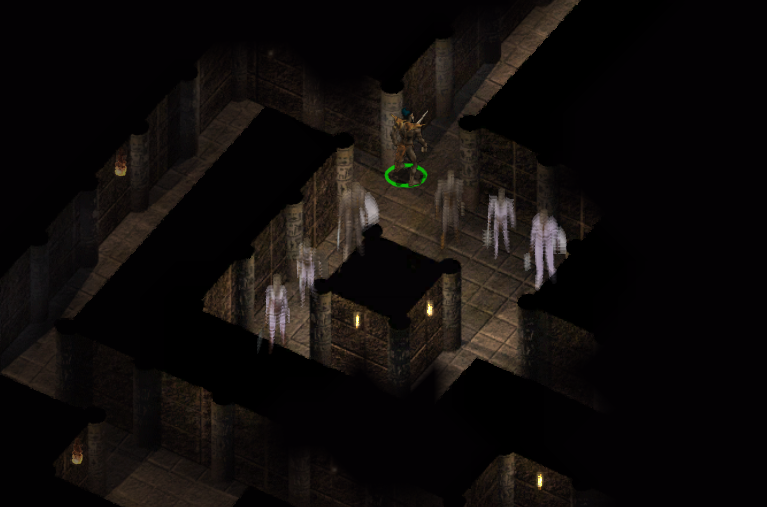{ .center-img width="60%" }

W komnacie łączącej odnogi podziemnego labiryntu 4 czekała chmara koboldów wspierana przez minotaura. Przeciwnicy wybrali dobre miejsce na zasadzkę, lecz nawet przewaga terenu nie wystarczyła, by zatrzymać drużynę.

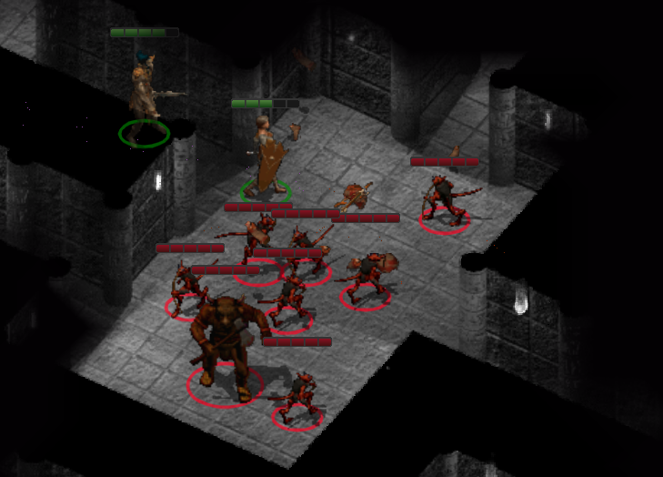{ .center-img width="60%" }

Długie korytarze kończyły się niewielkimi komnatami, w których wędrowcy natknęli się na **Lendara** i ogrzego maga. Obaj wysługiwali się koboldami, wykorzystując je do strzeżenia ruin i wykonywania brudnej roboty. Prowadzący stamtąd tunel dochodził do domu **Jenkala** 6, potwierdzając jego udział w całej sprawie. Drużyna nie zamierzała jednak wracać tą samą drogą i opuściła kazamaty wyjściem prowadzącym na powierzchnię przy moście 6.

:material-paw: Bestiariusz: *kobold, kobold komando, ogrzy mag*

## Most Firewine&nbsp;59-II { .divider }

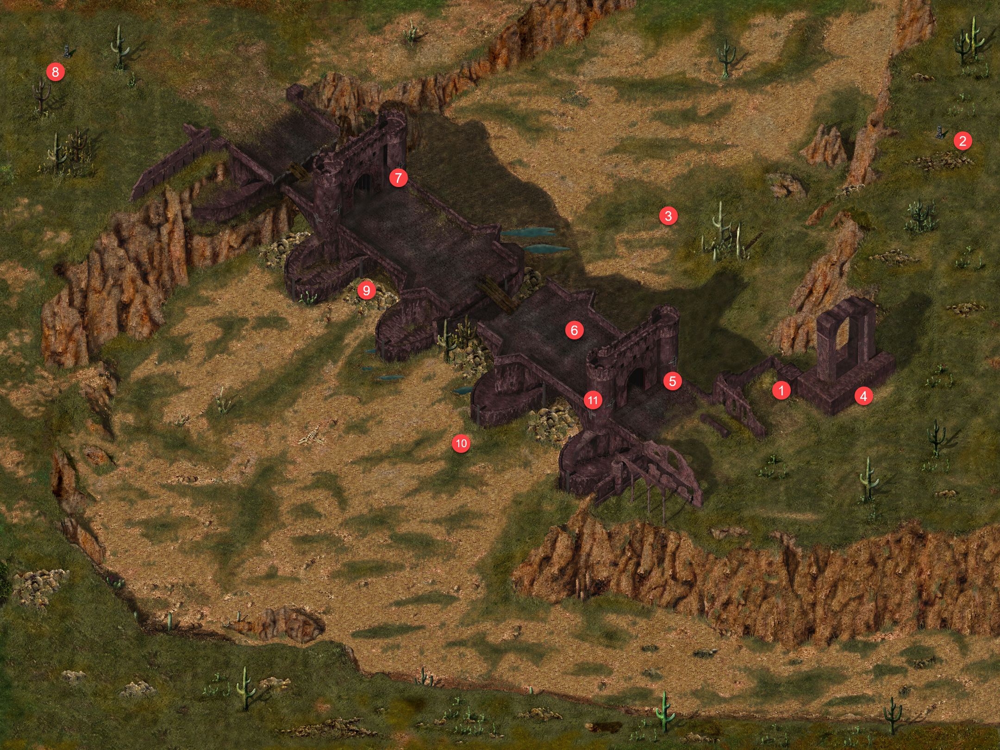{ .center-img width="40%" }

Przy wejściu do kazamatów 1 kręciły się kolejne grupki koboldów. Po krótkiej walce drużyna ruszyła wzdłuż ruin, gdzie drogę zastąpił jej **Meilum** 2. Powitał przybyszów jak równych sobie, uznając ich za doświadczonych podróżników i wprawnych wojowników, po czym przedstawił się jako największy szermierz *Wybrzeża Mieczy*. Był przekonany, że jego sława musiała dotrzeć nawet do uszu Leecha. **Sandrah** zapytała, jak długo przebywał na tym pustkowiu, skoro wyglądał, jakby spędził tam całe życie. **Meilum** odparł, że strzegł karawan i bezpiecznie prowadził podróżnych przez okoliczne szlaki. **Imoen** rozejrzała się jednak po pustej drodze i zauważyła, że od *Czasu Niepokojów* najwyraźniej nie przejechał tędy żaden wóz.

Szermierz przyznał wreszcie, że niegdyś ochraniał karawanę, lecz pewnej nocy wszyscy zniknęli. Zostały po nich jedynie strzępy materiału. **Sandrah** zrozumiała, że nieszczęśnik od tamtej pory nie opuścił miejsca ich zaginięcia. Jego kolejne słowa tylko potwierdziły, że stracił rozum. Twierdził, że wciąż słyszał płacz zaginionych, a zarazem chełpił się mianem największego wojownika na całym *Wybrzeżu Mieczy*.

**Finch** zapytała więc, dlaczego tak znakomity szermierz błąkał się po dziczy odziany w łachmany. **Meilum** odebrał pytanie jako zniewagę i zagroził, że udowodni wartość swojego ostrza. Kronikarka zapewniła, że nie zamierzała go obrażać, po czym uznała rozmowę za zakończoną. Drużyna pozostawiła obłąkanego wojownika samemu sobie, zabierając jedynie fragment materiału znaleziony w miejscu zaginięcia karawany.

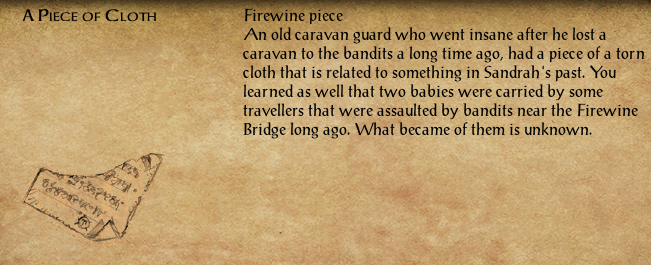{ .center-img width="60%" }

**Sandrah** przyjrzała się obu kawałkom tkaniny i zauważyła, że idealnie do siebie pasowały. Choć odnaleziono je daleko od siebie, niepowtarzalny wzór nie pozostawiał wątpliwości, że niegdyś stanowiły jedną całość. Ornament obudził w kapłance odległe wspomnienie. Podobne wzory zdobiły narzutę na jej dziecięcym łóżku w domu ojca w *Waterdeep*. Nie zamierzała jednak przemierzać całego *Faerûnu* w pogoni za strzępami pościeli z dzieciństwa.

Leech zasugerował, że jeden z napotkanych przez nich ludzi mógł posiadać fragment należącej do niej tkaniny. Nadal nie wyjaśniało to jednak, skąd materiał znalazł się w rękach przeciwników ani dlaczego prowadzące do niego ślady tak wyraźnie splatały się z własnym śledztwem młodego gnoma. **Sandrah** przyznała, że coraz bardziej gubiła się w tej zagadce. Wiedzieli zbyt mało, by wyciągać rozsądne wnioski, dlatego odłożyła oba fragmenty do czasu zdobycia kolejnych informacji.

Podczas dalszej drogi **Finch** zganiła się za roztargnienie. Choć sama była uzdrowicielką, ponownie zapomniała o tym, co miała tuż przed oczami. Myślami wciąż błądziła pośród ksiąg, zamiast dostrzec rany odniesione w niedawnej walce. **Sandrah** zauważyła, że obie dopiero uczyły się radzić sobie z prawdziwym życiem. **Finch** nie zdobyła tych obrażeń podczas przewracania stron swoich książek, lecz zaledwie kilka minut wcześniej odważnie walczyła u boku drużyny. Kronikarka przyznała jej rację, choć podkreśliła, że walka została im narzucona, a ona jedynie instynktownie stanęła w obronie własnej i swoich towarzyszy. Kapłanka wskazała jednak także własny błąd. Widząc ranną **Finch**, odruchowo rzuciła zaklęcie lecznicze, nie zastanawiając się, że kronikarka sama potrafiła sobie pomóc. Przy odrobinie rozwagi zachowałaby czar na wypadek obrażeń, których umiejętności **Finch** nie zdołałyby uleczyć.

Kronikarka z ulgą przyjęła ten dowód omylności **Sandrah**. Ceniła ją nie tylko za mądrość, lecz także za szczerość, z jaką przyznawała się do własnych błędów. Szlachcianka z *Waterdeep* nigdy nie próbowała przedstawiać się jako nieskazitelna bohaterka. Sama wciąż pozostawała uczennicą, a zarozumiałość mogła sprowadzić na nich zgubę. Zauważyła jednak, że nadmierne umniejszanie własnym zdolnościom również nie prowadziło do niczego dobrego. Jeśli właściwie połączą swoje talenty, misja Leecha miała znacznie większą szansę powodzenia.

W korycie wyschniętej rzeki drużyna natknęła się na pogrążoną w amoku **Carsę** 3. Kobieta krzyczała, błagając, by ktoś uciszył głos rozbrzmiewający w jej głowie. **Sandrah** próbowała ją uspokoić i nakłonić do wyjaśnienia, co doprowadziło ją do takiego stanu. Dziewczyna wskazała trzymany słój. Szept dobiegał właśnie z jego wnętrza, nie milkł ani na chwilę i powoli odbierał jej rozum. Dopiero gdy służka *Mystry* przemówiła spokojniej, kobieta opowiedziała o wyprawie do ruin *Firewine*. Wraz z towarzyszami odnalazła tam naczynie, które doprowadziło wszystkich do szaleństwa. Rzucili się na siebie z bronią, a pośród krzyków popłynęło morze krwi. Z całej grupy przeżyła jedynie ona. Głos ukryty w słoju domagał się wypowiedzenia swojego imienia. Obiecywał w zamian wielkie nagrody, lecz **Carsa** nie zamierzała ulec. Wiedziała jednak, że jej opór słabł z każdą chwilą. Ostrzegła drużynę, że wkrótce wypowie zakazane imię, a wtedy stworzenie przybędzie i rozpocznie się kolejna rzeź.

**Sandrah** poprosiła kobietę o oddanie naczynia, zapewniając, że drużyna będzie wiedziała, co z nim zrobić. **Carsa** odmówiła. Słój należał do niej i tylko ona mogła go nieść. Zagroziła, że jeśli ktokolwiek spróbuje go odebrać, wypowie imię i skaże wszystkich na śmierć. Kapłanka nie zamierzała pozostawić przeklętego przedmiotu w rękach osoby tracącej nad sobą panowanie. Gdy spróbowała odebrać słój siłą, **Carsa** wykrzyczała imię uwięzionej istoty: **„Kahrk!”**

Z naczynia wydostał się potężny ogrzy mag. **Kahrk** oznajmił, że odzyskał wolność, i podziękował śmiertelnikom za swoje oswobodzenie. Obiecał, że ich śmierć nakarmi jego moc, choć chwilowo pozostawał jeszcze osłabiony. **Sandrah** natychmiast rzuciła zaklęcie ciszy, próbując powstrzymać maga przed użyciem czarów. **Imoen** spojrzała na uwolnioną istotę i uznała, że z hałasem czy bez niego właśnie rozpętało się coś naprawdę paskudnego. ([The Madwoman of Firewine Bridge](../other/zadania.md#q105))

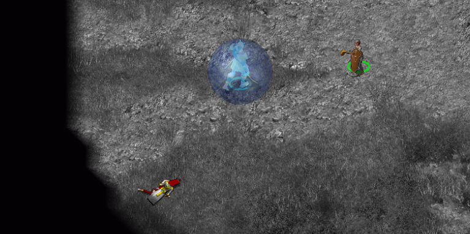{ .center-img width="60%" }

Walka okazała się niezwykle wymagająca. Dopiero wykorzystanie **Haiasa** oraz odrzucających pocisków **Jen’lig** pozwoliło pokonać potężnego przeciwnika.

Przy ciele **Kahrka** drużyna odnalazła piękny dwuręczny miecz *Valiant*. Broń należała niegdyś do krzyżowca, który wyruszył, by uwolnić *Wybrzeże Mieczy* od okrutnej hordy ogrów. Wyprawa zakończyła się klęską, a ostrze przez wiele pokoleń pozostawało w rękach zwycięzców. Mimo upływu czasu zachowało dawną czystość. 

Leech zauważył, że córka **Elminstera** z pewnością znała dalszą historię miecza, lecz nie mieli czasu na kolejną lekcję historii. **Sandrah** ograniczyła się więc do legendy, według której pewnego dnia miał pojawić się bohater, odzyskać świętą broń i zapoczątkować na *Wybrzeżu Mieczy* przemiany, jakich *Faerûn* jeszcze nie widział. Młody gnom uznał, że bohater zapowiadany przez legendę zdobył właśnie kolejne święte ostrze, podobne do miecza *Mystry* należącego do **Sandrah**. Kapłanka zapewniła, że mogła ręczyć za czystość i zasługi *Daru Mystry*, lecz w przypadku *Valianta* nie miała podobnej pewności. Broń nie była przeklęta, ale jej prawdziwa natura nadal pozostawała zagadką. Dla ogrów miecz stał się symbolem chwalebnego zwycięstwa nad ludźmi. Przez wiele pokoleń przekazywały go sobie jako przypomnienie własnej potęgi. Leech zapytał, czy gdy dowiedzą się, że broń trafiła w ręce drużyny, spróbują ją odzyskać. **Sandrah** uznała to za bardzo prawdopodobne. Odpowiedź miało przynieść następne spotkanie z przedstawicielami ich rasy. 

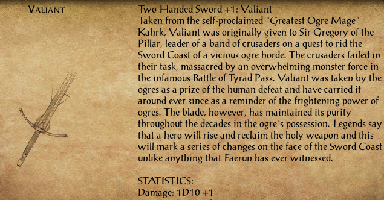{ .center-img width="60%" }

Później kapłanka wyznała naszemu bohaterowi, że ceniła każdą chwilę spędzoną u jego boku. Radość sprawiały jej jego obecność, wspólne rozmowy oraz nieustanna troska, jaką ją otaczał. Zapewniła, że nie kierowała się powierzchownym zauroczeniem. To prawdziwa natura młodego gnoma była jej szczególnie bliska, nawet jeśli nazywała go swoim ponurym przywódcą. Na znak sympatii postanowiła wręczyć mu drobny podarunek. *Mystra* pozwoliła jej przekazać mu cząstkę energii *Splotu*, której działanie miało przetrwać znacznie dłużej niż sam materialny upominek.

W pobliżu udało się również odnaleźć belladonnę, najbezpieczniejszy składnik czaru odwracającego wilkołactwo. ([Of Wolves and Men](../other/zadania.md#q52))

W murze wędrowcy odkryli półkę 4, a na niej bardzostary miecz. Kolejne podobne ostrze znaleźli w lewej wieży po wschodniej stronie mostu 5. Obie bronie wyglądały tak, jakby od stuleci czekały na odnalezienie.

Na moście drużynę powitał bard **Poe** 6. Zauważył, że okolica nie zawsze była równie spokojna. Trzysta lat wcześniej wydarzyła się tam tragedia, o której nadal krążyły opowieści. Od tamtych wydarzeń pośród kamieni pojawiali się liczni bohaterowie i złoczyńcy, a **Poe** zgromadził wiele historii o ich czynach. Zaproponował, że ułoży dla wędrowców pieśń opartą na pogłoskach, osobliwych zjawiskach oraz obrazach nawiedzających jego nocne sny.

bez tytułu
Mam pieśń do snucia — o rycerzach śmiałych, 
O piekle lochów, snach z posępnych skałek, 
O świcie, który blasku już nie niesie, 
Gdy szept z raf groźnych budzi lęk w bezkresie. 
To prawda o tchórzostwie i o zdradzie, 
O cnocie, która zginęła w zapomnianej sadzie, 
O drodze w mroku, niebezpiecznej, krwawej, 
Gdzie strach jest bliski — aż do bólu sławy. 
Miecznicy przyszli dwójkami i w czwórkach, 
By zło odnaleźć w jego własnych dziurkach, 
Z ufnością w prawo, w siłę i w światło jasne, 
Wyruszyli naprzód — serca ich żelazne. 
Lecz samo światło bieli nie przyniesie, 
Gdy piekło całe wrze w kamiennym lesie. 
Skąd wyszedł ogień, imię wciąż nieznane — 
Nikt go nie szepnie, nawet w złoty ranek. 
Razem walczyli, razem w boju padli, 
Choć dobro zwyciężyło — w pieśniach o nich gadli, 
Lecz zdrada przyszła nocą, skradła chwałę, 
I cień okrył zwycięstwo — czarne, trwałe. 
Bohaterowie — od tyłu zdradzeni, 
Przez przyjaciela w złoto uwikłanego — zmienni, 
By grabież zdobyć, skarby trupom brać, 
Tak nowe zło powstało, choć miało starą twarz. 
W chwale wspaniali rycerze polegli, 
Lecz nóż ich zgasił — czyn nikczemny, podlejszy, 
Martwy honor upadł razem z nimi, 
Zabity chciwością, skryty w losu dymie. 
Złamał przysięgę — sam, dla marnej mamony, 
Uciekł do lochu, tam krył swe demony. 
Sam wreszcie runął — płacząc w swojej winie, 
Samotnym echem ginąc w pustej glinie. 
Żony dziś płaczą, sieroty łkają, 
A bardowie w karczmach pieśń ich rozbrzmiewają. 
Panny wzdychają — sen wciąż niesie cień, 
Rycerzy, co nawiedzą je znów w nocny dzień. 
Na straży stoją — duchy w wiecznej ciszy, 
Choć ziemi nie widzą i nikt ich nie słyszy. 
Z gniewem czekają, w niedowierzaniu trwają, 
Wiek cały czuwają, swego krzywdziciela znają. 
Bo kiedy jeden zdradzi wszystkich braci, 
Żadna śmierć słusznego gniewu nie zatraci. 
Zranione dusze nie znajdą ukojenia, 
Dopóki honor ktoś ich nie ocenia. 
Razem więc wejdą, razem w mroku legną, 
Tak przysięga brzmiała — raz jeszcze wciąż jedną. 
Aż przyjdzie ten, co uciekł, wstydu śladów pełen, 
By w końcu stawić czoło — swej zbrodni i swoim cieniom. 
Poe

Pieśń **Poego** rzuciła nieco światła na los rycerzy uwięzionych w kazamatach. Zdrada jednego z towarzyszy skazała poległych na długie czuwanie, a odnalezione miecze najwyraźniej stanowiły klucz do zakończenia ich historii.

Chwilę później w pobliżu teleportował się **Wrarkh**, oskarżając wędrowców o zabicie **Kahrka**, potężnego właściciela *Valianta*. **Sandrah** zauważyła, że ogry rzeczywiście czciły miecz jako symbol własnej potęgi i z pewnością spróbują go odzyskać. Leech powątpiewał, czy oddanie broni zdołałoby je powstrzymać. Ogry napadały na drużynę jeszcze przed zdobyciem *Valianta*, więc ostrze stanowiło raczej kolejną wymówkę niż prawdziwy powód pościgu. **Wrarkh** wyjawił, że **Kahrk** miał brata. **Kharaz** wiedział już o jego śmierci oraz utracie miecza i rozpoczął polowanie na zabójców brata. **Sandrah** uznała, że atak nastąpiłby nawet po dobrowolnym oddaniu broni. Skoro drużyna zabiła **Kahrka**, jego pobratymcy i tak zażądaliby krwawej zapłaty.

**Wrarkh** nie zamierzał dłużej dyskutować. Nazwał wędrowców mięsem i łupem, po czym zapowiedział, że odbierze *Valianta* z ich martwych rąk i zaniesie go **Kharazowi**. Wierzył, że taki czyn zapewni mu sławę wśród ogrów. Chwilę później ruszył do ataku wraz z dwoma innymi magami, lecz zamiast zostać bohaterem swojego ludu, dołączył do rosnącej listy tych, którzy przecenili własne możliwości. Po śmierci **Wrarkha** zainteresowanie ogrów *Valiantem* przestało być jedynie przypuszczeniem. Jasne było, że drużyna miała na karku kolejną grupę łowców głów. Lecz zamiast czekać na ataki może lepiej odszukać ogra i sprawę ząłatwic od ręki. Leech zapytał służkę *Mystry*, gdzie właściwie mieliby go szukać, skoro ogrzy magowie nie posiadali żadnej twierdzy ani widocznej siedziby, którą można byłoby zaatakować. **Sandrah** przyznała, że właśnie na tym polegał problem. Pojawiali się znikąd, korzystając z potężnej magii, po czym atakowali bez ostrzeżenia. Skoro drużyna nie mogła odnaleźć **Kharaza**, pozostawało mieć nadzieję, że rozwścieczony ogr sam wkrótce ich odszuka.

Jakby wydarzeń tego dnia było jeszcze zbyt mało, przed drużyną teleportował się brodaty mag **Winski Perorate** i nakazał wszystkim się zatrzymać. **Sandrah** rozpoznała w nim othyora, potężnego czarodzieja z *Rashemen*, lecz nie wyjaśniało to ani jego obecności na *Wybrzeżu Mieczy*, ani powodów, dla których stanął im na drodze. **Winski** oznajmił, że kapłanka poruszyła coś, co powinno pozostać w spokoju. Szukając kogoś bliskiego, obrała drogę, która miała sprowadzić na nią zagładę. **Sandrah** spróbowała wykorzystać spotkanie, by uzyskać odpowiedzi. Zapytała, kim był czarodziej i kto właściwie poszukiwał Leecha. Mag zbył jej pytania. Przyznał jedynie, że drużyna odnalazła przedmiot zaginiony dawno temu. Choć relikwia sama w sobie nie miała większego znaczenia, mogła skierować wędrowców na trop zbyt niebezpieczny, by mogli nim podążać bez konsekwencji. Jeśli nie zawrócą, obrana droga miała doprowadzić ich do zguby. Kapłanka zapytała, jaki związek miało *Rashemen* z wydarzeniami rozgrywającymi się na *Wybrzeżu Mieczy*. Zapewniła też, że drużyna nie sprzymierzyła się z wrogami czarodzieja z *Thay*. **Winski** nazwał ich ślepcami potykającymi się we mgle. Ostrzegł, że na *Wybrzeżu Mieczy* działały siły potężniejsze niż przeklęta *Martwa Trójka* i nierozsądni *Wychlaranie*. Nakazał drużynie nie próbować powstrzymywać narodzin boga, gdyż w odpowiednim czasie wszyscy mieli zostać unicestwieni. Po tych słowach przywołał dziki przypływ magii, zmienił się w osobliwą istotę i zniknął im z oczu.

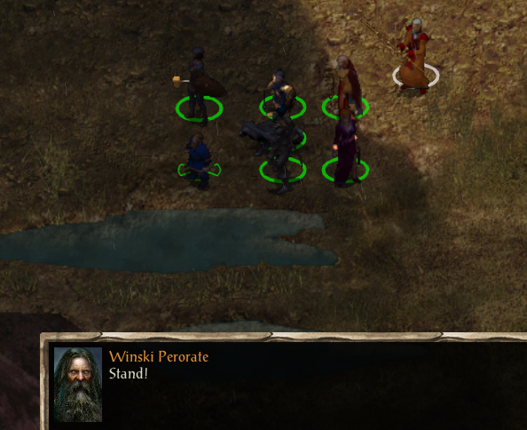{ .center-img width="60%" }

Odnalezienie tajemniczych fragmentów materiału najwyraźniej zbudziło bezimiennego wroga, który dotąd pozostawał w ukryciu. Wszystko wskazywało na to, że sprawa sięgała odległej przeszłości, aż do *Czasu Niepokojów*, którego mroczny cień wciąż kładł się na teraźniejszości. Podczas buntu przeciwko najwyższemu bogu *Ao* grupa bóstw próbowała obalić panujący porządek i wykraść *Tablice Przeznaczenia*. Spiskowcy ponieśli klęskę, a część z nich zginęła, ustępując miejsca nowym bogom. Pokój nie okazał się jednak trwały. Przynajmniej jeden z dawnych buntowników, *Bhaal*, pozostawił w *Faerûnie* niebezpieczne nasienie, które właśnie zaczynało kiełkować. Wyglądało również na to, że Leech i jego drużyna nieświadomie odgrywali w tych wydarzeniach własną rolę.

Po odejściu **Winskiego Perorate’a** nasz bohater długo milczał, oszołomiony groźbami czarodzieja i plątaniną nowych tropów. **Sandrah** przyznała, że sama niewiele z tego rozumiała, lecz zaproponowała spokojnie odtworzyć przebieg spotkania i krok po kroku oddzielić fakty od domysłów. Pierwszą wskazówką było pochodzenie maga. **Winski** wywodził się z *Rashemen* i należał do nielicznych tamtejszych czarodziejów, ponieważ miejscowa magia spoczywała przede wszystkim w rękach kobiet. Skoro posługiwał się nienawistnymi słowami wobec własnej ojczyzny, najpewniej był renegatem służącym komuś działającemu na *Wybrzeżu Mieczy*. Leech nie krył zdumienia tak daleko idącym wnioskiem, lecz dziewczyna zauważyła z uśmiechem, że właśnie temu służyło spokojne rozbieranie zagadki na części. 

Drugim tropem był wspomniany przez czarodzieja przedmiot, zaginiony przed wielu laty. Drużyna odnajdywała wprawdzie rozmaite relikwie, od miecza *Mystry* po starożytną tarczę martwego rycerza, lecz tylko tajemnicze fragmenty materiału wywołały tak gwałtowną reakcję nieznanego przeciwnika. To prowadziło do trzeciego wniosku. Osobliwa tkanina stanowiła ślad wiodący ku przeszłości, a właśnie tam należało szukać źródła wydarzeń rozgrywających się obecnie. Wróg nie pozostawał jednak tylko wspomnieniem. Działał tu i teraz, a jego motywy wciąż pozostawały nieznane. Leech uznał, że powinni skupić się na zagrożeniach stojących przed nimi, zamiast rozpamiętywać dawno minione wydarzenia. **Sandrah** zgodziła się, lecz zauważyła, że wiedza o przeciwniku i jego zamiarach mogła dać im przewagę podczas nieuniknionego starcia. Wiedzieli już, że mierzyli się z potężnym wrogiem, a wiedza bywała ostrzem równie skutecznym jak stal.

Kiedy ponownie przypomnieli sobie ostrzeżenie o narodzinach boga, **Finch** skojarzyła je z proroctwami **Alaunda**, które studiowała w niedostępnych częściach *Candlekeep*. Przepowiednie mówiły o martwym bogu, który miał powstać na nowo, oraz o potomkach *Bhaala*. Myśl o bogach powracających do życia wyraźnie zaniepokoiła **Imoen**. **Sandrah** przypomniała, że kruchy pokój następujący po *Czasie Niepokojów* łatwo mogli podeptać ci, którzy pragnęli władzy. Martwi bogowie, proroctwa **Alaunda** i potomstwo *Bhaala* nie dawały jej spokoju. Potrzebowała jednak świeżego powietrza i czasu, by uporządkować wszystkie elementy tej coraz mroczniejszej układanki. ([A Strange Piece of Cloth - A Visitor](../other/zadania.md#q106))

W kolejnej wieży mostu 7 drużyna odnalazła notatkę wyrytą w murze i skierowaną do **Moaha**, **Orlafa** oraz **Haara**. Autor oznajmiał, że ich droga dobiegła końca. Polecił pozostawić miecze w skrzyni i odpocząć, ponieważ wszyscy na to zasłużyli. Ślady czasu wskazywały, że słowa pozostawiono tam przed setkami lat. Drużyna miała już przy sobie dwa stare miecze i nietrudno było odgadnąć, że notatka dotyczyła właśnie ich. Gdy ostrza znalazły się w skrzyni, zniknęły w bladej poświacie. Do zakończenia rytuału brakowało jednak trzeciej broni. ([Final Rest of Firewine's Soldiers](../other/zadania.md#q107))

Nieco dalej wędrowców zatrzymał **Bentan** 8, wyznawca *Płaczącego Boga Ilmatera*. Duchowny postanowił przekonać ich do swojej wiary. Wyjaśnił, że *Ilmater* był bogiem cierpienia, lecz ból nie stanowił dla jego wiernych zwykłego ciężaru. Miał być najczystszym źródłem radości i mądrości. Przyjęcie tej drogi wymagało jedynie porzucenia całego doczesnego dobytku, wędrowania po świecie i cierpienia w zastępstwie innych. Drużyna wysłuchała propozycji, lecz na szczęście nikt nie upadł jeszcze na głowę na tyle mocno, by ją przyjąć.

Podczas dalszej drogi wędrowcy natknęli się na pustynne trolle. **Sandrah** przypomniała, że stworzenia te nie bały się ognia i tylko kwas mógł ostatecznie powstrzymać ich regenerację. Na szczęście miała przy sobie kilka odpowiednich strzał, dzięki którym udało się dobić bestie.

Trzeci starożytny miecz spoczywał wśród głazów pomiędzy przęsłami mostu 9.

Niedaleko stamtąd **Svlast** 10 ostrzegł drużynę, że ktoś nadchodził. Czuł zbliżające się kroki oraz odór gnijącego ciała. Zaządano od niego, lecz przyznał jedynie, że zabił prześladowcę, a mimo to ten powrócił zza grobu i podążał jego śladem. Niegdyś **Svlast** był paladynem walczącym po stronie dobra. Wszystko legło jednak w gruzach, gdy z zimną krwią zamordował własnego brata. Przekonany, że zasłużył na śmierć, poprosił drużynę, by nie chroniła go przed nadchodzącą zemstą.

Leech odmówił bezczynnego przyglądania się egzekucji. Chwilę później pojawił się nieumarły, przybyły po życie zabójcy. **Svlast** przeprosił brata, przyznając, że kierowała nim zazdrość i że postąpił jak głupiec. Oddał swój los w ręce zjawy, lecz drużyna stanęła w jego obronie i zgładziła mściciela. Ocalenie nie przyniosło dawnemu paladynowi ulgi. Uznał, że stał się jeszcze bardziej nieszczęśliwy, i ponownie błagał o śmierć, wierząc, że tylko ona może przynieść mu sprawiedliwość.

Odmówili mu jednak zostania jego katem. Nakazali **Svlastowi** żyć i odpokutować popełnioną zbrodnię, aby inni mogli wyciągnąć naukę z jego błędów. Ten nie wierzył, by ktokolwiek mógł nauczyć się czegoś od żałosnego głupca. Poprosił jedynie, by pozostawiono go sam na sam z własnym cierpieniem. ([Svlast's Torment](../other/zadania.md#q108))

Drużyna wróciła do skrzyni w wieży 7 i umieściła w niej ostatni z odnalezionych mieczy. Eteryczna energia w postaci bladej mgły rozeszła się po pomieszczeniu, a gdy poświata zgasła, zamiast ostrzy w skrzyni spoczywało kilka butelek magicznego wina. Trunek pozwalał bez odpoczynku odświeżyć listę dostępnych zaklęć. ([Final Rest of Firewine's Soldiers](../other/zadania.md#q107))

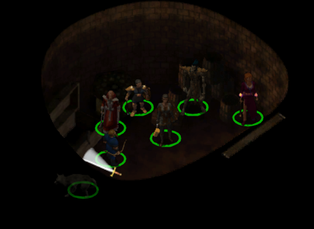{ .center-img width="60%" }

Pozostało zbadać korytarze, o których wspominał **Charleston Nib**. Dostęp do nich otworzył zwój otrzymany od archeologa, a wejście znajdowało się w jednej z wież mostu 11.

Na progu drużynę przywitał niezły komitet powitalny, złożony z zombie i wampirycznych wilków. Starcie nie należało do łatwych, lecz ostatecznie wędrowcy zdołali oczyścić pierwszy poziom.

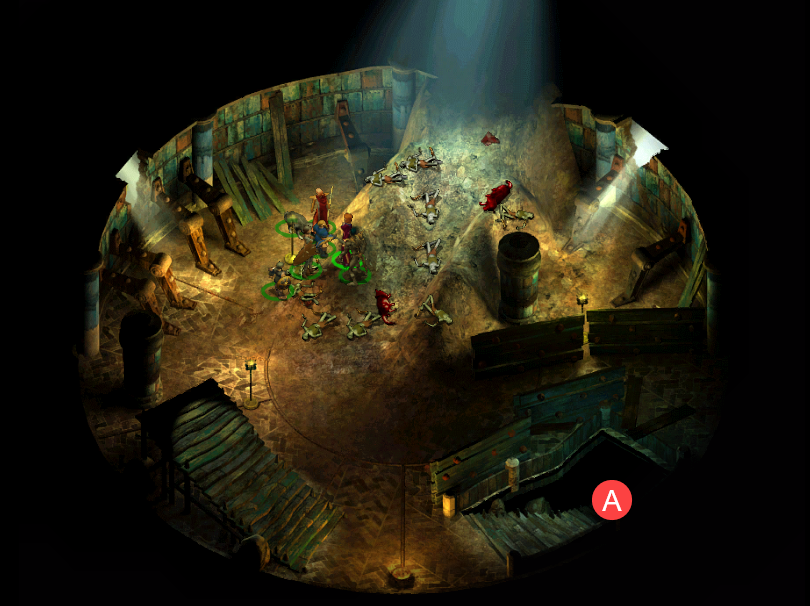{ .center-img width="60%" }

W położonych niżej komnatach gnieździł się pomiot wampirzy. Pokonane istoty znikały pod postacią nietoperzy albo rozpływały się w gazową mgłę. Drużyna nie odnalazła jednak żadnego dorosłego wampira, który mógłby nimi dowodzić.

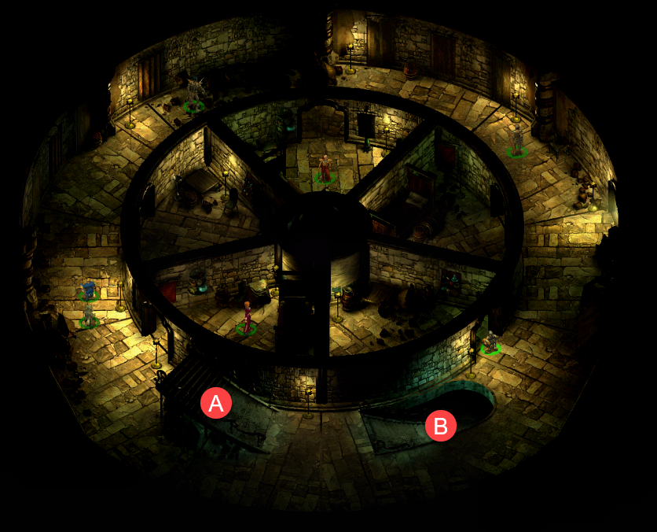{ .center-img width="60%" }

Na samym dole grupa pająków strzegła stołu ofiarnego, na którym spoczywało kilka interesujących łupów. Po rozprawieniu się z ostatnimi strażnikami wędrowcy mogli uznać podziemia za oczyszczone. ([Warded Dungeon Under Firewine Bridge](../other/zadania.md#q90))

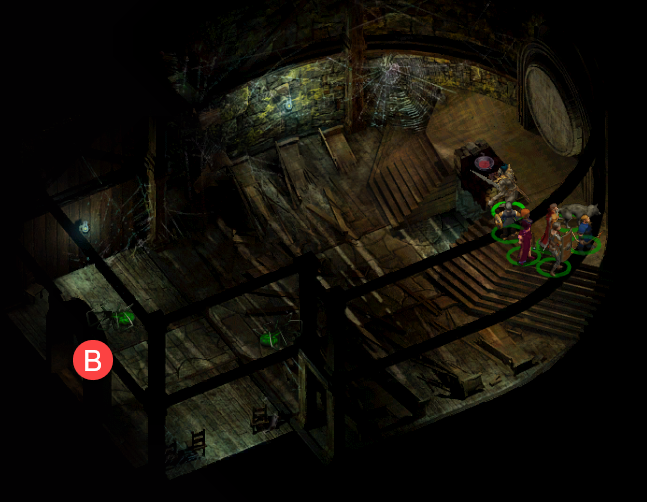{ .center-img width="60%" }

Po wyjściu na świeże powietrze uznali, że bliskość siedziby **Adoya** skłania by w dalszej drodze skierować się właśnie w tamtą stronę.

:material-paw: Bestiariusz: *kobold, ogrzy mag, zombie, goblin, goblin łucznik, troll pustynny, hobgoblin czarodziej, wampiryczny wilk, wampirzy pomiot, pająk miecznik, astralny pająk fazowy*

## Na szlaku { .divider }

Podczas podróży drużyna natknęła się na osobliwą beczkę obdarzoną darem teleportacji. Gdy Leech wreszcie ją zagadnął, przestraszony przedmiot poprosił, by przestano za nim chodzić i patrzeć na niego w tak niepokojący sposób. Młody gnom przyznał, że trudno było zachować obojętność, gdy spotykało się mówiącą beczkę. Beczka sama nie do końca rozumiała, co się z nią stało. Wiedziała jedynie, że stworzył ją pewien mag i początkowo służyła do przechowywania różnych przedmiotów. Kiedy właściciel postanowił odejść, nastąpił przypływ dzikiej magii. Beczka obudziła się, a wraz ze świadomością przyszły myśli i uczucia. **Neera** uznała, że w przypadku dzikiej magii nic nie było niemożliwe. Jej moc potrafiła dokonać dosłownie wszystkiego, czego mówiąca i myśląca beczka stanowiła całkiem przekonujący dowód. Nowe życie miało jednak swoje ograniczenia. Beczka potrafiła widzieć i nazywać drzewa, ludzi, skały oraz żuki gnojowe, a dzięki pozostałościom magicznego przypływu mogła teleportować się z miejsca na miejsce. Nie wiedziała tylko, dokąd właściwie powinna wyruszyć, ponieważ nie znała żadnych innych miejsc. Poprosiła więc drużynę o wskazanie celu, o którym mogłaby się czegoś dowiedzieć i który być może zdołałaby odnaleźć. **Leech** opowiedział jej o *Candlekeep*, miejscu, które niegdyś nazywał domem, lecz do którego sam nie mógł już powrócić. Beczka przypomniała sobie, że słyszała o *Candlekeep*, i postanowiła spróbować tam dotrzeć. Przed odejściem przeprosiła za wcześniejsze zachowanie. Teleportowanie się w przypadkowe miejsca i krzyczenie na nieznajomych wciąż było dla niej czymś nowym. Uznała jednak, że **Leech** nie był taki zły, po czym zniknęła, ciekawa, jak wyglądał jego dawny dom. ([A Magic Barrel](../other/zadania.md#q109))

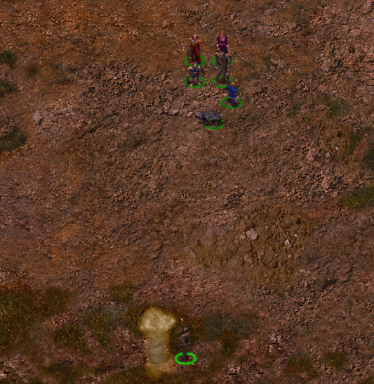{ .center-img width="60%" }
