# Między chaosem a Runą

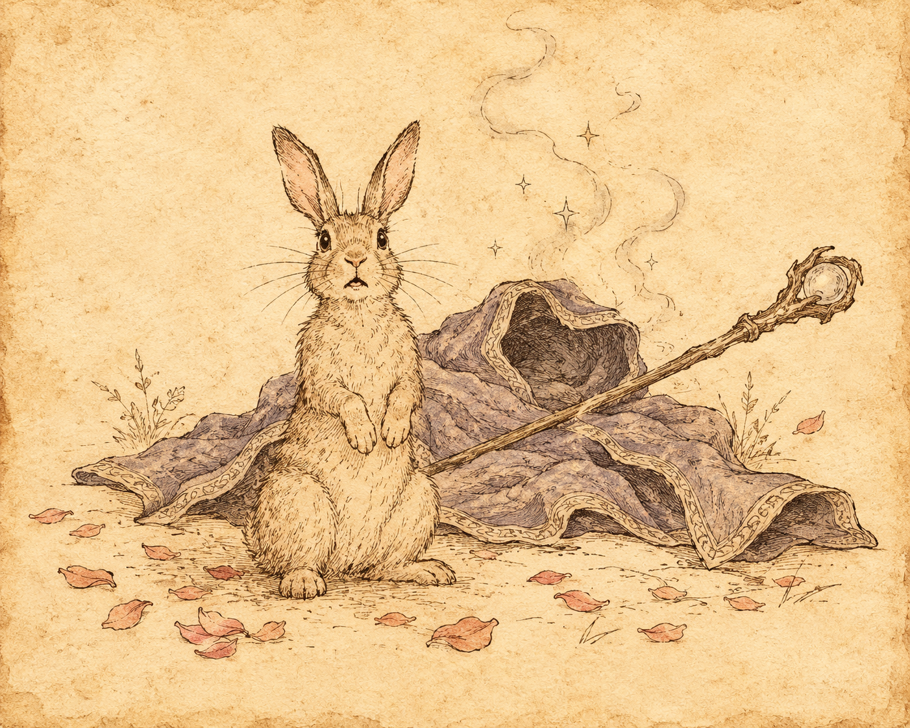{ .center-img width="60%" }

## Enklawa Adoy'a&nbsp;60 { .divider }

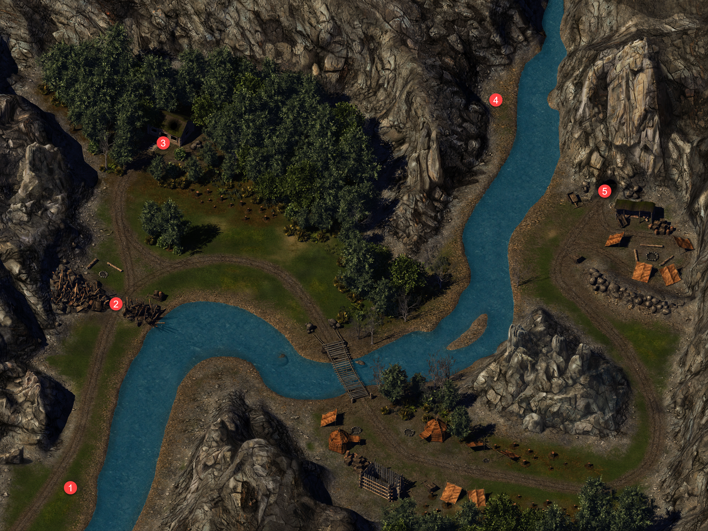{ .center-img width="40%" }

Podążając traktem, drużyna stanęła w osłupieniu na widok kraczącej wiewiórki 1. **Neera** uznała, że byli już blisko poszukiwanego dzikiego maga. O ile stworzenie nie miało wrony za ojca, musiało zostać przemienione całkiem niedawno. Leech zastanawiał się, dlaczego ktoś miałby zamieniać wronę w wiewiórkę. Być może czarodziej wciąż nie potrafił panować nad własną magią. Półelfka podsunęła prostsze wyjaśnienie: wiewiórka mogła zamęczać go pytaniami o jego magiczne talenty.

Po chwili dzika magini zaczęła się zastanawiać, czy odwaga i szaleństwo nie były dwiema stronami tej samej monety. Podejrzewała, że wielu uważało Leecha za szaleńca, gdy rzucał się na potężniejszych przeciwników. Młody gnom zauważył, że gdy postępował za nią, nazywała to odwagą, lecz kiedy sama robiła coś podobnego, należało to uznać za szaleństwo. **Neera** roześmiała się i przyznała, że wielu zgodziłoby się z takim rozumowaniem.

Zapytana o *Czerwonych Czarodziejów*, stanowczo zaprzeczyła, by czymkolwiek zasłużyła na ich gniew. Chcieli ją pojmać, rozciąć i sprawdzić, co czyniło ją dziką maginią. Próbowali kontrolować wszystko, co rozumieli, a niszczyć to, czego pojąć nie potrafili. Leech nazwał ich potworami i zapewnił, że dopóki podróżowała z nim, nie zdołają jej skrzywdzić. Przyjęła te słowa z wdzięcznością, choć wizja bezradnej niewiasty ratowanej przez bohatera wyraźnie jej nie odpowiadała. Cieszyła się ze wspólnej podróży, lecz nie zamierzała występować w roli damy w opałach. Na tym zakończyła rozmowę, przyznając, że miło było porozmawiać, i proponując, by kiedyś do tego wrócili. Najlepiej jednak innym razem.

Dalej na drodze wędrowcy natknęli się na gobliński posterunek 2. Udało im się dowiedzieć, że niejaki **Rogdok** pilnował **Bargrivyeka**. Nie mając pojęcia, o co chodziło, ruszyli dalej.

Przed leśniczówką 3 **Magreb** ostrzegł drużynę, że napastnicy nadchodzili spomiędzy drzew. W każdym cieniu dostrzegał gobliny, które pojawiły się znikąd i opanowały całą okolicę. Leech uspokoił go i poprosił o wyjaśnienia. Leśnik opowiedział, że wraz z **Rilsą** od wielu lat strzegł tych ziem i nigdy wcześniej nie mieli kłopotów z goblinami. Niedawno jednak pojawiło się ich mnóstwo. Zabiły **Rilsę**, gdy próbowała z nimi porozmawiać, a on sam nie potrafił stawić im czoła. Początkowo gobliny krążyły wokół domu starego maga, później przeniosły się do jaskiń na północnym wschodzie, zabierając czarodzieja ze sobą. Wkrótce przybył wielki hobgoblin, który ogłosił się królem plemienia. Mag nazywał się **Adoy**. Trzymał się z dala od mieszkańców, twierdząc, że nie chciał nikogo skrzywdzić swoją magią. **Magreb** uważał go za przyjaznego, choć nieco osobliwego człowieka.

Na dźwięk tego imienia **Neera** natychmiast się ożywiła lecz leśny strażnik nie wiedział jednak, czy mag nadal żył. Od chwili, gdy gobliny zabrały go do jaskini, nie widział go ani razu i przypuszczał, że podzielił los **Rilsy**. Zapytany o przywódcę goblinów, wyjawił, że nazywały go **Rogdokiem**. Hobgoblin mianował się arcykapłanem jednego z ich bogów, a coraz liczniejsze patrole wyruszały z jaskiń na poszukiwanie bóstwa, które rzekomo zaginęło. Leech obiecał rozprawić się z goblinami. Napotkany elf wskazał jaskinie na północnym wschodzie, ostrzegając, że patroli było tak wiele, iż sam nie odważył się podejść dość blisko, by odzyskać ciało **Rilsy**. Nie pragnęła walki, a mimo to gobliny odebrały jej życie. Młody przywódca zapewnił, że sprawiedliwości stanie się zadość ([Magreb and Rilsa](../other/zadania.md#q109)).

Czary **Adoya** najwyraźniej bywały nieco dziwne. Wędrowcy spotkali gadającego łosia w towarzystwie rozmownej także wiewiórki 4. Łoś postanowił wyczarować królika, lecz zamiast niego pojawił się ogr. Wyglądało na to, że zwierzęta były zaklętymi dzikimi magami, którzy mimo swego położenia wciąż popełniali kolejne głupstwa. Poza Neerą reszta drużyny nabiera coraz więcej wątpliwości co przydatności tej podróży w próbie zapanowania nad dziką magią.

Szlak pilnowany przez gobliny urwał się nagle przed jaskinią 5.

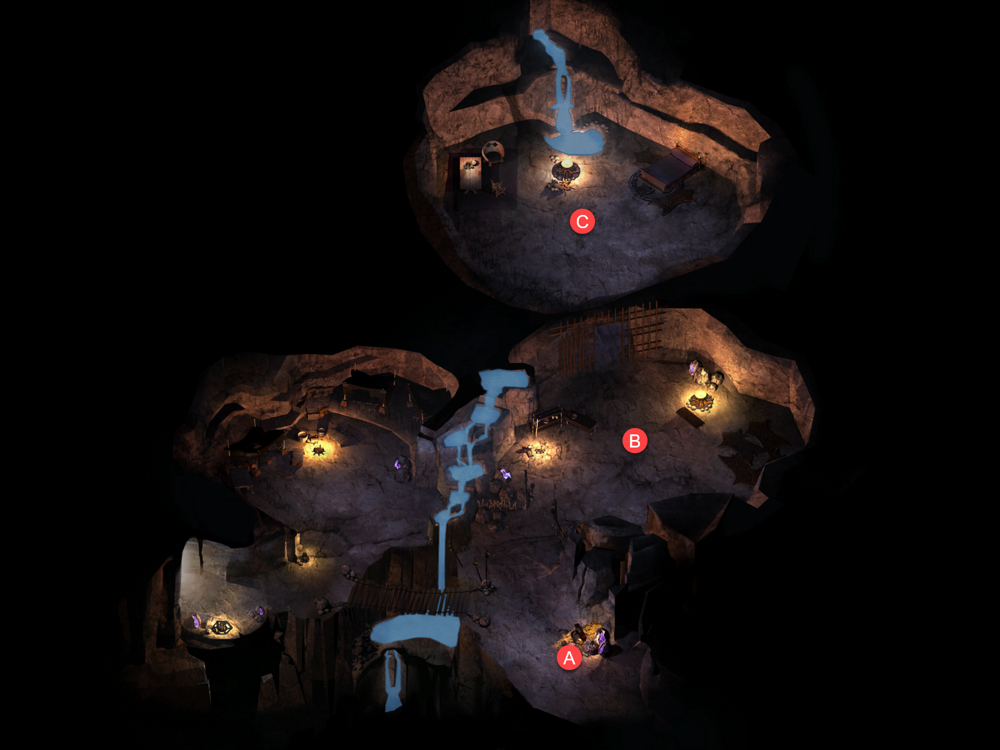{ .center-img width="60%" }

W jej wnętrzu drużyna odnalazła ciało **Rilsy** A. Pogrzebała je pod stertą kamieni i zabrała pierścień zmarłej. Nieco dalej natrafiła na **Rogdoka** B, który strzegł pieczary.

Tam też odnalazła **Adoya** C. Mag podziękował *Mystrze* za ratunek, choć żałował, że wybawcy musieli torować sobie drogę mieczami. **Neera** wyjaśniła, że sama była dziką maginią i liczyła, iż nauczy ją panować nad nieprzewidywalną mocą. Starzec szybko ostudził jej nadzieje. Przyznał, że nie był najlepszym przykładem kogoś, kto opanował dziką magię, i wątpił, czy ktokolwiek naprawdę tego dokonał. Gdyby jednak zdołał ograniczyć otaczający ich chaos, chętnie spróbowałby pomóc.

**Rogdok**, który przybył, by ustalić, skąd w okolicy wzięły się nowe gobliny dowiedział się, że **Adoy** ze swą źle działającą magią, dającą dziwne rezultaty był traktowany przez nie prawie jak bóg i obawiał się, że pobratymcy mogą go za takiego niedług oznać. Nie odważył się go zaatakować ale zamiast tego uwięził go. Dopóki czarodziej pozostawał pod jego kontrolą, hobgoblin mógł panować nad plemieniem.

Rozmowę przerwał **Ekandor**, zadowolony, że wreszcie odnalazł poszukiwanego maga i młodą adeptkę niekontrolowanej magii. **Neerę** nazwał elfką, czym natychmiast ją zirytował. Poprawiła go stanowczo, przypominając, że była pół krwii. Przybysz zapowiedział, że po schwytaniu obojga podda ich badaniom, a jeśli kolejny dziki mag okaże się bezwartościowy, być może wykorzysta go do innych prób. **Adoy** odmówił potulnego uczestnictwa w eksperymentach, zwłaszcza prowadzonych przez *Czerwonych Czarodziejów*. **Neera** dodała, że nawet nie ukończyła szkoły, więc tym bardziej nie zamierzała poddawać się żadnym testom.

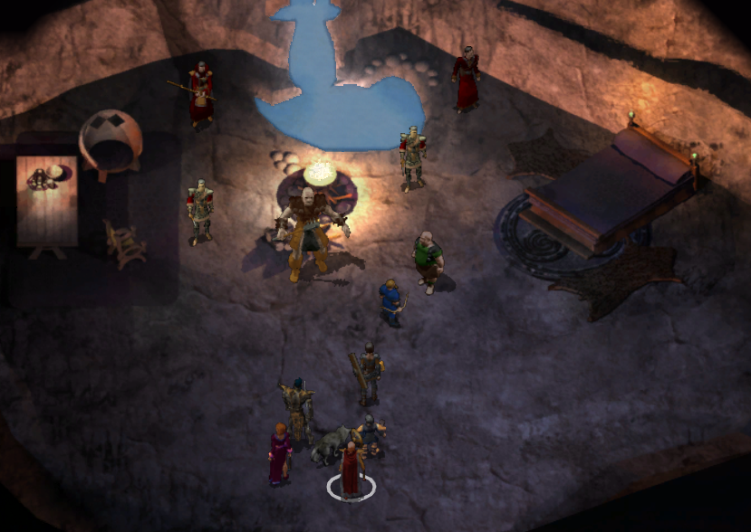{ .center-img width="60%" }

Leech nakazał **Ekandorowi** teleportować się z powrotem do *Thay*, nie zamierzał bowiem pozwolić na zabranie dzikich magów. *Czerwony Czarodziej* nie zważając na ostrzeżenie zaatakował. **Adoy** postanowił pomóc, przywołując moc nieujarzmionej magii i zaklęcie przyniosło osobliwy skutek - co nikogo już chyba nie zdziwiło - i stary mag zamienił się w królika. Na szczęście drużyna poradziła sobie i bez „kunsztu” dzikiego maga.

Po walce **Adoy** odetchnął z ulgą, choć przyznał, że jego zaklęcie wywołało niefortunne zamieszanie. Leech zauważył, że zamieszanie bardzo dogodnie trzymało go z dala od walki z *Czerwonymi Czarodziejami*. Starzec odparł, że znacznie chętniej stanąłby u boku drużyny, lecz jako praktyk dzikiej magii nie zawsze potrafił przewidzieć skutki własnych czarów. Wyjaśnił, że *Czerwoni Czarodzieje* ścigali zarówno **Neerę**, jak i jego, by badać ich zdolności, a być może również mózgi. Chcieli odkryć, dlaczego dzicy magowie potrafili władać mocą tajemnego chaosu, która pozostawała poza ich zasięgiem. Półelfka poprosiła, by przynajmniej nie rozmawiali o badaniu mózgów.

**Adoy** próbował wrócić do przerwanej rozmowy, lecz Leech przypomniał mu, że drużyna po raz drugi uratowała mu życie i zasługiwała choćby na odrobinę wdzięczności. Stary mag przyznał, że **Rogdok** nie słuchał żadnych argumentów, a on sam niechętnie uwolniłby pełną moc dzikiej magii przeciw plemieniu, które uznawało go za boga. Nie każdego dnia ktoś miał przecież okazję odbierać boską cześć.

**Neera** ponagliła go, by wreszcie podzielił się mądrością zdobytą przez długie lata. On zaś wyjaśnił, że jedyną tajemnicą było przyjmowanie złego wraz z dobrym. Dziki mag nie powinien rozpaczać, gdy jego kula ognia spopieliła całe plemię trolli, musiał natomiast nauczyć się improwizować, gdy zamiast płomieni z nieba spadały płatki kwiatów. Połowa uroku tej profesji polegała na tym, że nigdy nie było wiadomo, co wydarzy się za chwilę. Przyznał przy tym, że nawet po tylu latach nie odkrył przyjemności płynącej z przemiany w kobietę, gdy zaklęcie zawiodło poprzedniego lata. **Neera** nie chciała uwierzyć, że cała jego wiedza sprowadzała się do tak banalnej rady, i podejrzewała, że starzec skrywał jeszcze jakiś sekret.

**Adoy** uznał, że być może miał dla niej coś przydatnego. Zdjął pas służący mu podczas sporadycznych wypraw do miasta i przekazał go półelfce. Ostrzegł jedynie, że noszącego mogła czasem porazić magia, lecz mimo to pas powinien okazać się pomocny. Sam rzadko odwiedzał osady, dlatego ona prawdopodobnie zrobi z niego lepszy użytek, a przy okazji zyska nieco spokoju ducha. Leech zapytał, czy był to najlepszy dar, na jaki mag mógł się zdobyć. **Adoy** zapewnił, że o nim również nie zapomniał, po czym przywołał dla niego wspaniały skarbiec pełen kosztowności. W tej samej chwili zniknął, pozostawiając drużynę bez skarbu i bez możliwości zgłoszenia reklamacji.

**Neera** oburzyła się, że pokonała tyle przeszkód, a stary mag po prostu zniknął. Nas bohater przypomniał jej, że bez pomocy drużyny cała wyprawa mogła zakończyć się znacznie gorzej. Dzika magini przyznała z wyraźną niechęcią, że rzeczywiście otrzymała pomoc, lecz zauważyła też, że dla młodego gnoma każda historia najwyraźniej musiała ostatecznie sprowadzać się do niego. Cóż, taka karma ([Neera](../other/zadania.md#q111)).

Po wyjściu z jaskini wędrowcy wrócili do **Magreba** 3, oddali mu pierścień **Rilsy** i potwierdzili, że została pogrzebana ([Magreb and Rilsa](../other/zadania.md#q109)).

Drużyna uznała, że powinna ponownie zajrzeć do *Doliny Grobowców*. Bliskość tego miejsca i ukształtowanie terenu sugerowały, że może tam odnaleźć oręż **Inoshishiego**.

:material-paw: Bestiariusz: *goblin, wilk, straszliwy wilk, ogr, berserker ogr, strażnik czerwonych magów, czarodziej czerwonych magów*

## Dolina Grobowców&nbsp;61 { .divider }

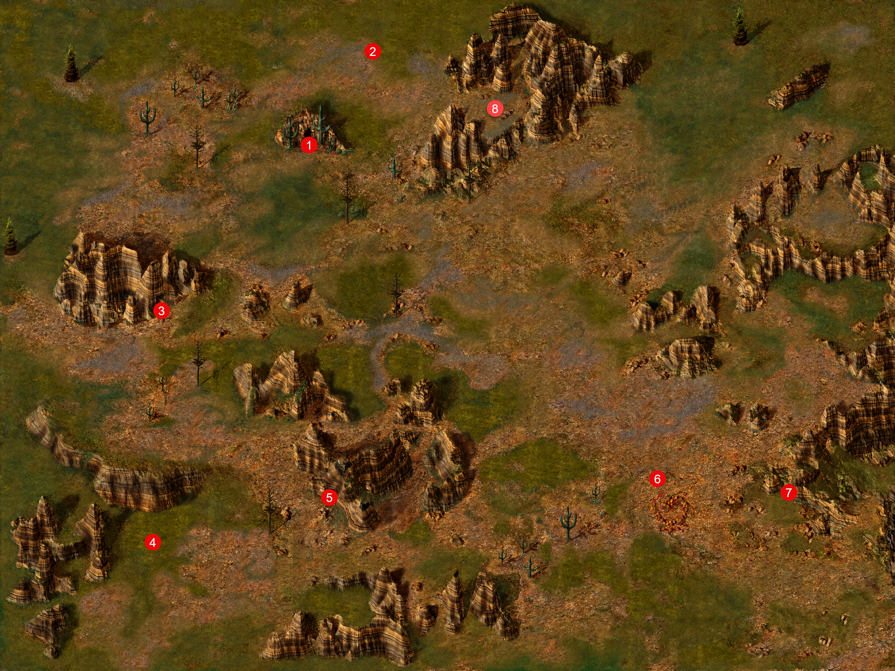{ .center-img width="40%" }

Poszukiwania nie trwały długo. W jednej z kotlin 8 drużyna natknęła się na jęczącego trolla, a przy nim na ostrze złamanej katany. Wszystko wskazywało na to, że był to fragment *Saiai no Hito*, słynnego miecza z *Kozakury*, wykutego w *Yimind* przez **Ne Kurosunę** oraz mnicha **Shiroume Yakuchiego**.

Ostrze wciąż mogło zostać naprawione, należało jednak odnaleźć jego rękojeść ([Restoring Saiai no Hito](../other/zadania.md#q89)).

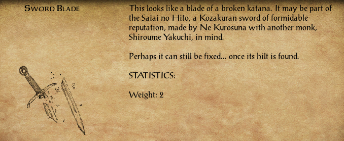{ .center-img width="60%" }

Nadszedł czas na odpoczynek w łóżku i odrobinę luksusu. Wędrowcy ruszyli w stronę *Nashkel*, zahaczając po drodze o *Samotne Szczyty*.

:material-paw: Bestiariusz: *jęczący troll*

## Na szlaku { .divider }

Na szlaku drużyna spotkała mordercę, a przy nim fragment raportu opisującego dotychczasowe ustalenia w sprawie *Skręconej Runy*. Organizacja była ściśle tajnym stowarzyszeniem liszów oraz innych potężnych nieumarłych czarowników. Tożsamość członków jej wewnętrznego kręgu pozostawała nieznana nawet większości magów wykonujących rozkazy Runy, często nieświadomych, komu naprawdę służyli. Od *Roku Smoczej Furii* *Skręcona Runa* stała się najpotężniejszą organizacją na południowym zachodzie *Faerûnu*. Jej agenci działali we wszystkich krajach położonych na południe od *Wysokiego Wrzosowiska* i na zachód od *Gór Rogu Burzy*.

Stowarzyszenie potajemnie kontrolowało niemal połowę wpływowych rodów *Calimshanu*, nie kierując nimi jednak bezpośrednio. Nieśmiertelni władcy Runy woleli cierpliwie czekać, aż czas sam przybliży ich do wyznaczonych celów. Raport miał wyliczać siedmiu znanych Mistrzów Runy, lecz dalszą część strony starannie wyrwano. Ktokolwiek sporządził dokument, zadbał o to, by najważniejsza tajemnica pozostała bezpieczna.

Jakie zamiary wobec drużyny miało to stowarzyszenie i jego przeciwnicy? Kim był napotkany asasyn? Co oznaczał tatuaż na jego przedramieniu?

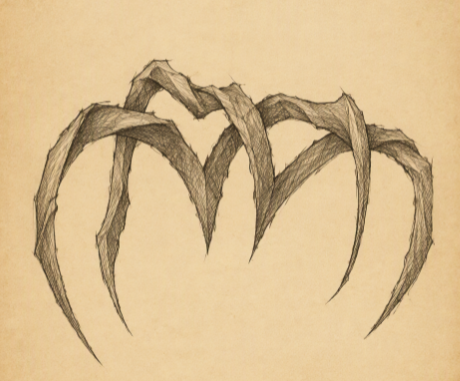{ .center-img width="30%" }

Na razie pytania te pozostały bez odpowiedzi ([The Twisted Rune](../other/zadania.md#q114)).

## Samotne Szczyty&nbsp;62 { .divider }

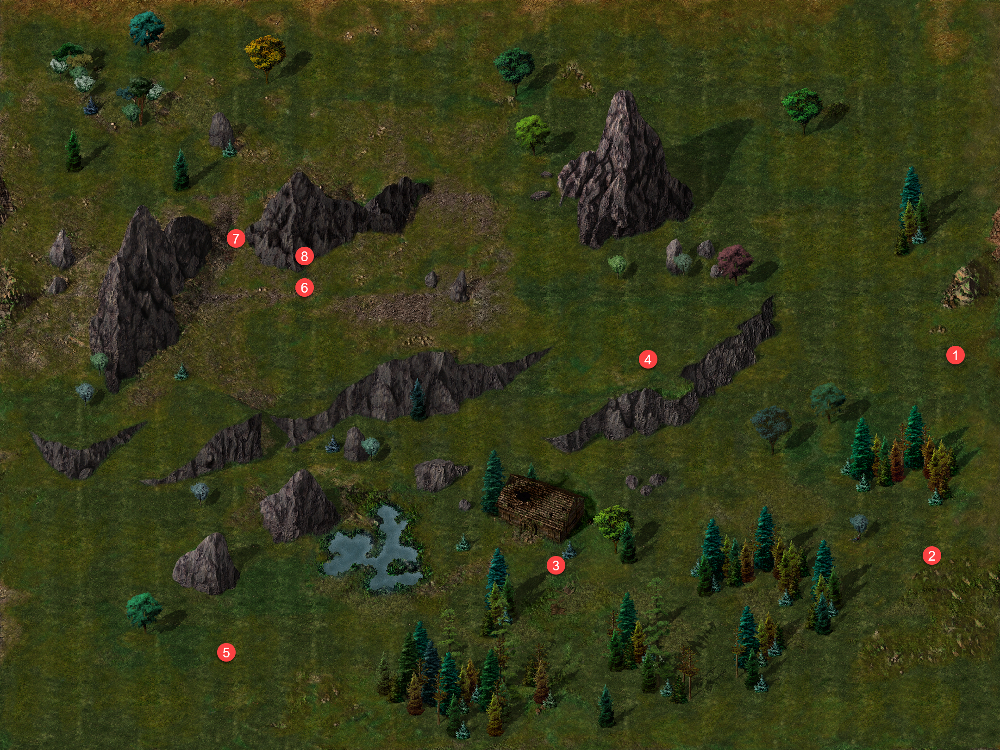{ .center-img width="40%" }

Krasnoludzka wojowniczka **Sarhedra** mb1 ostrzegła wędrowców przed ogrami i ich obozem położonym na południu. Między słowami dała do zrozumienia, że chciałaby, aby ktoś się z nimi rozprawił. Wkrótce kilka ogrów i ogrilion 2 przestały włóczyć się po okolicy, a zleceniodawczyni podziękowała drużynie ([Ogre Hunting](../other/zadania.md#q112)).

Przy opuszczonym domu 3 drużyna uratowała krowę **Hulrika**, zaatakowaną przez grupę xvartów. Okazało się, że miejscowa trzoda była często trzebiona przez rozmaite stwory ([Xvart Raids](../other/zadania.md#q113)). Zastanawiający pozostał jedynie zwyczaj nadawania krowom imion. Ta wabiła się *Arabella*.

Następnie wędrowcy rozprawili się z kolejną grupą bandytów 4- **Ioinem Gallchobhairem**, **Billym** i **Dribbenem**. Ci najwyraźniej wciąż nie rozumieli, że drużynę należało traktować poważnie.

**Sprat** 5 nie miał czasu na rozmowę. Pędził do *Amn*, by przekazać wieści o coraz częstszych napadach bandytów, wyczerpujących się zapasach żelaza oraz mieszkańcach zbrojących się z powodu braku broni. Nic dziwnego, że stosunki między sąsiadami stawały się coraz bardziej napięte. 

Szczęśliwym trafem drużyna dostrzegła pod kamieniem wodny opal 6. Był to kolejny rzadki kamień wykorzystywany w urządzeniach lokacyjnych, mogli więc wracać do *Wysokiego Żywopłotu* ([Destroy the Cursed Bracers](../other/zadania.md#q56)).

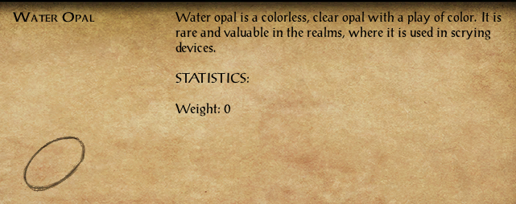{ .center-img width="60%" }

**Arghain** zagrodził drużynie drogę 7 i zażądał żelaza albo życia. Po chwili się poprawił, uznając, że najlepiej będzie odebrać przybyszom jedno i drugie. Wyjaśnił, że broń jego klanu kruszyła się niczym elfie kości, wystawiając pobratymców na pośmiewisko. Zamierzał więc szybko rozprawić się z wędrowcami i zabrać całe ich żelazo, najlepiej bez niepotrzebnego bólu. Na koniec wrzasnął, że był wściekły, i ruszył do ostatniego ataku.

W pobliskiej jaskini 8 skrzynia pilnowana przez etterkapa nie kryła niczego ciekawego.

W końcu drużyna dotarła do *Nashkel*.

:material-paw: Bestiariusz: *ogr, ogrilion, elita hobgoblinów, niedźwiedź jaskiniowy, wilk polarny, straszliwy wilk, xvart, półork, kobold, etterkap*

## Nashkel&nbsp;63 { .divider }

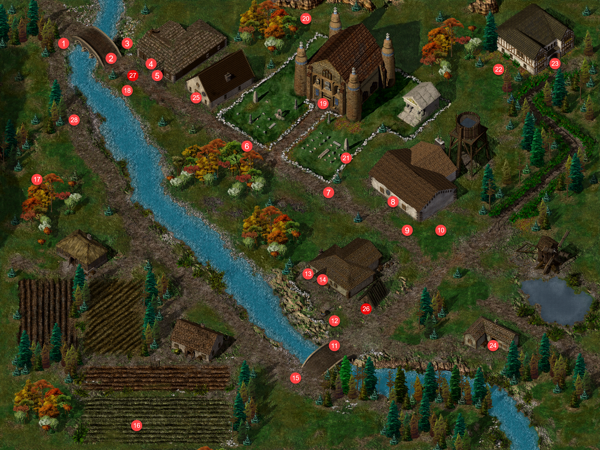{ .center-img width="40%" }

Szukając **Karp**, wędrowcy natknęli się na gadającą wiewiórkę 28, jak już wiadomo, nie pierwszą. **Mopap**, zwany *Ćwierkającą Wiewiórką*, próbował odprawić ich uporczywym trelem. Gdy jednak nie zamierzali odejść, zwierzątko zażądało, by przestali je niepokoić, i zapytało, czego właściwie chcą. Po chwili nerwowo zapewniło, że bez względu na zasłyszane plotki nie posiadało poszukiwanego przedmiotu. Wytrwałość drużyny szybko jednak przyniosła skutek. Zrezygnowany **Mopap** oddał skrywaną rzecz i poprosił, by wreszcie zostawiono go w spokoju. Przedmiotem okazała się runa szczęścia.

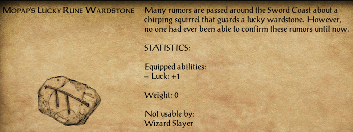{ .center-img width="60%" }

**Karp** 16 spodziewała się w tym roku dobrych zbiorów i dziękowała za nie bogom. Gdy Leech zapytał o odnalezione pierścienie, natychmiast nabrała podejrzeń. Na jej polach znajdowano zwykle co najwyżej rzepę, a gnom nie wyglądał ani na rolnika, ani na kupca z *Ulgoth’s Beard*, którego oczekiwała. Zażądała wyjaśnień i ostrzegła, że nie tolerowała wścibstwa w swoich prywatnych sprawach. Gnom otwarcie przyznał, że wiedział o planowanej sprzedaży pierścieni spod stołu, i zapytał, czego się obawiała.

Jego szczerość zaskoczyła kobietę, a skoro znał już jej sekret, postanowiła wyjawić całą prawdę. Pierścienie nie były dla niej jedynie skarbem wydobytym z ziemi, lecz jedyną nadzieją na lepsze życie. Jej mąż był okrutny wobec niej i ich syna, a o znalezisku nie wiedział niczego. **Karp** potajemnie sprzedawała wszystko, co udało jej się znaleźć, odkładając pieniądze na ucieczkę do *Athkatli*, gdzie schronienie obiecała jej siostra. Leech zaproponował pomoc w bezpiecznym dotarciu do miasta w zamian za pierścienie. Początkowo nie ufała obietnicom nieznajomego, lecz zgodziła się rozstać ze skarbem, jeśli rzeczywiście zapewni jej i synowi drogę do odległego miasta. Do tego czasu pierścienie miały pozostać ukryte, a ona zamierzała dalej zajmować się gospodarstwem, jakby nic się nie wydarzyło ([Beneath the Ploughshares](../other/zadania.md#q94)). Drużyna musiała znaleźć sposób, by pomóc zastraszonej kobiecie.

W *Bekającym Smoku* 14 do drużyny dołączyła **Shar-Teel**, a **Neera** udała się do *Pomocnej Dłoni*.

:material-account-group: Przyłączeni NPC: Shar-Teel

:material-account-group: Odłączeni NPC: Neera (Pomocna Dłoń)

Wędrowcy odszukali **Taris** 5. Leech wyznał, że nie miał całkowitej pewności, czy zabity mężczyzna rzeczywiście był jej mężem, lecz wiedział, że wszyscy, których **Hagar** spotkał u boku **Kryll**, ponieśli przedwczesną śmierć. **Taris** nie miała już wątpliwości. Uznała, że **Hagar** musiał znajdować się wśród ofiar, i zapytała, jak zginął. Młody gnom oszczędził jej szczegółów. Wyjaśnił jedynie, że mężczyzna odszedł spokojnie, a za jego śmierć odpowiadała nekromantka, kobieta, za którą podążył. Wdowa uznała, że lepiej nie poznawać całej prawdy. Podziękowała za pomoc i postanowiła opuścić to miejsce. Potrzebowała zostać sama.

Drużyna postanowiła ponownie zajrzeć do nagrobka **Marka D.** 21. Znów pojawił się **Daer Ragh**, który nazwał przybyszów głupcami zbyt mocno interesującymi się miejscem jego pochówku. Wyjaśnił, że upozorowanie własnej śmierci nie należało do łatwych, dlatego nie zamierzał pozwolić, by ich wścibstwo zniweczyło cały wysiłek. Nakazał im pogodzić się z nieuchronną śmiercią oraz czekającymi na nich płomieniami piekieł i przywołał strażników Feniksa.

Dzięki pierścieniom i eliksirom drużyna nie miała kłopotu z ich stylem walki. Pokonani strażnicy powstawali ponownie i dopiero drugie zwycięstwo okazywało się ostateczne, choć kończyło się salwą ognia. Sam mag ulotnił się jak niepyszny, by szukać kolejnego sposobu na zniknięcie z pola widzenia. Pozostało pytanie, komu zalazł za skórę, skoro tak bardzo pragnął zostać zapomniany.

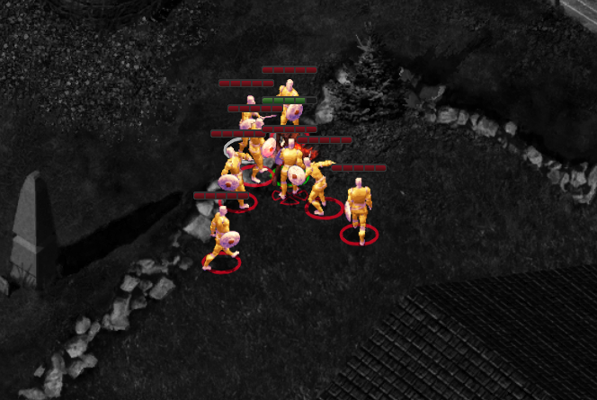{ .center-img width="60%" }

Następnym celem wędrowców był *Wysoki Żywopłot*.

:material-paw: Bestiariusz: *strażnik Feniksa*