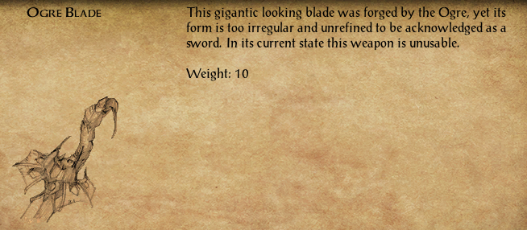
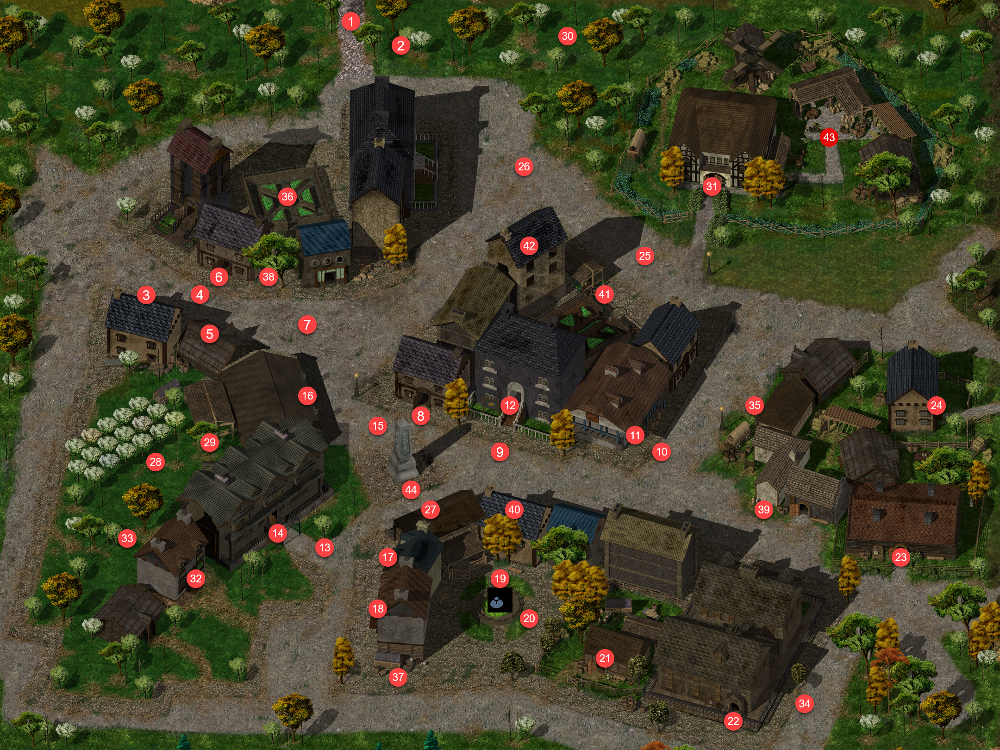
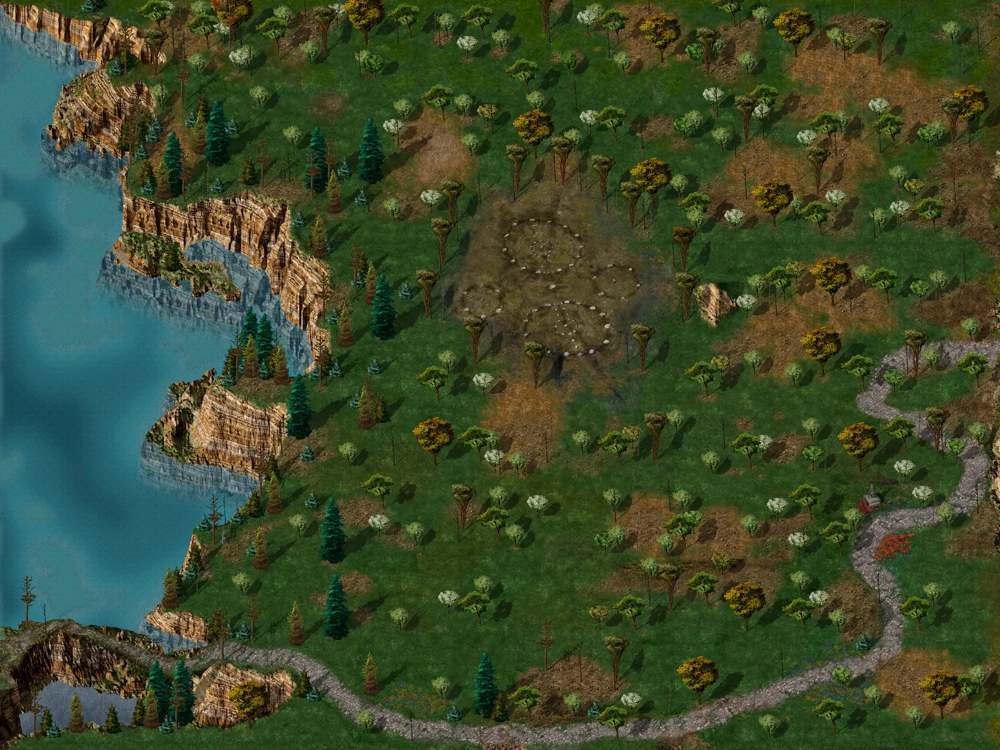
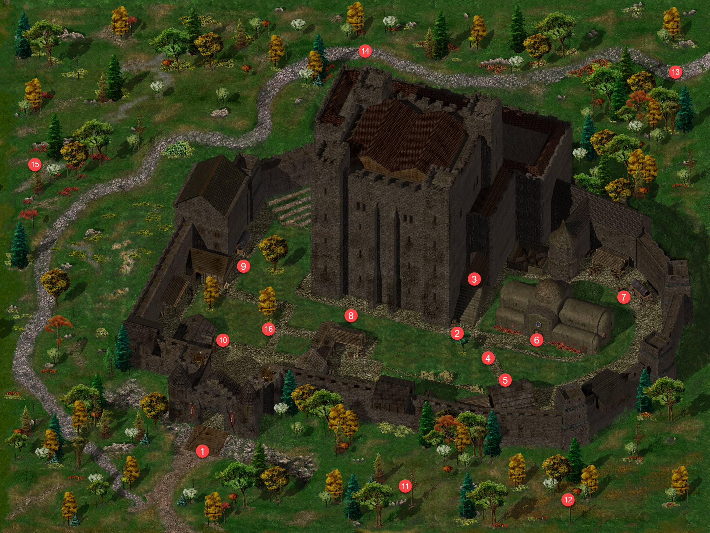
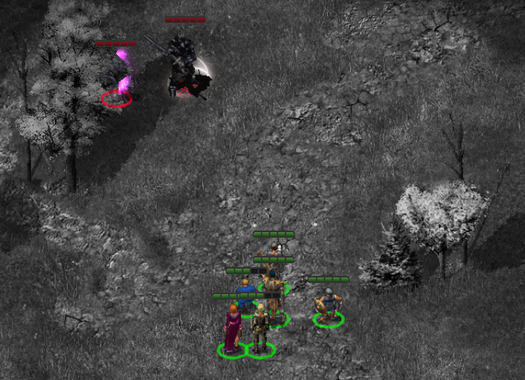

# Under Construction

{ .center-img width="60%" }

## Las Ognistych Liści&nbsp;67 { .divider }

{ .center-img width="40%" }

Pośród drzew drużynę zatrzymało nagłe wołanie. Stary człowiek, wyraźnie uradowany na widok żywej duszy, przedstawił się jako **Ordolath** i wyjaśnił, że spędza tu swój urlop naukowy, z dala od zgiełku *Wrót Baldura*. **Leech**, niezbyt skory do uprzejmości, od razu zapytał, czego starzec od nich chce. **Ordolath** z zakłopotanym chichotem wyznał, że szykując się do podróży, zapomniał świecy. Bez niej nie mógł ani pisać w swoim dzienniku, ani czytać książek, a tutejsze noce były bardzo ciemne – dla mola książkowego istna udręka. Złożył więc propozycję: jeśli bohaterowie poświęcą kilka dni i przyniosą mu jego mały woskowy skarb, nagrodzi ich sowicie – oprócz 2000 sztuk złota obiecał cenny przedmiot, który z pewnością przypadnie im do gustu. (Ordolath's Candle 115) **Leech** uznał ofertę za ciekawą i poprosił o wskazanie domu. Uradowany **Ordolath** wyjaśnił, że od pierwszej chwili wydali mu się godni zaufania. Jego dom stał w północnej części *Wrót*, niedaleko *Dzielnicy Północnej* – biały budynek za niebieską wieżą maga, nie sposób go przeoczyć. Na pożegnanie poprosił o pośpiech i zapewnił, że będzie niecierpliwie wyczekiwał ich powrotu.

Trochę dalej spotkali młodego Alberta, który z wielkim niepokojem poszukiwał swojego zaginionego psa, Rufiego. Chłopiec obawiał się, że jego mały przyjaciel, nieprzywykły do obcych miejsc i nieznajomych ludzi, mógł gdzieś się zaszyć ze strachu. Albert z wdzięcznością przyjął zaoferowaną pomoc. Na znak rozpoznawczy przekazał ulubioną zabawkę Rufiego, licząc, że znajomy zapach pomoże odnaleźć zgubę i zdobyć jej zaufanie. Choć dla przypadkowego wędrowca poszukiwanie małego pieska mogło wydawać się drobnostką, dla chłopca oznaczało odzyskanie najwierniejszego towarzysza (Albert and His Dog 116).

Trójka awanturników Sendai, Alexander i Delgod stanęła drużynie na drodze (3) i ostro zażądała, by wędrowcy z północy się zatrzymali. Oznajmiła, że zapuścili się głęboko na terytorium *Amnu*, i z drwiną zasugerowała, że może przybyli szpiegować rzekome zbrojenia. Bawiło ją, jakie głupie pomysły potrafią zalęgnąć się w głowach północnych barbarzyńców. **Shar-Teel** nie kryła pogardy. Uznała, że kobieta sama prosi się o posmakowanie ich stali, i spytała **Leecha**, czy dadzą jej nauczkę, czy też stchórzy i spróbuje ją ułagodzić. **Jen'lig** zapytała jednak wprost, czy *Amn* rzeczywiście nie zagraża *Wrotom Baldura*. **Sendai** zbyła to pytanie wyniośle: jej potężny naród miał ponoć ciekawsze zajęcia niż atakowanie jakiegoś zadufanego barbarzyńskiego miasta. Poradziła im zawrócić tam, skąd przyszli. Gdy **Jen'lig** odparła, że nigdzie się nie wybierają, bo mają takie samo prawo tu przebywać, **Sendai** stwierdziła, że trafiła na berserkerów. Podobno wyczuła ich woń już wcześniej, a ich zachowanie tylko utwierdziło ją w tym przekonaniu. Wezwała **Delgoda** i **Alexandra**, by szybko rozprawili się z tą hołotą. **Jen'lig** sięgnęła po zaklęcie, a **Alexander** z groźnym pomrukiem zapowiedział, że zaraz dostanie za swoje, i rzucił się prosto na nią. I wiadomo jak się to skończyło.

Niedaleko znajdujemy Ruffiego (4) i dzięki jego zabawce przekzanej prze Alberta udaje się nam psa skłonić aby podążał za nami spowrotem do jego właściela.

Albert gorąco nam dziekuje i nagle przeobraża się w demona mieszkańca Dziewięciu Piekieł i wraz pupilem znikają nam z oczu (Albert and His Dog 116).

{ .center-img width="60%" }

Drużynę zaczepił **Vax** (5), który z przesadną poufałością stwierdził, że zabłądzili nieco z utartego szlaku i mieli pecha trafić na najszybszą rękę na zachodzie. Wskazał stojącego opodal **Zala**, rzekomo najszybszego miotacza strzałek, jaki kiedykolwiek chodził po *Wybrzeżu Mieczy*. Radził nie wystawiać cierpliwości takiego człowieka na próbę, tylko rozsądnie oddać wszystkie pieniądze, bo inaczej czekają ich poważne kłopoty. **Shar-Teel** zaproponowała **Leechowi**, że chętnie przypomni mu, jak się zabija kretynów, gdyby przypadkiem zapomniał. **Finch** też nie dała się zastraszyć. Zapytała, czy **Vax** jest skończonym głupcem, bo czegoś równie idiotycznego jak najszybszy miotacz strzałek na zachodzie jeszcze nie słyszała, i wyzwała go, by **Zal** pokazał, co potrafi. Urażony **Vax** zawołał do towarzysza, że najwyraźniej nikt nie traktuje ich poważnie, więc pora dać pokaz swoich umiejętności. Z udawanym żalem zapowiedział, że drużynę czeka teraz moc cierpień. Tak związana z wytłumaczeniem czemu po świecie chodzili tacy idioci.

Dziwne trio xvarta, kobolda i tasloi o imionach Larry, Darryl i Darryl (6) podarowało nam autograf. 

Przy wodospadzie (7) atrakuje nas demoniczny rycerz i mówi coś o potrzebie ochrony swojego Pana. Po pokonaniu niecodziennego wroga Sandrah przyjrzała się bliżej wodospadowi, którego strzegł przeciwnik. Wtedy przypomniały jej się słowa tajemniczego zwoju: była tu woda, były i góry sięgające chmur. Po prawej stronie, wśród skał, rysowało się coś, co wyglądało na wejście. Sprawdzić to można było tylko w jeden sposób. (A Demonic Scroll 29)

{ .center-img width="60%" }

Przeszli przez wąski korytarz i nagle znależli się w komnacie a przed nimi stał demon, który z rykiem obwieścił, że podróż śmiertelników dobiegła końca. Przez moment wyglądał jednak na zbitego z tropu, bo najwyraźniej nie spodziewał się nikogo z tej strony ścieżki. Kiedy **Leech** zapytał, kim lub czym jest, potwór uznał, że skoro i tak nie wyjdą stąd żywi, może im to zdradzić. Z namaszczeniem przedstawił się jako **Naronguth**.

{ .center-img width="60%" }

**Leech** chłodno odparł, że to imię nic im nie mówi. W tej samej chwili rozległ się okropny łoskot walących się skał i wejście za ich plecami runęło.

Demon znów wydawał się zdziwiony, bo był pewien, że wszyscy go znają. **Sandrah** szepnęła **Leechowi**, że skoro nie jest to *Alzaligrundel*, musi chodzić o jego arcywroga, o którym wspominał zwój. Może dałoby się to wykorzystać. **Naronguth** wychwycił jednak szept i zagrzmiał, że przed nim nic nie pozostanie w ukryciu. Zapowiedział, że zuchwalcy zamiast zginąć szybko, będą długo cierpieć od jego gniewu. Zamyślił się, że tylko ktoś tak potężny jak *Elminster* zdołałby go odnaleźć, a przecież nikt z nich nim nie był. Potem przywołał bliżej młodą kapłankę, bo coś w niej wyczuwał. **Leech** ostrzegł plugawego biesa, by nie ważył się tknąć **Sandrah**. Demon wybuchnął triumfalnym śmiechem. Zrozumiał, że kradzież odłamka przyniosła lepszy skutek, niż się spodziewał, bo zamiast *Elminstera* przybyła jego ukochana córeczka. Był to dla niego prawdziwy piekielny festyn i wspaniała zdobycz. Aby przedłużyć ich cierpienie, postawił przed nimi wybór. Mogli na zawsze utracić część zdrowia, oddać mu **Sandrah** na dziesięciodniowy pobyt w piekle albo stanąć z nim do walki o odłamek, jedyny sposób na powrót tą samą drogą. **Leech** zamiast odpowiedzieć zapytał niewinnie o jego dawnego przyjaciela, *Alzaligrundela*.

**Naronguth** wyraźnie się poruszył. Rozpoznał wreszcie dziwny smród, który czuł od chwili ich przybycia, bo mieli przy sobie coś należącego do *Alzaligrundela*. Zażądał wyjaśnień, ostrzegając, że mogą to być ich ostatnie słowa. **Leech** zablefował, że arcywróg zna położenie jego legowiska, a oni wiedzą coś o nim samym, co może być dobrym początkiem układu. Demon, ponownie zbity z tropu, przyznał, że wie, gdzie tamten się ukrywa, ale nie może tam dotrzeć, bo nie jest w stanie przejść przez przeklętą ścianę wody, którą oni pokonali. **Sandrah** szepnęła, że mają go w garści. Z piekielnym ogniem w środku nie przejdzie za wodospad, więc jeśli zaproponują mu rozprawienie się z *Alzaligrundelem*, mogą w zamian zażądać odłamka. Tym razem rozdrażniony **Naronguth** nie protestował już przeciwko szeptom. Wyjawił, że wyczuwał obecność *Alzaligrundela* w pobliżu, lecz jego słudzy byli zbyt głupi, by go odnaleźć. Po ich ostatnim starciu w niezgłębionych czeluściach wybuchy mogły wyrzucić go aż w te góry, i demon miał nadzieję, że tamten tkwi w równie paskudnej dziurze co on sam. Zaproponował układ: jeśli przyniosą mu czarne serce *Alzaligrundela*, odda im odłamek *Elminstera* i rozstaną się w pokoju. **Leech** przystał na to bez wahania. (A Demonic Scroll 29) Drużyna otrzymała *Zwój Narongutha*. Wejście od strony *Chmurnych Szczytów* było zawalone i wyglądało na to, że tylko demon mógł pomóc im wydostać się z tego miejsca. **Naronguth**, rechocząc, przyznał, że rzeczywiście musi wyprowadzić ich na zewnątrz.

Po powrocie na powierchcnie odetchnęliśmy z ulgą. Podjeliśmy decyzję aby kontynować podróż dolinami Chmurnych Szczytów i znależć lokum wroga Narongutha.

Zmienirzając na zachód **Finch** która juz od jakiegoś czasu się nad czymś zastanawiała zagadnęła **Shar-Teel** i zaproponowała, że chętnie nauczy ją czytać, jeśli ta nie potrafi. **Shar-Teel** natychmiast się najeżyła. Oczywiście, że umie czytać, i chciała wiedzieć, skąd w ogóle ten niedorzeczny pomysł. **Finch** wyjaśniła łagodnie, że skoro wojowniczka ceni siłę ponad wszystko, mogła po prostu przegapić okazję, by cieszyć się wiedzą, która nie polega na rozrąbywaniu czegoś na pół. **Shar-Teel** warknęła, że nie widzi sensu w czytaniu marnej książeczki o rozbieraniu drzwi, skoro może je po prostu wyważyć głową i mieć sprawę z głowy. Uznała czytanie za cuchnącą stratę czasu, wymyśloną zapewne przez jakiegoś mężczyznę.

Bestiariusz: xvart, borsukołak, demoniczny rycerz

## Wodogrzmoty Driad&nbsp;68 { .divider }

{ .center-img width="40%" }

Demoniczny zwój zaczął wykazywać aktywność, prawdopodobnie, gdzieś tutaj powinniśmy znaleźć Alzaligrundela.

Spotykamy warczacego i charczacego gnolla Ingota (1), przeklinającego jakąś nędzną fortecę. Zapowiedział, że jeśli drużyna się tam wybiera, to tylko po to, by ją zdobyć. Kiedy **Imoen** zapytała, o jaką fortecę chodzi, gnoll wyjaśnił, że leży na zachodzie. Chciał upiec przetrzymywaną tam brankę, lecz pozostali woleli trzymać ją żywą w piwnicy. Nazwał ich głupcami i wyznał z goryczą, że współbracia wygnali go za to z własnego klanu. Poprzysiągł, że jeszcze skosztuje jej mięsa. **Imoen** skrzywiła się z obrzydzeniem i przyznała, że nagle zrobiło jej się niedobrze. **Ingot** tylko syczał z lubością, że jeszcze ją upiecze (Prisoner of the Gnolls 117).

Przy dolnym wodospadzie pojawiła się zjawa i wyszeptała imię **Aarona**, jakby w przybyszu rozpoznał ukochanego. Gdy **Leech** zapytał, czy to **Marina**, mara powtórzyła niepewnie to imię i przyznała, że tak się nazywa. Utracone wspomnienia zaczęły wracać, a wraz z nimi przyszły łzy. **Leech** zapytał, dlaczego wciąż tu jest i co ją wiąże z tym miejscem. **Marina** opowiedziała, że wybrała się z **Aaronem** na wędrówkę i romantyczny piknik pod drzewem nimfy. Podobno pocałunek pod tym drzewem sprawiał, że miłość trwała wiecznie. Była bardzo zmęczona i chciała zasnąć, ale **Aaron** zapowiedział, że ma dla niej niespodziankę, więc obiecała nie zasypiać, dopóki jej nie dostanie. Wtedy pojawiły się potwory. **Aaron** walczył, lecz go ogłuszono, a potem wszystko spowiła ciemność. Kiedy się ocknęła, wokół panowały chłód i mgła. Wiedziała tylko, że musi czekać na **Aarona**. **Leech** domyślił się, że wiąże ją obietnica czuwania aż do otrzymania niespodzianki. Duch przyznał mu rację. **Aaron** musiał jej powiedzieć, co dla niej przygotował. Wspomnienia jednak znów się rozmywały, a **Marina** szeptała coraz ciszej, że będzie czekać i nie zaśnie, dopóki nie dostanie niespodzianki, bo tak przysięgła (A Failed Picninc 70). Miejmy nadzieję, że pomożemy jej zaznać spokoju.

Drogę zastąpił drużynie **Ludrug** (3), który oznajmił, że wkroczyli na terytorium jego plemienia. Zapowiedział, że nie odejdą, dopóki nie zapłacą daniny w wysokości 50 sztuk złota. **Jen'lig** nie zamierzała płacić. Zapytała, czemu właściwie nie mieliby wybić całej tej bandy włochatych kup hieniego łajna. Rozwścieczony **Ludrug** poprzysiągł, że zapłaci za tę zniewagę życiem. Co jak wiadomo było prorocze ale dla niego.

Z kolei Driada z Chmurnych Szczytów** zwróciła się do wędrowców z prośbą o pomoc. Wspaniały, prastary dąb był w niebezpieczeństwie, bo zamierzało go zaatakować dwóch osobników gotowych zbezcześcić majestat natury. Na jej uroki byli odporni, więc trzeba było ich powstrzymać, zanim wyrządzą nieodwracalne szkody. **Sandrah** oburzyła się, że tylko najpodlejsi łotrzy mogliby wykorzystać łagodnego leśnego ducha. Poprosiła driadę, by prowadziła, a ona sama się z nimi rozprawi. Driada podziękowała. Ostrzegła przy tym, że choć tamci wydają się dość tępi, wciąż mogą narobić wiele szkody, po czym wskazała drogę. 

Przy drzewie czekał **Caldo**, który od razu dał do zrozumienia, że nie pozwoli, by ktoś obcy kręcił się za ich plecami podczas pracy. Był przekonany, że w drzewie ukryto skarb. Jeśli przybysze chcieli pomóc, mogli stanąć z przodu i wziąć się do roboty. W przeciwnym razie on i **Krumm** zrobią coś… no, coś naprawdę paskudnego. **Leech** próbował go odwieść od tego pomysłu, przekonując, jak piękne jest to drzewo i jakim jest cudem natury. **Caldo** nie dał się jednak przekonać. Skoro nie zamierzali pomagać, nie pozwoli im siedzieć i przyglądać się robocie, bo pewnie chcieli ich potem obrabować. Zapewnił, że on i **Krumm** nie znoszą bandytów, i poszukał u towarzysza potwierdzenia. **Krumm** zdołał tylko zapytać, o co chodzi i ruszyli na drużynę.

Driada była nam bardzo wdzięczna za wstawiennictwo za prastarym drzewem (Dryad of the Cloud Peaks 118). Reputacja +1.

Na ścieże w góre wodospadu **Drienne** łkała nad losem swojej kotki **Pixie**, która bawiła się w pobliżu wodospadu i się poślizgnęła. Pociągając nosem, wyrażała nadzieję, że nic jej się nie stało. **Sandrah** zapytała, czy dziewczyna ma pojęcie, kto mógł zabić kotkę, może jakieś cuchnące, przerażające stworzenia nietutejszego pochodzenia. **Drienne** odparła, że poza śmierdzącymi, strasznymi gnollami w grę wchodzili jeszcze mieszkańcy jaskini, wszyscy o świecących oczach i piekielnej woni. Może to oni zabili małą **Pixie**. Musimy poszukac tej jaskini!

Truchło kota znjadujemy w kipieli na dole wodospadu i zwracamy małej Drienne, która szybko się uspokoiła. Wyjaśniła, że kotka robiła już takie rzeczy wcześniej i tatuś po prostu będzie musiał znowu ją wskrzesić. W podzięce podarowała drużynie zwój, który dostała od ojca, bo i tak nie umiała jeszcze przeczytać zapisanych w nim słów. **Shar-Teel** nie kryła drwiny. Dziwiła się, że dziewczyna nazywa ojca tatusiem i biegnie do niego, by uleczył jej głupiego kota. Przez chwilę wpatrywała się w potakującą małą, po czym kazała jej się wynosić, bo sierść zdechłego kota drażniła jej oczy. **Drienne** odeszła z płaczem. Wyglądało na to, że kotka **Drienne** nie umarła po raz pierwszy. Dziewięć żyć, akurat. Gdyby tylko mieć na własność nekromantę, można by robić to samo. Dziewczyna oddała im jednak jeden ze zwojów ojca, a cokolwiek w nim zapisano, zapowiadało się interesująco (Drienne's Cat 119) Reputacja +1.

I rzeczywiście przegapiliśmy wejście do jaskini. W środku poprosiliśmy magiczny zwój aby przeniósł nas do swopjego Pana.

{ .center-img width="60%" }

Przenieślismy się do dużego systemu jaskiń w których musieliśmy zmierzyc się zombie, upiornymi wilkami i mefitami pyłu ale największym wyzwaniem byli demoniczni ryczerze (R), ktorych pokonanie wymagało przebiegłości.

Docieramy do arcywroga Narongutha. Okazał się nim olbrzymi smok (A), który zażądał, by niewolnik oddał mu przedmioty, i zapowiedział mu karę za spóźnienie. Szybko jednak zorientował się, że ma przed sobą nie swojego niewiernego niewolnika duergara, lecz nieproszonych gości, i wezwał sługi do ataku.

{ .center-img width="60%" }

**Leech** stwierdził spokojnie, że słudzy są chyba niedysponowani, i upewnił się, że rozmawia z **Alzaligrundelem**. Demon, zakrztusiwszy się ze złości, nie mógł pojąć, co tu się dzieje. Jego słudzy zginęli, a posłaniec duergar, jedyny, który potrafił wydostać się z tych przeklętych tuneli, nie wrócił. Zamiast niego zjawili się oni. Domyślił się, że musieli dostać się do środka dzięki zwojowi niewolnika, i zapytał, czy go zabili.

**Leech** zauważył, że ostatnia bitwa z **Naronguthem** uwięziła obu przeciwników w swego rodzaju pułapce i od tamtej pory sytuacja demona się nie poprawiła. **Alzaligrundel** zaśmiał się, że to znów sprawka jego arcywroga, który przysłał tę żałosną gromadkę, by go pokonać. Uznał, że żarty **Narongutha** są coraz gorsze, a za swoją zuchwałość głupcy zginą przedwcześnie. **Leech** zaprzeczył, by byli w zmowie z **Naronguthem**. Wyjaśnił, że tamten ma coś, czego potrzebują dla dobra krain na zewnątrz, a ceną jest serce **Alzaligrundela**. Bez niego nie mogli się stąd wydostać. Demon oburzył się, pytając, co w całym *Faerûnie* może być tak ważne, by śmiertelnicy ważyli się sięgać po jego serce. **Leech** odparł, że chodzi o *Odłamek Elminstera*, dar *Mystry*. Na dźwięk tych imion **Alzaligrundel** spoważniał. Skoro za drużyną stały najstraszliwsze moce ich świata, zabicie jej nic by nie dało, bo inni po prostu poszliby ich śladem. Choć chętnie zobaczyłby rozlew krwi, odciągnęłoby go to od pilnego zadania, jakim było rozprawienie się z **Naronguthem**. Przyznał, że potrzebują czarnego serca demona, by odzyskać artefakt od arcywroga, i że da się to załatwić bez niczyjej śmierci. Miał przy sobie świeże serce demona ze swojego rodu, poległego w ostatniej walce. Była to jego własna krew, więc **Naronguth** uzna je za jego serce. Kazał im je wziąć i odejść. **Leech** odetchnął z ulgą, że udało się dojść do porozumienia bez rozlewu krwi. Drużyna otrzymała *Fałszywe Serce Demona* (A Demonic Scroll 29). Gdzieś w oddali rozległ się odgłos otwieranych ciężkich drzwi (E).

Uradowani zdobyciem serca demona od razu kierujemy się ponownie do Narongutha. W drodze **Shar-Teel** nie wytrzymała i zapytała, czy ten piekielny hałas musi trwać bez końca. **Imoen**, radośnie nucąc, udała, że nie wie, o jaki hałas chodzi. Wojowniczka zagroziła, że jeśli to się nie skończy, wytnie jej język. **Imoen** zauważyła, że ktoś tu jest bardzo drażliwy, ale zgodziła się na chwilę przestać, bo nucenie i tak zaczęło ją nużyć. **Shar-Teel** odetchnęła, że udręka wreszcie dobiegła końca. Przedwcześnie, bo **Imoen** oznajmiła, że skończyła nucić i czas zacząć śpiewać stare, dobre piosenki na szlak. Innym razem **Imoen** zagadnęła **Shar-Teel**, czemu właściwie wciąż z nimi zostaje. Spodziewała się raczej, że już pierwszej nocy wojowniczka dźgnie śpiącego **Leecha**, w końcu był mężczyzną. **Shar-Teel** zbyła ją, nazywając rozszczebiotaną namiastką kobiety. Obiecała mu spłacić dług, bo przegrała, i na tym koniec. **Imoen** przyznała, że to możliwe, ale nie sądziła, by **Shar-Teel** przywiązywała wagę do honoru, zwłaszcza wobec mężczyzn. Zastanowiła się głośno, czy może jest w niej jednak trochę przyzwoitości, a może po prostu coś czuje do **Leecha**. **Shar-Teel** poradziła jej porzucić ten tok myślenia, zanim skończy ze sztyletem w gardle albo z rozciętym językiem, rozwidlonym jak przystało na żmiję. Splunęła przy tym, że niektóre kobiety niewiele są lepsze od mężczyzn.

Bestiariusz: zimowy wilk, straszliwy wilk, upiorny wilk, straszny wilk, gnoll, ogr berserker, ogrzy mag, ogrilion, zombie, mefit pułu, demoniczny rycerz

## Las Ognistych Liści&nbsp;69 { .divider }

{ .center-img width="40%" }

Przy wodospadzie czekał na nas wysłannik demona i zabrał ponownie do demona. 

**Naronguth** powitał powracających śmiertelników grzmiącym głosem. Skoro tu byli, musieli przecież pokonać jego arcywroga. **Shar-Teel** oznajmiła, że są gotowi na wymianę, i wręczyła demonowi *Fałszywe Serce Demona*. **Naronguth** wybuchnął triumfalnym śmiechem, że wreszcie mu się udało. Ogłosił, że czas na zabawę, i nazwał ich swoimi nowymi przyjaciółmi. Zachęcił, by się rozgościli, a on tymczasem każe kucharzowi przyrządzić świeżo zabite bazyliszki. Na przystawkę miało być czarne serce *Alzaligrundela* duszone we własnej krwi.

**Shar-Teel** ostudziła jednak jego zapał. Wykonali za niego tę przeklętą robotę, ale przyjaciółmi demona nie byli. Zażądała odłamka, po którym **Naronguth** mógł sobie świętować choćby przez całą wieczność. Rozwścieczony demon nazwał ich paskudnymi psujami zabawy i kazał im natychmiast się wynosić. Skoro nie chcieli się bawić, nie dostaną też odłamka. **Shar-Teel** przyznała, że powinna była się tego spodziewać, i zwróciła się do **Sandrah**, wytykając jej, że to był jej pomysł, i pytając, czy doradczyni ma teraz jakieś sugestie.

**Naronguth** natychmiast zaczął narzekać na kolejne szepty z tą małą kapłanką. Twarz **Sandrah** wykrzywił gniew, jakiego nikt u niej wcześniej nie widział. Wyjęła z kieszeni szaty garść orzeszków, cisnęła nimi w demona i życzyła mu smacznego na przyjęciu, a potem kazała mu iść do piekła. **Naronguth** powtórzył te słowa w zamyśleniu, po czym zaczął nucić o domu, słodkim domu. U jego stóp pojawiło się coś na kształt pantofelków. Demon stuknął obcasami, raz i drugi, powtarzając, że nie ma jak w domu, po czym zniknął za sprawą *Drzwi do innego wymiaru* zostawiajac zarowno pantofle jak i *Odłamka Elminstera*. Obie rzeczy zabraliśmy ze sobą.

Spryt i szczęście Sandrah bardoz się nam przydało. Niestety magiczny zwój odmówił współpracy i nie chciał nad już więcej słuchać. 

**Sandrah** zapytała **Leecha**, czy nie pora wypróbować odłamka. **Leech** przyznał jej rację i dodał, że wszyscy pokładają w niej teraz nadzieję. Kapłanka z uśmiechem podziękowała za zaufanie. Ledwie ujęła odłamek w obie dłonie, zaczął delikatnie lśnić. Najwyraźniej rozpoznał w niej krew *Elminstera*. **Sandrah** zwróciła się do niego, by zaniósł ją do ojca, skoro ją rozpoznał.

{ .center-img width="60%" }

Odłamek nie przeniósł ich jednak aż do celu. Dziewczyna uznała, że jej moc nie wystarcza jeszcze na taką odległość. Przynajmniej znów znaleźli się na powierzchni, a po tej piekielnie cuchnącej przygodzie odrobina marszu na świeżym powietrzu mogła im dobrze zrobić. Przyznała, że wszyscy widzieli, co zdołała zdziałać tym potężnym narzędziem. Musieli jednak przyznać, że jego miejsce wciąż jest w rękach jej ojca. Ponagliła więc towarzyszy, by pospieszyli się na spotkanie z nim i zwrócili mu odłamek.

## Nashkel&nbsp;70 { .divider }

{ .center-img width="40%" }

Zajrzeli tu tylko dla Karp (16) a ona przywitała powracających z ulgą, bo niecierpliwie wyczekiwała wieści. Zapytała, czy udało się znaleźć kogoś, kto pomógłby im bezpiecznie dotrzeć do *Athkatli*. **Leech** wyjaśnił, że coś dla niej załatwił w *Beregoście*. Miała wyruszyć tej nocy razem z synem, a po przybyciu do miasta ktoś się z nimi skontaktuje. **Karp** dziękowała wylewnie, przyznając, że przynieśli mu nie tylko pomoc, ale i nadzieję. Zgodnie z obietnicą wręczył drużynie pierścienie, a do tego chciał im dać coś jeszcze. Ponad miesiąc wcześniej znalazł ten przedmiot zakopany w polu. Był dziwny, niepodobny do niczego, co wcześniej widział, a nikt, kogo pytał, nie potrafił go rozszyfrować. Uznał, że może przyda się komuś z takimi możliwościami i znajomościami jak oni. Poprosił, by potraktowali go jako wyraz najgłębszej wdzięczności, i pożegnał ich, życząc bezpiecznej drogi. (Beneath the Ploughshares 94)

Sandrah powiedziła że to musi by ogrze ostrze ale było zdeformowane i nie dadawało się do użcyia może znajdziemy kogoś kto będzie wiedział więcej.

{ .center-img width="60%" }

## Beregost&nbsp;71 { .divider }

{ .center-img width="40%" }

**Taerom Fuiruim** (23) powitał drużynę i zapytał, czym może służyć w ten piękny dzień. **Leech** wyjaśnił, że **Thalantyr** przynieśli potrzebną rudę. Kowal potwierdził, że **Thalantyr** przysłał już wskazówki i sądził że z rudą wróci **Melicamp**. Skoro jednak zjawili się oni, domyślał się, że **Melicamp** znów, khm, niezbyt dobrze poradził sobie z powierzonym zadaniem. Poprosił o jakieś dwa dni, po których zamówienie dla **Thalantyra** miało być gotowe. (Destroy the Cursed Bracers 56).

Następnie u Feldeposta (14) zdajemy raport Illaserze, która z przekąsem zapytała, jak udał się powrót do kopalni w *Nashkel* i czy wciąż było tam tak barwnie i wesoło jak dawniej. **Leech** odparł w tym samym tonie, że następnym razem powinna pójść z nim, bo pokazałby jej tamtejsze widoki i zapachy, a zwłaszcza zapachy, którym nic nie dorównywało. **Illasera** uznała propozycję za kuszącą, ale podziękowała. Następnego razu i tak miało nie być, a jeśli to miasto nie potrafiło samo o siebie zadbać, mogło sobie zgnić. Potem zajęła się księgą czarów. Przeglądając ją, wybuchnęła śmiechem. Autor bał się podobno, że własny szkielet wyrwie się z jego ciała, a jakiś rachmistrz przyjdzie go zabić. Uznała to za niezłą patologię, a całość za szalone bazgroły przemieszane z mizernymi zaklęciami, kompletnie bezużyteczne śmieci. Mimo to zabrała księgę i za fatygę dorzuciła okrągły tysiąc sztuk złota. Drużyna oddała *Księgę Czarów Sazazira*. **Leech** zauważył, że nawet z przeciętnych zaklęć da się po pewnym dopracowaniu wydobyć potężne efekty, i zarzucił jej, że chce ich pozbawić owoców takich badań. Zapytał, co by było, gdyby odmówił i wolał zatrzymać księgę. **Illasera** przypomniała, że to jej operacja, a notatnik szaleńca nie jest powodem, by psuć tak dobrze układającą się współpracę. Widząc jednak jego upór, obiecała podzielić się wszelkimi magicznymi sekretami, które z niej wydobędzie, jeśli w ogóle okażą się przydatne. **Leech** uznał to za uczciwe i oddał księgę.

Tak zakończyła się sprawa nekromanty, a łowczyni mogła przejść do kolejnego zlecenia, jej zdaniem dość interesującego. Przypomniała o edykcie *Candlekeep*, zgodnie z którym wstęp do biblioteki wymagał przekazania księgi o odpowiedniej wartości. Pewien oni, lepiej znany jako ogr-mag, zaczął napadać na podróżnych i odbierać im księgi, zanim dotarli do bram. Klientka chciała odzyskać zabrany jej tom i pozbyć się oniego z okolicy. **Leech** zapytał, czy dla *Candlekeep* to zbyt wielki kłopot, by wysłać *Strażników* i przegonić stwora. **Illasera** odparła, że nie chcą mieszać się w nic, co dzieje się poza ich murami. **Imoen** dorzuciła, że te skąpe stare dziadygi pozwoliłyby umierającemu skonać z pragnienia, zamiast podać mu bukłak, dopóki nie przyniesie księgi. Na pytanie, czy klientka przeżyła, **Illasera** wyjaśniła, że oni nikogo nie zaatakował. Po prostu zatrzymywał podróżnych i żądał ksiąg, a nikt nie odważył się odmówić. 

**Leech** pomyślał, że skoro dotąd unikał przemocy, może da się z nim porozmawiać. Łowczyni uznała to za mało prawdopodobne. Oni byli znacznie bystrzejsi od tępych ogrów, za których krewnych uchodzili, ale żywili wrogość do wszystkich spoza swojego rodu. Najlepiej byłoby, gdyby jego ciało stygło w ziemi, a księga trafiła w ich ręce. Śmierć rozwiązywała więcej problemów na dłuższą metę. **Leech** chciał jednak spróbować i upewnił się, że klientka żądała usunięcia ogra, a nie jego śmierci. **Illasera** westchnęła, że kontrakt rzeczywiście mówi o usunięciu, choć jego duch był dość oczywisty. Jeśli miał ochotę na herbatkę z onim i przekonywanie go retoryką, proszę bardzo. Byle tylko ktoś z drużyny przeżył i mógł jej opowiedzieć, jak wszystko poszło źle, żeby miała się z czego pośmiać. O samym ogrze wiedziała niewiele. Kazał nazywać się *Dżentelmenem*, co może było sposobem na łatwiejsze radzenie sobie z ofiarami, a może zwykłą kpiną. Nie wiedziała, czemu to robił, poza tym, że w ten sposób łatwo zdobywał magiczne księgi. Jedno było pewne: ogrów-magów zawsze napędzała chęć powiększania własnej mocy i wiedzy. Za zlecenie wyznaczono równe osiemset sztuk złota, bo klientce bardzo zależało na odzyskaniu księgi. **Illasera** wskazała, że ogra powinni szukać na północ od miasta. Leżało tam pole kamieni ułożonych w cztery kręgi, być może dawne pogańskie miejsce rytualne. Jeśli kryła się tam uśpiona magia albo zbiegały się linie mocy, nic dziwnego, że to miejsce go przyciągało. **Leech** zgodził się zająć sprawą wiedząc, że wspomniane miejsce jest też związane z jego prywatną tragedia. **Illasera** dodała jeszcze, że poszukiwany tom zawiera oryginalne rękopisy sztuk bardki **Saleny Fairsky**, całkiem zdolnej dramatopisarki, choć jej gry słów bywały nieco rozwlekłe. Mieli przynieść księgę, by odebrać nagrodę. W sprawie losu oniego musiała polegać na ich słowie, ale przypomniała, że dla *Łowcy* słowo znaczy wszystko. (Black Hearts - The Huntress 87)

Nie omieszkamy zajrzeć do Rigaldo (29). Zauważył, że jeśli ich obecność nie jest przypadkowa i przynoszą owoce ostatniego przedsięwzięcia, pora o tym mówić. **Leech** wręczył mu obiecane pierścienie. **Rigaldo** zapewnił, że ich wysiłki nie przeszły niezauważone, i zgodnie z obietnicą jeden pierścień pozostawił im jako symbol trwałej współpracy. *Pierścień Karp*. (Beneath the Ploughshares 94)

Nowe zadanie wymagało precyzji. W jarmarku *Nashkel*, toczyła się subtelna gra, potrzebująca zręcznych dłoni i cichych kroków. Zorganizaowana grupa hopsztaplerów posługiwała się nie stalą, lecz przebiegłością i strzałkami ogłuszającymi, zdolnymi odwrócić bieg fortuny. Strzałki ukryto w dwóch wielkich namiotach hazardowych w zachodniej części jarmarku. Drużyna miała przeniknąć na teren wesołego miasteczka i niepostrzeżenie pozbawić ich arsenału. Następnie miała spotkać się z **Ariosh** i jego ludźmi, czekającymi w cieniu za namiotami, i przekazać im zdobyczne strzałki. Ironia polegała na tym, że ich własnymi narzędziami zamierzano odebrać szalbierzom wygrane, a przede wszystkim licencje hazardowe. **Rigaldo** wyjaśnił, że ci ludzie nie są zwykłymi dostarczycielami rozrywki, lecz współpracują z *Cienistymi Złodziejami*. Gry i wesołe miasteczko służyły im za przykrywkę dla mroczniejszych interesów. Nie chodziło więc o zwykły łup, lecz o rozbicie trybiku w znacznie bardziej złowrogiej machinie. **Imoen** przyznała, że to nieco zmienia obraz, choć trudno jej było wyobrazić sobie, że ludzie szukający zabawy mogą być uwikłani w coś mrocznego. Jeśli jednak *Cieniści Złodzieje* wykorzystywali jarmark do niecnych celów, nie mogli przymknąć na to oka. Miała tylko nadzieję, że uderzą we właściwe cele.

Po przekazaniu strzałek **Ariosh** ich rola tej nocy miała się zakończyć. Wesołe miasteczko stanowiło zaledwie pierwszy akt większego planu, więc mieli bezzwłocznie wrócić. **Leech** zapytał o znaczenie licencji hazardowych. **Rigaldo** wyjaśnił, że stanowią one zwornik szerszej strategii, bo pozwolą zalegalizować kilka ukrytych kasyn. Działając pod legalnymi pozorami, mogli maskować bardziej tajne interesy i przerzucać środki, nie wzbudzając zbędnej uwagi. Grali według zasad, by naginać je na swoją korzyść i rozszerzać wpływy na widoku, osłonięci pozorem legalności. Na pytanie o możliwe komplikacje **Rigaldo** przyznał, że wesołe miasteczko leży w strefie wpływów *Cienistych Złodziei*, którzy z pewnością dowiedzą się o wizycie. Ich główne siły znajdowały się jednak za *Chmurnymi Szczytami*, a w północnych rejonach rzadko prowadzili większe operacje. Słaba obecność ich agentów czyniła tę chwilę dogodną do uderzenia (Whispers of the Carousel 120).

Pomocna Dłoń juz blisko ale zajrzyjmy na Lwi Trakt.

## Lwi Trakt&nbsp;72 { .divider }

{ .center-img width="40%" }

I rzeczywiście spotykamy w miejscu kaźni Goriona (2) ogrzego maga, który z nienaganną uprzejmością zapytał, czy wędrowcy zmierzali do wielkiej biblioteki *Candlekeep*. **Leech** zaprzeczył i oznajmił, że przybył porozmawiać właśnie z nim. Rozmówca poprosił, by nazywano go **Dżentelmenem**. Przyznał, że wcześniej czy później ktoś uzbrojony w stal i magię musiał go odnaleźć, i zapewnił, że o ile nikt nie okaże wrogości, nie spotka go żadna krzywda. **Imoen** zauważyła półgłosem, że całe spotkanie było wyjątkowo dziwne, a z każdą chwilą coraz trudniej orzec, jak bardzo. Młody gnom odparł, że rzadko trafiał się ogr mag wolący rozmowę od ataku. **Dżentelmen** wyjaśnił, że jako gość w cudzym kraju uważał uprzejmość wobec jego mieszkańców za kwestię honoru. Ogrzych magów znano tu jako okrutnych i brutalnych, lecz w jego ojczyźnie byli ludem cywilizowanym. **Leech** docenił te słowa, ale trudno było mu przyjąć je za dobrą monetę, skoro ich autor okradał podróżnych jak pospolity rozbójnik. **Dżentelmen** zapewnił, że wolałby, aby do tego nie doszło. Przybył do tych ziem, by odwiedzić bibliotekę *Candlekeep*, lecz odmówiono mu wstępu, mimo że okazał wymagany rzadki tom. Próbował przemówić do rozsądku strażnikom bramy, a nawet jednemu z mnichów z wnętrza twierdzy, jednak żadne słowa nie zdołały ich przekonać. Pozostało mu więc jedynie narzędzie nacisku. Liczył, że niedogodności spotykające podróżnych skłonią zarządców do zmiany decyzji.

Młody gnom zapytał o powód odmowy. Ogr stwierdził, że nikt go nie podał, ale wystarczyło na niego spojrzeć, by odpowiedź nie sprawiała kłopotu. **Imoen** przyznała, że przez całe dzieciństwo w *Candlekeep* nie spotkała tam ani jednego ogra ani innego potwora, po czym dodała, że nie miała zamiaru nikogo urazić. **Dżentelmen** nie poczuł się obrażony, lecz uznał, że swobodny ton dziewczyny tylko lepiej ilustrował problem. **Leech** tłumaczył, że jego pobratymców uznawano tu za niebezpiecznych, i to nie bez powodu, dlatego żądanie natychmiastowego wstępu było nierozsądne. Ogr odparł, że nie był ślepy na te uprzedzenia, lecz właśnie dlatego starał się dowieść swej niegroźności. Postępował zgodnie z obyczajami małych ludów i przyniósł cenny tom ze swojej ojczyzny. Zapytał przy tym, czy sam chciałby być osądzany według najgorszego znanego gnoma. Młody gnom przyznał, że to niesprawiedliwe, i dodał, że gdyby to od niego zależało, wpuszczałby do miast tak zwane potworne rasy, o ile zachowywałyby pokój. **Dżentelmen** ubolewał, że rozmówca nie był magistrem stanowiącym prawo tej krainy, bo jego otwartość umysłu na niewiele się zdawała. **Leech** westchnął, że dobrze to wiedział. Ogr pozostał jednak niewzruszony.

Młody gnom zaproponował więc, by porozmawiać o samym celu wizyty, skoro biblioteki istniały też gdzie indziej. **Dżentelmen** wyjaśnił, że nie szukał byle jakiego tomu. Chodziło mu o jedną konkretną księgę, a ze wszystkich jego badań wynikało, że jedyny egzemplarz znajdował się właśnie w *Candlekeep*. **Leech** zapytał z niedowierzaniem, czy rzeczywiście całą wyprawę podjął dla jednej książki. Ogr uznał to pytanie za lekceważące wobec wartości wiedzy i oznajmił, że chodziło o dzieło o największym znaczeniu, którego słowa przynosiły moc i wpływy ponad wszelką miarę. Nosiło tytuł *Liberus Optimae Erositica*.

**Imoen** parsknęła śmiechem i pospiesznie zapewniła, że nigdy o niczym takim nie słyszała. **Leech** przypomniał sobie jednak, że znał ten tytuł, i rozpoznał w nim podręcznik sztuki miłosnej. **Dżentelmen** określił to jako rażące uproszczenie. Według niego było to kompendium wszelkich sztuk cielesnej rozkoszy, a zarazem największa skarbnica wiedzy na ten temat. Gdy zaczął zagłębiać się w szczegóły, młody gnom przerwał mu stanowczo, mówiąc, że zrozumiał wystarczająco dużo. Ogr oznajmił, że taka wiedza byłaby wspaniałym darem dla jego konkubin i że nie zamierzał wracać do domu bez tej księgi. **Leech** wątpił, czy uda się zdobyć oryginał, ale podsunął, że może istniała jej kopia. **Dżentelmen** uznał, że kompletny odpis mógłby go zadowolić, lecz nie miał pojęcia, od czego zacząć poszukiwania. Młody gnom wyjaśnił, że skrybowie odwiedzający *Candlekeep* czasem przepisywali tamtejsze księgi, by roznosić je po świecie, więc być może uda mu się odnaleźć kogoś, kto posiadał ten tom.

Rozmowa zeszła wreszcie na napady na podróżnych. **Dżentelmen** zapewnił, że dbał o to, by nikomu nie stała się krzywda, a ograbieni wędrowcy trafiali do najbliższej gospody. Mogli odzyskać swoje księgi, gdy tylko on dostanie to, czego szukał. Skoro nie zamierzał zatrzymać zabranych rzeczy, według tutejszych praw było to zwykłe pożyczanie. **Imoen** skwitowała, że ta obrona nigdy się nie sprawdzała. **Leech** dodał, że tak rozciągnięta definicja prawa była w najlepszym razie naciągana, a pożyczanie zakładało zgodę. Ogr odpowiedział, że przepis dopuszczający wstęp po spełnieniu określonych warunków nie powinien kryć żadnych niewypowiedzianych dodatkowych wymagań. Zdaniem **Dżentelmena** było jasne, że mieszkańcy tej krainy nie szanowali spisanego prawa, które tak chętnie uznawali za święte. Młody gnom przyznał, że prawo bywało skomplikowane i często arbitralne, lecz nie zmieniało to faktu, że nie powinien tego robić. Ogr nadal pozostał niewzruszony. Na koniec **Leech** poprosił go, by przemyślał te słowa, i obiecał poszukać rozwiązania gdzie indziej. Zapowiedział, że jeszcze wróci (Black Hearts - The Huntress 87).

## Pomocna Dłoń&nbsp;73 { .divider }

{ .center-img width="40%" }

Przed wejściem w mury ostoji (17) podbiegł Gruby Człowiek, błagając o pomoc dla swojej ciężko rannej żony. **Leech** zapytał, co się stało, i zdziwił się, że bandyci ośmielili się napaść na podróżnych niemal w zasięgu wzroku strażników *Przyjaznej Dłoni*. Nieznajomy odparł, że *Przyjazna Dłoń* nie była im w niczym pomocna, a uzdrowiciel drużyny również nic nie poradzi. Jego żonę dotknął demon za sprawą magii, więc tylko **Leech** mógł jej pomóc. Młody gnom zdziwił się, skąd mógł to wiedzieć, i zapytał, czego kobieta potrzebowała. Gruby Człowiek oznajmił, że ratunek mógł przynieść wyłącznie przedmiot skradziony potężnemu **Naronguthowi**, i zażądał jego wydania. **Leech** natychmiast przejrzał podstęp i ostrzegł towarzyszy, że to pułapka. Napastnik krzyknął, że byli głupcami, a młody gnom ruszył do ataku.

{ .center-img width="60%" }

Walka nie była łatwa a wrecz wymagająca oba pomniejsze demone wysłany przez swego Pana padły w końcu.

Po walce udajemy się do świątyni (6). **Elminster** z dumą przywitał córkę, gdy dostarczono mu odnaleziony odłamek *Mystry*. Uznał, że **Sandrah** dobrze wybrała przyjaciół, i pozdrowił także **Leecha** oraz jego nieustraszoną drużynę. **Sandrah** odpowiedziała krótko, że tak. **Imoen** dodała, że trzeba było zobaczyć ją w akcji, jak krzyczała w swoim stylu. Mag zapytał, czy demony zostały pokonane. **Leech** wyjaśnił, że drużyna posłużyła się sprytem i podstępem, by zdobyć odłamek, lecz przeciwnicy okazali się niezwyciężeni. **Elminster** uznał go za kompetentnego przywódcę, który umiejętnie wykorzystywał własne talenty i zdolności towarzyszy. Zachęcił, by dalej postępował w ten sam sposób i dobrze opiekował się wszystkimi, a na razie pożegnał się, prosząc o troskę o córkę. Mag objął **Sandrah** i ponownie ucałował, a gdy to robił, **Leech** zauważył, jak wsunął jej w fałdy szaty niewielką paczuszkę (A Demonic Scroll 29).

Puzderko Sandrah pozwala między innymi na przekstztałcanie liści Aescalusa w mikstury uzdrawiające. Czas odpocząć i jeszcze raz zaatakować obóz badytów.

Wynajmujemy pokój i w końcu oddajemy się odwoczynkowi i leczeniu ran. Rano **Sandrah** ukląkła przy posłaniu **Leecha** i pochyliła się nad nim, a jej długie włosy opadły wokół niczym kaskada. Zapytała, czy już się obudził. Odpowiedział, że nie, bo właśnie śnił cudowny sen, po czym powoli przyciągnął ją do siebie i pocałował.

Rzeczywistość bywa równie piękna jak sny, zauważyła, wtulając się w jego objęcia. Całowała go raz po raz, a pocałunek stał się głębszy. Zachwycona nowym doświadczeniem, wyznała, że kocha życie i kocha jego, po czym zapytała, czy on również to czuł. Tak, odparł **Leech**. Wziął ją w ramiona i ucałował jej usta, proponując, by wspólnie stawili czoła nowemu dniowi.

Między **Leechem** a **Sandrah** sprawy przybrały nieoczekiwany obrót. Młody gnom uznał, że to dobry moment, by wyjaśnić z nią pewną kwestię. Wyznał, że sporo myślał o tym, co się między nimi działo. Wszystko zdarzyło się niespodziewanie i budziło pewne zamieszanie, lecz był gotów podjąć to wspólne przedsięwzięcie. Przyciągnął ją do siebie i pocałował. Odpowiedziała namiętnie. Zapewniła, że to rzeczywiście będzie przygoda, a zakończy się pomyślnie, jeśli obydwoje całym sercem się jej oddadzą. **Leech** dodał, że gotów był podjąć ryzyko i przyjąć każdą niespodziankę, jaką los miał im przynieść. Uważał ją za silną, pełną pasji kobietę i kogoś znacznie więcej niż zwykłą towarzyszkę podróży. Poprosił o kolejny słodki pocałunek, a ona zamknęła oczy, wtuliła się w jego ramiona i rozchyliła usta. 

Z boku **Shar-Teel** posłała mu gniewne spojrzenie. Nie wiedział, czy bardziej go zaskoczyło, czy zaciekawiło. Pomyślał, że gdyby skłonił ją do mówienia o sobie, lepiej zrozumiałby tę ponurą wojowniczkę. Uznał jednak, że nie warto zawracać sobie tym głowy, by nie dowiedzieć się czegoś, czego wolałby nie wiedzieć.

Gdy podszedł bliżej, **Sandrah** uśmiechnęła się promiennie i zapytała, co mu chodziło po głowie. **Leech** wyznał, że chciał jeszcze raz zapytać o **Goriona**. Pośród zamieszania ostatnich dni prawie zapomniał o drobnym zdarzeniu. W tamten straszny dzień, gdy razem z opiekunem opuszczał *Candlekeep*, dostrzegł ją na schodach biblioteki, rozmawiającą ze starcem. Mogła go nie zauważyć, bo odeszła stamtąd bardzo wzburzona. Przyznała mu rację. Rzeczywiście tam była i choć trudno było to wyjaśnić, postanowiła spróbować. Chciała ostrzec **Goriona**, choć on i tak wiedział o nadciągającym niebezpieczeństwie. Chciała mu pomóc, lecz odrzucił tę pomoc, uznając młodą dziewczynę za ambitną, ale jeszcze niezbyt kompetentną. Wiedziała, że rozmowa niewiele da, ale nie potrafiła siedzieć w domu bezczynnie, nie z tym, co już wiedziała. **Leech** dopytywał, co właściwie wiedziała i skąd w *Waterdeep* znała jego oraz **Goriona**. Córka **Elminstera** zauważyła, że to już kilka pytań, i obiecała odpowiedzieć na każde po kolei. Zaproponowała jednak, by drużyna chwilę odpoczęła, bo opowieść miała zająć trochę czasu. Towarzysze rozsiedli się wygodnie, a ona zaczęła od ojca, maga cenionego w całym *Faerûnie* i związanego z *Harfiarzami*. Młody gnom wtrącił, że o *Harfiarzach* czytał w bibliotece. Uciszyła go łagodnie, żartując, że nigdy nie skończy, jeśli będzie jej przerywał. Wróciła więc do gabinetu ojca i *Odłamka Mystry*.

Odłamek należał do przyrządów, którymi jej ojciec obserwował krainy oraz sprawy interesujące jego i jego przyjaciół. Otrzymał go bezpośrednio od *Mystry*. Pozwalał widzieć odległe miejsca niczym przez ogromną lunetę, a czasem ukazywał także krótkie przebłyski przyszłości. Dziewczyna miała surowy zakaz zbliżania się do niego bez ojca. Jako kapłanka *Mystry*, która ukończyła już naukę w jej tajemnicach, nie mogła jednak zostać odcięta od wszystkiego. Roześmiała się, dodając, że była córką swojego ojca, a ten słynął z mieszania się w mnóstwo spraw we wszystkich zakątkach *Faerûnu*. Pomijając drobne szczegóły, odłamek przekazał jej niejasne informacje o **Gorionie**, nadciągającym niebezpieczeństwie oraz możliwym związku z badaniami historycznymi, które sama prowadziła. Lawina słów w końcu przerosła milczenie młodego gnoma. Zapytał, skąd znała jego i **Goriona**, a nawet **Imoen**, zanim w ogóle ją spotkała. Odpowiedziała, że kiedyś była w *Candlekeep* z ojcem, gdy ten spotkał się z **Gorionem**, **Jaheirą** i **Khalidem** w sprawach *Harfiarzy*. Wtedy właśnie dowiedziała się o nim i o **Imoen**.

**Leech** przyznał, że pamiętał wielu gości opiekuna, lecz nigdy nie było wśród nich młodej dziewczyny. Był pewien, że zauważyłby taką piękność. **Sandrah** wyjaśniła, że wtedy ani jego, ani **Imoen** nie było w twierdzy, bo wybrali się na wędrówkę w *Chmurne Szczyty*. **Gorion** miał jednak bańki wspomnień, które zapisywały obraz i krótką, żywą scenę z życia. Zachował kilka z nim w roli głównej i jedną z **Imoen**. Wyglądały tak żywo, że polubiła go już wtedy, gdy zobaczyła go w jednej z nich. Młody gnom odparł, że ten dzień przeleciał szybko i że miał sporo do przemyślenia. Jedno wiedział na pewno: dobrze zrobił, ufając jej i nie ulegając lękowi. Wszystko wskazywało, że istniały wyjaśnienia tajemniczych wydarzeń i wspólnie je odkryją. Objął ją, długo patrzył w jej ciemne, niemal bezdenne oczy, po czym pocałował.

Ukochana westchnęła, że tęskniła za dobrze przyrządzonym posiłkiem, podanym na ładnie nakrytym stole. **Leech** zapytał żartobliwie, czy to jego delikatna *Piękność z Waterdeep* wyłaniała się właśnie spod pancerza najgroźniejszej wojowniczki *Wybrzeża Mieczy*. Roześmiała się i przyznała, że nigdy nie ukrywała, jak bardzo lubiła wygody życia dziewczyny z wyższych sfer w *Mieście Przepychu*. Bez niektórych jego stron mogła się obejść, lecz innymi cieszyła się szczerze, jak choćby dobrym jedzeniem. Młody gnom wyznał, że kochał w niej właśnie te liczne oblicza: miejską damę znającą przyjemności wielkiego miasta, która potrafiła cieszyć się też surowym życiem w drodze. Służka *Mystry* odpowiedziała, że była szczęśliwa, mając go u boku w tym okresie życia, gdy tyle trzeba było zobaczyć i poznać. Choć okoliczności nie zawsze bywały lekkie, mieli siebie nawzajem i dzielili doświadczenia oraz przygody.

**Leech** przyznał, że czasem myślał, iż choć to smutna i okrutna śmierć **Goriona** wepchnęła go w to życie, ono mu służyło i pozwalało rozwijać się tak, jak spokojna codzienność w *Candlekeep* nigdy by nie pozwoliła. Dodał, że bez tego pewnie nigdy by się nie spotkali. Na samą myśl o życiu bez niego **Sandrah** westchnęła z przejęciem. Roześmiał się i przytulił ją do czułego pocałunku.

Gdy wciąż był blisko niej, wiedział, że chciał ją o tyle rzeczy zapytać. Jej uśmiech zdawał się zapraszać do rozmowy. Przypomniał sobie więc moment, gdy zwrócili odłamek jej ojcu, a ten wsunął jej w fałdy szaty małe pudełko. Zapytał, co to było. Odpowiedziała, że pudełko zrobiła sama jakiś czas temu, lecz zostawiła je w domu. Było eksperymentem w jej studiach nad sztuką *Mystry*. Młody gnom domyślił się, że musiało być magiczne, i zapytał o jego możliwości. Wyjaśniła, że przypominało magiczną torbę bez dna, z tą różnicą, że potrafiło magicznie wytwarzać niektóre rzeczy, choć nigdy nie włożono ich do środka. Stanowiło też rodzaj zdalnego dostępu do jej sakiewki w domu. **Leech** zapytał, czy chodziło o rzeczy użyteczne dla drużyny, czy o dziewczęce pamiątki z przeszłości. Uznała, że pudełko może im trochę pomóc. Czuła także, że mogło skrywać niespodzianki, bo podejrzewała, iż jej ojciec zdążył nieco w nim pogrzebać. Znając jego możliwości i poczucie humoru, nie obawiała się tego, choć nie wszystko, o co poprosi pudełko, miało wyjść zgodnie z oczekiwaniami.

Można było poprosić je o złote monety albo klejnoty z jej sakiewki w *Waterdeep*. Zasoby nie były więc nieskończone, lecz ograniczone tym, co faktycznie posiadała. Mogły jednak pomóc w zakupie ekwipunku i, jak dodała ze śmiechem, w pokryciu rachunków z karczem po ich niekończących się biesiadach.

Młody gnom zapytał, czy naprawdę gotowa była oddać swoje prywatne bogactwa dla dobra drużyny. Odparła, że powinien się cieszyć, iż trafił na nią w tak łagodnym nastroju, bo inaczej poczułaby się urażona. Oczywiście, to, co należało do niej, należało także do niego i do całej drużyny. **Leech** przeprosił, zapewniając, że nie chciał jej urazić, po czym zapytał, czy w pudełku dałoby się też przechowywać rzeczy zdobyte przez drużynę.

Przyznała, że to dobre pytanie. Chciała dodać taką funkcję do eksperymentu, lecz odłożyła ją, nim zdążyła ją dokończyć. Może pewnego dnia znajdą chwilę odpoczynku, wtedy poświęci jej czas. Młody gnom zauważył, że ostatnio mieli niewiele czasu na cokolwiek. Odpowiedziała, że w międzyczasie pudełko mogło okazać się pomocne w inny sposób, bo potrafiło przywracać ważne przedmioty zdobyte podczas przygód, a z jakiegoś powodu utracone. **Leech** uznał, że to rzeczywiście bardzo przydatne, i dodał, że jej ojciec wykazał się troską, ofiarowując jej coś takiego. Później zapytał, czy miała mu coś do powiedzenia o starcu **Jopim**. **Sandrah** odparła, że wspomnienie *Pomocnej Dłoni* i dawnych opowieści przywiodło jej na myśl coś związanego z jej rodzinnym *Waterdeep*. Młody gnom zapytał więc, czy czasem nie chciałaby je odwiedzić. Przyznała, że bardzo by chciała. Choć z ojcem spotykali się czasem poza domem, bardzo pragnęła pokazać mu, skąd pochodziła. Ich dom i ogród dałyby całej drużynie szansę odpoczynku przez dzień lub dwa, a poza tym było jeszcze samo *Miasto Przepychu* z wszystkimi atrakcjami.

**Leech** powiedział, że teraz, gdy lepiej znał ją i jej możliwości, nie wyobrażał sobie, by nie miała sposobu, aby ich tam zabrać. Odpowiedziała, że nie miała pod ręką żadnego magicznego przedmiotu ani zaklęcia, które przeniosłoby ich do *Waterdeep*. Znała jedynie fragment dawnych podań z księgi, a czy były prawdziwe, dopiero miało się okazać. Młody gnom zapytał, czemu nie opowie o nich, bo potem zdecydują, czy mają sens. Wspomniała więc o *Starej Drodze do Waterdeep*, która miała biec między *Miastem Przepychu* a zajazdem *Pomocna Dłoń*. Już w dawnych czasach pozostawała tajemnicą elfów, krasnoludów i innych mieszkańców, którzy pomagali budować i rozwijać *Waterdeep*. Według podania podróż między *Wybrzeżem Mieczy* a miastem trwała nią zaledwie kilka godzin.

Młody gnom zauważył, że okolice *Pomocnej Dłoni* znali dobrze i nie widział tam żadnej takiej drogi. Odparła, że nie była ona oczywista dla przechodniów. Nawet ci, którzy dawniej z niej korzystali, musieli posługiwać się mapą. Może niektóre z nich przetrwały do dziś na *Wybrzeżu Mieczy*. **Leech** stwierdził, że nie mieli czasu na poszukiwanie mapy, o której nawet nie wiedzieli, czy istniała, tylko po to, by spędzić dzień odpoczynku w *Waterdeep*. Przyznała mu rację, lecz zaproponowała, by mimo wszystko porozmawiać z **Jopim**. Jeśli rzeczywiście znał dawne opowieści o zajeździe, mógł dać im wskazówkę. Młody gnom uznał ten pomysł za rozsądny i obiecał zasięgnąć języka.

**Jopi** zauważył, że **Leech** najwyraźniej wciąż rozglądał się za czymś wyjątkowym. Młody gnom zapytał, czy nie zachowały się jakieś dawne opowieści z czasów, gdy wybrzeże i *Waterdeep* tętniły handlem.

Stary człowiek rozpromienił się na wspomnienie tamtych złotych dni. Podróżni nieustannie przemierzali drogę do wielkiego miasta, a klienci stawali w gospodzie w podwójnym rzędzie. Piwo i złoto płynęły dniem i nocą. **Leech** przyznał, że potrafił to sobie wyobrazić, bo słyszał nieco z dawnych podań i o starych mapach, którymi niegdyś posługiwano się na *Starej Drodze do Waterdeep*.

**Jopi** pochwalił jego wiedzę. Starego człowieka cieszyła rozmowa o dobrze zapamiętanych czasach, więc na pamiątkę sięgnął pod tłustą koszulę i wydobył stary, podarty skrawek pergaminu. Wyjaśnił, że była to jedna z wspomnianych map, i pozwolił ją zatrzymać, prosząc tylko, by nie zapomnieć o starym **Jopim**. Młody gnom serdecznie mu podziekował. (Roadmap to Waterdeep 121)

