# Nie ma jak w domu

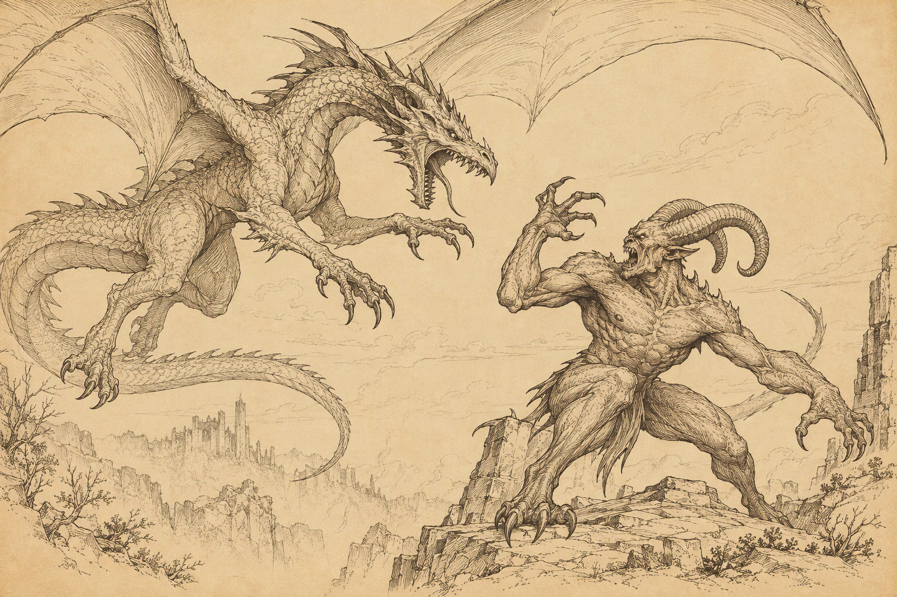{ .center-img width="60%" }

## Las Ognistych Liści&nbsp;67 { .divider }

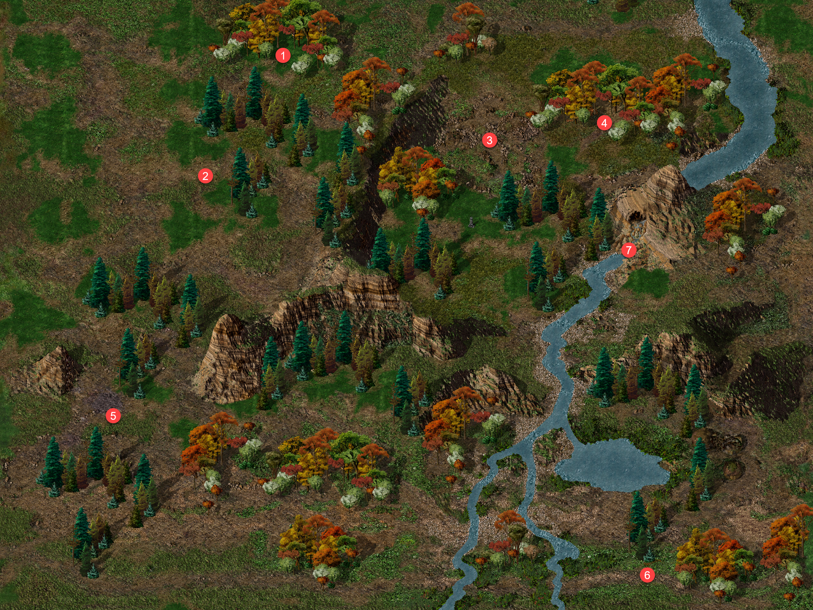{ .center-img width="40%" }

Pośród drzew 1 drużynę zatrzymało nagłe wołanie. Stary człowiek, wyraźnie uradowany na widok żywej duszy, przedstawił się jako **Ordolath** i wyjaśnił, że spędzał tu urlop naukowy, z dala od zgiełku *Wrót Baldura*. **Leech**, niezbyt skory do uprzejmości, od razu zapytał, czego od nich chciał. Starzec z zakłopotanym chichotem wyznał, że szykując się do podróży, zapomniał świecy. Bez niej nie mógł ani pisać w dzienniku, ani czytać książek, a tutejsze noce były bardzo ciemne. Dla mola książkowego była to istna udręka. Złożył więc propozycję. Jeśli wędrowcy poświęcą kilka dni i przyniosą mu jego mały woskowy skarb, nagrodzi ich sowicie ([Ordolath's Candle](../other/zadania.md#q115)). Leech uznał ofertę za ciekawą i poprosił o wskazanie domu. Uradowany uczony wyjaśnił, że od pierwszej chwili wydali mu się godni zaufania. Jego dom stał w północnej części *Wrót Baldura, biały budynek za niebieską wieżą maga, nie sposób go przeoczyć. Na pożegnanie poprosił o pośpiech i zapewnił, że będzie niecierpliwie wyczekiwał ich powrotu.

Nieco dalej spotkali młodego **Alberta** 2, który z wielkim niepokojem szukał zaginionego psa, **Rufiego**. Chłopiec obawiał się, że jego mały przyjaciel, nieprzywykły do obcych miejsc i nieznajomych ludzi, zaszył się gdzieś ze strachu. Z wdzięcznością przyjął pomoc i przekazał ulubioną zabawkę psiaka, licząc, że znajomy zapach pomoże odnaleźć zgubę i zdobyć jej zaufanie. Dla przypadkowego wędrowca poszukiwanie małego pieska mogło wydawać się drobnostką, dla chłopca oznaczało jednak odzyskanie najwierniejszego towarzysza ([Albert and His Dog](../other/zadania.md#q116)).

Wtem drogę zastąpiła im trójka awanturników 3: **Sendai**, **Alexander** i **Delgod**. Kobieta ostro zażądała, by wędrowcy z północy się zatrzymali. Oznajmiła, że zapuścili się głęboko na terytorium *Amnu*, i z drwiną zasugerowała, że może przybyli szpiegować rzekome zbrojenia. Bawiło ją, jakie głupie pomysły potrafiły zalęgnąć się w głowach północnych barbarzyńców. **Shar-Teel** nie kryła pogardy. Uznała, że tamta sama prosiła się o posmakowanie stali, i spytała Leecha, czy dadzą jej nauczkę, czy też stchórzy i spróbuje ją ułagodzić. **Jen'lig** zapytała jednak wprost, czy *Amn* rzeczywiście nie zagrażał *Wrotom Baldura*. **Sendai** zbyła to wyniośle bo jej potężny naród miał ponoć ciekawsze zajęcia niż atakowanie jakiegoś zadufanego barbarzyńskiego miasta. Poradziła im zawrócić. Githyanki odparła, że nigdzie się nie wybierali, bo mieli takie samo prawo tu przebywać. **Sendai** stwierdziła, że trafiła na berserkerów. Podobno wyczuła ich woń już wcześniej, a ich zachowanie tylko ją w tym utwierdziło. Wezwała **Delgoda** i **Alexandra**, by szybko rozprawili się z hołotą. **Jen'lig** sięgnęła po zaklęcie, a **Alexander** z groźnym pomrukiem zapowiedział, że zaraz dostanie za swoje, i rzucił się prosto na nią. Jak to się skończyło, łatwo się domyślić.

Niedaleko drużyna odnalazła **Rufiego** 4. Dzięki zabawce zdołała skłonić psa, by podążył za nią z powrotem do właściciela. Chłopiec gorąco podziękował, po czym nagle przeobraził się w demona, mieszkańca *Dziewięciu Piekieł*, i wraz z pupilem zniknął wędrowcom z oczu ([Albert and His Dog](../other/zadania.md#q116)).

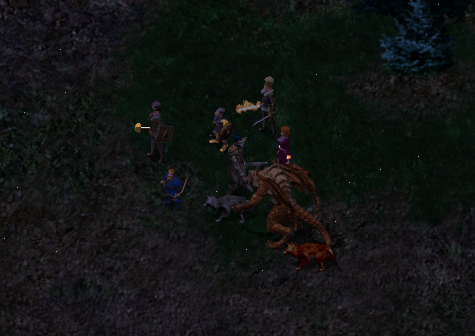{ .center-img width="60%" }

Z kolei zaczepił ich **Vax** 5. Z przesadną poufałością stwierdził, że zabłądzili nieco z utartego szlaku i mieli pecha trafić na najszybszą rękę na zachodzie. Wskazał stojącego opodal **Zala**, rzekomo najszybszego miotacza strzałek, jaki kiedykolwiek chodził po *Wybrzeżu Mieczy*. Radził nie wystawiać cierpliwości takiego człowieka na próbę, tylko rozsądnie oddać wszystkie pieniądze. **Shar-Teel** zaproponowała Leechowi, że chętnie przypomni mu, jak się zabija kretynów, gdyby przypadkiem zapomniał. **Finch** też nie dała się zastraszyć. Zapytała, czy **Vax** był skończonym głupcem, bo czegoś równie idiotycznego jak najszybszy miotacz strzałek na zachodzie jeszcze nie słyszała, i wyzwała go, by **Zal** pokazał, co potrafi. Urażony rozbójnik zawołał do towarzysza, że nikt ich nie traktował poważnie, więc pora dać pokaz umiejętności. Z udawanym żalem zapowiedział drużynie moc cierpień. Tak oto wyjaśniła się zagadka, czemu po świecie chodzili tacy idioci.

Dziwne trio 6, złożone z xvarta, kobolda i tasloi o imionach **Larry**, **Darryl** i **Darryl**, podarowało drużynie autograf.

Przy wodospadzie 7 zaatakował ich demoniczny rycerz, mamroczący coś o potrzebie ochrony swojego Pana. Po pokonaniu niecodziennego wroga **Sandrah** przyjrzała się bliżej wodospadowi, którego strzegł. Wtedy przypomniały jej się słowa tajemniczego zwoju: *była tu woda, były i góry sięgające chmur*. Po prawej stronie, wśród skał, rysowało się coś, co wyglądało na wejście. Sprawdzić to można było tylko w jeden sposób ([A Demonic Scroll](../other/zadania.md#q29)).

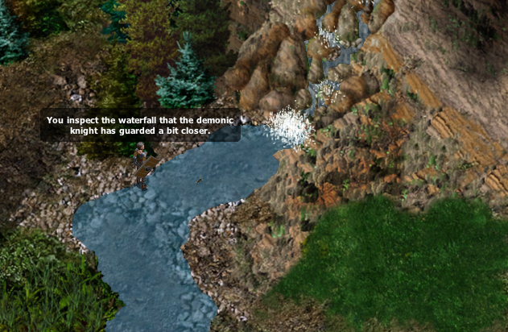{ .center-img width="60%" }

Wąski korytarz wyprowadził ich prosto do komnaty, w której stał demon. Z rykiem obwieścił, że podróż śmiertelników dobiegła końca, choć przez moment wyglądał na zbitego z tropu, bo najwyraźniej nie spodziewał się nikogo z tej strony ścieżki. Zapytany przez Leecha, kim lub czym jest, uznał, że skoro i tak nie wyjdą stąd żywi, może to zdradzić. Z namaszczeniem przedstawił się jako **Naronguth**.

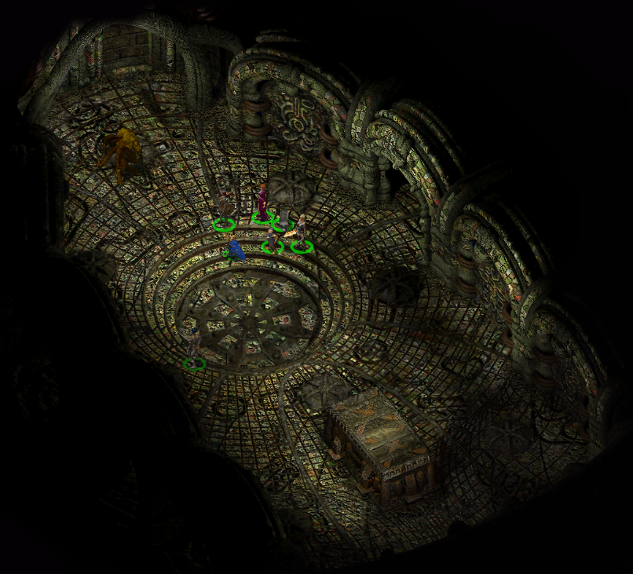{ .center-img width="60%" }

Młody gnom chłodno odparł, że to imię nic im nie mówi. W tej samej chwili rozległ się łoskot walących się skał i wejście za ich plecami runęło. Demon znów wydawał się zdziwiony, był bowiem pewien, że wszyscy go znają. **Sandrah** szepnęła ukochanemu, że skoro nie był to *Alzaligrundel*, musiał to być jego arcywróg, o którym wspominał zwój. Może dałoby się to wykorzystać. **Naronguth** wychwycił jednak szept i zagrzmiał, że przed nim nic nie pozostanie w ukryciu. Zapowiedział, że zuchwalcy zamiast zginąć szybko, będą długo cierpieć. Zamyślił się, że tylko ktoś tak potężny jak *Elminster* zdołałby go odnaleźć, a przecież nikt z nich nim nie był. Potem przywołał bliżej młodą kapłankę, bo coś w niej wyczuwał.

Leech ostrzegł plugawego biesa, by nie ważył się jej tknąć. Demon wybuchnął triumfalnym śmiechem. Zrozumiał, że kradzież odłamka przyniosła lepszy skutek, niż się spodziewał: zamiast *Elminstera* przybyła jego ukochana córeczka. Był to dla niego prawdziwy piekielny festyn i wspaniała zdobycz. By przedłużyć ich cierpienie, postawił przed nimi wybór. Mogli na zawsze utracić część zdrowia, oddać mu **Sandrah** na dziesięciodniowy pobyt w piekle albo stanąć z nim do walki o odłamek, jedyny sposób na powrót tą samą drogą. Zamiast odpowiedzieć, młody gnom zapytał niewinnie o jego dawnego przyjaciela, *Alzaligrundela*.

**Naronguth** wyraźnie się poruszył. Rozpoznał wreszcie smród, który czuł od chwili ich przybycia: mieli przy sobie coś należącego do *Alzaligrundela*. Zażądał wyjaśnień, ostrzegając, że mogą to być ich ostatnie słowa. Leech zablefował, że arcywróg znał położenie jego legowiska, a oni wiedzieli coś o nim samym, co mogło być dobrym początkiem układu. Ponownie zbity z tropu demon przyznał, że wiedział, gdzie tamten się ukrywał, lecz nie mógł tam dotrzeć, bo nie był w stanie przejść przez przeklętą ścianę wody, którą oni pokonali. **Sandrah** szepnęła, że mieli go w garści. Z piekielnym ogniem w środku nie przejdzie za wodospad, więc jeśli zaproponują mu rozprawienie się z *Alzaligrundelem*, mogą w zamian zażądać odłamka. Tym razem rozdrażniony **Naronguth** nie protestował już przeciwko szeptom. Wyjawił, że wyczuwał obecność wroga w pobliżu, lecz jego słudzy byli zbyt głupi, by go odnaleźć. Po ostatnim starciu w niezgłębionych czeluściach wybuchy mogły wyrzucić tamtego aż w te góry, a demon miał nadzieję, że tkwił w równie paskudnej dziurze co on sam. Zaproponował układ: jeśli przyniosą mu czarne serce *Alzaligrundela*, odda im odłamek *Elminstera* i rozstaną się w pokoju. Leech przystał na to bez wahania ([A Demonic Scroll](../other/zadania.md#q29)).

Drużyna otrzymała *Zwój Narongutha*. Wejście od strony *Chmurnych Szczytów* było zawalone i wyglądało na to, że tylko demon mógł pomóc im wydostać się na zewnątrz. **Naronguth**, rechocząc, przyznał, że rzeczywiście musiał ich wyprowadzić.

Na powierzchni wędrowcy odetchnęli z ulgą. Postanowili kontynuować podróż dolinami *Chmurnych Szczytów* i odnaleźć kryjówkę wroga **Narongutha**.

W drodze na zachód **Finch**, która od jakiegoś czasu nad czymś się zastanawiała, zagadnęła **Shar-Teel** i zaproponowała, że chętnie nauczy ją czytać, jeśli ta nie potrafi. Wojowniczka natychmiast się najeżyła. Oczywiście, że umiała czytać, i chciała wiedzieć, skąd ten niedorzeczny pomysł. Kronikarka wyjaśniła łagodnie, że skoro towarzyszka ceniła siłę ponad wszystko, mogła przegapić okazję, by cieszyć się wiedzą, która nie polegała na rozrąbywaniu czegoś na pół. **Shar-Teel** warknęła, że nie widziała sensu w czytaniu marnej książeczki o otwieraniu drzwi, skoro mogła je wyważyć nogą i mieć sprawę z głowy. Czytanie uznała za cuchnącą stratę czasu, wymyśloną zapewne przez jakiegoś mężczyznę i ruszyli dalej.

:material-paw: Bestiariusz: *xvart, borsukołak, demoniczny rycerz*

## Wodogrzmoty Driad&nbsp;68 { .divider }

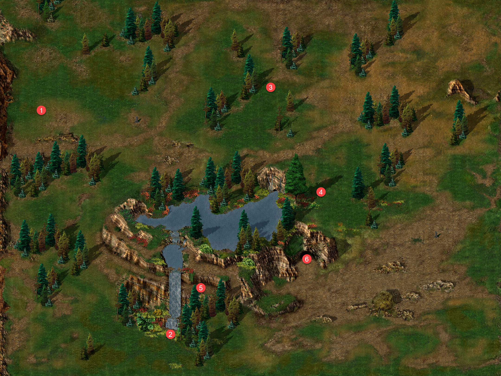{ .center-img width="40%" }

Demoniczny zwój zaczął wykazywać aktywność. Gdzieś w pobliżu musiał kryć się *Alzaligrundel*.

Najpierw jednak drużyna natknęła się na warczącego i charczącego gnolla **Ingota** 1, przeklinającego jakąś nędzną fortecę. Zapytany przez **Imoen**, o jaką fortecę chodziło, wyjaśnił, że leżała na zachodzie. Chciał upiec przetrzymywaną tam brankę, lecz pozostali woleli trzymać ją żywą w piwnicy. Nazwał ich głupcami i wyznał z goryczą, że za to wygnano go z klanu. Poprzysiągł, że jeszcze skosztuje jej mięsa. Rudowłosa skrzywiła się i przyznała, że nagle zrobiło jej się niedobrze. **Ingot** tylko syczał z lubością, że jeszcze ją upiecze ([Prisoner of the Gnolls](../other/zadania.md#q117)).

Przy dolnym wodospadzie 2 pojawiła się zjawa i wyszeptała imię **Aarona**, jakby w przybyszu rozpoznała ukochanego. Gdy Leech zapytał, czy to **Marina**, mara niepewnie powtórzyła imię i przyznała, że tak się nazywała. Wraz z utraconymi wspomnieniami przyszły łzy. Opowiedziała, że wybrała się z **Aaronem** na romantyczny piknik pod drzewem nimfy. Podobno pocałunek pod nim sprawiał, że miłość trwała wiecznie. Była bardzo zmęczona i chciała zasnąć, lecz ukochany zapowiedział niespodziankę, więc obiecała nie zasypiać, dopóki jej nie dostanie. Wtedy pojawiły się potwory. **Aaron** walczył, ale go ogłuszono, a potem wszystko spowiła ciemność. Ocknęła się wśród chłodu i mgły, wiedząc tylko, że musi czekać.

Młody gnom domyślił się, że wiązała ją obietnica czuwania aż do otrzymania niespodzianki. Duch przyznał mu rację. Wspomnienia jednak znów się rozmywały, a **Marina** szeptała coraz ciszej, że będzie czekać i nie zaśnie, bo tak przysięgła ([A Failed Picninc](../other/zadania.md#q70)). Drużyna miała nadzieję pomóc jej zaznać spokoju.

Drogę zastąpił im **Ludrug** 3, który oznajmił, że wkroczyli na terytorium jego plemienia i nie odejdą, dopóki nie zapłacą daniny w wysokości 50 sztuk złota. **Jen'lig** nie zamierzała płacić. Zapytała, czemu właściwie nie mieliby wybić całej tej bandy włochatych kup hieniego łajna. Rozwścieczony **Ludrug** poprzysiągł, że zapłaci za zniewagę życiem. Proroctwo okazało się trafne, tyle że dla niego samego.

Z kolei **Driada z Chmurnych Szczytów** poprosiła wędrowców o pomoc 4. Wspaniały, prastary dąb był w niebezpieczeństwie, bo zamierzało go ściąć dwóch osobników gotowych zbezcześcić majestat natury. Na jej uroki byli odporni, trzeba ich więc było powstrzymać, zanim wyrządzą nieodwracalne szkody. **Sandrah** oburzyła się, że tylko najpodlejsi łotrzy mogliby skrzywdzić łagodnego leśnego ducha, i poprosiła, by driada prowadziła. Ta podziękowała, ostrzegając, że choć tamci wydawali się dość tępi, mogli narobić już wiele szkód. 

Przy drzewie czekał **Caldo**, który od razu dał do zrozumienia, że nie pozwoli obcym kręcić się za plecami podczas pracy. Był przekonany, że w drzewie ukryto skarb. Jeśli chcieli pomóc, mogli stanąć z przodu i wziąć się do roboty. W przeciwnym razie on i **Krumm** zrobią coś… no, coś naprawdę paskudnego. **Leech** próbował przekonać go, jak piękne było to drzewo i jakim jest cudem natury. Bez skutku. Skoro nie zamierzali pomagać, nie pozwoli im się przyglądać, bo pewnie chcieli ich potem obrabować. On i **Krumm** nie znosili przecież bandytów, prawda? **Krumm** zdołał tylko zapytać, o co chodzi, i obaj ruszyli na drużynę.

Driada była bardzo wdzięczna za wstawiennictwo za prastarym drzewem ([Dryad of the Cloud Peaks](../other/zadania.md#q118)). :material-trending-up: Reputacja +1

Na ścieżce w górę wodospadu 5 **Drienne** łkała nad losem swojej kotki **Pixie**, która bawiła się i się poślizgnęła a następnię została wciągnięta przez masę spadającej wody. Pociągając nosem, wyrażała nadzieję, że nic jej się nie stało. **Sandrah** zapytała, czy dziewczynka miała pojęcie, czy kto kręcić sie w pobliżu, może jakieś cuchnące, przerażające stworzenia nietutejszego pochodzenia. **Drienne** odparła, że poza śmierdzącymi, strasznymi gnollami w grę wchodzili jeszcze mieszkańcy jaskini, wszyscy o świecących oczach i piekielnej woni. Jaskinię należało więc odnaleźć.

Truchło kotki spoczywało w kipieli u stóp wodospadu 2. Gdy wędrowcy je oddali, mała szybko się uspokoiła. Wyjaśniła, że **Pixie** robiła już takie rzeczy wcześniej, a tatuś po prostu znów będzie musiał ją wskrzesić. W podzięce podarowała im zwój od ojca, bo i tak nie umiała jeszcze przeczytać zapisanych w nim słów. **Shar-Teel** nie kryła drwiny. Dziwiła się, że dziewczyna nazywała ojca tatusiem i biegła do niego, by uleczył jej głupiego kota. Przez chwilę wpatrywała się w potakującą małą, po czym kazała jej się wynosić, bo sierść zdechłego kota drażniła jej oczy. **Drienne** odeszła z płaczem. Kotka najwyraźniej nie umarła po raz pierwszy. Dziewięć żyć, akurat. Gdyby tylko mieć na własność nekromantę… Cokolwiek zapisano w zwoju, zapowiadało się interesująco ([Drienne's Cat](../other/zadania.md#q119)). :material-trending-up: Reputacja +1

Wejście do jaskini 6 rzeczywiście wcześniej im umknęło. W środku poprosili magiczny zwój, by przeniósł ich do swojego Pana.

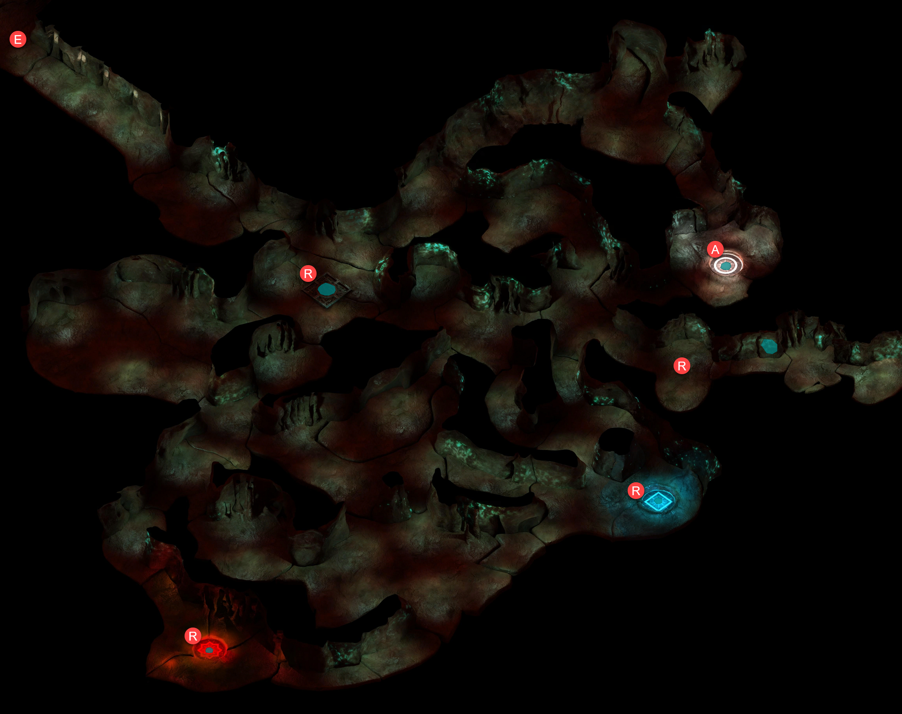{ .center-img width="60%" }

Trafili do rozległego systemu jaskiń. Zombie, upiorne wilki i mefity pyłu nie stanowiły wielkiego problemu, prawdziwym wyzwaniem okazali się dopiero demoniczni rycerze R, których pokonanie wymagało przebiegłości.

Wreszcie stanęli przed arcywrogiem **Narongutha**. Olbrzymi smok A zażądał, by niewolnik oddał mu przedmioty, i zapowiedział karę za spóźnienie. Szybko jednak zorientował się, że ma przed sobą nie swojego duergara, lecz nieproszonych gości, i wezwał sługi do ataku.

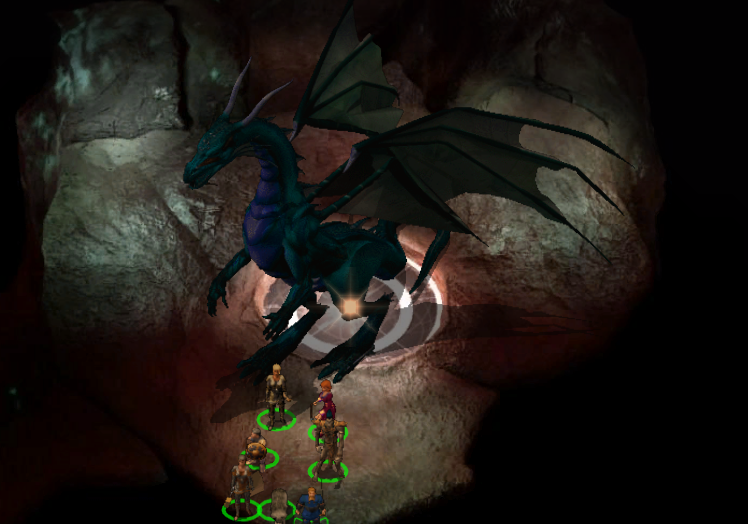{ .center-img width="60%" }

Leech stwierdził spokojnie, że słudzy byli chyba niedysponowani, i upewnił się, że rozmawia z **Alzaligrundelem**. Demon, zakrztusiwszy się ze złości, nie mógł pojąć, co się działo. Jego słudzy zginęli, a posłaniec duergar, jedyny, który potrafił wydostać się z przeklętych tuneli, nie wrócił. Zamiast niego zjawili się oni. Domyślił się, że dostali się do środka dzięki zwojowi niewolnika, i zapytał, czy go zabili.

Młody gnom zignorował pytanie i zauważył, że ostatnia bitwa z **Naronguthem** uwięziła obu przeciwników w pułapce i od tamtej pory sytuacja demona się nie poprawiła. **Alzaligrundel** zaśmiał się, że to znów sprawka arcywroga, który przysłał tę żałosną gromadkę. Uznał, że jego żarty były coraz gorsze, a głupcy za zuchwałość zginą przedwcześnie. Leech zaprzeczył, by byli w zmowie z **Naronguthem**. Wyjaśnił, że tamten miał coś, czego potrzebowali dla dobra krain na zewnątrz, a ceną było serce **Alzaligrundela**. Bez niego nie mogli się stąd wydostać. Demon oburzył się, pytając, co w całym *Faerûnie* mogło być tak ważne, by śmiertelnicy ważyli się sięgać po jego serce. Usłyszał, że chodziło o *Odłamek Elminstera*, dar *Mystry*.

Na dźwięk tych imion spoważniał. Skoro za drużyną stały najstraszliwsze moce ich świata, zabicie jej nic by nie dało, bo inni poszliby ich śladem. Choć chętnie zobaczyłby rozlew krwi, odciągnęłoby go to od pilnego zadania, jakim było rozprawienie się z **Naronguthem**. Przyznał, że da się to załatwić bez niczyjej śmierci. Miał przy sobie świeże serce demona ze swojego rodu, poległego w ostatniej walce. Była to jego własna linia krwi, więc arcywróg uzna je za jego. Kazał im je wziąć i odejść.

Leech odetchnął z ulgą, że obyło się bez rozlewu krwi. Drużyna otrzymała *Fałszywe Serce Demona* ([A Demonic Scroll](../other/zadania.md#q29)). Gdzieś w oddali rozległ się odgłos otwieranych ciężkich drzwi E.

Uradowani wędrowcy od razu skierowali się z powrotem do **Narongutha**. W drodze **Shar-Teel** nie wytrzymała i zapytała, czy ten piekielny hałas musi trwać bez końca. Chodziło jej o **Imoen**, radośnie nucącą i udającą, że nie wie, o jaki hałas chodzi. Wojowniczka zagroziła, że jeśli to się nie skończy, wytnie jej język. Rudowłosa zauważyła, że ktoś tu był bardzo drażliwy, ale zgodziła się przestać, bo nucenie i tak zaczęło ją nużyć. **Shar-Teel** odetchnęła. Przedwcześnie. **Imoen** oznajmiła bowiem, że skoro skończyła nucić, czas zacząć śpiewać stare, dobre piosenki na szlak. Innym razem Rudowłosa zagadnęła wojowniczkę, czemu właściwie wciąż z nimi zostawała. Spodziewała się raczej, że już pierwszej nocy dźgnie śpiącego Leecha, w końcu był mężczyzną. **Shar-Teel** zbyła ją, nazywając rozszczebiotaną namiastką kobiety. Przegrała i obiecała spłacić dług, na tym koniec. **Imoen** przyznała, że to możliwe, ale nie sądziła, by tamta przywiązywała wagę do honoru, zwłaszcza wobec mężczyzn. Zastanowiła się głośno, czy jest w niej jednak trochę przyzwoitości, a może po prostu coś czuje do Leecha. **Shar-Teel** poradziła jej porzucić ten tok myślenia, zanim skończy ze sztyletem w gardle albo z językiem rozciętym jak u żmii. Splunęła przy tym, że niektóre kobiety niewiele były lepsze od mężczyzn.

:material-paw: Bestiariusz: *zimowy wilk, straszliwy wilk, upiorny wilk, straszny wilk, gnoll, ogr berserker, ogrzy mag, ogrillon, zombie, mefit pyłu, demoniczny rycerz*

## Las Ognistych Liści&nbsp;69 { .divider }

{ .center-img width="40%" }

Przy wodospadzie 7 czekał już wysłannik demona, który ponownie zaprowadził ich do swojego pana.

**Naronguth** powitał powracających grzmiącym głosem. Skoro tu byli, musieli przecież pokonać jego arcywroga. **Shar-Teel** oznajmiła, że byli gotowi na wymianę, i wręczyła mu *Fałszywe Serce Demona*. Demon wybuchnął triumfalnym śmiechem, ogłosił czas zabawy i nazwał ich swoimi nowymi przyjaciółmi. Zachęcił, by się rozgościli, a on tymczasem każe kucharzowi przyrządzić świeżo zabite bazyliszki. Na przystawkę miało być czarne serce *Alzaligrundela* duszone we własnej krwi.

Wojowniczka ostudziła jego zapał. Wykonali za niego tę przeklętą robotę, ale przyjaciółmi nie byli. Zażądała odłamka, po którym mógł sobie świętować choćby przez całą wieczność. Rozwścieczony demon nazwał ich paskudnymi psujami zabawy i kazał się wynosić. Skoro nie chcieli się bawić, nie dostaną też odłamka. **Shar-Teel** przyznała, że powinna była się tego spodziewać, i zwróciła się do **Sandrah**, wytykając jej, że to był jej pomysł, i pytając, czy doradczyni miała teraz jakieś sugestie.

**Naronguth** natychmiast zaczął narzekać na kolejne szepty z małą kapłanką. Twarz córki **Elminstera** wykrzywił gniew, jakiego nikt u niej wcześniej nie widział. Wyjęła z kieszeni szaty garść orzeszków, cisnęła nimi w demona, życzyła mu smacznego na przyjęciu i kazała iść do piekła. Demon powtórzył te słowa w zamyśleniu, po czym zaczął nucić o domu, słodkim domu. U jego stóp pojawiło się coś na kształt pantofelków. Stuknął obcasami raz i drugi, powtarzając, że nie ma jak w domu, po czym zniknął za sprawą *Drzwi do innego wymiaru*, zostawiając zarówno pantofle, jak i *Odłamek Elminstera*.

Drużyna zabrała obie rzeczy. Spryt i szczęście **Sandrah** bardzo się przydały. Magiczny zwój odmówił jednak dalszej współpracy i nie chciał ich już słuchać.

Kapłanka zapytała Leecha, czy nie pora wypróbować odłamka. Przyznał jej rację i dodał, że wszyscy pokładali w niej teraz nadzieję. Z uśmiechem podziękowała za zaufanie. Ledwie ujęła odłamek w obie dłonie, zaczął delikatnie lśnić, jakby rozpoznał w niej krew *Elminstera*. Poprosiła, by skoro ją rozpoznał, zaniósł ją do ojca.

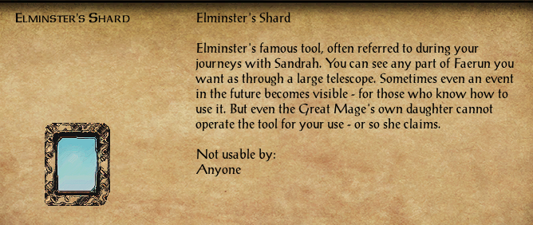{ .center-img width="60%" }

Odłamek nie przeniósł ich jednak aż do celu. Uznała, że jej moc nie wystarczała jeszcze na taką odległość. Przynajmniej znów byli na powierzchni, a po tej piekielnie cuchnącej przygodzie odrobina marszu na świeżym powietrzu mogła im dobrze zrobić. Wszyscy widzieli, co zdołała zdziałać tym potężnym narzędziem, lecz jego miejsce wciąż było w rękach jej ojca. Ponagliła więc towarzyszy, by pospieszyli się na spotkanie z nim.

## Nashkel&nbsp;70 { .divider }

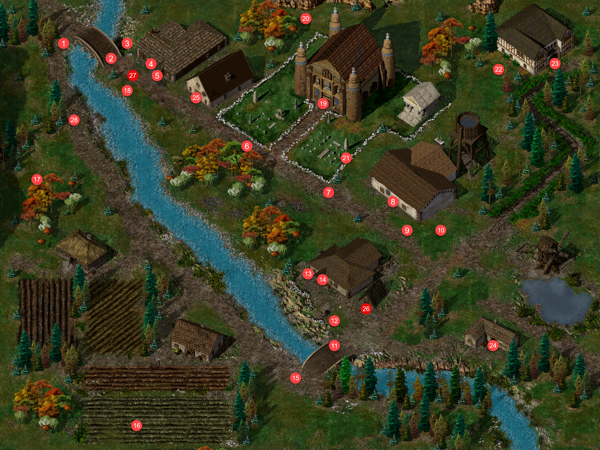{ .center-img width="40%" }

Wędrowcy zajrzeli tu tylko dla **Karp** 16. Przywitała ich z ulgą, bo niecierpliwie wyczekiwała wieści, i zapytała, czy udało się znaleźć kogoś, kto pomógłby jej i synowi bezpiecznie dotrzeć do *Athkatli*. Leech wyjaśnił, że załatwił coś dla niej w *Beregoście*. Mieli wyruszyć tej nocy, a po przybyciu do miasta ktoś się z nimi skontaktuje. Dziękowała wylewnie, przyznając, że przynieśli jej nie tylko pomoc, ale i nadzieję. Zgodnie z obietnicą wręczyła drużynie pierścienie, a do tego dorzuciła coś jeszcze. Ponad miesiąc wcześniej znalazła ten przedmiot zakopany w polu. Był dziwny, niepodobny do niczego, co wcześniej widziała, a nikt, kogo pytała, nie potrafił go rozszyfrować. Uznała, że może przyda się komuś z takimi możliwościami i znajomościami. Poprosiła, by potraktowali go jako wyraz najgłębszej wdzięczności, i pożegnała ich, życząc bezpiecznej drogi ([Beneath the Ploughshares](../other/zadania.md#q94)).

**Sandrah** uznała, że musiało to być ogrze ostrze, lecz zdeformowane i nienadające się do użytku. Może ktoś będzie wiedział o nim więcej.

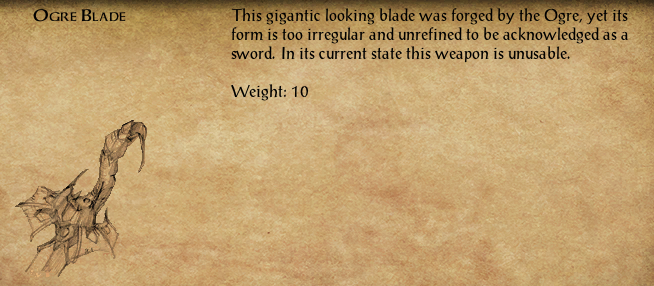{ .center-img width="60%" }

## Beregost&nbsp;71 { .divider }

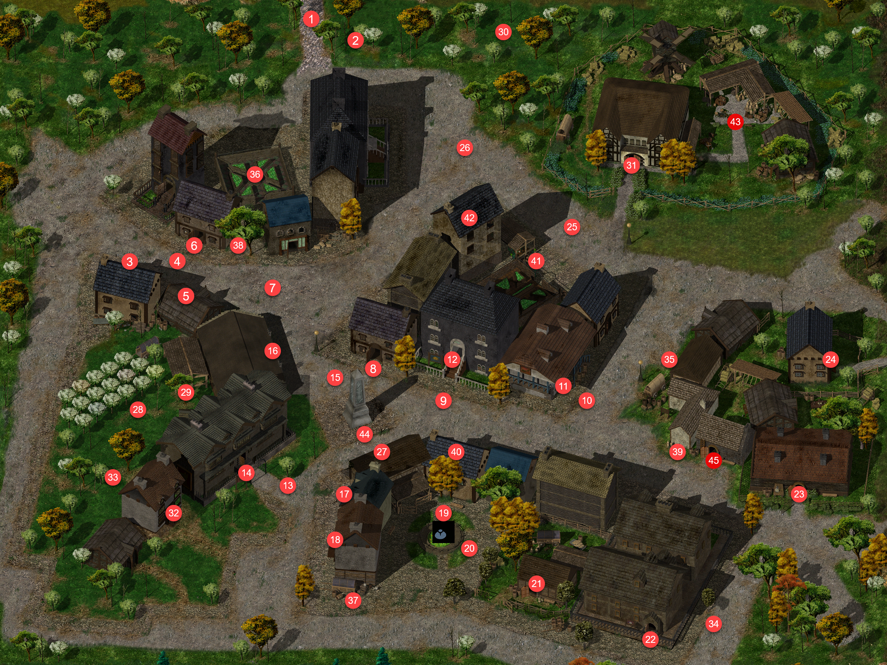{ .center-img width="40%" }

**Taerom Fuiruim** 23 powitał drużynę i zapytał, czym może służyć w ten piękny dzień. Leech wyjaśnił, że przynieśli rudę potrzebną dla **Thalantyra**. Kowal potwierdził, że mag przysłał już wskazówki, choć sądził, że z rudą wróci **Melicamp**. Skoro jednak zjawili się oni, domyślał się, że młody czarodziej znów, hmmm, niezbyt dobrze poradził sobie z zadaniem. Poprosił o jakieś dwa dni, po których zamówienie miało być gotowe ([Destroy the Cursed Bracers](../other/zadania.md#q56)).

W *Feldepost* 14 czekała **Illasera**. Z przekąsem zapytała, jak udał się powrót do kopalni w *Nashkel* i czy wciąż było tam tak barwnie i wesoło jak dawniej. Leech odparł w tym samym tonie, że następnym razem powinna pójść z nim, bo pokazałby jej tamtejsze widoki i zapachy, zwłaszcza zapachy, którym nic nie dorównywało. Uznała propozycję za kuszącą, ale podziękowała. Następnego razu i tak miało nie być, a jeśli miasto nie potrafiło o siebie zadbać, mogło sobie zgnić. Potem zajęła się księgą czarów. Przeglądając ją, wybuchnęła śmiechem. Autor bał się podobno, że własny szkielet wyrwie się z jego ciała, a jakiś rachmistrz przyjdzie go zabić. Niezła patologia. Całość uznała za szalone bazgroły przemieszane z mizernymi zaklęciami, kompletnie bezużyteczne śmieci. Mimo to zabrała księgę i za fatygę dorzuciła okrągły tysiąc sztuk złota.

Młody gnom zauważył jednak, że nawet z przeciętnych zaklęć da się po dopracowaniu wydobyć potężne efekty, i zarzucił jej, że chciała pozbawić ich owoców takich badań. Zapytał, co by było, gdyby wolał zatrzymać księgę. Łowczyni przypomniała, że to jej operacja, a notatnik szaleńca nie był powodem, by psuć tak dobrze układającą się współpracę. Widząc jego upór, obiecała podzielić się sekretami, które z niej wydobędzie, jeśli w ogóle okażą się przydatne. **Leech** uznał to za uczciwe i drużyna oddała *Księgę Czarów Sazazira*.

Tak zakończyła się sprawa nekromanty, a **Illasera** przeszła do kolejnego zlecenia, jej zdaniem dość interesującego. Przypomniała o edykcie *Candlekeep*, zgodnie z którym wstęp do biblioteki wymagał przekazania księgi o odpowiedniej wartości. Pewien oni, lepiej znany jako ogr mag, zaczął napadać na podróżnych i odbierać im księgi, zanim dotarli do bram. Klientka chciała odzyskać swój tom i pozbyć się stwora z okolicy. Leech zapytał, czy dla *Candlekeep* to zbyt wielki kłopot, by wysłać *Strażników*. **Illasera** odparła, że nie chcieli mieszać się w nic, co działo się poza ich murami. **Imoen** dorzuciła, że te skąpe stare dziadygi pozwoliłyby umierającemu skonać z pragnienia, zamiast podać mu bukłak, dopóki nie przyniesie księgi. Na pytanie, czy klientka przeżyła, łowczyni wyjaśniła, że oni nikogo nie zaatakował. Po prostu zatrzymywał podróżnych i zażądał ksiąg, a nikt nie odważył się odmówić.

Młody gnom pomyślał, że skoro stwór dotąd unikał przemocy, może dało się z nim porozmawiać. **Illasera** uznała to za mało prawdopodobne. O samym ogrze wiedziała niewiele. Kazał nazywać się *Dżentelmenem*, co mogło być sposobem na łatwiejsze radzenie sobie z ofiarami albo zwykłą kpiną. Nie wiedziała, czemu to robił, poza tym, że łatwo zdobywał w ten sposób magiczne księgi. Ogrów magów zawsze napędzała chęć powiększania mocy i wiedzy. Za zlecenie wyznaczono równe osiemset sztuk złota, bo klientce bardzo zależało na odzyskaniu tomu.

Ogra należało szukać na północ od miasta, gdzie leżało pole kamieni ułożonych w cztery kręgi, być może dawne pogańskie miejsce rytualne. Jeśli kryła się tam uśpiona magia albo zbiegały się linie mocy, nic dziwnego, że go przyciągało. Leech zgodził się zająć sprawą, wiedząc, że to miejsce wiązało się także z jego prywatną tragedią. **Illasera** dodała, że poszukiwany tom zawierał oryginalne rękopisy sztuk bardki **Saleny Fairsky**, całkiem zdolnej dramatopisarki, choć jej gry słów bywały nieco rozwlekłe. Mieli przynieść księgę, by odebrać nagrodę ([Black Hearts - The Huntress](../other/zadania.md#q87)).

Nie omieszkali zajrzeć do **Rigalda** 29. Zauważył, że jeśli ich obecność nie była przypadkowa i przynosili owoce ostatniego przedsięwzięcia, pora o tym mówić. Leech wręczył mu obiecane pierścienie. **Rigaldo** zapewnił, że ich wysiłki nie przeszły niezauważone, i zgodnie z obietnicą jeden pierścień pozostawił im jako symbol trwałej współpracy ([Beneath the Ploughshares](../other/zadania.md#q94)).

Nowe zadanie wymagało precyzji. Na jarmarku w *Nashkel* toczyła się subtelna gra, potrzebująca zręcznych dłoni. Zorganizowana grupa hochsztaplerów posługiwała się nie stalą, lecz przebiegłością i strzałkami ogłuszającymi, zdolnymi odwrócić bieg fortuny. Strzałki ukryto w dwóch wielkich namiotach hazardowych w zachodniej części jarmarku. Drużyna miała przeniknąć na teren wesołego miasteczka, niepostrzeżenie pozbawić szalbierzy arsenału, a następnie przekazać go **Arioshowi** i jego ludziom, czekającym w cieniu za namiotami. Ironia polegała na tym, że ich własnymi narzędziami zamierzano odebrać oszustom wygrane, a przede wszystkim licencje hazardowe.

**Rigaldo** wyjaśnił, że nie byli to zwykli dostarczyciele rozrywki, lecz wspólnicy *Cienistych Złodziei*. Gry i wesołe miasteczko służyły im za przykrywkę dla mroczniejszych interesów. Nie chodziło więc o zwykły łup, lecz o rozbicie trybiku w znacznie bardziej złowrogiej machinie. **Imoen** przyznała, że to zmieniało obraz, choć trudno jej było wyobrazić sobie, że miejsce zabawy mogło być uwikłane w coś mrocznego. Jeśli jednak *Cieniści Złodzieje* wykorzystywali jarmark do niecnych celów, nie mogli przymknąć na to oka. Miała tylko nadzieję, że uderzą we właściwe cele ([Whispers of the Carousel](../other/zadania.md#q120)).

*Pomocna Dłoń* była już blisko, lecz najpierw wędrowcy postanowili zajrzeć na *Lwi Trakt*.

## Lwi Trakt&nbsp;72 { .divider }

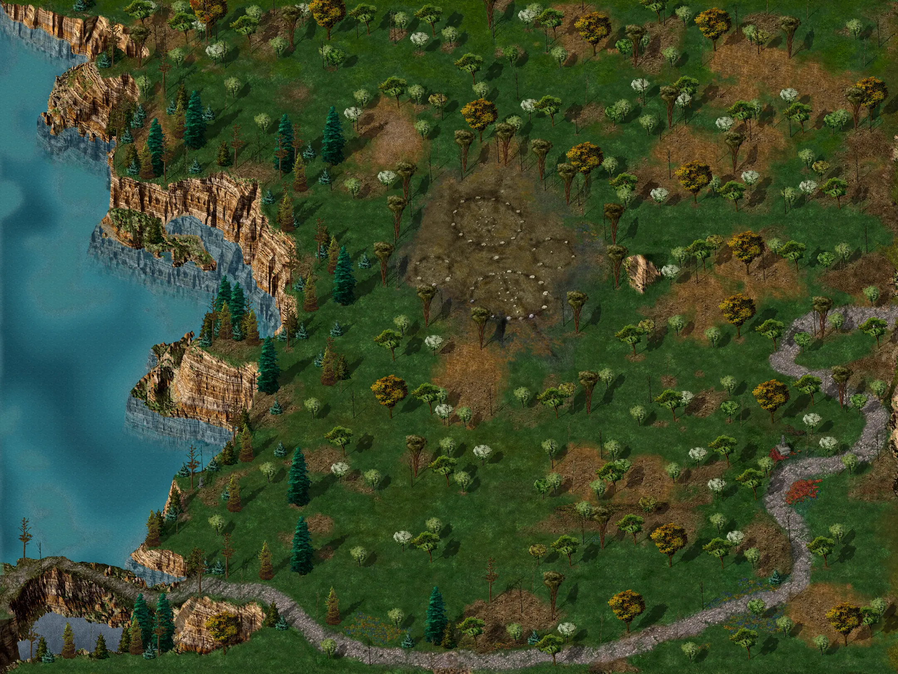{ .center-img width="40%" }

W miejscu kaźni **Goriona** 2 rzeczywiście czekał ogr mag. Z nienaganną uprzejmością zapytał, czy wędrowcy zmierzali do wielkiej biblioteki *Candlekeep*. Leech zaprzeczył i oznajmił, że przybył porozmawiać właśnie z nim. Rozmówca poprosił, by nazywano go **Dżentelmenem**. Przyznał, że prędzej czy później ktoś uzbrojony w stal i magię musiał go odnaleźć, i zapewnił, że o ile nikt nie okaże wrogości, nikomu nie stanie się krzywda.

**Imoen** zauważyła półgłosem, że całe spotkanie było wyjątkowo dziwne, a z każdą chwilą coraz trudniej było orzec, jak bardzo. Młody gnom przyznał, że rzadko trafiał się ogr mag przedkładający rozmowę nad atak. **Dżentelmen** wyjaśnił, że jako gość w cudzym kraju uważał uprzejmość wobec jego mieszkańców za kwestię honoru. Ogrzych magów znano tu jako okrutnych i brutalnych, lecz w jego ojczyźnie byli ludem cywilizowanym.

Leech docenił te słowa, trudno mu jednak było przyjąć je za dobrą monetę, skoro ich autor okradał podróżnych jak pospolity rozbójnik. Ogr zapewnił, że wolałby, aby do tego nie doszło. Przybył, by odwiedzić *Candlekeep*, lecz odmówiono mu wstępu, mimo że okazał wymagany rzadki tom. Ani strażnicy bramy, ani jeden z mnichów nie dali się przekonać. Pozostało mu więc narzędzie nacisku. Liczył, że niedogodności spotykające podróżnych skłonią zarządców do zmiany decyzji.

Powodu odmowy nikt mu nie podał, ale wystarczyło na niego spojrzeć. **Imoen** przyznała, że przez całe dzieciństwo w *Candlekeep* nie spotkała tam ani jednego ogra ani innego potwora, i zaraz dodała, że nie chciała nikogo urazić. **Dżentelmen** nie poczuł się obrażony, lecz uznał, że jej swobodny ton tylko lepiej ilustrował problem. Leech tłumaczył, że jego pobratymców uznawano tu za niebezpiecznych, i to nie bez powodu, dlatego żądanie natychmiastowego wstępu było nierozsądne. Ogr odparł, że właśnie dlatego starał się dowieść swej niegroźności. Postępował zgodnie z obyczajami małych ludów i przyniósł cenny tom z ojczyzny. Zapytał, czy gnom chciałby być osądzany według najgorszego znanego gnoma. Ten przyznał, że to niesprawiedliwe, i dodał, że gdyby to od niego zależało, wpuszczałby do miast tak zwane potworne rasy, o ile zachowywałyby pokój. **Dżentelmen** ubolewał, że rozmówca nie był magistrem stanowiącym prawo tej krainy. Jego otwartość umysłu na niewiele się zdawała.

Rozmowa przeszła więc do celu wizyty, skoro biblioteki istniały też gdzie indziej. Ogr nie szukał byle jakiego tomu. Chodziło mu o jedną konkretną księgę, a ze wszystkich badań wynikało, że jedyny egzemplarz znajdował się właśnie w *Candlekeep*. Na niedowierzające pytanie, czy całą wyprawę podjął dla jednej książki, odparł, że to lekceważenie wartości wiedzy. Chodziło o dzieło o największym znaczeniu, którego słowa przynosiły moc i wpływy ponad wszelką miarę. Nosiło tytuł *Liberus Optimae Erositica*.

**Imoen** parsknęła śmiechem i pospiesznie zapewniła, że nigdy o niczym takim nie słyszała. Leech przypomniał sobie jednak ten tytuł i rozpoznał w nim podręcznik sztuki miłosnej. **Dżentelmen** nazwał to rażącym uproszczeniem. Według niego było to kompendium wszelkich sztuk cielesnej rozkoszy i największa skarbnica wiedzy na ten temat. Gdy zaczął zagłębiać się w szczegóły, młody gnom przerwał mu stanowczo, że zrozumiał wystarczająco dużo. Ogr oznajmił, że taka wiedza byłaby wspaniałym darem dla jego konkubin i nie zamierzał wracać do domu bez tej księgi. Leech wątpił, czy uda się zdobyć oryginał, ale podsunął, że może istniała kopia. Kompletny odpis mógłby zadowolić **Dżentelmena**, lecz ten nie wiedział, od czego zacząć poszukiwania.

Gnom wyjaśnił, że skrybowie odwiedzający *Candlekeep* czasem przepisywali tamtejsze księgi, więc być może uda się odnaleźć kogoś, kto ją posiadał. Leech poprosił ogra o zaprzestanie rozbojów a w zamian obiecał poszukać rozwiązania i wkrótce wrócić ([Black Hearts - The Huntress](../other/zadania.md#q87)). 

## Pomocna Dłoń&nbsp;73 { .divider }

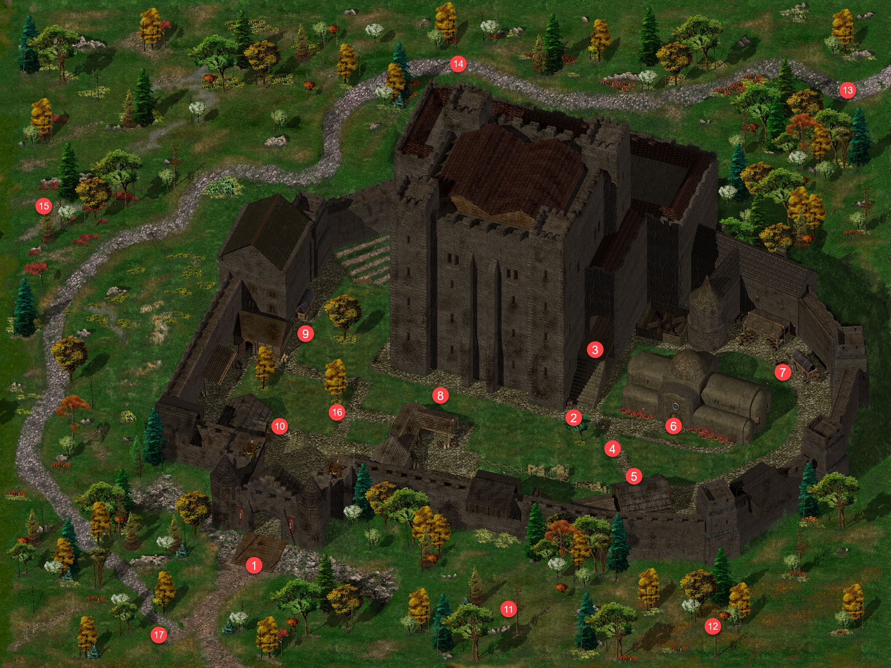{ .center-img width="40%" }

Przed murami ostoi 17 podbiegł do nich **Gruby Człowiek**, błagając o pomoc dla ciężko rannej żony. Leech zapytał, co się stało, i zdziwił się, że bandyci ośmielili się napaść na podróżnych niemal w zasięgu wzroku strażników *Przyjaznej Dłoni*. Nieznajomy odparł, że *Przyjazna Dłoń* nie była im w niczym pomocna, a uzdrowiciel drużyny również nic nie poradzi. Jego żonę dotknął demon za sprawą magii, więc tylko Leech mógł jej pomóc.

Młody gnom zdziwił się, skąd tamten mógł to wiedzieć, i zapytał, czego kobieta potrzebowała. Ratunek mógł przynieść wyłącznie przedmiot skradziony potężnemu **Naronguthowi**. Nieznajomy zażądał jego wydania. Leech natychmiast przejrzał podstęp i ostrzegł towarzyszy, że to pułapka. Napastnik krzyknął, że byli głupcami, a młody przywódca ruszył do ataku.

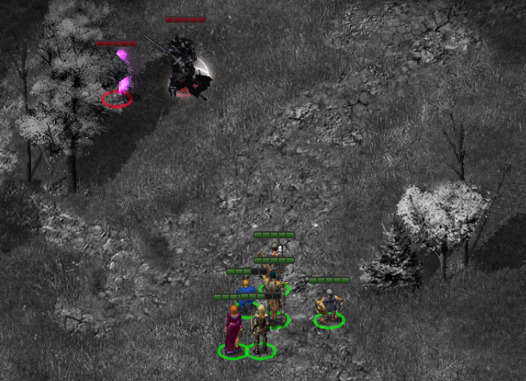{ .center-img width="60%" }

Walka była wymagająca, lecz w końcu oba pomniejsze demony wysłane przez swego Pana padły.

W świątyni 6 **Elminster** z radością przywitał córkę, gdy dostarczono mu odnaleziony odłamek *Mystry*. Uznał, że **Sandrah** dobrze wybrała przyjaciół, i pozdrowił także Leecha oraz jego nieustraszoną drużynę. Mag zapytał, czy demony zostały pokonane. **Leech** wyjaśnił, że drużyna zdobyła odłamek sprytem i podstępem, lecz przeciwnicy okazali się niezwyciężeni. **Elminster** uznał go za kompetentnego przywódcę, umiejętnie wykorzystującego własne talenty i zdolności towarzyszy. Zachęcił, by postępował tak dalej i dobrze opiekował się wszystkimi, a na pożegnanie poprosił o troskę o córkę. Objął **Sandrah** i ucałował ją, a Leech zauważył, jak przy tym wsunął jej w fałdy szaty niewielką paczuszkę ([A Demonic Scroll](../other/zadania.md#q29)).

Puzderko **Sandrah** pozwalało między innymi przekształcać liście *Aescalusa* w mikstury uzdrawiające. Nadszedł czas na odpoczynek, a potem na kolejny atak na obóz bandytów.

Drużyna wynajęła pokój i wreszcie oddała się odpoczynkowi i leczeniu ran. Leech i **Sandrah** część nocy jednak spędzili na wzajemnym dostrajaniu rtmu swoich bioder a rano **Sandrah** uklękła przy posłaniu dowódcy oddziału i pochyliła się nad nim, a jej długie włosy opadły wokół niczym kaskada. Zapytała, czy już się obudził. Odpowiedział, że nie, bo właśnie śnił cudowny sen, po czym powoli przyciągnął ją do siebie i pocałował.

Rzeczywistość bywała równie piękna jak sny, zauważyła, wtulając się w jego objęcia. Całowała go raz po raz, coraz głębiej. Zachwycona nowym doświadczeniem wyznała, że kochała życie i kochała jego, po czym zapytała, czy on czuł to samo. Odparł, że tak. Wziął ją w ramiona, ucałował jej usta i zaproponował, by wspólnie stawili czoła nowemu dniowi.

Sprawy między nimi przybrały nieoczekiwany obrót, a młody gnom uznał, że to dobry moment na szczerość. Wyznał, że sporo myślał o tym, co się między nimi działo. Wszystko zdarzyło się niespodziewanie i budziło pewne zamieszanie, lecz był gotów podjąć to wspólne przedsięwzięcie. Przyciągnął ją do siebie i pocałował, a ona odpowiedziała namiętnie. Zapewniła, że będzie to prawdziwa przygoda, która zakończy się pomyślnie, jeśli obydwoje oddadzą się jej całym sercem. Leech dodał, że gotów był podjąć ryzyko i przyjąć każdą niespodziankę losu. Widział w niej silną, pełną pasji kobietę i kogoś znacznie więcej niż towarzyszkę podróży. Poprosił o kolejny słodki pocałunek, a ona zamknęła oczy, wtuliła się w jego ramiona i rozchyliła usta. Straszne z nich "całuśniki*!

Z boku **Shar-Teel** posłała mu gniewne spojrzenie. Nie wiedział, czy bardziej go to zaskoczyło, czy zaciekawiło. Gdyby skłonił ją do mówienia o sobie, może lepiej zrozumiałby ponurą wojowniczkę. Uznał jednak, że nie warto zawracać sobie tym głowy, by nie dowiedzieć się czegoś, czego wolałby nie wiedzieć.

**Sandrah** uśmiechnęła się promiennie i zapytała, co chodziło mu po głowie. Chciał jeszcze raz zapytać o **Goriona**. Pośród zamieszania ostatnich dni niemal zapomniał o drobnym zdarzeniu. W tamten straszny dzień, gdy razem z opiekunem opuszczał *Candlekeep*, dostrzegł ją na schodach biblioteki rozmawiającą ze starcem. Mogła go nie zauważyć, bo odeszła bardzo wzburzona. Przyznała mu rację. Choć trudno było to wyjaśnić, postanowiła spróbować. Chciała ostrzec **Goriona**, choć on i tak wiedział o nadciągającym niebezpieczeństwie. Chciała pomóc, lecz odrzucił pomoc, uznając ją za ambitną, ale jeszcze niezbyt kompetentną dziewczynę. Wiedziała, że rozmowa niewiele da, ale nie potrafiła siedzieć w domu bezczynnie, nie z tym, co już wiedziała.

Leech dopytywał, co właściwie wiedziała i skąd w *Waterdeep* znała jego oraz **Goriona**. Córka **Elminstera** zauważyła, że to już kilka pytań, i obiecała odpowiedzieć na każde po kolei. Opowieść miała jednak zająć trochę czasu, więc towarzysze rozsiedli się wygodnie. Zaczęła od ojca, maga cenionego w całym *Faerûnie* i związanego z *Harfiarzami*. Gdy gnom wtrącił, że czytał o nich w bibliotece, uciszyła go łagodnie, żartując, że nigdy nie skończy, jeśli będzie jej przerywał. Odłamek należał do przyrządów, którymi jej ojciec obserwował krainy oraz sprawy interesujące jego i jego przyjaciół. Otrzymał go bezpośrednio od *Mystry*. Pozwalał widzieć odległe miejsca niczym przez ogromną lunetę, a czasem ukazywał przebłyski przyszłości. Miała surowy zakaz zbliżania się do niego bez ojca, lecz jako kapłanka *Mystry* i córką swojego ojca, a ten słynął z mieszania się w mnóstwo spraw we wszystkich zakątkach *Faerûnu* czasem korzystała z niego samowolnie.  Pomijając szczegóły, odłamek przekazał jej niejasne informacje o **Gorionie**, nadciągającym niebezpieczeństwie i możliwym związku z badaniami historycznymi, które sama prowadziła.

Lawina słów w końcu przerosła milczenie gnoma. Zapytał, skąd znała jego, **Goriona**, a nawet **Imoen**, zanim w ogóle ją spotkała. Odpowiedziała, że była kiedyś w *Candlekeep* z ojcem, gdy ten spotkał się z **Gorionem**, **Jaheirą** i **Khalidem** w sprawach *Harfiarzy*. Wtedy właśnie dowiedziała się o nim i o Rudowłosej. 
Leech pamiętał wielu gości opiekuna, lecz nigdy nie było wśród nich młodej dziewczyny. Był pewien, że zauważyłby taką piękność. Wyjaśniła, że wtedy ani jego, ani **Imoen** nie było w twierdzy, bo wybrali się na wędrówkę w *Chmurne Szczyty*.

Młody gnom zakończył rozmowę i oznajmił, że ma sporo do przemyślenia. Jedno wiedział na pewno: dobrze zrobił, ufając jej i nie ulegając lękowi. Istniały wyjaśnienia tajemniczych wydarzeń i wspólnie je odkryją. Objął ją, długo patrzył w jej ciemne, niemal bezdenne oczy, po czym pocałował (ponownie).

Ukochana westchnęła, że tęskniła za dobrze przyrządzonym posiłkiem na ładnie nakrytym stole. Leech zapytał żartobliwie, czy to jego delikatna *Piękność z Waterdeep* wyłaniała się właśnie spod pancerza najgroźniejszej wojowniczki *Wybrzeża Mieczy*. Roześmiała się i przyznała, że nigdy nie ukrywała, jak bardzo lubiła wygody życia dziewczyny z wyższych sfer w *Mieście Przepychu*. Bez niektórych jego stron mogła się obejść, innymi cieszyła się szczerze, jak choćby dobrym jedzeniem. Wyznał, że kochał w niej właśnie te liczne oblicza: miejską damę znającą przyjemności wielkiego miasta, która potrafiła cieszyć się też surowym życiem w drodze. Odpowiedziała, że była szczęśliwa, mając go u boku w okresie, gdy tyle trzeba było zobaczyć i poznać. Choć okoliczności nie zawsze bywały lekkie, mieli siebie nawzajem.

Leech przyznał, że czasem myślał, iż choć to smutna i okrutna śmierć **Goriona** wepchnęła go w to życie, ono mu służyło i pozwalało rozwijać się tak, jak spokojna codzienność w *Candlekeep* nigdy by nie pozwoliła. Bez tego pewnie nigdy by się nie spotkali. Na samą myśl o życiu bez niego **Sandrah** westchnęła z przejęciem. Roześmiał się i co? I ponownie buziaki!.

Wciąż blisko niej, wiedział, że chciał zapytać o tyle rzeczy, a jej uśmiech zdawał się zapraszać do rozmowy. Przypomniał sobie chwilę, gdy jej ojciec wsunął jej w fałdy szaty małe pudełko. Wyjaśniła, że zrobiła je sama jakiś czas temu, lecz zostawiła w domu. Było eksperymentem w jej studiach nad sztuką *Mystry*. Przypominało magiczną torbę bez dna, z tą różnicą, że potrafiło wytwarzać niektóre rzeczy, choć nigdy ich do środka nie włożono. Stanowiło też rodzaj zdalnego dostępu do jej sakiewki w domu. Leech zapytał, czy w pudełku dałoby się też przechowywać zdobycze. Przyznała, że to dobre pytanie. Chciała dodać taką funkcję, lecz odłożyła ją przed ukończeniem. Może pewnego dnia znajdą chwilę odpoczynku, wtedy poświęci jej czas. Na uwagę, że ostatnio mieli na cokolwiek niewiele czasu, odpowiedziała, że pudełko mogło pomóc inaczej: potrafiło przywracać ważne przedmioty zdobyte podczas przygód, a z jakiegoś powodu utracone. Leech uznał to za bardzo przydatne i dodał, że jej ojciec wykazał się troską.

Później zapytał, czy miała mu coś do powiedzenia o starcu **Jopim**. **Sandrah** odparła, że wspomnienie *Pomocnej Dłoni* i dawnych opowieści przywiodło jej na myśl coś związanego z rodzinnym *Waterdeep*. Gdy zapytał, czy chciałaby je odwiedzić, przyznała, że bardzo. Choć z ojcem spotykali się czasem poza domem, pragnęła pokazać ukochanemu, skąd pochodziła. Ich dom i ogród dałyby drużynie szansę na dzień lub dwa odpoczynku, a było jeszcze samo *Miasto Przepychu* ze wszystkimi atrakcjami. Niestety nie miała pod ręką żadnego przedmiotu ani zaklęcia, które przeniosłoby ich szybko do *Waterdeep*. Znała jedynie fragment dawnych podań z księgi, a czy były prawdziwe, dopiero miało się okazać. Wspomniała o *Starej Drodze do Waterdeep*, która miała biec między *Miastem Przepychu* a zajazdem *Pomocna Dłoń*. Już w dawnych czasach pozostawała tajemnicą elfów, krasnoludów i innych, którzy pomagali budować *Waterdeep*. Według podania podróż nią trwała zaledwie kilka godzin.

Młody gnom zauważył, że okolice *Pomocnej Dłoni* znali dobrze i nie widział tam żadnej takiej drogi. Nie była oczywista dla przechodniów, odparła. Nawet ci, którzy dawniej z niej korzystali, musieli posługiwać się mapą. Może niektóre przetrwały do dziś na *Wybrzeżu Mieczy*. Leech stwierdził, że nie mieli czasu na szukanie mapy, której istnienie było niepewne, tylko po to, by spędzić dzień w *Waterdeep*. Przyznała mu rację, lecz zaproponowała rozmowę z **Jopim**. Jeśli znał dawne opowieści o zajeździe, mógł dać im wskazówkę. Pomysł wydał się rozsądny.

**Jopi** zauważył, że Leech najwyraźniej wciąż rozglądał się za czymś wyjątkowym. Młody gnom zapytał, czy nie zachowały się jakieś opowieści z czasów, gdy wybrzeże i *Waterdeep* tętniły handlem. Stary człowiek rozpromienił się na wspomnienie złotych dni. Podróżni nieustannie przemierzali drogę do wielkiego miasta, klienci stawali w gospodzie w podwójnym rzędzie, a piwo i złoto płynęły dniem i nocą. Leech przyznał, że słyszał nieco o dawnych podaniach i starych mapach, którymi posługiwano się na *Starej Drodze do Waterdeep*.

**Jopi** pochwalił jego wiedzę. Rozmowa o dobrze zapamiętanych czasach sprawiła mu taką radość, że sięgnął pod tłustą koszulę i wydobył stary, podarty skrawek pergaminu. Była to jedna ze wspomnianych map. Pozwolił ją zatrzymać, prosząc tylko, by nie zapomnieć o starym **Jopim**. Młody gnom serdecznie mu podziękował ([Roadmap to Waterdeep](../other/zadania.md#q121)).

**Sandrah** zaproponowała wyprawę do rodzinnego miasta, lecz zgodzono się, że pierwszeństwo miał obóz bandytów.

**Sam** ucieszył się na widok Leecha i zapytał, czy ten chciałby skorzystać z jego usług w roli publicznego łącznika. Bard zaproponował, że za niewielką opłatą rozpowszechni wieści o dokonaniach drużyny w nieco innym świetle, tak by wędrowcy wydawali się potężniejsi, bardziej przerażający i godni lęku. **Imoen** zapytała, czy na pewno tego chcieli. Nie zależało im przecież, by ludzie bali się z nimi rozmawiać, a poza tym trudniej byłoby zakraść się do ofiar trzymających się z daleka. **Shar-Teel** nie zgodziła się z nią. Ludzie powinni się ich bać, a oni nie byli słabeuszami chowającymi się za ładnymi opowiastkami o bezwartościowej „cnocie”. Ostatecznie drużyna zapłaciła, by sława nie wyprzedzała jej zbytnio, lecz zarazem by nie stała się elementem opowieści, którymi straszy się dzieci. :material-trending-down: Reputacja -3

**Sandrah** powiedziała, że chciałaby pokazać naszemyu bohaterowi odrobinę *Splotu Mystry*. Czuła, że i jemu przeznaczone było uczestniczyć w tym, co bogini dawała jej każdego dnia. Nieskończona głębia jej oczu przyciągała go i pokonywała wszelki opór. Rzeczywistość wokół rozmywała się, a on miał wrażenie, że wychodził z samego siebie. Nie czuł niepokoju, bo dłoń ukochanej wciąż trzymała jego dłoń, a jej kojący głos rozbrzmiewał tuż obok. Wyruszył w bezczasową podróż, która zdawała się wieść poza *Faerûn*, a nawet poza plan materialny. Wokół wirowały barwy i światła, przychodziły i odchodziły, a niektóre przenikały jego przezroczyste ciało. Miał wrażenie, że wędrował, choć *przestrzeń* w znanym mu sensie najwyraźniej tu nie istniała. Z nieznanego źródła narastało w nim coś, czemu nie potrafił nadać imienia, a co dawało mu siłę, jakiej dotąd nie znał. Przez jedną krótką chwilę był częścią czegoś ogromnego i potężnego. Drobna cząstka tego pozostała w nim, gdy powoli wracał do *rzeczywistości*.

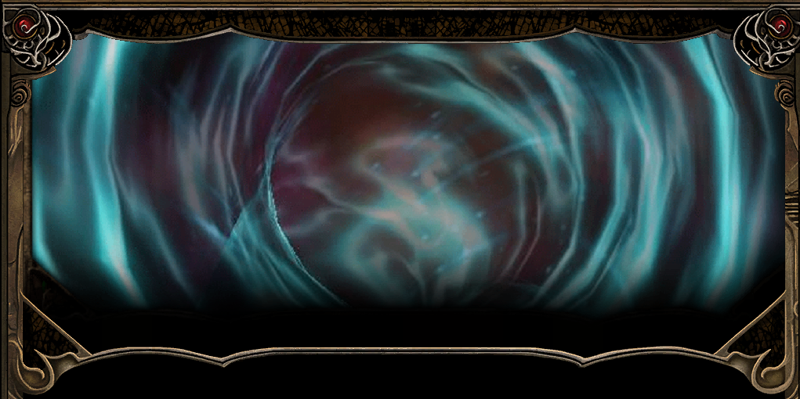{ .center-img width="60%" }

Nagle **Sandrah** syknęła z bólu i zapytała, dlaczego **Imoen** obrzucała ją orzechami. Rudowłosa poprosiła, by odeszły na stronę, i oznajmiła, że przyjaciółka najwyraźniej żywiła pewne zainteresowanie Leechem. Córka **Elminstera** przyznała, że była w tym trochę zbyt oczywista, i zapytała, czy w czymś przeszkadzała, skoro tamci znali się od tak dawna. **Imoen** zaprzeczyła stanowczo. Chciała tylko mieć na niego oko, bo po odejściu **Goriona** czuła się jego starszą siostrą.

**Sandrah** roześmiała się i zniżyła głos do tajemniczego szeptu. Skoro tak, przyznała się do wszystkiego: naprawdę zakochała się w Leechu. Rudowłosa nie posiadała się z radości. Miejska piękność oszalała na punkcie jej małego Leecha! Kapłanka zauważyła, że równie dobrze mogła przekazać tę nowinę miejskiemu heroldowi z *Beregostu*. Westchnęła i dodała, że gdyby kiedykolwiek potrzebowała siostrzanej rady w sprawach serca, zwróci się właśnie do niej.

**Imoen** uznała to za wspaniałe. Ogłosiła się doradczynią miłości przy swoim podopiecznym i jego wielkomiejskiej wybrance, a skoro były już najlepszymi przyjaciółkami, miała dla niej jedną wskazówkę: **Sandrah** nie mogła pożyczać jej różowej bielizny, by droczyć się z Leechem. Po tych słowach Rudowłosa zaczęła tarzać się po trawie, zanosząc się śmiechem. Kapłanka w zemście zebrała kilka orzechów i zaczęła nimi w nią rzucać. **Imoen** wołała, że to boli, ale wciąż się śmiała.

Tak oto drużyna ruszyła ponownie do obozu bandytów.
