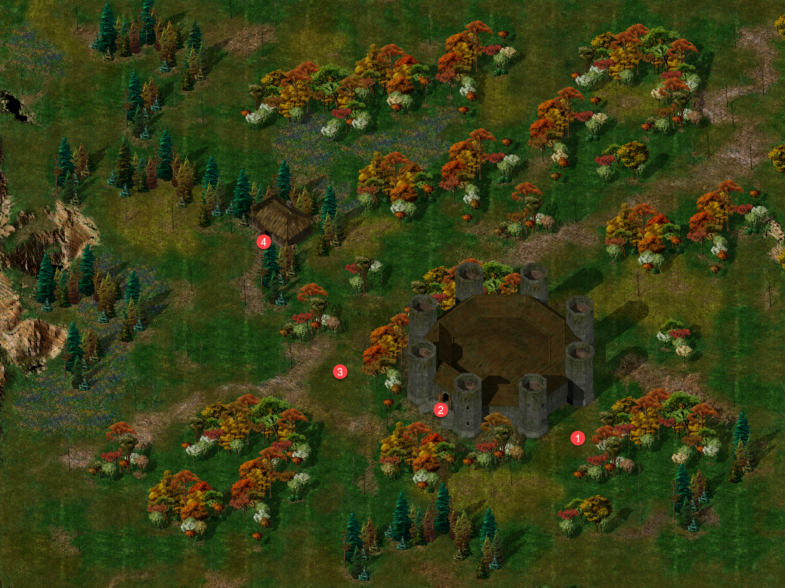
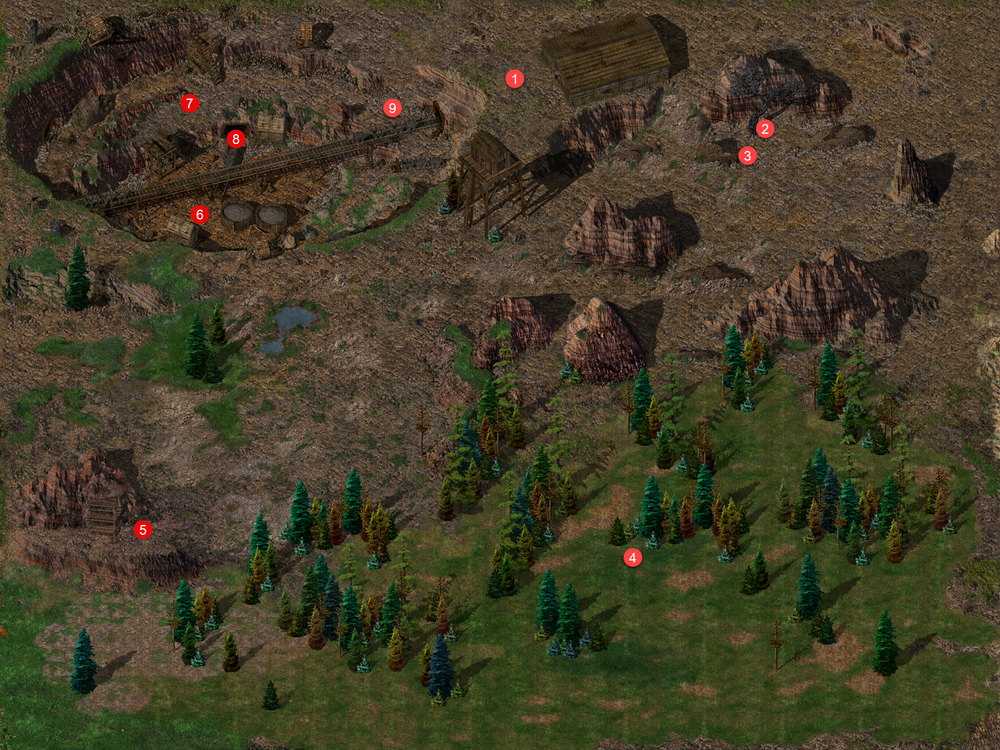
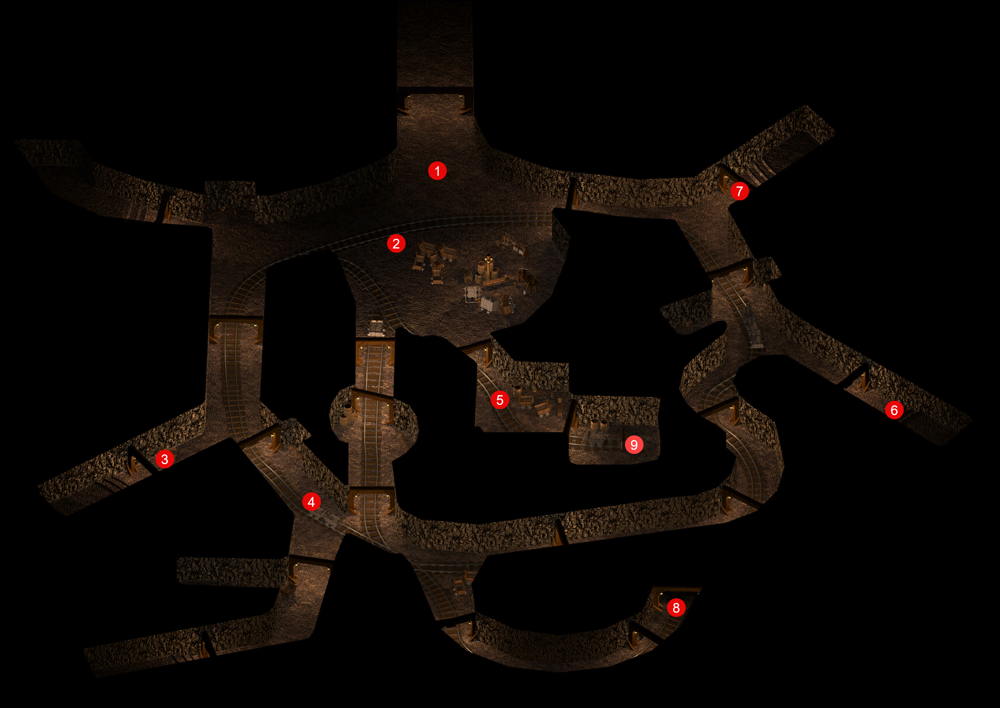
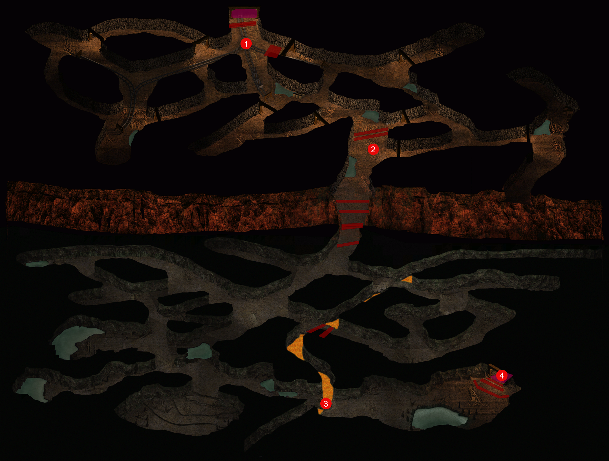

# Under Construction

## Wysoki Żywopłot&nbsp;64 { .divider }

{ .center-img width="40%" }

Wracamy do siedzi by Thalantyra (2) i najpierw odwiedzamy jego prywatne komnaty. Osobliwy regał, który najwyraźniej nie najlepiej radził sobie z upływem czasu rozpoznał jednak Leecha i od razu zapytał o poszukiwaną księgę. Młody gnom przekazał mu *Historię Shadowdale XIII*, zachowaną w doskonałym stanie. Regał zachwycił się pięknym grzbietem, wspaniałą okładką i nienaruszonymi krawędziami stron. Uznał tom za prawdziwy skarb, który zasługiwał na miejsce w jego zbiorach.

W podziękowaniu wręczył drużynie *Księgę Wirujących Kamieni*. Dzieło miało niezwykłe magiczne właściwości. Regał nie potrafił dokładnie wyjaśnić ich działania, wspomniał jedynie o nagłym „puf” i czymś, co działo się zaraz potem. Najwyraźniej najlepszym sposobem poznania sekretu księgi było po prostu jej użycie (Bibliophilia 54).

Możemy teraz zwrócic włąścicielowi jego kamień strażniczy. **Thalantyr** potwierdził, że znaleziony drobiazgjest jego włanością i nie krył zaskoczenia uczciwością młodego gnoma. Większość znalazców wykorzystałaby kamień, by dostać się do jego siedziby i ograbić ją z kosztowności. Mag posiadał jednak kilka podobnych przedmiotów, dlatego jeden mniej nie stanowił dla niego wielkiej straty. Cóż możemy się cieszyć, że nie zastał nas gty plądrowaliśmy jego prywatne komnaty (Snooping Around 53). Poprosiliśmy go także o przygotowanie antidotum wilkołaczego z beladonny (Of Wolves and Men 52).

Gospodarz poprosił o trzy klejnoty, które miały zasilić przygotowywane urządzenie wróżebne. Leech przekazał mu czarną perłę, klejnot cyrkonowy oraz wodny opal. Czarodziej pochwalił wybór, przyznając, że trudno byłoby znaleźć trzy kamienie lepiej nadające się do tego zadania. Klejnoty stanowiły jednak dopiero początek. **Thalantyr** nadal potrzebował urządzenia, w którym mógłby je osadzić. Polecił drużynie odwiedzić **Melicampa**, przebywającego u kowala w *Beregoście*, i sprawdzić postępy jego pracy. Podejrzewał, że dawny uczeń zdołał skomplikować nawet tak proste zadanie (Destroy the Cursed Bracers 56).

Udajemy sie do domu Aiwell (4) i przekazujemy przygotowaną przez maga fiolkę juz prawie w pełni przeobrażonemu w wilkołaka Tonderowi. Na szczęście mikstura zadziałała i pechowiec popędził do swojej ukochanej czekającej przy ostoi Thalantyra. Ostatnie dni pozostały w pamięci **Tondera** niczym senny koszmar, lecz **Aiwell** zdążyła już opowiedzieć mu o wszystkim, co się wydarzyło. Oboje postanowili wyruszyć do *Wrót Baldura* i tam odpocząć. **Tonder** podejrzewał, że jeśli zostanie w domu w lesie szybko postrada zmysły. Przed odejściem chciał odwdzięczyć się wybawicielom. Polecił zajrzeć do skrzyni w domu, pod którą znajdowała się tajna skrytka z wartościową bronią. Miał nadzieję, że znalezisko przyda się drużynie podczas dalszej wędrówki.(Of Wolves and Men 52).

Jasne jest, że trzeba sprawdzić co się dzieje z Melikampem.

## Beregost&nbsp;65 { .divider }

{ .center-img width="40%" }

Zaglądamy do Oka Gorgony (29), gdzie opowiedzieli Zedzie o **Karp**, która pragnęła wraz z synem potajemnie opuścić *Nashkel* i bezpiecznie dotrzeć do *Athkatli*. Zapytał, czy przemytniczka mogłaby jej w tym pomóc. **Zeda** uznała zadanie za dziecinnie proste. Jeśli **Karp** zdoła zapłacić żądaną cenę, ona i jej syn dotrą do *Athkatli* bez większych problemów. Wystarczyło przekazać kobiecie, by przygotowała pieniądze. Dyskretna podróż i bezpieczeństwo obojga miały być zagwarantowane. Podobne wyzwania należały do tych, w których **Zeda** czuła się najlepiej. (Beneath the Ploughshares 94)

**Sandrah** próbowała przekonać **Shar-Teel**, że nie wszyscy mężczyźni byli tak źli, jak sądziła. Podejrzewała, że wojowniczka musiała mieć wyjątkowo przykre doświadczenia, również z własnym ojcem. **Shar-Teel** odpowiedziała pogardliwie, że dla służki *Mystry* żaden mężczyzna nie był najwyraźniej zbyt podły, by się przed nim ukorzyć. Zaraz jednak urwała, jakby powiedziała o jedno słowo za dużo. Przyciśnięta pytaniem wyznała, że nie potrafiła zrozumieć **Sandrah**. Uważała ją za silną i pewną siebie, lecz jednocześnie widziała, jak pozwalała mężczyznom otaczać się słodkimi słówkami, lizać po stopach i brudzić jej buty. Jej zdaniem córka **Elminstera** w pełni na to zasługiwała, skoro nie potrafiła wykorzystać swojej przewagi. **Sandrah** zauważyła, że dla wojowniczki wszystko zdawało się rywalizacją. Jedna osoba zawsze musiała rządzić, udowodnić własną wyższość i odnieść zwycięstwo. Zapytała więc, czy w jej świecie nie istniała możliwość prawdziwej równości. **Shar-Teel** uznała te słowa za jeszcze dziwniejsze. Skoro **Sandrah** nie musiała się przed nikim uniżać, nie rozumiała, dlaczego chciała dorównywać standardom słabszym od własnych. Równość między kobietą a mężczyzną porównała do równości między psem a jego panem. Zachęciła rozmówczynię, by trzymała swoich mężczyzn na krótkiej smyczy i czerpała przyjemność z władzy, którą nad nimi miała. Jej zdaniem córka **Elminstera** stanowiła najlepszy przykład tego, czym mogła stać się kobieta. **Sandrah** odparła, że nie pragnęła być królową niewolników i pochlebców. Interesowali ją mężczyźni zdolni jej dorównać nie tylko siłą, lecz także namiętnością, charakterem i oddaniem. **Shar-Teel** pozostała przy swoim. Im większe ryzyko i cięższa walka, tym słodsze miało być zwycięstwo. **Sandrah** przypomniała jednak, że nie o takie podboje jej chodziło. Wojowniczka uznała te słowa za marnowanie urody i siły. Porównała **Sandrah** do potężnej lwicy zadowolonej z życia w złotej klatce i wyraziła litość dla biednej, bogatej dziewczynki. Mimo pogardliwego tonu wyraźnie pogrążyła się jednak w myślach. Córka **Elminstera** zupełnie nie pasowała do obrazu świata, który **Shar-Teel** dotąd uważała za jedyny możliwy.

Środek nocy i postanawiamy odpwocząć w aby rano odwiedzić kowala. Przed snem **Jen’lig** zdjęła ciężkie rękawice, które niemal zawsze nosiła. Dopiero wtedy **Leech** dostrzegł ostre, naturalne szpony wyrastające z jej palców. Githyanki zauważyła jego zaciekawione spojrzenie i wyjaśniła, że dziedzictwo illithidzkiej hodowli stworzyło z jej ludu użytecznych niewolników. Szpony pozwalały zabijać bez broni i jeść bez sztućców. Następnie przysunęła się bliżej, by pokazać mu jeden z nich. Był misternie ozdobiony złotymi elementami i drobnymi klejnotami. **Jen’lig** przyznała, że wśród jej pobratymców podobne dekoracje stanowiły oznakę przywiązania do wybranego partnera. Tęskniła za wieloma rzeczami pozostawionymi w dawnym życiu, lecz szacunek, jakim darzyła dowódcę, pozwalał jej choć na chwilę o nich zapomnieć. Przesunęła szponem po czole **Leecha**, a następnie powoli wzdłuż jego policzka. Dotyk był obcy, lecz zarazem delikatny. Nie przerywając pieszczoty, poprowadziła pazur ku górnej wardze, potem wzdłuż szczęki, uważając, by nie zranić kruchej skóry młodego gnoma. **Leech** ujął jej palec i krótko ucałował wrażliwy szpon. **Jen’lig** przyznała, że dotyk tak delikatnej skóry i ciała był dla niej czymś nowym, lecz nie uznała tego doświadczenia za nieprzyjemne. Być może któregoś dnia zechce je powtórzyć.

Rano **Sandrah** cieszyła się, że ponownie obudziła się u boku **Leecha**. Obdarzyła go krótkim pocałunkiem w policzek, po czym odwróciła wzrok, wyraźnie speszona własną śmiałością. Gdy młody gnom częściowo wysunął się spod koców, odsłaniając umięśnione ciało, służka *Mystry* przyznała, że chciałaby budzić się w ten sposób każdego ranka, a może nawet pozwolić sobie na odrobinę więcej. Zerknęła na niego nieśmiało i zarumieniła się jeszcze mocniej. Po chwili spuściła wzrok i zapytała cicho, czy przypadkiem nie posuwała się zbyt szybko. Oj nie!!!

Jak przypuszczaliśmy Melikampa nie było u Taeroma. Kowal wysłał go po specjalną rudę do Grace w kopalni. Cóż, nie rozumieją, że młody mag to jedna wielka porażka. Warto będzie sprawdzić jak sobie radzi (Destroy the Cursed Bracers 56).

**Sandrah** uznała, że czas przestac sprzeczać się z **Shar-Teel** a ta zapewniła, że nie zamierzała wszczynać problemów. Po namyśle uznała nawet, że na razie warto przyjąć córkę **Elminstera** taką, jaka była. Służka *Mystry* odpowiedziała, że jeśli wojowniczka chciała o czymś porozmawiać, nie zamierzała jej odtrącać. Obie należały przecież do towarzyszy **Leecha**. **Shar-Teel** zdobyła się wówczas na niezwykle osobiste wyznanie. Jej matka była nierządnicą, ojca zaś uważała za najgorszą męską świnię w całym *Faerûnie*. Sama była owocem ich przypadkowego związku i początkiem nędznego życia, które trudno było porównywać z uprzywilejowaną młodością **Sandrah**. Córka **Elminstera** zauważyła jednak, że wojowniczka siłą charakteru i niezłomną wolą przezwyciężyła ciężar własnego pochodzenia, nawet jeśli pozostawił on blizny na jej duszy. Właśnie za to darzyła ją szczerym szacunkiem. Te słowa wyraźnie zaskoczyły **Shar-Teel**. Przyznała, że uznanie **Sandrah** naprawdę wiele dla niej znaczyło, po czym zapytała, co właściwie w niej dostrzegała. Służka *Mystry* widziała osobę podążającą własną drogą i przestrzegającą osobistego kodeksu honorowego. Nie zawsze zgadzała się z jej zasadami, lecz nie mogła odmówić wojowniczce szczerości wobec samej siebie ani silnej woli, dzięki której próbowała naginać rzeczywistość do własnych zamierzeń. **Shar-Teel** zapytała, czy uważała to za zaletę, czy wadę. Jej rozmówczyni wyjaśniła, że nie mówiła o dobru ani złu, lecz o charakterze. Dotychczasowe doświadczenia ukształtowały cele i poglądy wojowniczki, lecz nic nie zostało wykute w kamieniu. Mogła obrać inną drogę, zachowując tę samą siłę i uczciwość. Dla **Shar-Teel** prawdziwa niezależność nadal oznaczała bogactwo i władzę. **Sandrah** odpowiedziała, że pieniądze liczone pod koniec dnia nie dawały takiej satysfakcji jak świadomość dobrego uczynku. Wojowniczka uznała to za typową perspektywę osoby, która od zawsze miała wszystko i nigdy nie musiała o nic walczyć. Służka *Mystry* odparła, że równie łatwo można było nazwać słowa **Shar-Teel** poglądami znudzonej szlachcianki, która potrzebowała niebezpieczeństw, by urozmaicić sobie puste życie. **Sandrah** zasugerowała więc, by obie wspólnie spróbowały odnaleźć prawdę. **Shar-Teel** przyjęła propozycję z rozbawieniem. Nie miała też nic przeciwko temu, by przy okazji skruszyć kilku głupich mężczyzn i dobrze się bawić. Rozmowa zeszła wreszcie na temat, który najwyraźniej interesował obie. **Sandrah** zapytała, czy mężczyźni rzeczywiście zawsze budzili w wojowniczce taką samą niechęć. **Shar-Teel** przyznała, że zdarzały się wyjątki. Córka **Elminstera** szybko domyśliła się, że jednym z nich mógł być **Leech**. Wojowniczka nie zaprzeczyła. Jej dłonie powędrowały jednak ku broni, a ramiona wyraźnie zesztywniały. **Sandrah** uspokoiła ją, że nie zamierzała walczyć o młodego gnoma. Nie były kotkami w rui, a ona sama nie miała prawa rozkazywać przyjaciółce, co mogła rob ić podczas nocnej warty ani poza czasem spędzanym z drużyną. **Shar-Teel** prychnęła, że trudno byłoby nazwać **Sandrah** przyjaciółką, gdyby wiedziała, co wydarzyło się podczas jednego z nocnych postojów. Służka *Mystry* nie dała się zaskoczyć. Wiedziała dokładnie, do czego doszło, i nie zamierzała udawać naiwnej. Nie uważała również, by miała prawo komukolwiek tego zabraniać. Wojowniczka zacisnęła dłoń na rękojeści broni i zapytała, czy **Sandrah** naprawdę nie obawiała się, że nauczy **Leecha** czegoś, czego sama jeszcze nie wiedziała o bliskości. Córka **Elminstera** przyznała, że nie miała wielkiego doświadczenia w tej dziedzinie, lecz również go **Shar-Teel** nie zazdrościła. Życie zdążyło już obdarzyć wojowniczkę wystarczającą liczbą przykrych przeżyć. Gniew **Shar-Teel** wreszcie osłabł. Opuściła dłonie i usiadła z kolanami podciągniętymi pod brodę, jakby z trudem powstrzymywała łzy. **Sandrah** usiadła obok i objęła ją ramieniem. Przyznała, że wojowniczka rzeczywiście miała za sobą wyjątkowo wiele bolesnych doświadczeń. Przeprosiła też, jeśli ich rozmowa przesunęła się w stronę, która zamiast przynieść ulgę, otworzyła dawne rany. Zapewniła, że podobna sytuacja więcej się nie powtórzy, przynajmniej dopóki **Shar-Teel** podróżowała wraz z nią i **Leechem**. Dwie kobiety pozostały jeszcze przez dłuższy czas na uboczu, rozmawiając przyciszonymi głosami. Drużyna odsunęła się nieco dalej, pozwalając im spokojnie przejść do łatwiejszych tematów.

## Kopalnia Nashkel&nbsp;66 { .divider }

{ .center-img width="40%" }

**Jen’lig** pochwaliła styl walki **Shar-Teel**. Wojowniczka dobrze zabijała i nie stroniła od krwi, lecz zdaniem githyanki powinna nauczyć się lepiej kierować gniewem. **Shar-Teel** uznała, że sposób walki **Jen’lig** również trafiał w jej gust. Szczególnie podobało jej się spojrzenie, którym astralna wojowniczka obdarzała pokonanego przeciwnika, nim wyrwała mu serce swoim niezwykłym mieczem. Ofiara nie miała wątpliwości, że zaraz zginie i że to właśnie **Jen’lig** trzymała jej życie w szponach. Zdaniem **Shar-Teel** był to gest godny prawdziwego wojownika. **Jen’lig** odparła, że połączenie umiejętności obu mogłoby zgubić każdego githyanki z *Planu Astralnego* albo *Limbo*, może z wyjątkiem illithidów i githzerai, których i tak pokonałyby z jeszcze większą satysfakcją. **Shar-Teel** zapewniła, że potrafiła sprawić, by każdy najemnik *Płonącej Pięści* wyglądał jak uliczny szczur wymachujący drewnianym mieczykiem. Dotyczyło to również **Angela Dosana**. 

Githyanki zapytała, czy znała sierżanta **Horvoka**. Wojowniczka znała go aż nazbyt dobrze. Nazwała go skorumpowanym łajdakiem, który za garść monet sprzedałby nawet zwłoki własnej matki. **Jen’lig** chciała wiedzieć, kogo **Horvok** uważał za przyjaciół. **Shar-Teel** zapewniła, że ten człowiek nie miał żadnych przyjaciół. Jeśli zaś chodziło o wspólników do nielegalnych interesów, przyjąłby każdego, kto zapłaciłby mu więcej niż dziesięć sztuk złota. Astralna wojowniczka syknęła cicho i wyjaśniła, dlaczego pytała. W jej oczach pojawiło się spojrzenie, które nie wróżyło sierżantowi niczego dobrego. **Shar-Teel** uznała pomysł za znakomity. **Horvok** w pełni zasługiwał na swój los i mogła jedynie mieć nadzieję, że **Jen’lig** zadbała, by jego koniec był naprawdę bolesny.

Grace znajdujemy niedaleko wejścia do kopalni (9) i potwierdza, że przekazała rudę Melikampowi ale uznał ze jest je za mało i zszedł sam do kopalni po więcej. Udajemy się więc za nim (Destroy the Cursed Bracers 56).

## Kopalnia Nashkel - poziom I&nbsp;66-I { .divider }

{ .center-img width="40%" }

Odnajdujemy Melicampa (9), który jest strapiony stanem wielu górników. Zwłaszcza Sal i James są w stuporzez i stracili pamięć. Może uda nam się zasięgnąć o nich trochę informacji u innych górników (W kopalni **Melicamp** przywitał **Leecha** głośnym gdakaniem i z wyraźną ulgą poprosił o pomoc. Coś poszło nie tak, a on sam z trudem potrafił zebrać myśli. Po rozmowie z **Grace** zszedł do podziemi, by zdobyć dla **Taeroma** ostatnią partię potrzebnej rudy. Wtedy otoczyła go grupa koboldów. Zdołał odeprzeć napastników, lecz jedno z jego zaklęć przyniosło nieoczekiwany skutek. Dwaj górnicy znaleźli się w zasięgu magicznego uderzenia i od tamtej chwili zachowywali się tak, jakby utracili część pamięci. **Melicamp** nie zamierzał pozostawić ich w takim stanie. Podejrzewał, że skutki czaru mogły z czasem ustąpić, lecz czuł się odpowiedzialny za to, co się wydarzyło. Poprosił drużynę, by porozmawiała z pozostałymi górnikami i spróbowała dowiedzieć się czegoś o poszkodowanych. Być może znajome informacje pozwoliłyby pobudzić ich wspomnienia. **Leech** zgodził się rozejrzeć po kopalni, a **Melicamp** postanowił zaczekać w bezpiecznym miejscu i dopilnować, by obaj mężczyźni nigdzie się nie oddalili).

Drużyna wypytała górników o poszkodowanych towarzyszy. **Marvin** (1) przypomniał sobie, że **James** bez końca opowiadał o swojej ukochanej z *Beregostu*, imieniem **Winnie** a **Bob** (6) wiedział natomiast, że **Sal** miał w domu dwoje dzieci, bliźnięta **Robby’ego** i **Neda**. Być może wspomnienia o bliskich pomogą obu górnikom odzyskać utraconą pamięć.

Po przedstawieniu tych kilku faktów z zycia górników udało sie ich uwolnić spod działania pseudoczarów Melicampla. On sam oddał na rudę i poprosił o dostarczenie do Taeroma a sam uznał, że lepiej będzie jak uda sie do Wysokiego Żywopłotu bo znowu coś zmajstruje (Destroy the Cursed Bracers 56).

Strażnik przy wejściu (1) rozpoznał w nas drużynę wysłaną przez Illaserę i zaprowadził aż do zejścia na trzeci poziom kopalni. Ostrzegł także drużynę przed odzianym w szaty szaleńcem, który krążył po dalszych tunelach i groził śmiercią każdemu, kto wkroczy do jego „królestwa”. **Leech** zdziwił się, że do pilnowania przejścia wyznaczono tylko jednego człowieka. Strażnik przyznał, że trafiła mu się wyjątkowo niewdzięczna służba. Miał obserwować tunel, a na widok szkieletu natychmiast wrócić na górę i zaalarmować pozostałych. Podejrzewał, że zwierzchnicy chcieli przede wszystkim powstrzymać rozchodzenie się wieści, dopóki intruz nie wykona pierwszego ruchu. Na razie obie strony trwały więc w impasie. Życząc wędrowcom powodzenia, pozwolił im ruszyć dalej.

## Kopalnia Nashkel - poziom III&nbsp;66-II { .divider }

{ .center-img width="40%" }

Od razu po wejściu zaatakowała nas chmara kruszejących szkieletow kontrolowana przez Sazazira. Po zabiciu maga wszystkie szkielety rozleciały się natychmiast. Zabraliśmy jego księgę czarów jako dowód wykonania zadania. Co dziwne miał przy sobie symbol Bhaala (Black Hearts - The Huntress 87). Wychodzimy z kopalni.

Moglibyści wrócić do Nashkel i Beregost ale już dość zwlekaliśmy z próbą roziwązania problemu Elminstera udajemy się więc w kierunku Chmurnych Szczytów.

Bestiariusz: szkielet

## Las Ognistych Liści&nbsp;66-II { .divider }

{ .center-img width="40%" }

Pośród drzew drużynę zatrzymało nagłe wołanie. Stary człowiek, wyraźnie uradowany na widok żywej duszy, przedstawił się jako **Ordolath** i wyjaśnił, że spędza tu swój urlop naukowy, z dala od zgiełku *Wrót Baldura*. **Leech**, niezbyt skory do uprzejmości, od razu zapytał, czego starzec od nich chce. **Ordolath** z zakłopotanym chichotem wyznał, że szykując się do podróży, zapomniał świecy. Bez niej nie mógł ani pisać w swoim dzienniku, ani czytać książek, a tutejsze noce były bardzo ciemne – dla mola książkowego istna udręka. Złożył więc propozycję: jeśli bohaterowie poświęcą kilka dni i przyniosą mu jego mały woskowy skarb, nagrodzi ich sowicie – oprócz 2000 sztuk złota obiecał cenny przedmiot, który z pewnością przypadnie im do gustu. (Ordolath's Candle 115) **Leech** uznał ofertę za ciekawą i poprosił o wskazanie domu. Uradowany **Ordolath** wyjaśnił, że od pierwszej chwili wydali mu się godni zaufania. Jego dom stał w północnej części *Wrót*, niedaleko *Dzielnicy Północnej* – biały budynek za niebieską wieżą maga, nie sposób go przeoczyć. Na pożegnanie poprosił o pośpiech i zapewnił, że będzie niecierpliwie wyczekiwał ich powrotu.

Trochę dalej spotkali młodego Alberta, który z wielkim niepokojem poszukiwał swojego zaginionego psa, Rufiego. Chłopiec obawiał się, że jego mały przyjaciel, nieprzywykły do obcych miejsc i nieznajomych ludzi, mógł gdzieś się zaszyć ze strachu. Albert z wdzięcznością przyjął zaoferowaną pomoc. Na znak rozpoznawczy przekazał ulubioną zabawkę Rufiego, licząc, że znajomy zapach pomoże odnaleźć zgubę i zdobyć jej zaufanie. Choć dla przypadkowego wędrowca poszukiwanie małego pieska mogło wydawać się drobnostką, dla chłopca oznaczało odzyskanie najwierniejszego towarzysza (Albert and His Dog 116).

Trójka awanturników Sendai, Alexander i Delgod stanęła drużynie na drodze (3) i ostro zażądała, by wędrowcy z północy się zatrzymali. Oznajmiła, że zapuścili się głęboko na terytorium *Amnu*, i z drwiną zasugerowała, że może przybyli szpiegować rzekome zbrojenia. Bawiło ją, jakie głupie pomysły potrafią zalęgnąć się w głowach północnych barbarzyńców. **Shar-Teel** nie kryła pogardy. Uznała, że kobieta sama prosi się o posmakowanie ich stali, i spytała **Leecha**, czy dadzą jej nauczkę, czy też stchórzy i spróbuje ją ułagodzić. **Jen'lig** zapytała jednak wprost, czy *Amn* rzeczywiście nie zagraża *Wrotom Baldura*. **Sendai** zbyła to pytanie wyniośle: jej potężny naród miał ponoć ciekawsze zajęcia niż atakowanie jakiegoś zadufanego barbarzyńskiego miasta. Poradziła im zawrócić tam, skąd przyszli. Gdy **Jen'lig** odparła, że nigdzie się nie wybierają, bo mają takie samo prawo tu przebywać, **Sendai** stwierdziła, że trafiła na berserkerów. Podobno wyczuła ich woń już wcześniej, a ich zachowanie tylko utwierdziło ją w tym przekonaniu. Wezwała **Delgoda** i **Alexandra**, by szybko rozprawili się z tą hołotą. **Jen'lig** sięgnęła po zaklęcie, a **Alexander** z groźnym pomrukiem zapowiedział, że zaraz dostanie za swoje, i rzucił się prosto na nią. I wiadomo jak się to skończyło.

Niedaleko znajdujemy Ruffiego (4) i dzięki jego zabawce przekzanej prze Alberta udaje się nam psa skłonić aby podążał za nami spowrotem do jego właściela.

Albert gorąco nam dziekuje i nagle przeobraża się w demona mieszkańca Dziewięciu Piekieł i wraz pupilem znikają nam z oczu (Albert and His Dog 116).

{ .center-img width="60%" }

Drużynę zaczepił **Vax** (5), który z przesadną poufałością stwierdził, że zabłądzili nieco z utartego szlaku i mieli pecha trafić na najszybszą rękę na zachodzie. Wskazał stojącego opodal **Zala**, rzekomo najszybszego miotacza strzałek, jaki kiedykolwiek chodził po *Wybrzeżu Mieczy*. Radził nie wystawiać cierpliwości takiego człowieka na próbę, tylko rozsądnie oddać wszystkie pieniądze, bo inaczej czekają ich poważne kłopoty. **Shar-Teel** zaproponowała **Leechowi**, że chętnie przypomni mu, jak się zabija kretynów, gdyby przypadkiem zapomniał. **Finch** też nie dała się zastraszyć. Zapytała, czy **Vax** jest skończonym głupcem, bo czegoś równie idiotycznego jak najszybszy miotacz strzałek na zachodzie jeszcze nie słyszała, i wyzwała go, by **Zal** pokazał, co potrafi. Urażony **Vax** zawołał do towarzysza, że najwyraźniej nikt nie traktuje ich poważnie, więc pora dać pokaz swoich umiejętności. Z udawanym żalem zapowiedział, że drużynę czeka teraz moc cierpień. Tak związana z wytłumaczeniem czemu po świecie chodzili tacy idioci.

Dziwne trio xvarta, kobolda i tasloi o imionach Larry, Darryl i Darryl (6) podarowało nam autograf. 

Przy wodospadzie (7) atrakuje nas demoniczny rycerz i mówi coś o potrzebie ochrony swojego Pana. Po pokonaniu niecodziennego wroga Sandrah przyjrzała się bliżej wodospadowi, którego strzegł przeciwnik. Wtedy przypomniały jej się słowa tajemniczego zwoju: była tu woda, były i góry sięgające chmur. Po prawej stronie, wśród skał, rysowało się coś, co wyglądało na wejście. Sprawdzić to można było tylko w jeden sposób. (A Demonic Scroll 29)

{ .center-img width="60%" }

Przeszli przez wąski korytarz i nagle znależli się w komnacie a przed nimi stał demon, który z rykiem obwieścił, że podróż śmiertelników dobiegła końca. Przez moment wyglądał jednak na zbitego z tropu, bo najwyraźniej nie spodziewał się nikogo z tej strony ścieżki. Kiedy **Leech** zapytał, kim lub czym jest, potwór uznał, że skoro i tak nie wyjdą stąd żywi, może im to zdradzić. Z namaszczeniem przedstawił się jako **Naronguth**.

{ .center-img width="60%" }

**Leech** chłodno odparł, że to imię nic im nie mówi. W tej samej chwili rozległ się okropny łoskot walących się skał i wejście za ich plecami runęło.

Demon znów wydawał się zdziwiony, bo był pewien, że wszyscy go znają. **Sandrah** szepnęła **Leechowi**, że skoro nie jest to *Alzaligrundel*, musi chodzić o jego arcywroga, o którym wspominał zwój. Może dałoby się to wykorzystać. **Naronguth** wychwycił jednak szept i zagrzmiał, że przed nim nic nie pozostanie w ukryciu. Zapowiedział, że zuchwalcy zamiast zginąć szybko, będą długo cierpieć od jego gniewu. Zamyślił się, że tylko ktoś tak potężny jak *Elminster* zdołałby go odnaleźć, a przecież nikt z nich nim nie był. Potem przywołał bliżej młodą kapłankę, bo coś w niej wyczuwał. **Leech** ostrzegł plugawego biesa, by nie ważył się tknąć **Sandrah**. Demon wybuchnął triumfalnym śmiechem. Zrozumiał, że kradzież odłamka przyniosła lepszy skutek, niż się spodziewał, bo zamiast *Elminstera* przybyła jego ukochana córeczka. Był to dla niego prawdziwy piekielny festyn i wspaniała zdobycz. Aby przedłużyć ich cierpienie, postawił przed nimi wybór. Mogli na zawsze utracić część zdrowia, oddać mu **Sandrah** na dziesięciodniowy pobyt w piekle albo stanąć z nim do walki o odłamek, jedyny sposób na powrót tą samą drogą. **Leech** zamiast odpowiedzieć zapytał niewinnie o jego dawnego przyjaciela, *Alzaligrundela*.

**Naronguth** wyraźnie się poruszył. Rozpoznał wreszcie dziwny smród, który czuł od chwili ich przybycia, bo mieli przy sobie coś należącego do *Alzaligrundela*. Zażądał wyjaśnień, ostrzegając, że mogą to być ich ostatnie słowa. **Leech** zablefował, że arcywróg zna położenie jego legowiska, a oni wiedzą coś o nim samym, co może być dobrym początkiem układu. Demon, ponownie zbity z tropu, przyznał, że wie, gdzie tamten się ukrywa, ale nie może tam dotrzeć, bo nie jest w stanie przejść przez przeklętą ścianę wody, którą oni pokonali. **Sandrah** szepnęła, że mają go w garści. Z piekielnym ogniem w środku nie przejdzie za wodospad, więc jeśli zaproponują mu rozprawienie się z *Alzaligrundelem*, mogą w zamian zażądać odłamka. Tym razem rozdrażniony **Naronguth** nie protestował już przeciwko szeptom. Wyjawił, że wyczuwał obecność *Alzaligrundela* w pobliżu, lecz jego słudzy byli zbyt głupi, by go odnaleźć. Po ich ostatnim starciu w niezgłębionych czeluściach wybuchy mogły wyrzucić go aż w te góry, i demon miał nadzieję, że tamten tkwi w równie paskudnej dziurze co on sam. Zaproponował układ: jeśli przyniosą mu czarne serce *Alzaligrundela*, odda im odłamek *Elminstera* i rozstaną się w pokoju. **Leech** przystał na to bez wahania. (A Demonic Scroll 29) Drużyna otrzymała *Zwój Narongutha*. Wejście od strony *Chmurnych Szczytów* było zawalone i wyglądało na to, że tylko demon mógł pomóc im wydostać się z tego miejsca. **Naronguth**, rechocząc, przyznał, że rzeczywiście musi wyprowadzić ich na zewnątrz.

Po powrocie na powierchcnie odetchnęliśmy z ulgą. Podjeliśmy decyzję aby kontynować podróż dolinami Chmurnych Szczytów i znależć lokum wroga Narongutha.

Zmienirzając na zachód **Finch** która juz od jakiegoś czasu się nad czymś zastanawiała zagadnęła **Shar-Teel** i zaproponowała, że chętnie nauczy ją czytać, jeśli ta nie potrafi. **Shar-Teel** natychmiast się najeżyła. Oczywiście, że umie czytać, i chciała wiedzieć, skąd w ogóle ten niedorzeczny pomysł. **Finch** wyjaśniła łagodnie, że skoro wojowniczka ceni siłę ponad wszystko, mogła po prostu przegapić okazję, by cieszyć się wiedzą, która nie polega na rozrąbywaniu czegoś na pół. **Shar-Teel** warknęła, że nie widzi sensu w czytaniu marnej książeczki o rozbieraniu drzwi, skoro może je po prostu wyważyć głową i mieć sprawę z głowy. Uznała czytanie za cuchnącą stratę czasu, wymyśloną zapewne przez jakiegoś mężczyznę.

Bestiariusz: xvart, borsukołak, demoniczny rycerz

## Wodogrzmoty Driad&nbsp;66-II { .divider }

{ .center-img width="40%" }
