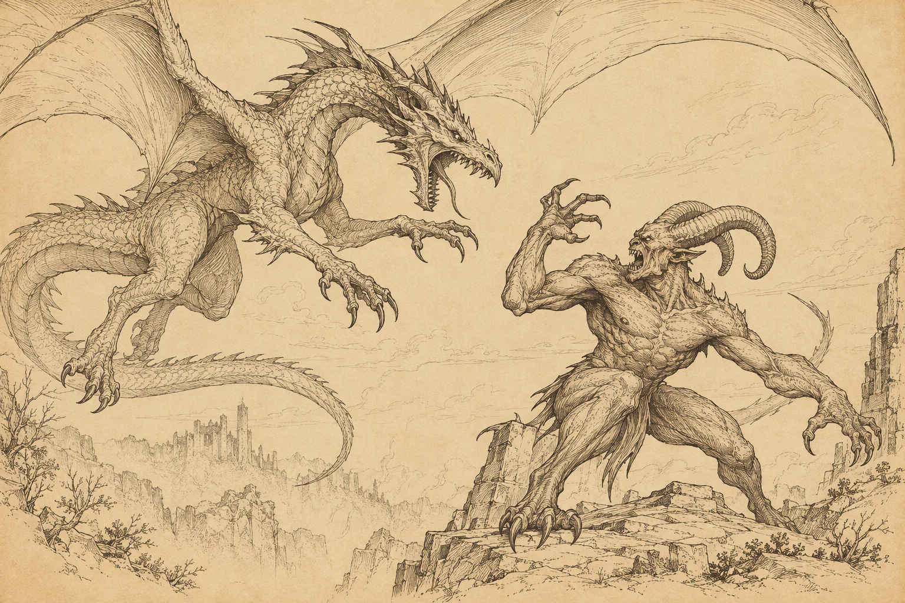
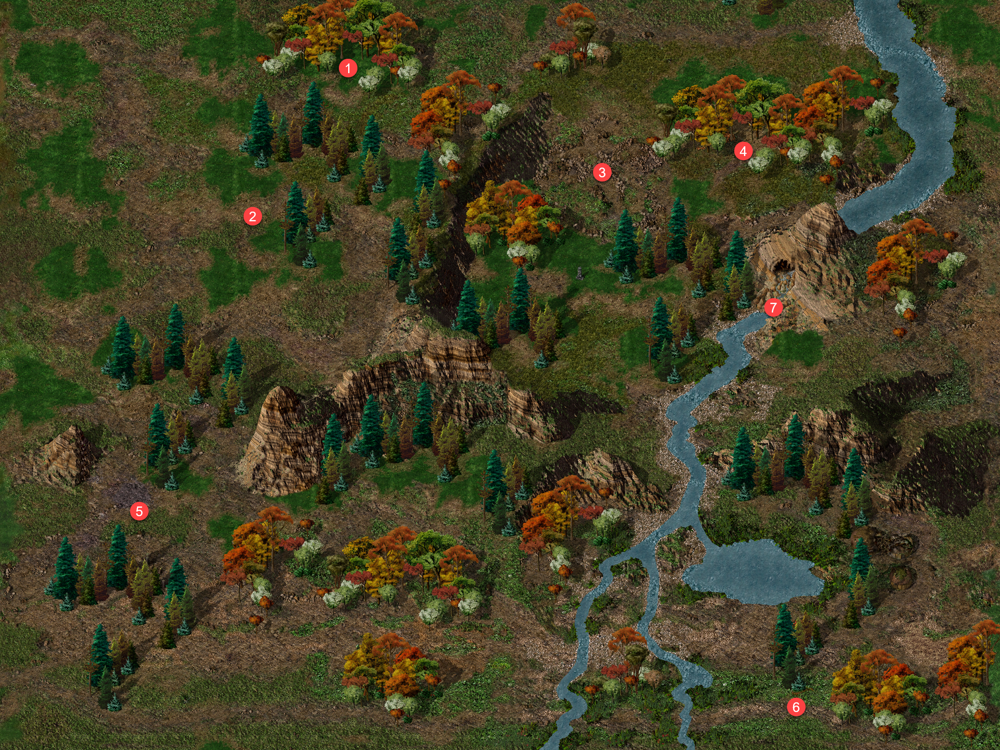
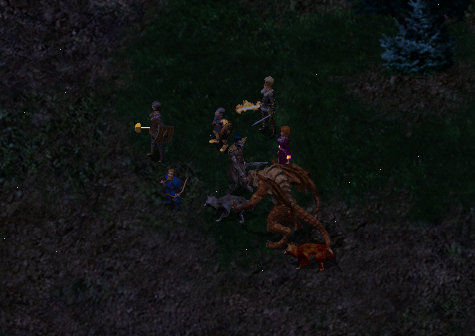
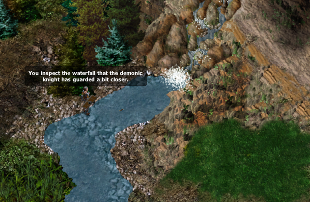
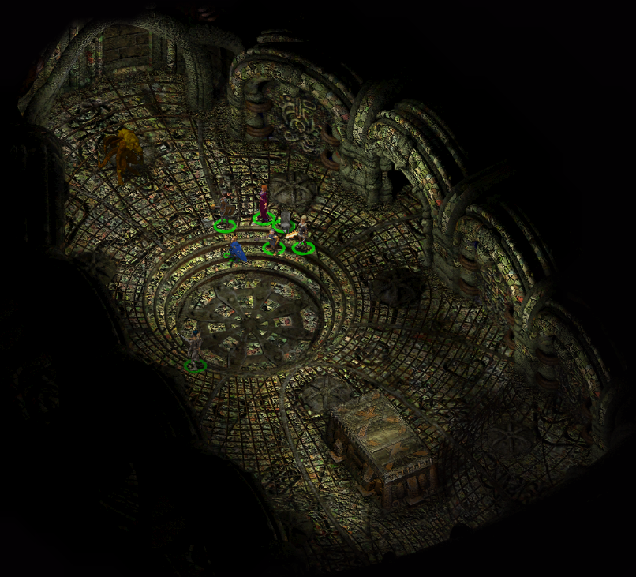
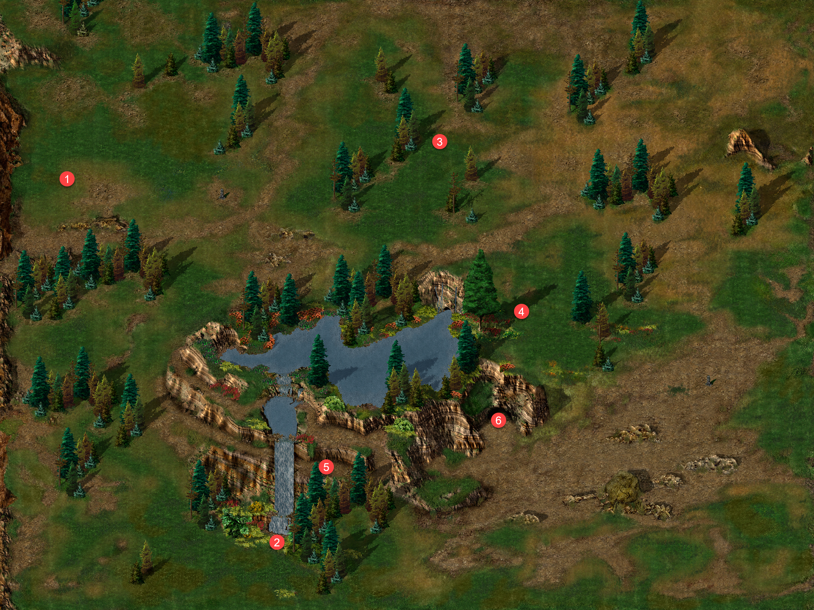
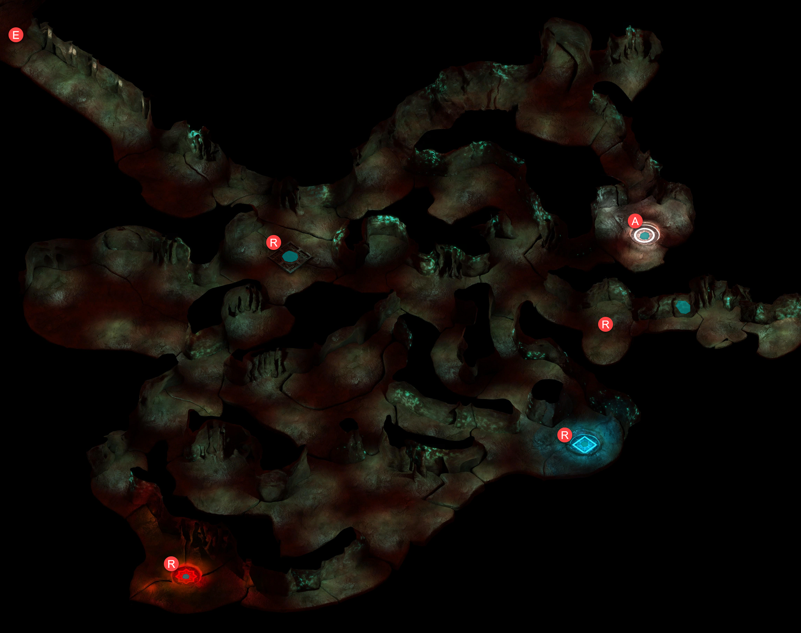
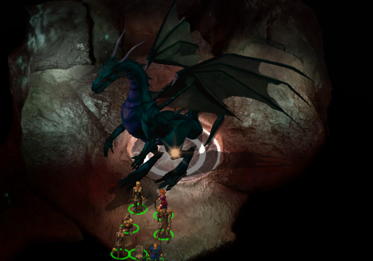
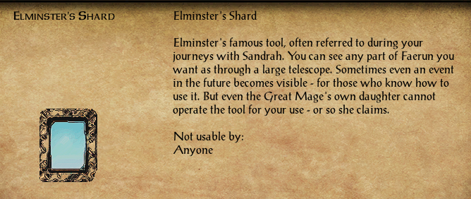
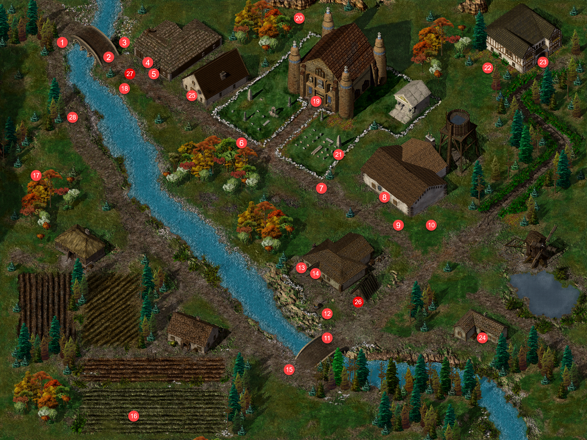

# Under Construction

{ .center-img width="60%" }

## Las Ognistych Liści&nbsp;67 { .divider }

{ .center-img width="40%" }

Pośród drzew drużynę zatrzymało nagłe wołanie. Stary człowiek, wyraźnie uradowany na widok żywej duszy, przedstawił się jako **Ordolath** i wyjaśnił, że spędza tu swój urlop naukowy, z dala od zgiełku *Wrót Baldura*. **Leech**, niezbyt skory do uprzejmości, od razu zapytał, czego starzec od nich chce. **Ordolath** z zakłopotanym chichotem wyznał, że szykując się do podróży, zapomniał świecy. Bez niej nie mógł ani pisać w swoim dzienniku, ani czytać książek, a tutejsze noce były bardzo ciemne – dla mola książkowego istna udręka. Złożył więc propozycję: jeśli bohaterowie poświęcą kilka dni i przyniosą mu jego mały woskowy skarb, nagrodzi ich sowicie – oprócz 2000 sztuk złota obiecał cenny przedmiot, który z pewnością przypadnie im do gustu. (Ordolath's Candle 115) **Leech** uznał ofertę za ciekawą i poprosił o wskazanie domu. Uradowany **Ordolath** wyjaśnił, że od pierwszej chwili wydali mu się godni zaufania. Jego dom stał w północnej części *Wrót*, niedaleko *Dzielnicy Północnej* – biały budynek za niebieską wieżą maga, nie sposób go przeoczyć. Na pożegnanie poprosił o pośpiech i zapewnił, że będzie niecierpliwie wyczekiwał ich powrotu.

Trochę dalej spotkali młodego Alberta, który z wielkim niepokojem poszukiwał swojego zaginionego psa, Rufiego. Chłopiec obawiał się, że jego mały przyjaciel, nieprzywykły do obcych miejsc i nieznajomych ludzi, mógł gdzieś się zaszyć ze strachu. Albert z wdzięcznością przyjął zaoferowaną pomoc. Na znak rozpoznawczy przekazał ulubioną zabawkę Rufiego, licząc, że znajomy zapach pomoże odnaleźć zgubę i zdobyć jej zaufanie. Choć dla przypadkowego wędrowca poszukiwanie małego pieska mogło wydawać się drobnostką, dla chłopca oznaczało odzyskanie najwierniejszego towarzysza (Albert and His Dog 116).

Trójka awanturników Sendai, Alexander i Delgod stanęła drużynie na drodze (3) i ostro zażądała, by wędrowcy z północy się zatrzymali. Oznajmiła, że zapuścili się głęboko na terytorium *Amnu*, i z drwiną zasugerowała, że może przybyli szpiegować rzekome zbrojenia. Bawiło ją, jakie głupie pomysły potrafią zalęgnąć się w głowach północnych barbarzyńców. **Shar-Teel** nie kryła pogardy. Uznała, że kobieta sama prosi się o posmakowanie ich stali, i spytała **Leecha**, czy dadzą jej nauczkę, czy też stchórzy i spróbuje ją ułagodzić. **Jen'lig** zapytała jednak wprost, czy *Amn* rzeczywiście nie zagraża *Wrotom Baldura*. **Sendai** zbyła to pytanie wyniośle: jej potężny naród miał ponoć ciekawsze zajęcia niż atakowanie jakiegoś zadufanego barbarzyńskiego miasta. Poradziła im zawrócić tam, skąd przyszli. Gdy **Jen'lig** odparła, że nigdzie się nie wybierają, bo mają takie samo prawo tu przebywać, **Sendai** stwierdziła, że trafiła na berserkerów. Podobno wyczuła ich woń już wcześniej, a ich zachowanie tylko utwierdziło ją w tym przekonaniu. Wezwała **Delgoda** i **Alexandra**, by szybko rozprawili się z tą hołotą. **Jen'lig** sięgnęła po zaklęcie, a **Alexander** z groźnym pomrukiem zapowiedział, że zaraz dostanie za swoje, i rzucił się prosto na nią. I wiadomo jak się to skończyło.

Niedaleko znajdujemy Ruffiego (4) i dzięki jego zabawce przekzanej prze Alberta udaje się nam psa skłonić aby podążał za nami spowrotem do jego właściela.

Albert gorąco nam dziekuje i nagle przeobraża się w demona mieszkańca Dziewięciu Piekieł i wraz pupilem znikają nam z oczu (Albert and His Dog 116).

{ .center-img width="60%" }

Drużynę zaczepił **Vax** (5), który z przesadną poufałością stwierdził, że zabłądzili nieco z utartego szlaku i mieli pecha trafić na najszybszą rękę na zachodzie. Wskazał stojącego opodal **Zala**, rzekomo najszybszego miotacza strzałek, jaki kiedykolwiek chodził po *Wybrzeżu Mieczy*. Radził nie wystawiać cierpliwości takiego człowieka na próbę, tylko rozsądnie oddać wszystkie pieniądze, bo inaczej czekają ich poważne kłopoty. **Shar-Teel** zaproponowała **Leechowi**, że chętnie przypomni mu, jak się zabija kretynów, gdyby przypadkiem zapomniał. **Finch** też nie dała się zastraszyć. Zapytała, czy **Vax** jest skończonym głupcem, bo czegoś równie idiotycznego jak najszybszy miotacz strzałek na zachodzie jeszcze nie słyszała, i wyzwała go, by **Zal** pokazał, co potrafi. Urażony **Vax** zawołał do towarzysza, że najwyraźniej nikt nie traktuje ich poważnie, więc pora dać pokaz swoich umiejętności. Z udawanym żalem zapowiedział, że drużynę czeka teraz moc cierpień. Tak związana z wytłumaczeniem czemu po świecie chodzili tacy idioci.

Dziwne trio xvarta, kobolda i tasloi o imionach Larry, Darryl i Darryl (6) podarowało nam autograf. 

Przy wodospadzie (7) atrakuje nas demoniczny rycerz i mówi coś o potrzebie ochrony swojego Pana. Po pokonaniu niecodziennego wroga Sandrah przyjrzała się bliżej wodospadowi, którego strzegł przeciwnik. Wtedy przypomniały jej się słowa tajemniczego zwoju: była tu woda, były i góry sięgające chmur. Po prawej stronie, wśród skał, rysowało się coś, co wyglądało na wejście. Sprawdzić to można było tylko w jeden sposób. (A Demonic Scroll 29)

{ .center-img width="60%" }

Przeszli przez wąski korytarz i nagle znależli się w komnacie a przed nimi stał demon, który z rykiem obwieścił, że podróż śmiertelników dobiegła końca. Przez moment wyglądał jednak na zbitego z tropu, bo najwyraźniej nie spodziewał się nikogo z tej strony ścieżki. Kiedy **Leech** zapytał, kim lub czym jest, potwór uznał, że skoro i tak nie wyjdą stąd żywi, może im to zdradzić. Z namaszczeniem przedstawił się jako **Naronguth**.

{ .center-img width="60%" }

**Leech** chłodno odparł, że to imię nic im nie mówi. W tej samej chwili rozległ się okropny łoskot walących się skał i wejście za ich plecami runęło.

Demon znów wydawał się zdziwiony, bo był pewien, że wszyscy go znają. **Sandrah** szepnęła **Leechowi**, że skoro nie jest to *Alzaligrundel*, musi chodzić o jego arcywroga, o którym wspominał zwój. Może dałoby się to wykorzystać. **Naronguth** wychwycił jednak szept i zagrzmiał, że przed nim nic nie pozostanie w ukryciu. Zapowiedział, że zuchwalcy zamiast zginąć szybko, będą długo cierpieć od jego gniewu. Zamyślił się, że tylko ktoś tak potężny jak *Elminster* zdołałby go odnaleźć, a przecież nikt z nich nim nie był. Potem przywołał bliżej młodą kapłankę, bo coś w niej wyczuwał. **Leech** ostrzegł plugawego biesa, by nie ważył się tknąć **Sandrah**. Demon wybuchnął triumfalnym śmiechem. Zrozumiał, że kradzież odłamka przyniosła lepszy skutek, niż się spodziewał, bo zamiast *Elminstera* przybyła jego ukochana córeczka. Był to dla niego prawdziwy piekielny festyn i wspaniała zdobycz. Aby przedłużyć ich cierpienie, postawił przed nimi wybór. Mogli na zawsze utracić część zdrowia, oddać mu **Sandrah** na dziesięciodniowy pobyt w piekle albo stanąć z nim do walki o odłamek, jedyny sposób na powrót tą samą drogą. **Leech** zamiast odpowiedzieć zapytał niewinnie o jego dawnego przyjaciela, *Alzaligrundela*.

**Naronguth** wyraźnie się poruszył. Rozpoznał wreszcie dziwny smród, który czuł od chwili ich przybycia, bo mieli przy sobie coś należącego do *Alzaligrundela*. Zażądał wyjaśnień, ostrzegając, że mogą to być ich ostatnie słowa. **Leech** zablefował, że arcywróg zna położenie jego legowiska, a oni wiedzą coś o nim samym, co może być dobrym początkiem układu. Demon, ponownie zbity z tropu, przyznał, że wie, gdzie tamten się ukrywa, ale nie może tam dotrzeć, bo nie jest w stanie przejść przez przeklętą ścianę wody, którą oni pokonali. **Sandrah** szepnęła, że mają go w garści. Z piekielnym ogniem w środku nie przejdzie za wodospad, więc jeśli zaproponują mu rozprawienie się z *Alzaligrundelem*, mogą w zamian zażądać odłamka. Tym razem rozdrażniony **Naronguth** nie protestował już przeciwko szeptom. Wyjawił, że wyczuwał obecność *Alzaligrundela* w pobliżu, lecz jego słudzy byli zbyt głupi, by go odnaleźć. Po ich ostatnim starciu w niezgłębionych czeluściach wybuchy mogły wyrzucić go aż w te góry, i demon miał nadzieję, że tamten tkwi w równie paskudnej dziurze co on sam. Zaproponował układ: jeśli przyniosą mu czarne serce *Alzaligrundela*, odda im odłamek *Elminstera* i rozstaną się w pokoju. **Leech** przystał na to bez wahania. (A Demonic Scroll 29) Drużyna otrzymała *Zwój Narongutha*. Wejście od strony *Chmurnych Szczytów* było zawalone i wyglądało na to, że tylko demon mógł pomóc im wydostać się z tego miejsca. **Naronguth**, rechocząc, przyznał, że rzeczywiście musi wyprowadzić ich na zewnątrz.

Po powrocie na powierchcnie odetchnęliśmy z ulgą. Podjeliśmy decyzję aby kontynować podróż dolinami Chmurnych Szczytów i znależć lokum wroga Narongutha.

Zmienirzając na zachód **Finch** która juz od jakiegoś czasu się nad czymś zastanawiała zagadnęła **Shar-Teel** i zaproponowała, że chętnie nauczy ją czytać, jeśli ta nie potrafi. **Shar-Teel** natychmiast się najeżyła. Oczywiście, że umie czytać, i chciała wiedzieć, skąd w ogóle ten niedorzeczny pomysł. **Finch** wyjaśniła łagodnie, że skoro wojowniczka ceni siłę ponad wszystko, mogła po prostu przegapić okazję, by cieszyć się wiedzą, która nie polega na rozrąbywaniu czegoś na pół. **Shar-Teel** warknęła, że nie widzi sensu w czytaniu marnej książeczki o rozbieraniu drzwi, skoro może je po prostu wyważyć głową i mieć sprawę z głowy. Uznała czytanie za cuchnącą stratę czasu, wymyśloną zapewne przez jakiegoś mężczyznę.

Bestiariusz: xvart, borsukołak, demoniczny rycerz

## Wodogrzmoty Driad&nbsp;68 { .divider }

{ .center-img width="40%" }

Demoniczny zwój zaczął wykazywać aktywność, prawdopodobnie, gdzieś tutaj powinniśmy znaleźć Alzaligrundela.

Spotykamy warczacego i charczacego gnolla Ingota (1), przeklinającego jakąś nędzną fortecę. Zapowiedział, że jeśli drużyna się tam wybiera, to tylko po to, by ją zdobyć. Kiedy **Imoen** zapytała, o jaką fortecę chodzi, gnoll wyjaśnił, że leży na zachodzie. Chciał upiec przetrzymywaną tam brankę, lecz pozostali woleli trzymać ją żywą w piwnicy. Nazwał ich głupcami i wyznał z goryczą, że współbracia wygnali go za to z własnego klanu. Poprzysiągł, że jeszcze skosztuje jej mięsa. **Imoen** skrzywiła się z obrzydzeniem i przyznała, że nagle zrobiło jej się niedobrze. **Ingot** tylko syczał z lubością, że jeszcze ją upiecze (Prisoner of the Gnolls 117).

Przy dolnym wodospadzie pojawiła się zjawa i wyszeptała imię **Aarona**, jakby w przybyszu rozpoznał ukochanego. Gdy **Leech** zapytał, czy to **Marina**, mara powtórzyła niepewnie to imię i przyznała, że tak się nazywa. Utracone wspomnienia zaczęły wracać, a wraz z nimi przyszły łzy. **Leech** zapytał, dlaczego wciąż tu jest i co ją wiąże z tym miejscem. **Marina** opowiedziała, że wybrała się z **Aaronem** na wędrówkę i romantyczny piknik pod drzewem nimfy. Podobno pocałunek pod tym drzewem sprawiał, że miłość trwała wiecznie. Była bardzo zmęczona i chciała zasnąć, ale **Aaron** zapowiedział, że ma dla niej niespodziankę, więc obiecała nie zasypiać, dopóki jej nie dostanie. Wtedy pojawiły się potwory. **Aaron** walczył, lecz go ogłuszono, a potem wszystko spowiła ciemność. Kiedy się ocknęła, wokół panowały chłód i mgła. Wiedziała tylko, że musi czekać na **Aarona**. **Leech** domyślił się, że wiąże ją obietnica czuwania aż do otrzymania niespodzianki. Duch przyznał mu rację. **Aaron** musiał jej powiedzieć, co dla niej przygotował. Wspomnienia jednak znów się rozmywały, a **Marina** szeptała coraz ciszej, że będzie czekać i nie zaśnie, dopóki nie dostanie niespodzianki, bo tak przysięgła (A Failed Picninc 70). Miejmy nadzieję, że pomożemy jej zaznać spokoju.

Drogę zastąpił drużynie **Ludrug** (3), który oznajmił, że wkroczyli na terytorium jego plemienia. Zapowiedział, że nie odejdą, dopóki nie zapłacą daniny w wysokości 50 sztuk złota. **Jen'lig** nie zamierzała płacić. Zapytała, czemu właściwie nie mieliby wybić całej tej bandy włochatych kup hieniego łajna. Rozwścieczony **Ludrug** poprzysiągł, że zapłaci za tę zniewagę życiem. Co jak wiadomo było prorocze ale dla niego.

Z kolei Driada z Chmurnych Szczytów** zwróciła się do wędrowców z prośbą o pomoc. Wspaniały, prastary dąb był w niebezpieczeństwie, bo zamierzało go zaatakować dwóch osobników gotowych zbezcześcić majestat natury. Na jej uroki byli odporni, więc trzeba było ich powstrzymać, zanim wyrządzą nieodwracalne szkody. **Sandrah** oburzyła się, że tylko najpodlejsi łotrzy mogliby wykorzystać łagodnego leśnego ducha. Poprosiła driadę, by prowadziła, a ona sama się z nimi rozprawi. Driada podziękowała. Ostrzegła przy tym, że choć tamci wydają się dość tępi, wciąż mogą narobić wiele szkody, po czym wskazała drogę. 

Przy drzewie czekał **Caldo**, który od razu dał do zrozumienia, że nie pozwoli, by ktoś obcy kręcił się za ich plecami podczas pracy. Był przekonany, że w drzewie ukryto skarb. Jeśli przybysze chcieli pomóc, mogli stanąć z przodu i wziąć się do roboty. W przeciwnym razie on i **Krumm** zrobią coś… no, coś naprawdę paskudnego. **Leech** próbował go odwieść od tego pomysłu, przekonując, jak piękne jest to drzewo i jakim jest cudem natury. **Caldo** nie dał się jednak przekonać. Skoro nie zamierzali pomagać, nie pozwoli im siedzieć i przyglądać się robocie, bo pewnie chcieli ich potem obrabować. Zapewnił, że on i **Krumm** nie znoszą bandytów, i poszukał u towarzysza potwierdzenia. **Krumm** zdołał tylko zapytać, o co chodzi i ruszyli na drużynę.

Driada była nam bardzo wdzięczna za wstawiennictwo za prastarym drzewem (Dryad of the Cloud Peaks 118). Reputacja +1.

Na ścieże w góre wodospadu **Drienne** łkała nad losem swojej kotki **Pixie**, która bawiła się w pobliżu wodospadu i się poślizgnęła. Pociągając nosem, wyrażała nadzieję, że nic jej się nie stało. **Sandrah** zapytała, czy dziewczyna ma pojęcie, kto mógł zabić kotkę, może jakieś cuchnące, przerażające stworzenia nietutejszego pochodzenia. **Drienne** odparła, że poza śmierdzącymi, strasznymi gnollami w grę wchodzili jeszcze mieszkańcy jaskini, wszyscy o świecących oczach i piekielnej woni. Może to oni zabili małą **Pixie**. Musimy poszukac tej jaskini!

Truchło kota znjadujemy w kipieli na dole wodospadu i zwracamy małej Drienne, która szybko się uspokoiła. Wyjaśniła, że kotka robiła już takie rzeczy wcześniej i tatuś po prostu będzie musiał znowu ją wskrzesić. W podzięce podarowała drużynie zwój, który dostała od ojca, bo i tak nie umiała jeszcze przeczytać zapisanych w nim słów. **Shar-Teel** nie kryła drwiny. Dziwiła się, że dziewczyna nazywa ojca tatusiem i biegnie do niego, by uleczył jej głupiego kota. Przez chwilę wpatrywała się w potakującą małą, po czym kazała jej się wynosić, bo sierść zdechłego kota drażniła jej oczy. **Drienne** odeszła z płaczem. Wyglądało na to, że kotka **Drienne** nie umarła po raz pierwszy. Dziewięć żyć, akurat. Gdyby tylko mieć na własność nekromantę, można by robić to samo. Dziewczyna oddała im jednak jeden ze zwojów ojca, a cokolwiek w nim zapisano, zapowiadało się interesująco (Drienne's Cat 119) Reputacja +1.

I rzeczywiście przegapiliśmy wejście do jaskini. W środku poprosiliśmy magiczny zwój aby przeniósł nas do swopjego Pana.

{ .center-img width="60%" }

Przenieślismy się do dużego systemu jaskiń w których musieliśmy zmierzyc się zombie, upiornymi wilkami i mefitami pyłu ale największym wyzwaniem byli demoniczni ryczerze (R), ktorych pokonanie wymagało przebiegłości.

Docieramy do arcywroga Narongutha. Okazał się nim olbrzymi smok (A), który zażądał, by niewolnik oddał mu przedmioty, i zapowiedział mu karę za spóźnienie. Szybko jednak zorientował się, że ma przed sobą nie swojego niewiernego niewolnika duergara, lecz nieproszonych gości, i wezwał sługi do ataku.

{ .center-img width="60%" }

**Leech** stwierdził spokojnie, że słudzy są chyba niedysponowani, i upewnił się, że rozmawia z **Alzaligrundelem**. Demon, zakrztusiwszy się ze złości, nie mógł pojąć, co tu się dzieje. Jego słudzy zginęli, a posłaniec duergar, jedyny, który potrafił wydostać się z tych przeklętych tuneli, nie wrócił. Zamiast niego zjawili się oni. Domyślił się, że musieli dostać się do środka dzięki zwojowi niewolnika, i zapytał, czy go zabili.

**Leech** zauważył, że ostatnia bitwa z **Naronguthem** uwięziła obu przeciwników w swego rodzaju pułapce i od tamtej pory sytuacja demona się nie poprawiła. **Alzaligrundel** zaśmiał się, że to znów sprawka jego arcywroga, który przysłał tę żałosną gromadkę, by go pokonać. Uznał, że żarty **Narongutha** są coraz gorsze, a za swoją zuchwałość głupcy zginą przedwcześnie. **Leech** zaprzeczył, by byli w zmowie z **Naronguthem**. Wyjaśnił, że tamten ma coś, czego potrzebują dla dobra krain na zewnątrz, a ceną jest serce **Alzaligrundela**. Bez niego nie mogli się stąd wydostać. Demon oburzył się, pytając, co w całym *Faerûnie* może być tak ważne, by śmiertelnicy ważyli się sięgać po jego serce. **Leech** odparł, że chodzi o *Odłamek Elminstera*, dar *Mystry*. Na dźwięk tych imion **Alzaligrundel** spoważniał. Skoro za drużyną stały najstraszliwsze moce ich świata, zabicie jej nic by nie dało, bo inni po prostu poszliby ich śladem. Choć chętnie zobaczyłby rozlew krwi, odciągnęłoby go to od pilnego zadania, jakim było rozprawienie się z **Naronguthem**. Przyznał, że potrzebują czarnego serca demona, by odzyskać artefakt od arcywroga, i że da się to załatwić bez niczyjej śmierci. Miał przy sobie świeże serce demona ze swojego rodu, poległego w ostatniej walce. Była to jego własna krew, więc **Naronguth** uzna je za jego serce. Kazał im je wziąć i odejść. **Leech** odetchnął z ulgą, że udało się dojść do porozumienia bez rozlewu krwi. Drużyna otrzymała *Fałszywe Serce Demona* (A Demonic Scroll 29). Gdzieś w oddali rozległ się odgłos otwieranych ciężkich drzwi (E).

Uradowani zdobyciem serca demona od razu kierujemy się ponownie do Narongutha. W drodze **Shar-Teel** nie wytrzymała i zapytała, czy ten piekielny hałas musi trwać bez końca. **Imoen**, radośnie nucąc, udała, że nie wie, o jaki hałas chodzi. Wojowniczka zagroziła, że jeśli to się nie skończy, wytnie jej język. **Imoen** zauważyła, że ktoś tu jest bardzo drażliwy, ale zgodziła się na chwilę przestać, bo nucenie i tak zaczęło ją nużyć. **Shar-Teel** odetchnęła, że udręka wreszcie dobiegła końca. Przedwcześnie, bo **Imoen** oznajmiła, że skończyła nucić i czas zacząć śpiewać stare, dobre piosenki na szlak. Innym razem **Imoen** zagadnęła **Shar-Teel**, czemu właściwie wciąż z nimi zostaje. Spodziewała się raczej, że już pierwszej nocy wojowniczka dźgnie śpiącego **Leecha**, w końcu był mężczyzną. **Shar-Teel** zbyła ją, nazywając rozszczebiotaną namiastką kobiety. Obiecała mu spłacić dług, bo przegrała, i na tym koniec. **Imoen** przyznała, że to możliwe, ale nie sądziła, by **Shar-Teel** przywiązywała wagę do honoru, zwłaszcza wobec mężczyzn. Zastanowiła się głośno, czy może jest w niej jednak trochę przyzwoitości, a może po prostu coś czuje do **Leecha**. **Shar-Teel** poradziła jej porzucić ten tok myślenia, zanim skończy ze sztyletem w gardle albo z rozciętym językiem, rozwidlonym jak przystało na żmiję. Splunęła przy tym, że niektóre kobiety niewiele są lepsze od mężczyzn.

Bestiariusz: zimowy wilk, straszliwy wilk, upiorny wilk, straszny wilk, gnoll, ogr berserker, ogrzy mag, ogrilion, zombie, mefit pułu, demoniczny rycerz

## Las Ognistych Liści&nbsp;67 { .divider }

{ .center-img width="40%" }

Przy wodospadzie czekał na nas wysłannik demona i zabrał ponownie do demona. 

**Naronguth** powitał powracających śmiertelników grzmiącym głosem. Skoro tu byli, musieli przecież pokonać jego arcywroga. **Shar-Teel** oznajmiła, że są gotowi na wymianę, i wręczyła demonowi *Fałszywe Serce Demona*. **Naronguth** wybuchnął triumfalnym śmiechem, że wreszcie mu się udało. Ogłosił, że czas na zabawę, i nazwał ich swoimi nowymi przyjaciółmi. Zachęcił, by się rozgościli, a on tymczasem każe kucharzowi przyrządzić świeżo zabite bazyliszki. Na przystawkę miało być czarne serce *Alzaligrundela* duszone we własnej krwi.

**Shar-Teel** ostudziła jednak jego zapał. Wykonali za niego tę przeklętą robotę, ale przyjaciółmi demona nie byli. Zażądała odłamka, po którym **Naronguth** mógł sobie świętować choćby przez całą wieczność. Rozwścieczony demon nazwał ich paskudnymi psujami zabawy i kazał im natychmiast się wynosić. Skoro nie chcieli się bawić, nie dostaną też odłamka. **Shar-Teel** przyznała, że powinna była się tego spodziewać, i zwróciła się do **Sandrah**, wytykając jej, że to był jej pomysł, i pytając, czy doradczyni ma teraz jakieś sugestie.

**Naronguth** natychmiast zaczął narzekać na kolejne szepty z tą małą kapłanką. Twarz **Sandrah** wykrzywił gniew, jakiego nikt u niej wcześniej nie widział. Wyjęła z kieszeni szaty garść orzeszków, cisnęła nimi w demona i życzyła mu smacznego na przyjęciu, a potem kazała mu iść do piekła. **Naronguth** powtórzył te słowa w zamyśleniu, po czym zaczął nucić o domu, słodkim domu. U jego stóp pojawiło się coś na kształt pantofelków. Demon stuknął obcasami, raz i drugi, powtarzając, że nie ma jak w domu, po czym zniknął za sprawą *Drzwi do innego wymiaru* zostawiajac zarowno pantofle jak i *Odłamka Elminstera*.

Spryt i szczęście Sandrah bardoz się nam przydało. Niestety magiczny zwój odmówił współpracy i nie chciał nad już więcej słuchać. 

**Sandrah** zapytała **Leecha**, czy nie pora wypróbować odłamka. **Leech** przyznał jej rację i dodał, że wszyscy pokładają w niej teraz nadzieję. Kapłanka z uśmiechem podziękowała za zaufanie. Ledwie ujęła odłamek w obie dłonie, zaczął delikatnie lśnić. Najwyraźniej rozpoznał w niej krew *Elminstera*. **Sandrah** zwróciła się do niego, by zaniósł ją do ojca, skoro ją rozpoznał.

{ .center-img width="60%" }

Odłamek nie przeniósł ich jednak aż do celu. Dziewczyna uznała, że jej moc nie wystarcza jeszcze na taką odległość. Przynajmniej znów znaleźli się na powierzchni, a po tej piekielnie cuchnącej przygodzie odrobina marszu na świeżym powietrzu mogła im dobrze zrobić. Przyznała, że wszyscy widzieli, co zdołała zdziałać tym potężnym narzędziem. Musieli jednak przyznać, że jego miejsce wciąż jest w rękach jej ojca. Ponagliła więc towarzyszy, by pospieszyli się na spotkanie z nim i zwrócili mu odłamek.

## Nashkel&nbsp;63 { .divider }

{ .center-img width="40%" }

