# Domknięcie kilku spraw

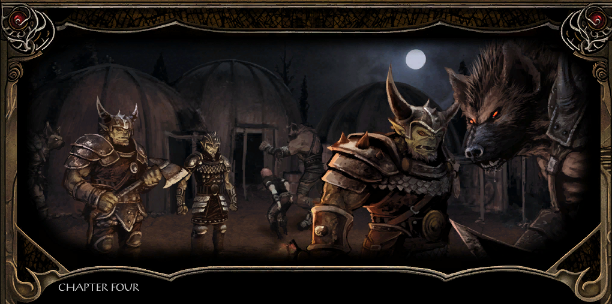{ .center-img width="80%%" }

*Mulahey i Tazok okazali się jedynie marionetkami. Prawdziwy mistrz rozwijającej się intrygi wciąż pozostawał poza zasięgiem Leecha. Jedno było pewne: ktoś żywił osobiste zainteresowanie jego śmiercią, choć młody gnom nie rozumiał dlaczego. Poszukiwania odpowiedzi trwały, a złowieszcza Knieja Otulisko stała się kolejnym celem wyprawy.*

## Obóz Bandytów&nbsp;74 { .divider }

{ .center-img width="40%" }

Tym razem bandyci uderzyli z całym impetem i wszystkimi siłami. Zwycięstwo przyniosła dopiero magia i żelazna dyscyplina szyku, który odcinał napastnikom drogę do najwrażliwszych członków drużyny. Polegli wszyscy: **Raemon**, **Taurosz Khosam**, **Brotus Bloodthirsty**, **Britik**, **Venkt** i **Hakt**. Przy plądrowaniu namiotów 3, 4 żywot skrócono jeszcze **Tersusowi** i **Knotowi**.

W jednej ze skrzyń obozu 10 **Finch** z zachwytem rozpoznała elementarz dla dzieci pióra **Fenedriela Boscoe’a**. Był to jej ulubiony autor, a przy tym gnom, co czyniło znalezisko jeszcze milszym. Niewielu pisarzy mogło jej zdaniem równać się z prozaiczną siłą perswazji Wielkiego **Boscoe’a**, a księga miała doskonale uzupełnić bibliotekę w *Nashkel*. Zastanawiała się tylko, po co bandytom taki tom. Może któryś z nich musiał nauczyć się czytać, a może po prostu obrabowali karawanę wiozącą dzieci. Tak czy inaczej, postanowiła pilnie strzec nowego nabytku ([Finch's Quest to Start a Library in Nashkel](../other/zadania.md#q25)). W obozie odnalazła się także rękojeść buzdyganu *Namiętny Pocałunek Nocy*.

W opustoszałym namiocie dowódców 7 siedział uwięziony elf **Ender Sai**. Wyjaśnił, że miejsce to było zgniłe do szpiku kości. Nie chodziło o zwykłych rozbójników, lecz o mieszankę *Czarnych Szponów* i *Chłodu*, półludzkiej bandy złożonej głównie z hobgoblinów pod wodzą złowieszczo sprytnego **Ardenora Crusha**. Gdzie indziej działali kolejni, jak kapłan **Mulahey**, wysłany, by zatruć kopalnie *Nashkel*. Ogłosił się powracającym bogiem koboldów, a legiony szczekających głupców gotowe były służyć mu aż do śmierci. Leech zauważył, że **Mulahey** nie żył i pracował dla **Tazoka**. Pytanie brzmiało, komu służył sam herszt. W tym tkwił cały sekret. **Crush** i **Taugosz Khosann**, przywódca *Czarnych Szponów*, wierzyli, że **Tazok** wykonywał rozkazy *Zhentarimów*, a ten niespecjalnie wyprowadzał ich z błędu. Obie bandy grasowały jednak na szlakach i unikały miast, i to był ich błąd. Elf pochodził z *Wrót Baldura* i mógł zapewnić, że *Zhentarimowie* nie mieli z tym nic wspólnego.

Skąd ta pewność? Miękkie podeszwy nosił nie tylko dla ciszy. Dzięki nim wiedział, komu deptał po palcach. Żadnemu *Zhentarimowi* się nie naraził. Wybrał sobie jednego wroga, *Żelazny Tron*. Skoro siedział teraz jako osobisty więzień **Tazoka**, wnioski nasuwały się same. Szukać należało w *Kniei Otulisko*, gdzie herszt regularnie bywał. W skrzyni leżały też dokumenty warte przejrzenia. **Imoen** westchnęła, że znów chodziło o *Otulisko*, więc mieli teraz dwa powody, by ruszać jak najszybciej. Elf zwrócił się do niej po imieniu, a także przezwiskiem *Rudowłosa*, którym nazywali ją wrogowie. Dziewczyna zasypała go pytaniami: czy widział jej **Henninga**, czy był cały, czy wiedział, że nadchodziła. Odpowiedział czterokrotnym „tak”. Gdy zdziwiona wydusiła „hę?”, zapewnił, że wystarczyło dać mu szansę odpowiedzieć. Jej ukochany przebywał tu dwie noce wcześniej, w tym samym namiocie co elf. **Tazok** ponaglał orkowego przywódcę, by czym prędzej odszedł z zakładnikiem do kniei, bo obawiał się, że *Rudowłosa* odnajdzie bazę i przez **Henninga** narobi mu kłopotów. Młodzieniec był nieco poobijany, lecz niegroźnie ranny, i nie stracił ducha. **Imoen** westchnęła nad losem swojego biednego, najdroższego, po czym w podzięce obdarzyła zaskoczony policzek elfa wielkim pocałunkiem ([The Kidnapping of Henning](../other/zadania.md#q91)).

Córka **Elminstera** zapytała, czy imię **Davaeorn** coś mu mówiło. **Ender Sai** podejrzewał, że to on kierował kopalnią w *Kniei Otulisko* i był przełożonym **Tazoka**. Poradził zbadać skrzynię z papierami herszta, bo znajdą w niej więcej, niż sam mógł opowiedzieć ([A Hidden Base in the Cloakwood](../other/zadania.md#q122). 

W skrzyni czekały trzy listy. Pierwszy napisał **Davaeorn**. Przekazywał rozkazy przełożonych ora ostrzeżenie, że grupa najemników mogła w przyszłości przysporzyć *Żelaznemu Tronowi* kłopotów, dlatego nie powinna dożyć tej chwili. **Tazok** miał wynająć zabójcę **Nimbula**. W drugim **Davaeorn** narzekał, że dostawy żelaza zwolniły. Potrzebna była kolejna tona rudy, więc nakazał zwiększyć liczbę napadów i w ciągu tygodnia przesłać transport do bazy w kniei. Przed wystosowaniem ultimatum należało zgromadzić jak największe zapasy. **Sarevok** chciał też wiedzieć, co stało się z grupą najemników, i nie przyjąłby łaskawie innych wieści niż potwierdzenie ich śmierci.

**Sandrah** zatrzymała się nad tym imieniem. Łańcuch zależności jeszcze się nie zamknął, a za **Davaeornem** zdawał się stać właśnie **Sarevok**. W intrygę był więc zamieszany mężczyzna w wieku Leecha, podejrzewany niegdyś o pochodzenie od *Bhaala*. To nie mógł być przypadek. Chłopak imieniem **Sarevok** zniknął przed laty w niewyjaśnionych okolicznościach. Dziś byłby dorosłym mężczyzną, być może takim, który w tajemnicy rozwinął odziedziczoną moc. Nawet jeśli nie był tym, kogo szukali, odgrywał w intrydze istotną rolę. Kapłanka była przekonana, że już go spotkała. Leech zapytał, czy miała na myśli dzień śmierci jego przybranego ojca. Potwierdziła. To ta czarna istota zabiła **Goriona**. Bezlicy wróg zaczynał się odsłaniać i miał w końcu imię.

**Jen’lig** zauważyła, że wiedzieli coraz więcej o swoich przeciwnikach. Drugim mordercą **Kasty** nosiciela miecza był **Tazok**, członek *Żelaznego Tronu*, który miał siedzibę we *Wrotach Baldura*. Dwóch kolejnych zabójców **Kasty** zostało zidentyfikowanych, lecz wielkie miasto pozostawało zamknięte, więc następnym krokiem była druga kopalnia położona gdzieś w **Otulisku**. Githyanki uznała, że drużyna jest dobrze prowadzona, a **Sandrah** dobrze sprawdzała się w roli doradcy. Wkrótce poznają imię czarodzieja z mieczem. Inteligencja i wytrwałość miały zgubić złodziei miecza i zabójcę **Goriona** ([Jen’lig's Hunt](../other/zadania.md#q15)).

Autorem trzeciego listu był **Borda**. Domagał się drugiej połowy zapłaty i zaznaczał, że to nie jego wina, iż komendant wymordował jedynie własną rodzinę, a nie połowę garnizonu. Siły *Nashkel* zostały osłabione, a o to chodziło w umowie. Listy można było przekazywać przez kontakt na karnawale w *Nashkel* albo przez kupca dość zdesperowanego, by kupować jego szczególne mikstury. Trop prowadził wyraźnie do sprawy kapitana **Brage’a** ([Captain Brage's Guilty](../other/zadania.md#q66)).

Później **Sandrah** zapewniła Leecha, że nadal będzie służyć mu radą i wsparciem, choć przekonała się już, że i ona potrafiła się mylić. Odparł, że na to właśnie liczył. Jej rady zawsze opierały się na najlepszej dostępnej wiedzy i nigdy nie zwiodła go z rozmysłem. Wyzwania miały być coraz cięższe, bo wrogowie zaczynali dostrzegać jego potencjał. Poprawiła go czule, że chodzi o ich wspólny potencjał. Tylko cała drużyna była zdolna odmienić los *Faerunu*.

Nieopodal obozu **Ogrodniczka** 9 zapytała, jak podobał się Leechowi jej ogród i piękne pnącza okalające stare mury. Gdy przypomniał o kręcących się w okolicy bandytach, przyznała, że jeden z nich doprowadzał ją do pasji. Prostak i gruboskórna bestia! Dla niej ogrodem był każdy kawałek ziemi pełen życia, a ten właśnie taki był. Zapytana, co zawiniła owa bestia, zawahała się z zakłopotaniem. Prostak załatwił się na jej drogocenną roślinkę, a smród był nie do zniesienia. Ktoś wołał go po imieniu: **Garclax**. Jeśli drużyna odbierze mu życie, może dostanie coś w podzięce za pozbycie się tego chwastu. Leech oznajmił, że gnoll już nie żył. Ogrodniczka przyjęła wieść z ogromną radością i dotrzymała słowa. Wręczyła drużynie jedno ze swoich dzieci, niebieski kwiat, który potrafił czynić cuda ([Disrespected Flowers](../other/zadania.md#q123)). Odtąd tę leczniczą roślinę można było dostać od niej za każde pięć nieśmiertelników bandytów.

**Sandrah** zawołała **Haiassa** i cisnęła patyk ponad łąką. Wilk pomknął za zabawką, a ona za nim, śmiejąc się radośnie. Leech dołączył i przez dłuższą chwilę czerpali radość z aportowania. W końcu kapłanka udała wyczerpanie i osunęła się na trawę nad strumykiem. **Haiass** oparł pysk na jej kolanach, a młody gnom usiadł obok, drapiąc wilka za uszami i co jakiś czas muskając jej dłoń. Wpatrzona w niebo powiedziała, że sposób, w jaki troszczył się o zwierzę, mówił wiele o jego stosunku do innych istot. Może ona i **Haiass** nie różnili się tak bardzo. Oboje byli sierotami w świecie, który brał ich za wrogów, zanim poznał ich naturę. Zaraz poprawiła się, że nie wszyscy tacy byli. Podniosła się i pocałowała obu w czoło.

:material-paw: Bestiariusz: *elita Czarnych Szponów, elita hobgoblinów, rozbójnik, hobgoblin Chłodu, ogrzy mag, ogrillon, zombie, gnoll, gnoll weteran, flind*

## Pomocna Dłoń&nbsp;75 { .divider }

{ .center-img width="40%" }

W pobliżu *Pomocnej Dłoni* drużyna poprosiła **Sandrah**, by spróbowała odnaleźć magiczne przejście do *Waterdeep*. Ukryta ścieżka zaczynała się tuż obok miejsca, w którym wcześniej spotkali szare elfy 15. Ruszli nią bez wahania.

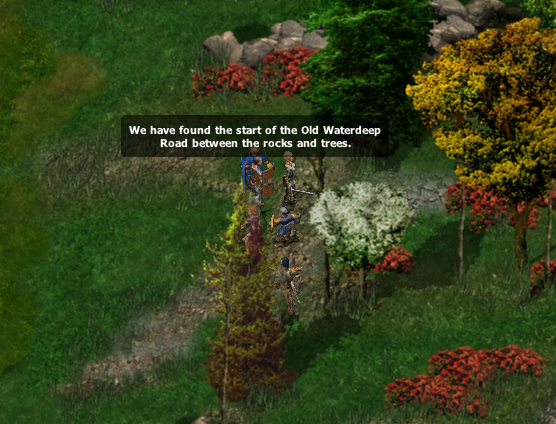{ .center-img width="60%" }

## Trakt do Waterdeep&nbsp;76 { .divider }

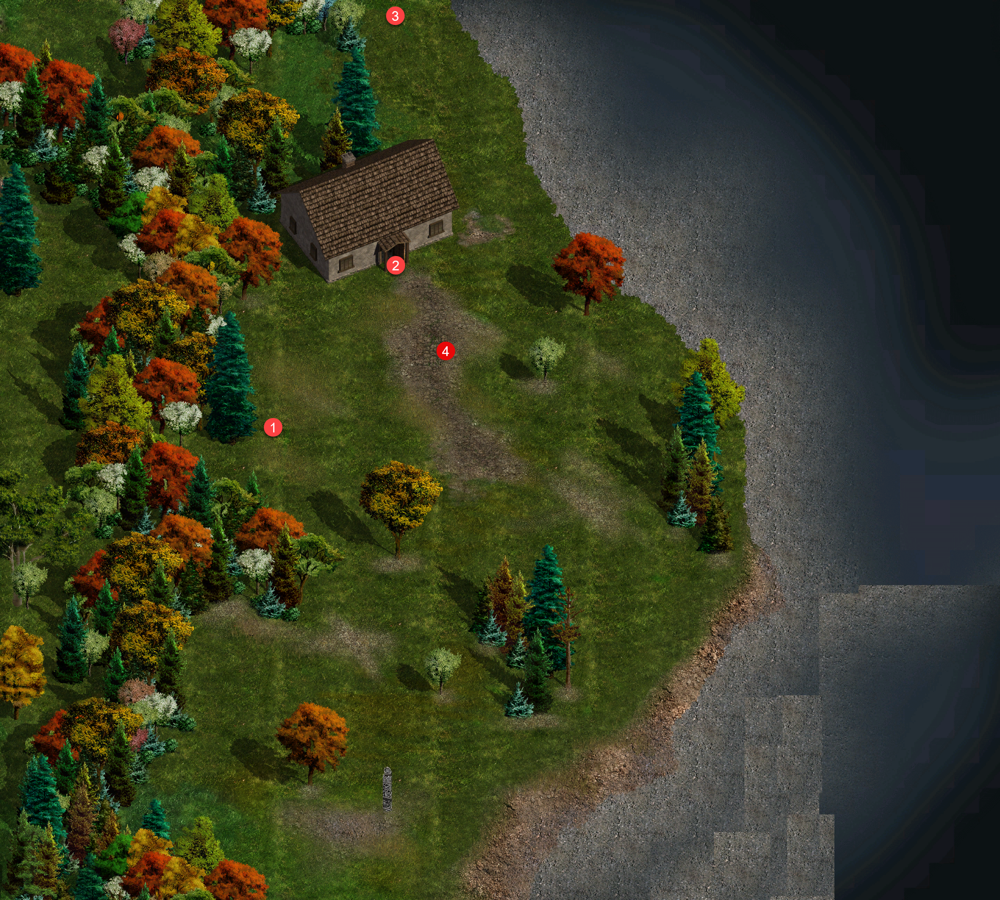{ .center-img width="40%" }

Magiczny skrót nie pozwalał zboczyć z obranego kierunku, za to nie trzeba było iść długo. Po godzinie, może dwóch, w oddali zamajaczyło miasto i jego rogatki ([Roadmap to Waterdeep](../other/zadania.md#q121)).

Wtem na ich oczach rozegrała się zbrodnia 1. Bandyta jednym cięciem zabił mężczyznę, wyrwał stojącej obok kobiecie becik z dzieckiem i na widok drużyny rzucił się do ucieczki. Zrozpaczona **Hillath** pytała, czy widzieli, co zrobił **Khattark**. **Sandrah** uklękła przy ciele zabitego mężczyzny, ale był już poza zasięgiem jakiegokolwiek uzdrowiciela. **Hillath** rozpoznała kapłankę i gorzko stwierdziła, że to naprawdę zły dzień na powrót do *Waterdeep*. Potężny **Khattark** terroryzował całą okolicę, a teraz zabił jej **Jonathana** i porwał dziecko. Córka **Elminstera** wskazała chatę, do której umknął bandyta, i obiecała, że go dopadną. Leech zapewnił, że dziecko wkrótce wróci do matki. Zrozpaczona matka została przy zmarłym mężu, pobłogosławiła młodego gnoma i poprosiła o pośpiech.

W chacie 2 **Khattark** nie zamierzał oddać zdobyczy bez słowa. Burknął, że nie dopadną potężnego **Khattarka**, że nadciągają jego ludzie, a jeśli się nie zatrzymają, dziecko zginie. Leech parsknął śmiechem. Bandyta mógł być silny, ale drużyna miała przewagę, a martwy zakładnik oznaczał koniec jego szans na ucieczkę. Gdy **Khattark** oburzył się, że ktoś śmie mu grozić, młody gnom sięgnął po blef podobny do tego użytego przez bandytę. Oznajmił, że straż miejska z *Waterdeep* była już w drodze, a chata za chwilę zostanie otoczona i lepiej aby oddał dziecko i uciekał, póki jeszcze może. Podziałało. Bandyta wymknął się, zostawiając niemowlę.

Dziecko natychmiast wróciło do matki. Dziękowała ze smutkiem, wpatrzona w stygnące ciało męża. Morderca nie mógł pozostać bezkarny ([Khattark - the Bandit](../other/zadania.md#q124)). :material-trending-up: Reputacja +1.

Bez dalszej zwłoki drużyna przekroczyła bramy miasta 3.

:material-paw: Bestiariusz: *wilk, rozbójnik*

## Waterdeep&nbsp;77 { .divider }

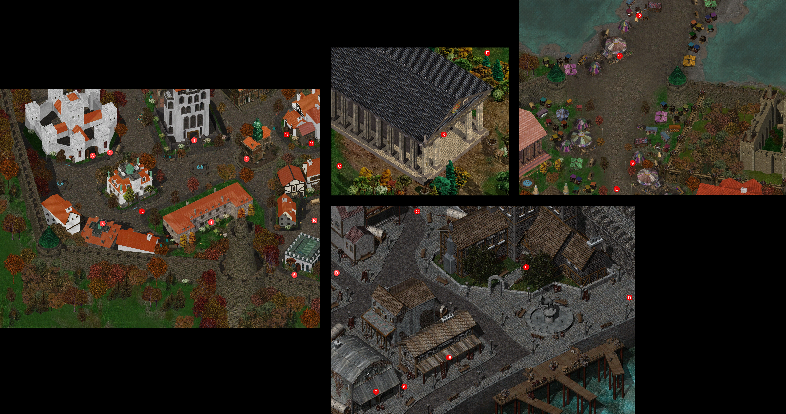{ .center-img width="40%" }

Główna brama A prowadziła do *Dzielnicy Południowo-Zachodniej*.

Pierwszym przystankiem była *Świątynia Splendoru* 1. Leech zauważył, że miejsce przypominało raczej graciarnię. Kapłan *Waukeen* westchnął i przyznał mu rację. Niegdyś najcenniejszy klejnot bogini, przybytek został splądrowany przez **Khattarka** i jego ludzi, którzy zabrali nawet uchwyty. Świątynia obiecywała ogromną nagrodę za zakończenie terroru bandyty. Młody gnom zapewnił, że już go ścigali. Kapłan poprosił, by wrócili po wszystkim, bo *Waukeen* słynęła ze szczególnych darów dla tych, którzy wspierali bezpieczny handel.

W *Domu Boskiego Prawa* *Siamorphe* 2 **Lady Ilvastarr** chłodno oznajmiła, że nie było tu miejsca dla chłopstwa. **Sandrah** odparła, że jak zawsze doceniała jej radę. Szlachcianka zaczęła strofować ją za sarkazm, urwała w pół słowa i pospiesznie przeprosiła, dopiero teraz rozpoznając rozmówczynię. Wyznała, że zawsze miała nadzieję, iż **Sandrah** odnajdzie drogę do ich grona, w przeciwieństwie do ojca, uparcie wypierającego się związków ze szlachtą.

Matrona z domu uciech 3 powitała **Sandrah** jak starą znajomą. **Jen’lig** zdziwiła się, co młoda kobieta robiła w takim miejscu. Burdel-mama wyjaśniła, że przychodziła tu na naukę, i dodała, że to prawdziwa strata, bo mogłaby zostać najlepiej opłacaną dziewczyną w przybytku. **Sandrah** chciała jednak, by jej przyszły partner niczego przy niej nie utracił. Kilka spraw nagle stało się dla Leecha jaśniejszych. Trening czyni mistrza.

W znacznie większym przybytku *Sharess* 4 barmanka zapewniła, że ci, którzy mieli monety i pragnęli rozkoszy, trafili w najlepsze miejsce. Na pytanie Leecha, co właściwie się tu robiło, roześmiała się, że to pewnie słodkie żółtodzioby z południa, z *Candlekeep* albo *Nashkel*, choć wszyscy prowincjusze byli tacy sami. Po chwili uznała, że wyglądali jednak na doświadczonych poszukiwaczy przygód. W tylnej izbie czekał człowiek skupujący rzadkie artefakty za najwyższą cenę, a ona wręczyła im klucz do tego pomieszczenia. Plecaki drużyny z dnia na dzień robiły się cięższe, więc warto było spróbować. Dodała jeszcze, że za złoto tutejsze dziewczęta chętnie dotrzymają towarzystwa.

Za zamkniętymi drzwiami czekał **Zbieracz**, handlujący z demonami. Drużyna kupiła od niego dziwnie wyglądający klucz, kamień łotrzyka i trochę liści *Aescalusa*, po czym tajemniczy jegomość teleportował się w nieznane.

Przed *Sharess* marynarz **Dan** 5 wesołym okrzykiem zaprosił Leecha do wspólnej biesiady. Cała kompania służyła na *Ziewającej Mary* i korzystała z przepustki na brzegu. Statek był podobno tak szybki i zwrotny, że gdyby sam **Balduran** stanął do wyścigu, załoga i jego by wyprzedziła. Zapytany o pochodzenie, **Dan** oznajmił, że był solą zlepionym obywatelem otwartych mórz i dziesięciokrotnym ocalałym ze szkorbutu. Kotwicę zarzucał w *Neverwinter*, *Waterdeep*, *Wrotach Baldura* i *Athkatli*, lecz nigdzie nie zaznał spokoju, bo nie ufał niestałemu niebu nad ich dachami.

W *Dzielnicy Centralnej* B drużynę powitał piskiem **Araxias**, mała wywerna. **Sandrah** uspokoiła towarzyszy, że to jeden z jej przyjaciół. Znalazła go tuż po wykluciu na szczycie wieży ich domu, wykarmiła i wyleczyła, lecz zostawiła wolnym. Czasem wpadał tylko aby się przywitać.

Chwilę później **Clarissa Bloomwhiffler** 6 z radością rozpoznała **Finch**. Kronikarka nazwała ją starą molicą książkową, a **Clarissa** odbiła piłeczkę. **Finch** opowiedziała, że podróżowała z drużyną Leecha, zapisała całe tomy o ich czynach na *Wybrzeżu Mieczy* i z pomocą przyjaciół zakładała bibliotekę w *Nashkel*. Zarumieniona dodała, że była teraz poszukiwaczką przygód w imię *Deneira*. **Clarissa** uznała, że przyjaciółka wyraźnie urosła, i zapytała, czy mogłaby skopiować część zapisków do swojej biblioteki. **Finch** przyjęła to z entuzjazmem. Wiedza miała rozejść się w imię *Deneira*, a imiona jej przyjaciół po całym *Faerûnie*.

W sklepie **Clarissy** 7 bibliotekarka stwierdziła, że w zwojach kronikarki nie trzeba było niczego szukać, bo ich wartość rzucała się w oczy od pierwszych linijek. Oznajmiła **Sandrah**, że gdyby jej ojciec miał odrobinę więcej talentu pisarskiego, sam opowiedziałby światu o swoich dokonaniach. Teraz mieli przynajmniej **Finch**, dokumentującą czyny jego córki i Leecha, bohatera tego pokolenia na *Wybrzeżu Mieczy*. Córka **Elminstera** poprosiła, by przestała, bo wszyscy zaraz wybuchną z dumy, a zbyt wielki rozgłos mógł być w ich przypadku niebezpieczny. **Clarissa** przyznała jej rację. Na koniec wręczyła **Finch** niezwykle rzadkie wydanie eseju **Monteelaha** o cnocie mądrości jako podarunek za dalszą pracę dla *Deneira*. Kronikarce odebrało mowę, ale zapewniła Leecha, że sama poniesie ten dar i nie obciąży nim drużyny, po czym zaśmiała się cicho z własnego żartu ([A Book For Finch](../other/zadania.md#q125)).

Następnie **Sandrah** poprowadziła ich do *Świątyni Mystry* C. Przed gmachem 8 przestrzegła Leecha przed zbyt wielkimi oczekiwaniami. Sława świątyni nie wynikała z przepychu, lecz z płynących z wiary czynów i wiedzy. W środku czekało miejsce nauki i uzdrawiania, niewiele różniące się od *Candlekeep*. Nie miała tu żadnych spraw, chciała po prostu odwiedzić dawnych znajomych i podzielić się z nim tą częścią swojego życia.

W środku **Rhanthona** powitała ją jako wnuczkę *Midnight* i Strażniczkę *Płaszcza*. **Sandrah** podziękowała, wychwytując przy tym delikatną aluzję do swojej nieobecności. Kapłanka zapewniła, że nie był to wyrzut, po prostu brakowało im jej radosnej obecności. **Elminster** informował ich o jej misji, a wieści docierały regularnie. Spojrzała na młodego gnoma i zapytała, czy to ten słynny Leech. Córka **Elminstera** przypomniała, że świątynia miała liczne sposoby zdobywania wieści i niewiele z ich dokonań długo pozostawało niezauważone. Gdy **Rhanthona** zaczęła mówić o wyjątkowości jego drogi i roli ich kapłanki, **Sandrah** przerwała jej, zanim Leech zdążył uznać, że wyznawcy *Mystry* próbowali wpleść się w jego los. **Rhanthona** przeprosiła. W naturze bogini nie leżało ingerowanie w decyzje śmiertelników, a ich kapłanka działała na własną odpowiedzialność. Na koniec zaprosiła ich do *Wewnętrznej Świątyni*, gdzie duchowni utknęli przy trudnym przypadku.

Tam **Ringhontal**, dawny nauczyciel **Sandrah**, przywitał ją z radością i stwierdził, że wyrosła na wspaniałą młodą kobietę. Zarumieniona uczennica przedstawiła mu Leecha. Duchowny poprosił ich o pomoc w drobnym problemie miasta, a ona od razu domyśliła się, że chodziło o **Khattarka**. Banda przerosła lokalną milicję, a świątynia nie miała własnych sił zbrojnych. **Sandrah** wyjaśniła, że przy pierwszym spotkaniu Leech słusznie uznał życie syna **Lady Hillath** za ważniejsze od ścigania łotra, teraz jednak czuli się zobowiązani go wytropić. Według plotek bandyta mieszkał w mieście, widywano go o zmierzchu, po czym znikał, jakby zapadał się pod ziemię. Raczej pod ziemię w dosłownym sensie, poprawiła go kapłanka. Kanały pod miastem pozwalały pojawiać się i znikać do woli, a ofiar nigdy tam nie brakowało. Nauczyciel pochwalił jej bystrość i przyznał, że czasem naprawdę potrzebowali jej spojrzenia. Poprosił jeszcze, by w wolnej chwili pomogła im swoimi umiejętnościami uzdrowicielskimi. Leech dał słowo, że będą wypatrywać **Khattarka** ([Khattark - the Bandit](../other/zadania.md#q124)).

Ze świątyni drużyna ruszyła na jarmark E. W jednym z namiotów natknęła się na zmiennokształtnych 9, stworzenia równie dziwne, co niespotykane.

Między straganami 10 dwaj rybacy, **Henk** i **Yantl**, zatrzymali **Sandrah**, pewni, że była kapłanką ze *Świątyni Mystry*. Przyznali szczerze, że czcili *Królową Wód*, a nie jej boginię, i chwytali się ostatniej deski ratunku. Od pięciu dni sieci wracały puste, a modlitwy pozostawały bez echa. Córka **Elminstera** wyjaśniła Leechowi, że rybacy zaopatrywali jej rodzinne miasto, więc ich kłopoty prędzej czy później miały stać się kłopotami całego *Waterdeep*. Nikt nie znał przewinienia, które mogłoby urazić *Umberlee*. Kapłanka podsunęła, że ktoś spoza ich kręgu mógł zgrzeszyć przeciw morzu. Część rybaków proponowała już dawny rytuał ofiarny. **Sandrah** zaprotestowała z oburzeniem. Czasy takich ofiar minęły, trzeba było negocjować. Istniał sposób, by przywołać na brzeg *Ambasadora Morza*, potrzebowali jednak *Czary Umberlee* i odpowiedniego zwoju. Poszukiwane przedmioty mogły znajdować się w którejś ze świątyń w zachodniej części miasta. Drużyna obiecała ich poszukać.

W dużym namiocie 11 krasnolud zachęcał do udziału w turnieju na arenie w innym planie. Najwyraźniej o tym miejscu wspominał niegdyś **Baeloth**. Na razie drużyna podziękowała.

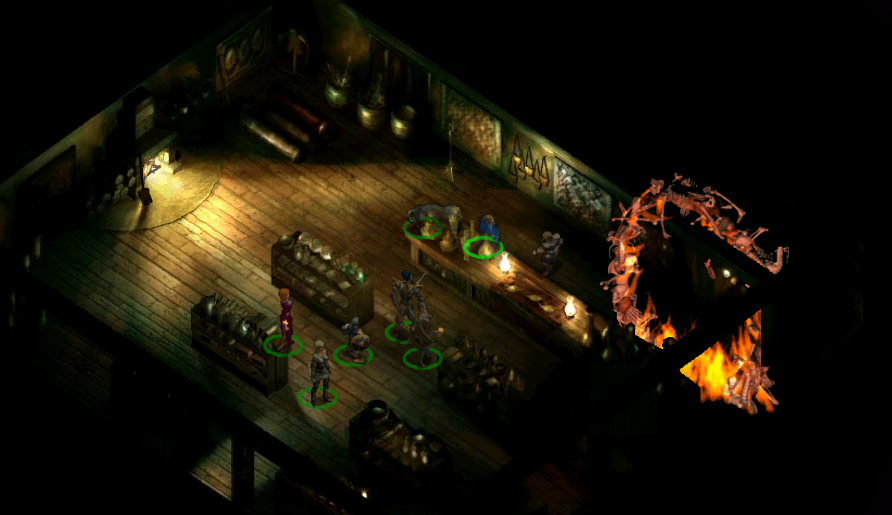{ .center-img width="60%" }

W *Dzielnicy Południowo-Zachodniej* **Sandrah** odnalazła zapamiętane zejście do kanałów 12.

W ciemnych tunelach czekali niezwykle silni szkieletowi wojownicy. Drużyna przebiła się przez nich krok po kroku aż do **Khattarka** i jego maga. Ten ostatni przywoływał potężne bestie, w tym dżina, i walka wyssała z wędrowców ostatnie siły. W końcu jednak bandyta numer jeden w *Waterdeep* przestał być problemem ([Khattark - the Bandit](../other/zadania.md#q124)).

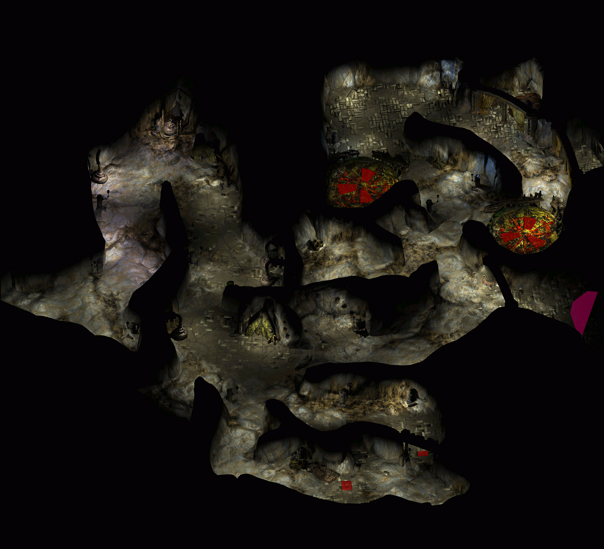{ .center-img width="60%" }

Kapłan *Waukeen* 1 odwdzięczył się za pomoc informacją, że czara potrzebna do przywołania *Ambasadora Morza* była wystawiona w sąsiedniej świątyni 2. Zwoju przywołania nie widział od napadu i obawiał się, że wandale zabrali go z resztą łupów. W kryjówce bandy go nie było. **Sandrah** miała nadzieję, że łotrzy nie zniszczyli go, nie dostrzegając jego wartości a raczej sprzedali za kilka monet. Jedynym zainteresowanym takim przedmiotem byłaby księgarnia *Bloomwhifflerów*, choć **Clarissa** nie słynęła ze skupowania kradzionych towarów, przynajmniej świadomie.

Czara rzeczywiście stała w jednej z gablot. Z nią w ekwipunku drużyna wróciła do **Clarissy** 7. Bibliotekarka przyznała, że zaledwie kilka dni wcześniej tajemniczy mag sprzedał jej taki zwój. Gdy **Sandrah** zasugerowała, że sprzedawca mógł należeć do wspólników **Khattarka**, **Clarissa** z przerażeniem zawołała do *Deneira* i poprosiła, by sami poszukali go na półkach i zabrali, bo nie chciała mieć z tą sprawą nic wspólnego. Córka **Elminstera** uspokoiła ją, że lepiej, iż zwój trafił do niej niż do pieca bandytów. Wkrótce znalazł się na jednej z półek.

W drodze na jarmark drużyna zajrzała do *Świątyni Mystry* 8. **Ringhontal** z ulgą przyjął wieść o rozbiciu bandy i uznał, że sława Leecha nie była przesadzona. Potem zapytał wprost, czy **Sandrah** podejmie się trudnego przypadku, wymagającego zarówno sztuki leczenia, jak i błogosławieństwa, którym obdarzono tylko ją. Zdziwiła się, że w ogóle pytał. Uzdrowicielka musiała tym razem bezpośrednio porozumieć się ze *Splotem* i poświęcić cząstkę siebie, by spłacić dług wobec jego równowagi. Tym razem mogło być potrzebne nawet jeszcze więcej. Chodziło o małą **Leyalę** leżącą na ołtarzu. Jej krew skaziła mroczna zaraza, a przy życiu utrzymywało ją jedynie pole siłowe ołtarza.

**Sandrah** zbadała dziecko i potwierdziła diagnozę nauczyciela. Gdy zapytał, czy mogła coś zrobić, odpowiedziała, że **MY** możemy. **Leyala** była gnomką, jak Leech, a do transferu potrzebna była też inna krew, uzupełniająca pierwszą. Od ukochanego zamierzała pobrać tylko odrobinę, krew pozostałych należało zbadać. Podczas transfuzji musiała połączyć się ze *Splotem*, co miało ją mocno osłabić. Młody gnom odparł, że ufał jej tak samo jak **Ringhontalowi**. Duchowny pobłogosławił ich i wskazał ciało dziewczynki oraz święty nóż *Mystry* na pobliskim stole. **Sandrah** wyznała Leechowi, że jeszcze nigdy nie kochała go bardziej niż w tej chwili, i poprosiła, by pozwolił jej zabrać się do pracy. Kapłanka obeszła drużynę z rytualnym nożem i każdemu nacięła palec wskazujący. Ostrze rozbłyskiwało albo pozostawało matowe, zdradzając naturę badanej krwi. Zranionych leczył *Splot*.

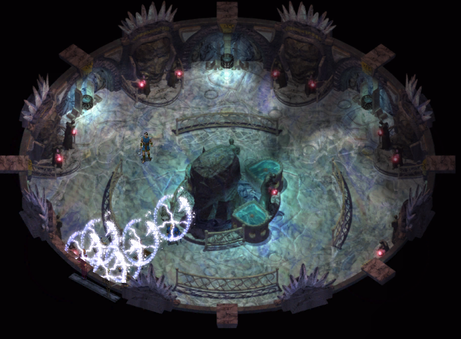{ .center-img width="60%" }

Gdy rytuał dobiegł końca, osłabiona **Sandrah** zapytała łagodnie, jak dziewczynka się czuła. **Leyala** miała wrażenie, że długo jej nie było, jakby trwała w niekończącym się śnie. Zaniepokoiła się o swoją wybawicielkę, lecz ta zapewniła, że potrzebowała jedynie odpoczynku. Dziewczynka czuła się dobrze i zapytała, czy to ona tego dokonała. Kapłanka wyjaśniła, że była jedną z uzdrowicielek *Mystry*. **Leyala** odpowiedziała, że rozpoznała w niej boginię ze swojego snu.

Drużyna musiała odpocząć, a Leech znów miał proroczy sen.

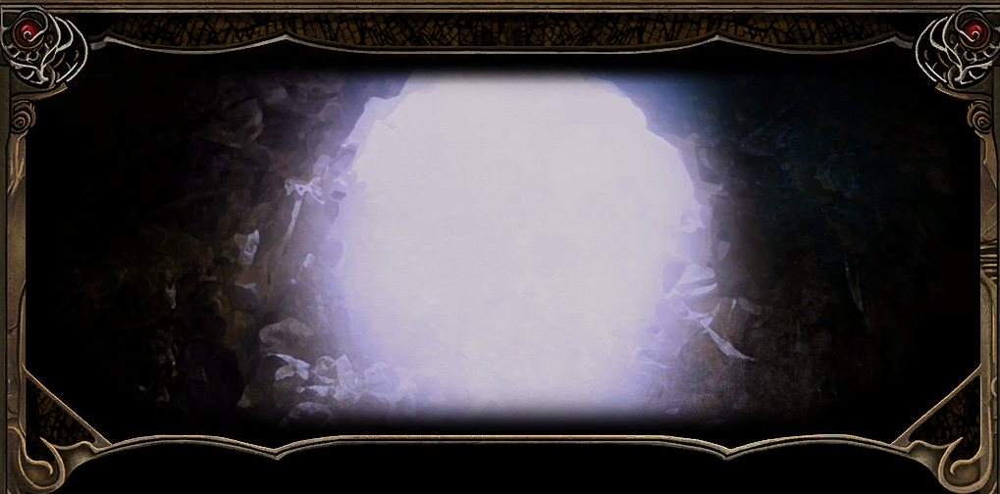

<em>Gdy zapadła ciemność, myśli Leecha powędrowały ku minionym wydarzeniom i w pełni zasłużonym triumfom. Obóz bandytów, ukryty i strzeżony na całym wybrzeżu, nie stanowił dla jego sprytu żadnego wyzwania. Rozmaici rozbójnicy i zbóje kręcili się po nim, lecz równie dobrze mógłby pozostać wśród nich niewidzialny. Wspomnienia przerwał potężny podmuch wiatru, który uniósł go wysoko ponad obóz i las. W porannym słońcu zatoczył łuk i przez chwilę był niczym ptak, wolny od obowiązków wobec tych, którzy pozostali na dole. Niewidzialne ręce sprawiły jednak, że ziemia na nowo odzyskała nad nim władzę, a on nagle poczuł się mniej jak wróbel, a bardziej jak kamień wyrzucony z katapulty. Bez uderzenia i bez fanfar ziemia przyjęła go i nie odpłaciła ciosem. W jednej chwili wszystko pogrążyło się w czerni, a on zdawał się opadać do samego jądra świata. Skała wokół rozjaśniła się, a przed nim powoli zarysowała się jaskinia, w której widział zaledwie kilka kroków w przód i w tył. Potykając się, ruszył naprzód i stanął twarzą w twarz... z samym sobą. Przed nim stał kamienny wizerunek, odwzorowany z najdrobniejszą dokładnością. Z ciemności rozległ się głos oskarżający go, a jednocześnie wyraźnie rozbawiony. „Cóż za niezasłużona duma, wielki drapieżniku, skoro całe twoje jestestwo jest pożyczone. Co się należy, niech zostanie przyznane, a zapłata niech trafi tam, gdzie się jej żąda”. Z mroku wyfrunął kościany sztylet i trafił prosto w posąg. Kamień lekko pękł, lecz ból, który poczuł, był tak straszliwy, jakby sam został rozerwany na strzępy. „Stworzono cię takim, jakim jesteś”, szydził głos, „i można cię także złamać”. Runął w pustkę i nie dotarł do dna czeluści, nim świt go obudził.</em>

Rano **Imoen** zauważyła, że jej przyjaciel nie wyglądał na wyspanego. Sama też miała kiepską noc. Czy znów pojawiły się sztylety i dziwne głosy? Leech opowiedział jej o wizji. *Rudowłosa* przyznała, że ten głos ją przerażał, i uznała za dobry znak, że jego również. Nie ufała mu ani trochę. Poradziła, by dalej z nim walczył, a nowe moce wykorzystywał tylko do tego, co uważał za słuszne. Tego chciałby **Gorion** i tego chciała ona. Skąd się wzięły, nie miało znaczenia.

**Ringhontal** z radością zobaczył wypoczętych śmiałków. **Leyala** całkowicie wróciła do zdrowia i trafiła pod opiekę szczęśliwej babci, bo jej rodziców zamordował niedawno **Khattark**. Przewidując decyzję uczennicy, duchowny przekazał rodzinie rozsądną sumę z funduszy świątyni. **Sandrah** uznała to za wspaniałe rozwiązanie. Nauczyciel stwierdził, że podczas krótkiego pobytu dokonała niemało, a bogini się do niej uśmiechała. Miał więc prawo przekazać jej przedmiot należący niegdyś do *Midnight*. Kapłanka obiecała nosić go z dumą.

Pora było przywołać *Ambasadora Morza* 10. **Yantl** zapowiedział, że rybacy przygotują na wszelki wypadek noże do patroszenia ryb, lecz **Sandrah** stanowczo kazała schować broń. Chodziło o negocjacje. **Henk** przyznał jej rację, bogini i tak była już rozgniewana. Kapłanka wyrecytowała zaklęcie w nieznanym języku. Nad wodą rozległ się plusk i *Ambasador Morza* powitał zebranych pogardliwym mianem cielesnych istot. Morze było wściekłe, bo słudzy *Umberlee* nie zrobili nic, by uwolnić jej stworzenie więzione w mieście. Niewiedza nie była usprawiedliwieniem. **Sandrah** zaoferowała pomoc. Ambasador poczuł od niej smród *Mystry*, lecz zauważył, że tylko ona nie drżała ze strachu. Wyjaśnił, że śmiertelny czarodziej wywabił na ląd jego siostrę, syrenę. Jeśli nie wróci na czas do morza, zginie. Gdy zostanie oddana falom, *Umberlee* zawrze pokój z mieszkańcami.

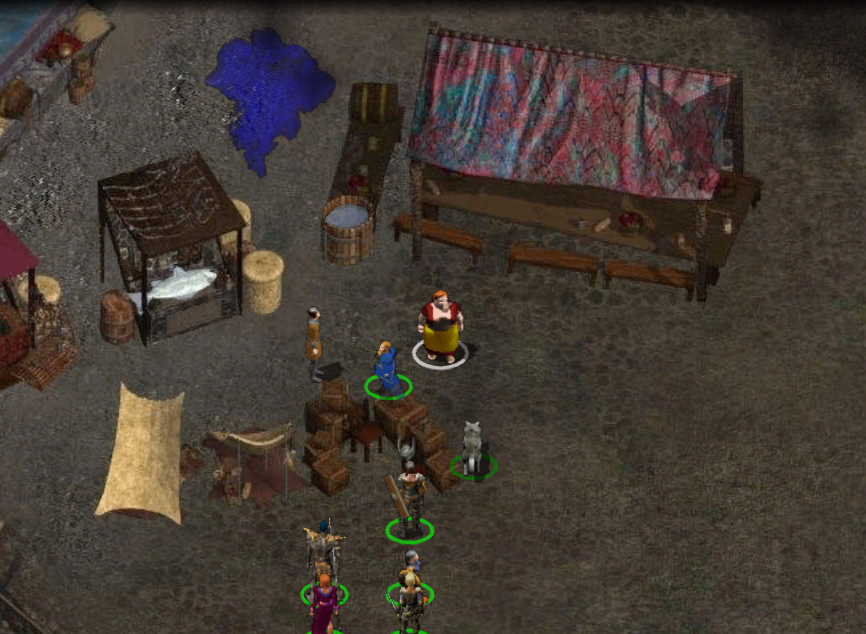{ .center-img width="60%" }

Szukanie syreny w mieście wielkim jak *Waterdeep* nie brzmiało zachęcająco. **Yantl** przypomniał jednak **Henkowi** o czarodzieju, którego ten widział nocą przy brzegu. Rybak wykręcał się, że niczego właściwie nie widział, aż Leech postawił sprawę jasno: albo opowie, albo nikt im nie pomoże. **Sandrah** uśmiechnęła się z aprobatą. **Henk** w końcu przyznał, że widział **Whyrtmana**, dziwnego maga, który nigdy nie zaglądał na targ rybny. Tamtej nocy, tuż przed początkiem kłopotów, stał jednak przy sieciach i przez kilka minut nieruchomo patrzył w morze. Był to jedyny trop. Kapłanka wyraźnie nie cieszyła się na tę wizytę. **Whyrtman** był człowiekiem niełatwym, żeby nie powiedzieć więcej, i mieszkał w *Dzielnicy Południowo-Zachodniej*, nieopodal domu kapitana portu. Ambasador otworzył wrota wymiaru i zniknął.

Frontowe drzwi domu maga 13 kryły za sobą sforę rozwścieczonych psów, więc drużyna zaszła od przybudówki 14. Na dole pulsował kryształ, najwyraźniej kontrolujący stworzenia w domu, strzeżony przez piekielne ogary i mglisty koszmar.

Po rozprawieniu się z diabelstwem **Sandrah** orzekła, że kryształ sterował istotami w obrębie domu, a przynajmniej niegdyś. Teraz dogasał, a wroga agresja wynikała z utraty kontroli. Kolejny mag bawił się mocami przekraczającymi jego umiejętności. Zastrzegła, by nie kusić jej do przedwczesnych sądów, bo **Whyrtmana** nie lubiła od zawsze.

Na piętrze syrena o imieniu **Neerol** zapytała, czy przyszli ją uwolnić, czy zakończyć jej gasnące życie. Mag stał obok zamieniony w kamień, najpewniej jej spojrzeniem, a ona utknęła w pułapce. Przyznała, że sprawa była bardziej złożona. Samotny czarodziej co noc przychodził nad morze, a to przyciągało ją do płytkiej wody. Takie historie zdarzały się często, lecz tym razem było inaczej. **Whyrtman**, chroniony własną magią przed jej czarami, uległ nie zaklęciu, lecz jej naturze. Ona zaś poczuła coś, czego wcześniej nie znała: troskę i podziw człowieka, który pokochał ją bez rzucanego na nań uroku. Nazwał to miłością. Kryształ skupiał jego moc i pozwalał mu opierać się jej niebezpiecznemu darowi. Przez jakiś czas to działało. Byli szczęśliwi i beztroscy, aż nagle wszystko się zmieniło. Być może mag zapomniał kryształ „nakarmić”.

**Sandrah** przypomniała, że *Królowa Wód* uznała ją za porwaną i pałała nienawiścią do mieszkańców lądu. **Neerol** zapytała, czy to wszystko było tylko iluzją. Leech odparł, że doświadczyła całej miłości, jaką mogły podzielać jej lud i mieszkańcy lądu, i poprosił, by wróciła do swojej królowej. W suchym miejscu, bez magii **Whyrtmana**, słabła z każdą chwilą. Kapłanka orzekła, że mag znał ryzyko, a jego śmierć nie była morderstwem. To nie było miejsca na wymierzanie sprawiedliwości, lecz czas dla miłosierdzia.

Drużyna nie była w tej kwestii jednomyślna, choć wnioski miała podobne. **Imoen** westchnęła nad niesprawiedliwością życia i upewniła się, że odprowadzą syrenę do domu. **Shar-Teel** mruknęła, że wystarczyło powierzyć mężczyźnie ważną sprawę, by skończyło się bałaganem, a kobieta zasłużyła na swój los. **Finch** zauważyła, że ratunek damy i pomoc rybakom trafią do kronik sławnego Leecha, a resztę jej pióro pominie. **Jen’lig** syknęła, że spanie z istotą pożerającą umysł kończyło się pożarciem własnego mózgu. Rybę należało po prostu wrzucić z powrotem do wody, dowódco. **Sandrah** przypomniała, że od tej decyzji zależało jej rodzinne miasto. Leech zdecydował, że zgubna miłość przyniosła dość cierpienia, czas działać w imieniu żywych. Drużyna zaniosła **Neerol** nad brzeg i pozwoliła jej odejść w morskie odmęty, przekonana, że gniew *Umberlee* przestanie ciążyć rybakom z *Waterdeep*. :material-trending-up: Reputacja +1.

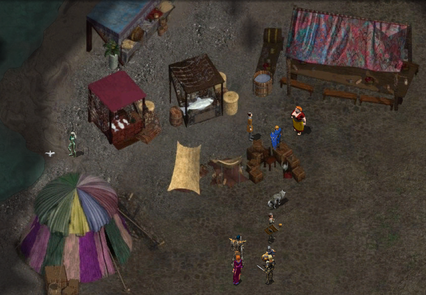{ .center-img width="60%" }

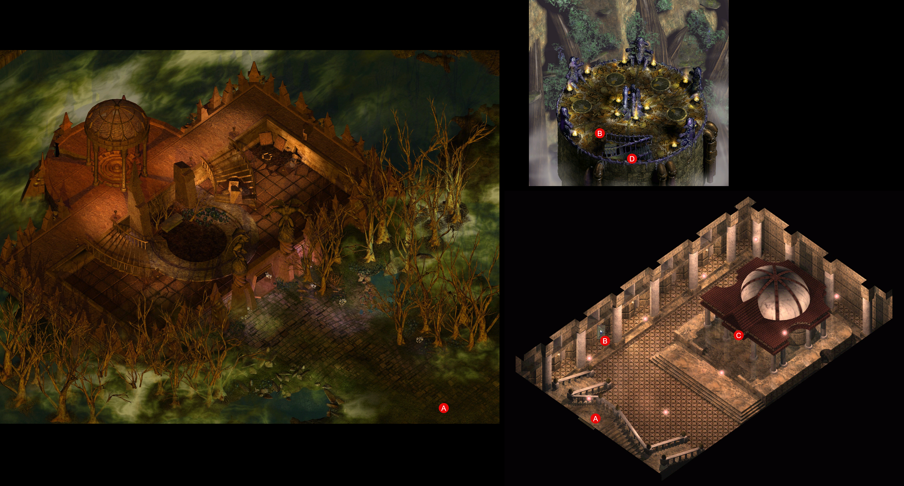{ .center-img width="60%" }

Po zażegnaniu miejskich kłopotów przyszła wreszcie pora na dom **Sandrah** 15. Majordomus **Landrel** oznajmił, że rezydencja ożyje na nowo, skoro pani zawitała w jej progi z przyjaciółmi, i dodał, że w ogrodzie na piętrze ktoś niecierpliwie na nią czekał. „**Pelligram**!”, zawołała z radością. Leech zdziwił się, że kolejna z jej dawnych miłości miała tupet przesiadywać w jej ogrodzie, lecz **Landrel** sprostował, że **Pelligram** była damą. **Sandrah** wyraziła nadzieję, że tym razem będzie mogła im towarzyszyć. 

Najpierw jednak **Elminster** powitał córkę i jej przyjaciół, zwłaszcza Leecha. Wyjaśnił, że wciąż badał sprawę demona. Odesłany do piekła **Naronguth** odkrył najwyraźniej, że zostawił kilka przedmiotów, i zapewne ich szukał. Poprosił, by przed opuszczeniem *Waterdeep* zajrzeli do jego gabinetu po najnowsze wieści.

Towarzysze nie kryli wrażenia. **Imoen** ogłosiła, że wspaniałe sale potężnego **Elminstera** odwiedzała sama Imoen Wspaniała. **Shar-Teel** mruknęła, że jedynym przyzwoitym mężczyzną w *Faerûnie* okazał się stary mag opłakujący dawno zmarłą żonę. Co za strata! A **Finch** notowała, że dom i ogrody **Elminstera** to najwspanialsze miejsce, jakie można odwiedzić. **Jen’lig** wyczuła, że dom łączył się z samymi planami, niczym wyspa innej materii i czasu, niemal jak miasta na *Planie Astralnym*. Mag życzył jej powodzenia w misji, zauważając, że rzadko githyanki odwiedzali ich *Prime*. Natomiast Leech podziękował mu za schronienie dla kogoś, kto nigdzie nie był zbyt mile widziany.

W ogrodach A do **Sandrah** podeszła **Pelligram** i z głębokim mruczeniem otarła się pyskiem o nogę swojej pani, po czym przewróciła się na grzbiet, wystawiając łaciaty brzuch. **Imoen** uznała, że to ładny kiciuś, choć chyba zjadła o kilka myszy za dużo. **Shar-Teel** widziała w niej dumną samicę, śmiertelnie niebezpieczną dla każdego mężczyzny. **Jen’lig** zauważyła, że to nie oswojony czerwony smok, ale istota potężniejsza od zwykłych zwierząt. Była to Czarna Pantera Równinna z *Lśniących Równin Ormothu*. **Sandrah** uratowała ją jako kocię przed łowcami, którzy chcieli ją wytresować i sprzedać na areny *Amn*. Dorastały razem i zostały przyjaciółkami. **Haiass** podszedł ostrożnie i obwąchał wielkiego kota, a **Pelligram** odpowiedziała tym samym i łagodnie zamruczała. Kto twierdził, że koty i psy nie mogły się przyjaźnić? Sprawa była przesądzona - pantera ruszała z drużyną.

Na wieży B Leech zdziwił się, jak wysoko się znaleźli po jednej kondygnacji schodów. W domu **Elminstera** magia tkwiła we wszystkim. Krążące wokół orły były przyjaciółmi **Sandrah**, każdy miał imię i razem strzegły schronienia przed złymi wpływami. Cały *Faerûn* leżał u ich stóp. Kapłanka zapytała, czy potrafił wyobrazić sobie, jak stała tu kiedyś, patrząc na południe i marząc o przyszłym ukochanym. Leech dostrzegł na wybrzeżu samotne, odległe światło. Roześmiała się łagodnie. To było *Candlekeep*. Marzyła o miłości, patrząc prosto na miejsce, w którym ta miłość już na nią czekała.

Zwróciła się do przyjaciół, by czuli się jak u siebie, a **Landrel** spełni każde ich życzenie. Leecha poprosiła, by zszedł z nią do jej komnat D. **Imoen** mruknęła, że nie trzeba było jej tłumaczyć, co ci dwoje knuli. **Shar-Teel** zapowiedziała, że wypróbuje tego całego **Landrela**, choć był tylko mężczyzną. **Finch** westchnęła nad zamkniętą książką, że samo czytanie o romantycznych bohaterach to nie to samo. **Jen’lig** syknęła, że minie wiele czasu, nim znajdzie odpowiedniego partnera wśród swoich. 

W komnacie **Sandrah** podała Leechowi kieliszek wina. Długo patrzyli sobie w oczy, nie potrzebując wielu słów. Wyznała, że od dawna wyczekiwała tej chwili i nie chciała się spieszyć. Noc spędzili razem. 

Rano rozmowa płynęła swobodnie. Leech zauważył, że w świątyni darzono ją szacunkiem należnym przełożonej, choć zdobyła go sama, a nie dzięki ojcu czy babce. Przyznała, że trochę się tym szczyciła. Długo zmagała się z drogą *Mystry*, bo nie znosiła myśli, że jakiś los wybrał za nią. Ani ojciec, ani nauczyciele jej nie przymuszali, a *Mystra* wymagała od wiernych otwartego umysłu, nie skostniałych ceremonii. W jej imieniu robiła więc mniej więcej to, co i tak robiłaby według własnych zasad. Wcześnie dostrzeżono jej buntowniczą naturę, ale też zdolności analityczne i niezwykły sposób przyswajania magii. Po naradzie z ojcem uznano, że nie będzie pełnić rutynowej służby. Nie miała oficjalnego tytułu. Była kapłanką ruszającą w świat, by walczyć dla *Mystry* tam, gdzie trzeba, śladami *Midnight*. Do niego doprowadziły ją niezależność i zainteresowanie historią rodziny, a nie rozkaz ojca czy świątyni. Teraz jej miejsce u jego boku zbiegało się po prostu z jej misją. Leech podsumował ze śmiechem, że uciekła od dróg **Elminstera** i *Midnight* tylko po to, by wylądować dokładnie na nich, jako tajna agentka bogini. Przyznała, że coś w tym było, tyle że to był jej wybór.

Młody gnom wyznał, że sam nie był wierzący i nie chciał jej tym urazić. Poprosiła, by przypomniał sobie lekcje z *Candlekeep* o *Midnight* a ten przypomniał sobie, że była śmiertelną poszukiwaczką przygód, w *Czasie Niepokojów* i wraz z **Cyrikiem** ścigała na *Torilu* awatary bogów z polecenia *Ao* i pokonała *Bhaala* oraz *Myrkula*, a potem została wyniesiona do boskości. Roześmiała się, że opowiedział to jeszcze bardziej świecko niż ona sama, ale miał rację. Widziała w *Midnight* raczej bohaterkę, z którą mogła się utożsamiać, niż niebiańską potęgę rządzącą jej życiem. Z tematami religijnymi nie musiał się przy niej obchodzić jak z jajkiem.

Opowiedziała też o wyprawach z ojcem. Dzięki *Odłamkowi* rano wybierali miejsce, a wieczorem wracali do domu, choć zwykle lądowali na odludziu i resztę drogi przemierzali jak zwykli wędrowcy, by nie płoszyć wieśniaków. **Elminster** opowiadał o każdej roślinie, ruinie i postaci z historii, a jego podejście do ludzi ukształtowało ją na zawsze. Gruby tom, który nosiła, zawierał ledwie czwartą część jego wiedzy o *Krainach*. Leech, który świat poznawał z celi w *Candlekeep*, usłyszał, że przynajmniej oszczędził sobie pająków w posłaniu. Wyznał, że u jej boku zaczynał rozumieć, jak wyglądały wędrówki z ojcem. Albo samo posiadanie ojca.

O jego losie dowiedziała się, zaglądając w *Odłamek Mystry*, więc **Elminster** musiał wiedzieć to samo. Wystarczyło pomyśleć o bezimiennych potęgach i zabójcach czyhających na jego życie. Po uratowaniu kopalni w *Nashkel* zaczynał odgrywać ważną rolę na całym *Wybrzeżu Mieczy*. **Gorion** wiedział o tym w dniu ucieczki, zabrakło mu tylko czasu. Najwięcej odpowiedzi miał jednak morderca opiekuna, który od początku wiedział, kim był Leech. Młody gnom zaśmiał się, że wszystko wyjaśni, gdy czubek miecza przygwoździ go do podłogi jak motyla do kolekcji.

Na koniec zdmuchnął jej z czoła niesforny kosmyk i zapytał, jak to możliwe, że zawsze wyglądała wspaniale, bez względu na trudy bitwy czy marszu. Kobieca tajemnica, odparła, choć przed nim nie miała sekretów i przyznała, że pomaga sobie magią.

Drużyna z pewnością była już gotowa i zapewne nabijała się z ich spóźnienia. Na wieży, w świetle wschodzącego słońca, wyznali sobie miłość. Gdzieś we mgle spowijającej *Faerûn* kryło się ich przeznaczenie, a słońce wkrótce miało ją rozpędzić. Jeszcze jeden pocałunek i zeszli do towarzyszy.

**Imoen** zapewniła Leecha, że pewnego dnia też będą mieli taki dom. **Shar-Teel** pieszczotliwie przyznała **Landrelowi**, że jak na mężczyznę miał niemałą wytrzymałość. **Finch** rozpaczała, że nie zdążyła przeczytać nawet tytułów tutejszych woluminów. **Jen’lig** wyczuła w domu moc, która mogła przydać się jej misji.

W swoim gabinecie C **Elminster** wyjawił swoje obawy. **Naronguth** polował na nich. W jego domu był bezsilny wobec zabezpieczeń, lecz poza *Waterdeep* szybko by ich wytropił. Leech odparł, że ukrywanie się nie wchodziło w grę. Jeśli czekało ich kolejne spotkanie z demonem, trzeba było się z nim zmierzyć. Mag zauważył, że jedyną rzeczą, której demon mógł żałować, były jego srebrne pantofle. **Imoen** zapytała, czy szykowała się kolejna niedorzeczna strategia obrony przed demonami. Stary mag przyznał małej, bystrej *Rudowłosej* rację. **Sandrah** przypomniała, że pantofle już raz zawiodły demona, lecz ten był na tyle głupi, by znów ich zapragnąć. **Elminster** wydobył parę srebrnych tanecznych pantofli, identycznych z porzuconymi przez **Narongutha**. Przestrzegł córkę, by nigdy ich nie wkładała. Przy pierwszym kroku zadziałałoby zaklęcie krępujące. Demon miał zostać skrępowany na tyle, by ich szanse wyraźnie wzrosły ([Naronguth's Return](../other/zadania.md#q126)).

Przed opuszczeniem miasta drużyna zajrzała jeszcze do słynnej w całym *Faerûnie* restauracji *Le Coq d'Or aux l'Eau Basse* 16. **Maitre de** powitał ich pytającym „Messieudammes?”, wyraźnie nie wiedząc, z kim ma do czynienia. Leech odpowiedział po francusku i poprosił o kartę. Gospodarz ostrożnie zasugerował nieporozumienie. **Imoen** zażyczyła sobie czegoś różowego i kremowego. **Shar-Teel** zagroziła, że jeśli jedzenie nie trafi na stół natychmiast, to on wyląduje na ruszcie. **Finch** pilnie notowała, a gospodarz zbladł, podejrzewając w niej krytyczkę kulinarną. **Jen’lig** dziwiła się, jak mężczyźni potrafili zrobić sztukę z jedzenia, na co usłyszała, że istota tak dbająca o ozdoby ciała powinna docenić rzemiosło najwyższej próby. **Sandrah** westchnęła, że jego arogancja nie zmieniła się ani na jotę.

Wreszcie padł wyrok: goście nie mieli REZERWACJI. Mogli wrócić za sześć albo siedem dziesięciodni, wtedy może trafią na listę oczekujących. Wtem wkroczyła **Lady Hillath**. Ci ludzie uratowali jej synka, a to była drużyna **Lady Sandrah**! Gospodarz nagle rozpoznał córkę **Elminstera**, zrzucił winę na stare oczy i pospiesznie poprowadził ich do stolika. **Lady Hillath** poleciła przesłać rachunek do swojego domu i przeprosiła, że nie może zostać, bo musiała zająć się pogrzebem męża.

Dania dnia brzmiały wytwornie: różowe przepiórki z *Lśniących Równin* i olbrzymie pstrągi z *Jeziora Pary*. **Imoen** dopytywała, czy przepiórki były naprawdę różowe. **Jen’lig** kazała gotować długo i przyprawiać obficie, bo nie chciała wiedzieć, czym potrawa była wcześniej. **Sandrah** poleciła Leechowi słynną zupę rybną po waterdeepsku, a on zamówił dobre wino dla wszystkich. 

Po posiłku ziewający **Maitre de** przypomniał o drobnym problemie z rachunkiem. Pokryto go wprawdzie, lecz bez nieprzewidzianych dodatków: czterech rozbitych talerzy, usunięcia różowych dekoracji z damskiej łazienki (tu mrugnął do **Imoen**), dwudziestu sztuk złota grzywny od milicji za nocny hałas, bo milicjanci nie mieli ucha do talentów prawdziwego barda, zatrudnienia nowego drugiego kucharza po tym, jak ognista wojowniczka obiecała ugotować poprzedniego w jego własnym gulaszu, oraz podatku przedobchodowego. Razem, dla nich wyjątkowo, tylko sześćset pięćdziesiąt sztuk złota plus drobny napiwek dla zawsze usłużnego **Maitre de**. Leech zdołał wydusić jedynie „O rety”. Kelnerzy **Garcon** i **Coq** również nadawali na innych falach. Drużyna wyszła z mocnym postanowieniem, że jej noga więcej tu nie postanie. Chyba?

Po wyjściu **Jen’lig** syknęła, że mężczyźni hodowali stada ssaków na pożywienie i mogli się tylko modlić do bezużytecznych bogów, by zwierzęta się nie zbuntowały. U githyanki mężczyźni polowali, a kobiety zbierały owoce i grzyby. Illithidzi trzymali niegdyś jej lud w niewoli i pożerali mózgi tych, którzy przestali być użyteczni, lecz githyanki zerwali kajdany pod wodzą *Gith* i teraz to illithidzi drżeli przed nimi. Następnego wieczoru zamierzała zadowolić się warzywami.

Gdy później **Sandrah** uleczyła ranę **Shar-Teel**, wojowniczka pogardliwie zapytała, co to za czary-mary. Może kapłanka uważała, że rozsypie się od drobnych skaleczeń jak ona sama? Przyjęcie pomocy uzdrowicielki nie było przyznaniem się do słabości, odparła córka **Elminstera**. To był fachowy zabieg, nie matczyne tulenie. **Shar-Teel** parsknęła, że to przedstawienie dla własnej dumy i dowód dobrego serca. Wtedy **Sandrah** podeszła i wcisnęła dwa palce w świeżo zaleczoną ranę. Krew znów zaczęła kapać, a kapłanka naciskała bezlitośnie, patrząc wojowniczce prosto w oczy. **Shar-Teel** odwzajemniła spojrzenie, drżąc z bólu, z kroplami potu na czole. **Sandrah** roześmiała się, że przyjaciółka naprawdę była silna i dumna, po czym kilkoma wprawnymi ruchami zamknęła ranę i nałożyła kojącą pastę. **Shar-Teel** odpowiedziała śmiechem. Tylko ktoś tak silny odważyłby się zrobić jej coś takiego. Nazwała ją przyjaciółką.

:material-paw: *Bestiariusz: zmiennokształtny, generał Czarnych Szponów, elita Czarnych Szponów, szkieletowy wojownik, dżin, piekielny ogar, mglisty koszmar*

## Trakt do Waterdeep&nbsp;78 { .divider }

{ .center-img width="40%" }

Zgodnie z przewidywaniami **Elminstera**, w drodze powrotnej zagrodził im drogę **Naronguth** 4. Zagrzmiał, że oto banda złodziei pantofli. Czy naprawdę sądzili, że ukryją się przed nim z jego pantoflami szczęścia? Głupcy! Leech sprostował, że to demon zgubił je po przyjęciu. **Naronguth** przyznał, że nie pamiętał tego dobrze, lecz wyczuwał, że je mieli, i zażądał zwrotu.

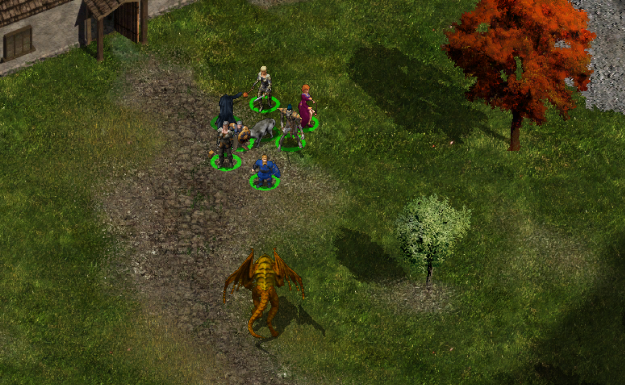{ .center-img width="60%" }

Młody gnom poprosił go, by się uspokoił. Nie byli zwykłymi złodziejami, przechowali pantofle specjalnie dla niego. Demon zdumiał się, że oddają mu je bez walki, kłamstw i oszustw, i wyraźnie go to rozczarowało. Ponaglił ich, bo chciał jak najszybciej opuścić to osławione, spokojne miejsce. Drużyna wręczyła mu przeklęte pantofle **Elminstera**. **Naronguth** wsunął je na stopy, rzucił się do ataku i natychmiast runął ciężko na ziemię w kuli ognia ([Naronguth's Return](../other/zadania.md#q126)).

Nadszedł czas, by wrócić na południe i przygotować się do wyprawy w głąb *Kniei Otulisko*.
