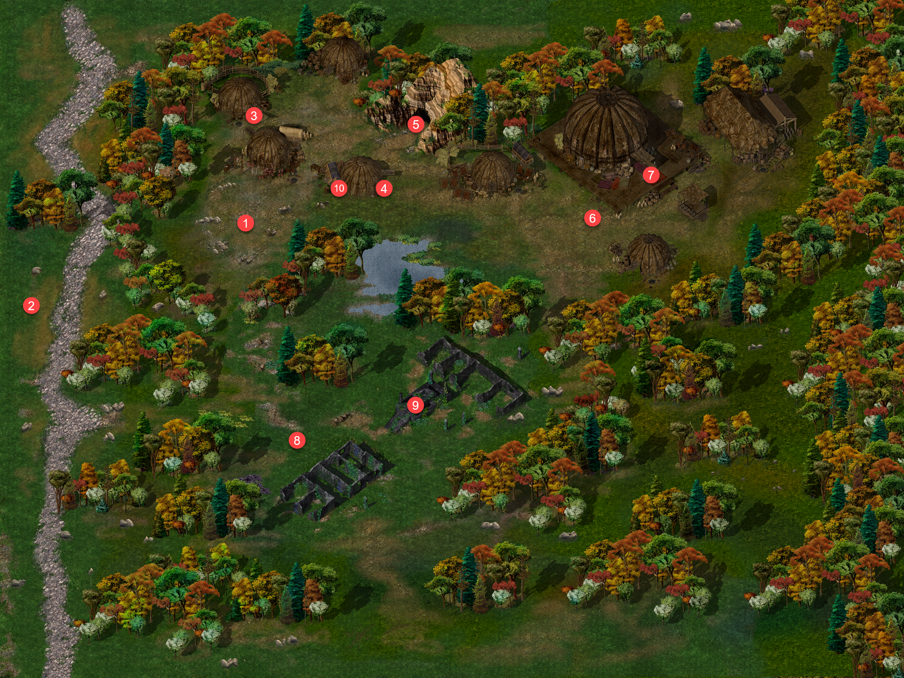

{ .center-img width="80%%" }

*Mulahey** i Tazok okazali się jedynie marionetkami. Prawdziwy mistrz rozwijającej się intrygi wciąż pozostawał poza zasięgiem Leecha. Jedno było pewne: ktoś żywił osobiste zainteresowanie jego śmiercią, choć młody gnom nie rozumiał dlaczego. Poszukiwania odpowiedzi trwały, a złowieszcza Knieja Otulisko stała się kolejnym celem wyprawy.*

## Obóz Bandytów&nbsp;74 { .divider }

{ .center-img width="40%" }

Zaatakowali nas ponownie z całym impetem i wszystkimi siłami. Tylko dzięki magii i umiejętnemu blokowaniu bezśredniego dostępu do najwrażliwszych członków drużyny udało się pokonać wszystkim w tym Raemona, Taurosz Khosama, Brotusa Bloodthirsty, Britika, Venkta i Hakta. Po bitwie splądrowaliśmy namioty a w nich (3), (4) skracamy żywot także Tersusowi i Knotowi.

W jednej ze skrzyń znajdujących sioę w obizie (10) **Finch** z zachwytem rozpoznała elementarz dla dzieci pióra **Fenedriela Boscoe’a**. Był to jej ulubiony autor, a przy tym gnom, co czyniło znalezisko jeszcze milszym. Zauważyła, że niewielu pisarzy mogło równać się z prozaiczną siłą perswazji Wielkiego **Boscoe’a**. Uznała, że księga będzie doskonałym uzupełnieniem biblioteki w *Nashkel*. Zastanawiała się tylko, po co bandytom taki tom. Może któryś z nich musiał nauczyć się czytać, a może po prostu obrabowali karawanę wiozącą dzieci. Kronikarka postanowiła mimo wszystko pilnować nowego nabytku, bo bardzo nie chciałaby go zgubić (Finch's Quest to Start a Library in Nashkel 25). Odnajdujemy także rękojeść buzdyganu Namiętny Pocałunek Nocy.

Docieramy do pustego już namiotu (7) dowodzących tą małą armią i zatajemy tam uwięzionego elfa Ender Sai, który powitał **Leecha** pytaniem, czy już nadszedł czas. Młody gnom poprosił o wyjaśnienie. Więzień odparł, że chodziło o jego egzekucję, po czym uznał, że gdyby przybysze byli ludźmi **Tazoka**, czułby na nich zjełczały oddech herszta. **Leech** przyznał mu rację. Nie byli posłusznymi pachołkami bandyty i chcieli się dowiedzieć, co się tu właściwie działo.

Elf wyjaśnił, że całe to miejsce było zgniłe do szpiku kości. Nie mieli tu do czynienia ze zwykłymi bandytami, lecz z mieszanką *Czarnych Szponów* i *Chłodu*, półludzkiej bandy złożonej głównie z hobgoblinów. Dowodził nimi złowieszczo sprytny **Ardenor Crush**. Gdzie indziej działali kolejni, jak choćby kapłan **Mulahey**, wysłany do zatrucia kopalń *Nashkel*. Ogłosił się powracającym bogiem koboldów, a legiony pozbawionych rozumu, szczekających głupców uwierzyły mu i gotowe były służyć aż do śmierci. **Leech** zauważył, że **Mulahey** nie żył i że pracował dla **Tazoka**. Pytanie brzmiało, komu służył sam herszt. **Ender Sai** wyjaśnił, że na tym polegał cały sekret. **Crush** i **Taugosz Khosann**, przywódca *Czarnych Szponów*, byli przekonani, że **Tazok** wykonywał rozkazy *Zhentarimów*, a ten niezbyt się starał wyprowadzić ich z błędu. Oba oddziały były jednak jedynie bandami rozbójników. Grasowały na szlakach handlowych i unikały miast, a właśnie w tym tkwił ich błąd. Elf pochodził z *Wrót Baldura* i mógł zapewnić, że za całą sprawą nie stali *Zhentarimowie*.

Młody gnom zapytał, skąd ta pewność. **Ender Sai** odparł, że miękkie podeszwy butów nosił nie tylko z pragnienia ciszy. Dzięki nim wiedział, komu deptał po palcach. Nie zadarł z żadnym *Zhentarimem*. Wybrał sobie wrogów i naraził się tylko jednej grupie, *Żelaznemu Tronowi*. Skoro siedział teraz jako osobisty więzień **Tazoka**, **Leech** mógł sam wyciągnąć wnioski. Zapytany, gdzie szukać *Żelaznego Tronu*, elf poradził zacząć od *Lasu Otulisko*, bo **Tazok** regularnie tam bywał. W skrzyni leżały też dokumenty, które mogły warto przejrzeć. Na koniec poprosił, by deptać przy tym po cudzych palcach, i dodał, że można powoływać się na niego. **Imoen** westchnęła, że znów chodziło o *Las Otulisko*, więc mieli teraz dwa powody, by ruszyć tam jak najszybciej. Elf zwrócił się do niej imieniem **Imoen**, a także przezwiskiem Rudowłosa, którym nazywali ją wrogowie. Dziewczyna zasypała go pytaniami: czy widział jej **Henninga**, czy był cały i czy wiedział, że ona nadchodziła. Odpowiedział czterokrotnym „tak”. Zdziwiona zapytała „hę?”, a on zapewnił, że wystarczyło dać mu szansę odpowiedzieć.

Jej ukochany przebywał tu dwie noce wcześniej. Trzymano go w namiocie razem z elfem. **Tazok** ponaglał orkowego przywódcę, by czym prędzej odszedł z zakładnikiem do *Lasu Otulisko*, bo obawiał się, że Rudowłosa odnajdzie jego bazę i przez **Henninga** narobi mu wielu kłopotów. Młodzieniec był nieco poobijany, ale w niewielkim stopniu ranny. Nie był mięczakiem i nie utracił ducha. **Imoen** westchnęła, że jej biedny, najdroższy musiał to wszystko znosić z jej powodu. Podziękowała elfowi za wieści i obdarowała jego zaskoczony policzek wielkim, mokrym pocałunkiem (The Kidnapping of Henning 91).

Córka **Elminstera** zapytała, czy imię **Davaeorn** coś mu mówiło. **Ender Sai** podejrzewał, że to właśnie on kierował sprawami z kopalni w *Lesie Otulisko* i był przełożonym **Tazoka**. Poradził zbadać pułapkową skrzynię z papierami herszta, bo z pewnością znajdzie w niej więcej, niż sam mógł opowiedzieć. (A Hidden Base in the Cloakwood )

W skrzyni **Tazoka** drużyna odnalazła trzy listy.

Pierwszy napisał **Davaeorn**. Liczył, że wszystko przebiegało gładko, i przekazywał rozkazy przełożonych. Doszły go słuchy, że niewielka grupa najemników mogła w przyszłości przysporzyć *Żelaznemu Tronowi* kłopotów, dlatego nie powinna dożyć chwili, w której zakłóci ich działania. **Tazok** miał wynająć zabójcę **Nimbula**, który powinien należycie się z tego wywiązać.

W drugim liście **Davaeorn** zauważył, że dostawy żelaza ostatnio zwolniły. Konieczne było dostarczenie kolejnej tony rudy, dlatego nakazał zwiększyć liczbę napadów i w ciągu tygodnia przesłać transport do bazy w *Lesie Otulisko*. Przed wystosowaniem ultimatum należało zgromadzić jak największe zapasy. **Sarevok** chciał również wiedzieć, co stało się z grupą najemników. Jeśli zostali zabici, **Tazok** powinien to potwierdzić, bo **Sarevok** nie przyjąłby łaskawie żadnych innych wieści.

**Sandrah** zatrzymała się nad listem. Znalazła w nim imię **Sarevoka**. Łańcuch zależności najwyraźniej jeszcze się nie zamknął, a właśnie ten człowiek zdawał się stać tuż za **Davaeornem**.
 
Kolejny element układanki trafił na swoje miejsce. W intrygę *Żelaznego Tronu* był zamieszany mężczyzna w wieku **Leecha**, podejrzewany niegdyś o pochodzenie od *Bhaala*. Według **Sandrah** nie mogło to być przypadkiem. Chłopak imieniem **Sarevok** zniknął przed laty w niewyjaśnionych okolicznościach. Dziś byłby dorosłym mężczyzną, być może takim, który w tajemnicy rozwinął w sobie moc odziedziczoną po potomku *Bhaala*. Jeśli nie był tym, którego szukali, z pewnością odgrywał w tej intrydze istotną rolę. Wskazówki o udziale potomka *Bhaala* pojawiały się już wcześniej. Teraz miał wreszcie imię, a ona była przekonana, że już go spotkała. **Leech** zapytał, czy miała na myśli dzień śmierci jego przybranego ojca. Potwierdziła. To właśnie ta czarna istota zabiła **Goriona**. Bezlicy wróg zaczynał się odsłaniać i nosił imię **Sarevok**.
 
**Jen’lig** zauważyła, że wiedzieli już więcej o kadrze, której się przeciwstawiali. Drugim mordercą był **Tazok**, członek *Żelaznego Tronu*, którego można było odnaleźć we *Wrotach Baldura*. **Sandrah** przytaknęła: dwóch z tych, którzy zabili **Kastyę**, zostało odnalezionych. Dostęp do wielkiego miasta pozostawał jednak zamknięty, dlatego następnym krokiem pozostawała druga kopalnia w *Lesie Otulisko*. Githyanki uznała, że dowódca dobrze prowadził drużynę, a **Sandrah** dobrze doradzała. Była pewna, że wkrótce poznają imię czarodzieja z mieczem. Razem inteligencja i wytrwałość mieli zgubić złodziei miecza i zabójcę **Goriona**. Jedno imię już mieli, drugie wkrótce miało się pojawić. (Jen’lig's Hunt 15)

Autorem trzeciego listu był **Borda**. Domagał się zapłaty drugiej połowy uzgodnionej sumy. Zaznaczył, że to nie jego wina, iż komendant wymordował jedynie własną rodzinę, a nie połowę garnizonu. Siły *Nashkel* zostały osłabione, a o to właśnie chodziło w umowie. Listy dla niego można było przekazywać przez kontakt na karnawale w *Nashkel*. Zapewnił też, że kupiec na tyle zdesperowany, by kupić część jego szczególnych mikstur, również przekaże korespondencję. Powinniśmy sprawdzić ten konakt bo weidentnie chodzi tu o kapitana Brage'a (Captain Brage's Guilty 66).

**Sandrah** zapewniła **Leecha**, że nadal będzie mu służyć radą i wsparciem, najlepiej jak potrafiła, choć przekonała się już, że i ona potrafiła się pomylić jak każdy. Młody gnom odparł, że na to właśnie liczył. Jej rady zawsze opierały się na najlepszych informacjach, jakimi dysponowali, i nigdy nie udzieliła mu złej z rozmysłem. Wyzwania, które ich czekały, miały stawać się coraz cięższe, bo wrogowie powoli zaczynali dostrzegać jego potencjał. Poprawiła się czule, że ich wspólny potencjał. Chciała mu jedynie przypomnieć, że nie mogli polegać na umiejętnościach jednej osoby. Dopiero cała drużyna była siłą zdolną choć odrobinę odmienić los *Krain*. W jej słowach **Leech** usłyszał także obietnicę, że pozostanie u jego boku bez względu na trudną drogę, która ich czekała. Zapewniła go, że tak będzie, dopóki pozostanie sobą. Musieli jednak pamiętać, że od teraz każda błędna decyzja mogła mieć fatalne skutki, i to nie tylko dla nich, lecz także dla coraz większej liczby ludzi, którzy pokładali nadzieję w ich sukcesie. Młody gnom uznał, że wiedza o tym, gdzie czaiły się pułapki, była czymś więcej niż pierwszym krokiem do ich ominięcia. Wierzył, że wspólnie sobie poradzą.

Niedaleko obozu **Ogrodniczka** zapytała, jak podobał się **Leechowi** jej ogród i te piękne pnącza, które tak chętnie badały stare mury i kamienie. Młody gnom przyznał, że miejsce było urocze, lecz przypomniał, że w okolicy kręcili się bandyci. Ogrodniczka potwierdziła, że doskonale o tym wiedziała, a jeden z nich doprowadzał ją do pasji. Przeprosiła za ostry ton, ale musiała przyznać, że był to prostak i gruboskórna bestia. **Leech** zauważył, że to miejsce niezbyt przypominało ogród. Ogrodniczka odparła, że nie wiedziała, jak gnom definiował ogrody, lecz dla niej był to po prostu kawałek ziemi pełen życia, w którym wszystko rosło i kwitło. To miejsce właśnie takie było. Zapytana, co zawiniła owa bestia, zawahała się, bo samo opowiadanie wprawiało ją w zakłopotanie. Prostak wydobył to, co miał do wydobycia, i załatwił się na jej drogocenną roślinkę. Smród był nie do zniesienia i trudno było o tym nawet mówić. Wkrótce potem usłyszała, jak ktoś wołał bandytę, i tak poznała jego imię: **Garclax**. Zapewniła, że była bardzo spokojną osobą. Jeśli jednak drużyna go spotka i odbierze mu życie, może da jej coś w podzięce za pozbycie się tego chwastu. **Leech** przekazał, że wspomnianego gnolla niedawno usiekł był a ona przyjęła tę wieść z ogromną radością. Podziękowała i dodała, że cieszyła się, iż bestia nie skrzywdzi już jej kwiatków. Należało się jej, żeby ktoś się nią zajął. Obiecała wcześniej nagrodę i zamierzała dotrzymać słowa. Wręczyła drużynie jedno ze swoich dzieci i zapewniła, że potrafiły czynić cuda. (Disrespected Flowers 123)

Bestiariusz: elita Czarnych Szponów, elita Hobgoblin, rozbójnik, hobgoblin Chłodu, ogrzy mag, ogrilion, zombie, gnoll, gnoll weteran, flind