# Tajni agenci i zapomniani uczniowie

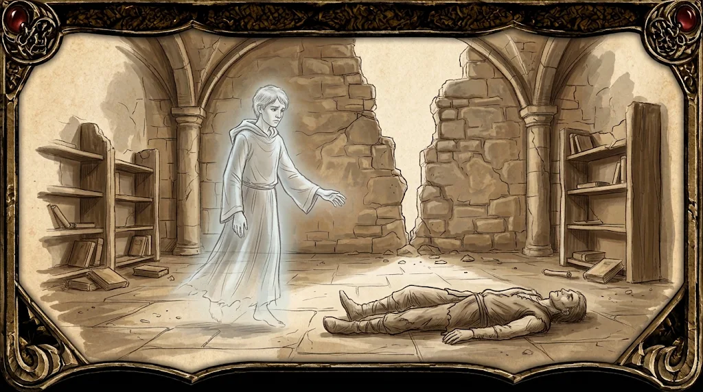{ .center-img width="80%%" }

## Pomocna Dłoń&nbsp;79 { .divider }

{ .center-img width="40%" }

Przed murami warowni 17 drogę zastąpili im **Najara** i **Vallius**. Oznajmili, że wreszcie dopadli zabójców niewinnych, a **Najara** przysięgła na potężnego *Torma*, że dostaną zapłatę od jej ostrza. Zespół zdziwił się, skąd ten zarzut. Mieli podobno napaść na wioskę i wymordować wszystkich mieszkańców, a kto wie, jakich jeszcze zbrodni się dopuścili. Zaprzeczyli stanowczo iż nigdy nie napadli na żadną wioskę i musiano ich z kimś pomylić. **Najara** uznała, że dość tych kłamstw obiecując szybką i ostateczną sprawiedliwość, i zawołała, że była jednością z potężnym. 

Sprawiedliwość okazała się jednak szybka i ostateczna dla niej samej. Przy ciele paladynki znaleziono list gończy, jasno wskazujący, że drużyna Leecha była oskarżana o wyrżnięcie w pień jakiejś wioski. Zlecenie sygnowano inicjałami *P.W.*

Na kolejne spotkanie z **Elminsterem** nie trzeba było długo czekać. Przed wejściem do karczmy powitał młodego gnoma serdecznie i przyznał, że w ostatnich dniach wiele o nim słyszał i był pod wrażeniem. **Sandrah** bez słowa opuściła miejsce u boku ukochanego i wtuliła się w ramiona starego maga, pieszczotliwie gładząc jego brodę, a on uśmiechał się coraz szerzej. Leechowi przemknęło przez myśl, że znów stała się małą dziewczynką.

Wszystko wskazywało, że kolejnym elementem układanki była *Knieja Otulisko*, gdzie łajdacy stojący za bandytami mieli zapewne swoją bazę, kopalnię. **Elminster** życzył powodzenia i przestrzegł, by Leech zachował ostrożność, bo tworzył sobie potężnych wrogów, zarówno w świecie, jak i w samym sobie. Żałował, że nie mógł mówić jaśniej, lecz wydarzenia musiały toczyć się własnym torem, bez ingerencji starego człowieka. Na koniec zauważył, że Leech odziedziczył po **Gorionie** przedmiot, który nie ujawnił jeszcze swojej prawdziwej natury. Przyjrzał się sztyletowi, wymówił zaklęcie i ostrze nabrało nowych właściwości ([Gorion's Dagger](../other/zadania.md#q8)).

Później **Sandrah** długo oglądała broń. Nie znalazła nic konkretnego, jedynie kilka spostrzeżeń. Sądząc po wadze i konstrukcji, sztylet stworzono raczej dla kobiety niż dla mężczyzny. Nie wyglądał też na używany w walce. Leech przypomniał, że w spokojnym *Candlekeep* nigdy nie widział, by **Gorion** sięgał po broń czy zaklęcia bojowe, aż do dnia swojej śmierci. Kapłance chodziło jednak o co innego. Sztylet nie służył do walki, jeszcze zanim trafił w ręce opiekuna. Pierwotnie przypominał raczej narzędzie rytualne. Zawahała się. Być może była to tylko fantazja młodej dziewczyny, lecz ozdoby na ostrzu robiły na niej złowieszcze wrażenie. Leech dopytał, czy chodziło jej o sztylet ofiarny. Skinęła głową i nie powiedziała nic więcej.

**Imoen** musiała nabrać sił przed wyprawą do *Kniei* i odbiciem **Henninga**, więc została w gospodzie. Jej miejsce zajął **Garrick**, który od razu zaczął flirtować z **Sandrah**. Leech musiał pogodzić się z tym, że jego kocica nie była monogamiczna.

:material-account-group: Przyłączeni NPC: Garrick

:material-account-group: Odłączeni NPC: Imoen (Pomocna Dłoń)

Drużyna ruszyła na południe.

## Nadbrzeżny Trakt &nbsp;80 { .divider }

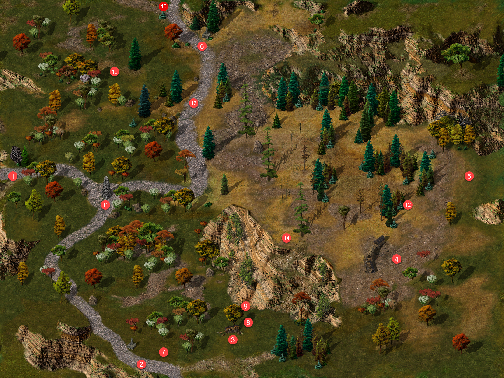{ .center-img width="40%" }

Ledwie weszli na trakt 15, zaczepiła ich grupa **Łowców Książek**. Ich przywódca cieszył się, że miłośnicy ksiąg trafiali się tam, gdzie najmniej można się ich spodziewać, i to jeszcze zainteresowani zaawansowaną filozofią. **Finch** zapytała, czy takie rzeczy dało się odczytać z samego wyglądu. Wspólny przyjaciel doniósł mu podobno, że była zwolenniczką wielkiego **Monteelaha** i mogła posiadać jego rzadkie pisma. Kronikarka przyznała, że rzadkie zapiski miała, lecz nigdy nie słyszała, by nazywano go „wielkim”. Zwykle mówiono raczej „szalony”, „dziwaczny” albo „absurdalny”. Uprzejmości okazały się jedynie preludium do próby odebrania jej podarowanej księgi. Walka nie była prosta, zwłaszcza gdy dołączył do niej **Davenport** z jakiejś Sekcji.

Przy nim znaleziono list i klucz wskazujące na bazę tajemniczej organizacji, i to tuż pod nosem *Oka Gorgony* w *Beregoście*. Wielce ciekawe.

**Sandrah** zastanawiała się, co kryło się za zainteresowaniem tak niewielkim zeszytem. **Finch** zauważyła, że napastnicy nie byli koneserami literatury. Sami przyznali, że kopia nie miałaby dla nich wartości, więc liczył się konkretny egzemplarz. Ukryty sens słów dałoby się przecież odczytać i z odpisu. Może coś kryło się między kartami? Kapłanka sprawdziła już strony i okładkę. Przypomniała sobie powieść przygodową z *Candlekeep*, w której tekst zapisano magicznym atramentem, widocznym dopiero po spaleniu papieru. Zanim jednak zaczną palić stronice albo zanurzać je w kwasie, obiecała przeczytać go jeszcze raz wieczorem ([A Book For Finch](../other/zadania.md#q125)).

Wkrótce drużyna dotarła do *Beregostu*.

:material-paw: Bestiariusz: *łowca ksiąg*

## Beregost &nbsp;81 { .divider }

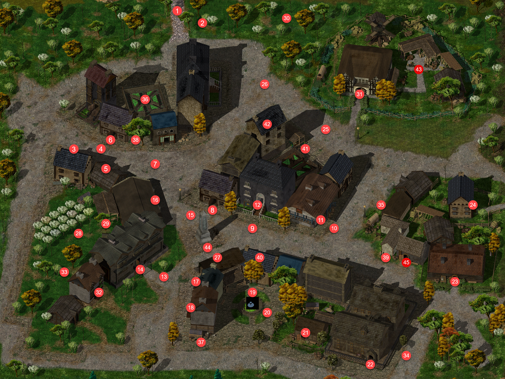{ .center-img width="40%" }

Był środek nocy, gdy zajrzeli do **Firebeada**, by zapytać o tom poszukiwany przez eleganckiego ogra. Mag rzeczywiście posiadał kopię *Liberus Optimae Erositica*. Brakowało w niej efektownych, magicznie poruszających się obrazów oryginału, trzeba było zadowolić się prostymi rysowanymi schematami. Dodał przy tym, że nie trzeba było zmyślać historii o zbójeckich, żądnych rozkoszy ograch. Młodzi mieli prawo być ciekawi takich spraw i nie powinni się tego wstydzić ([Black Hearts - The Huntress](../other/zadania.md#q87)). Na pewno **Sandrah** podręcznika nie potrzebuje - zapewniam.

Pora było sprawdzić tajemniczą *Sekcję*. Drużyna zakradła się do domu opisanego w liście 45. Wejścia do piwnicy pilnował strażnik, którego trzeba było uciszyć na zawsze. Klucz otworzył przejście ukryte za regałami w mniejszej izbie.

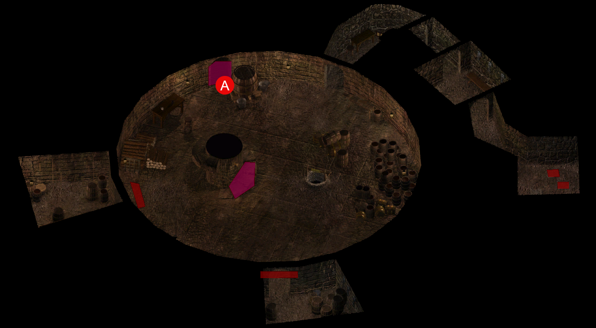{ .center-img width="60%" }

Na dole czekali zwiadowcy, kilka pułapek i przejście jeszcze niżej A.

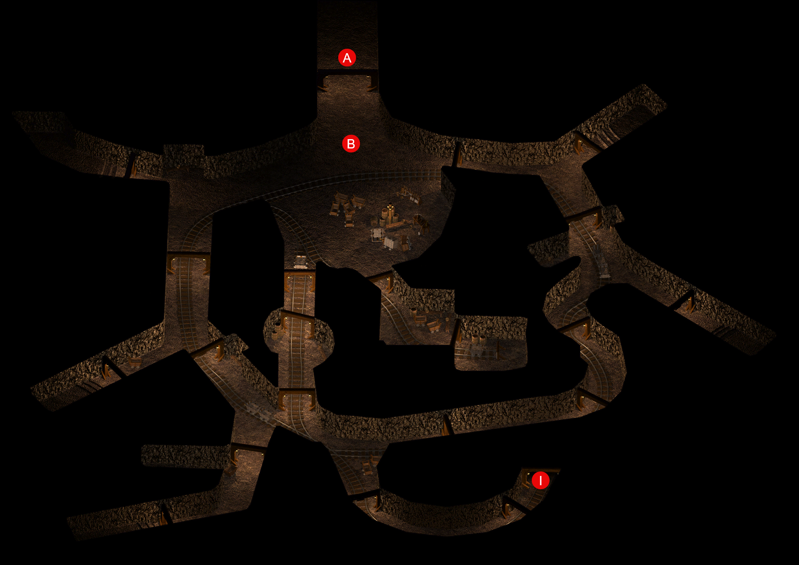{ .center-img width="60%" }

Zaraz na początku tunelu stał komitet powitalny B. **Andrea** z kąśliwym uśmiechem oznajmiła, że się ich spodziewano, i bez dalszych wyjaśnień pożegnała ich, nakazując partnerowi ich teleportować.

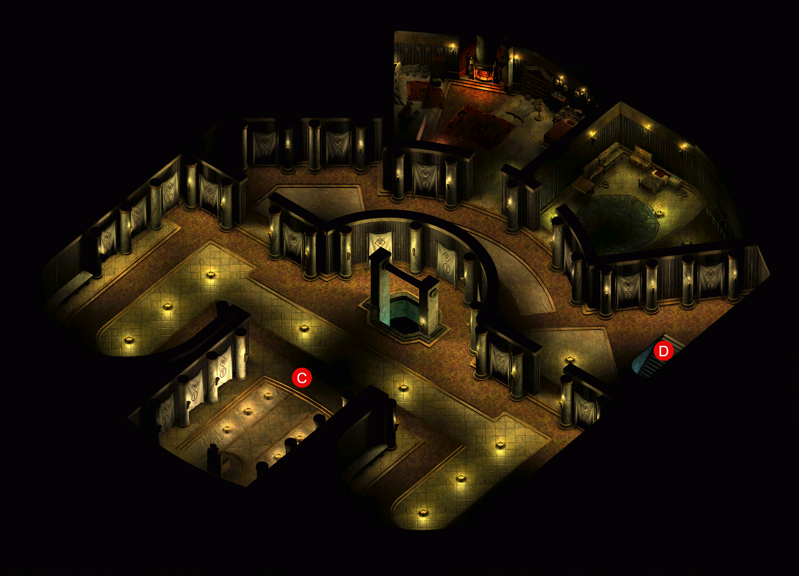{ .center-img width="60%" }

Wylądowali w olbrzymiej sali C, otoczeni przez licznych zwiadowców i ich zwierzchników. **Paul Wolfe** oznajmił, że nie powinni przekroczać murów tej twierdzy. Poszukiwaczw przygód popełnili fatalny błąd, pojawiając się w głównej siedzibie *Sekcji Pierwszej*, nawet gdyby nie wisiał już nad nimi rozkaz eliminacji.

**Madeline** przytaknęła, że obiekt należało zlikwidować natychmiast, lecz najpierw chciała wykorzystać go w swoich eksperymentach. **Wolfe** odmówił, gdyż uważał za przybyszów za zbyt niebezpiecznych. **Madeline** zaproponowała więc przedłużenie ich śmierci, by sprawdzić, jak długo zniosą ból. **Wolfe** pochwalił jej chłód, logikę i brak moralności. Moralność była nielogiczna, odparła, bo była tylko emocją, a emocje zaciemniały rozum. **Nikita** zaprotestowała. To właśnie emocje czyniły z nich istoty myślące, a nawet wobec wroga trzeba było coś czuć. **Madeline** przypomniała jej słabość do litości i zastanawiała się, czemu wciąż z nimi była. **Nikita** odparła, że wykonywała zadania, nawet gdy się z nimi nie zgadzała, i przynajmniej nie była potakiwaczem jak **Michael**. Tenże odpowiedział tylko - „Oczywiście, Nikita”.

**Wolfe** uciął wymianę i zwrócił się do Leecha, że w innych okolicznościach byłby z niego znakomity agent. Pokonał przecież kilku najlepiej wyszkolonych ludzi na całym *Wybrzeżu Mieczy*. Młody gnom zapytał, czemu wciąż nazywano go *złym*. Co im zrobił? Jeśli ktoś tu był zły, to właśnie oni. **Wolfe** odparł, że był niebezpieczną istotą, której nie wolno było dłużej istnieć. Zabiliby go, nawet gdyby nie zwróciła się do nich pewna grupa z tym zadaniem. **Nikita** nie dzieliła przekonania z resztą o nas. **Wolfe** warknął, by milczała bo zrobią wszystko, co konieczne. Jeśli trzeba zabić stu niewinnych, by dotrzeć do jednej złej istoty i ocalić miliony, uczynią to bez wahania. Leech zauważył, że czyjś kompas moralny był tego dnia lekko rozstrojony.

Tego było dla **Nikity** za wiele. Oznajmiła, że nie będzie miała z tym nic wspólnego. **Madeline** rozkazała jej wykonać polecenie a **Michael** błagał, by tego nie przemyślała swoje postępowanie, lecz ona krzyknęła, że to co robią jest właśnie złem. **Madeline** kazała strażnikom ją pojmać, lecz **Wolfe** odwołał rozkaz. Z **Nikitą** rozprawią się w swoim czasie. Teraz należało zabić Leecha.

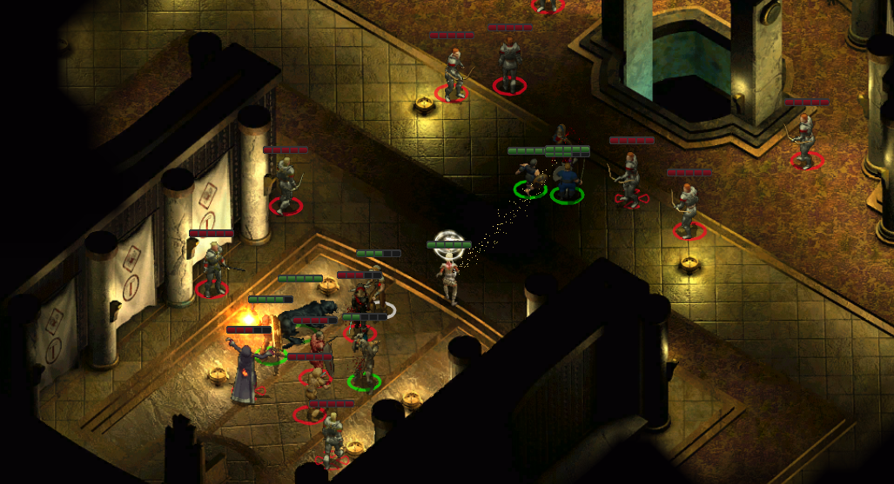{ .center-img width="60%" }

Tylko różdżki i eliksiry pozwoliły odeprzeć liczne siły wroga. Po przeczesaniu pomieszczeń drużyna odnalazła przejście D.

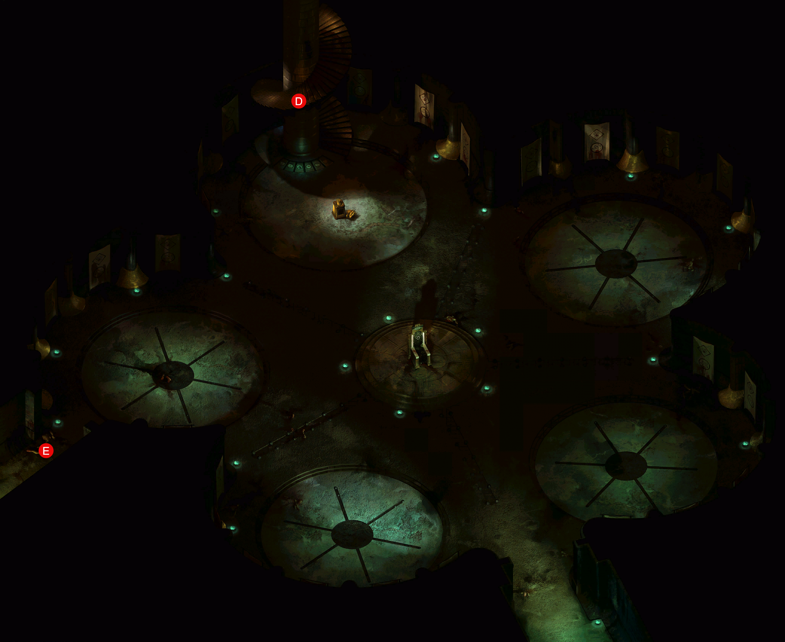{ .center-img width="60%" }

I tu roiło się od zwiadowców i wszelkiej maści obrońców *Sekcji*. Drogę do kolejnych komnat E trzeba było wyrąbać mieczem.

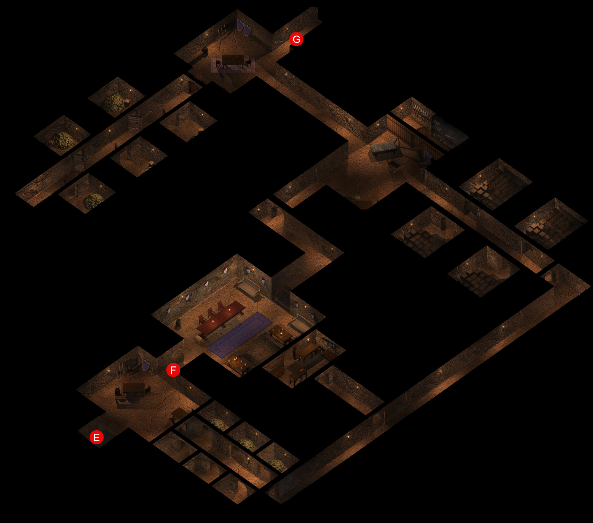{ .center-img width="60%" }

Spośród ciżby przeciwników sprytem i siłą wyróżniała się **Lillian Darkwater** F. Przy jej ciele znalazł się kamień strażniczy, otwierający jedną ze skrzyń. Korytarze prowadziły dalej, do kolejnego przejścia G.

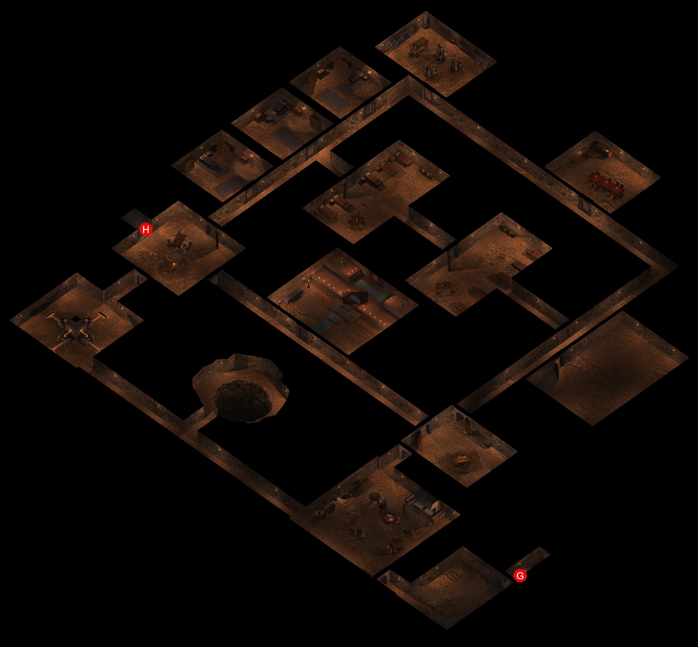{ .center-img width="60%" }

W wąskich tunelach czaili się cisi, trudni do wykrycia wojownicy cienia i ashirukuru. W końcu jednak odnaleźli przejście wyżej H.

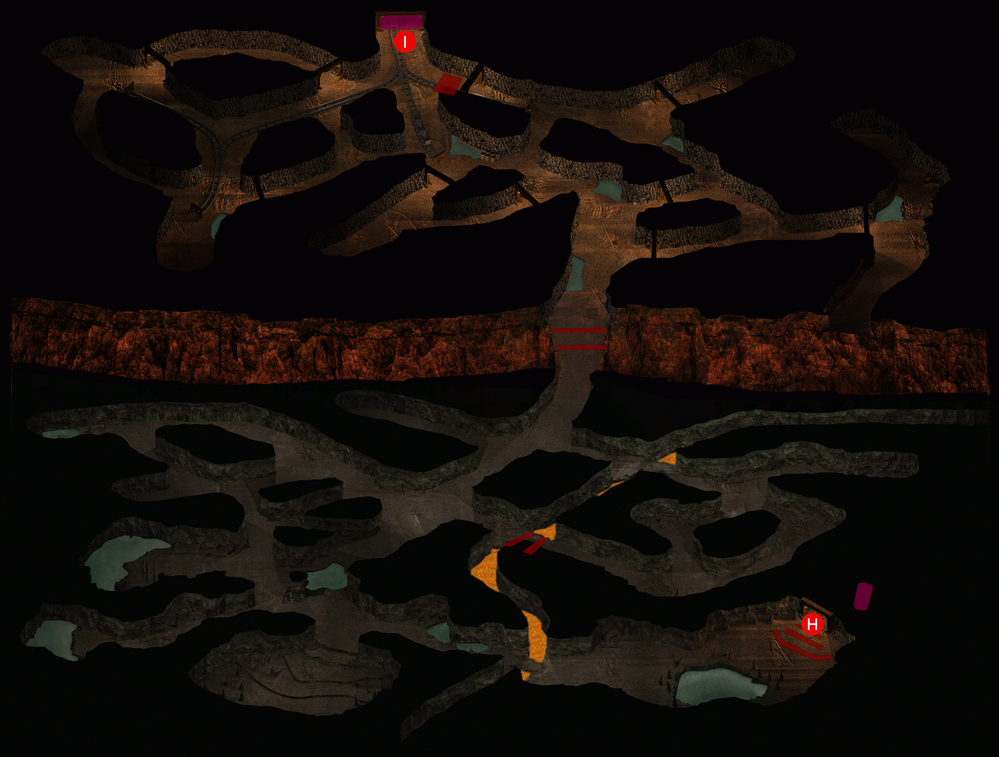{ .center-img width="60%" }

Kolejni obrońcy *Sekcji* nie stanowili już wyzwania, a drużyna dotarła do następnego łącznika I.

{ .center-img width="60%" }

Krąg się zamknął. Wędrowcy wrócili do miejsca, z którego teleportowała ich **Andrea**. Tym razem nie miała szans, a kolejna członkini tej sadystycznej organizacji przestała zagrażać komukolwiek.

Przez przejście A drużyna wróciła na górę i opuściła budynek.

Na zewnątrz czekała **Nikita**. Uciekła, zanim zaczęła się walka, i nie chciała im szkodzić, lecz pomóc. Dziękowała za zniszczenie *Sekcji* i uwolnienie tych, którzy sprzeciwiali się złej władzy **Paula**. Zadanie nie było jednak skończone. Ludzie ci zagubili drogę. Kiedyś stanowili siłę dobra i sprawiedliwości, lecz ulegli zepsuciu. Zło zagnieździło się w *Nadzorze* i obawiała się, że wszyscy jego członkowie musieli zostać wyeliminowani. Siedziba znajdowała się w południowo-wschodniej części centralnych *Wrót Baldura*, w trzypiętrowym budynku. Wręczyła Leechowi zwój pozwalający minąć strażników i poprosiła, by go nie zgubił. Chciała też dołączyć do drużyny, by odkupić swoje wcześniejsze decyzje, które nie służyły większemu dobru. Młody gnom odparł, że nie potrzebował jej pomocy. Przyjęła to spokojnie i zapowiedziała, że będzie czekać w *Pomocnej Dłoni*, gdyby zmienił zdanie.

Chwilę później zaatakowała kolejna grupa *"bibliofilów"* chętna posiąść podarunek dla **Finch**. **Sandrah** pochyliła się nad jednym z zabitych. To była już druga fala, a napastnikom z pewnością nie chodziło o filozofię. Kolczyki i tatuaże nie wyglądały ani na thayańskie, ani na calimshańskie. Leech zauważył, że jeden z tatuaży przedstawiał syrenę. Żeglarz, a może pirat. Kapłanka zastygła. Opowieść o magicznym atramencie była przecież przygodą piracką! Albo Leech bredził, co mu ślina na język przyniosła, albo był geniuszem. Pośpieszyła do plecaka i zaczęła gorączkowo przerzucać strony zeszytu.

U **Taeroma** 23 czekało gotowe urządzenie potrzebne do odnalezienia przeklętych naramienników ([Destroy the Cursed Bracers](../other/zadania.md#q56)). Kowal wspomniał też, że znaleziona rękojeść buzdyganu była fragmentem słynnej broni. Jeśli zdobędą wszystkie trzy części, mógł złożyć ją na nowo.

Wieczorem **Sandrah** znów siedziała nad zeszytem, który kosztował już tyle istnień. Leech przyznał, że przychodziły mu do głowy wyłącznie pirackie banały. Takie historie zawsze kręciły się wokół ukrytego skarbu, a w opowieści, o której mówiła, magiczny atrament skrywał mapę. Dla pirackiego skarbu znalazłoby się dość ludzi gotowych zabijać. Kapłanka poderwała się jak ukąszona przez żmiję. Geniusz, a ona była ślepa! Wszystkie te kręte zdania dotyczyły ilustracji, które nic nie ilustrowały. Zaczęła wyrywać kartki. Cztery położyła na ziemi, resztę cisnęła w kąt, i przesuwała je oraz obracała, aż ułożyły się w zadowalający wzór.

Leech spojrzał na łamigłówkę. Cztery kartki tworzyły jedną ilustrację, mapę. Nierówna linia była brzegiem wyspy. Widniały na niej góry, rzeka spływająca ku morzu, lasy, strzałka wskazująca północ i bagno w części południowo-wschodniej. Brakowało skali i jakiegokolwiek oznaczenia skarbu. **Sandrah** sięgnęła po odrzucone strony i odczytała zdanie, które w tekście nie miało sensu: „aby ostatecznie ujawnić, że żaden człowiek nie jest wyspą, zob. ilustracja numer jeden”. Następny ustęp brzmiał: „nie tam, gdzie strumień kończy się w morzu, lecz u źródła wody, w miejscu jej narodzin, zob. ilustracja numer dwa”. Oto była rzeka i jej źródło. Kolejny: „poranne słońce odsłania drogę do celu poszukiwacza, zob. ilustracja numer trzy”. Tego nie potrafiła odnieść do niczego na mapie. Leech uznał, że trzeba stanąć u źródła o wschodzie słońca, a wtedy droga sama się objawi. Czwarta wskazówka zapowiadała się podobnie: „tylko pszczoła wie, jak robić miód, zob. ilustracja numer cztery”.

Młody gnom podsumował - ul strzegący pirackiego skarbu na końcu ścieżki widocznej tylko o wschodzie słońca, u źródła bezimiennej rzeki na nieznanej wyspie. **Sandrah** roześmiała się, że to doskonałe streszczenie. Rozwiązywali już gorsze zagadki. Piraci nie przestaną na nich polować, nawet gdyby oddali im księgę, bo uznają, że drużyna zna sekret. Przy najbliższej okazji warto było popytać we *Wrotach Baldura* albo w *Waterdeep*, w *Charter House* lub u kapitana portu, o jaką wyspę mogło chodzić.

**Finch** przypomniała sobie coś o szalonym **Monteelahu**. Znaleziono go niegdyś na plaży niedaleko *Brodzie Ulgotha*, wyrzuconego przez fale, bez imienia i wspomnień. Pisać zaczął później, by się utrzymać. **Sandrah** zauważyła, że wskazówki w księdze były jego własnym dziełem, więc musiał pamiętać o wyspie. Może amnezja była sztuczką, mającą ukryć dawne życie pirata albo jedynego ocalałego z okrętu, który ukrył skarb. Ktoś z przeszłości najwyraźniej go jednak rozpoznał. Zapytać go nie było już jak, bo zmarł w *Brodzie Ulgotha* dwie zimy wcześniej ([A Book For Finch](../other/zadania.md#q125)).

Pora było wracać do **Thalantyra**.

:material-paw: Bestiariusz: *zwiadowca Sekcji, elita Sekcji, elita hobgoblinów, wojownik cienia, ashirukuru*

## Wysoki Żywopłot &nbsp;82 { .divider }

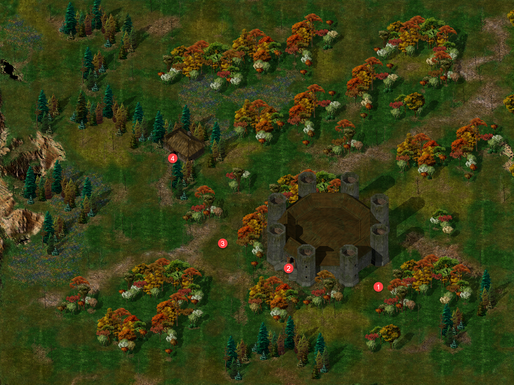{ .center-img width="40%" }

**Thalantyr** 2 powitał **Sandrah** i zauważył, że przyniosła dzieło **Taeroma**. Klejnoty były już przygotowane, wystarczyło osadzić je w oprawach. Zapytany przez Leecha o działanie urządzenia, **Thalantyr** wyjaśnił, że wróżba nawet w idealnych warunkach pozostawała sztuką niedokładną, a najwięcej zależało od doboru kamieni.

Rzucił na siebie *Ochronę przed Złem*, a potem *Prawdziwe Widzenie*. Urządzenie, jak się obawiał, wystarczyło tylko na jedno użycie, lecz lepszych klejnotów nie mogli dobrać. Ujrzał wyraźnie naramienniki na kobiecie imieniem **Iris Cotton** w *Gullykin*. Przestrzegł z całą mocą, by nie próbowano ich zdejmować z noszącej. Mogły zniknąć tak samo, jak zniknęły **Melicampowi**, a to zniweczyłoby wszystkie dotychczasowe starania. Polecił ruszać natychmiast i wrócić z posiadaczką opasek ([Destroy the Cursed Bracers](../other/zadania.md#q56)).

Cel był jasny, lecz bliskość *Lwiego Traktu* skusiła drużynę do odwiedzenia **Dżentelmena**.

## Lwi Trakt &nbsp;83 { .divider }

{ .center-img width="40%" }

Dotarli na trakt w świetle księżyca i rozbili krótki postój. Leech dostrzegł **Sandrah** siedzącą ramię w ramię z kimś, kogo obejmowała i komu szeptała coś do ucha. Serce mu się ścisnęło. Udając beztroski spacer i pogwizdując wesołą melodię, zbliżył się do pary. Druga sylwetka wydała niemal warczący dźwięk i ruszyła ku niemu na czworakach. To była **Pelligram**, przycupnięta na tylnych łapach, w półmroku łudząco podobna do człowieka. Zarumienił się i podziękował ciemności, że tego nie widać. Na odwrót było za późno. Pantera otarła się pyskiem o jego lewą nogę, a z prawej strony uklękła **Sandrah**, mrucząc i łasząc się na kocią modłę. Co za szczęście, zauważyła, być kochanym przez dwa tak wspaniałe koty. **Pelligram** wkrótce straciła zainteresowanie i odeszła w mrok.

Tymczasem z lasu wrócił **Haiass** ze świeżo upolowanym królikiem i złożył go u łap pantery. Wielki kot ułożyła się majestatycznie, jednym kłapnięciem odgryzła tylną łapę, a resztę przesunęła ku wilkowi. Jej mruczenie Leech czuł aż w podeszwach. **Sandrah** oparła głowę na jego ramieniu. Ci dwoje najwyraźniej czuli do siebie to samo co ich właściciele. Ze śmiechem dodała, by nie spodziewał się, że pobiegnie w nocy po krwistego królika dla niego.

Opodal **Garrick** uczył **Finch** zapisu nutowego. Po słowach „Dzielny, dzielny, sir Garricku” potrzebna była ćwierćnuta pauzy, nie ósemka, i poprosił, by wystukała tempo razem z nim. Kronikarka zapytała, czy sam nie poradziłby sobie szybciej. Pewnie tak, ale zabawa byłaby mniejsza. Podziękowała mu za cierpliwość. Nawet w pierwsze glify nie wkładała tyle wysiłku. Łapała szybko, bo nuty, jak każdy język, przypisywały symbole dźwiękom. Pozostawała jeszcze kreatywność, przyznała **Finch**. Pięciolinia przypominała rysowanie mapy kraju, którego nigdy się nie odwiedziło.

Rano drużyna odszukała ogra 2. Zapytał, czy zapewnili mu wstęp do *Candlekeep*, czy sprawę trzeba będzie rozstrzygnąć krwią. Leech podał mu kopię poszukiwanej księgi. Ogr nie mógł uwierzyć, lecz obejrzawszy ją, rozpoznał *Liberus Optimae Erositica*. Kopia, ale kompletna. Doskonale. Zgodnie z obietnicą zamierzał odejść.

Ukradzione wcześniej księgi schował w torbie bez dna i chciał oddać je drużynie. I wtedy zapadła kłopotliwa cisza. Jakaś magiczna anomalia, zapewne linie mocy, które przyciągnęły go w to miejsce, zmieniły torbę w zwykły, pusty worek. Został mu tylko jeden tom, czytany w lesie podczas oczekiwania: *Dzieła zebrane Saleny Fairsky*, całkiem zabawna lektura. Miał nadzieję, że to wystarczy, i jako zapłatę za kłopoty dorzucił pierścień znaleziony podczas podróży. Pożegnał młodego gnoma, licząc na kolejne spotkanie ([Black Hearts - The Huntress](../other/zadania.md#q87)).

Drużyna ruszyła do *Gullykin*.

## Gullykin &nbsp;84 { .divider }

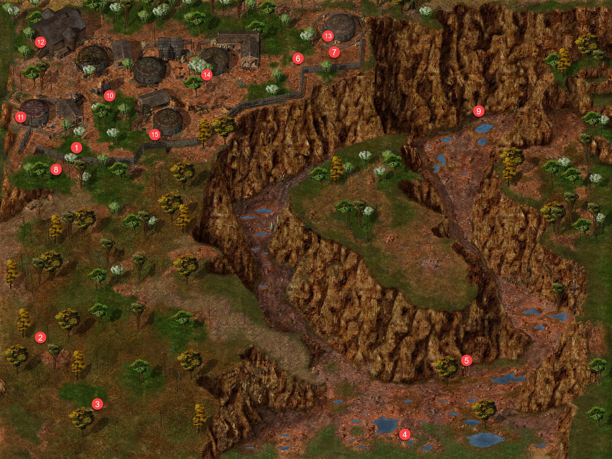{ .center-img width="40%" }

Przed wioską roiło się od rozjuszonych ogrów wszelkiej maści. Drużyna ruszyła w górę wąwozu, z którego nadciągały, i przez szeregi wrogów przebiła się do przywódcy plemienia, **Kharaza**. Na widok miecza zawył, że może on oznaczać tylko jedno - śmierć jego brata bliźniaka **Kahrka**. Nazwał ich bezczelnym bydłem, zapowiedział, że zginą, a *Gullykin* zetrze pod obcasem. Czyżby?

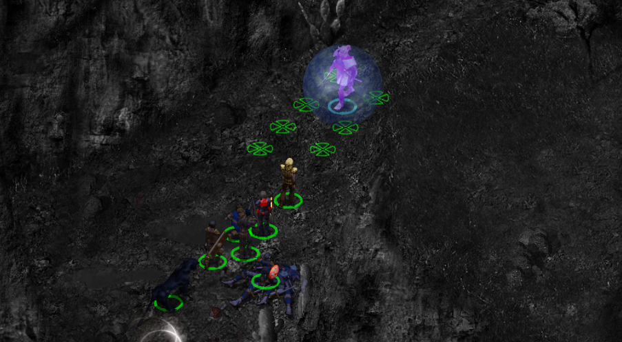{ .center-img width="60%" }

Nad ciałem ogra **Sandrah** wyraziła nadzieję, że nieustanne polowanie wreszcie się skończy, a wieść o śmierci tego utrapieńca szybko się rozniesie. Mimo to należało wyłapać niedobitki, by nie ucierpieli zaprzyjaźnieni niziołkowie. Leech przyznał jej rację. Bez przywództwa ogry wrócą do zwykłych napadów, jak zawsze, z *Valiantem* czy bez niego, lecz plemię **Kharaza** było groźniejsze od innych.

W wiosce rzeczywiście grasowały ogry. Gdy ucichła walka, **Gandolar Luckyfoot** 1 zawołał do Leecha, że słyszał o oczyszczeniu ruin *Mostu Firewine*. Koboldy nie będą już nękać ich maleńkiej wioski, a ogry wycofały się, gdy na zboczu ujrzały śmierć **Kharaza**. Młody gnom znów dotrzymał słowa, więc **Gandolar** poprosił o przyjęcie niewielkiej sumy i drobnego podarunku w dowód wdzięczności ([The Firewine Ruins](../other/zadania.md#q97))([Firewine Bridge and Gullykin](../other/zadania.md#q103)).

W domu **Cottonów** 15 **Largo Cotton** błagał o pomoc. Jego żona **Iris** znalazła opaski i nagle zamieniła się w wiewiórkę. Leech uspokoił go, że właśnie dlatego przybyli. Largo musiał udać się do *Wysokiego Żywopłotu*, na zachód od *Beregostu*, do maga **Thalantyra**. Niziołek zdziwił się, czemu nie do **Alvanhendara** z miejscowej świątyni, który wykonywał już podobne usługi. Leech wyjaśnił, że **Thalantyr** od dawna badał te opaski i wiedział, co z nimi zrobić, a drużyna nie przemierzała *Wybrzeża Mieczy* bez celu. **Largo** zgodził się im zaufać i obiecał spotkanie w *Wysokim Żywopłocie* ([Destroy the Cursed Bracers](../other/zadania.md#q56)).

Następnym celem były ruiny *Ulcastera*.

:material-paw: Bestiariusz: *ogr z plemienia Kharaza, wilk, ogr niszczyciel, ogrzy mag, ogr berserker*

## Ulcaster &nbsp;85 { .divider }

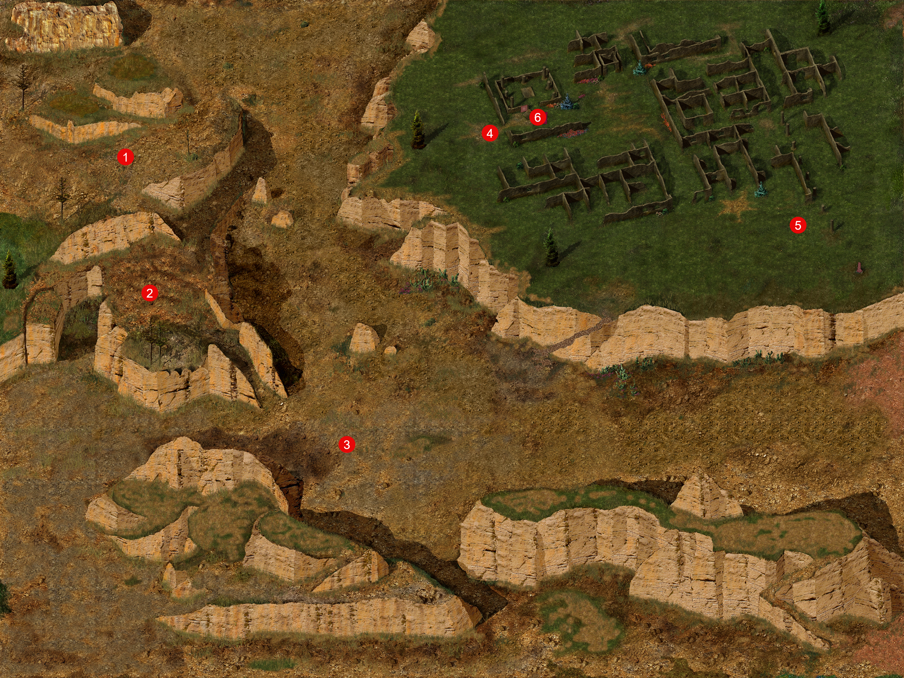{ .center-img width="40%" }

Drużyna rozbiła obóz. **Sandrah** zachęciła **Garricka**, by zagrał coś do tańca. Bard wolał ballady i pieśni miłosne od skocznych jigów, więc obiecał wolną melodię. Kapłanka poprosiła Leecha do tańca, uprzedzając, że przy takiej muzyce partnerzy tańczą blisko siebie. Młody gnom uznał, że przy wolnym tempie może nie połamie ani jej stóp, ani własnych palców. **Garrick** zaśpiewał o dwojgu młodych kochankach wirujących w srebrnym świetle księżyca, świadomych, że ta chwila skończy się zbyt szybko. W ramionach Leecha **Sandrah** była lekka jak ptak. Miał wrażenie, że to on prowadzi, choć wiedział, że jest inaczej.

Później leżeli obok siebie, patrząc w gwiazdy. Gdy zapytał szeptem, o czym myślała, długo milczała. Czasem wyobrażała sobie, że jedna z gwiazd była jej matką, spoglądającą na nią z góry. Dziwna myśl jak na kogoś tak racjonalnego, przyznała z nerwowym śmiechem. Jej matka zmarła, gdy **Sandrah** miała rok. Wszystko, co o niej wiedziała, pochodziło od ojca, dla którego żona nigdy naprawdę nie odeszła. Podobno była do niej bardzo podobna. W domu w *Waterdeep* wisiał portret matki, a patrzenie na niego przypominało dziś spoglądanie w lustro. Ojciec ją kochał, lecz była też dla niego nieustannym przypomnieniem straty. Leech uznał, że był zarazem szczęśliwym i nieszczęśliwym człowiekiem. Jej matka wydawała się niemal żywa, jego własna jakby nigdy nie istniała. **Gorion** pewnie by mu o niej opowiedział, gdyby zdążył. Może myśl o gwieździe nie była taka zła. **Sandrah** wtuliła się w jego ramię, a jego myśli powoli rozpłynęły się w ciszy.

Rano wypoczęta drużyna ruszyła na zwiady. **Furret** 1 zatrzymał ich, by zaproponować interes. Był poszukiwaczem przygód w pewnym sensie, choć wolał podbierać przedmioty z ruin i legowisk niż walczyć. Miał na sprzedaż magiczny klejnot prawdziwego widzenia, za jedyne tysiąc sztuk złota. Wędrowcy szybko przejrzeli naciągacza i podziękowali.

Dalej czekał duch **Myr’Cutio** 2, ktoś, kim był, zanim, no cóż, umarł. **Garrick** wyjaśnił, że przybyli posłuchać opowieści o jego mądrości i przygodach. Duch westchnął, że ostatnio przygód było niewiele, a jego towarzysze znosili nieżycie gorzej od niego i byli raczej mało zajmujący. Jeden z zombie jęknął, że to niezbyt uczciwe, po czym przyznał, że z punktu widzenia ducha musiało to być nudne. **Garrick** zdumiał się, że zombie mówi. Ten potwierdził i natychmiast wrócił do jęków. **Myr’Cutio** wyznał, że i jemu zbrzydło pozostawanie w takim stanie. Ostatnią przygodą mogło być zaznanie ostatecznego spokoju dzięki tej dzielnej gromadce. Wezwał przyjaciół do boju a od wyniku zależało, czyja opowieść tu się skończy, jego czy Leecha.

Rezultat był aż nader oczywisty. **Garrick** zamknął historię barda, który tak go zaciekawił, i uznał, że wielcy artyści powinni zyskiwać nieśmiertelność przez swoje dzieła, a ciała lepiej zostawić rozkładowi. Sam nie chciałby skończyć jako taki duch. Zbroja zmarłego prezentowała się jednak na nim bardzo stylowo ([Traveling Librarians](../other/zadania.md#q75)).

Obok przemknął posłaniec **Wilco** 3, który musiał dotrzeć do *Amn*. *Wrota Baldura* domagały się kresu napadów na karawany, choć słyszał, że *Amn* żądało tego samego od *Wrót Baldura*. Ktoś się gdzieś mylił, ale nie jego rzeczą było o tym myśleć. Musiał ruszac dalej.

**Garrick** oznajmił, że czas na kolejną pieśń pochwalną ku czci najsłodszej i najbardziej kompetentnej uzdrowicielki. **Sandrah** poprosiła, by ograniczył patos, bo wtedy pochwały cieszyłyby ją bardziej, i dodała, że chętnie przyjmie dowód uczuć wykraczający poza słowa. Bard zanucił więc o damie, która kruszy wrogów potężnymi dłońmi, a po bitwie leczy rany przyjaciół, i o bardzie, który podziwia ją pieśnią płynącą z serca. Kapłanka przyznała, że jego melodie uwiarygodniały nawet słowa, i przeprosiła za nieufność. Zarumieniony **Garrick** zauważył, że przeprosin nie da się złożyć samymi słowami. Podeszła, przesunęła opuszkami palców po jego uśmiechniętych ustach, wspięła się na palce i pocałowała go.

Na płaskowyżu, wśród resztek murów 4, unosiła się niegroźna zjawa maga **Ulcastera**, mamrocząca coś o księdze, która przyniesie mu spokój ([Tomes of Magic](../other/zadania.md#q127)).

W innym miejscu 5 **Icharyd** wyszeptał, że znalazł świeże mięso, dość, by znów uczynić go całym. Leech zawołał, że skosztuje jego ciała tylko po jego trupie. Upiór obiecał okryć jego ciałem stare kości. Były powolne i dawno nie smakowały krwi, lecz nie przemierzał *Faerûnu* tak długo, by nie zakosztować ponownie ucieleśnienia. Wezwał *Myrkula*, by uczcił ich pakt i krew przelaną w jego imię. Na nic mu się to zdało jednak.

Podczas postoju **Jen’lig** przyznała, że dziwnie było jej doświadczać czasu płynącego po linii prostej. Leech zauważył, że choć na *Planie Astralnym* czasu podobno nie było, ona przecież kiedyś była jajem, a teraz była dorosła. Githyanki wyjaśniła, że wylęgarnie jej ludu znajdowały się na *Prime*, a każda chwila spędzona tutaj ją postarzała. Młody gnom wiedział z lektur, że ich miasta powstały na skamieniałych szczątkach martwych bogów, dryfujących po *Planie Astralnym*. Githyanki zdradziła, że jej stolica, *Tu’narath*, była trupem boga zwanego „Jedyny w Pustce”. Gdy Leech wspomniał, że według ksiąg z *Candlekeep* królowa *Vlaakith* nigdy nie opuszczała domu i nie miała wieku, **Jen’lig** syknęła. O królowej nie wolno było tak mówić. Nikt nie wiedział, czy nie wchłaniała tych, którzy zdobyli zbyt wiele mocy. **Sandrah** szepnęła Leechowi, by uważał. **Jen’lig** była już potężną oficerką, a odzyskanie miecza mogło jeszcze podnieść jej pozycję. Leech nie wiedział, jak pomóc jej w tym dylemacie, i radził jej się nad tym zastanowić.

**Finch** wypytywała **Garricka** o życie w trupie aktorskiej. Czy wszędzie rozbrzmiewała muzyka, wygłaszano mowy, a w kulisach tańczono? Zachwycały ją zwłaszcza tańce wysokich ludzi, tak różne od gnomich. Gdyby miała jego głos, śpiewałaby zamiast mówić: „Tak, Leechu, w czym mogę pomóc?”. Bard roześmiał się i przypomniał, by nie oceniać książki po okładce. Za kulisami trubadurów z *Dale Wind* panował często chłodny, skryty nastrój, a ich motywy bywały niecne.

Wreszcie drużyna zeszła do podziemi 6.

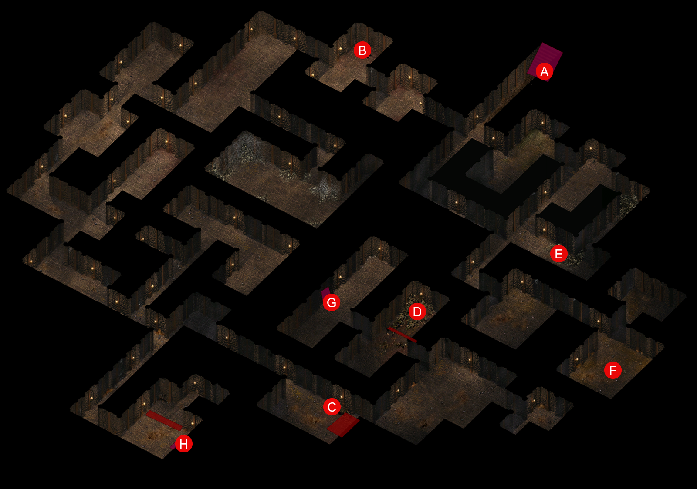{ .center-img width="60%" }

Przy zwłokach w jednym z pomieszczeń B leżał pamiętnik rashemeńskiego zwiadowcy. **Othlor** wysłał go śladem grupy podróżnych z *Waterdeep*, którzy mieli przy sobie dwoje dzieci potrzebnych mistrzowi. Grupa kluczyła po *Wybrzeżu Mieczy*, ukrywając cel podróży. Zanim zwiadowca zbliżył się do dzieci, napadła na nich banda rozbójników, a z ukrycia widział nadchodzącą drowią wojowniczkę i kapłankę. Uciekając przed bandytą i drowką, schronił się w tych tunelach. W mroku coś mamrotało i szemrało, otaczając go ze wszystkich stron. Na tym zapiski się urywały.

Dalej C leżało kolejne, wciąż świeże ciało mężczyzny, a przy nim uszkodzony pas pełen mocy. Może uda się odnaleźć jego drugi fragment. Drużyna zabrała zwłoki ze sobą.

W stosie kości D spoczywała stara księga. Może ta, o której mówił duch **Ulcastera**?

W innej części kazamatów E duch **Mal-Kalena** błagał o uwolnienie i powrót do ciała. Musiał dokończyć życie i pomścić tych, którzy zniszczyli jego szkołę. **Jen’lig** zapytała, kim był. Oznajmił, że uczniem i gdy *Ulcaster* upadł przez zdradę jemu kazano go bronić. Githyanki ostrzegła, by się cofnął, bo umrze po raz kolejny, potem przekonywała, że nie jest jego wrogiem i że wszyscy dawno zapomnieli o tamtej bitwie. Minęło trzysta lat, czas zabrał jego wrogów. **Mal-Kalen** nie mógł w to uwierzyć. Skoro wszyscy nie żyli, zażąda pokuty od potomków. Drużyna oddała mu znalezione ciało, a duch wstąpił w nie i odszedł.

W jednym z zaułków F czekała księga, o której wspominał **Karlini** ([The Magnificent Karlini](../other/zadania.md#q10)).

Na tym poziomie zauważyli dwa przejścia.

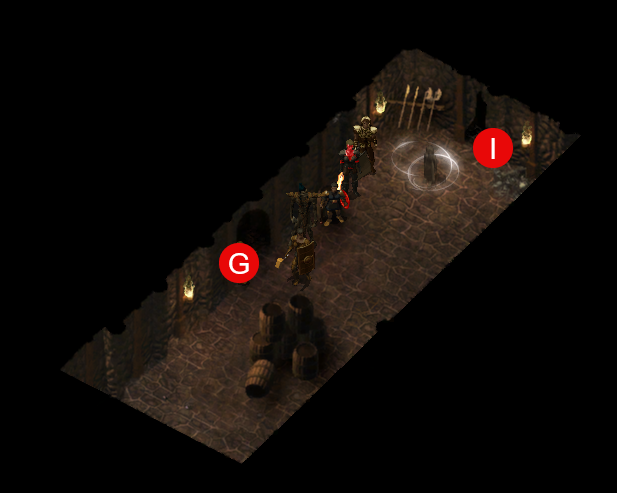{ .center-img width="60%" }

Jedno z nich G wiodło do małej komnaty z duchem dziewczynki, **Czai**. Wzięła wędrowców za nauczycieli, a ci nie wyprowadzali jej z błędu. Opowiedziała, że na górze zaatakowali ich jacyś ludzie. Mistrz **Ulcaster** mówił do siebie coś o *Hilather* albo *Hilathor*, o jakiejś pracy, a także o *Kuraltaar* i magach, którym ta praca mogła się nie podobać. Potem nastąpił ogromny wybuch, cisza, zimno i bezruch. Gdy się obudziła, mogła chodzić, lecz ściany wyglądały dziwnie. Czekała bardzo długo na nauczyciela albo pannę **Clayton**. Wybuch otworzył szczelinę, a za nią żyły pająki, które zabrały **Tomasza**, **Monaraha**, **Ynaka** i **Peepuu**. Poprosiła by im pomógł i nie pozwolił potworom żyć. Leech obiecał, że tak tego nie zostawi. Zjawa zniknęła ([Eight-Legged Misery](../other/zadania.md#q128)).

Drużyna ruszyła przez szczelinę I.

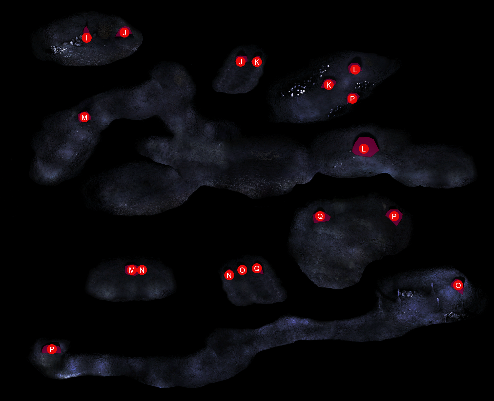{ .center-img width="60%" }

Za nią ciągnął się labirynt jam. Jedno z przejść P zaprowadziło ich do **Ssimkh**, pająka żywiącego się duchami.

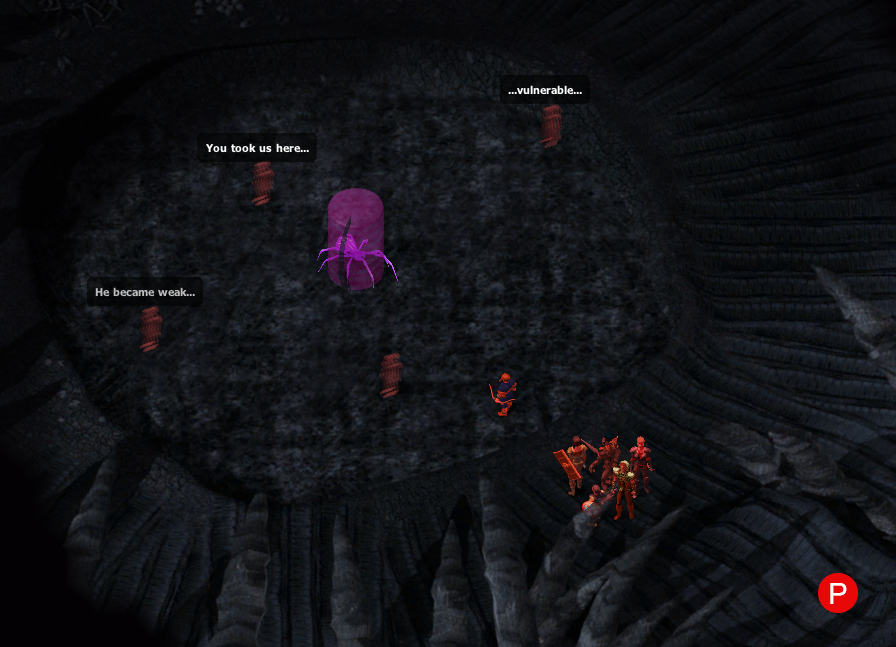{ .center-img width="60%" }

Niezwykły pająk padł, a duch **Czai** i uwolnione dusze **Tomasza**, **Monaraha**, **Ynaka** i **Peepuu** podziękowały wybawcom i odeszły w niebyt ([Eight-Legged Misery](../other/zadania.md#q128)). Drużyna zabrała szkielet pająka, który wydawał się niezwykle wytrzymały.

Zawrócili IG by sprawdzić drugie przejście H.

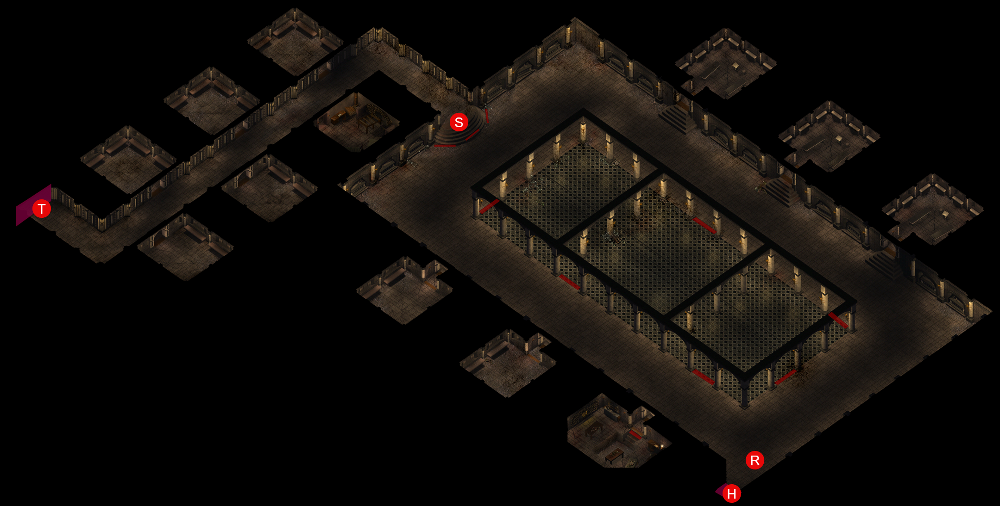{ .center-img width="60%" }

Tu na powitanie zaatakowała ich arcymagini **Arias** R. Śmierć przyszła w to miejsce nagle i wielu dawnych mieszkańców nie wiedziało, że są duchami. Zażądała, by intruzi natychmiast opuścili sanktuarium. **Sandrah** obiecała odejść, jeśli najpierw usłyszy, czemu duchy wciąż tu straszyły. Zaatakowali ich tchórze, którzy uznali ich za zagrożenie i chcieli ukraść ich wiedzę. Duchy przeklęły poległych wrogów, by strzegli tego, co przyszli ukraść. Taki sam los czekał drużynę. Arias rozkazała zniszczyć intruzów.

Przy kamiennym podeście S czekał **Anton Valor** z zapasem groźnych zaklęć. Drużyna parła dalej, aż do kolejnych tuneli T.

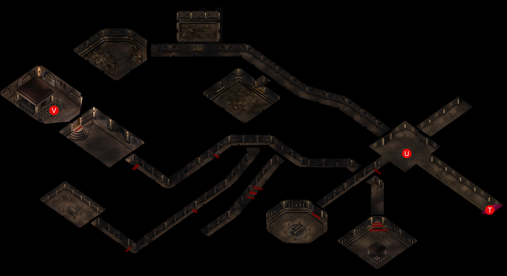{ .center-img width="60%" }

Tam powitał ich **Garrett** z eskortą rycerzy widm U, a w jednej z odnóg **Natasa** V. Po ich pokonaniu skrytki oddały grymuary i kamień łotrzyka. Podziemia *Ulcastera* zostały oczyszczone, a drużyna powróciła na świeże powietrze.

Koło wejścia do podziemi pojawili się trzej Czerwoni Magowie. **Taneth** zauważył z drwiną, że w ich stronę zmierzało stado małp. **Erica** powitała przybyszów jak starych znajomych i pochwaliła ich magiczne przedmioty. **Jeneik** poradził, by oddali je bez ociągania. Jego zdaniem on i jego towarzysze wykorzystaliby je znacznie lepiej niż jakiekolwiek naczelne. **Erica** przyznała, że szczególnie spodobał jej się połyskujący naszyjnik, bo świetnie pasowałby do jej stroju. **Jeneik** uznał, że wyglądałby na niej jeszcze lepiej wieczorem na jej gołym ciele w jego izbie. **Taneth** parsknął, że ona nigdy nie zniżyłaby się do kogoś takiego. **Jeneik** odparł, że gdyby kilka nocy wcześniej nie przesadził z alem, wiedziałby, że świat miał do zaoferowania znacznie więcej. Rozdrażniony **Taneth** zawołał, że to bzdura, bo żadna kobieta nie zainteresowałaby się takim prymitywem. **Jeneik** zaproponował, że chętnie pokaże mu prymitywa. **Erica** przerwała kłótnię, mówiąc, że dość tego. Należało zabrać magiczne przedmioty i odejść. **Jeneik** zauważył, że przybysze wyglądali na niechętnych do dzielenia się łupem. **Taneth** oznajmił, że nikt ich o zdanie nie pytał, i obiecał, że jeśli małpy oddadzą skarby, być może przeżyją to spotkanie.

**Leech** zapytał uprzejmie, dlaczego nazywano ich małpami, skoro jak widać gołym okiem nimi nie byli. Wyjaśnił, że małpami określa się naczelne z grup *Cercopithecoidea* i *Platyrrhini*. Wszystkie naczelne, które nie są ani wyższymi człekokształtnymi, ani lemurowatymi, są małpami. Dwieście sześćdziesiąt cztery znane gatunki należały do dwóch z trzech grup naczelnych, a trzecią stanowiło dwadzieścia jeden gatunków człekokształtnych. Małpy zwykle są mniejsze albo mają dłuższe ogony, a to jeszcze nie wszystko. **Taneth** jęknął, że to wystarczyło, by doprowadzić człowieka do szału. Błagał, by to przerwać. Co drużyna niezłocznie zrobiła, przerywając także magów krąg życia.

Postanowili odpocząć i **Sandrah** zauważyła, że osobliwy skrawek tkaniny i *Dziennik z Rashemen* musiały być ze sobą powiązane. Materiał rozdarto zapewne podczas napadu na podróżnych, którego świadkami byli rashemeński zwiadowca i zbiegła drowka, a dowódca karawany postradał przy tym zmysły. Wzór tkaniny poruszał w niej coś, czego nie potrafiła nazwać, a tajemnicze wskazówki wyglądały, jakby jakaś siła chciała, by odnalazła te przedmioty. Nie mogła prosić przyjaciół o pomoc w sprawie, której sama nie rozumiała. Pozostawało zachować znaleziska i liczyć na kolejne elementy. Skoro dotyczyło to zagubionej części jej dzieciństwa, pocieszała ją myśl, że może dowie się o nim czegoś więcej. 

Ostatnie wpisy rashemeńskiego zwiadowcy pochodziły mniej więcej z czasu ich narodzin, z końca *Czasu Niepokojów*. Na rozkaz *Othlora* śledził grupę podróżnych, którzy zacierali ślady z powodu czegoś, co ze sobą nieśli. Zanim zwiadowca zdążył działać, grupę napadli bandyci, a na miejscu była drowia kapłanka, zapewne tylko świadek. Zwiadowca zginął w ruinach *Ulcastera* z rąk tych samych potworów, z którymi walczyła drużyna. Potem wspomniała **Viconię**, która także opowiadała o tamtej scenie i w jej wyniku zdobyła dziwny artefakt, przekazany później Leechowi. Musieli wypatrywać kolejnych elementów, by dowiedzieć się, co ukrywali podróżni i czego szukał *Othlor*.

Gdy **Finch** poprosiła o chwilę spokoju, by zapisać w dzienniku kilka sekretów **Shar-Teel** zapytała **Garricka**, czy miał jakiekolwiek umiejętności przydatne drużynie, bo jej zdaniem był stratą racji żywnościowych. Bard wyliczył - niezrównany głos, świetna szermierka, szybko rosnące zdolności magiczne i lekka ręka do sakiewek. Wojowniczka podsumowała, że był więc przeciętną mieszanką talentów, które lepiej opanowali prawdziwi wojownicy, magowie i złodzieje. **Garrick** zapytał żartobliwie, czy stał przed sądem za swoją „pracę”. Może Leech po prostu bardziej od niej cenił dobrą muzykę i żywą osobowość. Może, przyznała. Niezależnie od przyczyny uważała go za płaczliwego robaka, nawet jak na standardy jego płci, i ostrzegła, by uważał na każdy krok.

Potem przyszła kolej na **Finch**. Czytanie i pisanie były dla **Shar-Teel** zajęciami słabeuszy, a najgorsze było to, że kronikarka zniżyła się do czczenia mężczyzny. **Finch** odparła, że to nienawiść wojowniczki była stratą czasu. Księgi dawały jej spokój ducha, a nie złośliwość, i nie żałowała, że podążała za *Deneirem*. **Shar-Teel** zarzuciła jej, że sama się zniewalała, polegając na mężczyźnie, który obdarzał ją magią. Gdyby stała samodzielnie i bez litości wymachiwała cepem, może zyskałaby odrobinę szacunku. Kronikarka zauważyła, że po prostu wierzyła we własne dary na tyle, by nie czuć się zagrożona przez mężczyzn. Wojowniczka prychnęła, że jedynym zagrożeniem były jej żałosne próby poczucia humoru.

**Leech** zagadnął **Shar-Teel**, czy przypadkiem nie kłóciła się z nimi trochę za często. Odparła, że nic ją to nie obchodziło. Był tylko kolejnym głupim męskim wieprzem, a ona nienawidziła siebie za to, że choć przez chwilę pomyślała inaczej.

Zanim ruszyli dalej odnaleźli ducha **Ulcastera**, który przyjął znalezioną księgę i wyszeptał, że wiedza wracała dzięki tym prostym słowom na pergaminie. Będzie uczył raz jeszcze, w niebiańskiej klasie, i któregoś dnia zapobiegnie temu, co się stało ([Tomes of Magic](../other/zadania.md#q127)).

Następnym celem była świątynia *Lathandera*, lecz po drodze leżał jarmark z kilkoma sprawami do załatwienia.

:material-paw: Bestiariusz: *hobgoblin, elita hobgoblinów, szkielet, zombie, kobold komando, goblin, ghast, upiorny wilk, straszny wilk, straszliwy wilk, wilkozwierz, większy wilkozwierz, wielki pająk, ghoul, wilk z lochów Ulcaster, ochrowa galareta, musztardowa galareta, upiorny pająk, mały pająk, pająk miecznik, astralny pająk fazowy, płonący umarlak, szkieletowy wojownik, hełmowy koszmar, rycerz widmo, większy ghoul*

## Jarmark w Nashkel &nbsp;86 { .divider }

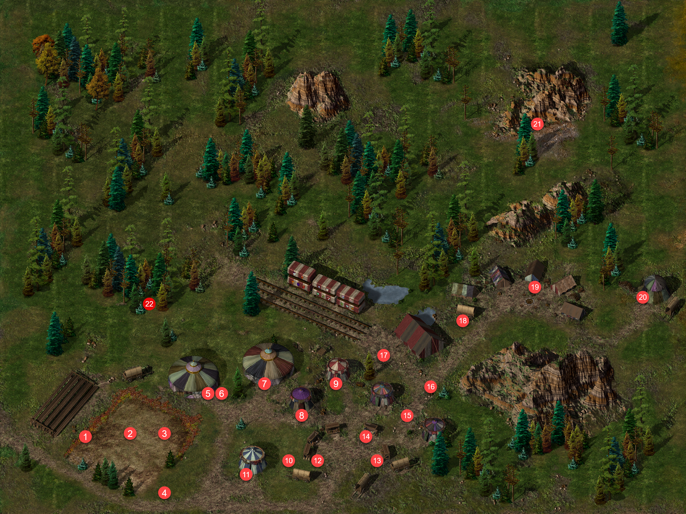{ .center-img width="40%" }

W obu wielkich pawilonach 57 **Jen’lig** zręcznie pozbawiła strzałek ośmiu nieuczciwych krupierów. Łup trafił do **Ariosha**, czekającego na skraju lasu 22, który wraz z kilkoma członkami gildii ruszył rozprawić się z szulerami ([Whispers of the Carousel](../other/zadania.md#q120)). Zespół ruszył ku Beregost.

:material-paw: Bestiariusz: *druid Cienia, kobold komando, kobold znachor*

## Świątynia Lathandera &nbsp;87 { .divider }

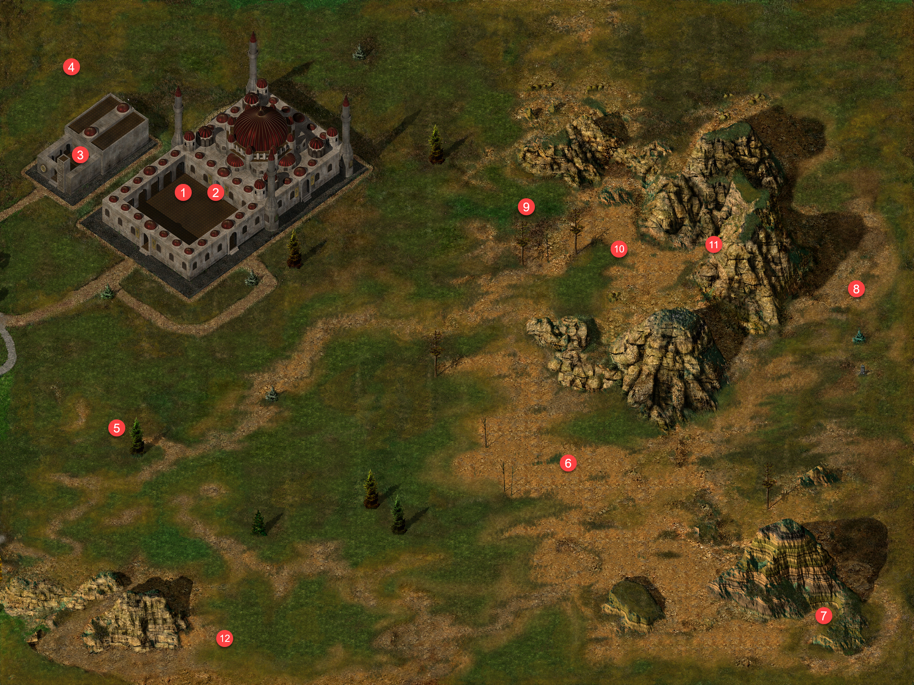{ .center-img width="40%" }

W świątyni 2 **Sandrah** ze zdumieniem rozpoznała **Pelltara** z *Wyspy Lendore*. Mag był równie zaskoczony. Gdy usłyszał, że podróżowała z Leechem z *Candlekeep*, uznał to za zbieg okoliczności, bo to właśnie jego polecono mu odnaleźć. Szukał kompetentnej drużyny. Młody gnom zauważył, że najwyraźniej zdobyli już pewną renomę.

**Pelltar** był rezydującym czarodziejem *Restenford*, niewielkiej rybackiej osady na *Wyspie Lendore*. Zwykle panował tam spokój, lecz ostatnio działy się rzeczy, których nie potrafił wyjaśnić. Część karawan nie dotarła do celu, a nieliczni podróżni opowiadali o hobgoblinach, gnollach i innych stworach nękających szlaki. Wyspa nigdy nie była od nich wolna, lecz narastające kłopoty go niepokoiły. W okolicy były stare ruiny i jaskinie, w których mogły się kryć. Sam musiał zajmować się poważniejszymi problemami rodziny barona. Zapytał wprost, czy drużyna mu pomoże. Leech się zgodził. Rejs na wyspę wymagał czasu i statku, więc uradowany **Pelltar** postanowił niezwłocznie przenieść ich tam sam z użyciem zaklęcia.
