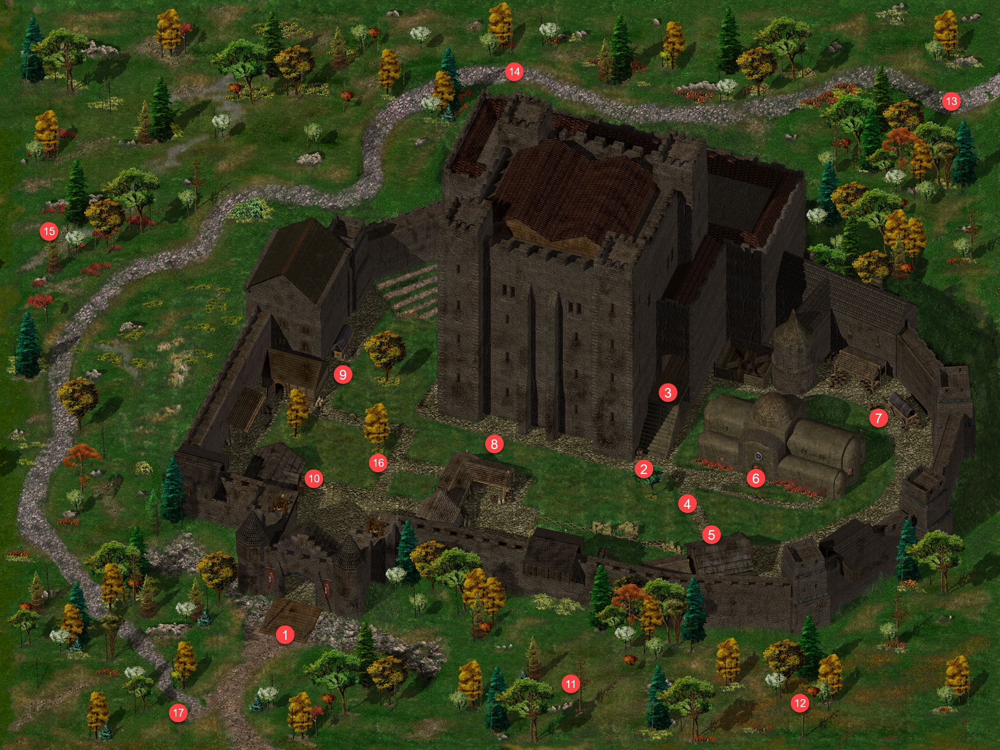

# UNDER CONSTRUCTION

## Pomocna Dłoń&nbsp;79 { .divider }

{ .center-img width="40%" }

Przed wejściem w mury warowni (17) **Najara** i Vallius oznajmili, że wreszcie dopadli **Shar-Teel**, zabójczynię niewinnych. Przysięgła na potężnego *Torma*, że wojowniczka zapłaci za to od jej ostrza. **Shar-Teel** zdziwiła się, skąd ten zarzut. **Najara** nakazała jej nie udawać niewiedzy. Wojowniczka miała napaść na wioskę i wymordować wszystkich mieszkańców, a kto wie, jakich jeszcze zbrodni się dopuściła. Czuła, że miała przed sobą istotę złą i plugawą. **Shar-Teel** zaprzeczyła stanowczo. Nigdy nie napadła na żadną wioskę ani nikogo nie zabiła, więc musiano ją z kimś pomylić. **Najara** uznała, że dość tych kłamstw. Oskarżona była poza zasięgiem odkupienia w Świetle. Wezwała swoich towarzyszy, obiecując, że sprawiedliwość będzie szybka i ostateczna, po czym zawołała, że była jednością z potężnym.

