# Kilka spraw w Lendore

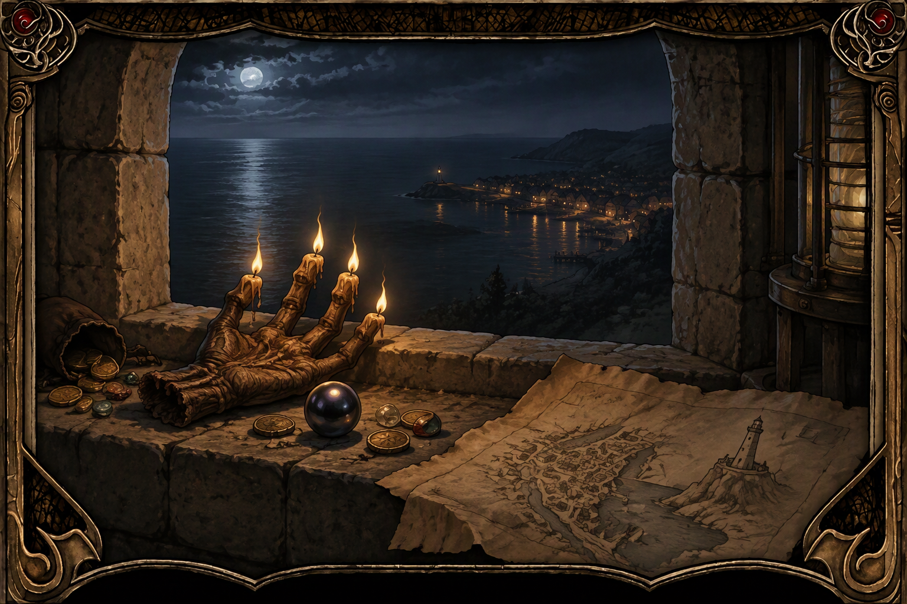{ .center-img width="80%%" }

## Lendore&nbsp;88 { .divider }

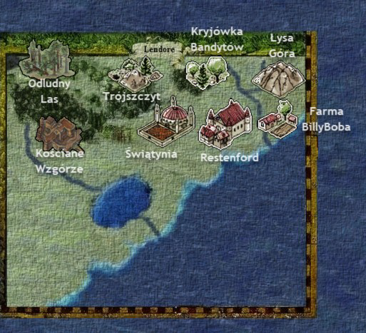{ .center-img width="40%" }

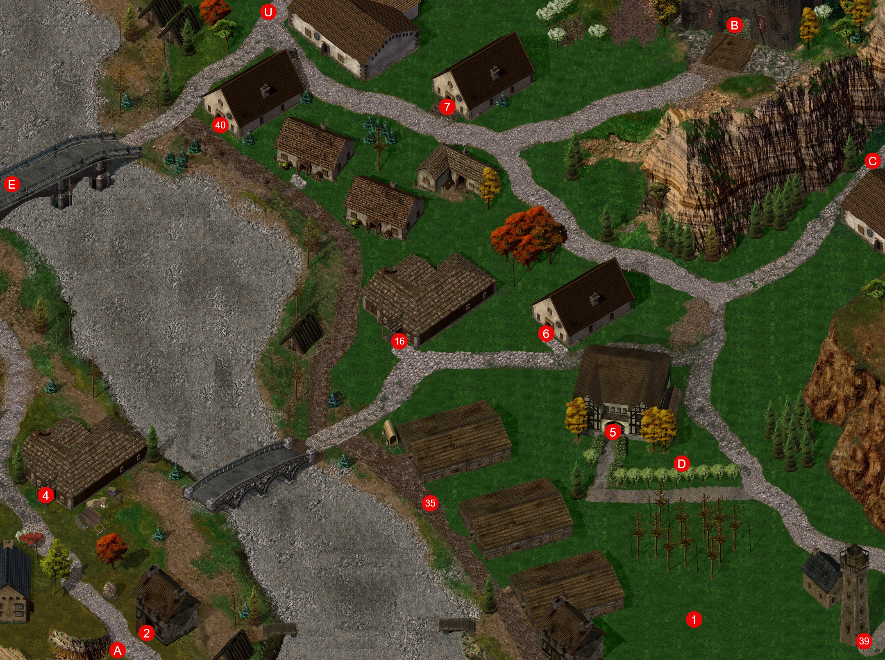{ .center-img width="60%" }

Zaklęcie **Pelltara** wyrzuciło drużynę w *Restenford* 1. Mag zachęcił wędrowców, by rozejrzeli się po miasteczku, w którym wieści o ich przybyciu zapewne już krążyły. Prosił tylko o jedno - żadnych napaści na strażników. Baron wydał stałe zarządzenie, że za zabicie strażnika groziła natychmiastowa śmierć, a tego wyroku nawet on nie zdołałby uchylić. Byli tu gośćmi. Gdyby odkryli coś niezwykłego, mieli go szukać w jego domu albo w wieży na zamku. Gdy uznają, że czas wracać, odeśle ich do świątyni w *Beregoście*.

Miasteczko chętnie dzieliło się plotkami. Spieszący do bydła farmer ostrzegł, że bandyci w dziczy zabierali znacznie więcej niż złoto. Ktoś inny słyszał od brata o martwym człowieku krążącym wokół starego posterunku straży, choć brat wracał wtedy z tawerny. Kupcy narzekali na braki w towarach, bo bandyci łupili karawany, a straż nic z tym nie robiła. Pewien rolnik w ciągu miesiąca stracił dziesięć sztuk bydła i winił gnolle. Inny omijał ruiny szerokim łukiem, odkąd jego wuja opętało coś w lochach i dopiero modlitwa zdołała go uwolnić. Pewna mieszkanka skarżyła się, że trzech najemnych pomocników zniknęło jej w biały dzień, ktoś zachwalał rozrywki w *Garrotten* na południu, a ktoś jeszcze ostrzegał przed opowiadaniem dzieciom bajek o bohaterach, bo wbijały im do głów głupie pomysły. Wielu cieszyło się po prostu, że poznali prawdziwych awanturników.

Najbardziej zaciekawiony okazał się **Zahrdahl** 2. Zauważył, że drużyna nie wyglądała na wybierającą się na ryby, i od razu wiedział, że to poszukiwacze przygód wynajęci przez **Pelltara**. Gdy **Sandrah** zapytała, skąd, zmieszał się i zrzucił wszystko na plotki. Na wzmiankę, że to podobno on ściągnął do miasta plagę szczurów, zaprotestował. Sprzedawał przynętę, robaki i kawałki martwych zwierząt, a przeklęte gryzonie zjadały mu towar. Nocą przychodziły drogą z południa, prowadzone przez kilka wielkich osobników. Zastawiał pułapki, a złapane szczury sam przerabiał na przynętę. Jeśli drużyna nie miała nic lepszego do roboty, mogła zajrzeć do spalonego przed laty posterunku straży, gdzie kończyła się południowa droga. Teoretycznie nie powinno tam niczego być.

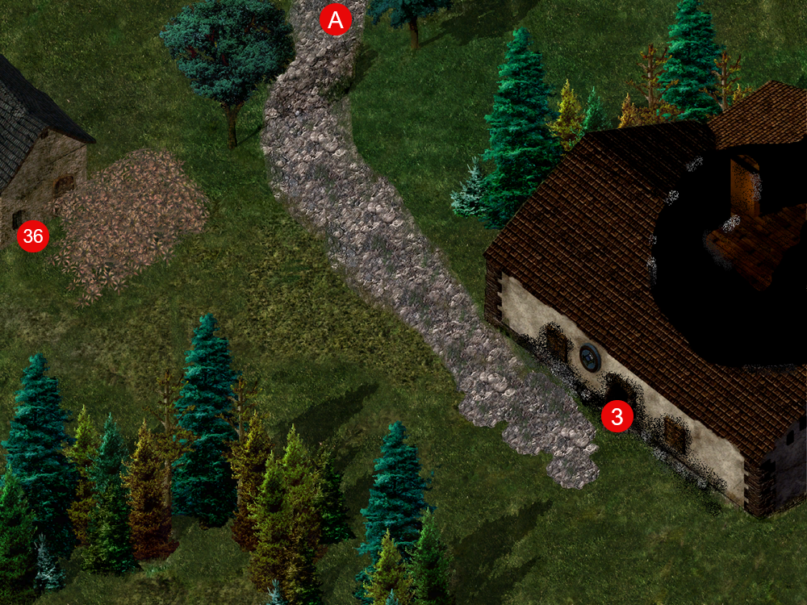{ .center-img width="60%" }

W nadpalonym budynku 3 na południu miasteczka A czekał wielki szczur, a pod podłogą zejście do podziemi.

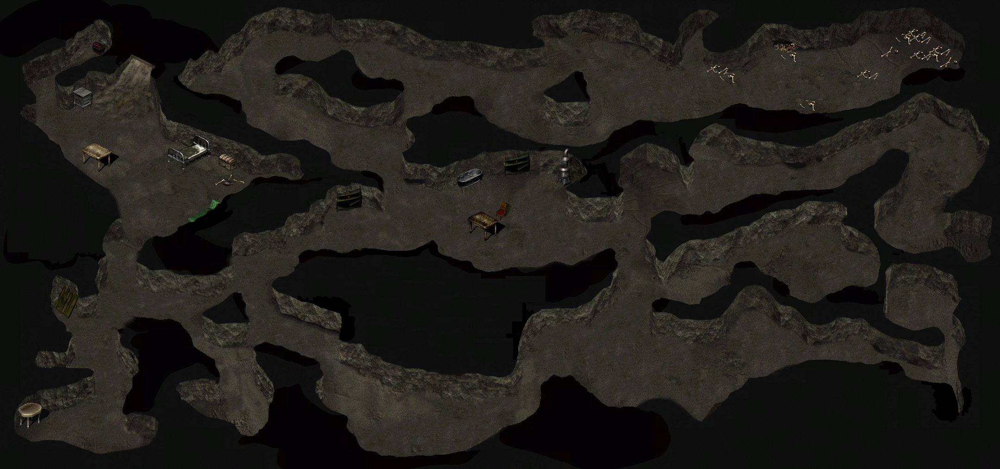{ .center-img width="60%" }

Na dole, oprócz szczurów, roiło się od szkieletów i ghuli. Butwiejące meble zdradzały, że ktoś, zapewne złodziej, urządził tu sobie kiedyś kryjówkę. Drużyna wybiła wszystko, co się ruszało, i wróciła do zleceniodawcy ([Clear out Abandoned Guardhouse](../other/zadania.md#q129)).

Zapytany o inne kłopoty, **Zahrdahl** zapewnił, że poza szczurami żadnych nie mieli. **Sandrah** zdziwiła się, bo **Pelltar** malował *Restenford* jako miasto pełne problemów. Rybak poprosił tylko, by dawali mu znać o nowinach, bo z chorą nogą nie zawsze docierał do tawerny *Falco*.

W tawernie *Falco* 4 **Sandrah** znów zasiadła nad tomem wiedzy **Elminstera**, który przez Leecha nieco zaniedbała. Ten rozparł się w fotelu, patrzył, jak ukochana przewraca strony, i powoli odpłynął w stan pomiędzy jawą a snem, gdzie wszystko było możliwe.

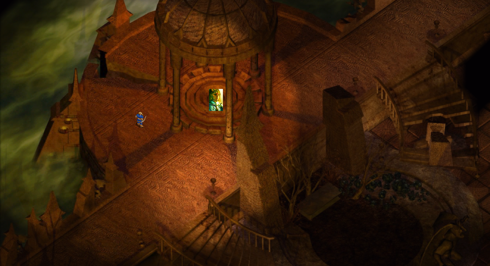

<em>
**Elminster** stał przed wspaniałym portretem młodej kobiety. **Sandrah** objęła go i podała mu kieliszek wina, prosząc, by wreszcie coś zjadł, bo stał tu niemal pół dnia. Pół dnia? Tam, gdzie przebywała **Khalindra**, czas nie istniał, a on podczas wizyt u niej nie był jego więźniem.

Córka przyznała, że widok ojca w takim stanie ją smucił, a zarazem cieszył, bo wciąż kochał żonę tak jak dawniej. Ona sama była żywym dowodem tej miłości, odparł, zanim ON wszystko zniszczył. Gniew maga wobec martwego boga nigdy nie słabł. Bóg był martwy, lecz wciąż mógł szkodzić, a jego potomstwo i wyznawcy mieli nękać *Faerûn* jeszcze długo po *Czasie Niepokojów*. Zabił ukochaną żonę **Elminstera** zza grobu, zaszczepiając w niej swoje nasienie. Nie wszystko jednak było złe. W córce mag z każdym dniem coraz wyraźniej widział **Khalindrę**.

**Sandrah** zapytała, czy opowie jej dziś o tamtym drugim dziecku, które sprowadziło śmierć matki, samo będąc niewinnym. Czy naprawdę wierzyła, że potomek *Boga Morderstwa* od narodzin nie ponosił winy? Tego nauczyła się od niego, odparła. To dobrze, uznał, choć któż mógł wiedzieć, co z takiego przekonania wyniknie. Odwrócił się ku portretowi i życzył **Khalindrze** dobrej nocy.
</em>

**Sandrah** zapytała, czy wszystko w porządku i czy zobaczył ducha. Leech nie był pewien, czy zasnął, bo wizja była zbyt prawdziwa. Zawahał się, czy o niej mówić, skoro dotyczyła także jej. Gdy padło imię **Khalindry**, kapłanka zamarła. Nigdy nie wspominała mu imienia matki. Nie mówiła mu też, że zmarła, wydając na świat dziecko, którego ojcem nie był **Elminster**. Poprosiła o chwilę, by to przemyśleć. Nikt nie mógł mu opowiedzieć czegoś, czego sama nie była jeszcze pewna, więc wizja musiała być prawdziwa ([Sandrah's Heritage - The Second Child](../other/zadania.md#q130)).

Gospodarz **Falco** chwalił swoją karczmę jako jedyną porządną w *Restenford* i polecał *Magiczny Sklepik* **Lazarusa**. Po uzdrowienie odsyłał do opactwa *Phaulkona* na zachodzie albo do druida **Almaxa** za rzeką. „Drzewołazów” nie lubił, ale ten akurat potrafił postawić na nogi. Na pytanie o **Zahrdahla** parsknął. Sprzedawca przynęt? Nigdy tu nie bywał, i dzięki *Phaulkonowi*, bo cuchnąłby na całą izbę. W *Zachodnim Wietrze* też raczej nie, bo tam chodzili farmerzy i kupcy, a z kulawą nogą to dla niego za daleko.

Skoro rybak kłamał, że plotkuje w gospodzie, i tak bardzo interesował się poczynaniami drużyny, warto było zajrzeć do niego ponownie.

**Jen'lig** przeszukała piętro jego domu 2. Klucz z szafy otworzył komodę, a w niej czekały księga czarów i notatnik pełen informacji o mieszkańcach oraz kłopotach z gnollami, szczurami i bandytami. Najważniejsze było jednak co innego: notatki trafiały do diuka *Kroten*, a kulawy rybak był jego szpiegiem. Przyparty do muru zaatakował i zginął.

W pracowni **Pelltara** 5 Leech zdał relację. Mag pochwalił pomysł wypytywania mieszkańców, bo zwykli ludzie często wiedzieli o okolicy więcej niż tak zwani światli. Jaskinie pod posterunkiem? Przed stu laty wykuto pod dawnymi koszarami tunele na broń i zbroje. Gdy przyszły magiczne schowki, miano je zasypać, bo nad rzeką groziły zalaniem. Najwyraźniej nie wszystkie zasypano. Złodziej, nieumarli i gniazdo szczurów zostały zniszczone, a resztą mogła zająć się straż, skoro **Gelpas** i tak dowodził „patrolem szczurzym”.

Dziennik **Zahrdahla** zrobił na magu znacznie większe wrażenie. Plotki o szpiegu w mieście okazały się prawdą! Znakomita detektywistyczna robota. Baron musiał dowiedzieć się natychmiast. Gdy usłyszał, że sprzedawca przynęt był magiem z ładnym sztyletem, który już mu się nie przyda, odetchnął z ulgą. Mieli dość kłopotów z elfimi władcami i bez ich szpiegów. W *Restenford* nigdy nie było nudno.

Płatnerz **Smyth** 6 nie miał wielkiego wyboru, ale sprzedawał w dobrej cenie kamień łotrzyka. **Lazarus Librarus** w składzie osobliwości 7 oferował za to całą gamę ciekawych zwojów i eliksirów.

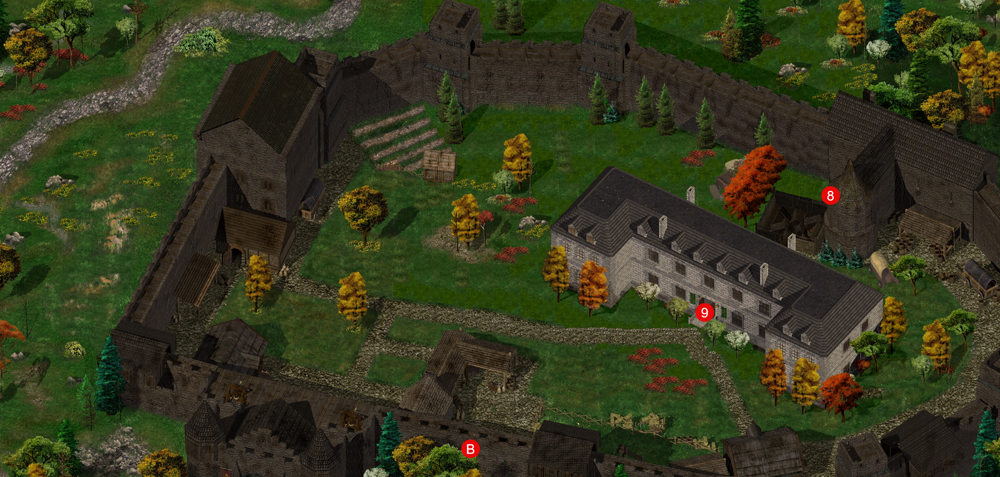{ .center-img width="60%" }

W górnym mieście B wznosiły się zamek i wieża **Pelltara** 8. Pod nieobecność gospodarza drużyna przejrzała jego bibliotekę i wyniosła z niej grymuar. **Sandrah** zachęciła **Finch**, by przyjrzała się zgromadzonym księgom. Kronikarka była zachwycona, właśnie tak wyobrażała sobie własną bibliotekę. Kapłanka miała nadzieję, że będzie ona lepsza. Tutaj studiowali tylko uczeni, a biblioteka **Finch** miała służyć ludziom, nawet jeśli nanoszą na dywan trochę ziemi. **Finch** natychmiast zanotowała - zamiast dywanów kafle, łatwiej się sprzątają.

W rezydencji 9 baron **Grellus** powitał poszukiwaczy przygód sprowadzonych przez **Pelltara**. Szczegóły to sprawa maga, on sam liczył tylko, że drużyna pomoże, bo kłopotów zebrało się naraz sporo. Wracając do pracy, wspomniał jeszcze, że diuk chciał zawrzeć z nimi kolejny „kontrakt”. Byłby szczęśliwszy, gdyby wszystkie ludzkie osady podlegały wprost jego władzy. Cóż, nic na to nie poradzi, prawda? Zachichotał.

Kapitan straży **Gelpas** nie sprawiał wrażenia bystrzaka. Według niego w miasteczku nie działo się nic poważnego. Mag słusznie zrobił, sprowadzając pomoc z zewnątrz.

Piętro wyżej baronowa **Fairwind** zapytała, czy się zgubili, po czym rozpoznała **Sandrah**. Słodka dziewczyna wróciła! Czy znów zamierzała pozbawiać snu miejscowych chłopców, którzy po jej ostatniej wizycie wzdychali do księżyca? Kapłanka odparła, że opowieści o urodzie baronowej nie oddawały jej sprawiedliwości. **Fairwind** zbyła pochlebstwo. Nie spędziła życia jako szlachecka ozdoba i potrafiła rozpoznać srebrny język. Dawniej była kleryczką w drużynie awanturników i znała smak krwi i śmierci. Znudziło ją ciągłe unikanie śmierci, a teraz życie szlachcianki nudziło ją na śmierć. Widać zawsze trzeba mieć na co narzekać. Obiecała oprowadzić **Sandrah** po zamku, gdy wszystko się uspokoi.

W innym skrzydle rezydowała **Andrella**, konkubina barona. Jak przystało na konkubinę, siedziała na sporych kufrach.

Drużyna wróciła do centrum i skierowała się na farmę Boba C.

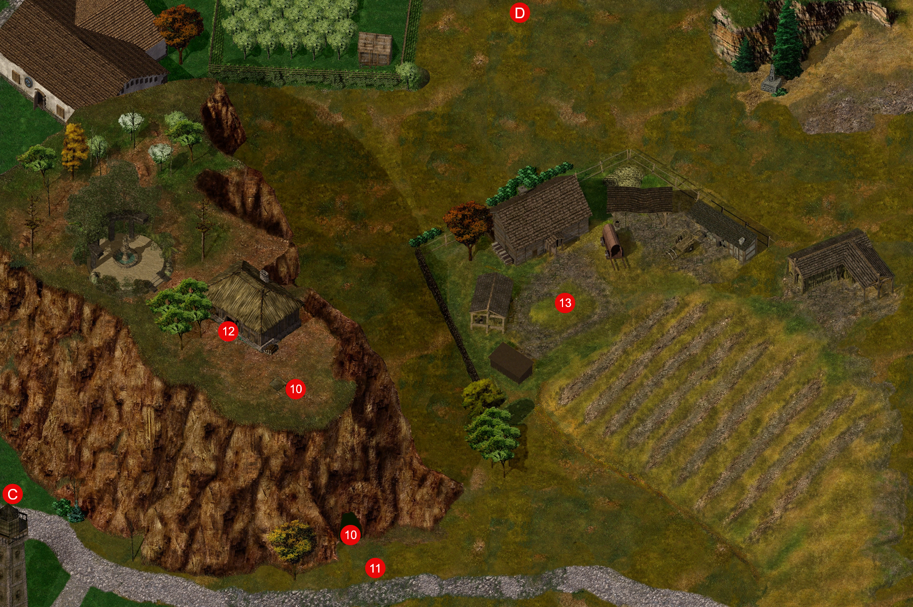{ .center-img width="60%" }

U stóp schodów na płaskowyż 10 spotkali **Amosa** 11, syna druida **Almaxa**. Almax nie był rozmowny i rozgadał się dopiero gdy zasięgneliśmy języka u żony jego syna - **Felwin** 12. Przygotowywali mikstury lecznicze sprzedawane przez **Almaxa**, lecz karawana ze składnikami się spóźniała i nikt nie wiedział dlaczego. Leech podejrzewał pogodę, ale obiecał to sprawdzić. **Felwin** radziła też porozmawiać z teściem, który stracił kontakt z **Martinem**, młodym zwiadowcą pomagającym budować gaj druidów w *Reddy Forest*. Łączność urwała się, gdy gnolle zaczęły atakować miasto.

**Almax** w końcu przedstawił się jako druid i opiekun tych ziem. Gdy spytaliśmy o spalony posterunek zrzucił winę na źle zbudowany kominek, nowe koszary postawiono przy zachodniej bramie, a starych nigdy nie rozebrano. O jaskini pod nimi nie miał pojęcia i pochwalił drużynę za rozprawę z nieumarłymi. Potem nakreślił okolicę. Za opactwem droga wiodła na zachód i na południe do *Garrotten*, nędznej mieściny kradzieży i nierządu. Prosto na zachód leżały *Las Kelman* i *Martwy Las*, spokojne miejsca. Na północnym zachodzie ciągnęły się wzgórza i *Trójszczyt*, pełne gnolli, które ostatnio coś pchało do ataków na miasto. Stąd nowy mur. *Odludny Las*, na północ od *Wzgórza Kości* i na zachód od *Trójszczytu*, był dobrym miejscem na odpoczynek, a druidzi wznosili tam świątynię i jeśli drużyna tam trafi powinna sprawdzić co z **Martinem**.

Na farmie 13 **Sir BillyBob** stał nad stertą martwych orków. Przedstawił się jako poszukiwacz przygód, żołnierz i obrońca krain. Był przy tym, jak **Pelltar** radził baronowi wynająć drużynę. Mag chciał początkowo zatrudnić jakichś *Maulerów*, lecz to **BillyBob** polecił Leecha, bo **Elminster** twierdził, że sobie poradzą. Wielu się nimi interesowało, ale to rozmowa na później. **Sandrah** rozpromieniła się. Wuj **BillyBob**! Czy teraz musi mówić „sir”? Mała **Sandrah**, a może już lady **Sandrah**? Pocałowała go w policzek. Dla niego zawsze pozostanie po prostu **Sandrah**.

Jeśli chodzi o orki, których kilka zabitych znajdowało się koło BillyBoba to ich kolejna banda, która nie pojęła, że okradanie jego farmy było beznadziejnym pomysłem. Nawet wilki trzymały się z daleka. Na północ od farmy i sadów jabłoni biegła droga między rzeką *East Restin* a *Łysą Górą*, otoczona wzgórzami i stworzona do zasadzek. Zwykle sam czyścił ją ze strażnikami, ale teraz zajmowały go wycielenia. Zaginęło kilka wozów, a część kupców w ogóle nie dotarła. Drużyna ruszyła na północ aby się temu przyjrzeć ([Bandits on Bald Hill](../other/zadania.md#q131)).

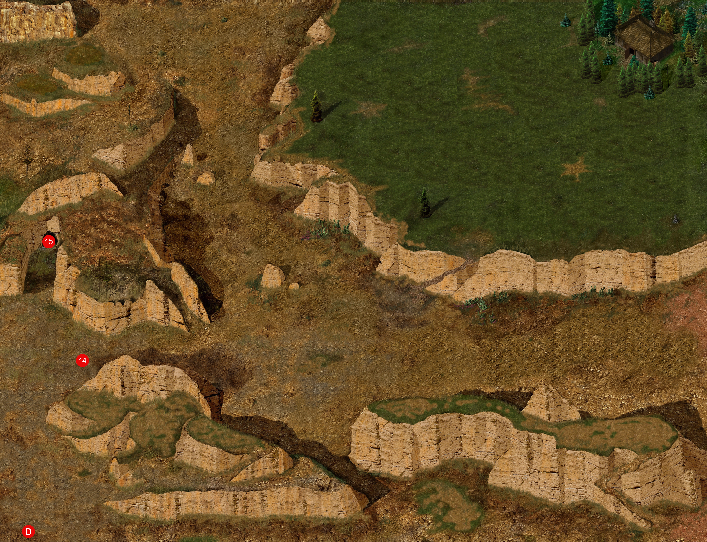{ .center-img width="60%" }

**Krellus** i **Gorharg** zaatakowali ze swoją bandą orków 14. *Łysa Góra* nie sprzyjała rolnictwu, ale dzięki podróżnym rozbójnicy nie mogli narzekać na wybór dóbr. Do czasu, bo nasza drużyna zwykłymi podróżnymi nie była.

W pobliskiej jaskini 15 leżały szczątki wozów z zaginionych karawan.

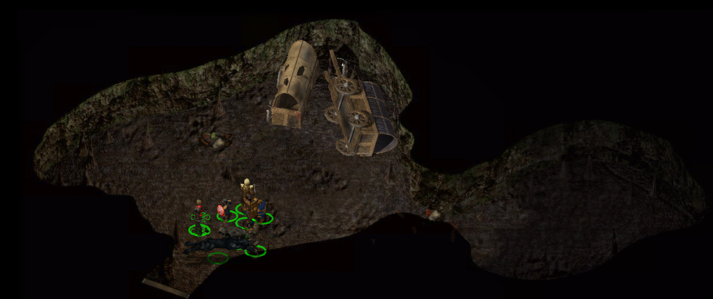{ .center-img width="60%" }

Wędrowcy przeczesali okolicę, kładąc upiory, władców ghuli, powietrznych sług, a nawet kościanego golema. Wrócili D do **BillyBoba** który podziękował im za pomoc ([Bandits on Bald Hill](../other/zadania.md#q131)).

Zaciekawieni zapytali, ile naprawdę miał lat. Całe miasteczko uważało go za starożytnego. Zachichotał. Nie był tak stary jak **Elminster**, ale żył dłużej, niż mogła się spodziewać większość pełnej krwi elfów. Nie był wybrańcem żadnego bóstwa, choć niektóre powierzały mu zadania przesuwające władzę z jednej frakcji do drugiej. Zapytał, kto rządził teraz *Candlekeep*. **Tethtoril**? Pamiętał chłopaka stajennego o tym imieniu. Widać minęło sporo czasu. Pożegnał Leecha i wrócił do swoich upraw i hodowli.

**Garrick** zagadnął **Shar-Teel** o jej imię, a potem o to, czemu była tak wroga wobec mężczyzn. Za każdym razem słyszał, że nie zamierzała o tym z nim rozmawiać, a mężczyźni byli gorsi, czego on był najlepszym przykładem. Bard podsumował z przekąsem, że to pewnie ten czas miesiąca. U niej najwyraźniej trwający codziennie.

Z powrotem w *Restenford* C drużyna zajrzała do *Zachodniego Wiatru* 16, prowadzonego przez **Zelmara** i **Hakiego**. Karczmarz uprzedził, że o tej porze roku mają urwanie głowy, ale po kilku kolejkach wszystko da się załatwić. Za cenę kufli drużyna usłyszała, że przy *Trójszczycie* mieszkało plemię olbrzymów wzgórzowych, że w lesie przy *Wzgórzu Kości* żyła druga druidka, że brudny **Zahrdahl** nie umiał utrzymać porządku i rozplenił szczury, a pod zamkiem barona spoczywał podobno skarb z jego awanturniczych czasów.

Obok siedział bard **Fabio**, który oświadczył, że nie przyjmuje zamówień. **Sandrah** zapytała, czy w *Ankhapur* i *Hlondeth* miał więcej szczęścia. Bard zaczął się plątać, aż rozpoznał w niej małą **Sandrah**, rozgniewaną dziewczynkę z potężnym młotem. Leech zapytał, czy w ogóle był bardem. Był, ale czy bard musi przyjmować zamówienia? **Garrick** poradził odpuścić, bo talentu nie miał za grosz, na co **Fabio** warknął, że gdyby nie cenił lutni, tamten chodziłby teraz dziwnie. Wtem karczmarka trzasnęła go w twarz bo jego rzekoma wysypka od zbroi przeszła na nią i musiała iść do kapłana.

**Sandrah** ze śmiechem wyznała, że jako głupiutka nastolatka wzdychała do tego „gwiazdora”, choć do niczego nie doszło, bo wyruszył na wielką trasę koncertową. Teraz **Fabio** był zajęty komplementowaniem **Shar-Teel**, która, ku powszechnemu zdumieniu, speszyła się i mruknęła, że jak na mężczyznę był znośny. Przedstawił się z ukłonem jako światowej sławy muzyk, podróżnik po wielu wszechświatach i członek słynnej trupy *Raelis Shai*. 

Zapytany o plotki rzekł, że na wschodzie bandyci, na zachodzie gnolle, szczury przy sprzedawcy przynęt, niespokojni umarli na *Wzgórzu Kości*. *Garrotten* zazdrościło *Restenford* sukcesów i mogło spróbować to zmienić. Diuk *Kroten* zrobiłby wszystko, by pozbyć się barona, a po mieście krążyli jego szpiedzy. Na pocieszenie handel morski kwitł, a połowy szły znakomicie, o ile ktoś lubił rybę na każdy posiłek. Słynął z tego, że wszędzie bywał. Tak, właśnie tak to wyglądało.

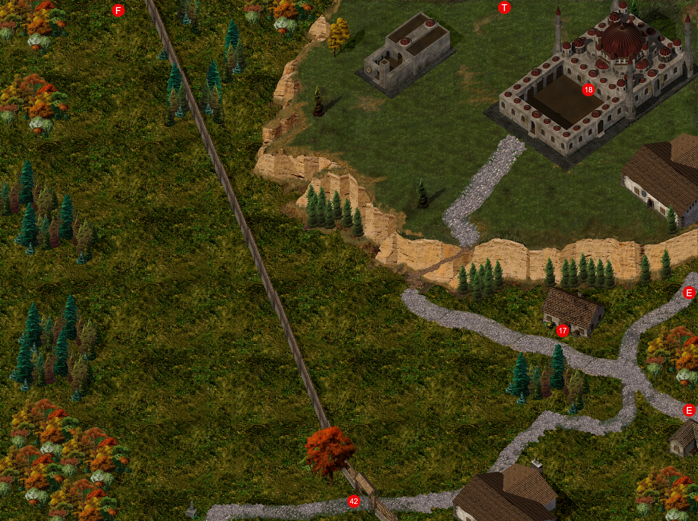{ .center-img width="60%" }

W dzielnicy świątynnej E, w domu pod wzgórzem 17, mieszkała kapłanka **Yalta**, duchowa doradczyni baronowej. **Lady Fairwind** też była kapłanką i traktowała kłopoty swojej ziemi jak własne, a **Yalta** coraz częściej słuchała jej zmartwień. Gnolle nękały okolicę od dawna, lecz zwykle tylko w mroźne zimy, z głodu. Teraz nie było zimy, a jedzenia nie brakowało. Ataki były też lepiej zaplanowane: grupy uderzały naraz w różne miejsca muru, rozpraszając straż, współpracowały z wilkami i atakowały o każdej porze. Ktoś albo coś musiało nimi kierować ([Gnoll Attacks](../other/zadania.md#q132)).

Kapłanka wspomniała też o wielkim szczurze, który pogryzł dziewczynkę przy starym posterunku. Usłyszawszy, że gniazdo zostało zniszczone, a przy okazji i nieumarli, zdumiała się. Nieumarli w mieście! Niespokojne czasy. Dziewczynce na szczęście nic nie będzie.

W świątyni *Phaulkona* 18 kapłani **Qualton** i **Almon** świadczyli zwykłe usługi. Drużyna wmówiła **Almonowi**, że wzywa go kolega, a pod jego nieobecność ukrytą dźwignią odsunęła ołtarz. Pod nim kryła się komnata pełna interesujących zwojów i tajne wyjście pod świątynne wzgórze.

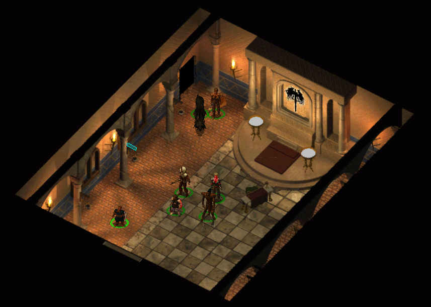{ .center-img width="60%" }

Przez bramę dzielnicy świątynnej drużyna ruszyła na północ, ku *Trójszczytowi* F.

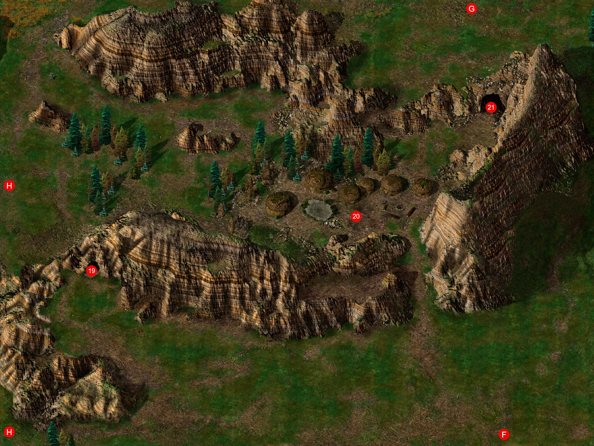{ .center-img width="60%" }

Padły kolejne wilcze stada 19 i cała gnolla wioska 20. W jaskini na północy 21 wyjaśniła się zagadka nienaturalnej aktywności - kolejny ogrzy mag próbował kierować gnollami.

Dalej na północy otwierała się droga do *Odludnego Lasu* G.

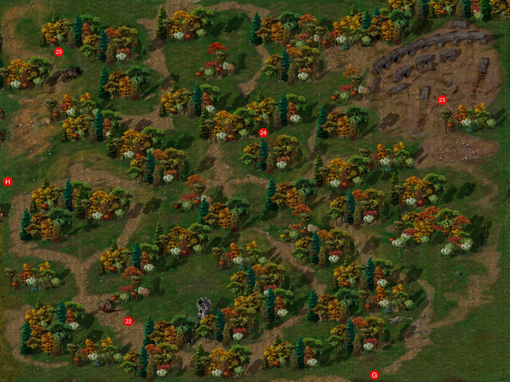{ .center-img width="60%" }

**Locinda** 21 zauważyła z ulgą, że przybysze nie byli wilkami. **Garrick** dodał, że wilkołakiem też nie, gdyby pytała. Właśnie odparła ostatnich napastników i potrzebowała mikstur. Opatrzona opowiedziała o swoich przygodach na wyspie. Okradziona, zagubiona, ścigana przez każde głodne zwierzę. Typowy dzień poszukiwacza przygód, skwitował bard, a ona przyznała mu rację ze śmiechem. Zmierzała do *Garrotten*, ale zgubiła drogę. **Garrick** wskazał jej kierunek na południe.

**Martin** 23 przywitał drużynę z nadzieją. Gdy **Jen'lig** wspomniała o **Almaxie**, odetchnął. Od tygodni nie miał wieści, a pierwszy tydzień samotności był miły, ale potem brakowało mu rozmowy. Zapewne gnolle zabijały posłańców. Githyanki rozwiała jego obawyi wyjaśniła, że gnollami kierował ogrzy mag, a kilka cięć w trzewia załatwiło sprawę. Zwiadowca poprosił o przekazanie wieści druidowi przy farmie BillyBoba.

Podróżnik **Volcifar** 24 sprowadził profesję drużyny do uciążliwych zleceń i ratowania głupców. **Sandrah** przyznała, że bywały takie dni. Miał dla nich coś jeszcze. Na południowym zachodzie stał stary zamek, w którym roiło się od hobgoblinów. Ruiny opuszczone już tylko z nazwy. Odkąd to hobgobliny gardziły jaskiniami? To pytanie zaintrygowało także kapłankę.

**Tolvar** 25 przedstawił się jako sławny czarodziej i od razu się poprawił bo tak naprawdę był nieudacznikiem. W walce zamierał i nie potrafił rzucić zaklęcia, a ostatnia drużyna zostawiła go tu na pewną śmierć. **Sandrah** poradziła, by poszukał w *Restenford* starego **Sir BillyBoba**, który szkolił młodych żołnierzy. W najgorszym razie elf go wyśmieje, uznał **Tolvar** i podziękował.

Drużyna ruszyła ku *Wzgórzu Kości* H.

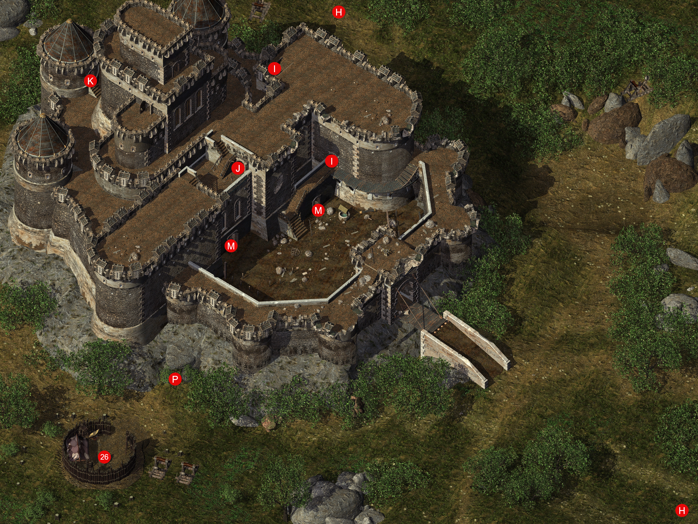{ .center-img width="60%" }

Na wzniesieniu górowała opuszczona warownia. W skrzyni za palisadą 26 czekał osobliwy artefakt, brązowy róg *Valhalli*. W salach *Valhalli* spoczywali najdzielniejsi wojownicy, zobowiązani przyjść z pomocą każdemu, kto zadmie w róg. Raz dziennie przywoływał berserkera siódmego poziomu, który walczył dla właściciela przez minutę.

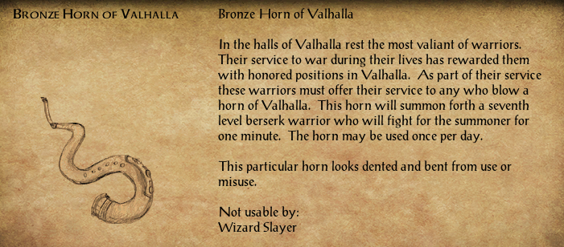{ .center-img width="60%" }

Twierdzę zajmowały hobgobliny. Schodami I drużyna wspięła się na taras. **Sandrah** zachwyciła się widokiem i zapytała Leecha, czy marzył o własnym zamku. Wystarczyłaby mu prosta chata. Sama nie wiedziała, po co pytała. Kochała życie u jego boku, pełne przygód i nauki, a przecież byli młodzi. Może z czasem zatęsknią za miejscem tylko dla siebie, zamkiem czy domkiem nad morzem. Dom w *Waterdeep* zawsze stał przed nim otworem, lecz rozumiała, że to nie to samo. Postanowiła brać życie, jakie przyjdzie, byle razem. Objął ją mocno.

Przez weszli do środka twierdzy J.

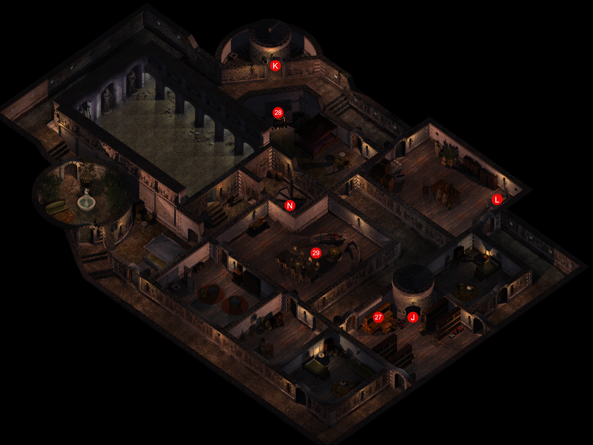{ .center-img width="60%" }

W komodzie 27 znalazł się klucz otwierający większość drzwi, w innej 28 księga czarów sygnowana imieniem **Telvara**. Właściciel siedział w swojej samotni 29 i wrzasnął, że kazał idiotom mu nie przeszkadzać. Gdy zrozumiał, że jego strażnicy nie żyją, przedstawił się jako opiekun twierdzy. Przysłano go po starożytny spiżowy róg, potrzebny władcom, którzy chcieli wznieść tu nowy zamek. Pozwalał przywoływać pomoc z innych twierdz. **Jen'lig** pokazała róg, a mag kazał go grzecznie podać. Dostał go, nazwał drużynę głupcami i zaatakował. Jego notatnik wypełniały obserwacje astronomiczne i przepisy na mikstury, lecz pod koniec pojawiała się wzmianka o współpracy z *Widmem*, władającym nieumarłymi w twierdzy. Obaj szykowali atak na *Restenford*.

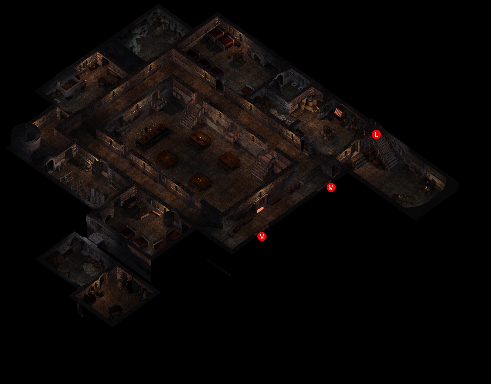{ .center-img width="60%" }

Po oczyszczeniu niższego poziomu L drużyna wróciła do krętych kamiennych schodów pośrodku zamczyska N.

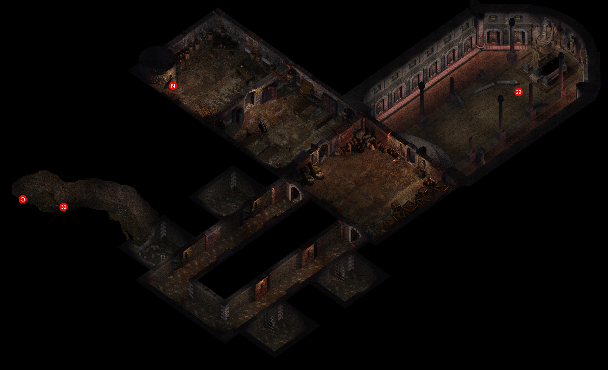{ .center-img width="60%" }

W jednej z komnat 29 Upiór ucieszył się, że **Telvar** przysłał mu kolejne ofiary. Mylić się jest rzeczą upiorną.

Gdy dotarli do cel więziennych ktoś wybił tam tunel, a w nim czekał ognisty olbrzym 30, strzegący wejścia do systemu jaskiń O.

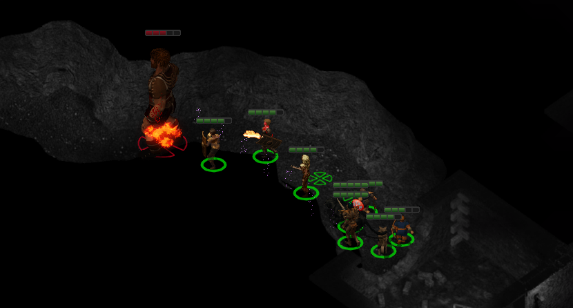{ .center-img width="60%" }

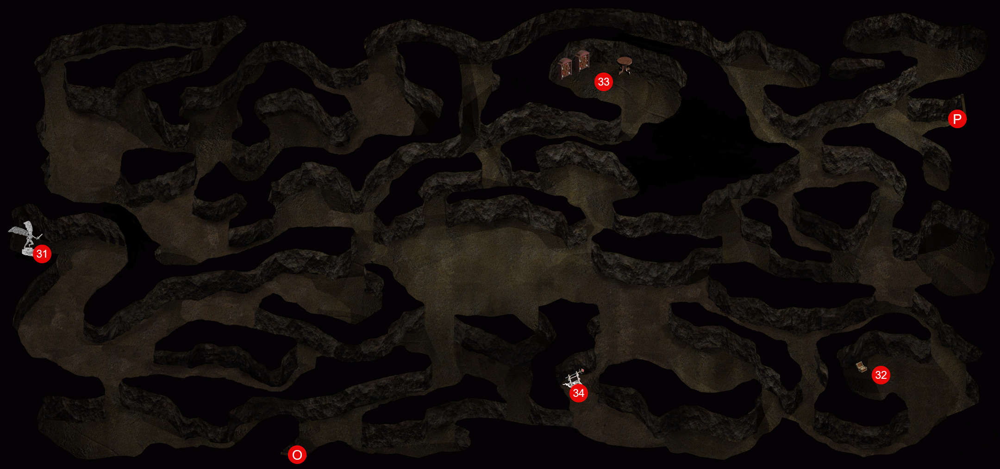{ .center-img width="60%" }

W korytarzach przemówił posąg 31. Wysławił *Amaunatora* i zapytał, czego pragnęło dziecko. **Sandrah** zdziwiła się świętej statui w tak nieświętym miejscu. Przed laty twierdza chroniła wyspę, wyjaśnił posąg, lecz zło zwyciężyło, a każde następne było gorsze od poprzedniego. O obecnych wydarzeniach nie wiedział nic, drużyna była pierwszą od wielu lat, która do niego przemówiła. Ostatni czciciel, czarodziej szukający sposobu na plagę nieumarłych, nigdy nie wrócił.

W jednej z jaskiń  obserwator strażnik i gazowe zarodniki pilnowały skrzyni z grymuarem.

Dalej zawodził szkielet 33, który nie atakował, tylko błagał o uwolnienie. Obok leżały wyblakłe kartki: „...przeklęte... nieumarli... co robić?... zwój odnowienia...”. Czytelny pozostał tylko ostatni wpis. Autorowi kończył się papier, a ciało niemal całkiem zgniło. Ten, kto go pokonał, również umarł, lecz jako widmo dalej plugawił to miejsce. Pragnął, by jego dusza dołączyła do chwały *Amaunatora*. Miał zwoje odnowienia, ale zaklęcie musiał rzucić ktoś inny. Drużyna spełniła jego prośbę, a uwolniona dusza odeszła z wdzięcznością.

Samotny stojak na broń 34 skrywał niezwykły kostur Błękitnego Smoka, wykonany przez wyznawców kultu Smoka. Drużyna zabrała go z przeczuciem, że dopisze jeszcze ciąg dalszy jego długiej historii.

Podziemia zostały oczyszczone i przynajmniej na jakiś czas *Wzgórze Kości* przestało zagrażać *Restenford*. Ukryte przejście P pozwoliło szybko opuścić ruiny.

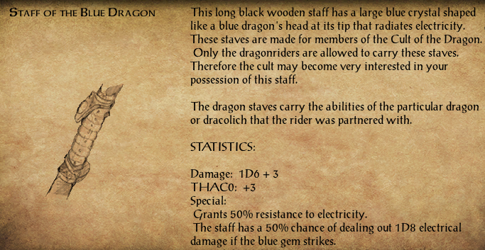{ .center-img width="60%" }

Później **Sandrah** wróciła myślami do chwili na zamkowym tarasie. Twierdze ucisku i wyzysku zawsze w końcu upadały. Ona pragnęła jedynie przytulnego miejsca dla nich dwojga i kochała Leecha za jego skromność. Wierzyła jednak, że mądry władca mógł zapewnić poddanym bezpieczeństwo i szczęście. Takich spotkali niewielu, za to wiele życzliwości znaleźli wśród zwykłych ludzi. Pocałowała go.

**Almax** 12 ucieszył się z wieści od **Martina**. Obiecał wysłać **Amosa** z zapasami i prosił, by przekazać zwiadowcy, że pomoc dotrze za kilka dni. Droga z powrotem do *Odludnego Lasu* minęła bez przygód. Drużyna przekazała wiadomość **Martinowi** 23, a przy okazji opowiedziała **Volcifarowi** 24, co zastała w warowni na *Wzgórzu Kości*.

{ .center-img width="40%" }

Wszystkie znane problemy wydawały się rozwiązane, więc pora było zdać raport **Pelltarowi** 5. **Sandrah** opowiedziała o orkach z *Łysej Góry* prowadzonych przez półorczego kapłana, który najwyraźniej działał na własny rachunek jako wyzwoliciel cudzych dóbr. Potem o gnollach z *Trójszczytu* i ich wodzu, ogrzym magu. To zdziwiło **Pelltara**, bo gnolle rzadko dawały się prowadzić obcym. Najgorsze wieści przyniosło *Wzgórze Kości*: czarodziej z hobgoblinami i Upiór z nieumarłymi zbierali armię, a *Restenford* miało paść pierwsze. Dziennik maga trafił w ręce **Pelltara**, który zbladł. Baron musiał się dowiedzieć natychmiast.

Gdy mag szykował się, by odesłać drużynę do świątyni, wpadł **Gelpas** i w imieniu barona kazał mu przerwać zaklęcie. Oskarżył wędrowców o morderstwa i kradzieże. **Jen'lig** oświadczyła, że nie wie, o czym mowa. Strażnicy znaleźli dwa obrabowane domy z martwymi właścicielami, a z magazynów zniknęły towary, w tym czarna perła. Githyanki kazała się przeszukać. **Gelpas** przyznał w końcu niechętnie, że straż nie radziła sobie ze sprawą, i poprosił o pomoc. Do domów nikt się nie włamywał, jakby złodziej miał klucz, a ofiarom poderżnięto gardła we śnie. W sprawie magazynów należało porozmawiać z **Welcarem**.

Zanim wyszli, wbiegł kolejny strażnik. Na północ od miasta pojawili się bandyci. Pewien kupiec ledwie dowlókł się do koszar i zmarł. Napastnicy czegoś szukali i sądzili, że miał to przy sobie. Leech wyjaśnił zdziwionemu magowi, że to inna banda niż ta z *Łysej Góry*, i obiecał ruszyć na północ. Powrót musiał poczekać.

**Welcar** 35 nie rozumiał, jak złodziej ominął wartowników przy budynkach w jedną noc, i to bez najmniejszego hałasu. Zginęły jedzenie, kilka mieczy, jedwab i czarna perła, którą sprowadził baron. Gdy ten się dowie, zrobi się gorąco. Strażnik był przekonany, że działał jeden złodziej, bo zniknęło tyle, ile udźwignie jeden człowiek. Przypomniał też dawną historię. Przed laty złodzieje z *Garrotten* urządzili sobie kryjówkę w kanałach odpływowych, a baron wynajął najemników pod wodzą **Gelpasa**, by ich wykurzyli. Kapitan stracił większość drużyny i porzucił przygody, ale łotrów powiesił na „Wisielczym Drzewie” za świątynią przy zachodniej bramie. Starsze kanały zaczynały się przy spalonym posterunku, drugie wejście prowadziło z cmentarza na północ od świątyni ([The Theft of the Warehouses](../other/zadania.md#q133)).

{ .center-img width="60%" }

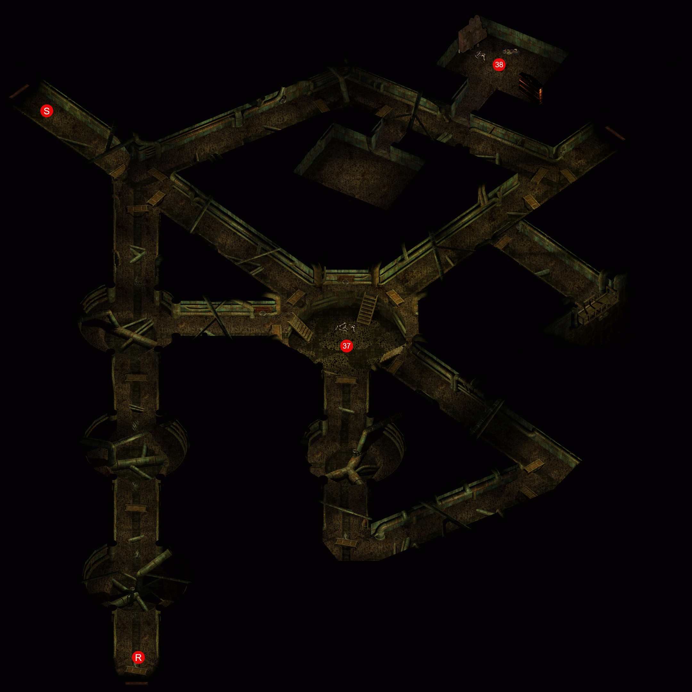{ .center-img width="60%" }

Przez piwnicę przy ruinach posterunku A36 drużyna zeszła do kanałów. Czekali tam złodzieje i drzwi prowadzące dalej R. Tunele nie były rozległe, lecz w dwóch miejscach 3536 otyughi strzegły towarów skradzionych z magazynów ([The Theft of the Warehouses](../other/zadania.md#q133)). Przy łupach leżała też notatka, która na pierwszy rzut oka nie miała żadnego sensu.

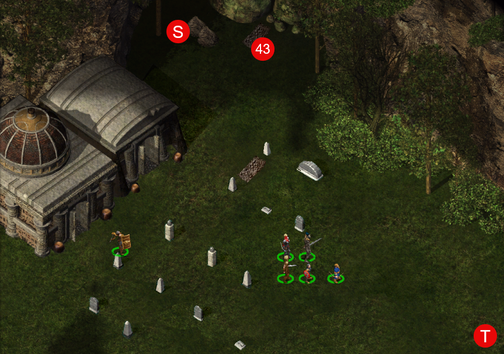{ .center-img width="60%" }

Wyjściem na cmentarzu S drużyna wydostała się na płaskowyż świątynny T. Po drodze poinformowała **Yaltę** 17, że gnolle przestały być problemem ([Gnoll Attacks](../other/zadania.md#q132)).

**Welcar** 35 rozpoznał w notatce szkic *Restenford*. Dwa prostokąty oznaczały okradzione magazyny, a znaczek przy *Zachodnim Wietrze* przypomniał mu, że **Zelmarowi** tydzień temu ktoś ukradł pieniądze. Ucieszył się z odzyskanych towarów, lecz natychmiast zapytał o perłę. Gdy usłyszał, że jej nie było, jęknął, że baron zażąda jego głowy, a może i ich. Złodziej musiał gdzieś być ([The Theft of the Warehouses](../other/zadania.md#q133)).

**Zelmar** 16 wzruszył ramionami. Większość gotówki trzymał gdzie indziej, więc zginął tylko tygodniowy utarg: dwieście sztuk w monetach i garść drobnych klejnotów, razem około dwustu pięćdziesięciu sztuk złota. Złodzieja nie widział, inaczej ten oberwałby kilkoma magicznymi pociskami w tyłek. Przypomniał sobie jednak coś dziwnego. Latarnik **Bomarc**, zrzędliwy gnom, który co miesiąc sam odbierał zapasy i wypijał przy tym kilka kufli, tym razem kazał dostarczyć je pod drzwi i nie zajrzał do karczmy.

**Smyth** 6 potwierdził. Zamiast przyjść, latarnik zostawił kartkę z poleceniem, by towar zostawić pod drzwiami, zapukać dwa razy i odejść. Zapłata czekała przy notatce. Nawet jak na **Bomarca** było to dziwne, a drzwi latarni pozostawały zamknięte dla wszystkich.

W latarni 39 czekał **Sirius**, który zaatakował bez słowa. Jego notatnik wyjaśnił wszystko. Wraz z nekromantą wynajęli go elfi władcy *Wysp Lendore*, by pogrążyć w chaosie ostatnie ludzkie ziemie na wyspie. Do kradzieży posłużyła im *Chwalebna Dłoń*, którą drużyna odnalazła razem z czarną perłą. **Sirius** zabił wspólnika, gdy odkrył, że ten go okradał, i przeniósł się do latarni, by być bliżej miasta. Ostatnie zapiski mówiły o drużynie jako zagrożeniu i o planach obarczenia jej winą za wszystko.

Perła wróciła do **Welcara**, a pieniądze do **Zelmara** ([The Theft of the Warehouses](../other/zadania.md#q133)). Pozostawała kryjówka bandytów na północy U. Po drodze drużyna zajrzała do sklepu **Pheldmana** 41, który nie miał nic ciekawego.

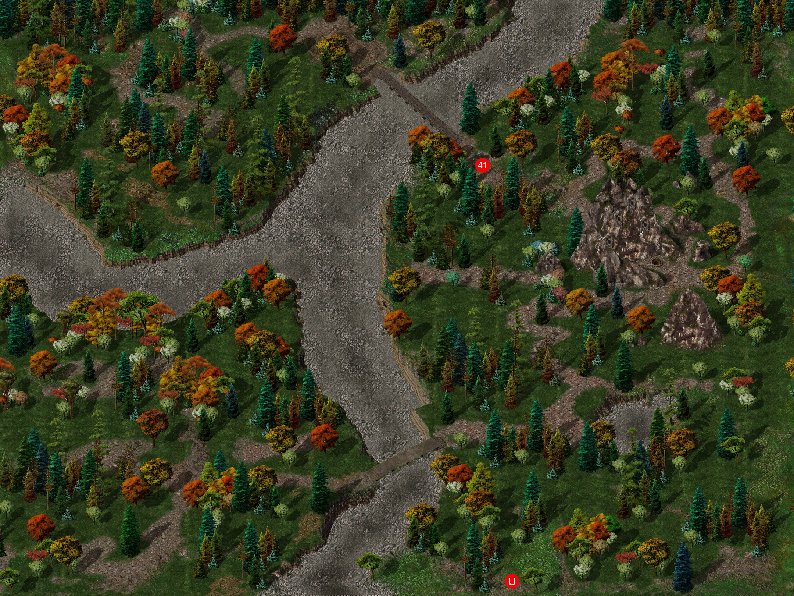{ .center-img width="60%" }

W lesie wędrowcy rozbijali kolejne grupki bandytów, aż przy jednym z mostów 41 dopadli ich przywódcę. Miał przy sobie notatkę wspominającą *Chwalebną Dłoń*.

**Pelltar** długo studiował notatkę z kanałów i potwierdził, że to plan miasta ze znakami przy okradzionych budynkach. Dziwiła go tylko zaznaczona latarnia, skoro u **Bomarca** nie było czego kraść. **Sandrah** wyjaśniła, że właśnie tam ukrywał się **Sirius**, wynajęty przez elfich władców, by obalić barona. O *Chwalebnej Dłoni* mag nigdy nie słyszał, więc pozwolił drużynie przeszukać swoje księgi, byle nie przeszkadzała uczniom.

Gdy **Sandrah** zagłębiła się w lekturze, Leech znów ujrzał *Waterdeep*.

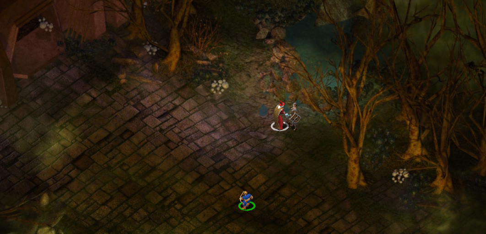

<em>
**Elminster** zauważył, że **Sandrah** była już niemal w wieku, w którym jej matka pierwszy raz stanęła mu przed oczami. Miała tę samą troskliwą duszę co **Khalindra** i znów chciała wrócić do tematu dziecka, o którym nie wiedziała nic. Mag prosił, by nigdy nie myślała o nim jak o rodzeństwie. Nie było ani jego, ani jej matki, lecz *Bhaala*. Okrutny bóg zaszczepił w **Khalindrze** swoje nasienie, a ona była tylko naczyniem, które zginęło, gdy nadszedł czas narodzin.

Skoro tak, uznała, nie było też jej bratem ani siostrą. Żal jej było biednego stworzenia bez matki i bez siostry. **Elminster** pochwalił jej miłosierdzie. Dziecko nie miało wpływu na swoje pochodzenie, choć niosło w sobie ziarno czarnej krwi, i samo decydowało o swojej drodze. Obawiał się jednak, że uprzedzenia tych, którzy poznają jego krew, mogły sprawić, że ziarno zacznie kiełkować. Teraz byłoby zaledwie o rok młodsze od niej, zauważyła. Mag zwrócił się ku **Khalindrze** - ich córka wkrótce pójdzie własną drogą, a on modlił się, by zrobił wszystko, co trzeba, by przygotować ją na to, co ją czekało.
</em>

Po kilku godzinach lektury **Sandrah** przedstawiła wyniki. Kradzieże zaczęły się tydzień po powieszeniu osławionego bandyty **Reynarda**. Dawniej w *Restenford* działała gildia złodziei, rozbita przez barona **Grellusa** zaraz po objęciu władzy, a jej siedziba mieściła się w tych samych kanałach, które drużyna już przeczesała. W przewodniku po magicznych przedmiotach znalazła wzmiankę, że *Chwalebną Dłoń* wykonywano z ręki martwego złodzieja, choć o jej działaniu tekst milczał. Trop prowadził do **Reynarda**.

Strażnik przy bramie świątynnej 42 pilnował nie tylko wejścia, ale i pobliskiego drzewa, a raczej wiszących na nim skazańców. Ludzie lubili rzucać w nich kamieniami, a wiedźmy, jak dodał szeptem, kradły części ciał na zombie. W mieście nie było wiedźm, zauważyła **Sandrah**. Chyba rzeczywiście nie, przyznał po namyśle. Na nowej linie wisiał niedawno **Reynard**. Strażnik splunął. Parszywy rozbójnik łupił podróżnych, czasem chciał, by damy zapamiętały go na zawsze, i zabił kilku jego kolegów. Szubienica była dla niego zbyt łaskawa. Nic niezwykłego przy egzekucji nie zauważył, ale ostatnią wartę pełniła **Ravella**, która też pochowała ciało. Miała wolne do jutra.

Następnego dnia **Ravella** od razu domyśliła się, że to drużyna, o której mówił **Gelpas**. O kradzieżach nic nie wiedziała, a pytania o **Reynarda** zbyła i kazała im odejść. Wystarczyła groźba, że **Gelpas** dowie się o jej pomocy złodziejom. Wystraszona strażniczka wyznała, że pewnej nocy spłoszyła kogoś przy ciele, a rano odkryła, że **Reynardowi** odcięto lewą dłoń. Nie chcąc kłopotów, zdjęła zwłoki i pochowała je, a sierżantowi powiedziała, że ciało zaczęło się rozpadać. Gdy **Sandrah** zażądała otwarcia grobu, **Ravella** uznała, że zwariowała, ale niechętnie poprowadziła ich na cmentarz.

W świeżym grobie 43 leżały dwa ciała: człowiek bez lewej dłoni i gnom. **Ravella** zbladła. To był **Bomarc**, latarnik. Leech dostrzegł na jego szyi ślady zmiażdżonego gardła, a na wieku wygięte, ponownie wbite gwoździe i ślady łomu. Strażniczka przysięgała, że trumna była ciężka i nieśli ją we kilku, ale niczego nie zauważyła. **Bomarc** był ponury, lecz morderstwa nie można było puścić płazem. Usłyszawszy, że sprawca z latarni już nie żył, poprosiła o powiadomienie **Pelltara** i obiecała, że ciała zostaną pochowane na nowo.

**Pelltar** uznał zbrodnię na **Bomarcu** za najokrutniejszy ruch elfich władców, jaki dotąd widział, i obiecał natychmiast powiadomić **Gelpasa** oraz barona. Miasto zawdzięczało drużynie wielką przysługę. *Chwalebną Dłoń* mag zatrzymał dla swoich uczniów. Działała tylko na humanoidy, więc potężnym poszukiwaczom przygód na niewiele by się zdała. Potem jednym zaklęciem odesłał ich do świątyni *Lathandera*, gdzie czekały na nich ich własne sprawy.

:material-paw: Bestiariusz: *szczur, szkielet, ghul, olbrzymi szczur, ork, kobold komando, upiór, szkieletowy wojownik, ghast, władca ghuli, straszliwy wilk, orog, ork kapłan, kościany golem, powietrzny sługa, flind, worg, straszny wilk, wilk, grizzly, gnoll weteran, ogrzy mag, hobgoblin kapitan, hobgoblin szaman, wywerna, hobgoblin czarodziej, elita hobgoblinów, hobgoblin siepacz, bełkotek, wilkozwierz, rozbójnik, czarny niedźwiedź, ognisty olbrzym, golem z ciała, zombie, szary szlam, obserwator strażnik, gazowy zarodnik, ochrowy śluz, otyugh*
